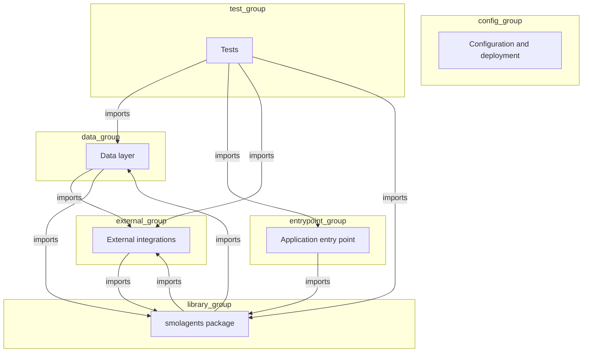

# Architecture report: huggingface/smolagents

> Automated static analysis. **Observed** = directly seen in files/imports/AST; **Inferred** = interpretation from that evidence. Repository code was not executed.

## 1. Repository at a glance

| Item | Value |
| --- | --- |
| Repository | huggingface/smolagents |
| Description | 🤗 smolagents: a barebones library for agents that think in code. |
| Language | Python |
| Stars | 30369 |
| Licence | Apache-2.0 |
| Analysed commit / branch | 96f33faaf028479119ec8d34507b47694cf14e34 / main |
| Framework(s) | Starlette |
| Files analysed | 184 |
| Components | 6 |

## 2. Architecture in one minute

huggingface/smolagents - 🤗 smolagents: a barebones library for agents that think in code.. This repository was analysed statically from 184 file(s) (75 Python). Detected technologies (observed from imports/manifests): GitHub Actions, Starlette, AWS (boto3), NumPy, pandas, requests. Files are grouped into 6 component(s): Configuration and deployment, Data layer, Application entry point, External integrations, smolagents package, Tests. Observed entry point(s): src/smolagents/cli.py, src/smolagents/vision_web_browser.py. Findings below distinguish observed facts from inferred interpretation.

## 3. High-level block diagram

## 4. Main components

### Configuration and deployment (`config`)

- **Kind:** config
- **Status:** Observed
- **Confidence:** 0.85
- **Responsibility:** Groups 5 file(s) under configuration and deployment (observed from repository paths and static analysis).
- **Paths:** `e2b.toml`, `pyproject.toml`, `src/smolagents/prompts/code_agent.yaml`, `src/smolagents/prompts/structured_code_agent.yaml`, `src/smolagents/prompts/toolcalling_agent.yaml`
- **Evidence:** [e2b.toml](https://github.com/huggingface/smolagents/blob/96f33faaf028479119ec8d34507b47694cf14e34/e2b.toml); [pyproject.toml](https://github.com/huggingface/smolagents/blob/96f33faaf028479119ec8d34507b47694cf14e34/pyproject.toml); [src/smolagents/prompts/code_agent.yaml](https://github.com/huggingface/smolagents/blob/96f33faaf028479119ec8d34507b47694cf14e34/src/smolagents/prompts/code_agent.yaml); [src/smolagents/prompts/structured_code_agent.yaml](https://github.com/huggingface/smolagents/blob/96f33faaf028479119ec8d34507b47694cf14e34/src/smolagents/prompts/structured_code_agent.yaml); [src/smolagents/prompts/toolcalling_agent.yaml](https://github.com/huggingface/smolagents/blob/96f33faaf028479119ec8d34507b47694cf14e34/src/smolagents/prompts/toolcalling_agent.yaml)

### Data layer (`data_layer`)

- **Kind:** data
- **Status:** Observed
- **Confidence:** 0.85
- **Responsibility:** Groups 1 file(s) under data layer (observed from repository paths and static analysis). Observed top-level classes: AmazonBedrockModel, ApiModel, AzureOpenAIModel, ChatMessage, ChatMessageStreamDelta, ChatMessageToolCall. Observed top-level functions: _coerce_tool_call, agglomerate_stream_deltas, get_clean_message_list, get_dict_from_nested_dataclasses, get_tool_call_from_text, get_tool_json_schema.
- **Paths:** `src/smolagents/models.py`
- **Evidence:** [src/smolagents/models.py:70](https://github.com/huggingface/smolagents/blob/96f33faaf028479119ec8d34507b47694cf14e34/src/smolagents/models.py#L70)

### Application entry point (`entrypoint`)

- **Kind:** entrypoint
- **Status:** Observed
- **Confidence:** 0.85
- **Responsibility:** Groups 2 file(s) under application entry point (observed from repository paths and static analysis). Observed top-level functions: _escape_xpath_string, close_popups, go_back, initialize_agent, initialize_driver, interactive_mode.
- **Paths:** `src/smolagents/cli.py`, `src/smolagents/vision_web_browser.py`
- **Evidence:** [src/smolagents/cli.py:45](https://github.com/huggingface/smolagents/blob/96f33faaf028479119ec8d34507b47694cf14e34/src/smolagents/cli.py#L45); [src/smolagents/vision_web_browser.py:27](https://github.com/huggingface/smolagents/blob/96f33faaf028479119ec8d34507b47694cf14e34/src/smolagents/vision_web_browser.py#L27)

### External integrations (`external_integrations`)

- **Kind:** external
- **Status:** Observed
- **Confidence:** 0.85
- **Responsibility:** Groups 1 file(s) under external integrations (observed from repository paths and static analysis). Observed top-level classes: MCPClient.
- **Paths:** `src/smolagents/mcp_client.py`
- **Evidence:** [src/smolagents/mcp_client.py:33](https://github.com/huggingface/smolagents/blob/96f33faaf028479119ec8d34507b47694cf14e34/src/smolagents/mcp_client.py#L33)

### smolagents package (`smolagents`)

- **Kind:** library
- **Status:** Observed
- **Confidence:** 0.85
- **Responsibility:** Groups 14 file(s) under smolagents package (observed from repository paths and static analysis). Observed top-level classes: ActionOutput, ActionStep, AgentAudio, AgentError, AgentExecutionError, AgentGenerationError. Observed top-level functions: _clean_model_output, _convert_type_hints_to_json_schema, _create_kernel_http, _evaluate_comprehensions, _format_code_content, _get_json_schema_type.
- **Paths:** `src/smolagents/__init__.py`, `src/smolagents/_function_type_hints_utils.py`, `src/smolagents/agent_types.py`, `src/smolagents/agents.py`, `src/smolagents/default_tools.py`, `src/smolagents/gradio_ui.py`, `src/smolagents/local_python_executor.py`, `src/smolagents/memory.py`, `src/smolagents/monitoring.py`, `src/smolagents/remote_executors.py`, `src/smolagents/serialization.py`, `src/smolagents/tool_validation.py`, `src/smolagents/tools.py`, `src/smolagents/utils.py`
- **Evidence:** [src/smolagents/__init__.py](https://github.com/huggingface/smolagents/blob/96f33faaf028479119ec8d34507b47694cf14e34/src/smolagents/__init__.py); [src/smolagents/_function_type_hints_utils.py:46](https://github.com/huggingface/smolagents/blob/96f33faaf028479119ec8d34507b47694cf14e34/src/smolagents/_function_type_hints_utils.py#L46); [src/smolagents/agent_types.py:32](https://github.com/huggingface/smolagents/blob/96f33faaf028479119ec8d34507b47694cf14e34/src/smolagents/agent_types.py#L32); [src/smolagents/agents.py:102](https://github.com/huggingface/smolagents/blob/96f33faaf028479119ec8d34507b47694cf14e34/src/smolagents/agents.py#L102); [src/smolagents/default_tools.py:30](https://github.com/huggingface/smolagents/blob/96f33faaf028479119ec8d34507b47694cf14e34/src/smolagents/default_tools.py#L30); [src/smolagents/gradio_ui.py:29](https://github.com/huggingface/smolagents/blob/96f33faaf028479119ec8d34507b47694cf14e34/src/smolagents/gradio_ui.py#L29); [src/smolagents/local_python_executor.py:42](https://github.com/huggingface/smolagents/blob/96f33faaf028479119ec8d34507b47694cf14e34/src/smolagents/local_python_executor.py#L42); [src/smolagents/memory.py:25](https://github.com/huggingface/smolagents/blob/96f33faaf028479119ec8d34507b47694cf14e34/src/smolagents/memory.py#L25)

### Tests (`tests`)

- **Kind:** test
- **Status:** Observed
- **Confidence:** 0.85
- **Responsibility:** Groups 27 file(s) under tests (observed from repository paths and static analysis). Observed routes: PATCH huggingface_hub.InferenceClient, PATCH openai.OpenAI, PATCH openai.OpenAI, PATCH huggingface_hub.InferenceClient, PATCH smolagents.gradio_ui.pull_messages_from_step. Observed top-level classes: AgentAudioTests, AgentLoggerLogTaskTester, AgentTextTests, ChoiceDelta, ChoiceDeltaToolCall, ChoiceDeltaToolCallFunction. Observed top-level functions: add_two, agent_logger, bad_return_func, boolean_default_tool_class, boolean_default_tool_function, complex_docstring_types_func.
- **Paths:** `tests/__init__.py`, `tests/conftest.py`, `tests/fixtures/agents.py`, `tests/fixtures/tools.py`, `tests/test_agents.py`, `tests/test_all_docs.py`, `tests/test_cli.py`, `tests/test_default_tools.py`, `tests/test_final_answer.py`, `tests/test_function_type_hints_utils.py`, `tests/test_gradio_ui.py`, `tests/test_import.py`, `tests/test_local_python_executor.py`, `tests/test_mcp_client.py`, `tests/test_memory.py`, `tests/test_models.py`, `tests/test_monitoring.py`, `tests/test_remote_executors.py`, `tests/test_search.py`, `tests/test_serialization.py`, `tests/test_telemetry.py`, `tests/test_tool_validation.py`, `tests/test_tools.py`, `tests/test_types.py`, `tests/test_utils.py`, `tests/test_vision_web_browser.py`, `tests/utils/markers.py`
- **Evidence:** [tests/__init__.py](https://github.com/huggingface/smolagents/blob/96f33faaf028479119ec8d34507b47694cf14e34/tests/__init__.py); [tests/conftest.py:16](https://github.com/huggingface/smolagents/blob/96f33faaf028479119ec8d34507b47694cf14e34/tests/conftest.py#L16); [tests/fixtures/agents.py:134](https://github.com/huggingface/smolagents/blob/96f33faaf028479119ec8d34507b47694cf14e34/tests/fixtures/agents.py#L134); [tests/fixtures/tools.py:7](https://github.com/huggingface/smolagents/blob/96f33faaf028479119ec8d34507b47694cf14e34/tests/fixtures/tools.py#L7); [tests/test_agents.py:81](https://github.com/huggingface/smolagents/blob/96f33faaf028479119ec8d34507b47694cf14e34/tests/test_agents.py#L81); [tests/test_all_docs.py:31](https://github.com/huggingface/smolagents/blob/96f33faaf028479119ec8d34507b47694cf14e34/tests/test_all_docs.py#L31); [tests/test_cli.py:11](https://github.com/huggingface/smolagents/blob/96f33faaf028479119ec8d34507b47694cf14e34/tests/test_cli.py#L11); [tests/test_default_tools.py:35](https://github.com/huggingface/smolagents/blob/96f33faaf028479119ec8d34507b47694cf14e34/tests/test_default_tools.py#L35)

## 5. Execution flow

**Observed** entry point(s):

- [src/smolagents/cli.py](https://github.com/huggingface/smolagents/blob/96f33faaf028479119ec8d34507b47694cf14e34/src/smolagents/cli.py)
- [src/smolagents/vision_web_browser.py](https://github.com/huggingface/smolagents/blob/96f33faaf028479119ec8d34507b47694cf14e34/src/smolagents/vision_web_browser.py)

**Observed** routes (from decorators):

- `PATCH huggingface_hub.InferenceClient` -> `test_toolcalling_agent_api` in `tests/test_agents.py:1679`
- `PATCH openai.OpenAI` -> `test_toolcalling_agent_stream_logs_multiple_tool_calls_observations` in `tests/test_agents.py:1731`
- `PATCH openai.OpenAI` -> `test_toolcalling_agent_final_answer_cannot_be_called_with_parallel_tool_calls` in `tests/test_agents.py:1816`
- `PATCH huggingface_hub.InferenceClient` -> `test_toolcalling_agent_api_misformatted_output` in `tests/test_agents.py:1891`
- `PATCH smolagents.gradio_ui.pull_messages_from_step` -> `test_stream_to_gradio_memory_step` in `tests/test_gradio_ui.py:138`
- `PATCH smolagents.remote_executors._websocket_run_code_raise_errors` -> `test_sandbox_lifecycle` in `tests/test_remote_executors.py:429`
- `PATCH requests.post` -> `test_sandbox_lifecycle` in `tests/test_remote_executors.py:429`
- `PATCH requests.get` -> `test_sandbox_lifecycle` in `tests/test_remote_executors.py:429`
- `PATCH websocket.create_connection` -> `test_sandbox_lifecycle` in `tests/test_remote_executors.py:429`
- `PATCH modal.App.lookup` -> `test_sandbox_lifecycle` in `tests/test_remote_executors.py:429`
- `PATCH modal.Sandbox.create` -> `test_sandbox_lifecycle` in `tests/test_remote_executors.py:429`
- `PATCH smolagents.remote_executors._create_kernel_http` -> `test_blaxel_executor_instantiation_with_blaxel_sdk` in `tests/test_remote_executors.py:489`
- `PATCH blaxel.core.SandboxInstance` -> `test_blaxel_executor_instantiation_with_blaxel_sdk` in `tests/test_remote_executors.py:489`
- `PATCH blaxel.core.settings` -> `test_blaxel_executor_instantiation_with_blaxel_sdk` in `tests/test_remote_executors.py:489`
- `PATCH smolagents.remote_executors.BlaxelExecutor.install_packages` -> `test_blaxel_executor_custom_parameters` in `tests/test_remote_executors.py:531`
- `PATCH smolagents.remote_executors._create_kernel_http` -> `test_blaxel_executor_custom_parameters` in `tests/test_remote_executors.py:531`
- `PATCH blaxel.core.SandboxInstance` -> `test_blaxel_executor_custom_parameters` in `tests/test_remote_executors.py:531`
- `PATCH blaxel.core.settings` -> `test_blaxel_executor_custom_parameters` in `tests/test_remote_executors.py:531`
- `PATCH smolagents.remote_executors._create_kernel_http` -> `test_blaxel_executor_cleanup` in `tests/test_remote_executors.py:578`
- `PATCH blaxel.core.SandboxInstance` -> `test_blaxel_executor_cleanup` in `tests/test_remote_executors.py:578`
- `PATCH blaxel.core.settings` -> `test_blaxel_executor_cleanup` in `tests/test_remote_executors.py:578`

Representative flow (derived from observed entry points and the import graph; steps beyond the entry point are **Inferred**):

1. Execution starts at an observed entry point listed above, if present.
2. `data_layer` imports `external_integrations` (Data layer -> External integrations).
3. `data_layer` imports `smolagents` (Data layer -> smolagents package).
4. `entrypoint` imports `smolagents` (Application entry point -> smolagents package).
5. `external_integrations` imports `smolagents` (External integrations -> smolagents package).
6. `smolagents` imports `data_layer` (smolagents package -> Data layer).
7. `smolagents` imports `external_integrations` (smolagents package -> External integrations).
8. `tests` imports `data_layer` (Tests -> Data layer).
9. `tests` imports `entrypoint` (Tests -> Application entry point).

## 6. Project structure

### `(root)`

- `.gitignore` - other (1438 bytes)
- `.pre-commit-config.yaml` - config (302 bytes)
- `AGENTS.md` - docs (157 bytes)
- `CODE_OF_CONDUCT.md` - docs (5488 bytes)
- `CONTRIBUTING.md` - docs (7636 bytes)
- `LICENSE` - docs (11357 bytes)
- `Makefile` - other (326 bytes)
- `README.md` - docs (14137 bytes)
- `SECURITY.md` - docs (7376 bytes)
- `e2b.toml` - config (569 bytes)
- `pyproject.toml` - manifest (2981 bytes)

### `.github`

- `.github/ISSUE_TEMPLATE/bug_report.md` - docs (1385 bytes)
- `.github/ISSUE_TEMPLATE/doc_improvement.md` - docs (1042 bytes)
- `.github/ISSUE_TEMPLATE/feature_request.md` - docs (1249 bytes)
- `.github/dependabot.yml` - config (205 bytes)
- `.github/workflows/build_documentation.yml` - ci, YAML (739 bytes)
- `.github/workflows/build_pr_documentation.yml` - ci, YAML (672 bytes)
- `.github/workflows/quality.yml` - ci, YAML (850 bytes)
- `.github/workflows/tests.yml` - ci, YAML (981 bytes)
- `.github/workflows/trufflehog.yml` - ci, YAML (418 bytes)
- `.github/workflows/upload_pr_documentation.yml` - ci, YAML (427 bytes)

### `docs`

- `docs/README.md` - docs (10844 bytes)
- `docs/source/en/_config.py` - docs (488 bytes)
- `docs/source/en/_toctree.yml` - config (1815 bytes)
- `docs/source/en/conceptual_guides/intro_agents.md` - docs (8909 bytes)
- `docs/source/en/conceptual_guides/react.md` - docs (2777 bytes)
- `docs/source/en/examples/async_agent.md` - docs (2779 bytes)
- `docs/source/en/examples/multiagents.md` - docs (6590 bytes)
- `docs/source/en/examples/plan_customization.md` - docs (3915 bytes)
- `docs/source/en/examples/rag.md` - docs (9359 bytes)
- `docs/source/en/examples/text_to_sql.md` - docs (6546 bytes)
- `docs/source/en/examples/using_different_models.md` - docs (4102 bytes)
- `docs/source/en/examples/web_browser.md` - docs (6828 bytes)
- `docs/source/en/guided_tour.md` - docs (31259 bytes)
- `docs/source/en/index.md` - docs (6377 bytes)
- `docs/source/en/installation.md` - docs (6997 bytes)
- `docs/source/en/reference/agents.md` - docs (1545 bytes)
- `docs/source/en/reference/default_tools.md` - docs (2186 bytes)
- `docs/source/en/reference/models.md` - docs (9646 bytes)
- `docs/source/en/reference/python_executors.md` - docs (1137 bytes)
- `docs/source/en/reference/tools.md` - docs (1746 bytes)
- `docs/source/en/tutorials/building_good_agents.md` - docs (26350 bytes)
- `docs/source/en/tutorials/inspect_runs.md` - docs (7827 bytes)
- `docs/source/en/tutorials/memory.md` - docs (4854 bytes)
- `docs/source/en/tutorials/secure_code_execution.md` - docs (21219 bytes)
- `docs/source/en/tutorials/tools.md` - docs (18645 bytes)
- `docs/source/es/_config.py` - docs (488 bytes)
- `docs/source/es/_toctree.yml` - config (1813 bytes)
- `docs/source/es/index.md` - docs (7191 bytes)
- `docs/source/es/installation.md` - docs (7628 bytes)
- `docs/source/hi/_config.py` - docs (488 bytes)
- `docs/source/hi/_toctree.yml` - config (1629 bytes)
- `docs/source/hi/conceptual_guides/intro_agents.md` - docs (19528 bytes)
- `docs/source/hi/conceptual_guides/react.md` - docs (2922 bytes)
- `docs/source/hi/examples/multiagents.md` - docs (11000 bytes)
- `docs/source/hi/examples/rag.md` - docs (13838 bytes)
- `docs/source/hi/examples/text_to_sql.md` - docs (9822 bytes)
- `docs/source/hi/guided_tour.md` - docs (31936 bytes)
- `docs/source/hi/index.md` - docs (5056 bytes)
- `docs/source/hi/reference/agents.md` - docs (8237 bytes)
- `docs/source/hi/reference/tools.md` - docs (3844 bytes)
- `docs/source/hi/tutorials/building_good_agents.md` - docs (34816 bytes)
- `docs/source/hi/tutorials/inspect_runs.md` - docs (6204 bytes)
- `docs/source/hi/tutorials/secure_code_execution.md` - docs (9766 bytes)
- `docs/source/hi/tutorials/tools.md` - docs (19940 bytes)
- `docs/source/ko/_config.py` - docs (488 bytes)
- `docs/source/ko/_toctree.yml` - config (1869 bytes)
- `docs/source/ko/conceptual_guides/react.md` - docs (3452 bytes)
- `docs/source/ko/examples/async_agent.md` - docs (3378 bytes)
- `docs/source/ko/examples/multiagents.md` - docs (7541 bytes)
- `docs/source/ko/examples/plan_customization.md` - docs (5097 bytes)
- `docs/source/ko/examples/rag.md` - docs (11101 bytes)
- `docs/source/ko/examples/text_to_sql.md` - docs (7461 bytes)
- `docs/source/ko/examples/using_different_models.md` - docs (4797 bytes)
- `docs/source/ko/examples/web_browser.md` - docs (7297 bytes)
- `docs/source/ko/guided_tour.md` - docs (33165 bytes)
- `docs/source/ko/index.md` - docs (7148 bytes)
- `docs/source/ko/installation.md` - docs (7813 bytes)
- `docs/source/ko/reference/agents.md` - docs (2654 bytes)
- `docs/source/ko/reference/models.md` - docs (10958 bytes)
- `docs/source/ko/reference/tools.md` - docs (2411 bytes)
- `docs/source/ko/tutorials/building_good_agents.md` - docs (27981 bytes)
- `docs/source/ko/tutorials/inspect_runs.md` - docs (7981 bytes)
- `docs/source/ko/tutorials/memory.md` - docs (5821 bytes)
- `docs/source/zh/_config.py` - docs (488 bytes)
- `docs/source/zh/_toctree.yml` - config (1277 bytes)
- `docs/source/zh/conceptual_guides/intro_agents.md` - docs (8052 bytes)
- `docs/source/zh/conceptual_guides/react.md` - docs (1570 bytes)
- `docs/source/zh/examples/multiagents.md` - docs (6908 bytes)
- `docs/source/zh/examples/rag.md` - docs (6858 bytes)
- `docs/source/zh/examples/text_to_sql.md` - docs (6136 bytes)
- `docs/source/zh/examples/web_browser.md` - docs (6755 bytes)
- `docs/source/zh/guided_tour.md` - docs (21216 bytes)
- `docs/source/zh/index.md` - docs (3002 bytes)
- `docs/source/zh/reference/agents.md` - docs (1472 bytes)
- `docs/source/zh/reference/models.md` - docs (5272 bytes)
- `docs/source/zh/reference/tools.md` - docs (1985 bytes)
- `docs/source/zh/tutorials/building_good_agents.md` - docs (23800 bytes)
- `docs/source/zh/tutorials/inspect_runs.md` - docs (6442 bytes)
- `docs/source/zh/tutorials/memory.md` - docs (4671 bytes)
- `docs/source/zh/tutorials/secure_code_execution.md` - docs (4099 bytes)
- `docs/source/zh/tutorials/tools.md` - docs (9529 bytes)

### `examples`

- `examples/agent_from_any_llm.py` - source, Python (2260 bytes)
- `examples/async_agent/README.md` - docs (1897 bytes)
- `examples/async_agent/main.py` - source, Python (1422 bytes)
- `examples/async_agent/requirements.txt` - manifest (35 bytes)
- `examples/gradio_ui.py` - source, Python (503 bytes)
- `examples/inspect_multiagent_run.py` - source, Python (1023 bytes)
- `examples/multi_llm_agent.py` - source, Python (1488 bytes)
- `examples/multiple_tools.py` - source, Python (8529 bytes)
- `examples/open_deep_research/README.md` - docs (2518 bytes)
- `examples/open_deep_research/analysis.ipynb` - other (13131 bytes)
- `examples/open_deep_research/app.py` - source, Python (167 bytes)
- `examples/open_deep_research/requirements.txt` - manifest (710 bytes)
- `examples/open_deep_research/run.py` - source, Python (3874 bytes)
- `examples/open_deep_research/run_gaia.py` - source, Python (11944 bytes)
- `examples/open_deep_research/scripts/cookies.py` - source, Python (23304 bytes)
- `examples/open_deep_research/scripts/gaia_scorer.py` - source, Python (3827 bytes)
- `examples/open_deep_research/scripts/mdconvert.py` - source, Python (36705 bytes)
- `examples/open_deep_research/scripts/reformulator.py` - source, Python (4430 bytes)
- `examples/open_deep_research/scripts/run_agents.py` - source, Python (3738 bytes)
- `examples/open_deep_research/scripts/text_inspector_tool.py` - source, Python (4687 bytes)
- `examples/open_deep_research/scripts/text_web_browser.py` - source, Python (23353 bytes)
- `examples/open_deep_research/scripts/visual_qa.py` - source, Python (6107 bytes)
- `examples/open_deep_research/visual_vs_text_browser.ipynb` - other (11008 bytes)
- `examples/plan_customization/README.md` - docs (4353 bytes)
- `examples/plan_customization/plan_customization.py` - source, Python (5835 bytes)
- `examples/rag.py` - source, Python (2245 bytes)
- `examples/rag_using_chromadb.py` - source, Python (4049 bytes)
- `examples/sandboxed_execution.py` - source, Python (1171 bytes)
- `examples/server/README.md` - docs (2467 bytes)
- `examples/server/main.py` - source, Python (6517 bytes)
- `examples/smolagents_benchmark/run.py` - source, Python (8366 bytes)
- `examples/smolagents_benchmark/score.ipynb` - other (14780 bytes)
- `examples/structured_output_tool.py` - source, Python (2373 bytes)
- `examples/text_to_sql.py` - source, Python (2175 bytes)

### `src`

- `src/smolagents/__init__.py` - source, Python (1107 bytes)
- `src/smolagents/_function_type_hints_utils.py` - source, Python (16007 bytes)
- `src/smolagents/agent_types.py` - source, Python (9215 bytes)
- `src/smolagents/agents.py` - source, Python (80780 bytes)
- `src/smolagents/cli.py` - source, Python (9658 bytes)
- `src/smolagents/default_tools.py` - source, Python (25804 bytes)
- `src/smolagents/gradio_ui.py` - source, Python (19092 bytes)
- `src/smolagents/local_python_executor.py` - source, Python (68159 bytes)
- `src/smolagents/mcp_client.py` - source, Python (7123 bytes)
- `src/smolagents/memory.py` - source, Python (12341 bytes)
- `src/smolagents/models.py` - source, Python (86054 bytes)
- `src/smolagents/monitoring.py` - source, Python (9716 bytes)
- `src/smolagents/prompts/code_agent.yaml` - config (17052 bytes)
- `src/smolagents/prompts/structured_code_agent.yaml` - config (15103 bytes)
- `src/smolagents/prompts/toolcalling_agent.yaml` - config (10279 bytes)
- `src/smolagents/remote_executors.py` - source, Python (44941 bytes)
- `src/smolagents/serialization.py` - source, Python (21194 bytes)
- `src/smolagents/tool_validation.py` - source, Python (10699 bytes)
- `src/smolagents/tools.py` - source, Python (59873 bytes)
- `src/smolagents/utils.py` - source, Python (21240 bytes)
- `src/smolagents/vision_web_browser.py` - source, Python (8700 bytes)

### `tests`

- `tests/__init__.py` - test, Python (0 bytes)
- `tests/conftest.py` - test, Python (735 bytes)
- `tests/fixtures/agents.py` - test, Python (5219 bytes)
- `tests/fixtures/tools.py` - test, Python (4355 bytes)
- `tests/test_agents.py` - test, Python (106339 bytes)
- `tests/test_all_docs.py` - test, Python (6342 bytes)
- `tests/test_cli.py` - test, Python (5029 bytes)
- `tests/test_default_tools.py` - test, Python (9817 bytes)
- `tests/test_final_answer.py` - test, Python (1870 bytes)
- `tests/test_function_type_hints_utils.py` - test, Python (16686 bytes)
- `tests/test_gradio_ui.py` - test, Python (16229 bytes)
- `tests/test_import.py` - test, Python (1052 bytes)
- `tests/test_local_python_executor.py` - test, Python (110030 bytes)
- `tests/test_mcp_client.py` - test, Python (5121 bytes)
- `tests/test_memory.py` - test, Python (10000 bytes)
- `tests/test_models.py` - test, Python (46440 bytes)
- `tests/test_monitoring.py` - test, Python (8314 bytes)
- `tests/test_remote_executors.py` - test, Python (23787 bytes)
- `tests/test_search.py` - test, Python (1108 bytes)
- `tests/test_serialization.py` - test, Python (31599 bytes)
- `tests/test_telemetry.py` - test, Python (3250 bytes)
- `tests/test_tool_validation.py` - test, Python (5530 bytes)
- `tests/test_tools.py` - test, Python (41261 bytes)
- `tests/test_types.py` - test, Python (3745 bytes)
- `tests/test_utils.py` - test, Python (16057 bytes)
- `tests/test_vision_web_browser.py` - test, Python (5196 bytes)
- `tests/utils/markers.py` - test, Python (985 bytes)

## 7. Key dependencies and integrations

| Name | Category | Status | Confidence | Evidence |
| --- | --- | --- | --- | --- |
| GitHub Actions | ci | Observed | 0.90 | [.github/workflows/build_documentation.yml](https://github.com/huggingface/smolagents/blob/96f33faaf028479119ec8d34507b47694cf14e34/.github/workflows/build_documentation.yml); [.github/workflows/build_pr_documentation.yml](https://github.com/huggingface/smolagents/blob/96f33faaf028479119ec8d34507b47694cf14e34/.github/workflows/build_pr_documentation.yml); [.github/workflows/quality.yml](https://github.com/huggingface/smolagents/blob/96f33faaf028479119ec8d34507b47694cf14e34/.github/workflows/quality.yml); [.github/workflows/tests.yml](https://github.com/huggingface/smolagents/blob/96f33faaf028479119ec8d34507b47694cf14e34/.github/workflows/tests.yml) |
| Starlette | framework | Observed | 0.95 | [examples/async_agent/main.py:9](https://github.com/huggingface/smolagents/blob/96f33faaf028479119ec8d34507b47694cf14e34/examples/async_agent/main.py#L9); [examples/async_agent/main.py:10](https://github.com/huggingface/smolagents/blob/96f33faaf028479119ec8d34507b47694cf14e34/examples/async_agent/main.py#L10); [examples/async_agent/main.py:11](https://github.com/huggingface/smolagents/blob/96f33faaf028479119ec8d34507b47694cf14e34/examples/async_agent/main.py#L11); [examples/async_agent/main.py:12](https://github.com/huggingface/smolagents/blob/96f33faaf028479119ec8d34507b47694cf14e34/examples/async_agent/main.py#L12) |
| AWS (boto3) | library | Observed | 0.90 | [pyproject.toml:26](https://github.com/huggingface/smolagents/blob/96f33faaf028479119ec8d34507b47694cf14e34/pyproject.toml#L26); [src/smolagents/models.py:2012](https://github.com/huggingface/smolagents/blob/96f33faaf028479119ec8d34507b47694cf14e34/src/smolagents/models.py#L2012) |
| NumPy | library | Observed | 0.95 | [examples/open_deep_research/requirements.txt:10](https://github.com/huggingface/smolagents/blob/96f33faaf028479119ec8d34507b47694cf14e34/examples/open_deep_research/requirements.txt#L10); [pyproject.toml:35](https://github.com/huggingface/smolagents/blob/96f33faaf028479119ec8d34507b47694cf14e34/pyproject.toml#L35); [src/smolagents/agent_types.py:101](https://github.com/huggingface/smolagents/blob/96f33faaf028479119ec8d34507b47694cf14e34/src/smolagents/agent_types.py#L101); [src/smolagents/agent_types.py:131](https://github.com/huggingface/smolagents/blob/96f33faaf028479119ec8d34507b47694cf14e34/src/smolagents/agent_types.py#L131) |
| pandas | library | Observed | 0.95 | [examples/open_deep_research/requirements.txt:13](https://github.com/huggingface/smolagents/blob/96f33faaf028479119ec8d34507b47694cf14e34/examples/open_deep_research/requirements.txt#L13); [examples/open_deep_research/run_gaia.py:12](https://github.com/huggingface/smolagents/blob/96f33faaf028479119ec8d34507b47694cf14e34/examples/open_deep_research/run_gaia.py#L12); [examples/open_deep_research/scripts/mdconvert.py:22](https://github.com/huggingface/smolagents/blob/96f33faaf028479119ec8d34507b47694cf14e34/examples/open_deep_research/scripts/mdconvert.py#L22); [examples/smolagents_benchmark/run.py:11](https://github.com/huggingface/smolagents/blob/96f33faaf028479119ec8d34507b47694cf14e34/examples/smolagents_benchmark/run.py#L11) |
| requests | library | Observed | 0.95 | [examples/multiple_tools.py:1](https://github.com/huggingface/smolagents/blob/96f33faaf028479119ec8d34507b47694cf14e34/examples/multiple_tools.py#L1); [examples/open_deep_research/requirements.txt:22](https://github.com/huggingface/smolagents/blob/96f33faaf028479119ec8d34507b47694cf14e34/examples/open_deep_research/requirements.txt#L22); [examples/open_deep_research/scripts/cookies.py:1](https://github.com/huggingface/smolagents/blob/96f33faaf028479119ec8d34507b47694cf14e34/examples/open_deep_research/scripts/cookies.py#L1); [examples/open_deep_research/scripts/mdconvert.py:30](https://github.com/huggingface/smolagents/blob/96f33faaf028479119ec8d34507b47694cf14e34/examples/open_deep_research/scripts/mdconvert.py#L30) |
| SQLAlchemy | library | Observed | 0.90 | [examples/text_to_sql.py:1](https://github.com/huggingface/smolagents/blob/96f33faaf028479119ec8d34507b47694cf14e34/examples/text_to_sql.py#L1); [pyproject.toml:112](https://github.com/huggingface/smolagents/blob/96f33faaf028479119ec8d34507b47694cf14e34/pyproject.toml#L112) |
| Uvicorn | library | Observed | 0.85 | [examples/async_agent/requirements.txt:4](https://github.com/huggingface/smolagents/blob/96f33faaf028479119ec8d34507b47694cf14e34/examples/async_agent/requirements.txt#L4) |
| Poetry | packaging | Observed | 0.85 | [pyproject.toml](https://github.com/huggingface/smolagents/blob/96f33faaf028479119ec8d34507b47694cf14e34/pyproject.toml) |
| setuptools | packaging | Observed | 0.85 | [pyproject.toml:2](https://github.com/huggingface/smolagents/blob/96f33faaf028479119ec8d34507b47694cf14e34/pyproject.toml#L2) |
| pytest | tooling | Observed | 0.95 | [.github/workflows/tests.yml:45](https://github.com/huggingface/smolagents/blob/96f33faaf028479119ec8d34507b47694cf14e34/.github/workflows/tests.yml#L45); [pyproject.toml:101](https://github.com/huggingface/smolagents/blob/96f33faaf028479119ec8d34507b47694cf14e34/pyproject.toml#L101); [tests/conftest.py:3](https://github.com/huggingface/smolagents/blob/96f33faaf028479119ec8d34507b47694cf14e34/tests/conftest.py#L3); [tests/fixtures/agents.py:1](https://github.com/huggingface/smolagents/blob/96f33faaf028479119ec8d34507b47694cf14e34/tests/fixtures/agents.py#L1) |
| unittest | tooling | Observed | 0.95 | [tests/conftest.py:1](https://github.com/huggingface/smolagents/blob/96f33faaf028479119ec8d34507b47694cf14e34/tests/conftest.py#L1); [tests/test_agents.py:27](https://github.com/huggingface/smolagents/blob/96f33faaf028479119ec8d34507b47694cf14e34/tests/test_agents.py#L27); [tests/test_cli.py:1](https://github.com/huggingface/smolagents/blob/96f33faaf028479119ec8d34507b47694cf14e34/tests/test_cli.py#L1); [tests/test_default_tools.py:15](https://github.com/huggingface/smolagents/blob/96f33faaf028479119ec8d34507b47694cf14e34/tests/test_default_tools.py#L15) |

## 8. Data and state

- Data component `data_layer` (Observed): Groups 1 file(s) under data layer (observed from repository paths and static analysis). Observed top-level classes: AmazonBedrockModel, ApiModel, AzureOpenAIModel, ChatMessage, ChatMessageStreamDelta, ChatMessageToolCall. Observed top-level functions: _coerce_tool_call, agglomerate_stream_deltas, g…

## 9. Configuration and deployment clues

- `.github/dependabot.yml` (config)
- `.github/workflows/build_documentation.yml` (ci)
- `.github/workflows/build_pr_documentation.yml` (ci)
- `.github/workflows/quality.yml` (ci)
- `.github/workflows/tests.yml` (ci)
- `.github/workflows/trufflehog.yml` (ci)
- `.github/workflows/upload_pr_documentation.yml` (ci)
- `.pre-commit-config.yaml` (config)
- `docs/source/en/_toctree.yml` (config)
- `docs/source/es/_toctree.yml` (config)
- `docs/source/hi/_toctree.yml` (config)
- `docs/source/ko/_toctree.yml` (config)
- `docs/source/zh/_toctree.yml` (config)
- `e2b.toml` (config)
- `examples/async_agent/requirements.txt` (manifest)
- `examples/open_deep_research/requirements.txt` (manifest)
- `pyproject.toml` (manifest)
- `src/smolagents/prompts/code_agent.yaml` (config)
- `src/smolagents/prompts/structured_code_agent.yaml` (config)
- `src/smolagents/prompts/toolcalling_agent.yaml` (config)

Console scripts declared in packaging metadata (**Observed**):

- `smolagent` -> `smolagents.cli:main`
- `webagent` -> `smolagents.vision_web_browser:main`

## 10. Design observations

- An entry/API layer is separated from other code (Inferred from paths and decorators).
- Data-related code is grouped separately, suggesting a data-layer boundary (Inferred).
- Tests are present alongside source code (Observed from test file paths).
- External integrations appear isolated behind a boundary component (Inferred from imports/paths).

These observations are interpretations (**Inferred**) of the observed structure, not guarantees about runtime design.

## 11. Limitations and unknowns

- Static analysis only: repository code was not executed, installed, or imported at runtime.
- Components and relationships are inferred from file paths, imports, and AST structure; runtime behaviour, dynamic imports, and reflection may not be visible.
- Repository text was treated as untrusted data; no instructions found in repository files were followed, and likely secret values were redacted/excluded.

## 12. Source references

- [.github/workflows/build_documentation.yml](https://github.com/huggingface/smolagents/blob/96f33faaf028479119ec8d34507b47694cf14e34/.github/workflows/build_documentation.yml)
- [.github/workflows/build_pr_documentation.yml](https://github.com/huggingface/smolagents/blob/96f33faaf028479119ec8d34507b47694cf14e34/.github/workflows/build_pr_documentation.yml)
- [.github/workflows/quality.yml](https://github.com/huggingface/smolagents/blob/96f33faaf028479119ec8d34507b47694cf14e34/.github/workflows/quality.yml)
- [.github/workflows/tests.yml](https://github.com/huggingface/smolagents/blob/96f33faaf028479119ec8d34507b47694cf14e34/.github/workflows/tests.yml)
- [.github/workflows/tests.yml:45](https://github.com/huggingface/smolagents/blob/96f33faaf028479119ec8d34507b47694cf14e34/.github/workflows/tests.yml#L45)
- [.github/workflows/trufflehog.yml](https://github.com/huggingface/smolagents/blob/96f33faaf028479119ec8d34507b47694cf14e34/.github/workflows/trufflehog.yml)
- [.github/workflows/upload_pr_documentation.yml](https://github.com/huggingface/smolagents/blob/96f33faaf028479119ec8d34507b47694cf14e34/.github/workflows/upload_pr_documentation.yml)
- [e2b.toml](https://github.com/huggingface/smolagents/blob/96f33faaf028479119ec8d34507b47694cf14e34/e2b.toml)
- [examples/async_agent/main.py:9](https://github.com/huggingface/smolagents/blob/96f33faaf028479119ec8d34507b47694cf14e34/examples/async_agent/main.py#L9)
- [examples/async_agent/main.py:10](https://github.com/huggingface/smolagents/blob/96f33faaf028479119ec8d34507b47694cf14e34/examples/async_agent/main.py#L10)
- [examples/async_agent/main.py:11](https://github.com/huggingface/smolagents/blob/96f33faaf028479119ec8d34507b47694cf14e34/examples/async_agent/main.py#L11)
- [examples/async_agent/main.py:12](https://github.com/huggingface/smolagents/blob/96f33faaf028479119ec8d34507b47694cf14e34/examples/async_agent/main.py#L12)
- [examples/async_agent/requirements.txt:2](https://github.com/huggingface/smolagents/blob/96f33faaf028479119ec8d34507b47694cf14e34/examples/async_agent/requirements.txt#L2)
- [examples/async_agent/requirements.txt:4](https://github.com/huggingface/smolagents/blob/96f33faaf028479119ec8d34507b47694cf14e34/examples/async_agent/requirements.txt#L4)
- [examples/multiple_tools.py:1](https://github.com/huggingface/smolagents/blob/96f33faaf028479119ec8d34507b47694cf14e34/examples/multiple_tools.py#L1)
- [examples/open_deep_research/requirements.txt:10](https://github.com/huggingface/smolagents/blob/96f33faaf028479119ec8d34507b47694cf14e34/examples/open_deep_research/requirements.txt#L10)
- [examples/open_deep_research/requirements.txt:13](https://github.com/huggingface/smolagents/blob/96f33faaf028479119ec8d34507b47694cf14e34/examples/open_deep_research/requirements.txt#L13)
- [examples/open_deep_research/requirements.txt:22](https://github.com/huggingface/smolagents/blob/96f33faaf028479119ec8d34507b47694cf14e34/examples/open_deep_research/requirements.txt#L22)
- [examples/open_deep_research/run_gaia.py:12](https://github.com/huggingface/smolagents/blob/96f33faaf028479119ec8d34507b47694cf14e34/examples/open_deep_research/run_gaia.py#L12)
- [examples/open_deep_research/scripts/cookies.py:1](https://github.com/huggingface/smolagents/blob/96f33faaf028479119ec8d34507b47694cf14e34/examples/open_deep_research/scripts/cookies.py#L1)
- [examples/open_deep_research/scripts/mdconvert.py:22](https://github.com/huggingface/smolagents/blob/96f33faaf028479119ec8d34507b47694cf14e34/examples/open_deep_research/scripts/mdconvert.py#L22)
- [examples/open_deep_research/scripts/mdconvert.py:30](https://github.com/huggingface/smolagents/blob/96f33faaf028479119ec8d34507b47694cf14e34/examples/open_deep_research/scripts/mdconvert.py#L30)
- [examples/open_deep_research/scripts/text_web_browser.py:13](https://github.com/huggingface/smolagents/blob/96f33faaf028479119ec8d34507b47694cf14e34/examples/open_deep_research/scripts/text_web_browser.py#L13)
- [examples/open_deep_research/scripts/text_web_browser.py:424](https://github.com/huggingface/smolagents/blob/96f33faaf028479119ec8d34507b47694cf14e34/examples/open_deep_research/scripts/text_web_browser.py#L424)
- [examples/open_deep_research/scripts/text_web_browser.py:462](https://github.com/huggingface/smolagents/blob/96f33faaf028479119ec8d34507b47694cf14e34/examples/open_deep_research/scripts/text_web_browser.py#L462)
- [examples/open_deep_research/scripts/visual_qa.py:9](https://github.com/huggingface/smolagents/blob/96f33faaf028479119ec8d34507b47694cf14e34/examples/open_deep_research/scripts/visual_qa.py#L9)
- [examples/server/main.py:2](https://github.com/huggingface/smolagents/blob/96f33faaf028479119ec8d34507b47694cf14e34/examples/server/main.py#L2)
- [examples/server/main.py:3](https://github.com/huggingface/smolagents/blob/96f33faaf028479119ec8d34507b47694cf14e34/examples/server/main.py#L3)
- [examples/server/main.py:4](https://github.com/huggingface/smolagents/blob/96f33faaf028479119ec8d34507b47694cf14e34/examples/server/main.py#L4)
- [examples/smolagents_benchmark/run.py:11](https://github.com/huggingface/smolagents/blob/96f33faaf028479119ec8d34507b47694cf14e34/examples/smolagents_benchmark/run.py#L11)
- [examples/text_to_sql.py:1](https://github.com/huggingface/smolagents/blob/96f33faaf028479119ec8d34507b47694cf14e34/examples/text_to_sql.py#L1)
- [pyproject.toml](https://github.com/huggingface/smolagents/blob/96f33faaf028479119ec8d34507b47694cf14e34/pyproject.toml)
- [pyproject.toml:2](https://github.com/huggingface/smolagents/blob/96f33faaf028479119ec8d34507b47694cf14e34/pyproject.toml#L2)
- [pyproject.toml:26](https://github.com/huggingface/smolagents/blob/96f33faaf028479119ec8d34507b47694cf14e34/pyproject.toml#L26)
- [pyproject.toml:35](https://github.com/huggingface/smolagents/blob/96f33faaf028479119ec8d34507b47694cf14e34/pyproject.toml#L35)
- [pyproject.toml:100](https://github.com/huggingface/smolagents/blob/96f33faaf028479119ec8d34507b47694cf14e34/pyproject.toml#L100)
- [pyproject.toml:101](https://github.com/huggingface/smolagents/blob/96f33faaf028479119ec8d34507b47694cf14e34/pyproject.toml#L101)
- [pyproject.toml:112](https://github.com/huggingface/smolagents/blob/96f33faaf028479119ec8d34507b47694cf14e34/pyproject.toml#L112)
- [src/smolagents/__init__.py](https://github.com/huggingface/smolagents/blob/96f33faaf028479119ec8d34507b47694cf14e34/src/smolagents/__init__.py)
- [src/smolagents/_function_type_hints_utils.py:46](https://github.com/huggingface/smolagents/blob/96f33faaf028479119ec8d34507b47694cf14e34/src/smolagents/_function_type_hints_utils.py#L46)
- [src/smolagents/agent_types.py:32](https://github.com/huggingface/smolagents/blob/96f33faaf028479119ec8d34507b47694cf14e34/src/smolagents/agent_types.py#L32)
- [src/smolagents/agent_types.py:101](https://github.com/huggingface/smolagents/blob/96f33faaf028479119ec8d34507b47694cf14e34/src/smolagents/agent_types.py#L101)
- [src/smolagents/agent_types.py:131](https://github.com/huggingface/smolagents/blob/96f33faaf028479119ec8d34507b47694cf14e34/src/smolagents/agent_types.py#L131)
- [src/smolagents/agent_types.py:151](https://github.com/huggingface/smolagents/blob/96f33faaf028479119ec8d34507b47694cf14e34/src/smolagents/agent_types.py#L151)
- [src/smolagents/agent_types.py:186](https://github.com/huggingface/smolagents/blob/96f33faaf028479119ec8d34507b47694cf14e34/src/smolagents/agent_types.py#L186)
- [src/smolagents/agents.py:102](https://github.com/huggingface/smolagents/blob/96f33faaf028479119ec8d34507b47694cf14e34/src/smolagents/agents.py#L102)
- [src/smolagents/cli.py](https://github.com/huggingface/smolagents/blob/96f33faaf028479119ec8d34507b47694cf14e34/src/smolagents/cli.py)
- [src/smolagents/cli.py:45](https://github.com/huggingface/smolagents/blob/96f33faaf028479119ec8d34507b47694cf14e34/src/smolagents/cli.py#L45)
- [src/smolagents/default_tools.py:30](https://github.com/huggingface/smolagents/blob/96f33faaf028479119ec8d34507b47694cf14e34/src/smolagents/default_tools.py#L30)
- [src/smolagents/gradio_ui.py:29](https://github.com/huggingface/smolagents/blob/96f33faaf028479119ec8d34507b47694cf14e34/src/smolagents/gradio_ui.py#L29)
- [src/smolagents/local_python_executor.py:42](https://github.com/huggingface/smolagents/blob/96f33faaf028479119ec8d34507b47694cf14e34/src/smolagents/local_python_executor.py#L42)
- [src/smolagents/mcp_client.py:33](https://github.com/huggingface/smolagents/blob/96f33faaf028479119ec8d34507b47694cf14e34/src/smolagents/mcp_client.py#L33)
- [src/smolagents/memory.py:25](https://github.com/huggingface/smolagents/blob/96f33faaf028479119ec8d34507b47694cf14e34/src/smolagents/memory.py#L25)
- [src/smolagents/models.py:70](https://github.com/huggingface/smolagents/blob/96f33faaf028479119ec8d34507b47694cf14e34/src/smolagents/models.py#L70)
- [src/smolagents/models.py:2012](https://github.com/huggingface/smolagents/blob/96f33faaf028479119ec8d34507b47694cf14e34/src/smolagents/models.py#L2012)
- [src/smolagents/prompts/code_agent.yaml](https://github.com/huggingface/smolagents/blob/96f33faaf028479119ec8d34507b47694cf14e34/src/smolagents/prompts/code_agent.yaml)
- [src/smolagents/prompts/structured_code_agent.yaml](https://github.com/huggingface/smolagents/blob/96f33faaf028479119ec8d34507b47694cf14e34/src/smolagents/prompts/structured_code_agent.yaml)
- [src/smolagents/prompts/toolcalling_agent.yaml](https://github.com/huggingface/smolagents/blob/96f33faaf028479119ec8d34507b47694cf14e34/src/smolagents/prompts/toolcalling_agent.yaml)
- [src/smolagents/remote_executors.py:235](https://github.com/huggingface/smolagents/blob/96f33faaf028479119ec8d34507b47694cf14e34/src/smolagents/remote_executors.py#L235)
- [src/smolagents/serialization.py:233](https://github.com/huggingface/smolagents/blob/96f33faaf028479119ec8d34507b47694cf14e34/src/smolagents/serialization.py#L233)
- [src/smolagents/vision_web_browser.py](https://github.com/huggingface/smolagents/blob/96f33faaf028479119ec8d34507b47694cf14e34/src/smolagents/vision_web_browser.py)
- [src/smolagents/vision_web_browser.py:27](https://github.com/huggingface/smolagents/blob/96f33faaf028479119ec8d34507b47694cf14e34/src/smolagents/vision_web_browser.py#L27)
- [tests/__init__.py](https://github.com/huggingface/smolagents/blob/96f33faaf028479119ec8d34507b47694cf14e34/tests/__init__.py)
- [tests/conftest.py:1](https://github.com/huggingface/smolagents/blob/96f33faaf028479119ec8d34507b47694cf14e34/tests/conftest.py#L1)
- [tests/conftest.py:3](https://github.com/huggingface/smolagents/blob/96f33faaf028479119ec8d34507b47694cf14e34/tests/conftest.py#L3)
- [tests/conftest.py:16](https://github.com/huggingface/smolagents/blob/96f33faaf028479119ec8d34507b47694cf14e34/tests/conftest.py#L16)
- [tests/fixtures/agents.py:1](https://github.com/huggingface/smolagents/blob/96f33faaf028479119ec8d34507b47694cf14e34/tests/fixtures/agents.py#L1)
- [tests/fixtures/agents.py:134](https://github.com/huggingface/smolagents/blob/96f33faaf028479119ec8d34507b47694cf14e34/tests/fixtures/agents.py#L134)
- [tests/fixtures/tools.py:1](https://github.com/huggingface/smolagents/blob/96f33faaf028479119ec8d34507b47694cf14e34/tests/fixtures/tools.py#L1)
- [tests/fixtures/tools.py:7](https://github.com/huggingface/smolagents/blob/96f33faaf028479119ec8d34507b47694cf14e34/tests/fixtures/tools.py#L7)
- [tests/test_agents.py:27](https://github.com/huggingface/smolagents/blob/96f33faaf028479119ec8d34507b47694cf14e34/tests/test_agents.py#L27)
- [tests/test_agents.py:29](https://github.com/huggingface/smolagents/blob/96f33faaf028479119ec8d34507b47694cf14e34/tests/test_agents.py#L29)
- [tests/test_agents.py:81](https://github.com/huggingface/smolagents/blob/96f33faaf028479119ec8d34507b47694cf14e34/tests/test_agents.py#L81)
- [tests/test_all_docs.py:25](https://github.com/huggingface/smolagents/blob/96f33faaf028479119ec8d34507b47694cf14e34/tests/test_all_docs.py#L25)
- [tests/test_all_docs.py:31](https://github.com/huggingface/smolagents/blob/96f33faaf028479119ec8d34507b47694cf14e34/tests/test_all_docs.py#L31)
- [tests/test_cli.py:1](https://github.com/huggingface/smolagents/blob/96f33faaf028479119ec8d34507b47694cf14e34/tests/test_cli.py#L1)
- [tests/test_cli.py:3](https://github.com/huggingface/smolagents/blob/96f33faaf028479119ec8d34507b47694cf14e34/tests/test_cli.py#L3)
- [tests/test_cli.py:11](https://github.com/huggingface/smolagents/blob/96f33faaf028479119ec8d34507b47694cf14e34/tests/test_cli.py#L11)
- [tests/test_default_tools.py:15](https://github.com/huggingface/smolagents/blob/96f33faaf028479119ec8d34507b47694cf14e34/tests/test_default_tools.py#L15)
- [tests/test_default_tools.py:16](https://github.com/huggingface/smolagents/blob/96f33faaf028479119ec8d34507b47694cf14e34/tests/test_default_tools.py#L16)
- [tests/test_default_tools.py:35](https://github.com/huggingface/smolagents/blob/96f33faaf028479119ec8d34507b47694cf14e34/tests/test_default_tools.py#L35)
- [tests/test_gradio_ui.py:19](https://github.com/huggingface/smolagents/blob/96f33faaf028479119ec8d34507b47694cf14e34/tests/test_gradio_ui.py#L19)
- [tests/test_gradio_ui.py:20](https://github.com/huggingface/smolagents/blob/96f33faaf028479119ec8d34507b47694cf14e34/tests/test_gradio_ui.py#L20)
- [tests/test_local_python_executor.py:21](https://github.com/huggingface/smolagents/blob/96f33faaf028479119ec8d34507b47694cf14e34/tests/test_local_python_executor.py#L21)
- [tests/test_local_python_executor.py:24](https://github.com/huggingface/smolagents/blob/96f33faaf028479119ec8d34507b47694cf14e34/tests/test_local_python_executor.py#L24)
