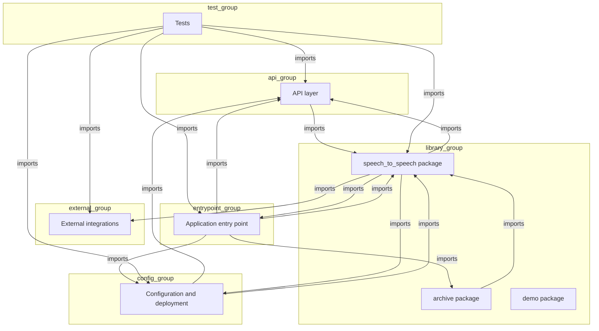

# Architecture report: huggingface/speech-to-speech

> Automated static analysis. **Observed** = directly seen in files/imports/AST; **Inferred** = interpretation from that evidence. Repository code was not executed.

## 1. Repository at a glance

| Item | Value |
| --- | --- |
| Repository | huggingface/speech-to-speech |
| Description | Build voice agents with open-source models |
| Language | Python |
| Stars | 13693 |
| Licence | Apache-2.0 |
| Analysed commit / branch | d1dc31deab44510188ffcd7edfc87203ed9077fb / main |
| Framework(s) | FastAPI, Starlette |
| Files analysed | 428 |
| Components | 8 |

## 2. Architecture in one minute

huggingface/speech-to-speech - Build voice agents with open-source models. This repository was analysed statically from 428 file(s) (347 Python). Detected technologies (observed from imports/manifests): GitHub Actions, SQLite, FastAPI, Starlette, NumPy, Pydantic. Files are grouped into 8 component(s): API layer, archive package, Configuration and deployment, demo package, Application entry point, External integrations, speech_to_speech package, Tests. Observed entry point(s): .github/scripts/star_history.py, demo/livekit/agent.py, demo/server.py. Findings below distinguish observed facts from inferred interpretation.

## 3. High-level block diagram

## 4. Main components

### API layer (`api_layer`)

- **Kind:** api
- **Status:** Observed
- **Confidence:** 0.85
- **Responsibility:** Groups 23 file(s) under api layer (observed from repository paths and static analysis). Observed top-level classes: ArrowDecoder, AudioHandler, ConnState, ConversationHandler, EchoCanceller, GlobalUsageMetrics. Observed top-level functions: _apply_update, _assistant_item_text, _configure_audio_sender, _error_response, _forward_and_account, _heard_text_event_id.
- **Paths:** `src/speech_to_speech/api/__init__.py`, `src/speech_to_speech/api/openai_realtime/__init__.py`, `src/speech_to_speech/api/openai_realtime/audio_client.py`, `src/speech_to_speech/api/openai_realtime/echo_canceller.py`, `src/speech_to_speech/api/openai_realtime/handlers/__init__.py`, `src/speech_to_speech/api/openai_realtime/handlers/audio.py`, `src/speech_to_speech/api/openai_realtime/handlers/base.py`, `src/speech_to_speech/api/openai_realtime/handlers/conversation.py`, `src/speech_to_speech/api/openai_realtime/handlers/history.py`, `src/speech_to_speech/api/openai_realtime/handlers/response.py`, `src/speech_to_speech/api/openai_realtime/handlers/session.py`, `src/speech_to_speech/api/openai_realtime/input_state.py`, `src/speech_to_speech/api/openai_realtime/llm_proxy.py`, `src/speech_to_speech/api/openai_realtime/pipeline_unit.py`, `src/speech_to_speech/api/openai_realtime/reasoning.py`, `src/speech_to_speech/api/openai_realtime/runtime_config.py`, `src/speech_to_speech/api/openai_realtime/service.py`, `src/speech_to_speech/api/openai_realtime/tool_followup.py`, `src/speech_to_speech/api/openai_realtime/transports.py`, `src/speech_to_speech/api/openai_realtime/utils.py`, `src/speech_to_speech/api/openai_realtime/visemes.py`, `src/speech_to_speech/api/openai_realtime/voice_controls.py`, `src/speech_to_speech/api/openai_realtime/webrtc_session.py`
- **Evidence:** [src/speech_to_speech/api/__init__.py](https://github.com/huggingface/speech-to-speech/blob/d1dc31deab44510188ffcd7edfc87203ed9077fb/src/speech_to_speech/api/__init__.py); [src/speech_to_speech/api/openai_realtime/__init__.py](https://github.com/huggingface/speech-to-speech/blob/d1dc31deab44510188ffcd7edfc87203ed9077fb/src/speech_to_speech/api/openai_realtime/__init__.py); [src/speech_to_speech/api/openai_realtime/audio_client.py:57](https://github.com/huggingface/speech-to-speech/blob/d1dc31deab44510188ffcd7edfc87203ed9077fb/src/speech_to_speech/api/openai_realtime/audio_client.py#L57); [src/speech_to_speech/api/openai_realtime/echo_canceller.py:17](https://github.com/huggingface/speech-to-speech/blob/d1dc31deab44510188ffcd7edfc87203ed9077fb/src/speech_to_speech/api/openai_realtime/echo_canceller.py#L17); [src/speech_to_speech/api/openai_realtime/handlers/__init__.py](https://github.com/huggingface/speech-to-speech/blob/d1dc31deab44510188ffcd7edfc87203ed9077fb/src/speech_to_speech/api/openai_realtime/handlers/__init__.py); [src/speech_to_speech/api/openai_realtime/handlers/audio.py:42](https://github.com/huggingface/speech-to-speech/blob/d1dc31deab44510188ffcd7edfc87203ed9077fb/src/speech_to_speech/api/openai_realtime/handlers/audio.py#L42); [src/speech_to_speech/api/openai_realtime/handlers/base.py:18](https://github.com/huggingface/speech-to-speech/blob/d1dc31deab44510188ffcd7edfc87203ed9077fb/src/speech_to_speech/api/openai_realtime/handlers/base.py#L18); [src/speech_to_speech/api/openai_realtime/handlers/conversation.py:71](https://github.com/huggingface/speech-to-speech/blob/d1dc31deab44510188ffcd7edfc87203ed9077fb/src/speech_to_speech/api/openai_realtime/handlers/conversation.py#L71)

### archive package (`archive`)

- **Kind:** library
- **Status:** Observed
- **Confidence:** 0.85
- **Responsibility:** Groups 9 file(s) under archive package (observed from repository paths and static analysis). Observed top-level classes: MeloTTSHandler, MeloTTSHandlerArguments, MoonshineSTTHandler, ParlerTTSHandler, ParlerTTSHandlerArguments.
- **Paths:** `archive/STT/__init__.py`, `archive/STT/moonshine_handler.py`, `archive/TTS/__init__.py`, `archive/TTS/melo_handler.py`, `archive/TTS/parler_handler.py`, `archive/__init__.py`, `archive/arguments_classes/__init__.py`, `archive/arguments_classes/melo_tts_arguments.py`, `archive/arguments_classes/parler_tts_arguments.py`
- **Evidence:** [archive/STT/__init__.py](https://github.com/huggingface/speech-to-speech/blob/d1dc31deab44510188ffcd7edfc87203ed9077fb/archive/STT/__init__.py); [archive/STT/moonshine_handler.py:18](https://github.com/huggingface/speech-to-speech/blob/d1dc31deab44510188ffcd7edfc87203ed9077fb/archive/STT/moonshine_handler.py#L18); [archive/TTS/__init__.py](https://github.com/huggingface/speech-to-speech/blob/d1dc31deab44510188ffcd7edfc87203ed9077fb/archive/TTS/__init__.py); [archive/TTS/melo_handler.py:42](https://github.com/huggingface/speech-to-speech/blob/d1dc31deab44510188ffcd7edfc87203ed9077fb/archive/TTS/melo_handler.py#L42); [archive/TTS/parler_handler.py:52](https://github.com/huggingface/speech-to-speech/blob/d1dc31deab44510188ffcd7edfc87203ed9077fb/archive/TTS/parler_handler.py#L52); [archive/__init__.py](https://github.com/huggingface/speech-to-speech/blob/d1dc31deab44510188ffcd7edfc87203ed9077fb/archive/__init__.py); [archive/arguments_classes/__init__.py](https://github.com/huggingface/speech-to-speech/blob/d1dc31deab44510188ffcd7edfc87203ed9077fb/archive/arguments_classes/__init__.py); [archive/arguments_classes/melo_tts_arguments.py:5](https://github.com/huggingface/speech-to-speech/blob/d1dc31deab44510188ffcd7edfc87203ed9077fb/archive/arguments_classes/melo_tts_arguments.py#L5)

### Configuration and deployment (`config`)

- **Kind:** config
- **Status:** Observed
- **Confidence:** 0.85
- **Responsibility:** Groups 15 file(s) under configuration and deployment (observed from repository paths and static analysis). Observed top-level classes: ConfigDocument, ConfigurationError, ResolvedConfig, ResolvedPipeline, ResolvedStage. Observed top-level functions: _check_composition, _client_settings, _client_type, _error, _expand_home, _is_env.
- **Paths:** `Dockerfile`, `Dockerfile.arm64`, `MANIFEST.in`, `demo/.dockerignore`, `demo/Dockerfile`, `demo/livekit/requirements.txt`, `demo/package.json`, `demo/requirements.txt`, `docker-compose.yml`, `example_configs/mac.yaml`, `mypy.ini`, `pyproject.toml`, `src/speech_to_speech/STV/phoneme_viseme_map.json`, `src/speech_to_speech/config.py`, `src/speech_to_speech/evals/big_bench_audio/Dockerfile.eval`
- **Evidence:** [Dockerfile](https://github.com/huggingface/speech-to-speech/blob/d1dc31deab44510188ffcd7edfc87203ed9077fb/Dockerfile); [Dockerfile.arm64](https://github.com/huggingface/speech-to-speech/blob/d1dc31deab44510188ffcd7edfc87203ed9077fb/Dockerfile.arm64); [MANIFEST.in](https://github.com/huggingface/speech-to-speech/blob/d1dc31deab44510188ffcd7edfc87203ed9077fb/MANIFEST.in); [demo/.dockerignore](https://github.com/huggingface/speech-to-speech/blob/d1dc31deab44510188ffcd7edfc87203ed9077fb/demo/.dockerignore); [demo/Dockerfile](https://github.com/huggingface/speech-to-speech/blob/d1dc31deab44510188ffcd7edfc87203ed9077fb/demo/Dockerfile); [demo/livekit/requirements.txt](https://github.com/huggingface/speech-to-speech/blob/d1dc31deab44510188ffcd7edfc87203ed9077fb/demo/livekit/requirements.txt); [demo/package.json](https://github.com/huggingface/speech-to-speech/blob/d1dc31deab44510188ffcd7edfc87203ed9077fb/demo/package.json); [demo/requirements.txt](https://github.com/huggingface/speech-to-speech/blob/d1dc31deab44510188ffcd7edfc87203ed9077fb/demo/requirements.txt)

### demo package (`demo`)

- **Kind:** library
- **Status:** Observed
- **Confidence:** 0.85
- **Responsibility:** Groups 15 file(s) under demo package (observed from repository paths and static analysis). Observed top-level functions: _add, _client_ip, _connect, _field, _oauth_token, _oauth_token_expired.
- **Paths:** `demo/auth.py`, `demo/limiter.py`, `demo/main.js`, `demo/s2s-realtime-client.js`, `demo/turn-latency.js`, `demo/ui/account.js`, `demo/ui/chat.js`, `demo/ui/dom.js`, `demo/ui/reasoning.js`, `demo/worklets/audio-playback.js`, `demo/worklets/mic-capture.js`, `demo/ws/codec.js`, `demo/ws/local-vad.js`, `demo/ws/orb-visualizer.js`, `demo/ws/user-audio-recorder.js`
- **Evidence:** [demo/auth.py:41](https://github.com/huggingface/speech-to-speech/blob/d1dc31deab44510188ffcd7edfc87203ed9077fb/demo/auth.py#L41); [demo/limiter.py:66](https://github.com/huggingface/speech-to-speech/blob/d1dc31deab44510188ffcd7edfc87203ed9077fb/demo/limiter.py#L66); [demo/main.js](https://github.com/huggingface/speech-to-speech/blob/d1dc31deab44510188ffcd7edfc87203ed9077fb/demo/main.js); [demo/s2s-realtime-client.js](https://github.com/huggingface/speech-to-speech/blob/d1dc31deab44510188ffcd7edfc87203ed9077fb/demo/s2s-realtime-client.js); [demo/turn-latency.js](https://github.com/huggingface/speech-to-speech/blob/d1dc31deab44510188ffcd7edfc87203ed9077fb/demo/turn-latency.js); [demo/ui/account.js](https://github.com/huggingface/speech-to-speech/blob/d1dc31deab44510188ffcd7edfc87203ed9077fb/demo/ui/account.js); [demo/ui/chat.js](https://github.com/huggingface/speech-to-speech/blob/d1dc31deab44510188ffcd7edfc87203ed9077fb/demo/ui/chat.js); [demo/ui/dom.js](https://github.com/huggingface/speech-to-speech/blob/d1dc31deab44510188ffcd7edfc87203ed9077fb/demo/ui/dom.js)

### Application entry point (`entrypoint`)

- **Kind:** entrypoint
- **Status:** Observed
- **Confidence:** 0.85
- **Responsibility:** Groups 14 file(s) under application entry point (observed from repository paths and static analysis). Observed application object created via FastAPI. Observed routes: GET /vendor/openai-realtime-agents.umd.js, GET /vendor/local-vad/{filename}, GET /api/config, GET /api/me, POST /api/search. Observed top-level classes: Assistant, BenchmarkResult, ParsedArguments, PartialTranscription, RealtimeServer, SearchRequest. Observed top-level functions: _add_run_arguments, _audio_cleanup_only, _audio_generation, _audio_payload, _audio_response_key, _build_handlers.
- **Paths:** `demo/livekit/agent.py`, `demo/server.py`, `scripts/benchmark_stt.py`, `scripts/benchmark_tts.py`, `scripts/check_pocket_tts_farsi.py`, `scripts/prepare_eval_space.py`, `scripts/synthetic_conversation_realtime_client.py`, `src/speech_to_speech/STT/smart_progressive_streaming.py`, `src/speech_to_speech/api/openai_realtime/server.py`, `src/speech_to_speech/api/openai_realtime/websocket_router.py`, `src/speech_to_speech/cli.py`, `src/speech_to_speech/evals/big_bench_audio/__main__.py`, `src/speech_to_speech/evals/big_bench_audio/job.py`, `src/speech_to_speech/s2s_pipeline.py`
- **Evidence:** [demo/livekit/agent.py:19](https://github.com/huggingface/speech-to-speech/blob/d1dc31deab44510188ffcd7edfc87203ed9077fb/demo/livekit/agent.py#L19); [demo/server.py:150](https://github.com/huggingface/speech-to-speech/blob/d1dc31deab44510188ffcd7edfc87203ed9077fb/demo/server.py#L150); [scripts/benchmark_stt.py:33](https://github.com/huggingface/speech-to-speech/blob/d1dc31deab44510188ffcd7edfc87203ed9077fb/scripts/benchmark_stt.py#L33); [scripts/benchmark_tts.py:34](https://github.com/huggingface/speech-to-speech/blob/d1dc31deab44510188ffcd7edfc87203ed9077fb/scripts/benchmark_tts.py#L34); [scripts/check_pocket_tts_farsi.py:31](https://github.com/huggingface/speech-to-speech/blob/d1dc31deab44510188ffcd7edfc87203ed9077fb/scripts/check_pocket_tts_farsi.py#L31); [scripts/prepare_eval_space.py:25](https://github.com/huggingface/speech-to-speech/blob/d1dc31deab44510188ffcd7edfc87203ed9077fb/scripts/prepare_eval_space.py#L25); [scripts/synthetic_conversation_realtime_client.py:148](https://github.com/huggingface/speech-to-speech/blob/d1dc31deab44510188ffcd7edfc87203ed9077fb/scripts/synthetic_conversation_realtime_client.py#L148); [src/speech_to_speech/STT/smart_progressive_streaming.py:19](https://github.com/huggingface/speech-to-speech/blob/d1dc31deab44510188ffcd7edfc87203ed9077fb/src/speech_to_speech/STT/smart_progressive_streaming.py#L19)

### External integrations (`external_integrations`)

- **Kind:** external
- **Status:** Inferred
- **Confidence:** 0.70
- **Responsibility:** Groups 0 file(s) under external integrations (observed from repository paths and static analysis).
- **Evidence:** [demo/limiter.py:35](https://github.com/huggingface/speech-to-speech/blob/d1dc31deab44510188ffcd7edfc87203ed9077fb/demo/limiter.py#L35); [src/speech_to_speech/LLM/utils.py:7](https://github.com/huggingface/speech-to-speech/blob/d1dc31deab44510188ffcd7edfc87203ed9077fb/src/speech_to_speech/LLM/utils.py#L7); [tests/openai_realtime/test_openai_client.py:20](https://github.com/huggingface/speech-to-speech/blob/d1dc31deab44510188ffcd7edfc87203ed9077fb/tests/openai_realtime/test_openai_client.py#L20); [tests/test_llm_stream_connection_reuse.py:16](https://github.com/huggingface/speech-to-speech/blob/d1dc31deab44510188ffcd7edfc87203ed9077fb/tests/test_llm_stream_connection_reuse.py#L16); [tests/test_minimax_tts_handler.py:7](https://github.com/huggingface/speech-to-speech/blob/d1dc31deab44510188ffcd7edfc87203ed9077fb/tests/test_minimax_tts_handler.py#L7); [tests/test_openai_stt_lifecycle.py:5](https://github.com/huggingface/speech-to-speech/blob/d1dc31deab44510188ffcd7edfc87203ed9077fb/tests/test_openai_stt_lifecycle.py#L5)

### speech_to_speech package (`speech_to_speech`)

- **Kind:** library
- **Status:** Observed
- **Confidence:** 0.85
- **Responsibility:** Groups 141 file(s) under speech_to_speech package (observed from repository paths and static analysis). Observed top-level classes: AssistantMessage, AssistantOutputEvent, AssistantReasoningPart, AssistantResponseDoneEvent, AssistantTextPart, AssistantToolCallPart. Observed top-level functions: _accepts_prompt, _adapt, _annotation_from_spec, _answer_sort_key, _append_event, _append_user_input.
- **Paths:** `src/speech_to_speech/LLM/__init__.py`, `src/speech_to_speech/LLM/audio_input_notifier.py`, `src/speech_to_speech/LLM/base_openai_compatible_language_model.py`, `src/speech_to_speech/LLM/chat.py`, `src/speech_to_speech/LLM/chat_completions_language_model.py`, `src/speech_to_speech/LLM/compaction_prompt.py`, `src/speech_to_speech/LLM/language_model.py`, `src/speech_to_speech/LLM/lm_output_processor.py`, `src/speech_to_speech/LLM/responses_api_language_model.py`, `src/speech_to_speech/LLM/text_prompt.py`, `src/speech_to_speech/LLM/tool_call/function_call.py`, `src/speech_to_speech/LLM/tool_call/function_tool.py`, `src/speech_to_speech/LLM/tool_call/signature_from_schema.py`, `src/speech_to_speech/LLM/tool_call/tool_prompt.py`, `src/speech_to_speech/LLM/utils.py`, `src/speech_to_speech/LLM/voice_prompt.py`, `src/speech_to_speech/LLM/zerogpu_handler.py`, `src/speech_to_speech/STT/__init__.py`, `src/speech_to_speech/STT/base_stt_handler.py`, `src/speech_to_speech/STT/faster_whisper_handler.py`, `src/speech_to_speech/STT/lightning_whisper_mlx_handler.py`, `src/speech_to_speech/STT/mlx_audio_whisper_handler.py`, `src/speech_to_speech/STT/nemo_asr_handler.py`, `src/speech_to_speech/STT/nemotron_transcribe.py`, `src/speech_to_speech/STT/openai_compatible_handler.py`, `src/speech_to_speech/STT/paraformer_handler.py`, `src/speech_to_speech/STT/parakeet_tdt_handler.py`, `src/speech_to_speech/STT/qwen3_asr_handler.py`, `src/speech_to_speech/STT/sense_voice_handler.py`, `src/speech_to_speech/STT/streaming_handler.py`, `src/speech_to_speech/STT/transcription_notifier.py`, `src/speech_to_speech/STT/whisper_stt_handler.py`, `src/speech_to_speech/STT/zerogpu_handler.py`, `src/speech_to_speech/STV/__init__.py`, `src/speech_to_speech/STV/w2v_stv_handler.py`, `src/speech_to_speech/TTS/__init__.py`, `src/speech_to_speech/TTS/base_tts_handler.py`, `src/speech_to_speech/TTS/chatTTS_handler.py`, `src/speech_to_speech/TTS/drama3_handler.py`, `src/speech_to_speech/TTS/facebookmms_handler.py`, `src/speech_to_speech/TTS/kitten_tts_handler.py`, `src/speech_to_speech/TTS/kokoro_handler.py`, `src/speech_to_speech/TTS/minimax_tts_handler.py`, `src/speech_to_speech/TTS/omnivoice_handler.py`, `src/speech_to_speech/TTS/openai_compatible_handler.py`, `src/speech_to_speech/TTS/pcm_blocks.py`, `src/speech_to_speech/TTS/persian_normalization.py`, `src/speech_to_speech/TTS/phonon_tts_handler.py`, `src/speech_to_speech/TTS/pocket_tts_farsi.py`, `src/speech_to_speech/TTS/pocket_tts_handler.py`, `src/speech_to_speech/TTS/qwen3_tts_handler.py`, `src/speech_to_speech/TTS/supertonic_tts_handler.py`, `src/speech_to_speech/TTS/zerogpu_handler.py`, `src/speech_to_speech/VAD/__init__.py`, `src/speech_to_speech/VAD/firered_vad_iterator.py`, `src/speech_to_speech/VAD/smart_turn.py`, `src/speech_to_speech/VAD/vad_handler.py`, `src/speech_to_speech/VAD/vad_iterator.py`, `src/speech_to_speech/__init__.py`, `src/speech_to_speech/_config_yaml.py`, `src/speech_to_speech/arguments_classes/__init__.py`, `src/speech_to_speech/arguments_classes/chat_completions_language_model_arguments.py`, `src/speech_to_speech/arguments_classes/chat_tts_arguments.py`, `src/speech_to_speech/arguments_classes/drama3_tts_arguments.py`, `src/speech_to_speech/arguments_classes/facebookmms_tts_arguments.py`, `src/speech_to_speech/arguments_classes/faster_whisper_stt_arguments.py`, `src/speech_to_speech/arguments_classes/kitten_tts_arguments.py`, `src/speech_to_speech/arguments_classes/kokoro_tts_arguments.py`, `src/speech_to_speech/arguments_classes/language_model_arguments.py`, `src/speech_to_speech/arguments_classes/language_model_base_arguments.py`, `src/speech_to_speech/arguments_classes/local_audio_arguments.py`, `src/speech_to_speech/arguments_classes/minimax_tts_arguments.py`, `src/speech_to_speech/arguments_classes/mlx_audio_whisper_arguments.py`, `src/speech_to_speech/arguments_classes/module_arguments.py`, `src/speech_to_speech/arguments_classes/nemotron_streaming_stt_arguments.py`, `src/speech_to_speech/arguments_classes/omnivoice_tts_arguments.py`, `src/speech_to_speech/arguments_classes/openai_realtime_stt_arguments.py`, `src/speech_to_speech/arguments_classes/openai_stt_arguments.py`, `src/speech_to_speech/arguments_classes/openai_tts_arguments.py`, `src/speech_to_speech/arguments_classes/orukeet_stt_arguments.py`, `src/speech_to_speech/arguments_classes/paraformer_stt_arguments.py`, `src/speech_to_speech/arguments_classes/parakeet_tdt_arguments.py`, `src/speech_to_speech/arguments_classes/parakeet_unified_stt_arguments.py`, `src/speech_to_speech/arguments_classes/phonon_tts_arguments.py`, `src/speech_to_speech/arguments_classes/pocket_tts_arguments.py`, `src/speech_to_speech/arguments_classes/qwen3_asr_stt_arguments.py`, `src/speech_to_speech/arguments_classes/qwen3_tts_arguments.py`, `src/speech_to_speech/arguments_classes/realtime_server_arguments.py`, `src/speech_to_speech/arguments_classes/responses_api_language_model_arguments.py`, `src/speech_to_speech/arguments_classes/sense_voice_stt_arguments.py`, `src/speech_to_speech/arguments_classes/supertonic_tts_arguments.py`, `src/speech_to_speech/arguments_classes/vad_arguments.py`, `src/speech_to_speech/arguments_classes/vllm_realtime_stt_arguments.py`, `src/speech_to_speech/arguments_classes/w2v_stv_arguments.py`, `src/speech_to_speech/arguments_classes/whisper_stt_arguments.py`, `src/speech_to_speech/arguments_classes/zerogpu_arguments.py`, `src/speech_to_speech/backend_registry.py`, `src/speech_to_speech/baseHandler.py`, `src/speech_to_speech/configured_runtime.py`, `src/speech_to_speech/diarization/__init__.py`, `src/speech_to_speech/diarization/streaming.py`, `src/speech_to_speech/diarization/worker.py`, `src/speech_to_speech/evals/__init__.py`, `src/speech_to_speech/evals/big_bench_audio/__init__.py`, `src/speech_to_speech/evals/big_bench_audio/big-bench-audio-entrypoint.sh`, `src/speech_to_speech/evals/big_bench_audio/dataset.py`, `src/speech_to_speech/evals/big_bench_audio/hub.py`, `src/speech_to_speech/evals/big_bench_audio/judge.py`, `src/speech_to_speech/evals/big_bench_audio/report.py`, `src/speech_to_speech/evals/big_bench_audio/runner.py`, `src/speech_to_speech/evals/big_bench_audio/scoring.py`, `src/speech_to_speech/language_codes.py`, `src/speech_to_speech/pipeline/__init__.py`, `src/speech_to_speech/pipeline/cancel_scope.py`, `src/speech_to_speech/pipeline/console.py`, `src/speech_to_speech/pipeline/control.py`, `src/speech_to_speech/pipeline/events.py`, `src/speech_to_speech/pipeline/handler_types.py`, `src/speech_to_speech/pipeline/history.py`, `src/speech_to_speech/pipeline/language_detection.py`, `src/speech_to_speech/pipeline/log_context.py`, `src/speech_to_speech/pipeline/messages.py`, `src/speech_to_speech/pipeline/queue_types.py`, `src/speech_to_speech/pipeline/speaker_metadata.py`, `src/speech_to_speech/pipeline/speculative_turns.py`, `src/speech_to_speech/pipeline/transcript_logging.py`, `src/speech_to_speech/pipeline/turn_latency.py`, `src/speech_to_speech/pipeline/visemes.py`, `src/speech_to_speech/speech_languages.py`, `src/speech_to_speech/utils/__init__.py`, `src/speech_to_speech/utils/mlx_lock.py`, `src/speech_to_speech/utils/request_tracing.py`, `src/speech_to_speech/utils/thread_manager.py`, `src/speech_to_speech/utils/utils.py`, `src/speech_to_speech/zerogpu/__init__.py`, `src/speech_to_speech/zerogpu/_model_kokoro.py`, `src/speech_to_speech/zerogpu/_model_qwen_tts.py`, `src/speech_to_speech/zerogpu/_model_stt.py`, `src/speech_to_speech/zerogpu/_tts_provider.py`, `src/speech_to_speech/zerogpu/_worker.py`, `src/speech_to_speech/zerogpu/runtime.py`
- **Evidence:** [src/speech_to_speech/LLM/__init__.py](https://github.com/huggingface/speech-to-speech/blob/d1dc31deab44510188ffcd7edfc87203ed9077fb/src/speech_to_speech/LLM/__init__.py); [src/speech_to_speech/LLM/audio_input_notifier.py:18](https://github.com/huggingface/speech-to-speech/blob/d1dc31deab44510188ffcd7edfc87203ed9077fb/src/speech_to_speech/LLM/audio_input_notifier.py#L18); [src/speech_to_speech/LLM/base_openai_compatible_language_model.py:93](https://github.com/huggingface/speech-to-speech/blob/d1dc31deab44510188ffcd7edfc87203ed9077fb/src/speech_to_speech/LLM/base_openai_compatible_language_model.py#L93); [src/speech_to_speech/LLM/chat.py:64](https://github.com/huggingface/speech-to-speech/blob/d1dc31deab44510188ffcd7edfc87203ed9077fb/src/speech_to_speech/LLM/chat.py#L64); [src/speech_to_speech/LLM/chat_completions_language_model.py:44](https://github.com/huggingface/speech-to-speech/blob/d1dc31deab44510188ffcd7edfc87203ed9077fb/src/speech_to_speech/LLM/chat_completions_language_model.py#L44); [src/speech_to_speech/LLM/compaction_prompt.py:69](https://github.com/huggingface/speech-to-speech/blob/d1dc31deab44510188ffcd7edfc87203ed9077fb/src/speech_to_speech/LLM/compaction_prompt.py#L69); [src/speech_to_speech/LLM/language_model.py:106](https://github.com/huggingface/speech-to-speech/blob/d1dc31deab44510188ffcd7edfc87203ed9077fb/src/speech_to_speech/LLM/language_model.py#L106); [src/speech_to_speech/LLM/lm_output_processor.py:45](https://github.com/huggingface/speech-to-speech/blob/d1dc31deab44510188ffcd7edfc87203ed9077fb/src/speech_to_speech/LLM/lm_output_processor.py#L45)

### Tests (`tests`)

- **Kind:** test
- **Status:** Observed
- **Confidence:** 0.85
- **Responsibility:** Groups 172 file(s) under tests (observed from repository paths and static analysis). Observed top-level classes: Connection, ControlledOperation, FakeApi, FakeArguments, FakeAsyncClient, FakeDiarizer. Observed top-level functions: _ack_session_update, _advance, _api_error_response, _append_events, _as, _assert_content_visibility.
- **Paths:** `demo/tests/agents-adapter.test.mjs`, `demo/tests/agents-webrtc.test.mjs`, `demo/tests/agents-websocket.test.mjs`, `demo/tests/conversation-language-ui.test.mjs`, `demo/tests/conversation-language.test.mjs`, `demo/tests/error-message.test.mjs`, `demo/tests/helpers.mjs`, `demo/tests/interrupted-reply-ui.test.mjs`, `demo/tests/local-vad-browser.test.mjs`, `demo/tests/local-vad.test.mjs`, `demo/tests/playback-helpers.mjs`, `demo/tests/playback-sdk.test.mjs`, `demo/tests/playback.test.mjs`, `demo/tests/reasoning-ui.test.mjs`, `demo/tests/turn-latency-ui.test.mjs`, `demo/tests/turn-latency.test.mjs`, `demo/tests/visemes.test.mjs`, `tests/__init__.py`, `tests/evals/__init__.py`, `tests/evals/conftest.py`, `tests/evals/test_big_bench_audio_cli.py`, `tests/evals/test_big_bench_audio_dataset.py`, `tests/evals/test_big_bench_audio_hub.py`, `tests/evals/test_big_bench_audio_job.py`, `tests/evals/test_big_bench_audio_judge.py`, `tests/evals/test_big_bench_audio_report.py`, `tests/evals/test_big_bench_audio_runner.py`, `tests/evals/test_big_bench_audio_scoring.py`, `tests/evals/test_prepare_eval_space.py`, `tests/install_smoke.py`, `tests/llm_history.py`, `tests/openai_realtime/__init__.py`, `tests/openai_realtime/agents_sdk_server.py`, `tests/openai_realtime/conftest.py`, `tests/openai_realtime/realtime_contract.py`, `tests/openai_realtime/test_audio_client.py`, `tests/openai_realtime/test_conversation_delete.py`, `tests/openai_realtime/test_conversation_retrieve.py`, `tests/openai_realtime/test_create_response.py`, `tests/openai_realtime/test_input_resampler.py`, `tests/openai_realtime/test_interrupted_playback_history.py`, `tests/openai_realtime/test_kitten_latency_finalization.py`, `tests/openai_realtime/test_llm_proxy.py`, `tests/openai_realtime/test_openai_client.py`, `tests/openai_realtime/test_output_resampling.py`, `tests/openai_realtime/test_pipeline_builder.py`, `tests/openai_realtime/test_realtime_protocol_contract.py`, `tests/openai_realtime/test_reasoning_effort.py`, `tests/openai_realtime/test_reasoning_text.py`, `tests/openai_realtime/test_response_input_identity.py`, `tests/openai_realtime/test_runtime_config.py`, `tests/openai_realtime/test_send_loop_wakeup.py`, `tests/openai_realtime/test_server_turn_latency.py`, `tests/openai_realtime/test_speaker_conversation.py`, `tests/openai_realtime/test_speculative_turn_protocol.py`, `tests/openai_realtime/test_speech_latency_attribution.py`, `tests/openai_realtime/test_turn_latency.py`, `tests/openai_realtime/test_voice_controls.py`, `tests/openai_realtime/test_web_search_tool_example.py`, `tests/openai_realtime/test_webrtc.py`, `tests/openai_realtime/test_websocket_router.py`, `tests/openai_realtime/test_youcom_search_tool_example.py`, `tests/reopen_dispatch.py`, `tests/test_audio_input_notifier.py`, `tests/test_auto_language_spelling.py`, `tests/test_backend_registry.py`, `tests/test_base_tts_handler.py`, `tests/test_chat.py`, `tests/test_chat_completions_backend.py`, `tests/test_chat_turn_order.py`, `tests/test_chattts_streaming.py`, `tests/test_chattts_tts_latency.py`, `tests/test_cli_defaults.py`, `tests/test_config.py`, `tests/test_configured_runtime.py`, `tests/test_conversation_output.py`, `tests/test_demo_agents_adapter.py`, `tests/test_demo_input_transcription.py`, `tests/test_demo_server.py`, `tests/test_demo_user_audio.py`, `tests/test_device.py`, `tests/test_diarization_transformers.py`, `tests/test_diarization_worker.py`, `tests/test_drama3_tts_handler.py`, `tests/test_facebookmms_language_map.py`, `tests/test_facebookmms_tts_latency.py`, `tests/test_faster_whisper_gen_kwargs_adaptation.py`, `tests/test_faster_whisper_language_reporting.py`, `tests/test_firered_vad_iterator.py`, `tests/test_generated_ids.py`, `tests/test_handler_logging_hygiene.py`, `tests/test_kitten_tts_handler.py`, `tests/test_kitten_tts_latency.py`, `tests/test_kokoro_device.py`, `tests/test_kokoro_handler.py`, `tests/test_kokoro_language_voice.py`, `tests/test_kokoro_tts_latency.py`, `tests/test_language_prompt.py`, `tests/test_llm_first_tts_latency.py`, `tests/test_llm_stream_connection_reuse.py`, `tests/test_llm_utils.py`, `tests/test_lm_output_processor.py`, `tests/test_local_llm_latency.py`, `tests/test_minimax_tts_handler.py`, `tests/test_mlx_audio_whisper_handler.py`, `tests/test_nemo_asr_handler.py`, `tests/test_nemo_asr_stt_latency.py`, `tests/test_nemotron_farsi_integration.py`, `tests/test_nemotron_farsi_stt.py`, `tests/test_nemotron_streaming_stt.py`, `tests/test_nemotron_transcribe_stt.py`, `tests/test_omnivoice_tts_handler.py`, `tests/test_omnivoice_tts_latency.py`, `tests/test_openai_stt_handler.py`, `tests/test_openai_stt_lifecycle.py`, `tests/test_openai_stt_windows.py`, `tests/test_openai_tts_handler.py`, `tests/test_orukeet_stt.py`, `tests/test_paraformer_sensevoice_stt_latency.py`, `tests/test_paraformer_transcription_events.py`, `tests/test_parakeet_language_detection.py`, `tests/test_parakeet_language_reporting.py`, `tests/test_parakeet_transcription_events.py`, `tests/test_pcm_blocks.py`, `tests/test_phonon_tts_handler.py`, `tests/test_pipeline_messages.py`, `tests/test_pocket_tts_handler.py`, `tests/test_provider_response_status.py`, `tests/test_qwen3_asr_transcription_events.py`, `tests/test_qwen3_tts_handler_backend.py`, `tests/test_reasoning_text.py`, `tests/test_response_overrides.py`, `tests/test_responses_api_language_model.py`, `tests/test_responses_reasoning.py`, `tests/test_sense_voice_transcription_events.py`, `tests/test_smart_turn.py`, `tests/test_speculative_turns.py`, `tests/test_speech_request_tracing.py`, `tests/test_streaming_diarization.py`, `tests/test_streaming_stt_handler.py`, `tests/test_stt_session_language_reset.py`, `tests/test_stt_stale_filter.py`, `tests/test_supertonic_tts_handler.py`, `tests/test_supertonic_tts_latency.py`, `tests/test_text_prompt.py`, `tests/test_torch_num_threads.py`, `tests/test_transcript_log_hygiene.py`, `tests/test_transcription_notifier.py`, `tests/test_tts_auto_reset.py`, `tests/test_tts_handler_gate_contract.py`, `tests/test_tts_input_coalescing.py`, `tests/test_turn_latency.py`, `tests/test_vad_iterator.py`, `tests/test_vad_model_state.py`, `tests/test_vad_progressive_snapshots.py`, `tests/test_vad_session_reset.py`, `tests/test_visemes.py`, `tests/test_voice_prompt.py`, `tests/test_whisper_language_detection.py`, `tests/test_whisper_progressive_transcription.py`, `tests/test_whisper_stt_gen_kwargs_isolation.py`, `tests/test_zerogpu_llm.py`, `tests/test_zerogpu_runtime.py`, `tests/test_zerogpu_stt.py`, `tests/test_zerogpu_tts.py`, `tests/test_zerogpu_tts_providers.py`, `tests/test_zerogpu_worker_lease.py`, `tests/test_zerogpu_worker_startup.py`, `tests/tool_call/__init__.py`, `tests/tool_call/test_function_parser.py`, `tests/tool_call/test_signature_from_schema.py`, `tests/turns.py`
- **Evidence:** [demo/tests/agents-adapter.test.mjs](https://github.com/huggingface/speech-to-speech/blob/d1dc31deab44510188ffcd7edfc87203ed9077fb/demo/tests/agents-adapter.test.mjs); [demo/tests/agents-webrtc.test.mjs](https://github.com/huggingface/speech-to-speech/blob/d1dc31deab44510188ffcd7edfc87203ed9077fb/demo/tests/agents-webrtc.test.mjs); [demo/tests/agents-websocket.test.mjs](https://github.com/huggingface/speech-to-speech/blob/d1dc31deab44510188ffcd7edfc87203ed9077fb/demo/tests/agents-websocket.test.mjs); [demo/tests/conversation-language-ui.test.mjs](https://github.com/huggingface/speech-to-speech/blob/d1dc31deab44510188ffcd7edfc87203ed9077fb/demo/tests/conversation-language-ui.test.mjs); [demo/tests/conversation-language.test.mjs](https://github.com/huggingface/speech-to-speech/blob/d1dc31deab44510188ffcd7edfc87203ed9077fb/demo/tests/conversation-language.test.mjs); [demo/tests/error-message.test.mjs](https://github.com/huggingface/speech-to-speech/blob/d1dc31deab44510188ffcd7edfc87203ed9077fb/demo/tests/error-message.test.mjs); [demo/tests/helpers.mjs](https://github.com/huggingface/speech-to-speech/blob/d1dc31deab44510188ffcd7edfc87203ed9077fb/demo/tests/helpers.mjs); [demo/tests/interrupted-reply-ui.test.mjs](https://github.com/huggingface/speech-to-speech/blob/d1dc31deab44510188ffcd7edfc87203ed9077fb/demo/tests/interrupted-reply-ui.test.mjs)

## 5. Execution flow

**Observed** entry point(s):

- [.github/scripts/star_history.py:193](https://github.com/huggingface/speech-to-speech/blob/d1dc31deab44510188ffcd7edfc87203ed9077fb/.github/scripts/star_history.py#L193)
- [demo/livekit/agent.py:56](https://github.com/huggingface/speech-to-speech/blob/d1dc31deab44510188ffcd7edfc87203ed9077fb/demo/livekit/agent.py#L56)
- [demo/server.py:150](https://github.com/huggingface/speech-to-speech/blob/d1dc31deab44510188ffcd7edfc87203ed9077fb/demo/server.py#L150)
- [scripts/benchmark_stt.py:384](https://github.com/huggingface/speech-to-speech/blob/d1dc31deab44510188ffcd7edfc87203ed9077fb/scripts/benchmark_stt.py#L384)
- [scripts/benchmark_tts.py:414](https://github.com/huggingface/speech-to-speech/blob/d1dc31deab44510188ffcd7edfc87203ed9077fb/scripts/benchmark_tts.py#L414)
- [scripts/check_pocket_tts_farsi.py:123](https://github.com/huggingface/speech-to-speech/blob/d1dc31deab44510188ffcd7edfc87203ed9077fb/scripts/check_pocket_tts_farsi.py#L123)
- [src/speech_to_speech/STT/smart_progressive_streaming.py:342](https://github.com/huggingface/speech-to-speech/blob/d1dc31deab44510188ffcd7edfc87203ed9077fb/src/speech_to_speech/STT/smart_progressive_streaming.py#L342)
- [src/speech_to_speech/api/openai_realtime/websocket_router.py:623](https://github.com/huggingface/speech-to-speech/blob/d1dc31deab44510188ffcd7edfc87203ed9077fb/src/speech_to_speech/api/openai_realtime/websocket_router.py#L623)
- [src/speech_to_speech/cli.py](https://github.com/huggingface/speech-to-speech/blob/d1dc31deab44510188ffcd7edfc87203ed9077fb/src/speech_to_speech/cli.py)
- [src/speech_to_speech/evals/big_bench_audio/__main__.py:386](https://github.com/huggingface/speech-to-speech/blob/d1dc31deab44510188ffcd7edfc87203ed9077fb/src/speech_to_speech/evals/big_bench_audio/__main__.py#L386)
- [src/speech_to_speech/evals/big_bench_audio/job.py:79](https://github.com/huggingface/speech-to-speech/blob/d1dc31deab44510188ffcd7edfc87203ed9077fb/src/speech_to_speech/evals/big_bench_audio/job.py#L79)
- [src/speech_to_speech/s2s_pipeline.py:918](https://github.com/huggingface/speech-to-speech/blob/d1dc31deab44510188ffcd7edfc87203ed9077fb/src/speech_to_speech/s2s_pipeline.py#L918)

**Observed** routes (from decorators):

- `GET /vendor/openai-realtime-agents.umd.js` -> `agents_sdk_bundle` in `demo/server.py:154`
- `GET /vendor/local-vad/{filename}` -> `local_vad_asset` in `demo/server.py:183`
- `GET /api/config` -> `config` in `demo/server.py:239`
- `GET /api/me` -> `me` in `demo/server.py:262`
- `POST /api/search` -> `search` in `demo/server.py:287`
- `POST /api/calls` -> `calls` in `demo/server.py:371`
- `POST /api/session` -> `session` in `demo/server.py:411`
- `GET /api/queue/{queue_id}` -> `queue_status` in `demo/server.py:554`
- `DELETE /api/queue/{queue_id}` -> `queue_leave` in `demo/server.py:614`
- `POST /api/queue/end` -> `queue_end` in `demo/server.py:623`
- `POST /api/session/heartbeat` -> `session_heartbeat` in `demo/server.py:698`
- `POST /api/session/end` -> `session_end` in `demo/server.py:709`

Representative flow (derived from observed entry points and the import graph; steps beyond the entry point are **Inferred**):

1. Execution starts at an observed entry point listed above, if present.
2. `api_layer` imports `speech_to_speech` (API layer -> speech_to_speech package).
3. `archive` imports `speech_to_speech` (archive package -> speech_to_speech package).
4. `config` imports `api_layer` (Configuration and deployment -> API layer).
5. `config` imports `speech_to_speech` (Configuration and deployment -> speech_to_speech package).
6. `entrypoint` imports `api_layer` (Application entry point -> API layer).
7. `entrypoint` imports `archive` (Application entry point -> archive package).
8. `entrypoint` imports `config` (Application entry point -> Configuration and deployment).
9. `entrypoint` imports `speech_to_speech` (Application entry point -> speech_to_speech package).

## 6. Project structure

### `(root)`

- `.dockerignore` - container (173 bytes)
- `.gitignore` - other (4799 bytes)
- `AGENTS.md` - docs (1939 bytes)
- `Dockerfile` - container (983 bytes)
- `Dockerfile.arm64` - container (1039 bytes)
- `LICENSE` - docs (11356 bytes)
- `MANIFEST.in` - manifest (89 bytes)
- `README.md` - docs (56018 bytes)
- `docker-compose.yml` - container (1345 bytes)
- `mypy.ini` - config (37 bytes)
- `pyproject.toml` - manifest (4662 bytes)

### `.github`

- `.github/dependabot.yml` - config (205 bytes)
- `.github/scripts/star_history.py` - source, Python (6081 bytes)
- `.github/workflows/ci.yml` - ci, YAML (6054 bytes)
- `.github/workflows/omnivoice.yml` - ci, YAML (2923 bytes)
- `.github/workflows/publish.yml` - ci, YAML (1220 bytes)
- `.github/workflows/star-history.yml` - ci, YAML (1434 bytes)

### `archive`

- `archive/README.md` - docs (559 bytes)
- `archive/STT/__init__.py` - source, Python (0 bytes)
- `archive/STT/moonshine_handler.py` - source, Python (1925 bytes)
- `archive/TTS/__init__.py` - source, Python (0 bytes)
- `archive/TTS/melo_handler.py` - source, Python (4938 bytes)
- `archive/TTS/parler_handler.py` - source, Python (8845 bytes)
- `archive/__init__.py` - source, Python (0 bytes)
- `archive/arguments_classes/__init__.py` - source, Python (0 bytes)
- `archive/arguments_classes/melo_tts_arguments.py` - source, Python (558 bytes)
- `archive/arguments_classes/parler_tts_arguments.py` - source, Python (2432 bytes)

### `assets`

- `assets/star-history.svg` - other (5240 bytes)

### `demo`

- `demo/.dockerignore` - container (109 bytes)
- `demo/.gitignore` - other (238 bytes)
- `demo/CONTEXT.md` - docs (5238 bytes)
- `demo/DESIGN.md` - docs (9430 bytes)
- `demo/Dockerfile` - container (1203 bytes)
- `demo/README.md` - docs (23202 bytes)
- `demo/auth.py` - source, Python (10784 bytes)
- `demo/docs/adr/0001-docker-space-with-search-proxy.md` - docs (1622 bytes)
- `demo/index.html` - other (34709 bytes)
- `demo/limiter.py` - source, Python (14112 bytes)
- `demo/livekit/README.md` - docs (4318 bytes)
- `demo/livekit/agent.py` - source, Python (1971 bytes)
- `demo/livekit/requirements.txt` - manifest (50 bytes)
- `demo/main.js` - source, JavaScript (72413 bytes)
- `demo/package.json` - manifest (1044 bytes)
- `demo/requirements.txt` - manifest (187 bytes)
- `demo/s2s-realtime-client.js` - source, JavaScript (49702 bytes)
- `demo/server.py` - source, Python (30934 bytes)
- `demo/style.css` - other (78456 bytes)
- `demo/tests/agents-adapter.test.mjs` - test, JavaScript (12512 bytes)
- `demo/tests/agents-webrtc.test.mjs` - test, JavaScript (8192 bytes)
- `demo/tests/agents-websocket.test.mjs` - test, JavaScript (9703 bytes)
- `demo/tests/conversation-language-ui.test.mjs` - test, JavaScript (2477 bytes)
- `demo/tests/conversation-language.test.mjs` - test, JavaScript (7033 bytes)
- `demo/tests/error-message.test.mjs` - test, JavaScript (871 bytes)
- `demo/tests/helpers.mjs` - test, JavaScript (3034 bytes)
- `demo/tests/interrupted-reply-ui.test.mjs` - test, JavaScript (5735 bytes)
- `demo/tests/local-vad-browser.test.mjs` - test, JavaScript (4387 bytes)
- `demo/tests/local-vad.test.mjs` - test, JavaScript (4825 bytes)
- `demo/tests/playback-helpers.mjs` - test, JavaScript (938 bytes)
- `demo/tests/playback-sdk.test.mjs` - test, JavaScript (12540 bytes)
- `demo/tests/playback.test.mjs` - test, JavaScript (12911 bytes)
- `demo/tests/reasoning-ui.test.mjs` - test, JavaScript (14960 bytes)
- `demo/tests/turn-latency-ui.test.mjs` - test, JavaScript (7847 bytes)
- `demo/tests/turn-latency.test.mjs` - test, JavaScript (5537 bytes)
- `demo/tests/visemes.test.mjs` - test, JavaScript (730 bytes)
- `demo/turn-latency.js` - source, JavaScript (2422 bytes)
- `demo/ui/account.js` - source, JavaScript (13523 bytes)
- `demo/ui/chat.js` - source, JavaScript (36137 bytes)
- `demo/ui/dom.js` - source, JavaScript (2028 bytes)
- `demo/ui/reasoning.js` - source, JavaScript (4067 bytes)
- `demo/worklets/audio-playback.js` - source, JavaScript (6125 bytes)
- `demo/worklets/mic-capture.js` - source, JavaScript (6712 bytes)
- `demo/ws/codec.js` - source, JavaScript (1116 bytes)
- `demo/ws/local-vad.js` - source, JavaScript (4286 bytes)
- `demo/ws/orb-visualizer.js` - source, JavaScript (3658 bytes)
- `demo/ws/user-audio-recorder.js` - source, JavaScript (7218 bytes)

### `docs`

- `docs/configuration.md` - docs (9089 bytes)
- `docs/echo-cancellation.md` - docs (1716 bytes)
- `docs/openai-compatible-stt.md` - docs (11533 bytes)
- `docs/openai-compatible-tts.md` - docs (5343 bytes)
- `docs/releases/v1.0.0.md` - docs (4264 bytes)
- `docs/releases/v1.1.0.md` - docs (4409 bytes)
- `docs/response-latency.md` - docs (17280 bytes)
- `docs/vibe-checks.md` - docs (10331 bytes)

### `example_configs`

- `example_configs/mac.yaml` - config (361 bytes)

### `examples`

- `examples/gemma4-12b-macos/README.md` - docs (5662 bytes)
- `examples/realtime_web_search_tool.py` - source, Python (3915 bytes)
- `examples/realtime_youcom_search_tool.py` - source, Python (5050 bytes)
- `examples/streaming-diarization/README.md` - docs (3958 bytes)

### `scripts`

- `scripts/benchmark_stt.py` - source, Python (13602 bytes)
- `scripts/benchmark_tts.py` - source, Python (14781 bytes)
- `scripts/check_pocket_tts_farsi.py` - source, Python (5161 bytes)
- `scripts/prepare_eval_space.py` - source, Python (3905 bytes)
- `scripts/synthetic_conversation_realtime_client.py` - source, Python (23436 bytes)

### `src`

- `src/speech_to_speech/LLM/README.md` - docs (3380 bytes)
- `src/speech_to_speech/LLM/__init__.py` - source, Python (0 bytes)
- `src/speech_to_speech/LLM/audio_input_notifier.py` - source, Python (3149 bytes)
- `src/speech_to_speech/LLM/base_openai_compatible_language_model.py` - source, Python (60120 bytes)
- `src/speech_to_speech/LLM/chat.py` - source, Python (81551 bytes)
- `src/speech_to_speech/LLM/chat_completions_language_model.py` - source, Python (16954 bytes)
- `src/speech_to_speech/LLM/compaction_prompt.py` - source, Python (6748 bytes)
- `src/speech_to_speech/LLM/language_model.py` - source, Python (53831 bytes)
- `src/speech_to_speech/LLM/lm_output_processor.py` - source, Python (14497 bytes)
- `src/speech_to_speech/LLM/responses_api_language_model.py` - source, Python (14300 bytes)
- `src/speech_to_speech/LLM/text_prompt.py` - source, Python (2059 bytes)
- `src/speech_to_speech/LLM/tool_call/function_call.py` - source, Python (14457 bytes)
- `src/speech_to_speech/LLM/tool_call/function_tool.py` - source, Python (1506 bytes)
- `src/speech_to_speech/LLM/tool_call/signature_from_schema.py` - source, Python (3772 bytes)
- `src/speech_to_speech/LLM/tool_call/tool_prompt.py` - source, Python (3847 bytes)
- `src/speech_to_speech/LLM/utils.py` - source, Python (7131 bytes)
- `src/speech_to_speech/LLM/voice_prompt.py` - source, Python (2897 bytes)
- `src/speech_to_speech/LLM/zerogpu_handler.py` - source, Python (2066 bytes)
- `src/speech_to_speech/STT/README.md` - docs (12884 bytes)
- `src/speech_to_speech/STT/__init__.py` - source, Python (1 bytes)
- `src/speech_to_speech/STT/base_stt_handler.py` - source, Python (13822 bytes)
- `src/speech_to_speech/STT/faster_whisper_handler.py` - source, Python (7726 bytes)
- `src/speech_to_speech/STT/lightning_whisper_mlx_handler.py` - source, Python (3982 bytes)
- `src/speech_to_speech/STT/mlx_audio_whisper_handler.py` - source, Python (7594 bytes)
- `src/speech_to_speech/STT/nemo_asr_handler.py` - source, Python (9805 bytes)
- `src/speech_to_speech/STT/nemotron_transcribe.py` - source, Python (5828 bytes)
- `src/speech_to_speech/STT/openai_compatible_handler.py` - source, Python (33858 bytes)
- `src/speech_to_speech/STT/paraformer_handler.py` - source, Python (3082 bytes)
- `src/speech_to_speech/STT/parakeet_tdt_handler.py` - source, Python (25249 bytes)
- `src/speech_to_speech/STT/qwen3_asr_handler.py` - source, Python (7923 bytes)
- `src/speech_to_speech/STT/sense_voice_handler.py` - source, Python (2983 bytes)
- `src/speech_to_speech/STT/smart_progressive_streaming.py` - source, Python (12782 bytes)
- `src/speech_to_speech/STT/streaming_handler.py` - source, Python (43612 bytes)
- `src/speech_to_speech/STT/transcription_notifier.py` - source, Python (4886 bytes)
- `src/speech_to_speech/STT/whisper_stt_handler.py` - source, Python (12532 bytes)
- `src/speech_to_speech/STT/zerogpu_handler.py` - source, Python (3384 bytes)
- `src/speech_to_speech/STV/README.md` - docs (3822 bytes)
- `src/speech_to_speech/STV/__init__.py` - source, Python (81 bytes)
- `src/speech_to_speech/STV/phoneme_viseme_map.json` - config (3971 bytes)
- `src/speech_to_speech/STV/w2v_stv_handler.py` - source, Python (8583 bytes)
- `src/speech_to_speech/TTS/README.md` - docs (19020 bytes)
- `src/speech_to_speech/TTS/__init__.py` - source, Python (13 bytes)
- `src/speech_to_speech/TTS/base_tts_handler.py` - source, Python (3225 bytes)
- `src/speech_to_speech/TTS/chatTTS_handler.py` - source, Python (6137 bytes)
- `src/speech_to_speech/TTS/drama3_handler.py` - source, Python (4065 bytes)
- `src/speech_to_speech/TTS/facebookmms_handler.py` - source, Python (9144 bytes)
- `src/speech_to_speech/TTS/kitten_tts_handler.py` - source, Python (7441 bytes)
- `src/speech_to_speech/TTS/kokoro_handler.py` - source, Python (21273 bytes)
- `src/speech_to_speech/TTS/minimax_tts_handler.py` - source, Python (6871 bytes)
- `src/speech_to_speech/TTS/omnivoice_handler.py` - source, Python (8505 bytes)
- `src/speech_to_speech/TTS/openai_compatible_handler.py` - source, Python (33511 bytes)
- `src/speech_to_speech/TTS/pcm_blocks.py` - source, Python (1109 bytes)
- `src/speech_to_speech/TTS/persian_normalization.py` - source, Python (9207 bytes)
- `src/speech_to_speech/TTS/phonon_tts_handler.py` - source, Python (13637 bytes)
- `src/speech_to_speech/TTS/pocket_tts_farsi.py` - source, Python (1759 bytes)
- `src/speech_to_speech/TTS/pocket_tts_handler.py` - source, Python (17352 bytes)
- `src/speech_to_speech/TTS/qwen3_tts_handler.py` - source, Python (44366 bytes)
- `src/speech_to_speech/TTS/supertonic_tts_handler.py` - source, Python (6850 bytes)
- `src/speech_to_speech/TTS/zerogpu_handler.py` - source, Python (6557 bytes)
- `src/speech_to_speech/VAD/README.md` - docs (1941 bytes)
- `src/speech_to_speech/VAD/__init__.py` - source, Python (1 bytes)
- `src/speech_to_speech/VAD/firered_vad_iterator.py` - source, Python (10933 bytes)
- `src/speech_to_speech/VAD/smart_turn.py` - source, Python (5506 bytes)
- `src/speech_to_speech/VAD/vad_handler.py` - source, Python (44482 bytes)
- `src/speech_to_speech/VAD/vad_iterator.py` - source, Python (7245 bytes)
- `src/speech_to_speech/__init__.py` - source, Python (86 bytes)
- `src/speech_to_speech/_config_yaml.py` - source, Python (5181 bytes)
- `src/speech_to_speech/api/__init__.py` - source, Python (0 bytes)
- `src/speech_to_speech/api/openai_realtime/README.md` - docs (42910 bytes)
- `src/speech_to_speech/api/openai_realtime/__init__.py` - source, Python (0 bytes)
- `src/speech_to_speech/api/openai_realtime/audio_client.py` - source, Python (71909 bytes)
- `src/speech_to_speech/api/openai_realtime/echo_canceller.py` - source, Python (5050 bytes)
- `src/speech_to_speech/api/openai_realtime/handlers/__init__.py` - source, Python (588 bytes)
- `src/speech_to_speech/api/openai_realtime/handlers/audio.py` - source, Python (25042 bytes)
- `src/speech_to_speech/api/openai_realtime/handlers/base.py` - source, Python (1780 bytes)
- `src/speech_to_speech/api/openai_realtime/handlers/conversation.py` - source, Python (28090 bytes)
- `src/speech_to_speech/api/openai_realtime/handlers/history.py` - source, Python (7716 bytes)
- `src/speech_to_speech/api/openai_realtime/handlers/response.py` - source, Python (74965 bytes)
- `src/speech_to_speech/api/openai_realtime/handlers/session.py` - source, Python (4766 bytes)
- `src/speech_to_speech/api/openai_realtime/input_state.py` - source, Python (1862 bytes)
- `src/speech_to_speech/api/openai_realtime/llm_proxy.py` - source, Python (12442 bytes)
- `src/speech_to_speech/api/openai_realtime/pipeline_unit.py` - source, Python (5757 bytes)
- `src/speech_to_speech/api/openai_realtime/reasoning.py` - source, Python (2158 bytes)
- `src/speech_to_speech/api/openai_realtime/runtime_config.py` - source, Python (8656 bytes)
- `src/speech_to_speech/api/openai_realtime/server.py` - source, Python (2256 bytes)
- `src/speech_to_speech/api/openai_realtime/service.py` - source, Python (55927 bytes)
- `src/speech_to_speech/api/openai_realtime/tool_followup.py` - source, Python (694 bytes)
- `src/speech_to_speech/api/openai_realtime/transports.py` - source, Python (5771 bytes)
- `src/speech_to_speech/api/openai_realtime/utils.py` - source, Python (4515 bytes)
- `src/speech_to_speech/api/openai_realtime/visemes.py` - source, Python (475 bytes)
- `src/speech_to_speech/api/openai_realtime/voice_controls.py` - source, Python (6079 bytes)
- `src/speech_to_speech/api/openai_realtime/webrtc_session.py` - source, Python (23178 bytes)
- `src/speech_to_speech/api/openai_realtime/websocket_router.py` - source, Python (58912 bytes)
- `src/speech_to_speech/arguments_classes/__init__.py` - source, Python (1 bytes)
- `src/speech_to_speech/arguments_classes/chat_completions_language_model_arguments.py` - source, Python (1335 bytes)
- `src/speech_to_speech/arguments_classes/chat_tts_arguments.py` - source, Python (728 bytes)
- `src/speech_to_speech/arguments_classes/drama3_tts_arguments.py` - source, Python (1648 bytes)
- `src/speech_to_speech/arguments_classes/facebookmms_tts_arguments.py` - source, Python (885 bytes)
- `src/speech_to_speech/arguments_classes/faster_whisper_stt_arguments.py` - source, Python (2679 bytes)
- `src/speech_to_speech/arguments_classes/kitten_tts_arguments.py` - source, Python (624 bytes)
- `src/speech_to_speech/arguments_classes/kokoro_tts_arguments.py` - source, Python (1422 bytes)
- `src/speech_to_speech/arguments_classes/language_model_arguments.py` - source, Python (2203 bytes)
- `src/speech_to_speech/arguments_classes/language_model_base_arguments.py` - source, Python (1836 bytes)
- `src/speech_to_speech/arguments_classes/local_audio_arguments.py` - source, Python (2750 bytes)
- `src/speech_to_speech/arguments_classes/minimax_tts_arguments.py` - source, Python (1955 bytes)
- `src/speech_to_speech/arguments_classes/mlx_audio_whisper_arguments.py` - source, Python (751 bytes)
- `src/speech_to_speech/arguments_classes/module_arguments.py` - source, Python (7536 bytes)
- `src/speech_to_speech/arguments_classes/nemotron_streaming_stt_arguments.py` - source, Python (1130 bytes)
- `src/speech_to_speech/arguments_classes/omnivoice_tts_arguments.py` - source, Python (2633 bytes)
- `src/speech_to_speech/arguments_classes/openai_realtime_stt_arguments.py` - source, Python (1422 bytes)
- `src/speech_to_speech/arguments_classes/openai_stt_arguments.py` - source, Python (2386 bytes)
- `src/speech_to_speech/arguments_classes/openai_tts_arguments.py` - source, Python (2294 bytes)
- `src/speech_to_speech/arguments_classes/orukeet_stt_arguments.py` - source, Python (1211 bytes)
- `src/speech_to_speech/arguments_classes/paraformer_stt_arguments.py` - source, Python (618 bytes)
- `src/speech_to_speech/arguments_classes/parakeet_tdt_arguments.py` - source, Python (1439 bytes)
- `src/speech_to_speech/arguments_classes/parakeet_unified_stt_arguments.py` - source, Python (725 bytes)
- `src/speech_to_speech/arguments_classes/phonon_tts_arguments.py` - source, Python (1878 bytes)
- `src/speech_to_speech/arguments_classes/pocket_tts_arguments.py` - source, Python (2232 bytes)
- `src/speech_to_speech/arguments_classes/qwen3_asr_stt_arguments.py` - source, Python (1934 bytes)
- `src/speech_to_speech/arguments_classes/qwen3_tts_arguments.py` - source, Python (6257 bytes)
- `src/speech_to_speech/arguments_classes/realtime_server_arguments.py` - source, Python (698 bytes)
- `src/speech_to_speech/arguments_classes/responses_api_language_model_arguments.py` - source, Python (3824 bytes)
- `src/speech_to_speech/arguments_classes/sense_voice_stt_arguments.py` - source, Python (745 bytes)
- `src/speech_to_speech/arguments_classes/supertonic_tts_arguments.py` - source, Python (753 bytes)
- `src/speech_to_speech/arguments_classes/vad_arguments.py` - source, Python (6031 bytes)
- `src/speech_to_speech/arguments_classes/vllm_realtime_stt_arguments.py` - source, Python (1253 bytes)
- `src/speech_to_speech/arguments_classes/w2v_stv_arguments.py` - source, Python (580 bytes)
- `src/speech_to_speech/arguments_classes/whisper_stt_arguments.py` - source, Python (2223 bytes)
- `src/speech_to_speech/arguments_classes/zerogpu_arguments.py` - source, Python (1683 bytes)
- `src/speech_to_speech/backend_registry.py` - source, Python (26373 bytes)
- `src/speech_to_speech/baseHandler.py` - source, Python (9808 bytes)
- `src/speech_to_speech/cli.py` - source, Python (11952 bytes)
- `src/speech_to_speech/config.py` - source, Python (23598 bytes)
- `src/speech_to_speech/configured_runtime.py` - source, Python (18229 bytes)
- `src/speech_to_speech/diarization/__init__.py` - source, Python (192 bytes)
- `src/speech_to_speech/diarization/streaming.py` - source, Python (10260 bytes)
- `src/speech_to_speech/diarization/worker.py` - source, Python (9774 bytes)
- `src/speech_to_speech/evals/__init__.py` - source, Python (70 bytes)
- `src/speech_to_speech/evals/big_bench_audio/Dockerfile.eval` - container (2463 bytes)
- `src/speech_to_speech/evals/big_bench_audio/__init__.py` - source, Python (1394 bytes)
- `src/speech_to_speech/evals/big_bench_audio/__main__.py` - source, Python (15870 bytes)
- `src/speech_to_speech/evals/big_bench_audio/big-bench-audio-entrypoint.sh` - source, Shell (244 bytes)
- `src/speech_to_speech/evals/big_bench_audio/dataset.py` - source, Python (9093 bytes)
- `src/speech_to_speech/evals/big_bench_audio/hub.py` - source, Python (3268 bytes)
- `src/speech_to_speech/evals/big_bench_audio/job.py` - source, Python (2988 bytes)
- `src/speech_to_speech/evals/big_bench_audio/judge.py` - source, Python (3890 bytes)
- `src/speech_to_speech/evals/big_bench_audio/report.py` - source, Python (11242 bytes)
- `src/speech_to_speech/evals/big_bench_audio/runner.py` - source, Python (16800 bytes)
- `src/speech_to_speech/evals/big_bench_audio/scoring.py` - source, Python (6866 bytes)
- `src/speech_to_speech/language_codes.py` - source, Python (2815 bytes)
- `src/speech_to_speech/pipeline/__init__.py` - source, Python (1657 bytes)
- `src/speech_to_speech/pipeline/cancel_scope.py` - source, Python (2442 bytes)
- `src/speech_to_speech/pipeline/console.py` - source, Python (2938 bytes)
- `src/speech_to_speech/pipeline/control.py` - source, Python (818 bytes)
- `src/speech_to_speech/pipeline/events.py` - source, Python (9051 bytes)
- `src/speech_to_speech/pipeline/handler_types.py` - source, Python (1930 bytes)
- `src/speech_to_speech/pipeline/history.py` - source, Python (3966 bytes)
- `src/speech_to_speech/pipeline/language_detection.py` - source, Python (4126 bytes)
- `src/speech_to_speech/pipeline/log_context.py` - source, Python (946 bytes)
- `src/speech_to_speech/pipeline/messages.py` - source, Python (16376 bytes)
- `src/speech_to_speech/pipeline/queue_types.py` - source, Python (1760 bytes)
- `src/speech_to_speech/pipeline/speaker_metadata.py` - source, Python (3707 bytes)
- `src/speech_to_speech/pipeline/speculative_turns.py` - source, Python (19546 bytes)
- `src/speech_to_speech/pipeline/transcript_logging.py` - source, Python (2953 bytes)
- `src/speech_to_speech/pipeline/turn_latency.py` - source, Python (24542 bytes)
- `src/speech_to_speech/pipeline/visemes.py` - source, Python (593 bytes)
- `src/speech_to_speech/s2s_pipeline.py` - source, Python (39299 bytes)
- `src/speech_to_speech/speech_languages.py` - source, Python (7384 bytes)
- `src/speech_to_speech/utils/__init__.py` - source, Python (0 bytes)
- `src/speech_to_speech/utils/mlx_lock.py` - source, Python (7479 bytes)
- `src/speech_to_speech/utils/request_tracing.py` - source, Python (3873 bytes)
- `src/speech_to_speech/utils/thread_manager.py` - source, Python (1198 bytes)
- `src/speech_to_speech/utils/utils.py` - source, Python (5051 bytes)
- `src/speech_to_speech/zerogpu/__init__.py` - source, Python (273 bytes)
- `src/speech_to_speech/zerogpu/_model_kokoro.py` - source, Python (4716 bytes)
- `src/speech_to_speech/zerogpu/_model_qwen_tts.py` - source, Python (5551 bytes)
- `src/speech_to_speech/zerogpu/_model_stt.py` - source, Python (2765 bytes)
- `src/speech_to_speech/zerogpu/_tts_provider.py` - source, Python (3431 bytes)
- `src/speech_to_speech/zerogpu/_worker.py` - source, Python (18579 bytes)
- `src/speech_to_speech/zerogpu/runtime.py` - source, Python (5040 bytes)

### `tests`

- `tests/__init__.py` - test, Python (1 bytes)
- `tests/evals/__init__.py` - test, Python (0 bytes)
- `tests/evals/conftest.py` - test, Python (1412 bytes)
- `tests/evals/test_big_bench_audio_cli.py` - test, Python (5854 bytes)
- `tests/evals/test_big_bench_audio_dataset.py` - test, Python (5467 bytes)
- `tests/evals/test_big_bench_audio_hub.py` - test, Python (4105 bytes)
- `tests/evals/test_big_bench_audio_job.py` - test, Python (8754 bytes)
- `tests/evals/test_big_bench_audio_judge.py` - test, Python (1926 bytes)
- `tests/evals/test_big_bench_audio_report.py` - test, Python (5639 bytes)
- `tests/evals/test_big_bench_audio_runner.py` - test, Python (21202 bytes)
- `tests/evals/test_big_bench_audio_scoring.py` - test, Python (3206 bytes)
- `tests/evals/test_prepare_eval_space.py` - test, Python (4059 bytes)
- `tests/install_smoke.py` - test, Python (10696 bytes)
- `tests/llm_history.py` - test, Python (4135 bytes)
- `tests/openai_realtime/__init__.py` - test, Python (0 bytes)
- `tests/openai_realtime/agents_sdk_server.py` - test, Python (8459 bytes)
- `tests/openai_realtime/conftest.py` - test, Python (2842 bytes)
- `tests/openai_realtime/realtime_contract.py` - test, Python (15744 bytes)
- `tests/openai_realtime/test_audio_client.py` - test, Python (93851 bytes)
- `tests/openai_realtime/test_conversation_delete.py` - test, Python (33993 bytes)
- `tests/openai_realtime/test_conversation_retrieve.py` - test, Python (11858 bytes)
- `tests/openai_realtime/test_create_response.py` - test, Python (14829 bytes)
- `tests/openai_realtime/test_input_resampler.py` - test, Python (8097 bytes)
- `tests/openai_realtime/test_interrupted_playback_history.py` - test, Python (34769 bytes)
- `tests/openai_realtime/test_kitten_latency_finalization.py` - test, Python (3960 bytes)
- `tests/openai_realtime/test_llm_proxy.py` - test, Python (25364 bytes)
- `tests/openai_realtime/test_openai_client.py` - test, Python (48546 bytes)
- `tests/openai_realtime/test_output_resampling.py` - test, Python (5536 bytes)
- `tests/openai_realtime/test_pipeline_builder.py` - test, Python (8739 bytes)
- `tests/openai_realtime/test_realtime_protocol_contract.py` - test, Python (12163 bytes)
- `tests/openai_realtime/test_reasoning_effort.py` - test, Python (10953 bytes)
- `tests/openai_realtime/test_reasoning_text.py` - test, Python (8762 bytes)
- `tests/openai_realtime/test_response_input_identity.py` - test, Python (24526 bytes)
- `tests/openai_realtime/test_runtime_config.py` - test, Python (7066 bytes)
- `tests/openai_realtime/test_send_loop_wakeup.py` - test, Python (16501 bytes)
- `tests/openai_realtime/test_server_turn_latency.py` - test, Python (14123 bytes)
- `tests/openai_realtime/test_speaker_conversation.py` - test, Python (14133 bytes)
- `tests/openai_realtime/test_speculative_turn_protocol.py` - test, Python (22411 bytes)
- `tests/openai_realtime/test_speech_latency_attribution.py` - test, Python (26237 bytes)
- `tests/openai_realtime/test_turn_latency.py` - test, Python (47043 bytes)
- `tests/openai_realtime/test_voice_controls.py` - test, Python (7539 bytes)
- `tests/openai_realtime/test_web_search_tool_example.py` - test, Python (2171 bytes)
- `tests/openai_realtime/test_webrtc.py` - test, Python (68608 bytes)
- `tests/openai_realtime/test_websocket_router.py` - test, Python (108944 bytes)
- `tests/openai_realtime/test_youcom_search_tool_example.py` - test, Python (4807 bytes)
- `tests/reopen_dispatch.py` - test, Python (855 bytes)
- `tests/test_audio_input_notifier.py` - test, Python (4423 bytes)
- `tests/test_auto_language_spelling.py` - test, Python (6076 bytes)
- `tests/test_backend_registry.py` - test, Python (48719 bytes)
- `tests/test_base_tts_handler.py` - test, Python (2591 bytes)
- `tests/test_chat.py` - test, Python (64165 bytes)
- `tests/test_chat_completions_backend.py` - test, Python (44533 bytes)
- `tests/test_chat_turn_order.py` - test, Python (9748 bytes)
- `tests/test_chattts_streaming.py` - test, Python (6226 bytes)
- `tests/test_chattts_tts_latency.py` - test, Python (6289 bytes)
- `tests/test_cli_defaults.py` - test, Python (34968 bytes)
- `tests/test_config.py` - test, Python (25829 bytes)
- `tests/test_configured_runtime.py` - test, Python (27457 bytes)
- `tests/test_conversation_output.py` - test, Python (4548 bytes)
- `tests/test_demo_agents_adapter.py` - test, Python (13271 bytes)
- `tests/test_demo_input_transcription.py` - test, Python (10104 bytes)
- `tests/test_demo_server.py` - test, Python (24107 bytes)
- `tests/test_demo_user_audio.py` - test, Python (12643 bytes)
- `tests/test_device.py` - test, Python (6917 bytes)
- `tests/test_diarization_transformers.py` - test, Python (3186 bytes)
- `tests/test_diarization_worker.py` - test, Python (9659 bytes)
- `tests/test_drama3_tts_handler.py` - test, Python (4207 bytes)
- `tests/test_facebookmms_language_map.py` - test, Python (1676 bytes)
- `tests/test_facebookmms_tts_latency.py` - test, Python (10715 bytes)
- `tests/test_faster_whisper_gen_kwargs_adaptation.py` - test, Python (2512 bytes)
- `tests/test_faster_whisper_language_reporting.py` - test, Python (11059 bytes)
- `tests/test_firered_vad_iterator.py` - test, Python (11044 bytes)
- `tests/test_generated_ids.py` - test, Python (539 bytes)
- `tests/test_handler_logging_hygiene.py` - test, Python (5625 bytes)
- `tests/test_kitten_tts_handler.py` - test, Python (14824 bytes)
- `tests/test_kitten_tts_latency.py` - test, Python (8213 bytes)
- `tests/test_kokoro_device.py` - test, Python (1516 bytes)
- `tests/test_kokoro_handler.py` - test, Python (1391 bytes)
- `tests/test_kokoro_language_voice.py` - test, Python (12729 bytes)
- `tests/test_kokoro_tts_latency.py` - test, Python (5868 bytes)
- `tests/test_language_prompt.py` - test, Python (4076 bytes)
- `tests/test_llm_first_tts_latency.py` - test, Python (6962 bytes)
- `tests/test_llm_stream_connection_reuse.py` - test, Python (14967 bytes)
- `tests/test_llm_utils.py` - test, Python (10562 bytes)
- `tests/test_lm_output_processor.py` - test, Python (30073 bytes)
- `tests/test_local_llm_latency.py` - test, Python (6483 bytes)
- `tests/test_minimax_tts_handler.py` - test, Python (17475 bytes)
- `tests/test_mlx_audio_whisper_handler.py` - test, Python (10064 bytes)
- `tests/test_nemo_asr_handler.py` - test, Python (7769 bytes)
- `tests/test_nemo_asr_stt_latency.py` - test, Python (2859 bytes)
- `tests/test_nemotron_farsi_integration.py` - test, Python (3194 bytes)
- `tests/test_nemotron_farsi_stt.py` - test, Python (8098 bytes)
- `tests/test_nemotron_streaming_stt.py` - test, Python (4525 bytes)
- `tests/test_nemotron_transcribe_stt.py` - test, Python (11982 bytes)
- `tests/test_omnivoice_tts_handler.py` - test, Python (11209 bytes)
- `tests/test_omnivoice_tts_latency.py` - test, Python (6188 bytes)
- `tests/test_openai_stt_handler.py` - test, Python (28954 bytes)
- `tests/test_openai_stt_lifecycle.py` - test, Python (31005 bytes)
- `tests/test_openai_stt_windows.py` - test, Python (12767 bytes)
- `tests/test_openai_tts_handler.py` - test, Python (52677 bytes)
- `tests/test_orukeet_stt.py` - test, Python (8567 bytes)
- `tests/test_paraformer_sensevoice_stt_latency.py` - test, Python (4061 bytes)
- `tests/test_paraformer_transcription_events.py` - test, Python (4233 bytes)
- `tests/test_parakeet_language_detection.py` - test, Python (4865 bytes)
- `tests/test_parakeet_language_reporting.py` - test, Python (4309 bytes)
- `tests/test_parakeet_transcription_events.py` - test, Python (21140 bytes)
- `tests/test_pcm_blocks.py` - test, Python (1248 bytes)
- `tests/test_phonon_tts_handler.py` - test, Python (19289 bytes)
- `tests/test_pipeline_messages.py` - test, Python (2168 bytes)
- `tests/test_pocket_tts_handler.py` - test, Python (30011 bytes)
- `tests/test_provider_response_status.py` - test, Python (22475 bytes)
- `tests/test_qwen3_asr_transcription_events.py` - test, Python (17674 bytes)
- `tests/test_qwen3_tts_handler_backend.py` - test, Python (43813 bytes)
- `tests/test_reasoning_text.py` - test, Python (8278 bytes)
- `tests/test_response_overrides.py` - test, Python (4242 bytes)
- `tests/test_responses_api_language_model.py` - test, Python (72770 bytes)
- `tests/test_responses_reasoning.py` - test, Python (28064 bytes)
- `tests/test_sense_voice_transcription_events.py` - test, Python (2958 bytes)
- `tests/test_smart_turn.py` - test, Python (7844 bytes)
- `tests/test_speculative_turns.py` - test, Python (55277 bytes)
- `tests/test_speech_request_tracing.py` - test, Python (19878 bytes)
- `tests/test_streaming_diarization.py` - test, Python (8236 bytes)
- `tests/test_streaming_stt_handler.py` - test, Python (81721 bytes)
- `tests/test_stt_session_language_reset.py` - test, Python (7477 bytes)
- `tests/test_stt_stale_filter.py` - test, Python (14064 bytes)
- `tests/test_supertonic_tts_handler.py` - test, Python (5622 bytes)
- `tests/test_supertonic_tts_latency.py` - test, Python (6205 bytes)
- `tests/test_text_prompt.py` - test, Python (2518 bytes)
- `tests/test_torch_num_threads.py` - test, Python (5501 bytes)
- `tests/test_transcript_log_hygiene.py` - test, Python (8871 bytes)
- `tests/test_transcription_notifier.py` - test, Python (5256 bytes)
- `tests/test_tts_auto_reset.py` - test, Python (4225 bytes)
- `tests/test_tts_handler_gate_contract.py` - test, Python (3343 bytes)
- `tests/test_tts_input_coalescing.py` - test, Python (2896 bytes)
- `tests/test_turn_latency.py` - test, Python (16902 bytes)
- `tests/test_vad_iterator.py` - test, Python (6767 bytes)
- `tests/test_vad_model_state.py` - test, Python (6408 bytes)
- `tests/test_vad_progressive_snapshots.py` - test, Python (1740 bytes)
- `tests/test_vad_session_reset.py` - test, Python (3403 bytes)
- `tests/test_visemes.py` - test, Python (9942 bytes)
- `tests/test_voice_prompt.py` - test, Python (28064 bytes)
- `tests/test_whisper_language_detection.py` - test, Python (17963 bytes)
- `tests/test_whisper_progressive_transcription.py` - test, Python (10148 bytes)
- `tests/test_whisper_stt_gen_kwargs_isolation.py` - test, Python (3420 bytes)
- `tests/test_zerogpu_llm.py` - test, Python (8080 bytes)
- `tests/test_zerogpu_runtime.py` - test, Python (5027 bytes)
- `tests/test_zerogpu_stt.py` - test, Python (3381 bytes)
- `tests/test_zerogpu_tts.py` - test, Python (8823 bytes)
- `tests/test_zerogpu_tts_providers.py` - test, Python (6212 bytes)
- `tests/test_zerogpu_worker_lease.py` - test, Python (8945 bytes)
- `tests/test_zerogpu_worker_startup.py` - test, Python (2268 bytes)
- `tests/tool_call/__init__.py` - test, Python (0 bytes)
- `tests/tool_call/test_function_parser.py` - test, Python (20479 bytes)
- `tests/tool_call/test_signature_from_schema.py` - test, Python (8174 bytes)
- `tests/turns.py` - test, Python (535 bytes)

## 7. Key dependencies and integrations

| Name | Category | Status | Confidence | Evidence |
| --- | --- | --- | --- | --- |
| GitHub Actions | ci | Observed | 0.90 | [.github/workflows/ci.yml](https://github.com/huggingface/speech-to-speech/blob/d1dc31deab44510188ffcd7edfc87203ed9077fb/.github/workflows/ci.yml); [.github/workflows/omnivoice.yml](https://github.com/huggingface/speech-to-speech/blob/d1dc31deab44510188ffcd7edfc87203ed9077fb/.github/workflows/omnivoice.yml); [.github/workflows/publish.yml](https://github.com/huggingface/speech-to-speech/blob/d1dc31deab44510188ffcd7edfc87203ed9077fb/.github/workflows/publish.yml); [.github/workflows/star-history.yml](https://github.com/huggingface/speech-to-speech/blob/d1dc31deab44510188ffcd7edfc87203ed9077fb/.github/workflows/star-history.yml) |
| SQLite | database | Observed | 0.90 | [demo/limiter.py:35](https://github.com/huggingface/speech-to-speech/blob/d1dc31deab44510188ffcd7edfc87203ed9077fb/demo/limiter.py#L35) |
| FastAPI | framework | Observed | 0.95 | [demo/requirements.txt:2](https://github.com/huggingface/speech-to-speech/blob/d1dc31deab44510188ffcd7edfc87203ed9077fb/demo/requirements.txt#L2); [demo/server.py:53](https://github.com/huggingface/speech-to-speech/blob/d1dc31deab44510188ffcd7edfc87203ed9077fb/demo/server.py#L53); [demo/server.py:54](https://github.com/huggingface/speech-to-speech/blob/d1dc31deab44510188ffcd7edfc87203ed9077fb/demo/server.py#L54); [demo/server.py:55](https://github.com/huggingface/speech-to-speech/blob/d1dc31deab44510188ffcd7edfc87203ed9077fb/demo/server.py#L55) |
| Starlette | framework | Observed | 0.95 | [src/speech_to_speech/api/openai_realtime/llm_proxy.py:22](https://github.com/huggingface/speech-to-speech/blob/d1dc31deab44510188ffcd7edfc87203ed9077fb/src/speech_to_speech/api/openai_realtime/llm_proxy.py#L22); [src/speech_to_speech/api/openai_realtime/llm_proxy.py:23](https://github.com/huggingface/speech-to-speech/blob/d1dc31deab44510188ffcd7edfc87203ed9077fb/src/speech_to_speech/api/openai_realtime/llm_proxy.py#L23); [src/speech_to_speech/api/openai_realtime/transports.py:23](https://github.com/huggingface/speech-to-speech/blob/d1dc31deab44510188ffcd7edfc87203ed9077fb/src/speech_to_speech/api/openai_realtime/transports.py#L23); [tests/openai_realtime/test_audio_client.py:2474](https://github.com/huggingface/speech-to-speech/blob/d1dc31deab44510188ffcd7edfc87203ed9077fb/tests/openai_realtime/test_audio_client.py#L2474) |
| NumPy | library | Observed | 0.95 | [archive/TTS/melo_handler.py:8](https://github.com/huggingface/speech-to-speech/blob/d1dc31deab44510188ffcd7edfc87203ed9077fb/archive/TTS/melo_handler.py#L8); [archive/TTS/parler_handler.py:9](https://github.com/huggingface/speech-to-speech/blob/d1dc31deab44510188ffcd7edfc87203ed9077fb/archive/TTS/parler_handler.py#L9); [pyproject.toml:36](https://github.com/huggingface/speech-to-speech/blob/d1dc31deab44510188ffcd7edfc87203ed9077fb/pyproject.toml#L36); [scripts/benchmark_stt.py:21](https://github.com/huggingface/speech-to-speech/blob/d1dc31deab44510188ffcd7edfc87203ed9077fb/scripts/benchmark_stt.py#L21) |
| Pydantic | library | Observed | 0.95 | [demo/server.py:56](https://github.com/huggingface/speech-to-speech/blob/d1dc31deab44510188ffcd7edfc87203ed9077fb/demo/server.py#L56); [pyproject.toml:41](https://github.com/huggingface/speech-to-speech/blob/d1dc31deab44510188ffcd7edfc87203ed9077fb/pyproject.toml#L41); [src/speech_to_speech/LLM/base_openai_compatible_language_model.py:35](https://github.com/huggingface/speech-to-speech/blob/d1dc31deab44510188ffcd7edfc87203ed9077fb/src/speech_to_speech/LLM/base_openai_compatible_language_model.py#L35); [src/speech_to_speech/LLM/chat.py:47](https://github.com/huggingface/speech-to-speech/blob/d1dc31deab44510188ffcd7edfc87203ed9077fb/src/speech_to_speech/LLM/chat.py#L47) |
| requests | library | Observed | 0.90 | [src/speech_to_speech/LLM/utils.py:7](https://github.com/huggingface/speech-to-speech/blob/d1dc31deab44510188ffcd7edfc87203ed9077fb/src/speech_to_speech/LLM/utils.py#L7) |
| Uvicorn | library | Observed | 0.95 | [demo/requirements.txt:3](https://github.com/huggingface/speech-to-speech/blob/d1dc31deab44510188ffcd7edfc87203ed9077fb/demo/requirements.txt#L3); [pyproject.toml:56](https://github.com/huggingface/speech-to-speech/blob/d1dc31deab44510188ffcd7edfc87203ed9077fb/pyproject.toml#L56); [src/speech_to_speech/api/openai_realtime/server.py:5](https://github.com/huggingface/speech-to-speech/blob/d1dc31deab44510188ffcd7edfc87203ed9077fb/src/speech_to_speech/api/openai_realtime/server.py#L5); [tests/openai_realtime/test_llm_proxy.py:20](https://github.com/huggingface/speech-to-speech/blob/d1dc31deab44510188ffcd7edfc87203ed9077fb/tests/openai_realtime/test_llm_proxy.py#L20) |
| Poetry | packaging | Observed | 0.85 | [pyproject.toml](https://github.com/huggingface/speech-to-speech/blob/d1dc31deab44510188ffcd7edfc87203ed9077fb/pyproject.toml) |
| setuptools | packaging | Observed | 0.85 | [pyproject.toml:2](https://github.com/huggingface/speech-to-speech/blob/d1dc31deab44510188ffcd7edfc87203ed9077fb/pyproject.toml#L2) |
| Docker | tooling | Observed | 0.90 | [Dockerfile](https://github.com/huggingface/speech-to-speech/blob/d1dc31deab44510188ffcd7edfc87203ed9077fb/Dockerfile); [Dockerfile.arm64](https://github.com/huggingface/speech-to-speech/blob/d1dc31deab44510188ffcd7edfc87203ed9077fb/Dockerfile.arm64); [demo/Dockerfile](https://github.com/huggingface/speech-to-speech/blob/d1dc31deab44510188ffcd7edfc87203ed9077fb/demo/Dockerfile); [src/speech_to_speech/evals/big_bench_audio/Dockerfile.eval](https://github.com/huggingface/speech-to-speech/blob/d1dc31deab44510188ffcd7edfc87203ed9077fb/src/speech_to_speech/evals/big_bench_audio/Dockerfile.eval) |
| Docker Compose | tooling | Observed | 0.85 | [docker-compose.yml](https://github.com/huggingface/speech-to-speech/blob/d1dc31deab44510188ffcd7edfc87203ed9077fb/docker-compose.yml) |
| pytest | tooling | Observed | 0.95 | [.github/workflows/ci.yml:43](https://github.com/huggingface/speech-to-speech/blob/d1dc31deab44510188ffcd7edfc87203ed9077fb/.github/workflows/ci.yml#L43); [tests/evals/conftest.py:6](https://github.com/huggingface/speech-to-speech/blob/d1dc31deab44510188ffcd7edfc87203ed9077fb/tests/evals/conftest.py#L6); [tests/evals/test_big_bench_audio_cli.py:5](https://github.com/huggingface/speech-to-speech/blob/d1dc31deab44510188ffcd7edfc87203ed9077fb/tests/evals/test_big_bench_audio_cli.py#L5); [tests/evals/test_big_bench_audio_dataset.py:7](https://github.com/huggingface/speech-to-speech/blob/d1dc31deab44510188ffcd7edfc87203ed9077fb/tests/evals/test_big_bench_audio_dataset.py#L7) |
| unittest | tooling | Observed | 0.95 | [src/speech_to_speech/zerogpu/_model_stt.py:14](https://github.com/huggingface/speech-to-speech/blob/d1dc31deab44510188ffcd7edfc87203ed9077fb/src/speech_to_speech/zerogpu/_model_stt.py#L14); [tests/evals/test_big_bench_audio_judge.py:4](https://github.com/huggingface/speech-to-speech/blob/d1dc31deab44510188ffcd7edfc87203ed9077fb/tests/evals/test_big_bench_audio_judge.py#L4); [tests/evals/test_big_bench_audio_runner.py:9](https://github.com/huggingface/speech-to-speech/blob/d1dc31deab44510188ffcd7edfc87203ed9077fb/tests/evals/test_big_bench_audio_runner.py#L9); [tests/llm_history.py:98](https://github.com/huggingface/speech-to-speech/blob/d1dc31deab44510188ffcd7edfc87203ed9077fb/tests/llm_history.py#L98) |

## 8. Data and state

- **SQLite** (Observed, confidence 0.90) - evidence: [demo/limiter.py:35](https://github.com/huggingface/speech-to-speech/blob/d1dc31deab44510188ffcd7edfc87203ed9077fb/demo/limiter.py#L35)

## 9. Configuration and deployment clues

- `.dockerignore` (container)
- `.github/dependabot.yml` (config)
- `.github/workflows/ci.yml` (ci)
- `.github/workflows/omnivoice.yml` (ci)
- `.github/workflows/publish.yml` (ci)
- `.github/workflows/star-history.yml` (ci)
- `Dockerfile` (container)
- `Dockerfile.arm64` (container)
- `MANIFEST.in` (manifest)
- `demo/.dockerignore` (container)
- `demo/Dockerfile` (container)
- `demo/livekit/requirements.txt` (manifest)
- `demo/package.json` (manifest)
- `demo/requirements.txt` (manifest)
- `docker-compose.yml` (container)
- `example_configs/mac.yaml` (config)
- `mypy.ini` (config)
- `pyproject.toml` (manifest)
- `src/speech_to_speech/STV/phoneme_viseme_map.json` (config)
- `src/speech_to_speech/evals/big_bench_audio/Dockerfile.eval` (container)

Console scripts declared in packaging metadata (**Observed**):

- `speech-to-speech` -> `speech_to_speech.cli:main`

## 10. Design observations

- An entry/API layer is separated from other code (Inferred from paths and decorators).
- Tests are present alongside source code (Observed from test file paths).
- External integrations appear isolated behind a boundary component (Inferred from imports/paths).

These observations are interpretations (**Inferred**) of the observed structure, not guarantees about runtime design.

## 11. Limitations and unknowns

- Static analysis only: repository code was not executed, installed, or imported at runtime.
- Components and relationships are inferred from file paths, imports, and AST structure; runtime behaviour, dynamic imports, and reflection may not be visible.
- 2 file(s) were skipped during inventory (1 x likely secret file excluded; 1 x lockfile excluded).
- Repository text was treated as untrusted data; no instructions found in repository files were followed, and likely secret values were redacted/excluded.

## 12. Source references

- [.github/scripts/star_history.py:193](https://github.com/huggingface/speech-to-speech/blob/d1dc31deab44510188ffcd7edfc87203ed9077fb/.github/scripts/star_history.py#L193)
- [.github/workflows/ci.yml](https://github.com/huggingface/speech-to-speech/blob/d1dc31deab44510188ffcd7edfc87203ed9077fb/.github/workflows/ci.yml)
- [.github/workflows/ci.yml:43](https://github.com/huggingface/speech-to-speech/blob/d1dc31deab44510188ffcd7edfc87203ed9077fb/.github/workflows/ci.yml#L43)
- [.github/workflows/omnivoice.yml](https://github.com/huggingface/speech-to-speech/blob/d1dc31deab44510188ffcd7edfc87203ed9077fb/.github/workflows/omnivoice.yml)
- [.github/workflows/publish.yml](https://github.com/huggingface/speech-to-speech/blob/d1dc31deab44510188ffcd7edfc87203ed9077fb/.github/workflows/publish.yml)
- [.github/workflows/star-history.yml](https://github.com/huggingface/speech-to-speech/blob/d1dc31deab44510188ffcd7edfc87203ed9077fb/.github/workflows/star-history.yml)
- [Dockerfile](https://github.com/huggingface/speech-to-speech/blob/d1dc31deab44510188ffcd7edfc87203ed9077fb/Dockerfile)
- [Dockerfile.arm64](https://github.com/huggingface/speech-to-speech/blob/d1dc31deab44510188ffcd7edfc87203ed9077fb/Dockerfile.arm64)
- [MANIFEST.in](https://github.com/huggingface/speech-to-speech/blob/d1dc31deab44510188ffcd7edfc87203ed9077fb/MANIFEST.in)
- [archive/STT/__init__.py](https://github.com/huggingface/speech-to-speech/blob/d1dc31deab44510188ffcd7edfc87203ed9077fb/archive/STT/__init__.py)
- [archive/STT/moonshine_handler.py:18](https://github.com/huggingface/speech-to-speech/blob/d1dc31deab44510188ffcd7edfc87203ed9077fb/archive/STT/moonshine_handler.py#L18)
- [archive/TTS/__init__.py](https://github.com/huggingface/speech-to-speech/blob/d1dc31deab44510188ffcd7edfc87203ed9077fb/archive/TTS/__init__.py)
- [archive/TTS/melo_handler.py:8](https://github.com/huggingface/speech-to-speech/blob/d1dc31deab44510188ffcd7edfc87203ed9077fb/archive/TTS/melo_handler.py#L8)
- [archive/TTS/melo_handler.py:42](https://github.com/huggingface/speech-to-speech/blob/d1dc31deab44510188ffcd7edfc87203ed9077fb/archive/TTS/melo_handler.py#L42)
- [archive/TTS/parler_handler.py:9](https://github.com/huggingface/speech-to-speech/blob/d1dc31deab44510188ffcd7edfc87203ed9077fb/archive/TTS/parler_handler.py#L9)
- [archive/TTS/parler_handler.py:52](https://github.com/huggingface/speech-to-speech/blob/d1dc31deab44510188ffcd7edfc87203ed9077fb/archive/TTS/parler_handler.py#L52)
- [archive/__init__.py](https://github.com/huggingface/speech-to-speech/blob/d1dc31deab44510188ffcd7edfc87203ed9077fb/archive/__init__.py)
- [archive/arguments_classes/__init__.py](https://github.com/huggingface/speech-to-speech/blob/d1dc31deab44510188ffcd7edfc87203ed9077fb/archive/arguments_classes/__init__.py)
- [archive/arguments_classes/melo_tts_arguments.py:5](https://github.com/huggingface/speech-to-speech/blob/d1dc31deab44510188ffcd7edfc87203ed9077fb/archive/arguments_classes/melo_tts_arguments.py#L5)
- [demo/.dockerignore](https://github.com/huggingface/speech-to-speech/blob/d1dc31deab44510188ffcd7edfc87203ed9077fb/demo/.dockerignore)
- [demo/Dockerfile](https://github.com/huggingface/speech-to-speech/blob/d1dc31deab44510188ffcd7edfc87203ed9077fb/demo/Dockerfile)
- [demo/auth.py:41](https://github.com/huggingface/speech-to-speech/blob/d1dc31deab44510188ffcd7edfc87203ed9077fb/demo/auth.py#L41)
- [demo/limiter.py:35](https://github.com/huggingface/speech-to-speech/blob/d1dc31deab44510188ffcd7edfc87203ed9077fb/demo/limiter.py#L35)
- [demo/limiter.py:66](https://github.com/huggingface/speech-to-speech/blob/d1dc31deab44510188ffcd7edfc87203ed9077fb/demo/limiter.py#L66)
- [demo/livekit/agent.py:19](https://github.com/huggingface/speech-to-speech/blob/d1dc31deab44510188ffcd7edfc87203ed9077fb/demo/livekit/agent.py#L19)
- [demo/livekit/agent.py:56](https://github.com/huggingface/speech-to-speech/blob/d1dc31deab44510188ffcd7edfc87203ed9077fb/demo/livekit/agent.py#L56)
- [demo/livekit/requirements.txt](https://github.com/huggingface/speech-to-speech/blob/d1dc31deab44510188ffcd7edfc87203ed9077fb/demo/livekit/requirements.txt)
- [demo/main.js](https://github.com/huggingface/speech-to-speech/blob/d1dc31deab44510188ffcd7edfc87203ed9077fb/demo/main.js)
- [demo/package.json](https://github.com/huggingface/speech-to-speech/blob/d1dc31deab44510188ffcd7edfc87203ed9077fb/demo/package.json)
- [demo/requirements.txt](https://github.com/huggingface/speech-to-speech/blob/d1dc31deab44510188ffcd7edfc87203ed9077fb/demo/requirements.txt)
- [demo/requirements.txt:2](https://github.com/huggingface/speech-to-speech/blob/d1dc31deab44510188ffcd7edfc87203ed9077fb/demo/requirements.txt#L2)
- [demo/requirements.txt:3](https://github.com/huggingface/speech-to-speech/blob/d1dc31deab44510188ffcd7edfc87203ed9077fb/demo/requirements.txt#L3)
- [demo/s2s-realtime-client.js](https://github.com/huggingface/speech-to-speech/blob/d1dc31deab44510188ffcd7edfc87203ed9077fb/demo/s2s-realtime-client.js)
- [demo/server.py:53](https://github.com/huggingface/speech-to-speech/blob/d1dc31deab44510188ffcd7edfc87203ed9077fb/demo/server.py#L53)
- [demo/server.py:54](https://github.com/huggingface/speech-to-speech/blob/d1dc31deab44510188ffcd7edfc87203ed9077fb/demo/server.py#L54)
- [demo/server.py:55](https://github.com/huggingface/speech-to-speech/blob/d1dc31deab44510188ffcd7edfc87203ed9077fb/demo/server.py#L55)
- [demo/server.py:56](https://github.com/huggingface/speech-to-speech/blob/d1dc31deab44510188ffcd7edfc87203ed9077fb/demo/server.py#L56)
- [demo/server.py:150](https://github.com/huggingface/speech-to-speech/blob/d1dc31deab44510188ffcd7edfc87203ed9077fb/demo/server.py#L150)
- [demo/tests/agents-adapter.test.mjs](https://github.com/huggingface/speech-to-speech/blob/d1dc31deab44510188ffcd7edfc87203ed9077fb/demo/tests/agents-adapter.test.mjs)
- [demo/tests/agents-webrtc.test.mjs](https://github.com/huggingface/speech-to-speech/blob/d1dc31deab44510188ffcd7edfc87203ed9077fb/demo/tests/agents-webrtc.test.mjs)
- [demo/tests/agents-websocket.test.mjs](https://github.com/huggingface/speech-to-speech/blob/d1dc31deab44510188ffcd7edfc87203ed9077fb/demo/tests/agents-websocket.test.mjs)
- [demo/tests/conversation-language-ui.test.mjs](https://github.com/huggingface/speech-to-speech/blob/d1dc31deab44510188ffcd7edfc87203ed9077fb/demo/tests/conversation-language-ui.test.mjs)
- [demo/tests/conversation-language.test.mjs](https://github.com/huggingface/speech-to-speech/blob/d1dc31deab44510188ffcd7edfc87203ed9077fb/demo/tests/conversation-language.test.mjs)
- [demo/tests/error-message.test.mjs](https://github.com/huggingface/speech-to-speech/blob/d1dc31deab44510188ffcd7edfc87203ed9077fb/demo/tests/error-message.test.mjs)
- [demo/tests/helpers.mjs](https://github.com/huggingface/speech-to-speech/blob/d1dc31deab44510188ffcd7edfc87203ed9077fb/demo/tests/helpers.mjs)
- [demo/tests/interrupted-reply-ui.test.mjs](https://github.com/huggingface/speech-to-speech/blob/d1dc31deab44510188ffcd7edfc87203ed9077fb/demo/tests/interrupted-reply-ui.test.mjs)
- [demo/turn-latency.js](https://github.com/huggingface/speech-to-speech/blob/d1dc31deab44510188ffcd7edfc87203ed9077fb/demo/turn-latency.js)
- [demo/ui/account.js](https://github.com/huggingface/speech-to-speech/blob/d1dc31deab44510188ffcd7edfc87203ed9077fb/demo/ui/account.js)
- [demo/ui/chat.js](https://github.com/huggingface/speech-to-speech/blob/d1dc31deab44510188ffcd7edfc87203ed9077fb/demo/ui/chat.js)
- [demo/ui/dom.js](https://github.com/huggingface/speech-to-speech/blob/d1dc31deab44510188ffcd7edfc87203ed9077fb/demo/ui/dom.js)
- [docker-compose.yml](https://github.com/huggingface/speech-to-speech/blob/d1dc31deab44510188ffcd7edfc87203ed9077fb/docker-compose.yml)
- [pyproject.toml](https://github.com/huggingface/speech-to-speech/blob/d1dc31deab44510188ffcd7edfc87203ed9077fb/pyproject.toml)
- [pyproject.toml:2](https://github.com/huggingface/speech-to-speech/blob/d1dc31deab44510188ffcd7edfc87203ed9077fb/pyproject.toml#L2)
- [pyproject.toml:31](https://github.com/huggingface/speech-to-speech/blob/d1dc31deab44510188ffcd7edfc87203ed9077fb/pyproject.toml#L31)
- [pyproject.toml:36](https://github.com/huggingface/speech-to-speech/blob/d1dc31deab44510188ffcd7edfc87203ed9077fb/pyproject.toml#L36)
- [pyproject.toml:41](https://github.com/huggingface/speech-to-speech/blob/d1dc31deab44510188ffcd7edfc87203ed9077fb/pyproject.toml#L41)
- [pyproject.toml:56](https://github.com/huggingface/speech-to-speech/blob/d1dc31deab44510188ffcd7edfc87203ed9077fb/pyproject.toml#L56)
- [scripts/benchmark_stt.py:21](https://github.com/huggingface/speech-to-speech/blob/d1dc31deab44510188ffcd7edfc87203ed9077fb/scripts/benchmark_stt.py#L21)
- [scripts/benchmark_stt.py:33](https://github.com/huggingface/speech-to-speech/blob/d1dc31deab44510188ffcd7edfc87203ed9077fb/scripts/benchmark_stt.py#L33)
- [scripts/benchmark_stt.py:384](https://github.com/huggingface/speech-to-speech/blob/d1dc31deab44510188ffcd7edfc87203ed9077fb/scripts/benchmark_stt.py#L384)
- [scripts/benchmark_tts.py:20](https://github.com/huggingface/speech-to-speech/blob/d1dc31deab44510188ffcd7edfc87203ed9077fb/scripts/benchmark_tts.py#L20)
- [scripts/benchmark_tts.py:34](https://github.com/huggingface/speech-to-speech/blob/d1dc31deab44510188ffcd7edfc87203ed9077fb/scripts/benchmark_tts.py#L34)
- [scripts/benchmark_tts.py:414](https://github.com/huggingface/speech-to-speech/blob/d1dc31deab44510188ffcd7edfc87203ed9077fb/scripts/benchmark_tts.py#L414)
- [scripts/check_pocket_tts_farsi.py:14](https://github.com/huggingface/speech-to-speech/blob/d1dc31deab44510188ffcd7edfc87203ed9077fb/scripts/check_pocket_tts_farsi.py#L14)
- [scripts/check_pocket_tts_farsi.py:31](https://github.com/huggingface/speech-to-speech/blob/d1dc31deab44510188ffcd7edfc87203ed9077fb/scripts/check_pocket_tts_farsi.py#L31)
- [scripts/check_pocket_tts_farsi.py:123](https://github.com/huggingface/speech-to-speech/blob/d1dc31deab44510188ffcd7edfc87203ed9077fb/scripts/check_pocket_tts_farsi.py#L123)
- [scripts/prepare_eval_space.py:25](https://github.com/huggingface/speech-to-speech/blob/d1dc31deab44510188ffcd7edfc87203ed9077fb/scripts/prepare_eval_space.py#L25)
- [scripts/synthetic_conversation_realtime_client.py:59](https://github.com/huggingface/speech-to-speech/blob/d1dc31deab44510188ffcd7edfc87203ed9077fb/scripts/synthetic_conversation_realtime_client.py#L59)
- [scripts/synthetic_conversation_realtime_client.py:148](https://github.com/huggingface/speech-to-speech/blob/d1dc31deab44510188ffcd7edfc87203ed9077fb/scripts/synthetic_conversation_realtime_client.py#L148)
- [src/speech_to_speech/LLM/__init__.py](https://github.com/huggingface/speech-to-speech/blob/d1dc31deab44510188ffcd7edfc87203ed9077fb/src/speech_to_speech/LLM/__init__.py)
- [src/speech_to_speech/LLM/audio_input_notifier.py:18](https://github.com/huggingface/speech-to-speech/blob/d1dc31deab44510188ffcd7edfc87203ed9077fb/src/speech_to_speech/LLM/audio_input_notifier.py#L18)
- [src/speech_to_speech/LLM/base_openai_compatible_language_model.py:35](https://github.com/huggingface/speech-to-speech/blob/d1dc31deab44510188ffcd7edfc87203ed9077fb/src/speech_to_speech/LLM/base_openai_compatible_language_model.py#L35)
- [src/speech_to_speech/LLM/base_openai_compatible_language_model.py:93](https://github.com/huggingface/speech-to-speech/blob/d1dc31deab44510188ffcd7edfc87203ed9077fb/src/speech_to_speech/LLM/base_openai_compatible_language_model.py#L93)
- [src/speech_to_speech/LLM/chat.py:47](https://github.com/huggingface/speech-to-speech/blob/d1dc31deab44510188ffcd7edfc87203ed9077fb/src/speech_to_speech/LLM/chat.py#L47)
- [src/speech_to_speech/LLM/chat.py:64](https://github.com/huggingface/speech-to-speech/blob/d1dc31deab44510188ffcd7edfc87203ed9077fb/src/speech_to_speech/LLM/chat.py#L64)
- [src/speech_to_speech/LLM/chat_completions_language_model.py:44](https://github.com/huggingface/speech-to-speech/blob/d1dc31deab44510188ffcd7edfc87203ed9077fb/src/speech_to_speech/LLM/chat_completions_language_model.py#L44)
- [src/speech_to_speech/LLM/compaction_prompt.py:69](https://github.com/huggingface/speech-to-speech/blob/d1dc31deab44510188ffcd7edfc87203ed9077fb/src/speech_to_speech/LLM/compaction_prompt.py#L69)
- [src/speech_to_speech/LLM/language_model.py:21](https://github.com/huggingface/speech-to-speech/blob/d1dc31deab44510188ffcd7edfc87203ed9077fb/src/speech_to_speech/LLM/language_model.py#L21)
- [src/speech_to_speech/LLM/language_model.py:106](https://github.com/huggingface/speech-to-speech/blob/d1dc31deab44510188ffcd7edfc87203ed9077fb/src/speech_to_speech/LLM/language_model.py#L106)
- [src/speech_to_speech/LLM/lm_output_processor.py:45](https://github.com/huggingface/speech-to-speech/blob/d1dc31deab44510188ffcd7edfc87203ed9077fb/src/speech_to_speech/LLM/lm_output_processor.py#L45)
- [src/speech_to_speech/LLM/tool_call/function_call.py:19](https://github.com/huggingface/speech-to-speech/blob/d1dc31deab44510188ffcd7edfc87203ed9077fb/src/speech_to_speech/LLM/tool_call/function_call.py#L19)
- [src/speech_to_speech/LLM/utils.py:7](https://github.com/huggingface/speech-to-speech/blob/d1dc31deab44510188ffcd7edfc87203ed9077fb/src/speech_to_speech/LLM/utils.py#L7)
- [src/speech_to_speech/STT/lightning_whisper_mlx_handler.py:7](https://github.com/huggingface/speech-to-speech/blob/d1dc31deab44510188ffcd7edfc87203ed9077fb/src/speech_to_speech/STT/lightning_whisper_mlx_handler.py#L7)
- [src/speech_to_speech/STT/smart_progressive_streaming.py:19](https://github.com/huggingface/speech-to-speech/blob/d1dc31deab44510188ffcd7edfc87203ed9077fb/src/speech_to_speech/STT/smart_progressive_streaming.py#L19)
- [src/speech_to_speech/STT/smart_progressive_streaming.py:342](https://github.com/huggingface/speech-to-speech/blob/d1dc31deab44510188ffcd7edfc87203ed9077fb/src/speech_to_speech/STT/smart_progressive_streaming.py#L342)
- [src/speech_to_speech/api/__init__.py](https://github.com/huggingface/speech-to-speech/blob/d1dc31deab44510188ffcd7edfc87203ed9077fb/src/speech_to_speech/api/__init__.py)
- [src/speech_to_speech/api/openai_realtime/__init__.py](https://github.com/huggingface/speech-to-speech/blob/d1dc31deab44510188ffcd7edfc87203ed9077fb/src/speech_to_speech/api/openai_realtime/__init__.py)
- [src/speech_to_speech/api/openai_realtime/audio_client.py:57](https://github.com/huggingface/speech-to-speech/blob/d1dc31deab44510188ffcd7edfc87203ed9077fb/src/speech_to_speech/api/openai_realtime/audio_client.py#L57)
- [src/speech_to_speech/api/openai_realtime/echo_canceller.py:17](https://github.com/huggingface/speech-to-speech/blob/d1dc31deab44510188ffcd7edfc87203ed9077fb/src/speech_to_speech/api/openai_realtime/echo_canceller.py#L17)
- [src/speech_to_speech/api/openai_realtime/handlers/__init__.py](https://github.com/huggingface/speech-to-speech/blob/d1dc31deab44510188ffcd7edfc87203ed9077fb/src/speech_to_speech/api/openai_realtime/handlers/__init__.py)
- [src/speech_to_speech/api/openai_realtime/handlers/audio.py:42](https://github.com/huggingface/speech-to-speech/blob/d1dc31deab44510188ffcd7edfc87203ed9077fb/src/speech_to_speech/api/openai_realtime/handlers/audio.py#L42)
- [src/speech_to_speech/api/openai_realtime/handlers/base.py:18](https://github.com/huggingface/speech-to-speech/blob/d1dc31deab44510188ffcd7edfc87203ed9077fb/src/speech_to_speech/api/openai_realtime/handlers/base.py#L18)
- [src/speech_to_speech/api/openai_realtime/handlers/conversation.py:71](https://github.com/huggingface/speech-to-speech/blob/d1dc31deab44510188ffcd7edfc87203ed9077fb/src/speech_to_speech/api/openai_realtime/handlers/conversation.py#L71)
- [src/speech_to_speech/api/openai_realtime/input_state.py:8](https://github.com/huggingface/speech-to-speech/blob/d1dc31deab44510188ffcd7edfc87203ed9077fb/src/speech_to_speech/api/openai_realtime/input_state.py#L8)
- [src/speech_to_speech/api/openai_realtime/llm_proxy.py:20](https://github.com/huggingface/speech-to-speech/blob/d1dc31deab44510188ffcd7edfc87203ed9077fb/src/speech_to_speech/api/openai_realtime/llm_proxy.py#L20)
- [src/speech_to_speech/api/openai_realtime/llm_proxy.py:21](https://github.com/huggingface/speech-to-speech/blob/d1dc31deab44510188ffcd7edfc87203ed9077fb/src/speech_to_speech/api/openai_realtime/llm_proxy.py#L21)
- [src/speech_to_speech/api/openai_realtime/llm_proxy.py:22](https://github.com/huggingface/speech-to-speech/blob/d1dc31deab44510188ffcd7edfc87203ed9077fb/src/speech_to_speech/api/openai_realtime/llm_proxy.py#L22)
- [src/speech_to_speech/api/openai_realtime/llm_proxy.py:23](https://github.com/huggingface/speech-to-speech/blob/d1dc31deab44510188ffcd7edfc87203ed9077fb/src/speech_to_speech/api/openai_realtime/llm_proxy.py#L23)
- [src/speech_to_speech/api/openai_realtime/server.py:5](https://github.com/huggingface/speech-to-speech/blob/d1dc31deab44510188ffcd7edfc87203ed9077fb/src/speech_to_speech/api/openai_realtime/server.py#L5)
- [src/speech_to_speech/api/openai_realtime/transports.py:22](https://github.com/huggingface/speech-to-speech/blob/d1dc31deab44510188ffcd7edfc87203ed9077fb/src/speech_to_speech/api/openai_realtime/transports.py#L22)
- [src/speech_to_speech/api/openai_realtime/transports.py:23](https://github.com/huggingface/speech-to-speech/blob/d1dc31deab44510188ffcd7edfc87203ed9077fb/src/speech_to_speech/api/openai_realtime/transports.py#L23)
- [src/speech_to_speech/api/openai_realtime/websocket_router.py:11](https://github.com/huggingface/speech-to-speech/blob/d1dc31deab44510188ffcd7edfc87203ed9077fb/src/speech_to_speech/api/openai_realtime/websocket_router.py#L11)
- [src/speech_to_speech/api/openai_realtime/websocket_router.py:623](https://github.com/huggingface/speech-to-speech/blob/d1dc31deab44510188ffcd7edfc87203ed9077fb/src/speech_to_speech/api/openai_realtime/websocket_router.py#L623)
- [src/speech_to_speech/cli.py](https://github.com/huggingface/speech-to-speech/blob/d1dc31deab44510188ffcd7edfc87203ed9077fb/src/speech_to_speech/cli.py)
- [src/speech_to_speech/evals/big_bench_audio/Dockerfile.eval](https://github.com/huggingface/speech-to-speech/blob/d1dc31deab44510188ffcd7edfc87203ed9077fb/src/speech_to_speech/evals/big_bench_audio/Dockerfile.eval)
- [src/speech_to_speech/evals/big_bench_audio/__main__.py:386](https://github.com/huggingface/speech-to-speech/blob/d1dc31deab44510188ffcd7edfc87203ed9077fb/src/speech_to_speech/evals/big_bench_audio/__main__.py#L386)
- [src/speech_to_speech/evals/big_bench_audio/job.py:79](https://github.com/huggingface/speech-to-speech/blob/d1dc31deab44510188ffcd7edfc87203ed9077fb/src/speech_to_speech/evals/big_bench_audio/job.py#L79)
- [src/speech_to_speech/s2s_pipeline.py:918](https://github.com/huggingface/speech-to-speech/blob/d1dc31deab44510188ffcd7edfc87203ed9077fb/src/speech_to_speech/s2s_pipeline.py#L918)
- [src/speech_to_speech/zerogpu/_model_stt.py:14](https://github.com/huggingface/speech-to-speech/blob/d1dc31deab44510188ffcd7edfc87203ed9077fb/src/speech_to_speech/zerogpu/_model_stt.py#L14)
- [tests/evals/conftest.py:6](https://github.com/huggingface/speech-to-speech/blob/d1dc31deab44510188ffcd7edfc87203ed9077fb/tests/evals/conftest.py#L6)
- [tests/evals/test_big_bench_audio_cli.py:5](https://github.com/huggingface/speech-to-speech/blob/d1dc31deab44510188ffcd7edfc87203ed9077fb/tests/evals/test_big_bench_audio_cli.py#L5)
- [tests/evals/test_big_bench_audio_dataset.py:7](https://github.com/huggingface/speech-to-speech/blob/d1dc31deab44510188ffcd7edfc87203ed9077fb/tests/evals/test_big_bench_audio_dataset.py#L7)
- [tests/evals/test_big_bench_audio_hub.py:5](https://github.com/huggingface/speech-to-speech/blob/d1dc31deab44510188ffcd7edfc87203ed9077fb/tests/evals/test_big_bench_audio_hub.py#L5)
- [tests/evals/test_big_bench_audio_job.py:10](https://github.com/huggingface/speech-to-speech/blob/d1dc31deab44510188ffcd7edfc87203ed9077fb/tests/evals/test_big_bench_audio_job.py#L10)
- [tests/evals/test_big_bench_audio_judge.py:4](https://github.com/huggingface/speech-to-speech/blob/d1dc31deab44510188ffcd7edfc87203ed9077fb/tests/evals/test_big_bench_audio_judge.py#L4)
- [tests/evals/test_big_bench_audio_judge.py:7](https://github.com/huggingface/speech-to-speech/blob/d1dc31deab44510188ffcd7edfc87203ed9077fb/tests/evals/test_big_bench_audio_judge.py#L7)
- [tests/evals/test_big_bench_audio_report.py:3](https://github.com/huggingface/speech-to-speech/blob/d1dc31deab44510188ffcd7edfc87203ed9077fb/tests/evals/test_big_bench_audio_report.py#L3)
- [tests/evals/test_big_bench_audio_runner.py:9](https://github.com/huggingface/speech-to-speech/blob/d1dc31deab44510188ffcd7edfc87203ed9077fb/tests/evals/test_big_bench_audio_runner.py#L9)
- [tests/llm_history.py:98](https://github.com/huggingface/speech-to-speech/blob/d1dc31deab44510188ffcd7edfc87203ed9077fb/tests/llm_history.py#L98)
- [tests/openai_realtime/test_audio_client.py:2474](https://github.com/huggingface/speech-to-speech/blob/d1dc31deab44510188ffcd7edfc87203ed9077fb/tests/openai_realtime/test_audio_client.py#L2474)
- [tests/openai_realtime/test_conversation_delete.py:20](https://github.com/huggingface/speech-to-speech/blob/d1dc31deab44510188ffcd7edfc87203ed9077fb/tests/openai_realtime/test_conversation_delete.py#L20)
- [tests/openai_realtime/test_conversation_retrieve.py:14](https://github.com/huggingface/speech-to-speech/blob/d1dc31deab44510188ffcd7edfc87203ed9077fb/tests/openai_realtime/test_conversation_retrieve.py#L14)
- [tests/openai_realtime/test_interrupted_playback_history.py:15](https://github.com/huggingface/speech-to-speech/blob/d1dc31deab44510188ffcd7edfc87203ed9077fb/tests/openai_realtime/test_interrupted_playback_history.py#L15)
- [tests/openai_realtime/test_interrupted_playback_history.py:16](https://github.com/huggingface/speech-to-speech/blob/d1dc31deab44510188ffcd7edfc87203ed9077fb/tests/openai_realtime/test_interrupted_playback_history.py#L16)
- [tests/openai_realtime/test_llm_proxy.py:20](https://github.com/huggingface/speech-to-speech/blob/d1dc31deab44510188ffcd7edfc87203ed9077fb/tests/openai_realtime/test_llm_proxy.py#L20)
- [tests/openai_realtime/test_openai_client.py:20](https://github.com/huggingface/speech-to-speech/blob/d1dc31deab44510188ffcd7edfc87203ed9077fb/tests/openai_realtime/test_openai_client.py#L20)
- [tests/openai_realtime/test_openai_client.py:30](https://github.com/huggingface/speech-to-speech/blob/d1dc31deab44510188ffcd7edfc87203ed9077fb/tests/openai_realtime/test_openai_client.py#L30)
- [tests/openai_realtime/test_send_loop_wakeup.py:15](https://github.com/huggingface/speech-to-speech/blob/d1dc31deab44510188ffcd7edfc87203ed9077fb/tests/openai_realtime/test_send_loop_wakeup.py#L15)
- [tests/openai_realtime/test_server_turn_latency.py:10](https://github.com/huggingface/speech-to-speech/blob/d1dc31deab44510188ffcd7edfc87203ed9077fb/tests/openai_realtime/test_server_turn_latency.py#L10)
- [tests/openai_realtime/test_webrtc.py:24](https://github.com/huggingface/speech-to-speech/blob/d1dc31deab44510188ffcd7edfc87203ed9077fb/tests/openai_realtime/test_webrtc.py#L24)
- [tests/test_auto_language_spelling.py:20](https://github.com/huggingface/speech-to-speech/blob/d1dc31deab44510188ffcd7edfc87203ed9077fb/tests/test_auto_language_spelling.py#L20)
- [tests/test_llm_stream_connection_reuse.py:16](https://github.com/huggingface/speech-to-speech/blob/d1dc31deab44510188ffcd7edfc87203ed9077fb/tests/test_llm_stream_connection_reuse.py#L16)
- [tests/test_minimax_tts_handler.py:7](https://github.com/huggingface/speech-to-speech/blob/d1dc31deab44510188ffcd7edfc87203ed9077fb/tests/test_minimax_tts_handler.py#L7)
- [tests/test_openai_stt_lifecycle.py:5](https://github.com/huggingface/speech-to-speech/blob/d1dc31deab44510188ffcd7edfc87203ed9077fb/tests/test_openai_stt_lifecycle.py#L5)
