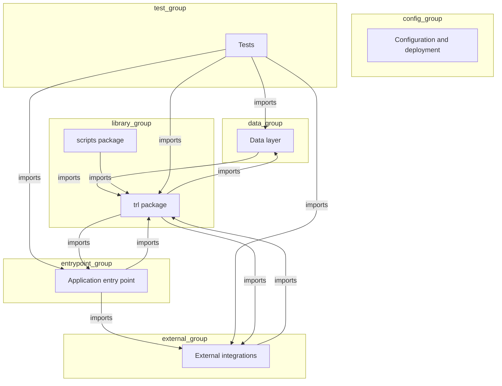

# Architecture report: huggingface/trl

> Automated static analysis. **Observed** = directly seen in files/imports/AST; **Inferred** = interpretation from that evidence. Repository code was not executed.

## 1. Repository at a glance

| Item | Value |
| --- | --- |
| Repository | huggingface/trl |
| Description | Train transformer language models with reinforcement learning. |
| Language | Python |
| Stars | 19735 |
| Licence | Apache-2.0 |
| Analysed commit / branch | 8ad18ec1b6493b85cf9fffbd87d376767ceb8611 / main |
| Framework(s) | None detected |
| Files analysed | 605 |
| Components | 7 |

## 2. Architecture in one minute

huggingface/trl - Train transformer language models with reinforcement learning.. This repository was analysed statically from 605 file(s) (339 Python). Detected technologies (observed from imports/manifests): GitHub Actions, SQLite, aiohttp, NumPy, pandas, Pydantic. Files are grouped into 7 component(s): Configuration and deployment, Data layer, Application entry point, External integrations, scripts package, Tests, trl package. Observed entry point(s): scripts/add_copyrights.py, scripts/check_chat_templates.py, scripts/generate_harmony_dataset.py. Findings below distinguish observed facts from inferred interpretation.

## 3. High-level block diagram

## 4. Main components

### Configuration and deployment (`config`)

- **Kind:** config
- **Status:** Observed
- **Confidence:** 0.85
- **Responsibility:** Groups 11 file(s) under configuration and deployment (observed from repository paths and static analysis).
- **Paths:** `MANIFEST.in`, `docker/trl-dev/Dockerfile`, `docker/trl/Dockerfile`, `pyproject.toml`, `trl/accelerate_configs/fsdp1.yaml`, `trl/accelerate_configs/fsdp2.yaml`, `trl/accelerate_configs/multi_gpu.yaml`, `trl/accelerate_configs/single_gpu.yaml`, `trl/accelerate_configs/zero1.yaml`, `trl/accelerate_configs/zero2.yaml`, `trl/accelerate_configs/zero3.yaml`
- **Evidence:** [MANIFEST.in](https://github.com/huggingface/trl/blob/8ad18ec1b6493b85cf9fffbd87d376767ceb8611/MANIFEST.in); [docker/trl-dev/Dockerfile](https://github.com/huggingface/trl/blob/8ad18ec1b6493b85cf9fffbd87d376767ceb8611/docker/trl-dev/Dockerfile); [docker/trl/Dockerfile](https://github.com/huggingface/trl/blob/8ad18ec1b6493b85cf9fffbd87d376767ceb8611/docker/trl/Dockerfile); [pyproject.toml](https://github.com/huggingface/trl/blob/8ad18ec1b6493b85cf9fffbd87d376767ceb8611/pyproject.toml); [trl/accelerate_configs/fsdp1.yaml](https://github.com/huggingface/trl/blob/8ad18ec1b6493b85cf9fffbd87d376767ceb8611/trl/accelerate_configs/fsdp1.yaml); [trl/accelerate_configs/fsdp2.yaml](https://github.com/huggingface/trl/blob/8ad18ec1b6493b85cf9fffbd87d376767ceb8611/trl/accelerate_configs/fsdp2.yaml); [trl/accelerate_configs/multi_gpu.yaml](https://github.com/huggingface/trl/blob/8ad18ec1b6493b85cf9fffbd87d376767ceb8611/trl/accelerate_configs/multi_gpu.yaml); [trl/accelerate_configs/single_gpu.yaml](https://github.com/huggingface/trl/blob/8ad18ec1b6493b85cf9fffbd87d376767ceb8611/trl/accelerate_configs/single_gpu.yaml)

### Data layer (`data_layer`)

- **Kind:** data
- **Status:** Observed
- **Confidence:** 0.85
- **Responsibility:** Groups 4 file(s) under data layer (observed from repository paths and static analysis). Observed top-level classes: NoOpManager, OffloadActivations, _ForwardRedirection. Observed top-level functions: _aten_attention_ops, _build_policy_fn, _get_unique_tensor_key, _is_dense, _override_model_generation_config, _unwrap_model_for_generation.
- **Paths:** `trl/models/__init__.py`, `trl/models/activation_offloading.py`, `trl/models/selective_activation_checkpointing.py`, `trl/models/utils.py`
- **Evidence:** [trl/models/__init__.py](https://github.com/huggingface/trl/blob/8ad18ec1b6493b85cf9fffbd87d376767ceb8611/trl/models/__init__.py); [trl/models/activation_offloading.py:48](https://github.com/huggingface/trl/blob/8ad18ec1b6493b85cf9fffbd87d376767ceb8611/trl/models/activation_offloading.py#L48); [trl/models/selective_activation_checkpointing.py:36](https://github.com/huggingface/trl/blob/8ad18ec1b6493b85cf9fffbd87d376767ceb8611/trl/models/selective_activation_checkpointing.py#L36); [trl/models/utils.py:45](https://github.com/huggingface/trl/blob/8ad18ec1b6493b85cf9fffbd87d376767ceb8611/trl/models/utils.py#L45)

### Application entry point (`entrypoint`)

- **Kind:** entrypoint
- **Status:** Observed
- **Confidence:** 0.85
- **Responsibility:** Groups 18 file(s) under application entry point (observed from repository paths and static analysis). Observed top-level classes: GRPOScriptArguments, RLOOScriptArguments, ScriptArguments, VLLMClient. Observed top-level functions: _build_parser, build_command, check_and_add_copyright, get_chat_template, get_tracked_python_files, main.
- **Paths:** `scripts/add_copyrights.py`, `scripts/check_chat_templates.py`, `scripts/generate_harmony_dataset.py`, `scripts/generate_toolcall_dataset.py`, `scripts/generate_zen_dataset.py`, `scripts/generate_zen_image_dataset.py`, `scripts/generate_zen_multi_image_dataset.py`, `trl/cli/main.py`, `trl/generation/vllm_client.py`, `trl/scripts/distillation.py`, `trl/scripts/dpo.py`, `trl/scripts/env.py`, `trl/scripts/grpo.py`, `trl/scripts/kto.py`, `trl/scripts/reward.py`, `trl/scripts/rloo.py`, `trl/scripts/sft.py`, `trl/scripts/vllm_serve.py`
- **Evidence:** [scripts/add_copyrights.py:37](https://github.com/huggingface/trl/blob/8ad18ec1b6493b85cf9fffbd87d376767ceb8611/scripts/add_copyrights.py#L37); [scripts/check_chat_templates.py:114](https://github.com/huggingface/trl/blob/8ad18ec1b6493b85cf9fffbd87d376767ceb8611/scripts/check_chat_templates.py#L114); [scripts/generate_harmony_dataset.py:22](https://github.com/huggingface/trl/blob/8ad18ec1b6493b85cf9fffbd87d376767ceb8611/scripts/generate_harmony_dataset.py#L22); [scripts/generate_toolcall_dataset.py:23](https://github.com/huggingface/trl/blob/8ad18ec1b6493b85cf9fffbd87d376767ceb8611/scripts/generate_toolcall_dataset.py#L23); [scripts/generate_zen_dataset.py:22](https://github.com/huggingface/trl/blob/8ad18ec1b6493b85cf9fffbd87d376767ceb8611/scripts/generate_zen_dataset.py#L22); [scripts/generate_zen_image_dataset.py:26](https://github.com/huggingface/trl/blob/8ad18ec1b6493b85cf9fffbd87d376767ceb8611/scripts/generate_zen_image_dataset.py#L26); [scripts/generate_zen_multi_image_dataset.py:26](https://github.com/huggingface/trl/blob/8ad18ec1b6493b85cf9fffbd87d376767ceb8611/scripts/generate_zen_multi_image_dataset.py#L26); [trl/cli/main.py:22](https://github.com/huggingface/trl/blob/8ad18ec1b6493b85cf9fffbd87d376767ceb8611/trl/cli/main.py#L22)

### External integrations (`external_integrations`)

- **Kind:** external
- **Status:** Observed
- **Confidence:** 0.85
- **Responsibility:** Groups 2 file(s) under external integrations (observed from repository paths and static analysis). Observed top-level classes: AsyncVLLMClient, VLLMClient.
- **Paths:** `trl/experimental/async_distillation/vllm_client.py`, `trl/generation/async_vllm_client.py`
- **Evidence:** [trl/experimental/async_distillation/vllm_client.py:29](https://github.com/huggingface/trl/blob/8ad18ec1b6493b85cf9fffbd87d376767ceb8611/trl/experimental/async_distillation/vllm_client.py#L29); [trl/generation/async_vllm_client.py:29](https://github.com/huggingface/trl/blob/8ad18ec1b6493b85cf9fffbd87d376767ceb8611/trl/generation/async_vllm_client.py#L29)

### scripts package (`scripts`)

- **Kind:** library
- **Status:** Observed
- **Confidence:** 0.85
- **Responsibility:** Groups 80 file(s) under scripts package (observed from repository paths and static analysis). Observed top-level classes: RemoteConfig, RemoteForCausalLM, RemoteForSequenceClassification, RemoteModel. Observed top-level functions: _flatten, _format_diff_value, _parse_args, _transformers_floor_from_pyproject, check_dtype_pattern, check_transformers_version.
- **Paths:** `scripts/generate_tiny_models/__init__.py`, `scripts/generate_tiny_models/_common.py`, `scripts/generate_tiny_models/for_block_diffusion/__init__.py`, `scripts/generate_tiny_models/for_block_diffusion/diffusion_gemma_for_block_diffusion.py`, `scripts/generate_tiny_models/for_causal_lm/__init__.py`, `scripts/generate_tiny_models/for_causal_lm/_remote_code/__init__.py`, `scripts/generate_tiny_models/for_causal_lm/_remote_code/configuration_remote.py`, `scripts/generate_tiny_models/for_causal_lm/_remote_code/modeling_remote.py`, `scripts/generate_tiny_models/for_causal_lm/beam_for_causal_lm.py`, `scripts/generate_tiny_models/for_causal_lm/cohere2_for_causal_lm.py`, `scripts/generate_tiny_models/for_causal_lm/cohere_for_causal_lm.py`, `scripts/generate_tiny_models/for_causal_lm/deepseek_v3_for_causal_lm.py`, `scripts/generate_tiny_models/for_causal_lm/deepseek_v3_for_causal_lm_0528.py`, `scripts/generate_tiny_models/for_causal_lm/falcon_mamba_for_causal_lm.py`, `scripts/generate_tiny_models/for_causal_lm/gemma2_for_causal_lm.py`, `scripts/generate_tiny_models/for_causal_lm/gemma_for_causal_lm.py`, `scripts/generate_tiny_models/for_causal_lm/glm4_moe_for_causal_lm.py`, `scripts/generate_tiny_models/for_causal_lm/gpt2_lm_head_model.py`, `scripts/generate_tiny_models/for_causal_lm/gpt_neox_for_causal_lm.py`, `scripts/generate_tiny_models/for_causal_lm/gpt_oss_for_causal_lm.py`, `scripts/generate_tiny_models/for_causal_lm/granitemoe_for_causal_lm.py`, `scripts/generate_tiny_models/for_causal_lm/granitemoehybrid_for_causal_lm.py`, `scripts/generate_tiny_models/for_causal_lm/lfm2_for_causal_lm.py`, `scripts/generate_tiny_models/for_causal_lm/lfm2_for_causal_lm_2_5.py`, `scripts/generate_tiny_models/for_causal_lm/lfm2_moe_for_causal_lm_2_5.py`, `scripts/generate_tiny_models/for_causal_lm/llama_for_causal_lm_3.py`, `scripts/generate_tiny_models/for_causal_lm/llama_for_causal_lm_3_1.py`, `scripts/generate_tiny_models/for_causal_lm/llama_for_causal_lm_3_2.py`, `scripts/generate_tiny_models/for_causal_lm/mistral_for_causal_lm_0_1.py`, `scripts/generate_tiny_models/for_causal_lm/mistral_for_causal_lm_0_2.py`, `scripts/generate_tiny_models/for_causal_lm/nemotron_3_5_lightning_for_causal_lm.py`, `scripts/generate_tiny_models/for_causal_lm/nemotron_3_nano_for_causal_lm.py`, `scripts/generate_tiny_models/for_causal_lm/nemotron_3_super_for_causal_lm.py`, `scripts/generate_tiny_models/for_causal_lm/nemotron_3_ultra_for_causal_lm.py`, `scripts/generate_tiny_models/for_causal_lm/olmo3_for_causal_lm.py`, `scripts/generate_tiny_models/for_causal_lm/opt_for_causal_lm.py`, `scripts/generate_tiny_models/for_causal_lm/peft_qwen3_for_causal_lm.py`, `scripts/generate_tiny_models/for_causal_lm/peft_qwen3_for_causal_lm_2.py`, `scripts/generate_tiny_models/for_causal_lm/phi3_for_causal_lm_3.py`, `scripts/generate_tiny_models/for_causal_lm/phi3_for_causal_lm_3_5.py`, `scripts/generate_tiny_models/for_causal_lm/phimoe_for_causal_lm.py`, `scripts/generate_tiny_models/for_causal_lm/qwen2_for_causal_lm_2_5.py`, `scripts/generate_tiny_models/for_causal_lm/qwen2_for_causal_lm_r1_distill.py`, `scripts/generate_tiny_models/for_causal_lm/qwen3_for_causal_lm.py`, `scripts/generate_tiny_models/for_causal_lm/qwen3_for_causal_lm_instruct_2507.py`, `scripts/generate_tiny_models/for_causal_lm/qwen3_moe_for_causal_lm.py`, `scripts/generate_tiny_models/for_causal_lm/qwen3_moe_for_causal_lm_response_template.py`, `scripts/generate_tiny_models/for_causal_lm/remote_for_causal_lm.py`, `scripts/generate_tiny_models/for_causal_lm/small_qwen2_for_causal_lm_2_5.py`, `scripts/generate_tiny_models/for_causal_lm/small_qwen3_for_causal_lm.py`, `scripts/generate_tiny_models/for_causal_lm/smollm3_for_causal_lm.py`, `scripts/generate_tiny_models/for_conditional_generation/__init__.py`, `scripts/generate_tiny_models/for_conditional_generation/bart_model.py`, `scripts/generate_tiny_models/for_conditional_generation/gemma3_for_conditional_generation.py`, `scripts/generate_tiny_models/for_conditional_generation/gemma4_for_conditional_generation.py`, `scripts/generate_tiny_models/for_conditional_generation/glm5_next_for_conditional_generation.py`, `scripts/generate_tiny_models/for_conditional_generation/idefics2_for_conditional_generation.py`, `scripts/generate_tiny_models/for_conditional_generation/idefics3_for_conditional_generation.py`, `scripts/generate_tiny_models/for_conditional_generation/internvl_for_conditional_generation.py`, `scripts/generate_tiny_models/for_conditional_generation/lfm2_vl_for_conditional_generation.py`, `scripts/generate_tiny_models/for_conditional_generation/llava_for_conditional_generation.py`, `scripts/generate_tiny_models/for_conditional_generation/llava_next_for_conditional_generation.py`, `scripts/generate_tiny_models/for_conditional_generation/mistral3_for_conditional_generation.py`, `scripts/generate_tiny_models/for_conditional_generation/mistral_large4_for_conditional_generation.py`, `scripts/generate_tiny_models/for_conditional_generation/muse_glimmer_for_conditional_generation.py`, `scripts/generate_tiny_models/for_conditional_generation/muse_spark_for_conditional_generation.py`, `scripts/generate_tiny_models/for_conditional_generation/qwen2_5_vl_for_conditional_generation.py`, `scripts/generate_tiny_models/for_conditional_generation/qwen2_vl_for_conditional_generation.py`, `scripts/generate_tiny_models/for_conditional_generation/qwen3_5_for_conditional_generation_nothink.py`, `scripts/generate_tiny_models/for_conditional_generation/qwen3_5_for_conditional_generation_think.py`, `scripts/generate_tiny_models/for_conditional_generation/qwen3_6_for_conditional_generation.py`, `scripts/generate_tiny_models/for_conditional_generation/qwen3_8_for_conditional_generation.py`, `scripts/generate_tiny_models/for_conditional_generation/qwen3_vl_for_conditional_generation.py`, `scripts/generate_tiny_models/for_conditional_generation/smolvlm_for_conditional_generation.py`, `scripts/generate_tiny_models/for_conditional_generation/t5_for_conditional_generation.py`, `scripts/generate_tiny_models/for_sequence_classification/__init__.py`, `scripts/generate_tiny_models/for_sequence_classification/gpt_neox_for_sequence_classification.py`, `scripts/generate_tiny_models/for_sequence_classification/llama_for_sequence_classification_3_2.py`, `scripts/generate_tiny_models/for_sequence_classification/qwen2_for_sequence_classification_2_5.py`, `scripts/generate_tiny_models/for_sequence_classification/qwen3_for_sequence_classification.py`
- **Evidence:** [scripts/generate_tiny_models/__init__.py](https://github.com/huggingface/trl/blob/8ad18ec1b6493b85cf9fffbd87d376767ceb8611/scripts/generate_tiny_models/__init__.py); [scripts/generate_tiny_models/_common.py:54](https://github.com/huggingface/trl/blob/8ad18ec1b6493b85cf9fffbd87d376767ceb8611/scripts/generate_tiny_models/_common.py#L54); [scripts/generate_tiny_models/for_block_diffusion/__init__.py](https://github.com/huggingface/trl/blob/8ad18ec1b6493b85cf9fffbd87d376767ceb8611/scripts/generate_tiny_models/for_block_diffusion/__init__.py); [scripts/generate_tiny_models/for_block_diffusion/diffusion_gemma_for_block_diffusion.py](https://github.com/huggingface/trl/blob/8ad18ec1b6493b85cf9fffbd87d376767ceb8611/scripts/generate_tiny_models/for_block_diffusion/diffusion_gemma_for_block_diffusion.py); [scripts/generate_tiny_models/for_causal_lm/__init__.py](https://github.com/huggingface/trl/blob/8ad18ec1b6493b85cf9fffbd87d376767ceb8611/scripts/generate_tiny_models/for_causal_lm/__init__.py); [scripts/generate_tiny_models/for_causal_lm/_remote_code/__init__.py](https://github.com/huggingface/trl/blob/8ad18ec1b6493b85cf9fffbd87d376767ceb8611/scripts/generate_tiny_models/for_causal_lm/_remote_code/__init__.py); [scripts/generate_tiny_models/for_causal_lm/_remote_code/configuration_remote.py:18](https://github.com/huggingface/trl/blob/8ad18ec1b6493b85cf9fffbd87d376767ceb8611/scripts/generate_tiny_models/for_causal_lm/_remote_code/configuration_remote.py#L18); [scripts/generate_tiny_models/for_causal_lm/_remote_code/modeling_remote.py:21](https://github.com/huggingface/trl/blob/8ad18ec1b6493b85cf9fffbd87d376767ceb8611/scripts/generate_tiny_models/for_causal_lm/_remote_code/modeling_remote.py#L21)

### Tests (`tests`)

- **Kind:** test
- **Status:** Observed
- **Confidence:** 0.85
- **Responsibility:** Groups 56 file(s) under tests (observed from repository paths and static analysis). Observed routes: PATCH sys.stdout, PATCH transformers.generation.utils.GenerationMixin.generate, PATCH sys.stdout, PATCH sys.stdout, PATCH sys.stdout. Observed top-level classes: CorrectnessConfig, DummyModel, EchoEnvironment, EchoParams, EchoTaskSpec, FakeVLLMServer. Observed top-level functions: _any_adapter_merged, _assert_alignment_covers_completion, _build, _build_server_result, _canned_teacher_logprobs, _checkpoint_trainer.
- **Paths:** `tests/__init__.py`, `tests/conftest.py`, `tests/data/template.jinja`, `tests/distributed/__init__.py`, `tests/distributed/data/fsdp2.json`, `tests/distributed/data/zero2.json`, `tests/distributed/data/zero3.json`, `tests/distributed/test_distributed.py`, `tests/experimental/__init__.py`, `tests/experimental/_openreward_echo_env.py`, `tests/experimental/test_a2po_trainer.py`, `tests/experimental/test_async_distillation_trainer.py`, `tests/experimental/test_cpo_trainer.py`, `tests/experimental/test_gkd_trainer.py`, `tests/experimental/test_gmpo_trainer.py`, `tests/experimental/test_gold_trainer.py`, `tests/experimental/test_harbor.py`, `tests/experimental/test_iw_opd_trainer.py`, `tests/experimental/test_merge_model_callback.py`, `tests/experimental/test_online_dpo_trainer.py`, `tests/experimental/test_openenv_tito.py`, `tests/experimental/test_openreward.py`, `tests/experimental/test_orpo_trainer.py`, `tests/experimental/test_sdft_trainer.py`, `tests/experimental/test_sdpo_trainer.py`, `tests/experimental/test_self_distillation_trainer_behavior.py`, `tests/experimental/test_server_distillation_trainer.py`, `tests/experimental/test_utils.py`, `tests/invariant/README.md`, `tests/invariant/__init__.py`, `tests/invariant/references/dpo.json`, `tests/invariant/references/sft.json`, `tests/invariant/references/sft_fa2.json`, `tests/invariant/test_invariant.py`, `tests/test_activation_offloading.py`, `tests/test_callbacks.py`, `tests/test_chat_template_utils.py`, `tests/test_cli.py`, `tests/test_cli_utils.py`, `tests/test_data_utils.py`, `tests/test_distillation_trainer.py`, `tests/test_dpo_trainer.py`, `tests/test_examples_index.py`, `tests/test_kernels.py`, `tests/test_kto_trainer.py`, `tests/test_model_utils.py`, `tests/test_reward_trainer.py`, `tests/test_rewards.py`, `tests/test_rich_progress_callback.py`, `tests/test_rloo_trainer.py`, `tests/test_selective_activation_checkpointing.py`, `tests/test_sft_trainer.py`, `tests/test_utils.py`, `tests/test_vllm_client_server.py`, `tests/testing_constants.py`, `tests/testing_utils.py`
- **Evidence:** [tests/__init__.py](https://github.com/huggingface/trl/blob/8ad18ec1b6493b85cf9fffbd87d376767ceb8611/tests/__init__.py); [tests/conftest.py:37](https://github.com/huggingface/trl/blob/8ad18ec1b6493b85cf9fffbd87d376767ceb8611/tests/conftest.py#L37); [tests/data/template.jinja](https://github.com/huggingface/trl/blob/8ad18ec1b6493b85cf9fffbd87d376767ceb8611/tests/data/template.jinja); [tests/distributed/__init__.py](https://github.com/huggingface/trl/blob/8ad18ec1b6493b85cf9fffbd87d376767ceb8611/tests/distributed/__init__.py); [tests/distributed/data/fsdp2.json](https://github.com/huggingface/trl/blob/8ad18ec1b6493b85cf9fffbd87d376767ceb8611/tests/distributed/data/fsdp2.json); [tests/distributed/data/zero2.json](https://github.com/huggingface/trl/blob/8ad18ec1b6493b85cf9fffbd87d376767ceb8611/tests/distributed/data/zero2.json); [tests/distributed/data/zero3.json](https://github.com/huggingface/trl/blob/8ad18ec1b6493b85cf9fffbd87d376767ceb8611/tests/distributed/data/zero3.json); [tests/distributed/test_distributed.py:52](https://github.com/huggingface/trl/blob/8ad18ec1b6493b85cf9fffbd87d376767ceb8611/tests/distributed/test_distributed.py#L52)

### trl package (`trl`)

- **Kind:** library
- **Status:** Observed
- **Confidence:** 0.85
- **Responsibility:** Groups 110 file(s) under trl package (observed from repository paths and static analysis). Observed top-level classes: A2POConfig, A2POTrainer, AsyncDistillationConfig, AsyncDistillationTrainer, AsyncGRPOConfig, AsyncGRPOTrainer. Observed top-level functions: HfArg, _accept_none, _add_tail_bucket, _addmm_fp32, _backward_kernel, _backward_tile.
- **Paths:** `trl/__init__.py`, `trl/_compat.py`, `trl/_lazy_module.py`, `trl/chat_template_utils.py`, `trl/cli/__init__.py`, `trl/cli/accelerate_config.py`, `trl/cli/accelerate_launcher.py`, `trl/cli/commands/__init__.py`, `trl/cli/commands/base.py`, `trl/cli/commands/env.py`, `trl/cli/commands/training.py`, `trl/cli/commands/vllm_serve.py`, `trl/data_utils.py`, `trl/distributed.py`, `trl/experimental/__init__.py`, `trl/experimental/a2po/__init__.py`, `trl/experimental/a2po/a2po_config.py`, `trl/experimental/a2po/a2po_trainer.py`, `trl/experimental/async_distillation/__init__.py`, `trl/experimental/async_distillation/async_distillation_config.py`, `trl/experimental/async_distillation/async_distillation_trainer.py`, `trl/experimental/async_distillation/async_rollout_worker.py`, `trl/experimental/async_distillation/weight_transfer.py`, `trl/experimental/async_grpo/__init__.py`, `trl/experimental/async_grpo/openenv_harness.py`, `trl/experimental/bema_for_ref_model/__init__.py`, `trl/experimental/bema_for_ref_model/callback.py`, `trl/experimental/bema_for_ref_model/dpo_trainer.py`, `trl/experimental/cpo/__init__.py`, `trl/experimental/cpo/cpo_config.py`, `trl/experimental/cpo/cpo_trainer.py`, `trl/experimental/distillation/__init__.py`, `trl/experimental/gkd/__init__.py`, `trl/experimental/gkd/gkd_config.py`, `trl/experimental/gkd/gkd_trainer.py`, `trl/experimental/gmpo/__init__.py`, `trl/experimental/gmpo/gmpo_config.py`, `trl/experimental/gmpo/gmpo_trainer.py`, `trl/experimental/gold/__init__.py`, `trl/experimental/gold/gold_config.py`, `trl/experimental/gold/gold_trainer.py`, `trl/experimental/harbor/__init__.py`, `trl/experimental/harbor/_env.py`, `trl/experimental/harbor/_spec.py`, `trl/experimental/iw_opd/__init__.py`, `trl/experimental/iw_opd/iw_opd_config.py`, `trl/experimental/iw_opd/iw_opd_trainer.py`, `trl/experimental/kto/__init__.py`, `trl/experimental/merge_model_callback.py`, `trl/experimental/online_dpo/__init__.py`, `trl/experimental/online_dpo/online_dpo_config.py`, `trl/experimental/online_dpo/online_dpo_trainer.py`, `trl/experimental/openreward/__init__.py`, `trl/experimental/openreward/_spec.py`, `trl/experimental/openreward/environment.py`, `trl/experimental/orpo/__init__.py`, `trl/experimental/orpo/orpo_config.py`, `trl/experimental/orpo/orpo_trainer.py`, `trl/experimental/sdft/__init__.py`, `trl/experimental/sdft/loss_utils.py`, `trl/experimental/sdft/sdft_config.py`, `trl/experimental/sdft/sdft_trainer.py`, `trl/experimental/sdft/teacher_sync.py`, `trl/experimental/sdpo/__init__.py`, `trl/experimental/sdpo/loss_utils.py`, `trl/experimental/sdpo/sdpo_config.py`, `trl/experimental/sdpo/sdpo_trainer.py`, `trl/experimental/sdpo/teacher_sync.py`, `trl/experimental/server_distillation/__init__.py`, `trl/experimental/server_distillation/server_distillation_config.py`, `trl/experimental/server_distillation/server_distillation_trainer.py`, `trl/experimental/utils.py`, `trl/extras/__init__.py`, `trl/extras/profiling.py`, `trl/generation/__init__.py`, `trl/generation/vllm_generation.py`, `trl/generation/weight_transfer.py`, `trl/import_utils.py`, `trl/kernels/__init__.py`, `trl/kernels/chunked_divergence.py`, `trl/kernels/chunked_logprob.py`, `trl/kernels/logprob_entropy.py`, `trl/kernels/tree_gated_delta_rule.py`, `trl/rewards/__init__.py`, `trl/rewards/accuracy_rewards.py`, `trl/rewards/format_rewards.py`, `trl/rewards/other_rewards.py`, `trl/scripts/__init__.py`, `trl/scripts/_hf_argparser.py`, `trl/scripts/utils.py`, `trl/trainer/__init__.py`, `trl/trainer/async_grpo_config.py`, `trl/trainer/base_config.py`, `trl/trainer/base_trainer.py`, `trl/trainer/callbacks.py`, `trl/trainer/distillation_config.py`, `trl/trainer/distillation_trainer.py`, `trl/trainer/dpo_config.py`, `trl/trainer/dpo_trainer.py`, `trl/trainer/grpo_config.py`, `trl/trainer/kto_config.py`, `trl/trainer/kto_trainer.py`, `trl/trainer/model_config.py`, `trl/trainer/reward_config.py`, `trl/trainer/reward_trainer.py`, `trl/trainer/rloo_config.py`, `trl/trainer/rloo_trainer.py`, `trl/trainer/sft_config.py`, `trl/trainer/sft_trainer.py`, `trl/trainer/utils.py`
- **Evidence:** [trl/__init__.py](https://github.com/huggingface/trl/blob/8ad18ec1b6493b85cf9fffbd87d376767ceb8611/trl/__init__.py); [trl/_compat.py:30](https://github.com/huggingface/trl/blob/8ad18ec1b6493b85cf9fffbd87d376767ceb8611/trl/_compat.py#L30); [trl/_lazy_module.py:22](https://github.com/huggingface/trl/blob/8ad18ec1b6493b85cf9fffbd87d376767ceb8611/trl/_lazy_module.py#L22); [trl/chat_template_utils.py:43](https://github.com/huggingface/trl/blob/8ad18ec1b6493b85cf9fffbd87d376767ceb8611/trl/chat_template_utils.py#L43); [trl/cli/__init__.py](https://github.com/huggingface/trl/blob/8ad18ec1b6493b85cf9fffbd87d376767ceb8611/trl/cli/__init__.py); [trl/cli/accelerate_config.py:19](https://github.com/huggingface/trl/blob/8ad18ec1b6493b85cf9fffbd87d376767ceb8611/trl/cli/accelerate_config.py#L19); [trl/cli/accelerate_launcher.py:22](https://github.com/huggingface/trl/blob/8ad18ec1b6493b85cf9fffbd87d376767ceb8611/trl/cli/accelerate_launcher.py#L22); [trl/cli/commands/__init__.py:21](https://github.com/huggingface/trl/blob/8ad18ec1b6493b85cf9fffbd87d376767ceb8611/trl/cli/commands/__init__.py#L21)

## 5. Execution flow

**Observed** entry point(s):

- [scripts/add_copyrights.py:91](https://github.com/huggingface/trl/blob/8ad18ec1b6493b85cf9fffbd87d376767ceb8611/scripts/add_copyrights.py#L91)
- [scripts/check_chat_templates.py:141](https://github.com/huggingface/trl/blob/8ad18ec1b6493b85cf9fffbd87d376767ceb8611/scripts/check_chat_templates.py#L141)
- [scripts/generate_harmony_dataset.py:260](https://github.com/huggingface/trl/blob/8ad18ec1b6493b85cf9fffbd87d376767ceb8611/scripts/generate_harmony_dataset.py#L260)
- [scripts/generate_toolcall_dataset.py:337](https://github.com/huggingface/trl/blob/8ad18ec1b6493b85cf9fffbd87d376767ceb8611/scripts/generate_toolcall_dataset.py#L337)
- [scripts/generate_zen_dataset.py:589](https://github.com/huggingface/trl/blob/8ad18ec1b6493b85cf9fffbd87d376767ceb8611/scripts/generate_zen_dataset.py#L589)
- [scripts/generate_zen_image_dataset.py:343](https://github.com/huggingface/trl/blob/8ad18ec1b6493b85cf9fffbd87d376767ceb8611/scripts/generate_zen_image_dataset.py#L343)
- [scripts/generate_zen_multi_image_dataset.py:271](https://github.com/huggingface/trl/blob/8ad18ec1b6493b85cf9fffbd87d376767ceb8611/scripts/generate_zen_multi_image_dataset.py#L271)
- [trl/cli/__init__.py](https://github.com/huggingface/trl/blob/8ad18ec1b6493b85cf9fffbd87d376767ceb8611/trl/cli/__init__.py)
- [trl/cli/main.py:50](https://github.com/huggingface/trl/blob/8ad18ec1b6493b85cf9fffbd87d376767ceb8611/trl/cli/main.py#L50)
- [trl/generation/vllm_client.py:955](https://github.com/huggingface/trl/blob/8ad18ec1b6493b85cf9fffbd87d376767ceb8611/trl/generation/vllm_client.py#L955)
- [trl/scripts/distillation.py:154](https://github.com/huggingface/trl/blob/8ad18ec1b6493b85cf9fffbd87d376767ceb8611/trl/scripts/distillation.py#L154)
- [trl/scripts/dpo.py:148](https://github.com/huggingface/trl/blob/8ad18ec1b6493b85cf9fffbd87d376767ceb8611/trl/scripts/dpo.py#L148)

**Observed** routes (from decorators):

- `PATCH sys.stdout` -> `test_env` in `tests/test_cli.py:126`
- `PATCH transformers.generation.utils.GenerationMixin.generate` -> `test_train_with_mask_truncated_completions` in `tests/test_rloo_trainer.py:1702`
- `PATCH sys.stdout` -> `test_print_tool_only_assistant_with_null_content` in `tests/test_utils.py:774`
- `PATCH sys.stdout` -> `test_print_output` in `tests/test_utils.py:796`
- `PATCH sys.stdout` -> `test_no_advantages` in `tests/test_utils.py:823`
- `PATCH sys.stdout` -> `test_no_rewards_no_advantages` in `tests/test_utils.py:839`
- `PATCH sys.stdout` -> `test_extra_columns` in `tests/test_utils.py:853`
- `PATCH sys.stdout` -> `test_num_samples` in `tests/test_utils.py:881`
- `PATCH sys.stdout` -> `test_print_messages` in `tests/test_utils.py:916`
- `PATCH sys.stdout` -> `test_print_messages_with_tools` in `tests/test_utils.py:965`
- `PATCH sys.stdout` -> `test_print_messages_with_reasoning_content` in `tests/test_utils.py:1029`
- `PATCH sys.stdout` -> `test_print_messages_with_thinking` in `tests/test_utils.py:1056`

Representative flow (derived from observed entry points and the import graph; steps beyond the entry point are **Inferred**):

1. Execution starts at an observed entry point listed above, if present.
2. `data_layer` imports `trl` (Data layer -> trl package).
3. `entrypoint` imports `external_integrations` (Application entry point -> External integrations).
4. `entrypoint` imports `trl` (Application entry point -> trl package).
5. `external_integrations` imports `trl` (External integrations -> trl package).
6. `scripts` imports `trl` (scripts package -> trl package).
7. `tests` imports `data_layer` (Tests -> Data layer).
8. `tests` imports `entrypoint` (Tests -> Application entry point).
9. `tests` imports `external_integrations` (Tests -> External integrations).

## 6. Project structure

### `(root)`

- `.gitignore` - other (1635 bytes)
- `.pre-commit-config.yaml` - config (502 bytes)
- `CITATION.cff` - other (1322 bytes)
- `CODE_OF_CONDUCT.md` - docs (5488 bytes)
- `CONTRIBUTING.md` - docs (29108 bytes)
- `LICENSE` - docs (11355 bytes)
- `MANIFEST.in` - manifest (234 bytes)
- `MIGRATION.md` - docs (2376 bytes)
- `Makefile` - other (1102 bytes)
- `README.md` - docs (10018 bytes)
- `RELEASE.md` - docs (6518 bytes)
- `SECURITY.md` - docs (8081 bytes)
- `VERSION` - other (12 bytes)
- `pyproject.toml` - manifest (10608 bytes)

### `.agents`

- `.agents/skills/update-paper-index/SKILL.md` - docs (1629 bytes)

### `.ai`

- `.ai/AGENTS.md` - docs (7280 bytes)

### `.github`

- `.github/ISSUE_TEMPLATE/bug-report.yml` - config (3242 bytes)
- `.github/ISSUE_TEMPLATE/feature-request.yml` - config (1082 bytes)
- `.github/ISSUE_TEMPLATE/new-trainer-addition.yml` - config (1181 bytes)
- `.github/PULL_REQUEST_TEMPLATE.md` - docs (2006 bytes)
- `.github/actions/post-slack/action.yml` - config (2906 bytes)
- `.github/codeql/custom-queries.qls` - other (1016 bytes)
- `.github/dependabot.yml` - config (982 bytes)
- `.github/labeler.yml` - config (623 bytes)
- `.github/release.yml` - config (585 bytes)
- `.github/workflows/build_documentation.yml` - ci, YAML (476 bytes)
- `.github/workflows/build_pr_documentation.yml` - ci, YAML (663 bytes)
- `.github/workflows/chat_templates_check.yml` - ci, YAML (1921 bytes)
- `.github/workflows/codeQL.yml` - ci, YAML (747 bytes)
- `.github/workflows/docker-build-dev.yml` - ci, YAML (1403 bytes)
- `.github/workflows/docker-build.yml` - ci, YAML (1765 bytes)
- `.github/workflows/labeler.yml` - ci, YAML (939 bytes)
- `.github/workflows/pr_template_check.yml` - ci, YAML (5205 bytes)
- `.github/workflows/publish.yml` - ci, YAML (1646 bytes)
- `.github/workflows/quality.yml` - ci, YAML (1487 bytes)
- `.github/workflows/sync-huggingface-skills.yml` - ci, YAML (3479 bytes)
- `.github/workflows/tests-experimental.yml` - ci, YAML (2717 bytes)
- `.github/workflows/tests.yml` - ci, YAML (16394 bytes)
- `.github/workflows/tests_latest.yml` - ci, YAML (2231 bytes)
- `.github/workflows/tests_python_versions.yml` - ci, YAML (2197 bytes)
- `.github/workflows/tests_transformers_branch.yml` - ci, YAML (4342 bytes)
- `.github/workflows/tests_vllm.yml` - ci, YAML (5185 bytes)
- `.github/workflows/trufflehog.yml` - ci, YAML (1734 bytes)
- `.github/workflows/upload_pr_documentation.yml` - ci, YAML (493 bytes)
- `.github/workflows/version_check.yml` - ci, YAML (1535 bytes)

### `docker`

- `docker/trl-dev/Dockerfile` - container (634 bytes)
- `docker/trl/Dockerfile` - container (609 bytes)

### `docs`

- `docs/source/_redirects.yml` - config (38 bytes)
- `docs/source/_toctree.yml` - config (3239 bytes)
- `docs/source/a2po_trainer.md` - docs (3519 bytes)
- `docs/source/amd_gpus.md` - docs (1344 bytes)
- `docs/source/async_distillation_trainer.md` - docs (35493 bytes)
- `docs/source/async_grpo_trainer.md` - docs (71407 bytes)
- `docs/source/aws_trainium.md` - docs (4514 bytes)
- `docs/source/bema_for_reference_model.md` - docs (749 bytes)
- `docs/source/callbacks.md` - docs (222 bytes)
- `docs/source/chat_template_utils.md` - docs (422 bytes)
- `docs/source/chat_templates.md` - docs (21840 bytes)
- `docs/source/clis.md` - docs (14097 bytes)
- `docs/source/community_tutorials.md` - docs (10149 bytes)
- `docs/source/cpo_trainer.md` - docs (11892 bytes)
- `docs/source/customization.md` - docs (7168 bytes)
- `docs/source/data_utils.md` - docs (251 bytes)
- `docs/source/dataset_formats.md` - docs (36331 bytes)
- `docs/source/deepspeed_integration.md` - docs (1897 bytes)
- `docs/source/distillation_trainer.md` - docs (15006 bytes)
- `docs/source/distributing_training.md` - docs (3849 bytes)
- `docs/source/dpo_trainer.md` - docs (20203 bytes)
- `docs/source/example_overview.md` - docs (16916 bytes)
- `docs/source/experimental_overview.md` - docs (3037 bytes)
- `docs/source/gkd_trainer.md` - docs (5826 bytes)
- `docs/source/gmpo.md` - docs (1553 bytes)
- `docs/source/gold_trainer.md` - docs (13502 bytes)
- `docs/source/grpo_trainer.md` - docs (62206 bytes)
- `docs/source/harbor.md` - docs (10192 bytes)
- `docs/source/index.md` - docs (11529 bytes)
- `docs/source/installation.md` - docs (824 bytes)
- `docs/source/iw_opd_trainer.md` - docs (1360 bytes)
- `docs/source/jobs_training.md` - docs (18530 bytes)
- `docs/source/kernels_hub.md` - docs (5465 bytes)
- `docs/source/kto_trainer.md` - docs (19052 bytes)
- `docs/source/long_context_training.md` - docs (16325 bytes)
- `docs/source/lora_without_regret.md` - docs (14542 bytes)
- `docs/source/merge_model_callback.md` - docs (87 bytes)
- `docs/source/online_dpo_trainer.md` - docs (11436 bytes)
- `docs/source/openenv.md` - docs (40160 bytes)
- `docs/source/openreward.md` - docs (10312 bytes)
- `docs/source/orpo_trainer.md` - docs (8830 bytes)
- `docs/source/paper_index.md` - docs (98986 bytes)
- `docs/source/peft_integration.md` - docs (22405 bytes)
- `docs/source/quickstart.md` - docs (3854 bytes)
- `docs/source/rapidfire_integration.md` - docs (17763 bytes)
- `docs/source/reducing_memory_usage.md` - docs (13122 bytes)
- `docs/source/reward_trainer.md` - docs (10735 bytes)
- `docs/source/rewards.md` - docs (586 bytes)
- `docs/source/rloo_trainer.md` - docs (34238 bytes)
- `docs/source/script_utils.md` - docs (358 bytes)
- `docs/source/sdft_trainer.md` - docs (7705 bytes)
- `docs/source/sdpo_trainer.md` - docs (8500 bytes)
- `docs/source/sft_trainer.md` - docs (17640 bytes)
- `docs/source/speeding_up_training.md` - docs (5662 bytes)
- `docs/source/trackio_integration.md` - docs (2127 bytes)
- `docs/source/unsloth_integration.md` - docs (5108 bytes)
- `docs/source/usage_stats.md` - docs (2512 bytes)
- `docs/source/use_model.md` - docs (2432 bytes)
- `docs/source/vllm_integration.md` - docs (9199 bytes)

### `examples`

- `examples/README.md` - docs (1116 bytes)
- `examples/async_distillation_math/async_distillation_math.py` - source, Python (2892 bytes)
- `examples/async_distillation_mopd/README.md` - docs (6126 bytes)
- `examples/async_distillation_mopd/async_distillation_mopd.py` - source, Python (4924 bytes)
- `examples/async_distillation_mopd/launcher.py` - source, Python (8201 bytes)
- `examples/async_grpo_harbor/README.md` - docs (4274 bytes)
- `examples/async_grpo_harbor/async_grpo_harbor.py` - source, Python (12672 bytes)
- `examples/async_grpo_harbor/launcher.py` - source, Python (16332 bytes)
- `examples/async_grpo_math/async_grpo_lora_math.py` - source, Python (4124 bytes)
- `examples/async_grpo_math/async_grpo_math.py` - source, Python (2227 bytes)
- `examples/datasets/chess_puzzles.py` - source, Python (4358 bytes)
- `examples/datasets/deepmath_103k.py` - source, Python (3256 bytes)
- `examples/datasets/hh-rlhf-helpful-base.py` - source, Python (5360 bytes)
- `examples/datasets/llava_instruct_mix.py` - source, Python (4382 bytes)
- `examples/datasets/lm-human-preferences-descriptiveness.py` - source, Python (4882 bytes)
- `examples/datasets/lm-human-preferences-sentiment.py` - source, Python (4560 bytes)
- `examples/datasets/rlaif-v.py` - source, Python (4581 bytes)
- `examples/datasets/tldr.py` - source, Python (4233 bytes)
- `examples/datasets/tldr_preference.py` - source, Python (4397 bytes)
- `examples/datasets/ultrafeedback-prompt.py` - source, Python (3470 bytes)
- `examples/datasets/ultrafeedback.py` - source, Python (5466 bytes)
- `examples/deepspeed_configs/zero1.json` - config (225 bytes)
- `examples/deepspeed_configs/zero2.json` - config (270 bytes)
- `examples/deepspeed_configs/zero3.json` - config (366 bytes)
- `examples/dpo_reduce_hallucinations/dpo_reduce_hallucinations.py` - source, Python (4054 bytes)
- `examples/fsdp_configs/fsdp2.json` - config (182 bytes)
- `examples/gold_chatbot_arena/gold_chatbot_arena.py` - source, Python (7379 bytes)
- `examples/gold_qwen3_vl/gold_qwen3_vl.py` - source, Python (7673 bytes)
- `examples/grpo_2048/grpo_2048.py` - source, Python (5113 bytes)
- `examples/grpo_browsergym/browsergym_llm.py` - source, Python (14842 bytes)
- `examples/grpo_browsergym/grpo_browsergym.py` - source, Python (10955 bytes)
- `examples/grpo_carla/carla_vlm.py` - source, Python (8629 bytes)
- `examples/grpo_carla/carla_vlm_gemma.py` - source, Python (10683 bytes)
- `examples/grpo_carla/grpo_carla.py` - source, Python (6672 bytes)
- `examples/grpo_catch/grpo_catch.py` - source, Python (11996 bytes)
- `examples/grpo_continuous_batching/grpo_continuous_batching.py` - source, Python (4729 bytes)
- `examples/grpo_echo/grpo_echo.py` - source, Python (3886 bytes)
- `examples/grpo_harbor/grpo_harbor.py` - source, Python (5409 bytes)
- `examples/grpo_harbor/harnesses/__init__.py` - source, Python (773 bytes)
- `examples/grpo_harbor/harnesses/bash/README.md` - docs (766 bytes)
- `examples/grpo_harbor/harnesses/bash/__init__.py` - source, Python (726 bytes)
- `examples/grpo_harbor/harnesses/jupyter/README.md` - docs (1385 bytes)
- `examples/grpo_harbor/harnesses/jupyter/__init__.py` - source, Python (667 bytes)
- `examples/grpo_harbor/harnesses/jupyter/env.py` - source, Python (4388 bytes)
- `examples/grpo_harbor/harnesses/jupyter/kernel_server.py` - source, Python (3416 bytes)
- `examples/grpo_harbor/harnesses/jupyter/run_cell.py` - source, Python (1949 bytes)
- `examples/grpo_harbor/harnesses/terminal_notes/README.md` - docs (2041 bytes)
- `examples/grpo_harbor/harnesses/terminal_notes/__init__.py` - source, Python (679 bytes)
- `examples/grpo_harbor/harnesses/terminal_notes/env.py` - source, Python (8465 bytes)
- `examples/grpo_ministral3_vl/grpo_ministral3_vl.ipynb` - other (25046 bytes)
- `examples/grpo_multi_env/grpo_multi_env.py` - source, Python (9801 bytes)
- `examples/grpo_qlora/grpo_qlora.ipynb` - other (60157 bytes)
- `examples/grpo_qwen3_vl/grpo_qwen3_vl.ipynb` - other (23089 bytes)
- `examples/grpo_rnj_1_instruct/grpo_rnj_1_instruct.ipynb` - other (20977 bytes)
- `examples/grpo_seta/grpo_seta.py` - source, Python (4920 bytes)
- `examples/grpo_sql_agent/grpo_sql_agent.ipynb` - other (26416 bytes)
- `examples/grpo_sql_agent/grpo_sql_agent.py` - source, Python (10028 bytes)
- `examples/grpo_sudoku/README.md` - docs (4933 bytes)
- `examples/grpo_sudoku/grpo_sudoku.ipynb` - other (20448 bytes)
- `examples/grpo_sudoku/grpo_sudoku.py` - source, Python (8648 bytes)
- `examples/grpo_visual_math/grpo_visual_math.py` - source, Python (4767 bytes)
- `examples/grpo_wordle/grpo_wordle.ipynb` - other (20417 bytes)
- `examples/grpo_wordle/grpo_wordle.py` - source, Python (8961 bytes)
- `examples/gspo_math/gspo_math.py` - source, Python (3966 bytes)
- `examples/gspo_visual_math/gspo_visual_math.py` - source, Python (4395 bytes)
- `examples/lfm2_5_moe_research_agent/1_sft.py` - source, Python (4196 bytes)
- `examples/lfm2_5_moe_research_agent/2_evaluate.py` - source, Python (4833 bytes)
- `examples/lfm2_5_moe_research_agent/3_grpo.py` - source, Python (3340 bytes)
- `examples/lfm2_5_moe_research_agent/README.md` - docs (7821 bytes)
- `examples/lfm2_5_moe_research_agent/wiki_library.py` - source, Python (4134 bytes)
- `examples/mpo_visual_preferences/mpo_visual_preferences.py` - source, Python (4038 bytes)
- `examples/online_dpo_visual_math/online_dpo_visual_math.py` - source, Python (7580 bytes)
- `examples/rloo_math/rloo_math.py` - source, Python (3311 bytes)
- `examples/rloo_visual_math/rloo_visual_math.py` - source, Python (4767 bytes)
- `examples/sdft_privileged_context/sdft_privileged_context.py` - source, Python (15600 bytes)
- `examples/sdpo_math/sdpo_math.py` - source, Python (14857 bytes)
- `examples/sft_agent_traces/README.md` - docs (12538 bytes)
- `examples/sft_agent_traces/build_dataset.py` - source, Python (6750 bytes)
- `examples/sft_agent_traces/rollouts.py` - source, Python (17027 bytes)
- `examples/sft_agent_traces/sft.py` - source, Python (4858 bytes)
- `examples/sft_beam/sft_beam.py` - source, Python (2928 bytes)
- `examples/sft_beam/sft_beam.slurm` - other (232 bytes)
- `examples/sft_diffusion_gemma/sft_diffusion_gemma.py` - source, Python (18561 bytes)
- `examples/sft_gemma3/sft_gemma3.py` - source, Python (2019 bytes)
- `examples/sft_gemma3_vision/sft_gemma3_vision.py` - source, Python (6382 bytes)
- `examples/sft_gpt_oss_chess/README.md` - docs (9529 bytes)
- `examples/sft_gpt_oss_chess/evaluate.py` - source, Python (3540 bytes)
- `examples/sft_gpt_oss_chess/sft_gpt_oss_chess.py` - source, Python (2810 bytes)
- `examples/sft_mistral_large_4/sft_mistral_large_4.py` - source, Python (3133 bytes)
- `examples/sft_mistral_large_4/sft_mistral_large_4.slurm` - other (254 bytes)
- `examples/sft_muse_spark_open/sft_muse_spark_open.py` - source, Python (2885 bytes)
- `examples/sft_muse_spark_open/sft_muse_spark_open.slurm` - other (580 bytes)
- `examples/sft_nemotron_3/sft_nemotron_3.ipynb` - other (34014 bytes)
- `examples/sft_nemotron_3/sft_nemotron_3.py` - source, Python (3768 bytes)
- `examples/sft_qlora/sft_qlora.ipynb` - other (42766 bytes)
- `examples/sft_qwen3_8b_1m_context/sft_qwen3_8b_1m_context.py` - source, Python (4799 bytes)
- `examples/sft_tool_calling/sft_tiny_aya_tool_calling.py` - source, Python (5161 bytes)
- `examples/sft_tool_calling/sft_tool_calling.ipynb` - other (39721 bytes)
- `examples/sft_tool_calling/tiny_aya_chat_template.jinja` - other (5590 bytes)
- `examples/sft_visual_chat/sft_visual_chat.py` - source, Python (3690 bytes)
- `examples/tail_sft_gsm8k/tail_sft.py` - source, Python (11716 bytes)
- `examples/xtoken/build_projection_matrix.py` - source, Python (14077 bytes)
- `examples/xtoken/reapply_exact_map.py` - source, Python (3923 bytes)
- `examples/xtoken/sort_and_cut_projection_matrix.py` - source, Python (7666 bytes)
- `examples/xtoken/xtoken.py` - source, Python (3746 bytes)

### `scripts`

- `scripts/add_copyrights.py` - source, Python (3360 bytes)
- `scripts/check_chat_templates.py` - source, Python (5219 bytes)
- `scripts/generate_harmony_dataset.py` - source, Python (22927 bytes)
- `scripts/generate_tiny_models/README.md` - docs (5196 bytes)
- `scripts/generate_tiny_models/__init__.py` - source, Python (612 bytes)
- `scripts/generate_tiny_models/_common.py` - source, Python (13250 bytes)
- `scripts/generate_tiny_models/for_block_diffusion/__init__.py` - source, Python (611 bytes)
- `scripts/generate_tiny_models/for_block_diffusion/diffusion_gemma_for_block_diffusion.py` - source, Python (2909 bytes)
- `scripts/generate_tiny_models/for_causal_lm/__init__.py` - source, Python (612 bytes)
- `scripts/generate_tiny_models/for_causal_lm/_remote_code/__init__.py` - source, Python (820 bytes)
- `scripts/generate_tiny_models/for_causal_lm/_remote_code/configuration_remote.py` - source, Python (710 bytes)
- `scripts/generate_tiny_models/for_causal_lm/_remote_code/modeling_remote.py` - source, Python (1500 bytes)
- `scripts/generate_tiny_models/for_causal_lm/beam_for_causal_lm.py` - source, Python (3643 bytes)
- `scripts/generate_tiny_models/for_causal_lm/cohere2_for_causal_lm.py` - source, Python (2226 bytes)
- `scripts/generate_tiny_models/for_causal_lm/cohere_for_causal_lm.py` - source, Python (1603 bytes)
- `scripts/generate_tiny_models/for_causal_lm/deepseek_v3_for_causal_lm.py` - source, Python (3793 bytes)
- `scripts/generate_tiny_models/for_causal_lm/deepseek_v3_for_causal_lm_0528.py` - source, Python (3851 bytes)
- `scripts/generate_tiny_models/for_causal_lm/falcon_mamba_for_causal_lm.py` - source, Python (1687 bytes)
- `scripts/generate_tiny_models/for_causal_lm/gemma2_for_causal_lm.py` - source, Python (1703 bytes)
- `scripts/generate_tiny_models/for_causal_lm/gemma_for_causal_lm.py` - source, Python (1616 bytes)
- `scripts/generate_tiny_models/for_causal_lm/glm4_moe_for_causal_lm.py` - source, Python (1858 bytes)
- `scripts/generate_tiny_models/for_causal_lm/gpt2_lm_head_model.py` - source, Python (1518 bytes)
- `scripts/generate_tiny_models/for_causal_lm/gpt_neox_for_causal_lm.py` - source, Python (1535 bytes)
- `scripts/generate_tiny_models/for_causal_lm/gpt_oss_for_causal_lm.py` - source, Python (3729 bytes)
- `scripts/generate_tiny_models/for_causal_lm/granitemoe_for_causal_lm.py` - source, Python (1981 bytes)
- `scripts/generate_tiny_models/for_causal_lm/granitemoehybrid_for_causal_lm.py` - source, Python (2400 bytes)
- `scripts/generate_tiny_models/for_causal_lm/lfm2_for_causal_lm.py` - source, Python (3247 bytes)
- `scripts/generate_tiny_models/for_causal_lm/lfm2_for_causal_lm_2_5.py` - source, Python (3464 bytes)
- `scripts/generate_tiny_models/for_causal_lm/lfm2_moe_for_causal_lm_2_5.py` - source, Python (2717 bytes)
- `scripts/generate_tiny_models/for_causal_lm/llama_for_causal_lm_3.py` - source, Python (1725 bytes)
- `scripts/generate_tiny_models/for_causal_lm/llama_for_causal_lm_3_1.py` - source, Python (1939 bytes)
- `scripts/generate_tiny_models/for_causal_lm/llama_for_causal_lm_3_2.py` - source, Python (1970 bytes)
- `scripts/generate_tiny_models/for_causal_lm/mistral_for_causal_lm_0_1.py` - source, Python (1659 bytes)
- `scripts/generate_tiny_models/for_causal_lm/mistral_for_causal_lm_0_2.py` - source, Python (1710 bytes)
- `scripts/generate_tiny_models/for_causal_lm/nemotron_3_5_lightning_for_causal_lm.py` - source, Python (2609 bytes)
- `scripts/generate_tiny_models/for_causal_lm/nemotron_3_nano_for_causal_lm.py` - source, Python (2752 bytes)
- `scripts/generate_tiny_models/for_causal_lm/nemotron_3_super_for_causal_lm.py` - source, Python (2653 bytes)
- `scripts/generate_tiny_models/for_causal_lm/nemotron_3_ultra_for_causal_lm.py` - source, Python (2653 bytes)
- `scripts/generate_tiny_models/for_causal_lm/olmo3_for_causal_lm.py` - source, Python (2474 bytes)
- `scripts/generate_tiny_models/for_causal_lm/opt_for_causal_lm.py` - source, Python (1505 bytes)
- `scripts/generate_tiny_models/for_causal_lm/peft_qwen3_for_causal_lm.py` - source, Python (1133 bytes)
- `scripts/generate_tiny_models/for_causal_lm/peft_qwen3_for_causal_lm_2.py` - source, Python (1345 bytes)
- `scripts/generate_tiny_models/for_causal_lm/phi3_for_causal_lm_3.py` - source, Python (1571 bytes)
- `scripts/generate_tiny_models/for_causal_lm/phi3_for_causal_lm_3_5.py` - source, Python (1811 bytes)
- `scripts/generate_tiny_models/for_causal_lm/phimoe_for_causal_lm.py` - source, Python (2461 bytes)
- `scripts/generate_tiny_models/for_causal_lm/qwen2_for_causal_lm_2_5.py` - source, Python (1686 bytes)
- `scripts/generate_tiny_models/for_causal_lm/qwen2_for_causal_lm_r1_distill.py` - source, Python (1740 bytes)
- `scripts/generate_tiny_models/for_causal_lm/qwen3_for_causal_lm.py` - source, Python (1768 bytes)
- `scripts/generate_tiny_models/for_causal_lm/qwen3_for_causal_lm_instruct_2507.py` - source, Python (1804 bytes)
- `scripts/generate_tiny_models/for_causal_lm/qwen3_moe_for_causal_lm.py` - source, Python (1847 bytes)
- `scripts/generate_tiny_models/for_causal_lm/qwen3_moe_for_causal_lm_response_template.py` - source, Python (2572 bytes)
- `scripts/generate_tiny_models/for_causal_lm/remote_for_causal_lm.py` - source, Python (2977 bytes)
- `scripts/generate_tiny_models/for_causal_lm/small_qwen2_for_causal_lm_2_5.py` - source, Python (1664 bytes)
- `scripts/generate_tiny_models/for_causal_lm/small_qwen3_for_causal_lm.py` - source, Python (1708 bytes)
- `scripts/generate_tiny_models/for_causal_lm/smollm3_for_causal_lm.py` - source, Python (1934 bytes)
- `scripts/generate_tiny_models/for_conditional_generation/__init__.py` - source, Python (612 bytes)
- `scripts/generate_tiny_models/for_conditional_generation/bart_model.py` - source, Python (1161 bytes)
- `scripts/generate_tiny_models/for_conditional_generation/gemma3_for_conditional_generation.py` - source, Python (2478 bytes)
- `scripts/generate_tiny_models/for_conditional_generation/gemma4_for_conditional_generation.py` - source, Python (3352 bytes)
- `scripts/generate_tiny_models/for_conditional_generation/glm5_next_for_conditional_generation.py` - source, Python (4151 bytes)
- `scripts/generate_tiny_models/for_conditional_generation/idefics2_for_conditional_generation.py` - source, Python (1777 bytes)
- `scripts/generate_tiny_models/for_conditional_generation/idefics3_for_conditional_generation.py` - source, Python (1728 bytes)
- `scripts/generate_tiny_models/for_conditional_generation/internvl_for_conditional_generation.py` - source, Python (1721 bytes)
- `scripts/generate_tiny_models/for_conditional_generation/lfm2_vl_for_conditional_generation.py` - source, Python (2326 bytes)
- `scripts/generate_tiny_models/for_conditional_generation/llava_for_conditional_generation.py` - source, Python (1662 bytes)
- `scripts/generate_tiny_models/for_conditional_generation/llava_next_for_conditional_generation.py` - source, Python (2104 bytes)
- `scripts/generate_tiny_models/for_conditional_generation/mistral3_for_conditional_generation.py` - source, Python (3317 bytes)
- `scripts/generate_tiny_models/for_conditional_generation/mistral_large4_for_conditional_generation.py` - source, Python (4650 bytes)
- `scripts/generate_tiny_models/for_conditional_generation/muse_glimmer_for_conditional_generation.py` - source, Python (2516 bytes)
- `scripts/generate_tiny_models/for_conditional_generation/muse_spark_for_conditional_generation.py` - source, Python (3457 bytes)
- `scripts/generate_tiny_models/for_conditional_generation/qwen2_5_vl_for_conditional_generation.py` - source, Python (2455 bytes)
- `scripts/generate_tiny_models/for_conditional_generation/qwen2_vl_for_conditional_generation.py` - source, Python (1973 bytes)
- `scripts/generate_tiny_models/for_conditional_generation/qwen3_5_for_conditional_generation_nothink.py` - source, Python (2768 bytes)
- `scripts/generate_tiny_models/for_conditional_generation/qwen3_5_for_conditional_generation_think.py` - source, Python (2764 bytes)
- `scripts/generate_tiny_models/for_conditional_generation/qwen3_6_for_conditional_generation.py` - source, Python (2484 bytes)
- `scripts/generate_tiny_models/for_conditional_generation/qwen3_8_for_conditional_generation.py` - source, Python (2276 bytes)
- `scripts/generate_tiny_models/for_conditional_generation/qwen3_vl_for_conditional_generation.py` - source, Python (2409 bytes)
- `scripts/generate_tiny_models/for_conditional_generation/smolvlm_for_conditional_generation.py` - source, Python (1729 bytes)
- `scripts/generate_tiny_models/for_conditional_generation/t5_for_conditional_generation.py` - source, Python (1291 bytes)
- `scripts/generate_tiny_models/for_sequence_classification/__init__.py` - source, Python (612 bytes)
- `scripts/generate_tiny_models/for_sequence_classification/gpt_neox_for_sequence_classification.py` - source, Python (1565 bytes)
- `scripts/generate_tiny_models/for_sequence_classification/llama_for_sequence_classification_3_2.py` - source, Python (1579 bytes)
- `scripts/generate_tiny_models/for_sequence_classification/qwen2_for_sequence_classification_2_5.py` - source, Python (1757 bytes)
- `scripts/generate_tiny_models/for_sequence_classification/qwen3_for_sequence_classification.py` - source, Python (1670 bytes)
- `scripts/generate_toolcall_dataset.py` - source, Python (16706 bytes)
- `scripts/generate_zen_dataset.py` - source, Python (35091 bytes)
- `scripts/generate_zen_image_dataset.py` - source, Python (25217 bytes)
- `scripts/generate_zen_multi_image_dataset.py` - source, Python (25101 bytes)

### `skills`

- `skills/trl-training/SKILL.md` - docs (4390 bytes)

### `tests`

- `tests/__init__.py` - test, Python (611 bytes)
- `tests/conftest.py` - test, Python (12932 bytes)
- `tests/data/template.jinja` - test (4168 bytes)
- `tests/distributed/__init__.py` - test, Python (612 bytes)
- `tests/distributed/data/fsdp2.json` - test (24 bytes)
- `tests/distributed/data/zero2.json` - test (145 bytes)
- `tests/distributed/data/zero3.json` - test (145 bytes)
- `tests/distributed/test_distributed.py` - test, Python (33976 bytes)
- `tests/experimental/__init__.py` - test, Python (611 bytes)
- `tests/experimental/_openreward_echo_env.py` - test, Python (4161 bytes)
- `tests/experimental/test_a2po_trainer.py` - test, Python (9332 bytes)
- `tests/experimental/test_async_distillation_trainer.py` - test, Python (83824 bytes)
- `tests/experimental/test_cpo_trainer.py` - test, Python (14847 bytes)
- `tests/experimental/test_gkd_trainer.py` - test, Python (29153 bytes)
- `tests/experimental/test_gmpo_trainer.py` - test, Python (6652 bytes)
- `tests/experimental/test_gold_trainer.py` - test, Python (147616 bytes)
- `tests/experimental/test_harbor.py` - test, Python (5694 bytes)
- `tests/experimental/test_iw_opd_trainer.py` - test, Python (37136 bytes)
- `tests/experimental/test_merge_model_callback.py` - test, Python (3162 bytes)
- `tests/experimental/test_online_dpo_trainer.py` - test, Python (25865 bytes)
- `tests/experimental/test_openenv_tito.py` - test, Python (24342 bytes)
- `tests/experimental/test_openreward.py` - test, Python (13794 bytes)
- `tests/experimental/test_orpo_trainer.py` - test, Python (12781 bytes)
- `tests/experimental/test_sdft_trainer.py` - test, Python (21065 bytes)
- `tests/experimental/test_sdpo_trainer.py` - test, Python (25701 bytes)
- `tests/experimental/test_self_distillation_trainer_behavior.py` - test, Python (13791 bytes)
- `tests/experimental/test_server_distillation_trainer.py` - test, Python (11810 bytes)
- `tests/experimental/test_utils.py` - test, Python (13044 bytes)
- `tests/invariant/README.md` - test (2936 bytes)
- `tests/invariant/__init__.py` - test, Python (612 bytes)
- `tests/invariant/references/dpo.json` - test (5860 bytes)
- `tests/invariant/references/sft.json` - test (5820 bytes)
- `tests/invariant/references/sft_fa2.json` - test (1215 bytes)
- `tests/invariant/test_invariant.py` - test, Python (12353 bytes)
- `tests/test_activation_offloading.py` - test, Python (16849 bytes)
- `tests/test_callbacks.py` - test, Python (10144 bytes)
- `tests/test_chat_template_utils.py` - test, Python (123771 bytes)
- `tests/test_cli.py` - test, Python (14267 bytes)
- `tests/test_cli_utils.py` - test, Python (21645 bytes)
- `tests/test_data_utils.py` - test, Python (55814 bytes)
- `tests/test_distillation_trainer.py` - test, Python (91174 bytes)
- `tests/test_dpo_trainer.py` - test, Python (92449 bytes)
- `tests/test_examples_index.py` - test, Python (1417 bytes)
- `tests/test_kernels.py` - test, Python (43261 bytes)
- `tests/test_kto_trainer.py` - test, Python (83835 bytes)
- `tests/test_model_utils.py` - test, Python (5157 bytes)
- `tests/test_reward_trainer.py` - test, Python (54039 bytes)
- `tests/test_rewards.py` - test, Python (20441 bytes)
- `tests/test_rich_progress_callback.py` - test, Python (2102 bytes)
- `tests/test_rloo_trainer.py` - test, Python (131054 bytes)
- `tests/test_selective_activation_checkpointing.py` - test, Python (5631 bytes)
- `tests/test_sft_trainer.py` - test, Python (138773 bytes)
- `tests/test_utils.py` - test, Python (119252 bytes)
- `tests/test_vllm_client_server.py` - test, Python (43760 bytes)
- `tests/testing_constants.py` - test, Python (744 bytes)
- `tests/testing_utils.py` - test, Python (6617 bytes)

### `trl`

- `trl/__init__.py` - source, Python (3818 bytes)
- `trl/_compat.py` - source, Python (5261 bytes)
- `trl/_lazy_module.py` - source, Python (3264 bytes)
- `trl/accelerate_configs/fsdp1.yaml` - config (725 bytes)
- `trl/accelerate_configs/fsdp2.yaml` - config (627 bytes)
- `trl/accelerate_configs/multi_gpu.yaml` - config (321 bytes)
- `trl/accelerate_configs/single_gpu.yaml` - config (316 bytes)
- `trl/accelerate_configs/zero1.yaml` - config (441 bytes)
- `trl/accelerate_configs/zero2.yaml` - config (470 bytes)
- `trl/accelerate_configs/zero3.yaml` - config (498 bytes)
- `trl/chat_template_utils.py` - source, Python (76180 bytes)
- `trl/chat_templates/README.md` - docs (42941 bytes)
- `trl/chat_templates/cohere.jinja` - other (1318 bytes)
- `trl/chat_templates/cohere2.jinja` - other (3239 bytes)
- `trl/chat_templates/cohere2_training.jinja` - other (3588 bytes)
- `trl/chat_templates/cohere_training.jinja` - other (1626 bytes)
- `trl/chat_templates/deepseek_r1_distill.jinja` - other (2246 bytes)
- `trl/chat_templates/deepseek_r1_distill_training.jinja` - other (3032 bytes)
- `trl/chat_templates/deepseekv3.jinja` - other (2765 bytes)
- `trl/chat_templates/deepseekv3_training.jinja` - other (3732 bytes)
- `trl/chat_templates/deepseekv3_v2.jinja` - other (3127 bytes)
- `trl/chat_templates/deepseekv3_v2_training.jinja` - other (4056 bytes)
- `trl/chat_templates/deepseekv3_v3.jinja` - other (2301 bytes)
- `trl/chat_templates/deepseekv3_v3_training.jinja` - other (2962 bytes)
- `trl/chat_templates/deepseekv3_v4.jinja` - other (3052 bytes)
- `trl/chat_templates/deepseekv3_v4_training.jinja` - other (3894 bytes)
- `trl/chat_templates/diffusion_gemma.jinja` - other (18575 bytes)
- `trl/chat_templates/diffusion_gemma_training.jinja` - other (19574 bytes)
- `trl/chat_templates/gemma.jinja` - other (591 bytes)
- `trl/chat_templates/gemma3.jinja` - other (1532 bytes)
- `trl/chat_templates/gemma3_training.jinja` - other (2722 bytes)
- `trl/chat_templates/gemma4.jinja` - other (16804 bytes)
- `trl/chat_templates/gemma4_v10.jinja` - other (18683 bytes)
- `trl/chat_templates/gemma4_v2.jinja` - other (11926 bytes)
- `trl/chat_templates/gemma4_v3.jinja` - other (16317 bytes)
- `trl/chat_templates/gemma4_v4.jinja` - other (17336 bytes)
- `trl/chat_templates/gemma4_v5.jinja` - other (18569 bytes)
- `trl/chat_templates/gemma4_v6.jinja` - other (12045 bytes)
- `trl/chat_templates/gemma4_v7.jinja` - other (16448 bytes)
- `trl/chat_templates/gemma4_v8.jinja` - other (16934 bytes)
- `trl/chat_templates/gemma4_v9.jinja` - other (17466 bytes)
- `trl/chat_templates/gemma_training.jinja` - other (1363 bytes)
- `trl/chat_templates/glm4_7.jinja` - other (3120 bytes)
- `trl/chat_templates/glm4moe.jinja` - other (3242 bytes)
- `trl/chat_templates/glm4moe_training.jinja` - other (3885 bytes)
- `trl/chat_templates/glm5.jinja` - other (3123 bytes)
- `trl/chat_templates/glm5_1.jinja` - other (4672 bytes)
- `trl/chat_templates/glm5_2.jinja` - other (5076 bytes)
- `trl/chat_templates/glm5_3.jinja` - other (10614 bytes)
- `trl/chat_templates/glm5_3_flash.jinja` - other (10830 bytes)
- `trl/chat_templates/gptoss.jinja` - other (16738 bytes)
- `trl/chat_templates/gptoss_training.jinja` - other (17346 bytes)
- `trl/chat_templates/idefics3.jinja` - other (408 bytes)
- `trl/chat_templates/idefics3_training.jinja` - other (1193 bytes)
- `trl/chat_templates/lfm2.jinja` - other (1379 bytes)
- `trl/chat_templates/lfm2_2_5.jinja` - other (4621 bytes)
- `trl/chat_templates/lfm2_2_5_v2.jinja` - other (4762 bytes)
- `trl/chat_templates/lfm2_2_5_v3.jinja` - other (5443 bytes)
- `trl/chat_templates/lfm2_2_5_v4.jinja` - other (5487 bytes)
- `trl/chat_templates/lfm2_2_5_vl.jinja` - other (5436 bytes)
- `trl/chat_templates/lfm2_2_5_vl_v2.jinja` - other (3836 bytes)
- `trl/chat_templates/lfm2_training.jinja` - other (1522 bytes)
- `trl/chat_templates/lfm2_v2.jinja` - other (3099 bytes)
- `trl/chat_templates/lfm2_v2_training.jinja` - other (3255 bytes)
- `trl/chat_templates/llama3.jinja` - other (389 bytes)
- `trl/chat_templates/llama3_1.jinja` - other (4614 bytes)
- `trl/chat_templates/llama3_2.jinja` - other (3827 bytes)
- `trl/chat_templates/llama3_training.jinja` - other (863 bytes)
- `trl/chat_templates/llava_next.jinja` - other (663 bytes)
- `trl/chat_templates/llava_next_training.jinja` - other (1115 bytes)
- `trl/chat_templates/mistral_large_4.jinja` - other (14264 bytes)
- `trl/chat_templates/mistral_large_4_training.jinja` - other (14319 bytes)
- `trl/chat_templates/mistral_medium_3_5.jinja` - other (14255 bytes)
- `trl/chat_templates/mistral_medium_3_5_training.jinja` - other (14310 bytes)
- `trl/chat_templates/muse_glimmer.jinja` - other (9992 bytes)
- `trl/chat_templates/muse_glimmer_training.jinja` - other (10630 bytes)
- `trl/chat_templates/muse_spark.jinja` - other (16295 bytes)
- `trl/chat_templates/muse_spark_training.jinja` - other (16961 bytes)
- `trl/chat_templates/nemotron_3_5_lightning.jinja` - other (9867 bytes)
- `trl/chat_templates/nemotron_3_5_lightning_training.jinja` - other (10698 bytes)
- `trl/chat_templates/nemotron_3_nano.jinja` - other (10504 bytes)
- `trl/chat_templates/nemotron_3_nano_training.jinja` - other (11215 bytes)
- `trl/chat_templates/nemotron_3_super.jinja` - other (10771 bytes)
- `trl/chat_templates/nemotron_3_super_training.jinja` - other (11605 bytes)
- `trl/chat_templates/nemotron_3_ultra.jinja` - other (10152 bytes)
- `trl/chat_templates/nemotron_3_ultra_training.jinja` - other (10989 bytes)
- `trl/chat_templates/phi3.jinja` - other (407 bytes)
- `trl/chat_templates/phi3_5.jinja` - other (430 bytes)
- `trl/chat_templates/phi3_5_training.jinja` - other (971 bytes)
- `trl/chat_templates/phi3_training.jinja` - other (947 bytes)
- `trl/chat_templates/qwen2_5.jinja` - other (2507 bytes)
- `trl/chat_templates/qwen2_5_base.jinja` - other (2427 bytes)
- `trl/chat_templates/qwen2_5_base_training.jinja` - other (2895 bytes)
- `trl/chat_templates/qwen2_5_training.jinja` - other (2965 bytes)
- `trl/chat_templates/qwen2_5_vl.jinja` - other (1017 bytes)
- `trl/chat_templates/qwen2_5_vl_training.jinja` - other (3239 bytes)
- `trl/chat_templates/qwen3.jinja` - other (4168 bytes)
- `trl/chat_templates/qwen3_5_nothink.jinja` - other (7755 bytes)
- `trl/chat_templates/qwen3_5_nothink_training.jinja` - other (8879 bytes)
- `trl/chat_templates/qwen3_5_think.jinja` - other (7756 bytes)
- `trl/chat_templates/qwen3_5_think_training.jinja` - other (8871 bytes)
- `trl/chat_templates/qwen3_6.jinja` - other (7764 bytes)
- `trl/chat_templates/qwen3_6_training.jinja` - other (8793 bytes)
- `trl/chat_templates/qwen3_6_v2.jinja` - other (7816 bytes)
- `trl/chat_templates/qwen3_8.jinja` - other (8952 bytes)
- `trl/chat_templates/qwen3_8_training.jinja` - other (10071 bytes)
- `trl/chat_templates/qwen3_8_v2.jinja` - other (9004 bytes)
- `trl/chat_templates/qwen3_coder.jinja` - other (6211 bytes)
- `trl/chat_templates/qwen3_coder_next.jinja` - other (6068 bytes)
- `trl/chat_templates/qwen3_instruct_2507.jinja` - other (2630 bytes)
- `trl/chat_templates/qwen3_instruct_2507_training.jinja` - other (3165 bytes)
- `trl/chat_templates/qwen3_thinking_2507.jinja` - other (4049 bytes)
- `trl/chat_templates/qwen3_thinking_2507_training.jinja` - other (4809 bytes)
- `trl/chat_templates/qwen3_training.jinja` - other (4820 bytes)
- `trl/chat_templates/qwen3_v2.jinja` - other (4116 bytes)
- `trl/chat_templates/qwen3_v2_training.jinja` - other (4780 bytes)
- `trl/chat_templates/qwen3_vl.jinja` - other (5292 bytes)
- `trl/chat_templates/qwen3_vl_training.jinja` - other (5741 bytes)
- `trl/chat_templates/smolvlm.jinja` - other (403 bytes)
- `trl/chat_templates/smolvlm_training.jinja` - other (1280 bytes)
- `trl/chat_templates/smolvlm_v2.jinja` - other (490 bytes)
- `trl/chat_templates/smolvlm_v2_training.jinja` - other (1363 bytes)
- `trl/cli/__init__.py` - source, Python (656 bytes)
- `trl/cli/accelerate_config.py` - source, Python (2008 bytes)
- `trl/cli/accelerate_launcher.py` - source, Python (1897 bytes)
- `trl/cli/commands/__init__.py` - source, Python (1191 bytes)
- `trl/cli/commands/base.py` - source, Python (1855 bytes)
- `trl/cli/commands/env.py` - source, Python (1146 bytes)
- `trl/cli/commands/training.py` - source, Python (4824 bytes)
- `trl/cli/commands/vllm_serve.py` - source, Python (1604 bytes)
- `trl/cli/main.py` - source, Python (1660 bytes)
- `trl/data_utils.py` - source, Python (42889 bytes)
- `trl/distributed.py` - source, Python (3157 bytes)
- `trl/experimental/__init__.py` - source, Python (1310 bytes)
- `trl/experimental/a2po/__init__.py` - source, Python (686 bytes)
- `trl/experimental/a2po/a2po_config.py` - source, Python (7197 bytes)
- `trl/experimental/a2po/a2po_trainer.py` - source, Python (19466 bytes)
- `trl/experimental/async_distillation/__init__.py` - source, Python (740 bytes)
- `trl/experimental/async_distillation/async_distillation_config.py` - source, Python (25180 bytes)
- `trl/experimental/async_distillation/async_distillation_trainer.py` - source, Python (117757 bytes)
- `trl/experimental/async_distillation/async_rollout_worker.py` - source, Python (41746 bytes)
- `trl/experimental/async_distillation/vllm_client.py` - source, Python (8262 bytes)
- `trl/experimental/async_distillation/weight_transfer.py` - source, Python (7894 bytes)
- `trl/experimental/async_grpo/__init__.py` - source, Python (1810 bytes)
- `trl/experimental/async_grpo/openenv_harness.py` - source, Python (23424 bytes)
- `trl/experimental/bema_for_ref_model/__init__.py` - source, Python (683 bytes)
- `trl/experimental/bema_for_ref_model/callback.py` - source, Python (9834 bytes)
- `trl/experimental/bema_for_ref_model/dpo_trainer.py` - source, Python (1181 bytes)
- `trl/experimental/cpo/__init__.py` - source, Python (722 bytes)
- `trl/experimental/cpo/cpo_config.py` - source, Python (8903 bytes)
- `trl/experimental/cpo/cpo_trainer.py` - source, Python (51772 bytes)
- `trl/experimental/distillation/__init__.py` - source, Python (1753 bytes)
- `trl/experimental/gkd/__init__.py` - source, Python (722 bytes)
- `trl/experimental/gkd/gkd_config.py` - source, Python (4853 bytes)
- `trl/experimental/gkd/gkd_trainer.py` - source, Python (21858 bytes)
- `trl/experimental/gmpo/__init__.py` - source, Python (686 bytes)
- `trl/experimental/gmpo/gmpo_config.py` - source, Python (2145 bytes)
- `trl/experimental/gmpo/gmpo_trainer.py` - source, Python (8211 bytes)
- `trl/experimental/gold/__init__.py` - source, Python (728 bytes)
- `trl/experimental/gold/gold_config.py` - source, Python (37580 bytes)
- `trl/experimental/gold/gold_trainer.py` - source, Python (173690 bytes)
- `trl/experimental/harbor/__init__.py` - source, Python (1254 bytes)
- `trl/experimental/harbor/_env.py` - source, Python (11591 bytes)
- `trl/experimental/harbor/_spec.py` - source, Python (9909 bytes)
- `trl/experimental/iw_opd/__init__.py` - source, Python (736 bytes)
- `trl/experimental/iw_opd/iw_opd_config.py` - source, Python (25286 bytes)
- `trl/experimental/iw_opd/iw_opd_trainer.py` - source, Python (89099 bytes)
- `trl/experimental/kto/__init__.py` - source, Python (1627 bytes)
- `trl/experimental/merge_model_callback.py` - source, Python (13866 bytes)
- `trl/experimental/online_dpo/__init__.py` - source, Python (760 bytes)
- `trl/experimental/online_dpo/online_dpo_config.py` - source, Python (20900 bytes)
- `trl/experimental/online_dpo/online_dpo_trainer.py` - source, Python (70905 bytes)
- `trl/experimental/openreward/__init__.py` - source, Python (677 bytes)
- `trl/experimental/openreward/_spec.py` - source, Python (15792 bytes)
- `trl/experimental/openreward/environment.py` - source, Python (16386 bytes)
- `trl/experimental/orpo/__init__.py` - source, Python (728 bytes)
- `trl/experimental/orpo/orpo_config.py` - source, Python (6367 bytes)
- `trl/experimental/orpo/orpo_trainer.py` - source, Python (50422 bytes)
- `trl/experimental/sdft/__init__.py` - source, Python (728 bytes)
- `trl/experimental/sdft/loss_utils.py` - source, Python (6049 bytes)
- `trl/experimental/sdft/sdft_config.py` - source, Python (27018 bytes)
- `trl/experimental/sdft/sdft_trainer.py` - source, Python (57795 bytes)
- `trl/experimental/sdft/teacher_sync.py` - source, Python (6675 bytes)
- `trl/experimental/sdpo/__init__.py` - source, Python (728 bytes)
- `trl/experimental/sdpo/loss_utils.py` - source, Python (6049 bytes)
- `trl/experimental/sdpo/sdpo_config.py` - source, Python (39462 bytes)
- `trl/experimental/sdpo/sdpo_trainer.py` - source, Python (83047 bytes)
- `trl/experimental/sdpo/teacher_sync.py` - source, Python (6675 bytes)
- `trl/experimental/server_distillation/__init__.py` - source, Python (876 bytes)
- `trl/experimental/server_distillation/server_distillation_config.py` - source, Python (5563 bytes)
- `trl/experimental/server_distillation/server_distillation_trainer.py` - source, Python (27432 bytes)
- `trl/experimental/utils.py` - source, Python (50332 bytes)
- `trl/extras/__init__.py` - source, Python (611 bytes)
- `trl/extras/profiling.py` - source, Python (7677 bytes)
- `trl/generation/__init__.py` - source, Python (828 bytes)
- `trl/generation/async_vllm_client.py` - source, Python (9149 bytes)
- `trl/generation/vllm_client.py` - source, Python (47752 bytes)
- `trl/generation/vllm_generation.py` - source, Python (42814 bytes)
- `trl/generation/weight_transfer.py` - source, Python (8712 bytes)
- `trl/import_utils.py` - source, Python (4498 bytes)
- `trl/kernels/__init__.py` - source, Python (904 bytes)
- `trl/kernels/chunked_divergence.py` - source, Python (35940 bytes)
- `trl/kernels/chunked_logprob.py` - source, Python (33550 bytes)
- `trl/kernels/logprob_entropy.py` - source, Python (10211 bytes)
- `trl/kernels/tree_gated_delta_rule.py` - source, Python (63474 bytes)
- `trl/models/__init__.py` - source, Python (1402 bytes)
- `trl/models/activation_offloading.py` - source, Python (37249 bytes)
- `trl/models/selective_activation_checkpointing.py` - source, Python (5718 bytes)
- `trl/models/utils.py` - source, Python (19430 bytes)
- `trl/py.typed` - other (0 bytes)
- `trl/rewards/__init__.py` - source, Python (1334 bytes)
- `trl/rewards/accuracy_rewards.py` - source, Python (16646 bytes)
- `trl/rewards/format_rewards.py` - source, Python (2211 bytes)
- `trl/rewards/other_rewards.py` - source, Python (6126 bytes)
- `trl/scripts/__init__.py` - source, Python (1077 bytes)
- `trl/scripts/_hf_argparser.py` - source, Python (21182 bytes)
- `trl/scripts/distillation.py` - source, Python (6157 bytes)
- `trl/scripts/dpo.py` - source, Python (5291 bytes)
- `trl/scripts/env.py` - source, Python (3593 bytes)
- `trl/scripts/grpo.py` - source, Python (7291 bytes)
- `trl/scripts/kto.py` - source, Python (5210 bytes)
- `trl/scripts/reward.py` - source, Python (4150 bytes)
- `trl/scripts/rloo.py` - source, Python (7291 bytes)
- `trl/scripts/sft.py` - source, Python (5003 bytes)
- `trl/scripts/utils.py` - source, Python (20205 bytes)
- `trl/scripts/vllm_serve.py` - source, Python (14206 bytes)
- `trl/templates/completions_dataset_card.md` - docs (1233 bytes)
- `trl/templates/lm_model_card.md` - docs (2435 bytes)
- `trl/templates/rm_model_card.md` - docs (2227 bytes)
- `trl/trainer/__init__.py` - source, Python (2989 bytes)
- `trl/trainer/async_grpo_config.py` - source, Python (24593 bytes)
- `trl/trainer/base_config.py` - source, Python (6055 bytes)
- `trl/trainer/base_trainer.py` - source, Python (9253 bytes)
- `trl/trainer/callbacks.py` - source, Python (32105 bytes)
- `trl/trainer/distillation_config.py` - source, Python (21663 bytes)
- `trl/trainer/distillation_trainer.py` - source, Python (117697 bytes)
- `trl/trainer/dpo_config.py` - source, Python (21971 bytes)
- `trl/trainer/dpo_trainer.py` - source, Python (105717 bytes)
- `trl/trainer/grpo_config.py` - source, Python (74305 bytes)
- `trl/trainer/kto_config.py` - source, Python (13722 bytes)
- `trl/trainer/kto_trainer.py` - source, Python (98075 bytes)
- `trl/trainer/model_config.py` - source, Python (8518 bytes)
- `trl/trainer/reward_config.py` - source, Python (9126 bytes)
- `trl/trainer/reward_trainer.py` - source, Python (47350 bytes)
- `trl/trainer/rloo_config.py` - source, Python (37753 bytes)
- `trl/trainer/rloo_trainer.py` - source, Python (114879 bytes)
- `trl/trainer/sft_config.py` - source, Python (17886 bytes)
- `trl/trainer/sft_trainer.py` - source, Python (103079 bytes)
- `trl/trainer/utils.py` - source, Python (82616 bytes)

## 7. Key dependencies and integrations

| Name | Category | Status | Confidence | Evidence |
| --- | --- | --- | --- | --- |
| GitHub Actions | ci | Observed | 0.90 | [.github/workflows/build_documentation.yml](https://github.com/huggingface/trl/blob/8ad18ec1b6493b85cf9fffbd87d376767ceb8611/.github/workflows/build_documentation.yml); [.github/workflows/build_pr_documentation.yml](https://github.com/huggingface/trl/blob/8ad18ec1b6493b85cf9fffbd87d376767ceb8611/.github/workflows/build_pr_documentation.yml); [.github/workflows/chat_templates_check.yml](https://github.com/huggingface/trl/blob/8ad18ec1b6493b85cf9fffbd87d376767ceb8611/.github/workflows/chat_templates_check.yml); [.github/workflows/codeQL.yml](https://github.com/huggingface/trl/blob/8ad18ec1b6493b85cf9fffbd87d376767ceb8611/.github/workflows/codeQL.yml) |
| SQLite | database | Observed | 0.90 | [examples/grpo_sql_agent/grpo_sql_agent.py:41](https://github.com/huggingface/trl/blob/8ad18ec1b6493b85cf9fffbd87d376767ceb8611/examples/grpo_sql_agent/grpo_sql_agent.py#L41) |
| aiohttp | library | Observed | 0.95 | [pyproject.toml:92](https://github.com/huggingface/trl/blob/8ad18ec1b6493b85cf9fffbd87d376767ceb8611/pyproject.toml#L92); [tests/experimental/test_async_distillation_trainer.py:509](https://github.com/huggingface/trl/blob/8ad18ec1b6493b85cf9fffbd87d376767ceb8611/tests/experimental/test_async_distillation_trainer.py#L509); [tests/experimental/test_async_distillation_trainer.py:510](https://github.com/huggingface/trl/blob/8ad18ec1b6493b85cf9fffbd87d376767ceb8611/tests/experimental/test_async_distillation_trainer.py#L510); [trl/experimental/async_distillation/async_rollout_worker.py:43](https://github.com/huggingface/trl/blob/8ad18ec1b6493b85cf9fffbd87d376767ceb8611/trl/experimental/async_distillation/async_rollout_worker.py#L43) |
| NumPy | library | Observed | 0.95 | [examples/grpo_browsergym/grpo_browsergym.py:59](https://github.com/huggingface/trl/blob/8ad18ec1b6493b85cf9fffbd87d376767ceb8611/examples/grpo_browsergym/grpo_browsergym.py#L59); [pyproject.toml:35](https://github.com/huggingface/trl/blob/8ad18ec1b6493b85cf9fffbd87d376767ceb8611/pyproject.toml#L35); [scripts/generate_zen_image_dataset.py:17](https://github.com/huggingface/trl/blob/8ad18ec1b6493b85cf9fffbd87d376767ceb8611/scripts/generate_zen_image_dataset.py#L17); [scripts/generate_zen_multi_image_dataset.py:17](https://github.com/huggingface/trl/blob/8ad18ec1b6493b85cf9fffbd87d376767ceb8611/scripts/generate_zen_multi_image_dataset.py#L17) |
| pandas | library | Observed | 0.95 | [pyproject.toml:37](https://github.com/huggingface/trl/blob/8ad18ec1b6493b85cf9fffbd87d376767ceb8611/pyproject.toml#L37); [trl/experimental/cpo/cpo_trainer.py:25](https://github.com/huggingface/trl/blob/8ad18ec1b6493b85cf9fffbd87d376767ceb8611/trl/experimental/cpo/cpo_trainer.py#L25); [trl/experimental/gold/gold_trainer.py:3591](https://github.com/huggingface/trl/blob/8ad18ec1b6493b85cf9fffbd87d376767ceb8611/trl/experimental/gold/gold_trainer.py#L3591); [trl/experimental/iw_opd/iw_opd_trainer.py:1775](https://github.com/huggingface/trl/blob/8ad18ec1b6493b85cf9fffbd87d376767ceb8611/trl/experimental/iw_opd/iw_opd_trainer.py#L1775) |
| Pydantic | library | Observed | 0.90 | [tests/experimental/_openreward_echo_env.py:35](https://github.com/huggingface/trl/blob/8ad18ec1b6493b85cf9fffbd87d376767ceb8611/tests/experimental/_openreward_echo_env.py#L35) |
| requests | library | Observed | 0.95 | [examples/grpo_catch/grpo_catch.py:83](https://github.com/huggingface/trl/blob/8ad18ec1b6493b85cf9fffbd87d376767ceb8611/examples/grpo_catch/grpo_catch.py#L83); [pyproject.toml:93](https://github.com/huggingface/trl/blob/8ad18ec1b6493b85cf9fffbd87d376767ceb8611/pyproject.toml#L93); [tests/experimental/test_async_distillation_trainer.py:29](https://github.com/huggingface/trl/blob/8ad18ec1b6493b85cf9fffbd87d376767ceb8611/tests/experimental/test_async_distillation_trainer.py#L29); [tests/experimental/test_async_distillation_trainer.py:33](https://github.com/huggingface/trl/blob/8ad18ec1b6493b85cf9fffbd87d376767ceb8611/tests/experimental/test_async_distillation_trainer.py#L33) |
| Uvicorn | library | Observed | 0.90 | [tests/experimental/_openreward_echo_env.py:127](https://github.com/huggingface/trl/blob/8ad18ec1b6493b85cf9fffbd87d376767ceb8611/tests/experimental/_openreward_echo_env.py#L127) |
| Poetry | packaging | Observed | 0.85 | [pyproject.toml](https://github.com/huggingface/trl/blob/8ad18ec1b6493b85cf9fffbd87d376767ceb8611/pyproject.toml) |
| setuptools | packaging | Observed | 0.85 | [pyproject.toml:2](https://github.com/huggingface/trl/blob/8ad18ec1b6493b85cf9fffbd87d376767ceb8611/pyproject.toml#L2) |
| Docker | tooling | Observed | 0.90 | [.github/workflows/docker-build-dev.yml:1](https://github.com/huggingface/trl/blob/8ad18ec1b6493b85cf9fffbd87d376767ceb8611/.github/workflows/docker-build-dev.yml#L1); [.github/workflows/docker-build.yml:1](https://github.com/huggingface/trl/blob/8ad18ec1b6493b85cf9fffbd87d376767ceb8611/.github/workflows/docker-build.yml#L1); [docker/trl-dev/Dockerfile](https://github.com/huggingface/trl/blob/8ad18ec1b6493b85cf9fffbd87d376767ceb8611/docker/trl-dev/Dockerfile); [docker/trl/Dockerfile](https://github.com/huggingface/trl/blob/8ad18ec1b6493b85cf9fffbd87d376767ceb8611/docker/trl/Dockerfile) |
| pytest | tooling | Observed | 0.95 | [.github/workflows/tests-experimental.yml:81](https://github.com/huggingface/trl/blob/8ad18ec1b6493b85cf9fffbd87d376767ceb8611/.github/workflows/tests-experimental.yml#L81); [.github/workflows/tests.yml:88](https://github.com/huggingface/trl/blob/8ad18ec1b6493b85cf9fffbd87d376767ceb8611/.github/workflows/tests.yml#L88); [.github/workflows/tests_latest.yml:61](https://github.com/huggingface/trl/blob/8ad18ec1b6493b85cf9fffbd87d376767ceb8611/.github/workflows/tests_latest.yml#L61); [.github/workflows/tests_python_versions.yml:61](https://github.com/huggingface/trl/blob/8ad18ec1b6493b85cf9fffbd87d376767ceb8611/.github/workflows/tests_python_versions.yml#L61) |
| unittest | tooling | Observed | 0.95 | [tests/experimental/test_async_distillation_trainer.py:24](https://github.com/huggingface/trl/blob/8ad18ec1b6493b85cf9fffbd87d376767ceb8611/tests/experimental/test_async_distillation_trainer.py#L24); [tests/experimental/test_iw_opd_trainer.py:17](https://github.com/huggingface/trl/blob/8ad18ec1b6493b85cf9fffbd87d376767ceb8611/tests/experimental/test_iw_opd_trainer.py#L17); [tests/experimental/test_openenv_tito.py:28](https://github.com/huggingface/trl/blob/8ad18ec1b6493b85cf9fffbd87d376767ceb8611/tests/experimental/test_openenv_tito.py#L28); [tests/experimental/test_server_distillation_trainer.py:16](https://github.com/huggingface/trl/blob/8ad18ec1b6493b85cf9fffbd87d376767ceb8611/tests/experimental/test_server_distillation_trainer.py#L16) |

## 8. Data and state

- **SQLite** (Observed, confidence 0.90) - evidence: [examples/grpo_sql_agent/grpo_sql_agent.py:41](https://github.com/huggingface/trl/blob/8ad18ec1b6493b85cf9fffbd87d376767ceb8611/examples/grpo_sql_agent/grpo_sql_agent.py#L41)
- Data component `data_layer` (Observed): Groups 4 file(s) under data layer (observed from repository paths and static analysis). Observed top-level classes: NoOpManager, OffloadActivations, _ForwardRedirection. Observed top-level functions: _aten_attention_ops, _build_policy_fn, _get_unique_tensor_key, _is_dense, _override_model_generatio…

## 9. Configuration and deployment clues

- `.github/ISSUE_TEMPLATE/bug-report.yml` (config)
- `.github/ISSUE_TEMPLATE/feature-request.yml` (config)
- `.github/ISSUE_TEMPLATE/new-trainer-addition.yml` (config)
- `.github/actions/post-slack/action.yml` (config)
- `.github/dependabot.yml` (config)
- `.github/labeler.yml` (config)
- `.github/release.yml` (config)
- `.github/workflows/build_documentation.yml` (ci)
- `.github/workflows/build_pr_documentation.yml` (ci)
- `.github/workflows/chat_templates_check.yml` (ci)
- `.github/workflows/codeQL.yml` (ci)
- `.github/workflows/docker-build-dev.yml` (ci)
- `.github/workflows/docker-build.yml` (ci)
- `.github/workflows/labeler.yml` (ci)
- `.github/workflows/pr_template_check.yml` (ci)
- `.github/workflows/publish.yml` (ci)
- `.github/workflows/quality.yml` (ci)
- `.github/workflows/sync-huggingface-skills.yml` (ci)
- `.github/workflows/tests-experimental.yml` (ci)
- `.github/workflows/tests.yml` (ci)
- `.github/workflows/tests_latest.yml` (ci)
- `.github/workflows/tests_python_versions.yml` (ci)
- `.github/workflows/tests_transformers_branch.yml` (ci)
- `.github/workflows/tests_vllm.yml` (ci)
- `.github/workflows/trufflehog.yml` (ci)
- `.github/workflows/upload_pr_documentation.yml` (ci)
- `.github/workflows/version_check.yml` (ci)
- `.pre-commit-config.yaml` (config)
- `MANIFEST.in` (manifest)
- `docker/trl-dev/Dockerfile` (container)
- `docker/trl/Dockerfile` (container)
- `docs/source/_redirects.yml` (config)
- `docs/source/_toctree.yml` (config)
- `examples/deepspeed_configs/zero1.json` (config)
- `examples/deepspeed_configs/zero2.json` (config)
- `examples/deepspeed_configs/zero3.json` (config)
- `examples/fsdp_configs/fsdp2.json` (config)
- `pyproject.toml` (manifest)
- `trl/accelerate_configs/fsdp1.yaml` (config)
- `trl/accelerate_configs/fsdp2.yaml` (config)
- `trl/accelerate_configs/multi_gpu.yaml` (config)
- `trl/accelerate_configs/single_gpu.yaml` (config)
- `trl/accelerate_configs/zero1.yaml` (config)
- `trl/accelerate_configs/zero2.yaml` (config)
- `trl/accelerate_configs/zero3.yaml` (config)

Console scripts declared in packaging metadata (**Observed**):

- `trl` -> `trl.cli:main`

## 10. Design observations

- An entry/API layer is separated from other code (Inferred from paths and decorators).
- Data-related code is grouped separately, suggesting a data-layer boundary (Inferred).
- Tests are present alongside source code (Observed from test file paths).
- External integrations appear isolated behind a boundary component (Inferred from imports/paths).

These observations are interpretations (**Inferred**) of the observed structure, not guarantees about runtime design.

## 11. Limitations and unknowns

- Static analysis only: repository code was not executed, installed, or imported at runtime.
- Components and relationships are inferred from file paths, imports, and AST structure; runtime behaviour, dynamic imports, and reflection may not be visible.
- Repository text was treated as untrusted data; no instructions found in repository files were followed, and likely secret values were redacted/excluded.

## 12. Source references

- [.github/workflows/build_documentation.yml](https://github.com/huggingface/trl/blob/8ad18ec1b6493b85cf9fffbd87d376767ceb8611/.github/workflows/build_documentation.yml)
- [.github/workflows/build_pr_documentation.yml](https://github.com/huggingface/trl/blob/8ad18ec1b6493b85cf9fffbd87d376767ceb8611/.github/workflows/build_pr_documentation.yml)
- [.github/workflows/chat_templates_check.yml](https://github.com/huggingface/trl/blob/8ad18ec1b6493b85cf9fffbd87d376767ceb8611/.github/workflows/chat_templates_check.yml)
- [.github/workflows/codeQL.yml](https://github.com/huggingface/trl/blob/8ad18ec1b6493b85cf9fffbd87d376767ceb8611/.github/workflows/codeQL.yml)
- [.github/workflows/docker-build-dev.yml](https://github.com/huggingface/trl/blob/8ad18ec1b6493b85cf9fffbd87d376767ceb8611/.github/workflows/docker-build-dev.yml)
- [.github/workflows/docker-build-dev.yml:1](https://github.com/huggingface/trl/blob/8ad18ec1b6493b85cf9fffbd87d376767ceb8611/.github/workflows/docker-build-dev.yml#L1)
- [.github/workflows/docker-build.yml](https://github.com/huggingface/trl/blob/8ad18ec1b6493b85cf9fffbd87d376767ceb8611/.github/workflows/docker-build.yml)
- [.github/workflows/docker-build.yml:1](https://github.com/huggingface/trl/blob/8ad18ec1b6493b85cf9fffbd87d376767ceb8611/.github/workflows/docker-build.yml#L1)
- [.github/workflows/labeler.yml](https://github.com/huggingface/trl/blob/8ad18ec1b6493b85cf9fffbd87d376767ceb8611/.github/workflows/labeler.yml)
- [.github/workflows/pr_template_check.yml](https://github.com/huggingface/trl/blob/8ad18ec1b6493b85cf9fffbd87d376767ceb8611/.github/workflows/pr_template_check.yml)
- [.github/workflows/tests-experimental.yml:81](https://github.com/huggingface/trl/blob/8ad18ec1b6493b85cf9fffbd87d376767ceb8611/.github/workflows/tests-experimental.yml#L81)
- [.github/workflows/tests.yml:88](https://github.com/huggingface/trl/blob/8ad18ec1b6493b85cf9fffbd87d376767ceb8611/.github/workflows/tests.yml#L88)
- [.github/workflows/tests_latest.yml:61](https://github.com/huggingface/trl/blob/8ad18ec1b6493b85cf9fffbd87d376767ceb8611/.github/workflows/tests_latest.yml#L61)
- [.github/workflows/tests_python_versions.yml:61](https://github.com/huggingface/trl/blob/8ad18ec1b6493b85cf9fffbd87d376767ceb8611/.github/workflows/tests_python_versions.yml#L61)
- [.github/workflows/tests_transformers_branch.yml:63](https://github.com/huggingface/trl/blob/8ad18ec1b6493b85cf9fffbd87d376767ceb8611/.github/workflows/tests_transformers_branch.yml#L63)
- [.github/workflows/tests_vllm.yml:96](https://github.com/huggingface/trl/blob/8ad18ec1b6493b85cf9fffbd87d376767ceb8611/.github/workflows/tests_vllm.yml#L96)
- [MANIFEST.in](https://github.com/huggingface/trl/blob/8ad18ec1b6493b85cf9fffbd87d376767ceb8611/MANIFEST.in)
- [docker/trl-dev/Dockerfile](https://github.com/huggingface/trl/blob/8ad18ec1b6493b85cf9fffbd87d376767ceb8611/docker/trl-dev/Dockerfile)
- [docker/trl/Dockerfile](https://github.com/huggingface/trl/blob/8ad18ec1b6493b85cf9fffbd87d376767ceb8611/docker/trl/Dockerfile)
- [examples/grpo_browsergym/grpo_browsergym.py:59](https://github.com/huggingface/trl/blob/8ad18ec1b6493b85cf9fffbd87d376767ceb8611/examples/grpo_browsergym/grpo_browsergym.py#L59)
- [examples/grpo_catch/grpo_catch.py:83](https://github.com/huggingface/trl/blob/8ad18ec1b6493b85cf9fffbd87d376767ceb8611/examples/grpo_catch/grpo_catch.py#L83)
- [examples/grpo_sql_agent/grpo_sql_agent.py:41](https://github.com/huggingface/trl/blob/8ad18ec1b6493b85cf9fffbd87d376767ceb8611/examples/grpo_sql_agent/grpo_sql_agent.py#L41)
- [pyproject.toml](https://github.com/huggingface/trl/blob/8ad18ec1b6493b85cf9fffbd87d376767ceb8611/pyproject.toml)
- [pyproject.toml:2](https://github.com/huggingface/trl/blob/8ad18ec1b6493b85cf9fffbd87d376767ceb8611/pyproject.toml#L2)
- [pyproject.toml:35](https://github.com/huggingface/trl/blob/8ad18ec1b6493b85cf9fffbd87d376767ceb8611/pyproject.toml#L35)
- [pyproject.toml:37](https://github.com/huggingface/trl/blob/8ad18ec1b6493b85cf9fffbd87d376767ceb8611/pyproject.toml#L37)
- [pyproject.toml:84](https://github.com/huggingface/trl/blob/8ad18ec1b6493b85cf9fffbd87d376767ceb8611/pyproject.toml#L84)
- [pyproject.toml:92](https://github.com/huggingface/trl/blob/8ad18ec1b6493b85cf9fffbd87d376767ceb8611/pyproject.toml#L92)
- [pyproject.toml:93](https://github.com/huggingface/trl/blob/8ad18ec1b6493b85cf9fffbd87d376767ceb8611/pyproject.toml#L93)
- [scripts/add_copyrights.py:37](https://github.com/huggingface/trl/blob/8ad18ec1b6493b85cf9fffbd87d376767ceb8611/scripts/add_copyrights.py#L37)
- [scripts/add_copyrights.py:91](https://github.com/huggingface/trl/blob/8ad18ec1b6493b85cf9fffbd87d376767ceb8611/scripts/add_copyrights.py#L91)
- [scripts/check_chat_templates.py:114](https://github.com/huggingface/trl/blob/8ad18ec1b6493b85cf9fffbd87d376767ceb8611/scripts/check_chat_templates.py#L114)
- [scripts/check_chat_templates.py:141](https://github.com/huggingface/trl/blob/8ad18ec1b6493b85cf9fffbd87d376767ceb8611/scripts/check_chat_templates.py#L141)
- [scripts/generate_harmony_dataset.py:22](https://github.com/huggingface/trl/blob/8ad18ec1b6493b85cf9fffbd87d376767ceb8611/scripts/generate_harmony_dataset.py#L22)
- [scripts/generate_harmony_dataset.py:260](https://github.com/huggingface/trl/blob/8ad18ec1b6493b85cf9fffbd87d376767ceb8611/scripts/generate_harmony_dataset.py#L260)
- [scripts/generate_tiny_models/__init__.py](https://github.com/huggingface/trl/blob/8ad18ec1b6493b85cf9fffbd87d376767ceb8611/scripts/generate_tiny_models/__init__.py)
- [scripts/generate_tiny_models/_common.py:54](https://github.com/huggingface/trl/blob/8ad18ec1b6493b85cf9fffbd87d376767ceb8611/scripts/generate_tiny_models/_common.py#L54)
- [scripts/generate_tiny_models/for_block_diffusion/__init__.py](https://github.com/huggingface/trl/blob/8ad18ec1b6493b85cf9fffbd87d376767ceb8611/scripts/generate_tiny_models/for_block_diffusion/__init__.py)
- [scripts/generate_tiny_models/for_block_diffusion/diffusion_gemma_for_block_diffusion.py](https://github.com/huggingface/trl/blob/8ad18ec1b6493b85cf9fffbd87d376767ceb8611/scripts/generate_tiny_models/for_block_diffusion/diffusion_gemma_for_block_diffusion.py)
- [scripts/generate_tiny_models/for_causal_lm/__init__.py](https://github.com/huggingface/trl/blob/8ad18ec1b6493b85cf9fffbd87d376767ceb8611/scripts/generate_tiny_models/for_causal_lm/__init__.py)
- [scripts/generate_tiny_models/for_causal_lm/_remote_code/__init__.py](https://github.com/huggingface/trl/blob/8ad18ec1b6493b85cf9fffbd87d376767ceb8611/scripts/generate_tiny_models/for_causal_lm/_remote_code/__init__.py)
- [scripts/generate_tiny_models/for_causal_lm/_remote_code/configuration_remote.py:18](https://github.com/huggingface/trl/blob/8ad18ec1b6493b85cf9fffbd87d376767ceb8611/scripts/generate_tiny_models/for_causal_lm/_remote_code/configuration_remote.py#L18)
- [scripts/generate_tiny_models/for_causal_lm/_remote_code/modeling_remote.py:21](https://github.com/huggingface/trl/blob/8ad18ec1b6493b85cf9fffbd87d376767ceb8611/scripts/generate_tiny_models/for_causal_lm/_remote_code/modeling_remote.py#L21)
- [scripts/generate_toolcall_dataset.py:23](https://github.com/huggingface/trl/blob/8ad18ec1b6493b85cf9fffbd87d376767ceb8611/scripts/generate_toolcall_dataset.py#L23)
- [scripts/generate_toolcall_dataset.py:337](https://github.com/huggingface/trl/blob/8ad18ec1b6493b85cf9fffbd87d376767ceb8611/scripts/generate_toolcall_dataset.py#L337)
- [scripts/generate_zen_dataset.py:22](https://github.com/huggingface/trl/blob/8ad18ec1b6493b85cf9fffbd87d376767ceb8611/scripts/generate_zen_dataset.py#L22)
- [scripts/generate_zen_dataset.py:589](https://github.com/huggingface/trl/blob/8ad18ec1b6493b85cf9fffbd87d376767ceb8611/scripts/generate_zen_dataset.py#L589)
- [scripts/generate_zen_image_dataset.py:17](https://github.com/huggingface/trl/blob/8ad18ec1b6493b85cf9fffbd87d376767ceb8611/scripts/generate_zen_image_dataset.py#L17)
- [scripts/generate_zen_image_dataset.py:26](https://github.com/huggingface/trl/blob/8ad18ec1b6493b85cf9fffbd87d376767ceb8611/scripts/generate_zen_image_dataset.py#L26)
- [scripts/generate_zen_image_dataset.py:343](https://github.com/huggingface/trl/blob/8ad18ec1b6493b85cf9fffbd87d376767ceb8611/scripts/generate_zen_image_dataset.py#L343)
- [scripts/generate_zen_multi_image_dataset.py:17](https://github.com/huggingface/trl/blob/8ad18ec1b6493b85cf9fffbd87d376767ceb8611/scripts/generate_zen_multi_image_dataset.py#L17)
- [scripts/generate_zen_multi_image_dataset.py:26](https://github.com/huggingface/trl/blob/8ad18ec1b6493b85cf9fffbd87d376767ceb8611/scripts/generate_zen_multi_image_dataset.py#L26)
- [scripts/generate_zen_multi_image_dataset.py:271](https://github.com/huggingface/trl/blob/8ad18ec1b6493b85cf9fffbd87d376767ceb8611/scripts/generate_zen_multi_image_dataset.py#L271)
- [tests/__init__.py](https://github.com/huggingface/trl/blob/8ad18ec1b6493b85cf9fffbd87d376767ceb8611/tests/__init__.py)
- [tests/conftest.py:21](https://github.com/huggingface/trl/blob/8ad18ec1b6493b85cf9fffbd87d376767ceb8611/tests/conftest.py#L21)
- [tests/conftest.py:37](https://github.com/huggingface/trl/blob/8ad18ec1b6493b85cf9fffbd87d376767ceb8611/tests/conftest.py#L37)
- [tests/data/template.jinja](https://github.com/huggingface/trl/blob/8ad18ec1b6493b85cf9fffbd87d376767ceb8611/tests/data/template.jinja)
- [tests/distributed/__init__.py](https://github.com/huggingface/trl/blob/8ad18ec1b6493b85cf9fffbd87d376767ceb8611/tests/distributed/__init__.py)
- [tests/distributed/data/fsdp2.json](https://github.com/huggingface/trl/blob/8ad18ec1b6493b85cf9fffbd87d376767ceb8611/tests/distributed/data/fsdp2.json)
- [tests/distributed/data/zero2.json](https://github.com/huggingface/trl/blob/8ad18ec1b6493b85cf9fffbd87d376767ceb8611/tests/distributed/data/zero2.json)
- [tests/distributed/data/zero3.json](https://github.com/huggingface/trl/blob/8ad18ec1b6493b85cf9fffbd87d376767ceb8611/tests/distributed/data/zero3.json)
- [tests/distributed/test_distributed.py:52](https://github.com/huggingface/trl/blob/8ad18ec1b6493b85cf9fffbd87d376767ceb8611/tests/distributed/test_distributed.py#L52)
- [tests/experimental/_openreward_echo_env.py:35](https://github.com/huggingface/trl/blob/8ad18ec1b6493b85cf9fffbd87d376767ceb8611/tests/experimental/_openreward_echo_env.py#L35)
- [tests/experimental/_openreward_echo_env.py:127](https://github.com/huggingface/trl/blob/8ad18ec1b6493b85cf9fffbd87d376767ceb8611/tests/experimental/_openreward_echo_env.py#L127)
- [tests/experimental/test_async_distillation_trainer.py:24](https://github.com/huggingface/trl/blob/8ad18ec1b6493b85cf9fffbd87d376767ceb8611/tests/experimental/test_async_distillation_trainer.py#L24)
- [tests/experimental/test_async_distillation_trainer.py:27](https://github.com/huggingface/trl/blob/8ad18ec1b6493b85cf9fffbd87d376767ceb8611/tests/experimental/test_async_distillation_trainer.py#L27)
- [tests/experimental/test_async_distillation_trainer.py:29](https://github.com/huggingface/trl/blob/8ad18ec1b6493b85cf9fffbd87d376767ceb8611/tests/experimental/test_async_distillation_trainer.py#L29)
- [tests/experimental/test_async_distillation_trainer.py:33](https://github.com/huggingface/trl/blob/8ad18ec1b6493b85cf9fffbd87d376767ceb8611/tests/experimental/test_async_distillation_trainer.py#L33)
- [tests/experimental/test_async_distillation_trainer.py:509](https://github.com/huggingface/trl/blob/8ad18ec1b6493b85cf9fffbd87d376767ceb8611/tests/experimental/test_async_distillation_trainer.py#L509)
- [tests/experimental/test_async_distillation_trainer.py:510](https://github.com/huggingface/trl/blob/8ad18ec1b6493b85cf9fffbd87d376767ceb8611/tests/experimental/test_async_distillation_trainer.py#L510)
- [tests/experimental/test_iw_opd_trainer.py:17](https://github.com/huggingface/trl/blob/8ad18ec1b6493b85cf9fffbd87d376767ceb8611/tests/experimental/test_iw_opd_trainer.py#L17)
- [tests/experimental/test_online_dpo_trainer.py:33](https://github.com/huggingface/trl/blob/8ad18ec1b6493b85cf9fffbd87d376767ceb8611/tests/experimental/test_online_dpo_trainer.py#L33)
- [tests/experimental/test_openenv_tito.py:28](https://github.com/huggingface/trl/blob/8ad18ec1b6493b85cf9fffbd87d376767ceb8611/tests/experimental/test_openenv_tito.py#L28)
- [tests/experimental/test_openreward.py:33](https://github.com/huggingface/trl/blob/8ad18ec1b6493b85cf9fffbd87d376767ceb8611/tests/experimental/test_openreward.py#L33)
- [tests/experimental/test_server_distillation_trainer.py:16](https://github.com/huggingface/trl/blob/8ad18ec1b6493b85cf9fffbd87d376767ceb8611/tests/experimental/test_server_distillation_trainer.py#L16)
- [tests/test_callbacks.py:17](https://github.com/huggingface/trl/blob/8ad18ec1b6493b85cf9fffbd87d376767ceb8611/tests/test_callbacks.py#L17)
- [tests/test_cli.py:18](https://github.com/huggingface/trl/blob/8ad18ec1b6493b85cf9fffbd87d376767ceb8611/tests/test_cli.py#L18)
- [tests/test_distillation_trainer.py:15](https://github.com/huggingface/trl/blob/8ad18ec1b6493b85cf9fffbd87d376767ceb8611/tests/test_distillation_trainer.py#L15)
- [tests/test_kernels.py:16](https://github.com/huggingface/trl/blob/8ad18ec1b6493b85cf9fffbd87d376767ceb8611/tests/test_kernels.py#L16)
- [tests/test_vllm_client_server.py:46](https://github.com/huggingface/trl/blob/8ad18ec1b6493b85cf9fffbd87d376767ceb8611/tests/test_vllm_client_server.py#L46)
- [trl/__init__.py](https://github.com/huggingface/trl/blob/8ad18ec1b6493b85cf9fffbd87d376767ceb8611/trl/__init__.py)
- [trl/_compat.py:30](https://github.com/huggingface/trl/blob/8ad18ec1b6493b85cf9fffbd87d376767ceb8611/trl/_compat.py#L30)
- [trl/_lazy_module.py:22](https://github.com/huggingface/trl/blob/8ad18ec1b6493b85cf9fffbd87d376767ceb8611/trl/_lazy_module.py#L22)
- [trl/accelerate_configs/fsdp1.yaml](https://github.com/huggingface/trl/blob/8ad18ec1b6493b85cf9fffbd87d376767ceb8611/trl/accelerate_configs/fsdp1.yaml)
- [trl/accelerate_configs/fsdp2.yaml](https://github.com/huggingface/trl/blob/8ad18ec1b6493b85cf9fffbd87d376767ceb8611/trl/accelerate_configs/fsdp2.yaml)
- [trl/accelerate_configs/multi_gpu.yaml](https://github.com/huggingface/trl/blob/8ad18ec1b6493b85cf9fffbd87d376767ceb8611/trl/accelerate_configs/multi_gpu.yaml)
- [trl/accelerate_configs/single_gpu.yaml](https://github.com/huggingface/trl/blob/8ad18ec1b6493b85cf9fffbd87d376767ceb8611/trl/accelerate_configs/single_gpu.yaml)
- [trl/chat_template_utils.py:43](https://github.com/huggingface/trl/blob/8ad18ec1b6493b85cf9fffbd87d376767ceb8611/trl/chat_template_utils.py#L43)
- [trl/cli/__init__.py](https://github.com/huggingface/trl/blob/8ad18ec1b6493b85cf9fffbd87d376767ceb8611/trl/cli/__init__.py)
- [trl/cli/accelerate_config.py:19](https://github.com/huggingface/trl/blob/8ad18ec1b6493b85cf9fffbd87d376767ceb8611/trl/cli/accelerate_config.py#L19)
- [trl/cli/accelerate_launcher.py:22](https://github.com/huggingface/trl/blob/8ad18ec1b6493b85cf9fffbd87d376767ceb8611/trl/cli/accelerate_launcher.py#L22)
- [trl/cli/commands/__init__.py:21](https://github.com/huggingface/trl/blob/8ad18ec1b6493b85cf9fffbd87d376767ceb8611/trl/cli/commands/__init__.py#L21)
- [trl/cli/main.py:22](https://github.com/huggingface/trl/blob/8ad18ec1b6493b85cf9fffbd87d376767ceb8611/trl/cli/main.py#L22)
- [trl/cli/main.py:50](https://github.com/huggingface/trl/blob/8ad18ec1b6493b85cf9fffbd87d376767ceb8611/trl/cli/main.py#L50)
- [trl/data_utils.py:20](https://github.com/huggingface/trl/blob/8ad18ec1b6493b85cf9fffbd87d376767ceb8611/trl/data_utils.py#L20)
- [trl/experimental/async_distillation/async_distillation_trainer.py:31](https://github.com/huggingface/trl/blob/8ad18ec1b6493b85cf9fffbd87d376767ceb8611/trl/experimental/async_distillation/async_distillation_trainer.py#L31)
- [trl/experimental/async_distillation/async_rollout_worker.py:43](https://github.com/huggingface/trl/blob/8ad18ec1b6493b85cf9fffbd87d376767ceb8611/trl/experimental/async_distillation/async_rollout_worker.py#L43)
- [trl/experimental/async_distillation/vllm_client.py:23](https://github.com/huggingface/trl/blob/8ad18ec1b6493b85cf9fffbd87d376767ceb8611/trl/experimental/async_distillation/vllm_client.py#L23)
- [trl/experimental/async_distillation/vllm_client.py:29](https://github.com/huggingface/trl/blob/8ad18ec1b6493b85cf9fffbd87d376767ceb8611/trl/experimental/async_distillation/vllm_client.py#L29)
- [trl/experimental/cpo/cpo_trainer.py:25](https://github.com/huggingface/trl/blob/8ad18ec1b6493b85cf9fffbd87d376767ceb8611/trl/experimental/cpo/cpo_trainer.py#L25)
- [trl/experimental/gold/gold_trainer.py:3591](https://github.com/huggingface/trl/blob/8ad18ec1b6493b85cf9fffbd87d376767ceb8611/trl/experimental/gold/gold_trainer.py#L3591)
- [trl/experimental/iw_opd/iw_opd_trainer.py:1775](https://github.com/huggingface/trl/blob/8ad18ec1b6493b85cf9fffbd87d376767ceb8611/trl/experimental/iw_opd/iw_opd_trainer.py#L1775)
- [trl/experimental/orpo/orpo_trainer.py:25](https://github.com/huggingface/trl/blob/8ad18ec1b6493b85cf9fffbd87d376767ceb8611/trl/experimental/orpo/orpo_trainer.py#L25)
- [trl/generation/async_vllm_client.py:23](https://github.com/huggingface/trl/blob/8ad18ec1b6493b85cf9fffbd87d376767ceb8611/trl/generation/async_vllm_client.py#L23)
- [trl/generation/async_vllm_client.py:29](https://github.com/huggingface/trl/blob/8ad18ec1b6493b85cf9fffbd87d376767ceb8611/trl/generation/async_vllm_client.py#L29)
- [trl/generation/vllm_client.py:955](https://github.com/huggingface/trl/blob/8ad18ec1b6493b85cf9fffbd87d376767ceb8611/trl/generation/vllm_client.py#L955)
- [trl/models/__init__.py](https://github.com/huggingface/trl/blob/8ad18ec1b6493b85cf9fffbd87d376767ceb8611/trl/models/__init__.py)
- [trl/models/activation_offloading.py:48](https://github.com/huggingface/trl/blob/8ad18ec1b6493b85cf9fffbd87d376767ceb8611/trl/models/activation_offloading.py#L48)
- [trl/models/selective_activation_checkpointing.py:36](https://github.com/huggingface/trl/blob/8ad18ec1b6493b85cf9fffbd87d376767ceb8611/trl/models/selective_activation_checkpointing.py#L36)
- [trl/models/utils.py:45](https://github.com/huggingface/trl/blob/8ad18ec1b6493b85cf9fffbd87d376767ceb8611/trl/models/utils.py#L45)
- [trl/scripts/distillation.py:154](https://github.com/huggingface/trl/blob/8ad18ec1b6493b85cf9fffbd87d376767ceb8611/trl/scripts/distillation.py#L154)
- [trl/scripts/dpo.py:148](https://github.com/huggingface/trl/blob/8ad18ec1b6493b85cf9fffbd87d376767ceb8611/trl/scripts/dpo.py#L148)
- [trl/trainer/callbacks.py:17](https://github.com/huggingface/trl/blob/8ad18ec1b6493b85cf9fffbd87d376767ceb8611/trl/trainer/callbacks.py#L17)
- [trl/trainer/distillation_trainer.py:2052](https://github.com/huggingface/trl/blob/8ad18ec1b6493b85cf9fffbd87d376767ceb8611/trl/trainer/distillation_trainer.py#L2052)
- [trl/trainer/rloo_trainer.py:29](https://github.com/huggingface/trl/blob/8ad18ec1b6493b85cf9fffbd87d376767ceb8611/trl/trainer/rloo_trainer.py#L29)
