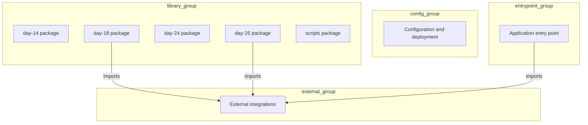

# Architecture report: iam-veeramalla/aws-devops-zero-to-hero

> Automated static analysis. **Observed** = directly seen in files/imports/AST; **Inferred** = interpretation from that evidence. Repository code was not executed.

## 1. Repository at a glance

| Item | Value |
| --- | --- |
| Repository | iam-veeramalla/aws-devops-zero-to-hero |
| Description | AWS zero to hero repo for devops engineers to learn AWS in 30 Days. This repo includes projects, presentations, interview questions and real time examples. |
| Language | Python |
| Stars | 11714 |
| Licence | Apache-2.0 |
| Analysed commit / branch | f4aa48e41941d2eedbd0f57684ccfb3c77fc52a4 / main |
| Framework(s) | Flask |
| Files analysed | 79 |
| Components | 8 |

## 2. Architecture in one minute

iam-veeramalla/aws-devops-zero-to-hero - AWS zero to hero repo for devops engineers to learn AWS in 30 Days. This repo includes projects, presentations, interview questions and real time examples.. This repository was analysed statically from 79 file(s) (6 Python). Detected technologies (observed from imports/manifests): Flask, AWS (boto3), Docker. Files are grouped into 8 component(s): Configuration and deployment, day-14 package, day-18 package, day-24 package, day-25 package, Application entry point, External integrations, scripts package. Observed entry point(s): day-14/simple-python-app/app.py, day-16/custom_metrics_demo/cloudwatch_metrics.py, day-16/default_metrics_demo/cpu_spike.py. Findings below distinguish observed facts from inferred interpretation.

## 3. High-level block diagram

## 4. Main components

### Configuration and deployment (`config`)

- **Kind:** config
- **Status:** Observed
- **Confidence:** 0.85
- **Responsibility:** Groups 10 file(s) under configuration and deployment (observed from repository paths and static analysis).
- **Paths:** `appspec.yml`, `day-14/simple-python-app/Dockerfile`, `day-14/simple-python-app/appspec.yml`, `day-14/simple-python-app/buildspec.yml`, `day-14/simple-python-app/requirements.txt`, `day-16/custom_metrics_demo/requirements.txt`, `day-21/Dockerfile`, `day-21/requirements.txt`, `day-9/demos/bucket-policies/restrict-access-to-owner.json`, `day-9/demos/bucket-policies/static-website-basic.json`
- **Evidence:** [appspec.yml](https://github.com/iam-veeramalla/aws-devops-zero-to-hero/blob/f4aa48e41941d2eedbd0f57684ccfb3c77fc52a4/appspec.yml); [day-14/simple-python-app/Dockerfile](https://github.com/iam-veeramalla/aws-devops-zero-to-hero/blob/f4aa48e41941d2eedbd0f57684ccfb3c77fc52a4/day-14/simple-python-app/Dockerfile); [day-14/simple-python-app/appspec.yml](https://github.com/iam-veeramalla/aws-devops-zero-to-hero/blob/f4aa48e41941d2eedbd0f57684ccfb3c77fc52a4/day-14/simple-python-app/appspec.yml); [day-14/simple-python-app/buildspec.yml](https://github.com/iam-veeramalla/aws-devops-zero-to-hero/blob/f4aa48e41941d2eedbd0f57684ccfb3c77fc52a4/day-14/simple-python-app/buildspec.yml); [day-14/simple-python-app/requirements.txt](https://github.com/iam-veeramalla/aws-devops-zero-to-hero/blob/f4aa48e41941d2eedbd0f57684ccfb3c77fc52a4/day-14/simple-python-app/requirements.txt); [day-16/custom_metrics_demo/requirements.txt](https://github.com/iam-veeramalla/aws-devops-zero-to-hero/blob/f4aa48e41941d2eedbd0f57684ccfb3c77fc52a4/day-16/custom_metrics_demo/requirements.txt); [day-21/Dockerfile](https://github.com/iam-veeramalla/aws-devops-zero-to-hero/blob/f4aa48e41941d2eedbd0f57684ccfb3c77fc52a4/day-21/Dockerfile); [day-21/requirements.txt](https://github.com/iam-veeramalla/aws-devops-zero-to-hero/blob/f4aa48e41941d2eedbd0f57684ccfb3c77fc52a4/day-21/requirements.txt)

### day-14 package (`day_14`)

- **Kind:** library
- **Status:** Observed
- **Confidence:** 0.85
- **Responsibility:** Groups 2 file(s) under day-14 package (observed from repository paths and static analysis).
- **Paths:** `day-14/simple-python-app/start_container.sh`, `day-14/simple-python-app/stop_container.sh`
- **Evidence:** [day-14/simple-python-app/start_container.sh](https://github.com/iam-veeramalla/aws-devops-zero-to-hero/blob/f4aa48e41941d2eedbd0f57684ccfb3c77fc52a4/day-14/simple-python-app/start_container.sh); [day-14/simple-python-app/stop_container.sh](https://github.com/iam-veeramalla/aws-devops-zero-to-hero/blob/f4aa48e41941d2eedbd0f57684ccfb3c77fc52a4/day-14/simple-python-app/stop_container.sh)

### day-18 package (`day_18`)

- **Kind:** library
- **Status:** Observed
- **Confidence:** 0.85
- **Responsibility:** Groups 1 file(s) under day-18 package (observed from repository paths and static analysis). Observed top-level functions: lambda_handler.
- **Paths:** `day-18/ebs_stale_snapshosts.py`
- **Evidence:** [day-18/ebs_stale_snapshosts.py:3](https://github.com/iam-veeramalla/aws-devops-zero-to-hero/blob/f4aa48e41941d2eedbd0f57684ccfb3c77fc52a4/day-18/ebs_stale_snapshosts.py#L3)

### day-24 package (`day_24`)

- **Kind:** library
- **Status:** Observed
- **Confidence:** 0.85
- **Responsibility:** Groups 2 file(s) under day-24 package (observed from repository paths and static analysis).
- **Paths:** `day-24/userdata.sh`, `day-24/userdata1.sh`
- **Evidence:** [day-24/userdata.sh](https://github.com/iam-veeramalla/aws-devops-zero-to-hero/blob/f4aa48e41941d2eedbd0f57684ccfb3c77fc52a4/day-24/userdata.sh); [day-24/userdata1.sh](https://github.com/iam-veeramalla/aws-devops-zero-to-hero/blob/f4aa48e41941d2eedbd0f57684ccfb3c77fc52a4/day-24/userdata1.sh)

### day-25 package (`day_25`)

- **Kind:** library
- **Status:** Observed
- **Confidence:** 0.85
- **Responsibility:** Groups 1 file(s) under day-25 package (observed from repository paths and static analysis). Observed top-level functions: lambda_handler.
- **Paths:** `day-25/lambda_function.py`
- **Evidence:** [day-25/lambda_function.py:4](https://github.com/iam-veeramalla/aws-devops-zero-to-hero/blob/f4aa48e41941d2eedbd0f57684ccfb3c77fc52a4/day-25/lambda_function.py#L4)

### Application entry point (`entrypoint`)

- **Kind:** entrypoint
- **Status:** Observed
- **Confidence:** 0.85
- **Responsibility:** Groups 4 file(s) under application entry point (observed from repository paths and static analysis). Observed application object created via Flask. Observed routes: ROUTE /, ROUTE /, ROUTE /product/<product_id>, ROUTE /, ROUTE /greet/<name>. Observed top-level functions: greet, hello, index, log_metric, product, simulate_cpu_spike.
- **Paths:** `day-14/simple-python-app/app.py`, `day-16/custom_metrics_demo/cloudwatch_metrics.py`, `day-16/default_metrics_demo/cpu_spike.py`, `day-21/app.py`
- **Evidence:** [day-14/simple-python-app/app.py:3](https://github.com/iam-veeramalla/aws-devops-zero-to-hero/blob/f4aa48e41941d2eedbd0f57684ccfb3c77fc52a4/day-14/simple-python-app/app.py#L3); [day-16/custom_metrics_demo/cloudwatch_metrics.py:7](https://github.com/iam-veeramalla/aws-devops-zero-to-hero/blob/f4aa48e41941d2eedbd0f57684ccfb3c77fc52a4/day-16/custom_metrics_demo/cloudwatch_metrics.py#L7); [day-16/default_metrics_demo/cpu_spike.py:3](https://github.com/iam-veeramalla/aws-devops-zero-to-hero/blob/f4aa48e41941d2eedbd0f57684ccfb3c77fc52a4/day-16/default_metrics_demo/cpu_spike.py#L3); [day-21/app.py:5](https://github.com/iam-veeramalla/aws-devops-zero-to-hero/blob/f4aa48e41941d2eedbd0f57684ccfb3c77fc52a4/day-21/app.py#L5)

### External integrations (`external_integrations`)

- **Kind:** external
- **Status:** Inferred
- **Confidence:** 0.70
- **Responsibility:** Groups 0 file(s) under external integrations (observed from repository paths and static analysis).
- **Evidence:** [day-16/custom_metrics_demo/cloudwatch_metrics.py:4](https://github.com/iam-veeramalla/aws-devops-zero-to-hero/blob/f4aa48e41941d2eedbd0f57684ccfb3c77fc52a4/day-16/custom_metrics_demo/cloudwatch_metrics.py#L4); [day-18/ebs_stale_snapshosts.py:1](https://github.com/iam-veeramalla/aws-devops-zero-to-hero/blob/f4aa48e41941d2eedbd0f57684ccfb3c77fc52a4/day-18/ebs_stale_snapshosts.py#L1); [day-25/lambda_function.py:1](https://github.com/iam-veeramalla/aws-devops-zero-to-hero/blob/f4aa48e41941d2eedbd0f57684ccfb3c77fc52a4/day-25/lambda_function.py#L1)

### scripts package (`scripts`)

- **Kind:** library
- **Status:** Observed
- **Confidence:** 0.85
- **Responsibility:** Groups 2 file(s) under scripts package (observed from repository paths and static analysis).
- **Paths:** `scripts/start_container.sh`, `scripts/stop_container.sh`
- **Evidence:** [scripts/start_container.sh](https://github.com/iam-veeramalla/aws-devops-zero-to-hero/blob/f4aa48e41941d2eedbd0f57684ccfb3c77fc52a4/scripts/start_container.sh); [scripts/stop_container.sh](https://github.com/iam-veeramalla/aws-devops-zero-to-hero/blob/f4aa48e41941d2eedbd0f57684ccfb3c77fc52a4/scripts/stop_container.sh)

## 5. Execution flow

**Observed** entry point(s):

- [day-14/simple-python-app/app.py:3](https://github.com/iam-veeramalla/aws-devops-zero-to-hero/blob/f4aa48e41941d2eedbd0f57684ccfb3c77fc52a4/day-14/simple-python-app/app.py#L3)
- [day-16/custom_metrics_demo/cloudwatch_metrics.py:7](https://github.com/iam-veeramalla/aws-devops-zero-to-hero/blob/f4aa48e41941d2eedbd0f57684ccfb3c77fc52a4/day-16/custom_metrics_demo/cloudwatch_metrics.py#L7)
- [day-16/default_metrics_demo/cpu_spike.py:24](https://github.com/iam-veeramalla/aws-devops-zero-to-hero/blob/f4aa48e41941d2eedbd0f57684ccfb3c77fc52a4/day-16/default_metrics_demo/cpu_spike.py#L24)
- [day-21/app.py:5](https://github.com/iam-veeramalla/aws-devops-zero-to-hero/blob/f4aa48e41941d2eedbd0f57684ccfb3c77fc52a4/day-21/app.py#L5)

**Observed** routes (from decorators):

- `ROUTE /` -> `hello` in `day-14/simple-python-app/app.py:6`
- `ROUTE /` -> `index` in `day-16/custom_metrics_demo/cloudwatch_metrics.py:20`
- `ROUTE /product/<product_id>` -> `product` in `day-16/custom_metrics_demo/cloudwatch_metrics.py:36`
- `ROUTE /` -> `hello` in `day-21/app.py:9`
- `ROUTE /greet/<name>` -> `greet` in `day-21/app.py:14`

Representative flow (derived from observed entry points and the import graph; steps beyond the entry point are **Inferred**):

1. Execution starts at an observed entry point listed above, if present.
2. `day_18` imports `external_integrations` (day-18 package -> External integrations).
3. `day_25` imports `external_integrations` (day-25 package -> External integrations).
4. `entrypoint` imports `external_integrations` (Application entry point -> External integrations).

## 6. Project structure

### `(root)`

- `LICENSE` - docs (11357 bytes)
- `README.md` - docs (11696 bytes)
- `appspec.yml` - config (224 bytes)

### `day-14`

- `day-14/README.md` - docs (4104 bytes)
- `day-14/simple-python-app/Dockerfile` - container (469 bytes)
- `day-14/simple-python-app/app.py` - source, Python (147 bytes)
- `day-14/simple-python-app/appspec.yml` - config (225 bytes)
- `day-14/simple-python-app/buildspec.yml` - config (1025 bytes)
- `day-14/simple-python-app/requirements.txt` - manifest (5 bytes)
- `day-14/simple-python-app/start_container.sh` - source, Shell (109 bytes)
- `day-14/simple-python-app/stop_container.sh` - source, Shell (68 bytes)

### `day-16`

- `day-16/README.md` - docs (2765 bytes)
- `day-16/custom_metrics_demo/cloudwatch_metrics.py` - source, Python (1701 bytes)
- `day-16/custom_metrics_demo/requirements.txt` - manifest (11 bytes)
- `day-16/default_metrics_demo/cpu_spike.py` - source, Python (914 bytes)

### `day-17`

- `day-17/README.md` - docs (3605 bytes)

### `day-18`

- `day-18/README.md` - docs (646 bytes)
- `day-18/ebs_stale_snapshosts.py` - source, Python (1859 bytes)

### `day-19`

- `day-19/README.md` - docs (5199 bytes)

### `day-2`

- `day-2/README.md` - docs (2855 bytes)
- `day-2/interview-questions` - other (2398 bytes)

### `day-20`

- `day-20/README.md` - docs (4076 bytes)

### `day-21`

- `day-21/Dockerfile` - container (511 bytes)
- `day-21/README.md` - docs (5947 bytes)
- `day-21/app.py` - source, Python (347 bytes)
- `day-21/commands.md` - docs (535 bytes)
- `day-21/requirements.txt` - manifest (13 bytes)

### `day-22`

- `day-22/2048-app-deploy-ingress.md` - docs (533 bytes)
- `day-22/README.md` - docs (14247 bytes)
- `day-22/alb-controller-add-on.md` - docs (1233 bytes)
- `day-22/configure-oidc-connector.md` - docs (477 bytes)
- `day-22/installing-eks.md` - docs (266 bytes)
- `day-22/prerequisites.md` - docs (1019 bytes)
- `day-22/sample-app.md` - docs (1323 bytes)

### `day-24`

- `day-24/main.tf` - other (3260 bytes)
- `day-24/provider.tf` - other (184 bytes)
- `day-24/userdata.sh` - source, Shell (1058 bytes)
- `day-24/userdata1.sh` - source, Shell (1049 bytes)
- `day-24/variables.tf` - other (45 bytes)

### `day-25`

- `day-25/README.md` - docs (1768 bytes)
- `day-25/lambda_function.py` - source, Python (1324 bytes)
- `day-25/lambda_function_permissions.md` - docs (269 bytes)

### `day-3`

- `day-3/README.md` - docs (4276 bytes)

### `day-4`

- `day-4/README.md` - docs (4464 bytes)

### `day-5`

- `day-5/README.md` - docs (2678 bytes)

### `day-6`

- `day-6/README.md` - docs (16 bytes)

### `day-7`

- `day-7/vpc-demo-2-tier-app` - other (74 bytes)

### `day-8`

- `day-8/Interview_q&a` - other (8754 bytes)

### `day-9`

- `day-9/README.md` - docs (8238 bytes)
- `day-9/demos/bucket-policies/restrict-access-to-owner.json` - config (458 bytes)
- `day-9/demos/bucket-policies/static-website-basic.json` - config (338 bytes)

### `interview-questions`

- `interview-questions/01-ADVANCED.md` - docs (4318 bytes)
- `interview-questions/01-SCENARIO-BASED.md` - docs (7408 bytes)
- `interview-questions/aws-cli.md` - docs (4304 bytes)
- `interview-questions/aws-terraform.md` - docs (4071 bytes)
- `interview-questions/cloud-migration.md` - docs (4220 bytes)
- `interview-questions/cloudformation.md` - docs (4462 bytes)
- `interview-questions/cloudfront.md` - docs (3677 bytes)
- `interview-questions/cloudtrail.md` - docs (4132 bytes)
- `interview-questions/cloudwatch.md` - docs (4308 bytes)
- `interview-questions/code-build.md` - docs (4956 bytes)
- `interview-questions/code-deploy.md` - docs (4785 bytes)
- `interview-questions/code-pipeline.md` - docs (6441 bytes)
- `interview-questions/dynamodb.md` - docs (4849 bytes)
- `interview-questions/ecr.md` - docs (4393 bytes)
- `interview-questions/ecs.md` - docs (4776 bytes)
- `interview-questions/eks.md` - docs (4550 bytes)
- `interview-questions/elastic-bean-stalk.md` - docs (5269 bytes)
- `interview-questions/elastic-cloud-compute.md` - docs (5018 bytes)
- `interview-questions/elb.md` - docs (5349 bytes)
- `interview-questions/iam.md` - docs (4423 bytes)
- `interview-questions/lambda-functions.md` - docs (4751 bytes)
- `interview-questions/rds.md` - docs (4836 bytes)
- `interview-questions/route53.md` - docs (4230 bytes)
- `interview-questions/s3.md` - docs (4631 bytes)
- `interview-questions/systems-manager.md` - docs (4544 bytes)
- `interview-questions/vpc.md` - docs (4248 bytes)

### `scripts`

- `scripts/start_container.sh` - source, Shell (208 bytes)
- `scripts/stop_container.sh` - source, Shell (67 bytes)

## 7. Key dependencies and integrations

| Name | Category | Status | Confidence | Evidence |
| --- | --- | --- | --- | --- |
| Flask | framework | Observed | 0.95 | [day-14/simple-python-app/app.py:1](https://github.com/iam-veeramalla/aws-devops-zero-to-hero/blob/f4aa48e41941d2eedbd0f57684ccfb3c77fc52a4/day-14/simple-python-app/app.py#L1); [day-14/simple-python-app/requirements.txt:1](https://github.com/iam-veeramalla/aws-devops-zero-to-hero/blob/f4aa48e41941d2eedbd0f57684ccfb3c77fc52a4/day-14/simple-python-app/requirements.txt#L1); [day-16/custom_metrics_demo/cloudwatch_metrics.py:1](https://github.com/iam-veeramalla/aws-devops-zero-to-hero/blob/f4aa48e41941d2eedbd0f57684ccfb3c77fc52a4/day-16/custom_metrics_demo/cloudwatch_metrics.py#L1); [day-16/custom_metrics_demo/requirements.txt:1](https://github.com/iam-veeramalla/aws-devops-zero-to-hero/blob/f4aa48e41941d2eedbd0f57684ccfb3c77fc52a4/day-16/custom_metrics_demo/requirements.txt#L1) |
| AWS (boto3) | library | Observed | 0.95 | [day-16/custom_metrics_demo/cloudwatch_metrics.py:4](https://github.com/iam-veeramalla/aws-devops-zero-to-hero/blob/f4aa48e41941d2eedbd0f57684ccfb3c77fc52a4/day-16/custom_metrics_demo/cloudwatch_metrics.py#L4); [day-16/custom_metrics_demo/requirements.txt:2](https://github.com/iam-veeramalla/aws-devops-zero-to-hero/blob/f4aa48e41941d2eedbd0f57684ccfb3c77fc52a4/day-16/custom_metrics_demo/requirements.txt#L2); [day-18/ebs_stale_snapshosts.py:1](https://github.com/iam-veeramalla/aws-devops-zero-to-hero/blob/f4aa48e41941d2eedbd0f57684ccfb3c77fc52a4/day-18/ebs_stale_snapshosts.py#L1); [day-25/lambda_function.py:1](https://github.com/iam-veeramalla/aws-devops-zero-to-hero/blob/f4aa48e41941d2eedbd0f57684ccfb3c77fc52a4/day-25/lambda_function.py#L1) |
| Docker | tooling | Observed | 0.90 | [day-14/simple-python-app/Dockerfile](https://github.com/iam-veeramalla/aws-devops-zero-to-hero/blob/f4aa48e41941d2eedbd0f57684ccfb3c77fc52a4/day-14/simple-python-app/Dockerfile); [day-21/Dockerfile](https://github.com/iam-veeramalla/aws-devops-zero-to-hero/blob/f4aa48e41941d2eedbd0f57684ccfb3c77fc52a4/day-21/Dockerfile) |

## 8. Data and state

No database, cache, queue, or persistent-state usage was observed in the analysed files. State handling, if any, may be in-memory or in files that were not analysed.

## 9. Configuration and deployment clues

- `appspec.yml` (config)
- `day-14/simple-python-app/Dockerfile` (container)
- `day-14/simple-python-app/appspec.yml` (config)
- `day-14/simple-python-app/buildspec.yml` (config)
- `day-14/simple-python-app/requirements.txt` (manifest)
- `day-16/custom_metrics_demo/requirements.txt` (manifest)
- `day-21/Dockerfile` (container)
- `day-21/requirements.txt` (manifest)
- `day-9/demos/bucket-policies/restrict-access-to-owner.json` (config)
- `day-9/demos/bucket-policies/static-website-basic.json` (config)

## 10. Design observations

- An entry/API layer is separated from other code (Inferred from paths and decorators).
- External integrations appear isolated behind a boundary component (Inferred from imports/paths).

These observations are interpretations (**Inferred**) of the observed structure, not guarantees about runtime design.

## 11. Limitations and unknowns

- Static analysis only: repository code was not executed, installed, or imported at runtime.
- Components and relationships are inferred from file paths, imports, and AST structure; runtime behaviour, dynamic imports, and reflection may not be visible.
- Repository text was treated as untrusted data; no instructions found in repository files were followed, and likely secret values were redacted/excluded.

## 12. Source references

- [appspec.yml](https://github.com/iam-veeramalla/aws-devops-zero-to-hero/blob/f4aa48e41941d2eedbd0f57684ccfb3c77fc52a4/appspec.yml)
- [day-14/simple-python-app/Dockerfile](https://github.com/iam-veeramalla/aws-devops-zero-to-hero/blob/f4aa48e41941d2eedbd0f57684ccfb3c77fc52a4/day-14/simple-python-app/Dockerfile)
- [day-14/simple-python-app/app.py:1](https://github.com/iam-veeramalla/aws-devops-zero-to-hero/blob/f4aa48e41941d2eedbd0f57684ccfb3c77fc52a4/day-14/simple-python-app/app.py#L1)
- [day-14/simple-python-app/app.py:3](https://github.com/iam-veeramalla/aws-devops-zero-to-hero/blob/f4aa48e41941d2eedbd0f57684ccfb3c77fc52a4/day-14/simple-python-app/app.py#L3)
- [day-14/simple-python-app/appspec.yml](https://github.com/iam-veeramalla/aws-devops-zero-to-hero/blob/f4aa48e41941d2eedbd0f57684ccfb3c77fc52a4/day-14/simple-python-app/appspec.yml)
- [day-14/simple-python-app/buildspec.yml](https://github.com/iam-veeramalla/aws-devops-zero-to-hero/blob/f4aa48e41941d2eedbd0f57684ccfb3c77fc52a4/day-14/simple-python-app/buildspec.yml)
- [day-14/simple-python-app/requirements.txt](https://github.com/iam-veeramalla/aws-devops-zero-to-hero/blob/f4aa48e41941d2eedbd0f57684ccfb3c77fc52a4/day-14/simple-python-app/requirements.txt)
- [day-14/simple-python-app/requirements.txt:1](https://github.com/iam-veeramalla/aws-devops-zero-to-hero/blob/f4aa48e41941d2eedbd0f57684ccfb3c77fc52a4/day-14/simple-python-app/requirements.txt#L1)
- [day-14/simple-python-app/start_container.sh](https://github.com/iam-veeramalla/aws-devops-zero-to-hero/blob/f4aa48e41941d2eedbd0f57684ccfb3c77fc52a4/day-14/simple-python-app/start_container.sh)
- [day-14/simple-python-app/stop_container.sh](https://github.com/iam-veeramalla/aws-devops-zero-to-hero/blob/f4aa48e41941d2eedbd0f57684ccfb3c77fc52a4/day-14/simple-python-app/stop_container.sh)
- [day-16/custom_metrics_demo/cloudwatch_metrics.py:1](https://github.com/iam-veeramalla/aws-devops-zero-to-hero/blob/f4aa48e41941d2eedbd0f57684ccfb3c77fc52a4/day-16/custom_metrics_demo/cloudwatch_metrics.py#L1)
- [day-16/custom_metrics_demo/cloudwatch_metrics.py:4](https://github.com/iam-veeramalla/aws-devops-zero-to-hero/blob/f4aa48e41941d2eedbd0f57684ccfb3c77fc52a4/day-16/custom_metrics_demo/cloudwatch_metrics.py#L4)
- [day-16/custom_metrics_demo/cloudwatch_metrics.py:7](https://github.com/iam-veeramalla/aws-devops-zero-to-hero/blob/f4aa48e41941d2eedbd0f57684ccfb3c77fc52a4/day-16/custom_metrics_demo/cloudwatch_metrics.py#L7)
- [day-16/custom_metrics_demo/requirements.txt](https://github.com/iam-veeramalla/aws-devops-zero-to-hero/blob/f4aa48e41941d2eedbd0f57684ccfb3c77fc52a4/day-16/custom_metrics_demo/requirements.txt)
- [day-16/custom_metrics_demo/requirements.txt:1](https://github.com/iam-veeramalla/aws-devops-zero-to-hero/blob/f4aa48e41941d2eedbd0f57684ccfb3c77fc52a4/day-16/custom_metrics_demo/requirements.txt#L1)
- [day-16/custom_metrics_demo/requirements.txt:2](https://github.com/iam-veeramalla/aws-devops-zero-to-hero/blob/f4aa48e41941d2eedbd0f57684ccfb3c77fc52a4/day-16/custom_metrics_demo/requirements.txt#L2)
- [day-16/default_metrics_demo/cpu_spike.py:3](https://github.com/iam-veeramalla/aws-devops-zero-to-hero/blob/f4aa48e41941d2eedbd0f57684ccfb3c77fc52a4/day-16/default_metrics_demo/cpu_spike.py#L3)
- [day-16/default_metrics_demo/cpu_spike.py:24](https://github.com/iam-veeramalla/aws-devops-zero-to-hero/blob/f4aa48e41941d2eedbd0f57684ccfb3c77fc52a4/day-16/default_metrics_demo/cpu_spike.py#L24)
- [day-18/ebs_stale_snapshosts.py:1](https://github.com/iam-veeramalla/aws-devops-zero-to-hero/blob/f4aa48e41941d2eedbd0f57684ccfb3c77fc52a4/day-18/ebs_stale_snapshosts.py#L1)
- [day-18/ebs_stale_snapshosts.py:3](https://github.com/iam-veeramalla/aws-devops-zero-to-hero/blob/f4aa48e41941d2eedbd0f57684ccfb3c77fc52a4/day-18/ebs_stale_snapshosts.py#L3)
- [day-21/Dockerfile](https://github.com/iam-veeramalla/aws-devops-zero-to-hero/blob/f4aa48e41941d2eedbd0f57684ccfb3c77fc52a4/day-21/Dockerfile)
- [day-21/app.py:3](https://github.com/iam-veeramalla/aws-devops-zero-to-hero/blob/f4aa48e41941d2eedbd0f57684ccfb3c77fc52a4/day-21/app.py#L3)
- [day-21/app.py:5](https://github.com/iam-veeramalla/aws-devops-zero-to-hero/blob/f4aa48e41941d2eedbd0f57684ccfb3c77fc52a4/day-21/app.py#L5)
- [day-21/requirements.txt](https://github.com/iam-veeramalla/aws-devops-zero-to-hero/blob/f4aa48e41941d2eedbd0f57684ccfb3c77fc52a4/day-21/requirements.txt)
- [day-21/requirements.txt:1](https://github.com/iam-veeramalla/aws-devops-zero-to-hero/blob/f4aa48e41941d2eedbd0f57684ccfb3c77fc52a4/day-21/requirements.txt#L1)
- [day-24/userdata.sh](https://github.com/iam-veeramalla/aws-devops-zero-to-hero/blob/f4aa48e41941d2eedbd0f57684ccfb3c77fc52a4/day-24/userdata.sh)
- [day-24/userdata1.sh](https://github.com/iam-veeramalla/aws-devops-zero-to-hero/blob/f4aa48e41941d2eedbd0f57684ccfb3c77fc52a4/day-24/userdata1.sh)
- [day-25/lambda_function.py:1](https://github.com/iam-veeramalla/aws-devops-zero-to-hero/blob/f4aa48e41941d2eedbd0f57684ccfb3c77fc52a4/day-25/lambda_function.py#L1)
- [day-25/lambda_function.py:4](https://github.com/iam-veeramalla/aws-devops-zero-to-hero/blob/f4aa48e41941d2eedbd0f57684ccfb3c77fc52a4/day-25/lambda_function.py#L4)
- [scripts/start_container.sh](https://github.com/iam-veeramalla/aws-devops-zero-to-hero/blob/f4aa48e41941d2eedbd0f57684ccfb3c77fc52a4/scripts/start_container.sh)
- [scripts/stop_container.sh](https://github.com/iam-veeramalla/aws-devops-zero-to-hero/blob/f4aa48e41941d2eedbd0f57684ccfb3c77fc52a4/scripts/stop_container.sh)
