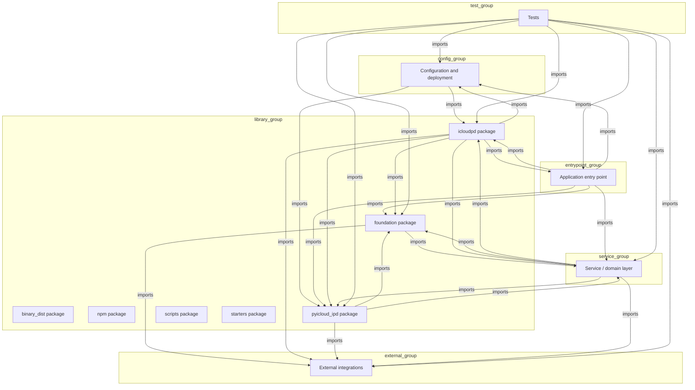

# Architecture report: icloud-photos-downloader/icloud_photos_downloader

> Automated static analysis. **Observed** = directly seen in files/imports/AST; **Inferred** = interpretation from that evidence. Repository code was not executed.

## 1. Repository at a glance

| Item | Value |
| --- | --- |
| Repository | icloud-photos-downloader/icloud_photos_downloader |
| Description | A command-line tool to download photos from iCloud |
| Language | Python |
| Stars | 12424 |
| Licence | MIT |
| Analysed commit / branch | 3caeae584c3d8bc6fcc51a1c9f7e5413b1422fd3 / master |
| Framework(s) | Flask |
| Files analysed | 221 |
| Components | 12 |

## 2. Architecture in one minute

icloud-photos-downloader/icloud_photos_downloader - A command-line tool to download photos from iCloud. This repository was analysed statically from 221 file(s) (99 Python). Detected technologies (observed from imports/manifests): GitHub Actions, Flask, requests, Poetry, setuptools, Docker. Files are grouped into 12 component(s): binary_dist package, Configuration and deployment, Application entry point, External integrations, foundation package, icloudpd package, npm package, pyicloud_ipd package. Observed entry point(s): scripts/compile_compatibility.py, scripts/compile_tzlc.py, src/icloudpd/cli.py. Findings below distinguish observed facts from inferred interpretation.

## 3. High-level block diagram

## 4. Main components

### binary_dist package (`binary_dist`)

- **Kind:** library
- **Status:** Observed
- **Confidence:** 0.85
- **Responsibility:** Groups 2 file(s) under binary_dist package (observed from repository paths and static analysis).
- **Paths:** `binary_dist/src/icloud/__init__.py`, `binary_dist/src/icloudpd/__init__.py`
- **Evidence:** [binary_dist/src/icloud/__init__.py](https://github.com/icloud-photos-downloader/icloud_photos_downloader/blob/3caeae584c3d8bc6fcc51a1c9f7e5413b1422fd3/binary_dist/src/icloud/__init__.py); [binary_dist/src/icloudpd/__init__.py](https://github.com/icloud-photos-downloader/icloud_photos_downloader/blob/3caeae584c3d8bc6fcc51a1c9f7e5413b1422fd3/binary_dist/src/icloudpd/__init__.py)

### Configuration and deployment (`config`)

- **Kind:** config
- **Status:** Observed
- **Confidence:** 0.85
- **Responsibility:** Groups 16 file(s) under configuration and deployment (observed from repository paths and static analysis). Observed top-level classes: GlobalConfig, UserConfig, _DefaultConfig.
- **Paths:** `Dockerfile`, `Dockerfile.build`, `Dockerfile.build-doc`, `Dockerfile.build-musl`, `binary_dist/pyproject.toml`, `npm/@icloudpd/darwin-arm64/package.json`, `npm/@icloudpd/darwin-x64/package.json`, `npm/@icloudpd/linux-arm/package.json`, `npm/@icloudpd/linux-arm64/package.json`, `npm/@icloudpd/linux-x64/package.json`, `npm/@icloudpd/win32-x64/package.json`, `npm/icloudpd/package.json`, `pyproject.toml`, `requirements-pip.txt`, `src/icloudpd/config.py`, `src/icloudpd/server/static/manifest.json`
- **Evidence:** [Dockerfile](https://github.com/icloud-photos-downloader/icloud_photos_downloader/blob/3caeae584c3d8bc6fcc51a1c9f7e5413b1422fd3/Dockerfile); [Dockerfile.build](https://github.com/icloud-photos-downloader/icloud_photos_downloader/blob/3caeae584c3d8bc6fcc51a1c9f7e5413b1422fd3/Dockerfile.build); [Dockerfile.build-doc](https://github.com/icloud-photos-downloader/icloud_photos_downloader/blob/3caeae584c3d8bc6fcc51a1c9f7e5413b1422fd3/Dockerfile.build-doc); [Dockerfile.build-musl](https://github.com/icloud-photos-downloader/icloud_photos_downloader/blob/3caeae584c3d8bc6fcc51a1c9f7e5413b1422fd3/Dockerfile.build-musl); [binary_dist/pyproject.toml](https://github.com/icloud-photos-downloader/icloud_photos_downloader/blob/3caeae584c3d8bc6fcc51a1c9f7e5413b1422fd3/binary_dist/pyproject.toml); [npm/@icloudpd/darwin-arm64/package.json](https://github.com/icloud-photos-downloader/icloud_photos_downloader/blob/3caeae584c3d8bc6fcc51a1c9f7e5413b1422fd3/npm/%40icloudpd/darwin-arm64/package.json); [npm/@icloudpd/darwin-x64/package.json](https://github.com/icloud-photos-downloader/icloud_photos_downloader/blob/3caeae584c3d8bc6fcc51a1c9f7e5413b1422fd3/npm/%40icloudpd/darwin-x64/package.json); [npm/@icloudpd/linux-arm/package.json](https://github.com/icloud-photos-downloader/icloud_photos_downloader/blob/3caeae584c3d8bc6fcc51a1c9f7e5413b1422fd3/npm/%40icloudpd/linux-arm/package.json)

### Application entry point (`entrypoint`)

- **Kind:** entrypoint
- **Status:** Observed
- **Confidence:** 0.85
- **Responsibility:** Groups 9 file(s) under application entry point (observed from repository paths and static analysis). Observed application object created via Flask. Observed top-level functions: add_global_options, add_options_for_user, add_user_option, cli, content_checker, format_help.
- **Paths:** `binary_dist/src/icloud/__main__.py`, `binary_dist/src/icloudpd/__main__.py`, `scripts/compile_compatibility.py`, `scripts/compile_tzlc.py`, `src/icloudpd/cli.py`, `src/icloudpd/server/__init__.py`, `src/pyicloud_ipd/cmdline.py`, `src/starters/icloud.py`, `src/starters/icloudpd.py`
- **Evidence:** [binary_dist/src/icloud/__main__.py](https://github.com/icloud-photos-downloader/icloud_photos_downloader/blob/3caeae584c3d8bc6fcc51a1c9f7e5413b1422fd3/binary_dist/src/icloud/__main__.py); [binary_dist/src/icloudpd/__main__.py](https://github.com/icloud-photos-downloader/icloud_photos_downloader/blob/3caeae584c3d8bc6fcc51a1c9f7e5413b1422fd3/binary_dist/src/icloudpd/__main__.py); [scripts/compile_compatibility.py:10](https://github.com/icloud-photos-downloader/icloud_photos_downloader/blob/3caeae584c3d8bc6fcc51a1c9f7e5413b1422fd3/scripts/compile_compatibility.py#L10); [scripts/compile_tzlc.py:9](https://github.com/icloud-photos-downloader/icloud_photos_downloader/blob/3caeae584c3d8bc6fcc51a1c9f7e5413b1422fd3/scripts/compile_tzlc.py#L9); [src/icloudpd/cli.py:27](https://github.com/icloud-photos-downloader/icloud_photos_downloader/blob/3caeae584c3d8bc6fcc51a1c9f7e5413b1422fd3/src/icloudpd/cli.py#L27); [src/icloudpd/server/__init__.py:12](https://github.com/icloud-photos-downloader/icloud_photos_downloader/blob/3caeae584c3d8bc6fcc51a1c9f7e5413b1422fd3/src/icloudpd/server/__init__.py#L12); [src/pyicloud_ipd/cmdline.py:21](https://github.com/icloud-photos-downloader/icloud_photos_downloader/blob/3caeae584c3d8bc6fcc51a1c9f7e5413b1422fd3/src/pyicloud_ipd/cmdline.py#L21); [src/starters/icloud.py](https://github.com/icloud-photos-downloader/icloud_photos_downloader/blob/3caeae584c3d8bc6fcc51a1c9f7e5413b1422fd3/src/starters/icloud.py)

### External integrations (`external_integrations`)

- **Kind:** external
- **Status:** Inferred
- **Confidence:** 0.70
- **Responsibility:** Groups 0 file(s) under external integrations (observed from repository paths and static analysis).
- **Evidence:** [src/foundation/http.py:8](https://github.com/icloud-photos-downloader/icloud_photos_downloader/blob/3caeae584c3d8bc6fcc51a1c9f7e5413b1422fd3/src/foundation/http.py#L8); [src/icloudpd/base.py:32](https://github.com/icloud-photos-downloader/icloud_photos_downloader/blob/3caeae584c3d8bc6fcc51a1c9f7e5413b1422fd3/src/icloudpd/base.py#L32); [src/icloudpd/download.py:12](https://github.com/icloud-photos-downloader/icloud_photos_downloader/blob/3caeae584c3d8bc6fcc51a1c9f7e5413b1422fd3/src/icloudpd/download.py#L12); [src/icloudpd/download.py:13](https://github.com/icloud-photos-downloader/icloud_photos_downloader/blob/3caeae584c3d8bc6fcc51a1c9f7e5413b1422fd3/src/icloudpd/download.py#L13); [src/icloudpd/download.py:14](https://github.com/icloud-photos-downloader/icloud_photos_downloader/blob/3caeae584c3d8bc6fcc51a1c9f7e5413b1422fd3/src/icloudpd/download.py#L14); [src/pyicloud_ipd/base.py:21](https://github.com/icloud-photos-downloader/icloud_photos_downloader/blob/3caeae584c3d8bc6fcc51a1c9f7e5413b1422fd3/src/pyicloud_ipd/base.py#L21)

### foundation package (`foundation`)

- **Kind:** library
- **Status:** Observed
- **Confidence:** 0.85
- **Responsibility:** Groups 6 file(s) under foundation package (observed from repository paths and static analysis). Observed top-level classes: VersionInfo. Observed top-level functions: _, _apply_rules_internal, always_false, always_true, and_, apply_rules.
- **Paths:** `src/foundation/__init__.py`, `src/foundation/http.py`, `src/foundation/json.py`, `src/foundation/predicates.py`, `src/foundation/string.py`, `src/foundation/string_utils.py`
- **Evidence:** [src/foundation/__init__.py:22](https://github.com/icloud-photos-downloader/icloud_photos_downloader/blob/3caeae584c3d8bc6fcc51a1c9f7e5413b1422fd3/src/foundation/__init__.py#L22); [src/foundation/http.py:14](https://github.com/icloud-photos-downloader/icloud_photos_downloader/blob/3caeae584c3d8bc6fcc51a1c9f7e5413b1422fd3/src/foundation/http.py#L14); [src/foundation/json.py:18](https://github.com/icloud-photos-downloader/icloud_photos_downloader/blob/3caeae584c3d8bc6fcc51a1c9f7e5413b1422fd3/src/foundation/json.py#L18); [src/foundation/predicates.py:8](https://github.com/icloud-photos-downloader/icloud_photos_downloader/blob/3caeae584c3d8bc6fcc51a1c9f7e5413b1422fd3/src/foundation/predicates.py#L8); [src/foundation/string.py:7](https://github.com/icloud-photos-downloader/icloud_photos_downloader/blob/3caeae584c3d8bc6fcc51a1c9f7e5413b1422fd3/src/foundation/string.py#L7); [src/foundation/string_utils.py:8](https://github.com/icloud-photos-downloader/icloud_photos_downloader/blob/3caeae584c3d8bc6fcc51a1c9f7e5413b1422fd3/src/foundation/string_utils.py#L8)

### icloudpd package (`icloudpd`)

- **Kind:** library
- **Status:** Observed
- **Confidence:** 0.85
- **Responsibility:** Groups 21 file(s) under icloudpd package (observed from repository paths and static analysis). Observed top-level classes: Counter, DownloadResult, FileRecord, IPDLogger, LogLevel, MFAProvider. Observed top-level functions: _, _process_all_users_once, ask_password_in_console, asset_type_skip_message, authenticator, autodelete_photos.
- **Paths:** `src/icloudpd/__init__.py`, `src/icloudpd/authentication.py`, `src/icloudpd/autodelete.py`, `src/icloudpd/base.py`, `src/icloudpd/constants.py`, `src/icloudpd/counter.py`, `src/icloudpd/download.py`, `src/icloudpd/email_notifications.py`, `src/icloudpd/exif_datetime.py`, `src/icloudpd/filename_policies.py`, `src/icloudpd/log_level.py`, `src/icloudpd/logger.py`, `src/icloudpd/mfa_provider.py`, `src/icloudpd/password_provider.py`, `src/icloudpd/paths.py`, `src/icloudpd/progress.py`, `src/icloudpd/prune.py`, `src/icloudpd/server/static/js/toast.js`, `src/icloudpd/status.py`, `src/icloudpd/string_helpers.py`, `src/icloudpd/xmp_sidecar.py`
- **Evidence:** [src/icloudpd/__init__.py](https://github.com/icloud-photos-downloader/icloud_photos_downloader/blob/3caeae584c3d8bc6fcc51a1c9f7e5413b1422fd3/src/icloudpd/__init__.py); [src/icloudpd/authentication.py:15](https://github.com/icloud-photos-downloader/icloud_photos_downloader/blob/3caeae584c3d8bc6fcc51a1c9f7e5413b1422fd3/src/icloudpd/authentication.py#L15); [src/icloudpd/autodelete.py:20](https://github.com/icloud-photos-downloader/icloud_photos_downloader/blob/3caeae584c3d8bc6fcc51a1c9f7e5413b1422fd3/src/icloudpd/autodelete.py#L20); [src/icloudpd/base.py:89](https://github.com/icloud-photos-downloader/icloud_photos_downloader/blob/3caeae584c3d8bc6fcc51a1c9f7e5413b1422fd3/src/icloudpd/base.py#L89); [src/icloudpd/constants.py](https://github.com/icloud-photos-downloader/icloud_photos_downloader/blob/3caeae584c3d8bc6fcc51a1c9f7e5413b1422fd3/src/icloudpd/constants.py); [src/icloudpd/counter.py:6](https://github.com/icloud-photos-downloader/icloud_photos_downloader/blob/3caeae584c3d8bc6fcc51a1c9f7e5413b1422fd3/src/icloudpd/counter.py#L6); [src/icloudpd/download.py:29](https://github.com/icloud-photos-downloader/icloud_photos_downloader/blob/3caeae584c3d8bc6fcc51a1c9f7e5413b1422fd3/src/icloudpd/download.py#L29); [src/icloudpd/email_notifications.py:10](https://github.com/icloud-photos-downloader/icloud_photos_downloader/blob/3caeae584c3d8bc6fcc51a1c9f7e5413b1422fd3/src/icloudpd/email_notifications.py#L10)

### npm package (`npm`)

- **Kind:** library
- **Status:** Observed
- **Confidence:** 0.85
- **Responsibility:** Groups 2 file(s) under npm package (observed from repository paths and static analysis).
- **Paths:** `npm/icloudpd/bin/icloudpd.js`, `npm/icloudpd/preinstall.js`
- **Evidence:** [npm/icloudpd/bin/icloudpd.js](https://github.com/icloud-photos-downloader/icloud_photos_downloader/blob/3caeae584c3d8bc6fcc51a1c9f7e5413b1422fd3/npm/icloudpd/bin/icloudpd.js); [npm/icloudpd/preinstall.js](https://github.com/icloud-photos-downloader/icloud_photos_downloader/blob/3caeae584c3d8bc6fcc51a1c9f7e5413b1422fd3/npm/icloudpd/preinstall.js)

### pyicloud_ipd package (`pyicloud_ipd`)

- **Kind:** library
- **Status:** Observed
- **Confidence:** 0.85
- **Responsibility:** Groups 12 file(s) under pyicloud_ipd package (observed from repository paths and static analysis). Observed top-level classes: AssetItemType, AssetVersion, AssetVersionSize, AuthenticatedSession, FileMatchPolicy, LivePhotoMovFilenamePolicy. Observed top-level functions: _auth_url, _map_to_trusted_device, _oauth_const_headers, _oauth_headers, _oauth_redirect_header, add_suffix_to_filename.
- **Paths:** `src/pyicloud_ipd/__init__.py`, `src/pyicloud_ipd/asset_version.py`, `src/pyicloud_ipd/base.py`, `src/pyicloud_ipd/exceptions.py`, `src/pyicloud_ipd/file_match.py`, `src/pyicloud_ipd/item_type.py`, `src/pyicloud_ipd/live_photo_mov_filename_policy.py`, `src/pyicloud_ipd/raw_policy.py`, `src/pyicloud_ipd/session.py`, `src/pyicloud_ipd/sms.py`, `src/pyicloud_ipd/utils.py`, `src/pyicloud_ipd/version_size.py`
- **Evidence:** [src/pyicloud_ipd/__init__.py](https://github.com/icloud-photos-downloader/icloud_photos_downloader/blob/3caeae584c3d8bc6fcc51a1c9f7e5413b1422fd3/src/pyicloud_ipd/__init__.py); [src/pyicloud_ipd/asset_version.py:35](https://github.com/icloud-photos-downloader/icloud_photos_downloader/blob/3caeae584c3d8bc6fcc51a1c9f7e5413b1422fd3/src/pyicloud_ipd/asset_version.py#L35); [src/pyicloud_ipd/base.py:61](https://github.com/icloud-photos-downloader/icloud_photos_downloader/blob/3caeae584c3d8bc6fcc51a1c9f7e5413b1422fd3/src/pyicloud_ipd/base.py#L61); [src/pyicloud_ipd/exceptions.py:1](https://github.com/icloud-photos-downloader/icloud_photos_downloader/blob/3caeae584c3d8bc6fcc51a1c9f7e5413b1422fd3/src/pyicloud_ipd/exceptions.py#L1); [src/pyicloud_ipd/file_match.py:4](https://github.com/icloud-photos-downloader/icloud_photos_downloader/blob/3caeae584c3d8bc6fcc51a1c9f7e5413b1422fd3/src/pyicloud_ipd/file_match.py#L4); [src/pyicloud_ipd/item_type.py:4](https://github.com/icloud-photos-downloader/icloud_photos_downloader/blob/3caeae584c3d8bc6fcc51a1c9f7e5413b1422fd3/src/pyicloud_ipd/item_type.py#L4); [src/pyicloud_ipd/live_photo_mov_filename_policy.py:4](https://github.com/icloud-photos-downloader/icloud_photos_downloader/blob/3caeae584c3d8bc6fcc51a1c9f7e5413b1422fd3/src/pyicloud_ipd/live_photo_mov_filename_policy.py#L4); [src/pyicloud_ipd/raw_policy.py:4](https://github.com/icloud-photos-downloader/icloud_photos_downloader/blob/3caeae584c3d8bc6fcc51a1c9f7e5413b1422fd3/src/pyicloud_ipd/raw_policy.py#L4)

### scripts package (`scripts`)

- **Kind:** library
- **Status:** Observed
- **Confidence:** 0.85
- **Responsibility:** Groups 1 file(s) under scripts package (observed from repository paths and static analysis). Observed top-level functions: _matrix, _stats, print_breakdowns.
- **Paths:** `scripts/compile_matrix.py`
- **Evidence:** [scripts/compile_matrix.py:7](https://github.com/icloud-photos-downloader/icloud_photos_downloader/blob/3caeae584c3d8bc6fcc51a1c9f7e5413b1422fd3/scripts/compile_matrix.py#L7)

### Service / domain layer (`service_layer`)

- **Kind:** service
- **Status:** Observed
- **Confidence:** 0.85
- **Responsibility:** Groups 4 file(s) under service / domain layer (observed from repository paths and static analysis). Observed top-level classes: PhotoAlbum, PhotoAsset, PhotoLibrary, PhotosService. Observed top-level functions: apply_file_match_policy, apply_filename_cleaner, apply_raw_policy, apply_reverse, arrow, bind.
- **Paths:** `src/foundation/core/__init__.py`, `src/foundation/core/optional/__init__.py`, `src/pyicloud_ipd/services/__init__.py`, `src/pyicloud_ipd/services/photos.py`
- **Evidence:** [src/foundation/core/__init__.py:13](https://github.com/icloud-photos-downloader/icloud_photos_downloader/blob/3caeae584c3d8bc6fcc51a1c9f7e5413b1422fd3/src/foundation/core/__init__.py#L13); [src/foundation/core/optional/__init__.py:9](https://github.com/icloud-photos-downloader/icloud_photos_downloader/blob/3caeae584c3d8bc6fcc51a1c9f7e5413b1422fd3/src/foundation/core/optional/__init__.py#L9); [src/pyicloud_ipd/services/__init__.py](https://github.com/icloud-photos-downloader/icloud_photos_downloader/blob/3caeae584c3d8bc6fcc51a1c9f7e5413b1422fd3/src/pyicloud_ipd/services/__init__.py); [src/pyicloud_ipd/services/photos.py:36](https://github.com/icloud-photos-downloader/icloud_photos_downloader/blob/3caeae584c3d8bc6fcc51a1c9f7e5413b1422fd3/src/pyicloud_ipd/services/photos.py#L36)

### starters package (`starters`)

- **Kind:** library
- **Status:** Observed
- **Confidence:** 0.85
- **Responsibility:** Groups 1 file(s) under starters package (observed from repository paths and static analysis).
- **Paths:** `src/starters/__init__.py`
- **Evidence:** [src/starters/__init__.py](https://github.com/icloud-photos-downloader/icloud_photos_downloader/blob/3caeae584c3d8bc6fcc51a1c9f7e5413b1422fd3/src/starters/__init__.py)

### Tests (`tests`)

- **Kind:** test
- **Status:** Observed
- **Confidence:** 0.85
- **Responsibility:** Groups 60 file(s) under tests (observed from repository paths and static analysis). Observed routes: PATCH pyicloud_ipd.services.photos.time.sleep, PATCH pyicloud_ipd.services.photos.time.sleep, PATCH pyicloud_ipd.services.photos.time.sleep. Observed top-level classes: AlbumPaginationTestCase, AlbumsInFoldersTestCase, AppleRuleTestCase, AssertEquality, AuthenticationTestCase, AuthenticatorAdpTestCase. Observed top-level functions: _b64, _raw_deflate, album, album_page, assert_files, assert_lock_available.
- **Paths:** `scripts/test`, `scripts/test_python_versions.sh`, `tests/__init__.py`, `tests/conftest.py`, `tests/cookie/jdoegmailcom`, `tests/cookie/jdoegmailcom.session`, `tests/data/parse_trusted_phone_numbers_payload_valid.html`, `tests/helpers/__init__.py`, `tests/test_adp_web_access.py`, `tests/test_album_pagination.py`, `tests/test_albums_in_folders.py`, `tests/test_authentication.py`, `tests/test_autodelete_photos.py`, `tests/test_cli.py`, `tests/test_download_live_photos.py`, `tests/test_download_live_photos_id.py`, `tests/test_download_photos.py`, `tests/test_download_photos_id.py`, `tests/test_download_videos.py`, `tests/test_email_notifications.py`, `tests/test_exif_datetime.py`, `tests/test_filenames.py`, `tests/test_folder_structure.py`, `tests/test_http.py`, `tests/test_icloud_cmdline.py`, `tests/test_incomplete_listing.py`, `tests/test_issue_1220_only_print_filenames_dedup_bug.py`, `tests/test_issue_1355_xmp_only_print_filenames.py`, `tests/test_issue_1387_indexing_state_retry.py`, `tests/test_item_type.py`, `tests/test_json_rules.py`, `tests/test_keep_icloud_mode.py`, `tests/test_listing_albums.py`, `tests/test_listing_libraries.py`, `tests/test_listing_recent_photos.py`, `tests/test_local_time_zone.py`, `tests/test_logger.py`, `tests/test_partial_download.py`, `tests/test_prune.py`, `tests/test_prune_adoption.py`, `tests/test_security_key.py`, `tests/test_session_connection_errors.py`, `tests/test_set_exif_datetime_dedup.py`, `tests/test_shared_master_assets.py`, `tests/test_string_helpers.py`, `tests/test_two_step_auth.py`, `tests/test_xmp_sidecar.py`, `tests/vcr_cassettes/2fa_flow_invalid_code.yml`, `tests/vcr_cassettes/2fa_flow_valid_code.yml`, `tests/vcr_cassettes/2fa_flow_valid_code_zero_lead.yml`, `tests/vcr_cassettes/2sa_flow_invalid_code.yml`, `tests/vcr_cassettes/2sa_flow_valid_code.yml`, `tests/vcr_cassettes/auth_invalid_session_421.yml`, `tests/vcr_cassettes/auth_non_2fa.yml`, `tests/vcr_cassettes/auth_requires_2fa.yml`, `tests/vcr_cassettes/failed_auth.yml`, `tests/vcr_cassettes/failed_auth_503.yml`, `tests/vcr_cassettes/fallback_raw_password.yml`, `tests/vcr_cassettes/listing_albums.yml`, `tests/vcr_cassettes/successful_auth.yml`
- **Evidence:** [scripts/test](https://github.com/icloud-photos-downloader/icloud_photos_downloader/blob/3caeae584c3d8bc6fcc51a1c9f7e5413b1422fd3/scripts/test); [scripts/test_python_versions.sh](https://github.com/icloud-photos-downloader/icloud_photos_downloader/blob/3caeae584c3d8bc6fcc51a1c9f7e5413b1422fd3/scripts/test_python_versions.sh); [tests/__init__.py](https://github.com/icloud-photos-downloader/icloud_photos_downloader/blob/3caeae584c3d8bc6fcc51a1c9f7e5413b1422fd3/tests/__init__.py); [tests/conftest.py](https://github.com/icloud-photos-downloader/icloud_photos_downloader/blob/3caeae584c3d8bc6fcc51a1c9f7e5413b1422fd3/tests/conftest.py); [tests/cookie/jdoegmailcom](https://github.com/icloud-photos-downloader/icloud_photos_downloader/blob/3caeae584c3d8bc6fcc51a1c9f7e5413b1422fd3/tests/cookie/jdoegmailcom); [tests/cookie/jdoegmailcom.session](https://github.com/icloud-photos-downloader/icloud_photos_downloader/blob/3caeae584c3d8bc6fcc51a1c9f7e5413b1422fd3/tests/cookie/jdoegmailcom.session); [tests/data/parse_trusted_phone_numbers_payload_valid.html](https://github.com/icloud-photos-downloader/icloud_photos_downloader/blob/3caeae584c3d8bc6fcc51a1c9f7e5413b1422fd3/tests/data/parse_trusted_phone_numbers_payload_valid.html); [tests/helpers/__init__.py:19](https://github.com/icloud-photos-downloader/icloud_photos_downloader/blob/3caeae584c3d8bc6fcc51a1c9f7e5413b1422fd3/tests/helpers/__init__.py#L19)

## 5. Execution flow

**Observed** entry point(s):

- [npm/icloudpd/bin/icloudpd.js](https://github.com/icloud-photos-downloader/icloud_photos_downloader/blob/3caeae584c3d8bc6fcc51a1c9f7e5413b1422fd3/npm/icloudpd/bin/icloudpd.js)
- [scripts/compile_compatibility.py:14](https://github.com/icloud-photos-downloader/icloud_photos_downloader/blob/3caeae584c3d8bc6fcc51a1c9f7e5413b1422fd3/scripts/compile_compatibility.py#L14)
- [scripts/compile_tzlc.py:22](https://github.com/icloud-photos-downloader/icloud_photos_downloader/blob/3caeae584c3d8bc6fcc51a1c9f7e5413b1422fd3/scripts/compile_tzlc.py#L22)
- [src/icloudpd/cli.py](https://github.com/icloud-photos-downloader/icloud_photos_downloader/blob/3caeae584c3d8bc6fcc51a1c9f7e5413b1422fd3/src/icloudpd/cli.py)
- [src/icloudpd/server/__init__.py:12](https://github.com/icloud-photos-downloader/icloud_photos_downloader/blob/3caeae584c3d8bc6fcc51a1c9f7e5413b1422fd3/src/icloudpd/server/__init__.py#L12)
- [src/pyicloud_ipd/cmdline.py](https://github.com/icloud-photos-downloader/icloud_photos_downloader/blob/3caeae584c3d8bc6fcc51a1c9f7e5413b1422fd3/src/pyicloud_ipd/cmdline.py)
- [src/starters/icloud.py:4](https://github.com/icloud-photos-downloader/icloud_photos_downloader/blob/3caeae584c3d8bc6fcc51a1c9f7e5413b1422fd3/src/starters/icloud.py#L4)
- [src/starters/icloudpd.py:6](https://github.com/icloud-photos-downloader/icloud_photos_downloader/blob/3caeae584c3d8bc6fcc51a1c9f7e5413b1422fd3/src/starters/icloudpd.py#L6)

**Observed** routes (from decorators):

- `PATCH pyicloud_ipd.services.photos.time.sleep` -> `test_finished_on_first_check` in `tests/test_issue_1387_indexing_state_retry.py:49`
- `PATCH pyicloud_ipd.services.photos.time.sleep` -> `test_retries_until_finished` in `tests/test_issue_1387_indexing_state_retry.py:56`
- `PATCH pyicloud_ipd.services.photos.time.sleep` -> `test_raises_when_never_finished` in `tests/test_issue_1387_indexing_state_retry.py:66`

Representative flow (derived from observed entry points and the import graph; steps beyond the entry point are **Inferred**):

1. Execution starts at an observed entry point listed above, if present.
2. `config` imports `icloudpd` (Configuration and deployment -> icloudpd package).
3. `config` imports `pyicloud_ipd` (Configuration and deployment -> pyicloud_ipd package).
4. `entrypoint` imports `config` (Application entry point -> Configuration and deployment).
5. `entrypoint` imports `foundation` (Application entry point -> foundation package).
6. `entrypoint` imports `icloudpd` (Application entry point -> icloudpd package).
7. `entrypoint` imports `pyicloud_ipd` (Application entry point -> pyicloud_ipd package).
8. `entrypoint` imports `service_layer` (Application entry point -> Service / domain layer).
9. `foundation` imports `external_integrations` (foundation package -> External integrations).

## 6. Project structure

### `(root)`

- `.dockerignore` - container (227 bytes)
- `.gitattributes` - other (27 bytes)
- `.gitignore` - other (378 bytes)
- `CHANGELOG.md` - docs (36706 bytes)
- `CODE_OF_CONDUCT.md` - docs (3286 bytes)
- `CONTRIBUTING.md` - docs (8941 bytes)
- `Dockerfile` - container (1643 bytes)
- `Dockerfile.build` - container (3957 bytes)
- `Dockerfile.build-doc` - container (943 bytes)
- `Dockerfile.build-musl` - container (2149 bytes)
- `EXPERIMENTAL.md` - docs (1241 bytes)
- `LICENSE.md` - docs (1083 bytes)
- `README.md` - docs (5848 bytes)
- `README_AUR.md` - docs (1539 bytes)
- `README_DOCKER.md` - docs (1980 bytes)
- `README_NPM.md` - docs (1236 bytes)
- `README_PYPI.md` - docs (2424 bytes)
- `help_current.txt` - docs (0 bytes)
- `pyproject.toml` - manifest (2879 bytes)
- `requirements-pip.txt` - manifest (10 bytes)

### `.devcontainer`

- `.devcontainer/node/devcontainer.json` - config (900 bytes)
- `.devcontainer/python/devcontainer.json` - config (1110 bytes)

### `.github`

- `.github/ISSUE_TEMPLATE/bug-report.md` - docs (696 bytes)
- `.github/ISSUE_TEMPLATE/feature-request.md` - docs (338 bytes)
- `.github/ISSUE_TEMPLATE/generic.md` - docs (322 bytes)
- `.github/dependabot.yml` - config (535 bytes)
- `.github/workflows/README.md` - ci, YAML (6263 bytes)
- `.github/workflows/build-docs.yml` - ci, YAML (1810 bytes)
- `.github/workflows/build-package.yml` - ci, YAML (78621 bytes)
- `.github/workflows/codeql-analysis.yml` - ci, YAML (2564 bytes)
- `.github/workflows/compile-notes.yml` - ci, YAML (1200 bytes)
- `.github/workflows/create-release.yml` - ci, YAML (1811 bytes)
- `.github/workflows/extract-changelog.yml` - ci, YAML (779 bytes)
- `.github/workflows/patch-version.yml` - ci, YAML (436 bytes)
- `.github/workflows/produce-artifacts.yml` - ci, YAML (2502 bytes)
- `.github/workflows/publish-docs.yml` - ci, YAML (478 bytes)
- `.github/workflows/publish.yml` - ci, YAML (5201 bytes)
- `.github/workflows/quality-checks.yml` - ci, YAML (5645 bytes)
- `.github/workflows/refresh-docs.yml` - ci, YAML (506 bytes)

### `.vscode`

- `.vscode/settings.json` - config (119 bytes)

### `binary_dist`

- `binary_dist/pyproject.toml` - manifest (980 bytes)
- `binary_dist/src/icloud/__init__.py` - source, Python (0 bytes)
- `binary_dist/src/icloud/__main__.py` - source, Python (134 bytes)
- `binary_dist/src/icloudpd/__init__.py` - source, Python (0 bytes)
- `binary_dist/src/icloudpd/__main__.py` - source, Python (136 bytes)

### `docs`

- `docs/authentication.md` - docs (6482 bytes)
- `docs/conf.py` - docs (1093 bytes)
- `docs/index.md` - docs (291 bytes)
- `docs/install.md` - docs (5448 bytes)
- `docs/mode.md` - docs (929 bytes)
- `docs/naming.md` - docs (3062 bytes)
- `docs/nas.md` - docs (3493 bytes)
- `docs/raw.md` - docs (1385 bytes)
- `docs/reference.md` - docs (21583 bytes)
- `docs/size.md` - docs (2208 bytes)
- `docs/webui.md` - docs (288 bytes)

### `examples`

- `examples/cron_script.sh.example` - other (516 bytes)

### `jq`

- `jq/version.jq` - other (89 bytes)

### `npm`

- `npm/@icloudpd/darwin-arm64/README.md` - docs (166 bytes)
- `npm/@icloudpd/darwin-arm64/package.json` - manifest (460 bytes)
- `npm/@icloudpd/darwin-x64/README.md` - docs (162 bytes)
- `npm/@icloudpd/darwin-x64/package.json` - manifest (452 bytes)
- `npm/@icloudpd/linux-arm/README.md` - docs (162 bytes)
- `npm/@icloudpd/linux-arm/package.json` - manifest (450 bytes)
- `npm/@icloudpd/linux-arm64/README.md` - docs (166 bytes)
- `npm/@icloudpd/linux-arm64/package.json` - manifest (458 bytes)
- `npm/@icloudpd/linux-x64/README.md` - docs (162 bytes)
- `npm/@icloudpd/linux-x64/package.json` - manifest (450 bytes)
- `npm/@icloudpd/win32-x64/README.md` - docs (164 bytes)
- `npm/@icloudpd/win32-x64/package.json` - manifest (452 bytes)
- `npm/icloudpd/bin/icloudpd.js` - source, JavaScript (1191 bytes)
- `npm/icloudpd/package.json` - manifest (941 bytes)
- `npm/icloudpd/preinstall.js` - source, JavaScript (969 bytes)

### `scripts`

- `scripts/build_bin1` - other (448 bytes)
- `scripts/build_binary_dist_macos` - other (858 bytes)
- `scripts/build_binary_dist_windows` - other (749 bytes)
- `scripts/build_npm` - other (2581 bytes)
- `scripts/build_static` - other (288 bytes)
- `scripts/build_whl` - other (643 bytes)
- `scripts/clean` - other (54 bytes)
- `scripts/clone_whl_version` - other (781 bytes)
- `scripts/compat_test` - other (15242 bytes)
- `scripts/compile_compatibility.py` - source, Python (1014 bytes)
- `scripts/compile_matrix.py` - source, Python (2185 bytes)
- `scripts/compile_tzlc.py` - source, Python (1701 bytes)
- `scripts/extract_releasenotes` - other (239 bytes)
- `scripts/format` - other (182 bytes)
- `scripts/get_version` - other (99 bytes)
- `scripts/install_deps` - other (278 bytes)
- `scripts/lint` - other (83 bytes)
- `scripts/npx_optional` - other (177 bytes)
- `scripts/npx_optional_touch` - other (174 bytes)
- `scripts/patch_version` - other (371 bytes)
- `scripts/publish_npm` - other (616 bytes)
- `scripts/publish_pypi` - other (513 bytes)
- `scripts/run_all_checks` - other (306 bytes)
- `scripts/test` - test (475 bytes)
- `scripts/test_python_versions.sh` - test, Shell (8672 bytes)
- `scripts/type_check` - other (250 bytes)
- `scripts/unpublish_npm` - other (433 bytes)

### `src`

- `src/foundation/__init__.py` - source, Python (3562 bytes)
- `src/foundation/core/__init__.py` - source, Python (8340 bytes)
- `src/foundation/core/optional/__init__.py` - source, Python (3229 bytes)
- `src/foundation/http.py` - source, Python (3449 bytes)
- `src/foundation/json.py` - source, Python (5131 bytes)
- `src/foundation/predicates.py` - source, Python (3190 bytes)
- `src/foundation/py.typed` - other (0 bytes)
- `src/foundation/string.py` - source, Python (279 bytes)
- `src/foundation/string_utils.py` - source, Python (3539 bytes)
- `src/icloudpd/__init__.py` - source, Python (0 bytes)
- `src/icloudpd/authentication.py` - source, Python (12916 bytes)
- `src/icloudpd/autodelete.py` - source, Python (4766 bytes)
- `src/icloudpd/base.py` - source, Python (66756 bytes)
- `src/icloudpd/cli.py` - source, Python (27302 bytes)
- `src/icloudpd/config.py` - source, Python (2218 bytes)
- `src/icloudpd/constants.py` - source, Python (152 bytes)
- `src/icloudpd/counter.py` - source, Python (517 bytes)
- `src/icloudpd/download.py` - source, Python (10675 bytes)
- `src/icloudpd/email_notifications.py` - source, Python (1806 bytes)
- `src/icloudpd/exif_datetime.py` - source, Python (2225 bytes)
- `src/icloudpd/filename_policies.py` - source, Python (2007 bytes)
- `src/icloudpd/log_level.py` - source, Python (160 bytes)
- `src/icloudpd/logger.py` - source, Python (1768 bytes)
- `src/icloudpd/mfa_provider.py` - source, Python (149 bytes)
- `src/icloudpd/password_provider.py` - source, Python (206 bytes)
- `src/icloudpd/paths.py` - source, Python (651 bytes)
- `src/icloudpd/progress.py` - source, Python (1577 bytes)
- `src/icloudpd/prune.py` - source, Python (10999 bytes)
- `src/icloudpd/py.typed` - other (0 bytes)
- `src/icloudpd/server/__init__.py` - source, Python (3581 bytes)
- `src/icloudpd/server/static/js/toast.js` - source, JavaScript (275 bytes)
- `src/icloudpd/server/static/manifest.json` - config (320 bytes)
- `src/icloudpd/server/static/style/style.css` - other (94 bytes)
- `src/icloudpd/server/templates/auth_error.html` - other (256 bytes)
- `src/icloudpd/server/templates/code.html` - other (916 bytes)
- `src/icloudpd/server/templates/code_submitted.html` - other (364 bytes)
- `src/icloudpd/server/templates/index.html` - other (3970 bytes)
- `src/icloudpd/server/templates/no_input.html` - other (9126 bytes)
- `src/icloudpd/server/templates/password.html` - other (923 bytes)
- `src/icloudpd/server/templates/password_submitted.html` - other (367 bytes)
- `src/icloudpd/server/templates/status.html` - other (105 bytes)
- `src/icloudpd/status.py` - source, Python (3722 bytes)
- `src/icloudpd/string_helpers.py` - source, Python (1749 bytes)
- `src/icloudpd/xmp_sidecar.py` - source, Python (12712 bytes)
- `src/pyicloud_ipd/__init__.py` - source, Python (144 bytes)
- `src/pyicloud_ipd/asset_version.py` - source, Python (4465 bytes)
- `src/pyicloud_ipd/base.py` - source, Python (43465 bytes)
- `src/pyicloud_ipd/cmdline.py` - source, Python (6839 bytes)
- `src/pyicloud_ipd/exceptions.py` - source, Python (2258 bytes)
- `src/pyicloud_ipd/file_match.py` - source, Python (199 bytes)
- `src/pyicloud_ipd/item_type.py` - source, Python (147 bytes)
- `src/pyicloud_ipd/live_photo_mov_filename_policy.py` - source, Python (168 bytes)
- `src/pyicloud_ipd/py.typed` - other (0 bytes)
- `src/pyicloud_ipd/raw_policy.py` - source, Python (202 bytes)
- `src/pyicloud_ipd/services/__init__.py` - source, Python (72 bytes)
- `src/pyicloud_ipd/services/photos.py` - source, Python (41039 bytes)
- `src/pyicloud_ipd/session.py` - source, Python (6883 bytes)
- `src/pyicloud_ipd/sms.py` - source, Python (6396 bytes)
- `src/pyicloud_ipd/utils.py` - source, Python (8339 bytes)
- `src/pyicloud_ipd/version_size.py` - source, Python (452 bytes)
- `src/starters/__init__.py` - source, Python (0 bytes)
- `src/starters/icloud.py` - source, Python (99 bytes)
- `src/starters/icloudpd.py` - source, Python (111 bytes)

### `tests`

- `tests/__init__.py` - test, Python (0 bytes)
- `tests/conftest.py` - test, Python (333 bytes)
- `tests/cookie/jdoegmailcom` - test (654 bytes)
- `tests/cookie/jdoegmailcom.session` - test (223 bytes)
- `tests/data/parse_trusted_phone_numbers_payload_valid.html` - test (7078 bytes)
- `tests/helpers/__init__.py` - test, Python (12408 bytes)
- `tests/test_adp_web_access.py` - test, Python (5204 bytes)
- `tests/test_album_pagination.py` - test, Python (3185 bytes)
- `tests/test_albums_in_folders.py` - test, Python (5718 bytes)
- `tests/test_authentication.py` - test, Python (24869 bytes)
- `tests/test_autodelete_photos.py` - test, Python (45643 bytes)
- `tests/test_cli.py` - test, Python (26040 bytes)
- `tests/test_download_live_photos.py` - test, Python (5254 bytes)
- `tests/test_download_live_photos_id.py` - test, Python (4776 bytes)
- `tests/test_download_photos.py` - test, Python (99415 bytes)
- `tests/test_download_photos_id.py` - test, Python (91310 bytes)
- `tests/test_download_videos.py` - test, Python (3087 bytes)
- `tests/test_email_notifications.py` - test, Python (7961 bytes)
- `tests/test_exif_datetime.py` - test, Python (3703 bytes)
- `tests/test_filenames.py` - test, Python (17519 bytes)
- `tests/test_folder_structure.py` - test, Python (8193 bytes)
- `tests/test_http.py` - test, Python (13944 bytes)
- `tests/test_icloud_cmdline.py` - test, Python (2464 bytes)
- `tests/test_incomplete_listing.py` - test, Python (2777 bytes)
- `tests/test_issue_1220_only_print_filenames_dedup_bug.py` - test, Python (3717 bytes)
- `tests/test_issue_1355_xmp_only_print_filenames.py` - test, Python (1332 bytes)
- `tests/test_issue_1387_indexing_state_retry.py` - test, Python (2937 bytes)
- `tests/test_item_type.py` - test, Python (1547 bytes)
- `tests/test_json_rules.py` - test, Python (3603 bytes)
- `tests/test_keep_icloud_mode.py` - test, Python (28836 bytes)
- `tests/test_listing_albums.py` - test, Python (1215 bytes)
- `tests/test_listing_libraries.py` - test, Python (1901 bytes)
- `tests/test_listing_recent_photos.py` - test, Python (7287 bytes)
- `tests/test_local_time_zone.py` - test, Python (3565 bytes)
- `tests/test_logger.py` - test, Python (2596 bytes)
- `tests/test_partial_download.py` - test, Python (6830 bytes)
- `tests/test_prune.py` - test, Python (27811 bytes)
- `tests/test_prune_adoption.py` - test, Python (17217 bytes)
- `tests/test_security_key.py` - test, Python (7603 bytes)
- `tests/test_session_connection_errors.py` - test, Python (8283 bytes)
- `tests/test_set_exif_datetime_dedup.py` - test, Python (5469 bytes)
- `tests/test_shared_master_assets.py` - test, Python (3709 bytes)
- `tests/test_string_helpers.py` - test, Python (4228 bytes)
- `tests/test_two_step_auth.py` - test, Python (7546 bytes)
- `tests/test_xmp_sidecar.py` - test, Python (11785 bytes)
- `tests/vcr_cassettes/2fa_flow_invalid_code.yml` - test (20676 bytes)
- `tests/vcr_cassettes/2fa_flow_valid_code.yml` - test (31674 bytes)
- `tests/vcr_cassettes/2fa_flow_valid_code_zero_lead.yml` - test (31674 bytes)
- `tests/vcr_cassettes/2sa_flow_invalid_code.yml` - test (19119 bytes)
- `tests/vcr_cassettes/2sa_flow_valid_code.yml` - test (27477 bytes)
- `tests/vcr_cassettes/auth_invalid_session_421.yml` - test (944 bytes)
- `tests/vcr_cassettes/auth_non_2fa.yml` - test (14428 bytes)
- `tests/vcr_cassettes/auth_requires_2fa.yml` - test (12418 bytes)
- `tests/vcr_cassettes/failed_auth.yml` - test (6533 bytes)
- `tests/vcr_cassettes/failed_auth_503.yml` - test (3944 bytes)
- `tests/vcr_cassettes/fallback_raw_password.yml` - test (15027 bytes)
- `tests/vcr_cassettes/listing_albums.yml` - test (61129 bytes)
- `tests/vcr_cassettes/successful_auth.yml` - test (8967 bytes)

## 7. Key dependencies and integrations

| Name | Category | Status | Confidence | Evidence |
| --- | --- | --- | --- | --- |
| GitHub Actions | ci | Observed | 0.90 | [.github/workflows/README.md](https://github.com/icloud-photos-downloader/icloud_photos_downloader/blob/3caeae584c3d8bc6fcc51a1c9f7e5413b1422fd3/.github/workflows/README.md); [.github/workflows/build-docs.yml](https://github.com/icloud-photos-downloader/icloud_photos_downloader/blob/3caeae584c3d8bc6fcc51a1c9f7e5413b1422fd3/.github/workflows/build-docs.yml); [.github/workflows/build-package.yml](https://github.com/icloud-photos-downloader/icloud_photos_downloader/blob/3caeae584c3d8bc6fcc51a1c9f7e5413b1422fd3/.github/workflows/build-package.yml); [.github/workflows/codeql-analysis.yml](https://github.com/icloud-photos-downloader/icloud_photos_downloader/blob/3caeae584c3d8bc6fcc51a1c9f7e5413b1422fd3/.github/workflows/codeql-analysis.yml) |
| Flask | framework | Observed | 0.90 | [pyproject.toml:32](https://github.com/icloud-photos-downloader/icloud_photos_downloader/blob/3caeae584c3d8bc6fcc51a1c9f7e5413b1422fd3/pyproject.toml#L32); [src/icloudpd/server/__init__.py:6](https://github.com/icloud-photos-downloader/icloud_photos_downloader/blob/3caeae584c3d8bc6fcc51a1c9f7e5413b1422fd3/src/icloudpd/server/__init__.py#L6) |
| requests | library | Observed | 0.95 | [pyproject.toml:26](https://github.com/icloud-photos-downloader/icloud_photos_downloader/blob/3caeae584c3d8bc6fcc51a1c9f7e5413b1422fd3/pyproject.toml#L26); [src/foundation/http.py:8](https://github.com/icloud-photos-downloader/icloud_photos_downloader/blob/3caeae584c3d8bc6fcc51a1c9f7e5413b1422fd3/src/foundation/http.py#L8); [src/icloudpd/base.py:32](https://github.com/icloud-photos-downloader/icloud_photos_downloader/blob/3caeae584c3d8bc6fcc51a1c9f7e5413b1422fd3/src/icloudpd/base.py#L32); [src/icloudpd/download.py:12](https://github.com/icloud-photos-downloader/icloud_photos_downloader/blob/3caeae584c3d8bc6fcc51a1c9f7e5413b1422fd3/src/icloudpd/download.py#L12) |
| Poetry | packaging | Observed | 0.90 | [binary_dist/pyproject.toml](https://github.com/icloud-photos-downloader/icloud_photos_downloader/blob/3caeae584c3d8bc6fcc51a1c9f7e5413b1422fd3/binary_dist/pyproject.toml); [pyproject.toml](https://github.com/icloud-photos-downloader/icloud_photos_downloader/blob/3caeae584c3d8bc6fcc51a1c9f7e5413b1422fd3/pyproject.toml) |
| setuptools | packaging | Observed | 0.90 | [binary_dist/pyproject.toml:3](https://github.com/icloud-photos-downloader/icloud_photos_downloader/blob/3caeae584c3d8bc6fcc51a1c9f7e5413b1422fd3/binary_dist/pyproject.toml#L3); [pyproject.toml:3](https://github.com/icloud-photos-downloader/icloud_photos_downloader/blob/3caeae584c3d8bc6fcc51a1c9f7e5413b1422fd3/pyproject.toml#L3) |
| Docker | tooling | Observed | 0.90 | [.github/workflows/README.md:11](https://github.com/icloud-photos-downloader/icloud_photos_downloader/blob/3caeae584c3d8bc6fcc51a1c9f7e5413b1422fd3/.github/workflows/README.md#L11); [.github/workflows/build-docs.yml:12](https://github.com/icloud-photos-downloader/icloud_photos_downloader/blob/3caeae584c3d8bc6fcc51a1c9f7e5413b1422fd3/.github/workflows/build-docs.yml#L12); [.github/workflows/build-package.yml:12](https://github.com/icloud-photos-downloader/icloud_photos_downloader/blob/3caeae584c3d8bc6fcc51a1c9f7e5413b1422fd3/.github/workflows/build-package.yml#L12); [.github/workflows/create-release.yml:56](https://github.com/icloud-photos-downloader/icloud_photos_downloader/blob/3caeae584c3d8bc6fcc51a1c9f7e5413b1422fd3/.github/workflows/create-release.yml#L56) |
| pytest | tooling | Observed | 0.95 | [tests/test_adp_web_access.py:5](https://github.com/icloud-photos-downloader/icloud_photos_downloader/blob/3caeae584c3d8bc6fcc51a1c9f7e5413b1422fd3/tests/test_adp_web_access.py#L5); [tests/test_authentication.py:9](https://github.com/icloud-photos-downloader/icloud_photos_downloader/blob/3caeae584c3d8bc6fcc51a1c9f7e5413b1422fd3/tests/test_authentication.py#L9); [tests/test_autodelete_photos.py:10](https://github.com/icloud-photos-downloader/icloud_photos_downloader/blob/3caeae584c3d8bc6fcc51a1c9f7e5413b1422fd3/tests/test_autodelete_photos.py#L10); [tests/test_cli.py:11](https://github.com/icloud-photos-downloader/icloud_photos_downloader/blob/3caeae584c3d8bc6fcc51a1c9f7e5413b1422fd3/tests/test_cli.py#L11) |
| unittest | tooling | Observed | 0.95 | [tests/test_adp_web_access.py:3](https://github.com/icloud-photos-downloader/icloud_photos_downloader/blob/3caeae584c3d8bc6fcc51a1c9f7e5413b1422fd3/tests/test_adp_web_access.py#L3); [tests/test_album_pagination.py:10](https://github.com/icloud-photos-downloader/icloud_photos_downloader/blob/3caeae584c3d8bc6fcc51a1c9f7e5413b1422fd3/tests/test_album_pagination.py#L10); [tests/test_albums_in_folders.py:17](https://github.com/icloud-photos-downloader/icloud_photos_downloader/blob/3caeae584c3d8bc6fcc51a1c9f7e5413b1422fd3/tests/test_albums_in_folders.py#L17); [tests/test_authentication.py:6](https://github.com/icloud-photos-downloader/icloud_photos_downloader/blob/3caeae584c3d8bc6fcc51a1c9f7e5413b1422fd3/tests/test_authentication.py#L6) |

## 8. Data and state

No database, cache, queue, or persistent-state usage was observed in the analysed files. State handling, if any, may be in-memory or in files that were not analysed.

## 9. Configuration and deployment clues

- `.devcontainer/node/devcontainer.json` (config)
- `.devcontainer/python/devcontainer.json` (config)
- `.dockerignore` (container)
- `.github/dependabot.yml` (config)
- `.github/workflows/README.md` (ci)
- `.github/workflows/build-docs.yml` (ci)
- `.github/workflows/build-package.yml` (ci)
- `.github/workflows/codeql-analysis.yml` (ci)
- `.github/workflows/compile-notes.yml` (ci)
- `.github/workflows/create-release.yml` (ci)
- `.github/workflows/extract-changelog.yml` (ci)
- `.github/workflows/patch-version.yml` (ci)
- `.github/workflows/produce-artifacts.yml` (ci)
- `.github/workflows/publish-docs.yml` (ci)
- `.github/workflows/publish.yml` (ci)
- `.github/workflows/quality-checks.yml` (ci)
- `.github/workflows/refresh-docs.yml` (ci)
- `.vscode/settings.json` (config)
- `Dockerfile` (container)
- `Dockerfile.build` (container)
- `Dockerfile.build-doc` (container)
- `Dockerfile.build-musl` (container)
- `binary_dist/pyproject.toml` (manifest)
- `npm/@icloudpd/darwin-arm64/package.json` (manifest)
- `npm/@icloudpd/darwin-x64/package.json` (manifest)
- `npm/@icloudpd/linux-arm/package.json` (manifest)
- `npm/@icloudpd/linux-arm64/package.json` (manifest)
- `npm/@icloudpd/linux-x64/package.json` (manifest)
- `npm/@icloudpd/win32-x64/package.json` (manifest)
- `npm/icloudpd/package.json` (manifest)
- `pyproject.toml` (manifest)
- `requirements-pip.txt` (manifest)
- `src/icloudpd/server/static/manifest.json` (config)

Console scripts declared in packaging metadata (**Observed**):

- `icloud` -> `pyicloud_ipd.cmdline:main`
- `icloudpd` -> `icloudpd.cli:cli`

## 10. Design observations

- An entry/API layer is separated from other code (Inferred from paths and decorators).
- Service/domain code is distinct from entry and data code, suggesting layered separation (Inferred).
- Tests are present alongside source code (Observed from test file paths).
- External integrations appear isolated behind a boundary component (Inferred from imports/paths).

These observations are interpretations (**Inferred**) of the observed structure, not guarantees about runtime design.

## 11. Limitations and unknowns

- Static analysis only: repository code was not executed, installed, or imported at runtime.
- Components and relationships are inferred from file paths, imports, and AST structure; runtime behaviour, dynamic imports, and reflection may not be visible.
- 7 file(s) were skipped during inventory (6 x generated/minified file excluded; 1 x vendored/generated directory excluded).
- Repository text was treated as untrusted data; no instructions found in repository files were followed, and likely secret values were redacted/excluded.

## 12. Source references

- [.github/workflows/README.md](https://github.com/icloud-photos-downloader/icloud_photos_downloader/blob/3caeae584c3d8bc6fcc51a1c9f7e5413b1422fd3/.github/workflows/README.md)
- [.github/workflows/README.md:11](https://github.com/icloud-photos-downloader/icloud_photos_downloader/blob/3caeae584c3d8bc6fcc51a1c9f7e5413b1422fd3/.github/workflows/README.md#L11)
- [.github/workflows/build-docs.yml](https://github.com/icloud-photos-downloader/icloud_photos_downloader/blob/3caeae584c3d8bc6fcc51a1c9f7e5413b1422fd3/.github/workflows/build-docs.yml)
- [.github/workflows/build-docs.yml:12](https://github.com/icloud-photos-downloader/icloud_photos_downloader/blob/3caeae584c3d8bc6fcc51a1c9f7e5413b1422fd3/.github/workflows/build-docs.yml#L12)
- [.github/workflows/build-package.yml](https://github.com/icloud-photos-downloader/icloud_photos_downloader/blob/3caeae584c3d8bc6fcc51a1c9f7e5413b1422fd3/.github/workflows/build-package.yml)
- [.github/workflows/build-package.yml:12](https://github.com/icloud-photos-downloader/icloud_photos_downloader/blob/3caeae584c3d8bc6fcc51a1c9f7e5413b1422fd3/.github/workflows/build-package.yml#L12)
- [.github/workflows/codeql-analysis.yml](https://github.com/icloud-photos-downloader/icloud_photos_downloader/blob/3caeae584c3d8bc6fcc51a1c9f7e5413b1422fd3/.github/workflows/codeql-analysis.yml)
- [.github/workflows/compile-notes.yml](https://github.com/icloud-photos-downloader/icloud_photos_downloader/blob/3caeae584c3d8bc6fcc51a1c9f7e5413b1422fd3/.github/workflows/compile-notes.yml)
- [.github/workflows/create-release.yml](https://github.com/icloud-photos-downloader/icloud_photos_downloader/blob/3caeae584c3d8bc6fcc51a1c9f7e5413b1422fd3/.github/workflows/create-release.yml)
- [.github/workflows/create-release.yml:56](https://github.com/icloud-photos-downloader/icloud_photos_downloader/blob/3caeae584c3d8bc6fcc51a1c9f7e5413b1422fd3/.github/workflows/create-release.yml#L56)
- [.github/workflows/extract-changelog.yml](https://github.com/icloud-photos-downloader/icloud_photos_downloader/blob/3caeae584c3d8bc6fcc51a1c9f7e5413b1422fd3/.github/workflows/extract-changelog.yml)
- [.github/workflows/patch-version.yml](https://github.com/icloud-photos-downloader/icloud_photos_downloader/blob/3caeae584c3d8bc6fcc51a1c9f7e5413b1422fd3/.github/workflows/patch-version.yml)
- [.github/workflows/publish.yml:11](https://github.com/icloud-photos-downloader/icloud_photos_downloader/blob/3caeae584c3d8bc6fcc51a1c9f7e5413b1422fd3/.github/workflows/publish.yml#L11)
- [Dockerfile](https://github.com/icloud-photos-downloader/icloud_photos_downloader/blob/3caeae584c3d8bc6fcc51a1c9f7e5413b1422fd3/Dockerfile)
- [Dockerfile.build](https://github.com/icloud-photos-downloader/icloud_photos_downloader/blob/3caeae584c3d8bc6fcc51a1c9f7e5413b1422fd3/Dockerfile.build)
- [Dockerfile.build-doc](https://github.com/icloud-photos-downloader/icloud_photos_downloader/blob/3caeae584c3d8bc6fcc51a1c9f7e5413b1422fd3/Dockerfile.build-doc)
- [Dockerfile.build-musl](https://github.com/icloud-photos-downloader/icloud_photos_downloader/blob/3caeae584c3d8bc6fcc51a1c9f7e5413b1422fd3/Dockerfile.build-musl)
- [binary_dist/pyproject.toml](https://github.com/icloud-photos-downloader/icloud_photos_downloader/blob/3caeae584c3d8bc6fcc51a1c9f7e5413b1422fd3/binary_dist/pyproject.toml)
- [binary_dist/pyproject.toml:3](https://github.com/icloud-photos-downloader/icloud_photos_downloader/blob/3caeae584c3d8bc6fcc51a1c9f7e5413b1422fd3/binary_dist/pyproject.toml#L3)
- [binary_dist/src/icloud/__init__.py](https://github.com/icloud-photos-downloader/icloud_photos_downloader/blob/3caeae584c3d8bc6fcc51a1c9f7e5413b1422fd3/binary_dist/src/icloud/__init__.py)
- [binary_dist/src/icloud/__main__.py](https://github.com/icloud-photos-downloader/icloud_photos_downloader/blob/3caeae584c3d8bc6fcc51a1c9f7e5413b1422fd3/binary_dist/src/icloud/__main__.py)
- [binary_dist/src/icloudpd/__init__.py](https://github.com/icloud-photos-downloader/icloud_photos_downloader/blob/3caeae584c3d8bc6fcc51a1c9f7e5413b1422fd3/binary_dist/src/icloudpd/__init__.py)
- [binary_dist/src/icloudpd/__main__.py](https://github.com/icloud-photos-downloader/icloud_photos_downloader/blob/3caeae584c3d8bc6fcc51a1c9f7e5413b1422fd3/binary_dist/src/icloudpd/__main__.py)
- [npm/@icloudpd/darwin-arm64/package.json](https://github.com/icloud-photos-downloader/icloud_photos_downloader/blob/3caeae584c3d8bc6fcc51a1c9f7e5413b1422fd3/npm/%40icloudpd/darwin-arm64/package.json)
- [npm/@icloudpd/darwin-x64/package.json](https://github.com/icloud-photos-downloader/icloud_photos_downloader/blob/3caeae584c3d8bc6fcc51a1c9f7e5413b1422fd3/npm/%40icloudpd/darwin-x64/package.json)
- [npm/@icloudpd/linux-arm/package.json](https://github.com/icloud-photos-downloader/icloud_photos_downloader/blob/3caeae584c3d8bc6fcc51a1c9f7e5413b1422fd3/npm/%40icloudpd/linux-arm/package.json)
- [npm/icloudpd/bin/icloudpd.js](https://github.com/icloud-photos-downloader/icloud_photos_downloader/blob/3caeae584c3d8bc6fcc51a1c9f7e5413b1422fd3/npm/icloudpd/bin/icloudpd.js)
- [npm/icloudpd/preinstall.js](https://github.com/icloud-photos-downloader/icloud_photos_downloader/blob/3caeae584c3d8bc6fcc51a1c9f7e5413b1422fd3/npm/icloudpd/preinstall.js)
- [pyproject.toml](https://github.com/icloud-photos-downloader/icloud_photos_downloader/blob/3caeae584c3d8bc6fcc51a1c9f7e5413b1422fd3/pyproject.toml)
- [pyproject.toml:3](https://github.com/icloud-photos-downloader/icloud_photos_downloader/blob/3caeae584c3d8bc6fcc51a1c9f7e5413b1422fd3/pyproject.toml#L3)
- [pyproject.toml:26](https://github.com/icloud-photos-downloader/icloud_photos_downloader/blob/3caeae584c3d8bc6fcc51a1c9f7e5413b1422fd3/pyproject.toml#L26)
- [pyproject.toml:32](https://github.com/icloud-photos-downloader/icloud_photos_downloader/blob/3caeae584c3d8bc6fcc51a1c9f7e5413b1422fd3/pyproject.toml#L32)
- [scripts/compile_compatibility.py:10](https://github.com/icloud-photos-downloader/icloud_photos_downloader/blob/3caeae584c3d8bc6fcc51a1c9f7e5413b1422fd3/scripts/compile_compatibility.py#L10)
- [scripts/compile_compatibility.py:14](https://github.com/icloud-photos-downloader/icloud_photos_downloader/blob/3caeae584c3d8bc6fcc51a1c9f7e5413b1422fd3/scripts/compile_compatibility.py#L14)
- [scripts/compile_matrix.py:7](https://github.com/icloud-photos-downloader/icloud_photos_downloader/blob/3caeae584c3d8bc6fcc51a1c9f7e5413b1422fd3/scripts/compile_matrix.py#L7)
- [scripts/compile_tzlc.py:9](https://github.com/icloud-photos-downloader/icloud_photos_downloader/blob/3caeae584c3d8bc6fcc51a1c9f7e5413b1422fd3/scripts/compile_tzlc.py#L9)
- [scripts/compile_tzlc.py:22](https://github.com/icloud-photos-downloader/icloud_photos_downloader/blob/3caeae584c3d8bc6fcc51a1c9f7e5413b1422fd3/scripts/compile_tzlc.py#L22)
- [scripts/test](https://github.com/icloud-photos-downloader/icloud_photos_downloader/blob/3caeae584c3d8bc6fcc51a1c9f7e5413b1422fd3/scripts/test)
- [scripts/test_python_versions.sh](https://github.com/icloud-photos-downloader/icloud_photos_downloader/blob/3caeae584c3d8bc6fcc51a1c9f7e5413b1422fd3/scripts/test_python_versions.sh)
- [src/foundation/__init__.py:22](https://github.com/icloud-photos-downloader/icloud_photos_downloader/blob/3caeae584c3d8bc6fcc51a1c9f7e5413b1422fd3/src/foundation/__init__.py#L22)
- [src/foundation/core/__init__.py:13](https://github.com/icloud-photos-downloader/icloud_photos_downloader/blob/3caeae584c3d8bc6fcc51a1c9f7e5413b1422fd3/src/foundation/core/__init__.py#L13)
- [src/foundation/core/optional/__init__.py:9](https://github.com/icloud-photos-downloader/icloud_photos_downloader/blob/3caeae584c3d8bc6fcc51a1c9f7e5413b1422fd3/src/foundation/core/optional/__init__.py#L9)
- [src/foundation/http.py:8](https://github.com/icloud-photos-downloader/icloud_photos_downloader/blob/3caeae584c3d8bc6fcc51a1c9f7e5413b1422fd3/src/foundation/http.py#L8)
- [src/foundation/http.py:14](https://github.com/icloud-photos-downloader/icloud_photos_downloader/blob/3caeae584c3d8bc6fcc51a1c9f7e5413b1422fd3/src/foundation/http.py#L14)
- [src/foundation/json.py:18](https://github.com/icloud-photos-downloader/icloud_photos_downloader/blob/3caeae584c3d8bc6fcc51a1c9f7e5413b1422fd3/src/foundation/json.py#L18)
- [src/foundation/predicates.py:8](https://github.com/icloud-photos-downloader/icloud_photos_downloader/blob/3caeae584c3d8bc6fcc51a1c9f7e5413b1422fd3/src/foundation/predicates.py#L8)
- [src/foundation/string.py:7](https://github.com/icloud-photos-downloader/icloud_photos_downloader/blob/3caeae584c3d8bc6fcc51a1c9f7e5413b1422fd3/src/foundation/string.py#L7)
- [src/foundation/string_utils.py:8](https://github.com/icloud-photos-downloader/icloud_photos_downloader/blob/3caeae584c3d8bc6fcc51a1c9f7e5413b1422fd3/src/foundation/string_utils.py#L8)
- [src/icloudpd/__init__.py](https://github.com/icloud-photos-downloader/icloud_photos_downloader/blob/3caeae584c3d8bc6fcc51a1c9f7e5413b1422fd3/src/icloudpd/__init__.py)
- [src/icloudpd/authentication.py:15](https://github.com/icloud-photos-downloader/icloud_photos_downloader/blob/3caeae584c3d8bc6fcc51a1c9f7e5413b1422fd3/src/icloudpd/authentication.py#L15)
- [src/icloudpd/autodelete.py:20](https://github.com/icloud-photos-downloader/icloud_photos_downloader/blob/3caeae584c3d8bc6fcc51a1c9f7e5413b1422fd3/src/icloudpd/autodelete.py#L20)
- [src/icloudpd/base.py:32](https://github.com/icloud-photos-downloader/icloud_photos_downloader/blob/3caeae584c3d8bc6fcc51a1c9f7e5413b1422fd3/src/icloudpd/base.py#L32)
- [src/icloudpd/base.py:89](https://github.com/icloud-photos-downloader/icloud_photos_downloader/blob/3caeae584c3d8bc6fcc51a1c9f7e5413b1422fd3/src/icloudpd/base.py#L89)
- [src/icloudpd/cli.py](https://github.com/icloud-photos-downloader/icloud_photos_downloader/blob/3caeae584c3d8bc6fcc51a1c9f7e5413b1422fd3/src/icloudpd/cli.py)
- [src/icloudpd/cli.py:27](https://github.com/icloud-photos-downloader/icloud_photos_downloader/blob/3caeae584c3d8bc6fcc51a1c9f7e5413b1422fd3/src/icloudpd/cli.py#L27)
- [src/icloudpd/constants.py](https://github.com/icloud-photos-downloader/icloud_photos_downloader/blob/3caeae584c3d8bc6fcc51a1c9f7e5413b1422fd3/src/icloudpd/constants.py)
- [src/icloudpd/counter.py:6](https://github.com/icloud-photos-downloader/icloud_photos_downloader/blob/3caeae584c3d8bc6fcc51a1c9f7e5413b1422fd3/src/icloudpd/counter.py#L6)
- [src/icloudpd/download.py:12](https://github.com/icloud-photos-downloader/icloud_photos_downloader/blob/3caeae584c3d8bc6fcc51a1c9f7e5413b1422fd3/src/icloudpd/download.py#L12)
- [src/icloudpd/download.py:13](https://github.com/icloud-photos-downloader/icloud_photos_downloader/blob/3caeae584c3d8bc6fcc51a1c9f7e5413b1422fd3/src/icloudpd/download.py#L13)
- [src/icloudpd/download.py:14](https://github.com/icloud-photos-downloader/icloud_photos_downloader/blob/3caeae584c3d8bc6fcc51a1c9f7e5413b1422fd3/src/icloudpd/download.py#L14)
- [src/icloudpd/download.py:29](https://github.com/icloud-photos-downloader/icloud_photos_downloader/blob/3caeae584c3d8bc6fcc51a1c9f7e5413b1422fd3/src/icloudpd/download.py#L29)
- [src/icloudpd/email_notifications.py:10](https://github.com/icloud-photos-downloader/icloud_photos_downloader/blob/3caeae584c3d8bc6fcc51a1c9f7e5413b1422fd3/src/icloudpd/email_notifications.py#L10)
- [src/icloudpd/server/__init__.py:6](https://github.com/icloud-photos-downloader/icloud_photos_downloader/blob/3caeae584c3d8bc6fcc51a1c9f7e5413b1422fd3/src/icloudpd/server/__init__.py#L6)
- [src/icloudpd/server/__init__.py:12](https://github.com/icloud-photos-downloader/icloud_photos_downloader/blob/3caeae584c3d8bc6fcc51a1c9f7e5413b1422fd3/src/icloudpd/server/__init__.py#L12)
- [src/pyicloud_ipd/__init__.py](https://github.com/icloud-photos-downloader/icloud_photos_downloader/blob/3caeae584c3d8bc6fcc51a1c9f7e5413b1422fd3/src/pyicloud_ipd/__init__.py)
- [src/pyicloud_ipd/asset_version.py:35](https://github.com/icloud-photos-downloader/icloud_photos_downloader/blob/3caeae584c3d8bc6fcc51a1c9f7e5413b1422fd3/src/pyicloud_ipd/asset_version.py#L35)
- [src/pyicloud_ipd/base.py:21](https://github.com/icloud-photos-downloader/icloud_photos_downloader/blob/3caeae584c3d8bc6fcc51a1c9f7e5413b1422fd3/src/pyicloud_ipd/base.py#L21)
- [src/pyicloud_ipd/base.py:61](https://github.com/icloud-photos-downloader/icloud_photos_downloader/blob/3caeae584c3d8bc6fcc51a1c9f7e5413b1422fd3/src/pyicloud_ipd/base.py#L61)
- [src/pyicloud_ipd/cmdline.py](https://github.com/icloud-photos-downloader/icloud_photos_downloader/blob/3caeae584c3d8bc6fcc51a1c9f7e5413b1422fd3/src/pyicloud_ipd/cmdline.py)
- [src/pyicloud_ipd/cmdline.py:21](https://github.com/icloud-photos-downloader/icloud_photos_downloader/blob/3caeae584c3d8bc6fcc51a1c9f7e5413b1422fd3/src/pyicloud_ipd/cmdline.py#L21)
- [src/pyicloud_ipd/exceptions.py:1](https://github.com/icloud-photos-downloader/icloud_photos_downloader/blob/3caeae584c3d8bc6fcc51a1c9f7e5413b1422fd3/src/pyicloud_ipd/exceptions.py#L1)
- [src/pyicloud_ipd/file_match.py:4](https://github.com/icloud-photos-downloader/icloud_photos_downloader/blob/3caeae584c3d8bc6fcc51a1c9f7e5413b1422fd3/src/pyicloud_ipd/file_match.py#L4)
- [src/pyicloud_ipd/item_type.py:4](https://github.com/icloud-photos-downloader/icloud_photos_downloader/blob/3caeae584c3d8bc6fcc51a1c9f7e5413b1422fd3/src/pyicloud_ipd/item_type.py#L4)
- [src/pyicloud_ipd/live_photo_mov_filename_policy.py:4](https://github.com/icloud-photos-downloader/icloud_photos_downloader/blob/3caeae584c3d8bc6fcc51a1c9f7e5413b1422fd3/src/pyicloud_ipd/live_photo_mov_filename_policy.py#L4)
- [src/pyicloud_ipd/raw_policy.py:4](https://github.com/icloud-photos-downloader/icloud_photos_downloader/blob/3caeae584c3d8bc6fcc51a1c9f7e5413b1422fd3/src/pyicloud_ipd/raw_policy.py#L4)
- [src/pyicloud_ipd/services/__init__.py](https://github.com/icloud-photos-downloader/icloud_photos_downloader/blob/3caeae584c3d8bc6fcc51a1c9f7e5413b1422fd3/src/pyicloud_ipd/services/__init__.py)
- [src/pyicloud_ipd/services/photos.py:13](https://github.com/icloud-photos-downloader/icloud_photos_downloader/blob/3caeae584c3d8bc6fcc51a1c9f7e5413b1422fd3/src/pyicloud_ipd/services/photos.py#L13)
- [src/pyicloud_ipd/services/photos.py:36](https://github.com/icloud-photos-downloader/icloud_photos_downloader/blob/3caeae584c3d8bc6fcc51a1c9f7e5413b1422fd3/src/pyicloud_ipd/services/photos.py#L36)
- [src/starters/__init__.py](https://github.com/icloud-photos-downloader/icloud_photos_downloader/blob/3caeae584c3d8bc6fcc51a1c9f7e5413b1422fd3/src/starters/__init__.py)
- [src/starters/icloud.py](https://github.com/icloud-photos-downloader/icloud_photos_downloader/blob/3caeae584c3d8bc6fcc51a1c9f7e5413b1422fd3/src/starters/icloud.py)
- [src/starters/icloud.py:4](https://github.com/icloud-photos-downloader/icloud_photos_downloader/blob/3caeae584c3d8bc6fcc51a1c9f7e5413b1422fd3/src/starters/icloud.py#L4)
- [src/starters/icloudpd.py:6](https://github.com/icloud-photos-downloader/icloud_photos_downloader/blob/3caeae584c3d8bc6fcc51a1c9f7e5413b1422fd3/src/starters/icloudpd.py#L6)
- [tests/__init__.py](https://github.com/icloud-photos-downloader/icloud_photos_downloader/blob/3caeae584c3d8bc6fcc51a1c9f7e5413b1422fd3/tests/__init__.py)
- [tests/conftest.py](https://github.com/icloud-photos-downloader/icloud_photos_downloader/blob/3caeae584c3d8bc6fcc51a1c9f7e5413b1422fd3/tests/conftest.py)
- [tests/cookie/jdoegmailcom](https://github.com/icloud-photos-downloader/icloud_photos_downloader/blob/3caeae584c3d8bc6fcc51a1c9f7e5413b1422fd3/tests/cookie/jdoegmailcom)
- [tests/cookie/jdoegmailcom.session](https://github.com/icloud-photos-downloader/icloud_photos_downloader/blob/3caeae584c3d8bc6fcc51a1c9f7e5413b1422fd3/tests/cookie/jdoegmailcom.session)
- [tests/data/parse_trusted_phone_numbers_payload_valid.html](https://github.com/icloud-photos-downloader/icloud_photos_downloader/blob/3caeae584c3d8bc6fcc51a1c9f7e5413b1422fd3/tests/data/parse_trusted_phone_numbers_payload_valid.html)
- [tests/helpers/__init__.py:19](https://github.com/icloud-photos-downloader/icloud_photos_downloader/blob/3caeae584c3d8bc6fcc51a1c9f7e5413b1422fd3/tests/helpers/__init__.py#L19)
- [tests/test_adp_web_access.py:3](https://github.com/icloud-photos-downloader/icloud_photos_downloader/blob/3caeae584c3d8bc6fcc51a1c9f7e5413b1422fd3/tests/test_adp_web_access.py#L3)
- [tests/test_adp_web_access.py:5](https://github.com/icloud-photos-downloader/icloud_photos_downloader/blob/3caeae584c3d8bc6fcc51a1c9f7e5413b1422fd3/tests/test_adp_web_access.py#L5)
- [tests/test_album_pagination.py:10](https://github.com/icloud-photos-downloader/icloud_photos_downloader/blob/3caeae584c3d8bc6fcc51a1c9f7e5413b1422fd3/tests/test_album_pagination.py#L10)
- [tests/test_albums_in_folders.py:17](https://github.com/icloud-photos-downloader/icloud_photos_downloader/blob/3caeae584c3d8bc6fcc51a1c9f7e5413b1422fd3/tests/test_albums_in_folders.py#L17)
- [tests/test_authentication.py:6](https://github.com/icloud-photos-downloader/icloud_photos_downloader/blob/3caeae584c3d8bc6fcc51a1c9f7e5413b1422fd3/tests/test_authentication.py#L6)
- [tests/test_authentication.py:9](https://github.com/icloud-photos-downloader/icloud_photos_downloader/blob/3caeae584c3d8bc6fcc51a1c9f7e5413b1422fd3/tests/test_authentication.py#L9)
- [tests/test_autodelete_photos.py:8](https://github.com/icloud-photos-downloader/icloud_photos_downloader/blob/3caeae584c3d8bc6fcc51a1c9f7e5413b1422fd3/tests/test_autodelete_photos.py#L8)
- [tests/test_autodelete_photos.py:10](https://github.com/icloud-photos-downloader/icloud_photos_downloader/blob/3caeae584c3d8bc6fcc51a1c9f7e5413b1422fd3/tests/test_autodelete_photos.py#L10)
- [tests/test_cli.py:9](https://github.com/icloud-photos-downloader/icloud_photos_downloader/blob/3caeae584c3d8bc6fcc51a1c9f7e5413b1422fd3/tests/test_cli.py#L9)
- [tests/test_cli.py:11](https://github.com/icloud-photos-downloader/icloud_photos_downloader/blob/3caeae584c3d8bc6fcc51a1c9f7e5413b1422fd3/tests/test_cli.py#L11)
- [tests/test_download_live_photos.py:3](https://github.com/icloud-photos-downloader/icloud_photos_downloader/blob/3caeae584c3d8bc6fcc51a1c9f7e5413b1422fd3/tests/test_download_live_photos.py#L3)
- [tests/test_download_live_photos.py:5](https://github.com/icloud-photos-downloader/icloud_photos_downloader/blob/3caeae584c3d8bc6fcc51a1c9f7e5413b1422fd3/tests/test_download_live_photos.py#L5)
- [tests/test_download_live_photos_id.py:3](https://github.com/icloud-photos-downloader/icloud_photos_downloader/blob/3caeae584c3d8bc6fcc51a1c9f7e5413b1422fd3/tests/test_download_live_photos_id.py#L3)
- [tests/test_download_live_photos_id.py:5](https://github.com/icloud-photos-downloader/icloud_photos_downloader/blob/3caeae584c3d8bc6fcc51a1c9f7e5413b1422fd3/tests/test_download_live_photos_id.py#L5)
- [tests/test_download_photos.py:13](https://github.com/icloud-photos-downloader/icloud_photos_downloader/blob/3caeae584c3d8bc6fcc51a1c9f7e5413b1422fd3/tests/test_download_photos.py#L13)
- [tests/test_download_photos_id.py:11](https://github.com/icloud-photos-downloader/icloud_photos_downloader/blob/3caeae584c3d8bc6fcc51a1c9f7e5413b1422fd3/tests/test_download_photos_id.py#L11)
