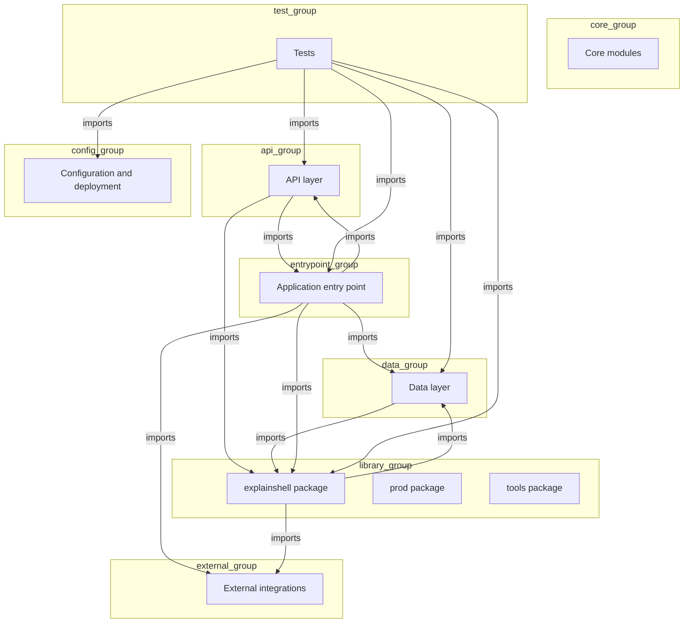

# Architecture report: idank/explainshell

> Automated static analysis. **Observed** = directly seen in files/imports/AST; **Inferred** = interpretation from that evidence. Repository code was not executed.

## 1. Repository at a glance

| Item | Value |
| --- | --- |
| Repository | idank/explainshell |
| Description | match command-line arguments to their help text |
| Language | Python |
| Stars | 14342 |
| Licence | GPL-3.0 |
| Analysed commit / branch | 827ebe38da9822a10e89946551e377330a9de35e / master |
| Framework(s) | Flask |
| Files analysed | 145 |
| Components | 10 |

## 2. Architecture in one minute

idank/explainshell - match command-line arguments to their help text. This repository was analysed statically from 145 file(s) (72 Python). Detected technologies (observed from imports/manifests): GitHub Actions, SQLite, Flask, aiohttp, Click, Gunicorn. Files are grouped into 10 component(s): API layer, Configuration and deployment, Core modules, Data layer, Application entry point, explainshell package, External integrations, prod package. Observed entry point(s): explainshell/manager.py, explainshell/web/__init__.py, prod/datadog/apply.py. Findings below distinguish observed facts from inferred interpretation.

## 3. High-level block diagram

## 4. Main components

### API layer (`api_layer`)

- **Kind:** api
- **Status:** Observed
- **Confidence:** 0.85
- **Responsibility:** Groups 1 file(s) under api layer (observed from repository paths and static analysis). Observed routes: ROUTE /, ROUTE /manpage/<distro>/, ROUTE /manpage/<distro>/<release>/, ROUTE /manpage/<distro>/<release>/<section>/, ROUTE /manpage/<distro>/<release>/<path:rest>. Observed top-level functions: _cacheable_explain_response, _explain_etag, _explain_prefix, _get_current_url_distro_release, _get_distro_release, _handle_explain_cmd.
- **Paths:** `explainshell/web/views.py`
- **Evidence:** [explainshell/web/views.py:26](https://github.com/idank/explainshell/blob/827ebe38da9822a10e89946551e377330a9de35e/explainshell/web/views.py#L26)

### Configuration and deployment (`config`)

- **Kind:** config
- **Status:** Observed
- **Confidence:** 0.85
- **Responsibility:** Groups 21 file(s) under configuration and deployment (observed from repository paths and static analysis). Observed top-level functions: parse_distro_release, source_from_path.
- **Paths:** `biome.json`, `explainshell/config.py`, `package.json`, `prod/botshed/go.mod`, `prod/datadog/dashboards/overview.json`, `prod/datadog/logs/index_main.json`, `prod/datadog/logs/metrics/parse_errors.json`, `prod/datadog/logs/metrics/request_duration.json`, `prod/datadog/logs/metrics/requests.json`, `prod/datadog/logs/metrics/requests_by_country.json`, `prod/datadog/logs/pipeline.json`, `prod/datadog/monitors/5xx_rate.json`, `prod/datadog/synthetics/explain_keyword.json`, `prod/datadog/synthetics/homepage.json`, `prod/datadog/synthetics/ssl.json`, `prod/digitalocean/app.yaml`, `prod/docker/Dockerfile`, `requirements-dev.txt`, `requirements-extraction.txt`, `requirements.txt`, `ruff.toml`
- **Evidence:** [biome.json](https://github.com/idank/explainshell/blob/827ebe38da9822a10e89946551e377330a9de35e/biome.json); [explainshell/config.py:20](https://github.com/idank/explainshell/blob/827ebe38da9822a10e89946551e377330a9de35e/explainshell/config.py#L20); [package.json](https://github.com/idank/explainshell/blob/827ebe38da9822a10e89946551e377330a9de35e/package.json); [prod/botshed/go.mod](https://github.com/idank/explainshell/blob/827ebe38da9822a10e89946551e377330a9de35e/prod/botshed/go.mod); [prod/datadog/dashboards/overview.json](https://github.com/idank/explainshell/blob/827ebe38da9822a10e89946551e377330a9de35e/prod/datadog/dashboards/overview.json); [prod/datadog/logs/index_main.json](https://github.com/idank/explainshell/blob/827ebe38da9822a10e89946551e377330a9de35e/prod/datadog/logs/index_main.json); [prod/datadog/logs/metrics/parse_errors.json](https://github.com/idank/explainshell/blob/827ebe38da9822a10e89946551e377330a9de35e/prod/datadog/logs/metrics/parse_errors.json); [prod/datadog/logs/metrics/request_duration.json](https://github.com/idank/explainshell/blob/827ebe38da9822a10e89946551e377330a9de35e/prod/datadog/logs/metrics/request_duration.json)

### Core modules (`core`)

- **Kind:** core
- **Status:** Observed
- **Confidence:** 0.85
- **Responsibility:** Groups 1 file(s) under core modules (observed from repository paths and static analysis).
- **Paths:** `playwright.config.js`
- **Evidence:** [playwright.config.js](https://github.com/idank/explainshell/blob/827ebe38da9822a10e89946551e377330a9de35e/playwright.config.js)

### Data layer (`data_layer`)

- **Kind:** data
- **Status:** Observed
- **Confidence:** 0.85
- **Responsibility:** Groups 1 file(s) under data layer (observed from repository paths and static analysis). Observed top-level classes: ExtractionMeta, Option, ParsedManpage, RawManpage.
- **Paths:** `explainshell/models.py`
- **Evidence:** [explainshell/models.py:19](https://github.com/idank/explainshell/blob/827ebe38da9822a10e89946551e377330a9de35e/explainshell/models.py#L19)

### Application entry point (`entrypoint`)

- **Kind:** entrypoint
- **Status:** Observed
- **Confidence:** 0.85
- **Responsibility:** Groups 10 file(s) under application entry point (observed from repository paths and static analysis). Observed application object created via Flask. Observed top-level classes: Dashboard, LogsIndex, LogsMetric, LogsPipeline, LoopStats, Monitor. Observed top-level functions: _add_alias_mapping, _attach_run_log, _bucket_stats, _build_report, _closed_loop_worker, _coerce_bool.
- **Paths:** `explainshell/manager.py`, `explainshell/web/__init__.py`, `prod/datadog/apply.py`, `runserver.py`, `tools/bench_src_index.py`, `tools/experiments/eval_size_routing.py`, `tools/fetch_manned.py`, `tools/loadtest.py`, `tools/migrate_mongo_to_sqlite.py`, `tools/postprocess_ubuntu_archive.py`
- **Evidence:** [explainshell/manager.py:75](https://github.com/idank/explainshell/blob/827ebe38da9822a10e89946551e377330a9de35e/explainshell/manager.py#L75); [explainshell/web/__init__.py:96](https://github.com/idank/explainshell/blob/827ebe38da9822a10e89946551e377330a9de35e/explainshell/web/__init__.py#L96); [prod/datadog/apply.py:37](https://github.com/idank/explainshell/blob/827ebe38da9822a10e89946551e377330a9de35e/prod/datadog/apply.py#L37); [runserver.py](https://github.com/idank/explainshell/blob/827ebe38da9822a10e89946551e377330a9de35e/runserver.py); [tools/bench_src_index.py:46](https://github.com/idank/explainshell/blob/827ebe38da9822a10e89946551e377330a9de35e/tools/bench_src_index.py#L46); [tools/experiments/eval_size_routing.py:34](https://github.com/idank/explainshell/blob/827ebe38da9822a10e89946551e377330a9de35e/tools/experiments/eval_size_routing.py#L34); [tools/fetch_manned.py:35](https://github.com/idank/explainshell/blob/827ebe38da9822a10e89946551e377330a9de35e/tools/fetch_manned.py#L35); [tools/loadtest.py:64](https://github.com/idank/explainshell/blob/827ebe38da9822a10e89946551e377330a9de35e/tools/loadtest.py#L64)

### explainshell package (`explainshell`)

- **Kind:** library
- **Status:** Observed
- **Confidence:** 0.85
- **Responsibility:** Groups 34 file(s) under explainshell package (observed from repository paths and static analysis). Observed top-level classes: AlreadyStored, BatchEntry, BatchExtractor, BatchManifest, BatchManifestEntry, BatchManifestWriter. Observed top-level functions: _addwords, _azure_base_url, _build_preamble, _clean_roff, _compress, _decompress.
- **Paths:** `explainshell/__init__.py`, `explainshell/caching_store.py`, `explainshell/db_check.py`, `explainshell/diff.py`, `explainshell/errors.py`, `explainshell/extraction/__init__.py`, `explainshell/extraction/common.py`, `explainshell/extraction/llm/__init__.py`, `explainshell/extraction/llm/extractor.py`, `explainshell/extraction/llm/prompt.py`, `explainshell/extraction/llm/providers/__init__.py`, `explainshell/extraction/llm/providers/codex.py`, `explainshell/extraction/llm/providers/gemini.py`, `explainshell/extraction/llm/providers/openai.py`, `explainshell/extraction/llm/response.py`, `explainshell/extraction/llm/text.py`, `explainshell/extraction/manifest.py`, `explainshell/extraction/postprocess.py`, `explainshell/extraction/prefilter.py`, `explainshell/extraction/report.py`, `explainshell/extraction/runner.py`, `explainshell/extraction/types.py`, `explainshell/help_constants.py`, `explainshell/logger/__init__.py`, `explainshell/logger/json_logging.py`, `explainshell/manpage.py`, `explainshell/matcher.py`, `explainshell/roff_utils.py`, `explainshell/store.py`, `explainshell/util.py`, `explainshell/web/helpers.py`, `explainshell/web/markdown.py`, `explainshell/web/static/js/bootstrap.js`, `explainshell/web/static/js/es.js`
- **Evidence:** [explainshell/__init__.py](https://github.com/idank/explainshell/blob/827ebe38da9822a10e89946551e377330a9de35e/explainshell/__init__.py); [explainshell/caching_store.py:14](https://github.com/idank/explainshell/blob/827ebe38da9822a10e89946551e377330a9de35e/explainshell/caching_store.py#L14); [explainshell/db_check.py:20](https://github.com/idank/explainshell/blob/827ebe38da9822a10e89946551e377330a9de35e/explainshell/db_check.py#L20); [explainshell/diff.py:39](https://github.com/idank/explainshell/blob/827ebe38da9822a10e89946551e377330a9de35e/explainshell/diff.py#L39); [explainshell/errors.py:4](https://github.com/idank/explainshell/blob/827ebe38da9822a10e89946551e377330a9de35e/explainshell/errors.py#L4); [explainshell/extraction/__init__.py:33](https://github.com/idank/explainshell/blob/827ebe38da9822a10e89946551e377330a9de35e/explainshell/extraction/__init__.py#L33); [explainshell/extraction/common.py:19](https://github.com/idank/explainshell/blob/827ebe38da9822a10e89946551e377330a9de35e/explainshell/extraction/common.py#L19); [explainshell/extraction/llm/__init__.py](https://github.com/idank/explainshell/blob/827ebe38da9822a10e89946551e377330a9de35e/explainshell/extraction/llm/__init__.py)

### External integrations (`external_integrations`)

- **Kind:** external
- **Status:** Inferred
- **Confidence:** 0.70
- **Responsibility:** Groups 0 file(s) under external integrations (observed from repository paths and static analysis).
- **Evidence:** [explainshell/caching_store.py:3](https://github.com/idank/explainshell/blob/827ebe38da9822a10e89946551e377330a9de35e/explainshell/caching_store.py#L3); [explainshell/db_check.py:14](https://github.com/idank/explainshell/blob/827ebe38da9822a10e89946551e377330a9de35e/explainshell/db_check.py#L14); [explainshell/extraction/llm/providers/gemini.py:10](https://github.com/idank/explainshell/blob/827ebe38da9822a10e89946551e377330a9de35e/explainshell/extraction/llm/providers/gemini.py#L10); [explainshell/manager.py:1161](https://github.com/idank/explainshell/blob/827ebe38da9822a10e89946551e377330a9de35e/explainshell/manager.py#L1161); [explainshell/store.py:10](https://github.com/idank/explainshell/blob/827ebe38da9822a10e89946551e377330a9de35e/explainshell/store.py#L10); [tools/bench_src_index.py:14](https://github.com/idank/explainshell/blob/827ebe38da9822a10e89946551e377330a9de35e/tools/bench_src_index.py#L14)

### prod package (`prod`)

- **Kind:** library
- **Status:** Observed
- **Confidence:** 0.85
- **Responsibility:** Groups 5 file(s) under prod package (observed from repository paths and static analysis).
- **Paths:** `prod/botshed/module.go`, `prod/botshed/module_test.go`, `prod/docker/start.sh`, `prod/integration-test.sh`, `prod/smoke-test.sh`
- **Evidence:** [prod/botshed/module.go](https://github.com/idank/explainshell/blob/827ebe38da9822a10e89946551e377330a9de35e/prod/botshed/module.go); [prod/botshed/module_test.go](https://github.com/idank/explainshell/blob/827ebe38da9822a10e89946551e377330a9de35e/prod/botshed/module_test.go); [prod/docker/start.sh](https://github.com/idank/explainshell/blob/827ebe38da9822a10e89946551e377330a9de35e/prod/docker/start.sh); [prod/integration-test.sh](https://github.com/idank/explainshell/blob/827ebe38da9822a10e89946551e377330a9de35e/prod/integration-test.sh); [prod/smoke-test.sh](https://github.com/idank/explainshell/blob/827ebe38da9822a10e89946551e377330a9de35e/prod/smoke-test.sh)

### Tests (`tests`)

- **Kind:** test
- **Status:** Observed
- **Confidence:** 0.85
- **Responsibility:** Groups 32 file(s) under tests (observed from repository paths and static analysis). Observed routes: PATCH explainshell.extraction.common.roff_utils.detect_nested_cmd, PATCH explainshell.extraction.common.manpage.get_synopsis_and_aliases, PATCH explainshell.extraction.llm.extractor.get_manpage_text, PATCH explainshell.extraction.llm.extractor.manpage.get_synopsis_and_aliases, PATCH explainshell.extraction.common.gz_sha256. Observed top-level classes: RenderedPage, TagCounter, TestAddManpageDuplicatePrevention, TestApplyDecisions, TestAtFileExpansion, TestAzureRouting. Observed top-level funct…
- **Paths:** `tests/__init__.py`, `tests/conftest.py`, `tests/e2e/e2e.spec.js`, `tests/evals/__init__.py`, `tests/evals/_common.py`, `tests/evals/llm/corpus.txt`, `tests/evals/llm/llm_eval.py`, `tests/evals/render/.gitignore`, `tests/evals/render/README.md`, `tests/evals/render/corpus.txt`, `tests/evals/render/render_eval.py`, `tests/extraction/__init__.py`, `tests/extraction/llm/__init__.py`, `tests/extraction/llm/test_codex_provider.py`, `tests/extraction/llm/test_extractor.py`, `tests/extraction/llm/test_openai_provider.py`, `tests/extraction/llm/test_response.py`, `tests/extraction/llm/test_text.py`, `tests/extraction/test_manifest.py`, `tests/extraction/test_postprocess.py`, `tests/extraction/test_prefilter.py`, `tests/extraction/test_runner.py`, `tests/helpers.py`, `tests/test_caching_store.py`, `tests/test_db_check.py`, `tests/test_json_logging.py`, `tests/test_manager.py`, `tests/test_manpage.py`, `tests/test_matcher.py`, `tests/test_postprocess_ubuntu_archive.py`, `tests/test_store.py`, `tests/test_web_views.py`
- **Evidence:** [tests/__init__.py](https://github.com/idank/explainshell/blob/827ebe38da9822a10e89946551e377330a9de35e/tests/__init__.py); [tests/conftest.py:7](https://github.com/idank/explainshell/blob/827ebe38da9822a10e89946551e377330a9de35e/tests/conftest.py#L7); [tests/e2e/e2e.spec.js](https://github.com/idank/explainshell/blob/827ebe38da9822a10e89946551e377330a9de35e/tests/e2e/e2e.spec.js); [tests/evals/__init__.py](https://github.com/idank/explainshell/blob/827ebe38da9822a10e89946551e377330a9de35e/tests/evals/__init__.py); [tests/evals/_common.py:35](https://github.com/idank/explainshell/blob/827ebe38da9822a10e89946551e377330a9de35e/tests/evals/_common.py#L35); [tests/evals/llm/corpus.txt](https://github.com/idank/explainshell/blob/827ebe38da9822a10e89946551e377330a9de35e/tests/evals/llm/corpus.txt); [tests/evals/llm/llm_eval.py:61](https://github.com/idank/explainshell/blob/827ebe38da9822a10e89946551e377330a9de35e/tests/evals/llm/llm_eval.py#L61); [tests/evals/render/.gitignore](https://github.com/idank/explainshell/blob/827ebe38da9822a10e89946551e377330a9de35e/tests/evals/render/.gitignore)

### tools package (`tools`)

- **Kind:** library
- **Status:** Observed
- **Confidence:** 0.85
- **Responsibility:** Groups 2 file(s) under tools package (observed from repository paths and static analysis).
- **Paths:** `tools/download-latest-db.sh`, `tools/upload-live-db.sh`
- **Evidence:** [tools/download-latest-db.sh](https://github.com/idank/explainshell/blob/827ebe38da9822a10e89946551e377330a9de35e/tools/download-latest-db.sh); [tools/upload-live-db.sh](https://github.com/idank/explainshell/blob/827ebe38da9822a10e89946551e377330a9de35e/tools/upload-live-db.sh)

## 5. Execution flow

**Observed** entry point(s):

- [explainshell/manager.py:494](https://github.com/idank/explainshell/blob/827ebe38da9822a10e89946551e377330a9de35e/explainshell/manager.py#L494)
- [explainshell/web/__init__.py:96](https://github.com/idank/explainshell/blob/827ebe38da9822a10e89946551e377330a9de35e/explainshell/web/__init__.py#L96)
- [prod/datadog/apply.py:283](https://github.com/idank/explainshell/blob/827ebe38da9822a10e89946551e377330a9de35e/prod/datadog/apply.py#L283)
- [runserver.py:8](https://github.com/idank/explainshell/blob/827ebe38da9822a10e89946551e377330a9de35e/runserver.py#L8)
- [tools/bench_src_index.py:269](https://github.com/idank/explainshell/blob/827ebe38da9822a10e89946551e377330a9de35e/tools/bench_src_index.py#L269)
- [tools/experiments/eval_size_routing.py:215](https://github.com/idank/explainshell/blob/827ebe38da9822a10e89946551e377330a9de35e/tools/experiments/eval_size_routing.py#L215)
- [tools/fetch_manned.py:791](https://github.com/idank/explainshell/blob/827ebe38da9822a10e89946551e377330a9de35e/tools/fetch_manned.py#L791)
- [tools/loadtest.py:810](https://github.com/idank/explainshell/blob/827ebe38da9822a10e89946551e377330a9de35e/tools/loadtest.py#L810)
- [tools/migrate_mongo_to_sqlite.py:208](https://github.com/idank/explainshell/blob/827ebe38da9822a10e89946551e377330a9de35e/tools/migrate_mongo_to_sqlite.py#L208)
- [tools/postprocess_ubuntu_archive.py:211](https://github.com/idank/explainshell/blob/827ebe38da9822a10e89946551e377330a9de35e/tools/postprocess_ubuntu_archive.py#L211)

**Observed** routes (from decorators):

- `ROUTE /` -> `index` in `explainshell/web/views.py:102`
- `ROUTE /manpage/<distro>/` -> `manpage_releases` in `explainshell/web/views.py:113`
- `ROUTE /manpage/<distro>/<release>/` -> `manpage_sections` in `explainshell/web/views.py:124`
- `ROUTE /manpage/<distro>/<release>/<section>/` -> `manpage_list` in `explainshell/web/views.py:136`
- `ROUTE /manpage/<distro>/<release>/<path:rest>` -> `manpage` in `explainshell/web/views.py:165`
- `ROUTE /explain` -> `explain_router` in `explainshell/web/views.py:193`
- `ROUTE /explain/<path:path>` -> `explain_router` in `explainshell/web/views.py:193`
- `PATCH explainshell.extraction.common.roff_utils.detect_nested_cmd` -> `test_extract_returns_manpage` in `tests/extraction/llm/test_extractor.py:66`
- `PATCH explainshell.extraction.common.manpage.get_synopsis_and_aliases` -> `test_extract_returns_manpage` in `tests/extraction/llm/test_extractor.py:66`
- `PATCH explainshell.extraction.llm.extractor.get_manpage_text` -> `test_extract_returns_manpage` in `tests/extraction/llm/test_extractor.py:66`
- `PATCH explainshell.extraction.llm.extractor.manpage.get_synopsis_and_aliases` -> `test_extract_returns_manpage` in `tests/extraction/llm/test_extractor.py:66`
- `PATCH explainshell.extraction.common.gz_sha256` -> `test_extract_returns_manpage` in `tests/extraction/llm/test_extractor.py:66`
- `PATCH explainshell.extraction.common.roff_utils.detect_nested_cmd` -> `test_malformed_options_skipped` in `tests/extraction/llm/test_extractor.py:110`
- `PATCH explainshell.extraction.common.manpage.get_synopsis_and_aliases` -> `test_malformed_options_skipped` in `tests/extraction/llm/test_extractor.py:110`
- `PATCH explainshell.extraction.llm.extractor.get_manpage_text` -> `test_malformed_options_skipped` in `tests/extraction/llm/test_extractor.py:110`
- `PATCH explainshell.extraction.llm.extractor.manpage.get_synopsis_and_aliases` -> `test_malformed_options_skipped` in `tests/extraction/llm/test_extractor.py:110`
- `PATCH explainshell.extraction.common.gz_sha256` -> `test_malformed_options_skipped` in `tests/extraction/llm/test_extractor.py:110`
- `PATCH explainshell.extraction.common.roff_utils.detect_nested_cmd` -> `test_debug_dir_writes_files` in `tests/extraction/llm/test_extractor.py:143`
- `PATCH explainshell.extraction.common.manpage.get_synopsis_and_aliases` -> `test_debug_dir_writes_files` in `tests/extraction/llm/test_extractor.py:143`
- `PATCH explainshell.extraction.llm.extractor.get_manpage_text` -> `test_debug_dir_writes_files` in `tests/extraction/llm/test_extractor.py:143`
- `PATCH explainshell.extraction.llm.extractor.manpage.get_synopsis_and_aliases` -> `test_debug_dir_writes_files` in `tests/extraction/llm/test_extractor.py:143`
- `PATCH explainshell.extraction.common.gz_sha256` -> `test_debug_dir_writes_files` in `tests/extraction/llm/test_extractor.py:143`
- `PATCH explainshell.extraction.common.roff_utils.detect_nested_cmd` -> `test_multi_chunk_merges_options` in `tests/extraction/llm/test_extractor.py:229`
- `PATCH explainshell.extraction.common.manpage.get_synopsis_and_aliases` -> `test_multi_chunk_merges_options` in `tests/extraction/llm/test_extractor.py:229`
- `PATCH explainshell.extraction.common.gz_sha256` -> `test_multi_chunk_merges_options` in `tests/extraction/llm/test_extractor.py:229`
- `PATCH explainshell.extraction.llm.extractor.LLMExtractor.prepare` -> `test_multi_chunk_merges_options` in `tests/extraction/llm/test_extractor.py:229`
- `PATCH explainshell.extraction.llm.extractor.chunk_text` -> `test_too_many_chunks_raises` in `tests/extraction/llm/test_extractor.py:265`
- `PATCH explainshell.extraction.llm.extractor.get_manpage_text` -> `test_too_many_chunks_raises` in `tests/extraction/llm/test_extractor.py:265`
- `PATCH explainshell.extraction.llm.extractor.manpage.get_synopsis_and_aliases` -> `test_too_many_chunks_raises` in `tests/extraction/llm/test_extractor.py:265`
- `PATCH explainshell.extraction.llm.extractor.LLMExtractor.prepare` -> `test_extract_invalid_chunk0_dumps_failed_response` in `tests/extraction/llm/test_extractor.py:288`
- `PATCH explainshell.extraction.common.roff_utils.detect_nested_cmd` -> `test_multi_chunk_merges_options` in `tests/extraction/llm/test_extractor.py:319`
- `PATCH explainshell.extraction.common.manpage.get_synopsis_and_aliases` -> `test_multi_chunk_merges_options` in `tests/extraction/llm/test_extractor.py:319`
- `PATCH explainshell.extraction.common.gz_sha256` -> `test_multi_chunk_merges_options` in `tests/extraction/llm/test_extractor.py:319`
- `PATCH explainshell.extraction.common.roff_utils.detect_nested_cmd` -> `test_chunk0_invalid_raises_extraction_error` in `tests/extraction/llm/test_extractor.py:336`
- `PATCH explainshell.extraction.common.manpage.get_synopsis_and_aliases` -> `test_chunk0_invalid_raises_extraction_error` in `tests/extraction/llm/test_extractor.py:336`
- `PATCH explainshell.extraction.common.gz_sha256` -> `test_chunk0_invalid_raises_extraction_error` in `tests/extraction/llm/test_extractor.py:336`
- `PATCH explainshell.extraction.common.roff_utils.detect_nested_cmd` -> `test_finalize_normalizes_subcommands` in `tests/extraction/llm/test_extractor.py:355`
- `PATCH explainshell.extraction.common.manpage.get_synopsis_and_aliases` -> `test_finalize_normalizes_subcommands` in `tests/extraction/llm/test_extractor.py:355`
- `PATCH explainshell.extraction.common.gz_sha256` -> `test_finalize_normalizes_subcommands` in `tests/extraction/llm/test_extractor.py:355`
- `PATCH explainshell.extraction.llm.providers.openai.time` -> `test_stall_cancels_and_returns_partial` in `tests/extraction/llm/test_openai_provider.py:56`
- `PATCH explainshell.extraction.llm.providers.openai.time` -> `test_progress_does_not_extend_walltime` in `tests/extraction/llm/test_openai_provider.py:101`
- `PATCH explainshell.extraction.llm.providers.openai.time` -> `test_cancel_wait_timeout_returns_batch` in `tests/extraction/llm/test_openai_provider.py:144`
- `PATCH explainshell.extraction.llm.providers.openai.time` -> `test_cancel_api_failure_raises` in `tests/extraction/llm/test_openai_provider.py:189`
- `PATCH explainshell.extraction.llm.providers.openai.time` -> `test_external_cancel_still_raises` in `tests/extraction/llm/test_openai_provider.py:222`
- `PATCH explainshell.extraction.llm.providers.openai.time` -> `test_completed_during_cancel_wait` in `tests/extraction/llm/test_openai_provider.py:248`
- `PATCH explainshell.extraction.llm.providers.openai.time` -> `test_no_stall_completes_normally` in `tests/extraction/llm/test_openai_provider.py:293`
- `PATCH explainshell.extraction.llm.providers.openai.time` -> `test_walltime_ignores_status_transitions` in `tests/extraction/llm/test_openai_provider.py:327`
- `PATCH explainshell.extraction.llm.providers.openai.time` -> `test_long_validating_without_transition_triggers_stall` in `tests/extraction/llm/test_openai_provider.py:371`
- `PATCH explainshell.extraction.llm.providers.openai.time` -> `test_cancel_wait_measured_from_cancel_time` in `tests/extraction/llm/test_openai_provider.py:411`
- `PATCH explainshell.extraction.llm.providers.openai.time` -> `test_poll_errors_use_exponential_backoff` in `tests/extraction/llm/test_openai_provider.py:459`
- `PATCH explainshell.extraction.llm.providers.openai.time` -> `test_poll_error_backoff_capped` in `tests/extraction/llm/test_openai_provider.py:500`
- `PATCH explainshell.extraction.llm.providers.openai.time` -> `test_poll_errors_reset_on_success` in `tests/extraction/llm/test_openai_provider.py:541`
- `PATCH explainshell.extraction.llm.providers.openai.time` -> `test_poll_errors_exhaust_budget_raises` in `tests/extraction/llm/test_openai_provider.py:586`
- `PATCH explainshell.extraction.llm.providers.openai.time` -> `test_non_retryable_error_fails_fast` in `tests/extraction/llm/test_openai_provider.py:609`
- `PATCH explainshell.extraction.llm.providers.openai.time` -> `test_stop_event_during_error_backoff` in `tests/extraction/llm/test_openai_provider.py:638`
- `PATCH explainshell.extraction.llm.providers.openai.OpenAI` -> `test_factory_routes_azure_models_to_openai_provider` in `tests/extraction/llm/test_openai_provider.py:678`
- `PATCH explainshell.extraction.llm.providers.openai.OpenAI` -> `test_call_uses_azure_endpoint_configuration` in `tests/extraction/llm/test_openai_provider.py:695`
- `PATCH explainshell.extraction.llm.providers.openai.OpenAI` -> `test_submit_batch_uses_azure_deployment_name` in `tests/extraction/llm/test_openai_provider.py:727`
- `PATCH explainshell.extraction.llm.providers.openai.OpenAI` -> `test_azure_base_url_may_carry_the_api_path` in `tests/extraction/llm/test_openai_provider.py:801`
- `PATCH explainshell.extraction.llm.text.subprocess.run` -> `test_success_returns_markdown` in `tests/extraction/llm/test_text.py:30`
- `PATCH explainshell.extraction.llm.text.subprocess.run` -> `test_empty_output_raises` in `tests/extraction/llm/test_text.py:43`
- `PATCH explainshell.extraction.llm.text.subprocess.run` -> `test_nonzero_exit_raises` in `tests/extraction/llm/test_text.py:49`
- `PATCH os.path.islink` -> `test_small_only_skips_large_file` in `tests/extraction/test_prefilter.py:88`
- `PATCH os.path.getsize` -> `test_small_only_skips_large_file` in `tests/extraction/test_prefilter.py:88`
- `PATCH os.path.islink` -> `test_small_only_passes_at_threshold` in `tests/extraction/test_prefilter.py:99`
- `PATCH os.path.getsize` -> `test_small_only_passes_at_threshold` in `tests/extraction/test_prefilter.py:99`
- `PATCH explainshell.extraction.common.gz_sha256` -> `test_small_only_passes_at_threshold` in `tests/extraction/test_prefilter.py:99`
- `PATCH os.path.islink` -> `test_large_only_skips_at_threshold` in `tests/extraction/test_prefilter.py:105`
- `PATCH os.path.getsize` -> `test_large_only_skips_at_threshold` in `tests/extraction/test_prefilter.py:105`
- `PATCH os.path.islink` -> `test_large_only_passes_above_threshold` in `tests/extraction/test_prefilter.py:115`
- `PATCH os.path.getsize` -> `test_large_only_passes_above_threshold` in `tests/extraction/test_prefilter.py:115`
- `PATCH explainshell.extraction.common.gz_sha256` -> `test_large_only_passes_above_threshold` in `tests/extraction/test_prefilter.py:115`
- `PATCH os.path.realpath` -> `test_symlink_to_different_canonical` in `tests/extraction/test_prefilter.py:127`
- `PATCH os.path.islink` -> `test_symlink_to_different_canonical` in `tests/extraction/test_prefilter.py:127`
- `PATCH os.path.realpath` -> `test_symlink_canonical_not_in_inputs` in `tests/extraction/test_prefilter.py:141`
- `PATCH os.path.islink` -> `test_symlink_canonical_not_in_inputs` in `tests/extraction/test_prefilter.py:141`
- `PATCH os.path.getsize` -> `test_self_symlink_falls_through` in `tests/extraction/test_prefilter.py:153`
- `PATCH os.path.realpath` -> `test_self_symlink_falls_through` in `tests/extraction/test_prefilter.py:153`
- `PATCH os.path.islink` -> `test_self_symlink_falls_through` in `tests/extraction/test_prefilter.py:153`
- `PATCH explainshell.extraction.common.gz_sha256` -> `test_self_symlink_falls_through` in `tests/extraction/test_prefilter.py:153`
- `PATCH os.path.islink` -> `test_filter_match_returns_work` in `tests/extraction/test_prefilter.py:174`
- `PATCH explainshell.extraction.common.gz_sha256` -> `test_filter_match_returns_work` in `tests/extraction/test_prefilter.py:174`
- `PATCH os.path.islink` -> `test_filter_no_match_returns_filter_skip` in `tests/extraction/test_prefilter.py:180`
- `PATCH os.path.islink` -> `test_filter_match_does_not_seed_dedup` in `tests/extraction/test_prefilter.py:190`
- `PATCH explainshell.extraction.common.gz_sha256` -> `test_filter_match_does_not_seed_dedup` in `tests/extraction/test_prefilter.py:190`
- `PATCH os.path.islink` -> `test_filter_skip_does_not_seed_dedup` in `tests/extraction/test_prefilter.py:203`
- `PATCH explainshell.extraction.common.gz_sha256` -> `test_filter_skip_does_not_seed_dedup` in `tests/extraction/test_prefilter.py:203`
- `PATCH os.path.islink` -> `test_filter_with_no_db_row_falls_through` in `tests/extraction/test_prefilter.py:212`
- `PATCH explainshell.extraction.common.gz_sha256` -> `test_filter_with_no_db_row_falls_through` in `tests/extraction/test_prefilter.py:212`
- `PATCH os.path.islink` -> `test_filter_matches_any_of_multiple_specs` in `tests/extraction/test_prefilter.py:222`
- `PATCH explainshell.extraction.common.gz_sha256` -> `test_filter_matches_any_of_multiple_specs` in `tests/extraction/test_prefilter.py:222`
- `PATCH os.path.islink` -> `test_filter_matches_none_of_multiple_specs` in `tests/extraction/test_prefilter.py:233`
- `PATCH os.path.islink` -> `test_already_stored_no_overwrite` in `tests/extraction/test_prefilter.py:250`
- `PATCH os.path.islink` -> `test_overwrite_skips_already_stored_branch` in `tests/extraction/test_prefilter.py:257`
- `PATCH explainshell.extraction.common.gz_sha256` -> `test_overwrite_skips_already_stored_branch` in `tests/extraction/test_prefilter.py:257`
- `PATCH os.path.islink` -> `test_in_run_dedup` in `tests/extraction/test_prefilter.py:271`
- `PATCH explainshell.extraction.common.gz_sha256` -> `test_in_run_dedup` in `tests/extraction/test_prefilter.py:271`
- `PATCH os.path.islink` -> `test_db_seeded_dedup` in `tests/extraction/test_prefilter.py:281`
- `PATCH explainshell.extraction.common.gz_sha256` -> `test_db_seeded_dedup` in `tests/extraction/test_prefilter.py:281`
- `PATCH os.path.islink` -> `test_overwrite_drops_db_seed` in `tests/extraction/test_prefilter.py:291`
- `PATCH explainshell.extraction.common.gz_sha256` -> `test_overwrite_drops_db_seed` in `tests/extraction/test_prefilter.py:291`
- `PATCH os.path.islink` -> `test_dedup_scoped_by_release` in `tests/extraction/test_prefilter.py:299`
- `PATCH explainshell.extraction.common.gz_sha256` -> `test_dedup_scoped_by_release` in `tests/extraction/test_prefilter.py:299`
- `PATCH explainshell.extraction.common.gz_sha256` -> `test_db_writes_after_each_batch` in `tests/test_manager.py:111`
- `PATCH explainshell.manager.run` -> `test_db_writes_after_each_batch` in `tests/test_manager.py:111`
- `PATCH explainshell.manager.make_extractor` -> `test_db_writes_after_each_batch` in `tests/test_manager.py:111`
- `PATCH explainshell.util.collect_gz_files` -> `test_db_writes_after_each_batch` in `tests/test_manager.py:111`
- `PATCH explainshell.manager.config.source_from_path` -> `test_db_writes_after_each_batch` in `tests/test_manager.py:111`
- `PATCH explainshell.extraction.common.gz_sha256` -> `test_batch2_failure_preserves_batch1_writes` in `tests/test_manager.py:195`
- `PATCH explainshell.manager.run` -> `test_batch2_failure_preserves_batch1_writes` in `tests/test_manager.py:195`
- `PATCH explainshell.manager.make_extractor` -> `test_batch2_failure_preserves_batch1_writes` in `tests/test_manager.py:195`
- `PATCH explainshell.util.collect_gz_files` -> `test_batch2_failure_preserves_batch1_writes` in `tests/test_manager.py:195`
- `PATCH explainshell.manager.config.source_from_path` -> `test_batch2_failure_preserves_batch1_writes` in `tests/test_manager.py:195`
- `PATCH explainshell.extraction.common.gz_sha256` -> `test_dry_run_classifies_without_extracting` in `tests/test_manager.py:297`
- `PATCH os.path.islink` -> `test_dry_run_classifies_without_extracting` in `tests/test_manager.py:297`
- `PATCH explainshell.manager.run` -> `test_dry_run_classifies_without_extracting` in `tests/test_manager.py:297`
- `PATCH explainshell.manager.make_extractor` -> `test_dry_run_classifies_without_extracting` in `tests/test_manager.py:297`
- `PATCH explainshell.util.collect_gz_files` -> `test_dry_run_classifies_without_extracting` in `tests/test_manager.py:297`
- `PATCH explainshell.manager.config.source_from_path` -> `test_dry_run_classifies_without_extracting` in `tests/test_manager.py:297`
- `PATCH explainshell.extraction.common.gz_sha256` -> `test_dry_run_reports_already_stored` in `tests/test_manager.py:344`
- `PATCH os.path.islink` -> `test_dry_run_reports_already_stored` in `tests/test_manager.py:344`
- `PATCH explainshell.util.collect_gz_files` -> `test_dry_run_reports_already_stored` in `tests/test_manager.py:344`
- `PATCH explainshell.manager.config.source_from_path` -> `test_dry_run_reports_already_stored` in `tests/test_manager.py:344`
- `PATCH explainshell.util.collect_gz_files` -> `test_reason_required_for_bulk_extraction` in `tests/test_manager.py:395`
- `PATCH explainshell.util.collect_gz_files` -> `test_reason_gate_skipped_for_dry_run` in `tests/test_manager.py:416`
- `PATCH explainshell.util.collect_gz_files` -> `test_reason_gate_skipped_under_threshold` in `tests/test_manager.py:436`
- `PATCH explainshell.extraction.common.gz_sha256` -> `test_normal_run_writes_to_store` in `tests/test_manager.py:462`
- `PATCH explainshell.manager.run` -> `test_normal_run_writes_to_store` in `tests/test_manager.py:462`
- `PATCH explainshell.manager.make_extractor` -> `test_normal_run_writes_to_store` in `tests/test_manager.py:462`
- `PATCH explainshell.util.collect_gz_files` -> `test_normal_run_writes_to_store` in `tests/test_manager.py:462`
- `PATCH explainshell.manager.config.source_from_path` -> `test_normal_run_writes_to_store` in `tests/test_manager.py:462`
- `PATCH explainshell.extraction.common.gz_sha256` -> `test_symlink_mapped_after_extraction` in `tests/test_manager.py:536`
- `PATCH explainshell.manager.run` -> `test_symlink_mapped_after_extraction` in `tests/test_manager.py:536`
- `PATCH explainshell.manager.make_extractor` -> `test_symlink_mapped_after_extraction` in `tests/test_manager.py:536`
- `PATCH explainshell.util.collect_gz_files` -> `test_symlink_mapped_after_extraction` in `tests/test_manager.py:536`
- `PATCH explainshell.manager.run` -> `test_symlink_skipped_when_canonical_missing` in `tests/test_manager.py:621`
- `PATCH explainshell.manager.make_extractor` -> `test_symlink_skipped_when_canonical_missing` in `tests/test_manager.py:621`
- `PATCH explainshell.util.collect_gz_files` -> `test_symlink_skipped_when_canonical_missing` in `tests/test_manager.py:621`
- `PATCH explainshell.manager.run` -> `test_symlink_already_mapped_at_score_10` in `tests/test_manager.py:667`
- `PATCH explainshell.manager.make_extractor` -> `test_symlink_already_mapped_at_score_10` in `tests/test_manager.py:667`
- `PATCH explainshell.util.collect_gz_files` -> `test_symlink_already_mapped_at_score_10` in `tests/test_manager.py:667`
- `PATCH explainshell.manager.run` -> `test_symlink_upgrades_lexgrog_alias_score` in `tests/test_manager.py:724`
- `PATCH explainshell.manager.make_extractor` -> `test_symlink_upgrades_lexgrog_alias_score` in `tests/test_manager.py:724`
- `PATCH explainshell.util.collect_gz_files` -> `test_symlink_upgrades_lexgrog_alias_score` in `tests/test_manager.py:724`
- `PATCH explainshell.manager.run` -> `test_symlink_cleans_up_stale_manpage` in `tests/test_manager.py:781`
- `PATCH explainshell.manager.make_extractor` -> `test_symlink_cleans_up_stale_manpage` in `tests/test_manager.py:781`
- `PATCH explainshell.util.collect_gz_files` -> `test_symlink_cleans_up_stale_manpage` in `tests/test_manager.py:781`
- `PATCH explainshell.extraction.common.gz_sha256` -> `test_identical_files_deduped_in_same_run` in `tests/test_manager.py:876`
- `PATCH explainshell.manager.run` -> `test_identical_files_deduped_in_same_run` in `tests/test_manager.py:876`
- `PATCH explainshell.manager.make_extractor` -> `test_identical_files_deduped_in_same_run` in `tests/test_manager.py:876`
- `PATCH explainshell.util.collect_gz_files` -> `test_identical_files_deduped_in_same_run` in `tests/test_manager.py:876`
- `PATCH explainshell.manager.config.source_from_path` -> `test_identical_files_deduped_in_same_run` in `tests/test_manager.py:876`
- `PATCH explainshell.extraction.common.gz_sha256` -> `test_file_matching_db_hash_gets_mapped` in `tests/test_manager.py:956`
- `PATCH explainshell.manager.run` -> `test_file_matching_db_hash_gets_mapped` in `tests/test_manager.py:956`
- `PATCH explainshell.manager.make_extractor` -> `test_file_matching_db_hash_gets_mapped` in `tests/test_manager.py:956`
- `PATCH explainshell.util.collect_gz_files` -> `test_file_matching_db_hash_gets_mapped` in `tests/test_manager.py:956`
- `PATCH explainshell.manager.config.source_from_path` -> `test_file_matching_db_hash_gets_mapped` in `tests/test_manager.py:956`
- `PATCH explainshell.extraction.common.gz_sha256` -> `test_overwrite_bypasses_db_hash_dedup` in `tests/test_manager.py:1015`
- `PATCH explainshell.manager.run` -> `test_overwrite_bypasses_db_hash_dedup` in `tests/test_manager.py:1015`
- `PATCH explainshell.manager.make_extractor` -> `test_overwrite_bypasses_db_hash_dedup` in `tests/test_manager.py:1015`
- `PATCH explainshell.util.collect_gz_files` -> `test_overwrite_bypasses_db_hash_dedup` in `tests/test_manager.py:1015`
- `PATCH explainshell.manager.config.source_from_path` -> `test_overwrite_bypasses_db_hash_dedup` in `tests/test_manager.py:1015`
- `PATCH explainshell.extraction.common.gz_sha256` -> `test_cross_release_identical_files_not_deduped` in `tests/test_manager.py:1087`
- `PATCH explainshell.manager.run` -> `test_cross_release_identical_files_not_deduped` in `tests/test_manager.py:1087`
- `PATCH explainshell.manager.make_extractor` -> `test_cross_release_identical_files_not_deduped` in `tests/test_manager.py:1087`
- `PATCH explainshell.util.collect_gz_files` -> `test_cross_release_identical_files_not_deduped` in `tests/test_manager.py:1087`
- `PATCH explainshell.manager.config.source_from_path` -> `test_cross_release_identical_files_not_deduped` in `tests/test_manager.py:1087`
- `PATCH explainshell.extraction.common.gz_sha256` -> `test_cross_section_identical_files_not_deduped` in `tests/test_manager.py:1151`
- `PATCH explainshell.manager.run` -> `test_cross_section_identical_files_not_deduped` in `tests/test_manager.py:1151`
- `PATCH explainshell.manager.make_extractor` -> `test_cross_section_identical_files_not_deduped` in `tests/test_manager.py:1151`
- `PATCH explainshell.util.collect_gz_files` -> `test_cross_section_identical_files_not_deduped` in `tests/test_manager.py:1151`
- `PATCH explainshell.manager.config.source_from_path` -> `test_cross_section_identical_files_not_deduped` in `tests/test_manager.py:1151`
- `PATCH explainshell.extraction.common.gz_sha256` -> `test_filter_db_llm_model_scope` in `tests/test_manager.py:1279`
- `PATCH explainshell.manager.run` -> `test_filter_db_llm_model_scope` in `tests/test_manager.py:1279`
- `PATCH explainshell.manager.make_extractor` -> `test_filter_db_llm_model_scope` in `tests/test_manager.py:1279`
- `PATCH explainshell.util.collect_gz_files` -> `test_filter_db_llm_model_scope` in `tests/test_manager.py:1279`
- `PATCH explainshell.manager.config.source_from_path` -> `test_filter_db_llm_model_scope` in `tests/test_manager.py:1279`
- `PATCH explainshell.extraction.common.gz_sha256` -> `test_filter_db_repeatable_matches_any` in `tests/test_manager.py:1337`
- `PATCH explainshell.manager.run` -> `test_filter_db_repeatable_matches_any` in `tests/test_manager.py:1337`
- `PATCH explainshell.manager.make_extractor` -> `test_filter_db_repeatable_matches_any` in `tests/test_manager.py:1337`
- `PATCH explainshell.util.collect_gz_files` -> `test_filter_db_repeatable_matches_any` in `tests/test_manager.py:1337`
- `PATCH explainshell.manager.config.source_from_path` -> `test_filter_db_repeatable_matches_any` in `tests/test_manager.py:1337`
- `PATCH explainshell.extraction.common.gz_sha256` -> `test_filter_db_lets_new_files_through` in `tests/test_manager.py:1407`
- `PATCH explainshell.manager.run` -> `test_filter_db_lets_new_files_through` in `tests/test_manager.py:1407`
- `PATCH explainshell.manager.make_extractor` -> `test_filter_db_lets_new_files_through` in `tests/test_manager.py:1407`
- `PATCH explainshell.util.collect_gz_files` -> `test_filter_db_lets_new_files_through` in `tests/test_manager.py:1407`
- `PATCH explainshell.manager.config.source_from_path` -> `test_filter_db_lets_new_files_through` in `tests/test_manager.py:1407`
- `PATCH explainshell.extraction.common.gz_sha256` -> `test_filter_db_matches_extra_meta_keys` in `tests/test_manager.py:1462`
- `PATCH explainshell.manager.run` -> `test_filter_db_matches_extra_meta_keys` in `tests/test_manager.py:1462`
- `PATCH explainshell.manager.make_extractor` -> `test_filter_db_matches_extra_meta_keys` in `tests/test_manager.py:1462`
- `PATCH explainshell.util.collect_gz_files` -> `test_filter_db_matches_extra_meta_keys` in `tests/test_manager.py:1462`
- `PATCH explainshell.manager.config.source_from_path` -> `test_filter_db_matches_extra_meta_keys` in `tests/test_manager.py:1462`
- `PATCH explainshell.extraction.common.gz_sha256` -> `test_filter_skipped_row_doesnt_block_matching_sibling` in `tests/test_manager.py:1519`
- `PATCH explainshell.manager.run` -> `test_filter_skipped_row_doesnt_block_matching_sibling` in `tests/test_manager.py:1519`
- `PATCH explainshell.manager.make_extractor` -> `test_filter_skipped_row_doesnt_block_matching_sibling` in `tests/test_manager.py:1519`
- `PATCH explainshell.util.collect_gz_files` -> `test_filter_skipped_row_doesnt_block_matching_sibling` in `tests/test_manager.py:1519`
- `PATCH explainshell.manager.config.source_from_path` -> `test_filter_skipped_row_doesnt_block_matching_sibling` in `tests/test_manager.py:1519`
- `PATCH explainshell.extraction.common.gz_sha256` -> `test_new_file_first_doesnt_block_matching_db_row` in `tests/test_manager.py:1576`
- `PATCH explainshell.manager.run` -> `test_new_file_first_doesnt_block_matching_db_row` in `tests/test_manager.py:1576`
- `PATCH explainshell.manager.make_extractor` -> `test_new_file_first_doesnt_block_matching_db_row` in `tests/test_manager.py:1576`
- `PATCH explainshell.util.collect_gz_files` -> `test_new_file_first_doesnt_block_matching_db_row` in `tests/test_manager.py:1576`
- `PATCH explainshell.manager.config.source_from_path` -> `test_new_file_first_doesnt_block_matching_db_row` in `tests/test_manager.py:1576`
- `PATCH explainshell.extraction.common.gz_sha256` -> `test_filter_skipped_row_doesnt_block_new_sibling` in `tests/test_manager.py:1633`
- `PATCH explainshell.manager.run` -> `test_filter_skipped_row_doesnt_block_new_sibling` in `tests/test_manager.py:1633`
- `PATCH explainshell.manager.make_extractor` -> `test_filter_skipped_row_doesnt_block_new_sibling` in `tests/test_manager.py:1633`
- `PATCH explainshell.util.collect_gz_files` -> `test_filter_skipped_row_doesnt_block_new_sibling` in `tests/test_manager.py:1633`
- `PATCH explainshell.manager.config.source_from_path` -> `test_filter_skipped_row_doesnt_block_new_sibling` in `tests/test_manager.py:1633`
- `PATCH explainshell.manager.run` -> `test_diff_db_success` in `tests/test_manager.py:1696`
- `PATCH explainshell.manager.make_extractor` -> `test_diff_db_success` in `tests/test_manager.py:1696`
- `PATCH explainshell.manager.store.Store.create` -> `test_diff_db_success` in `tests/test_manager.py:1696`
- `PATCH explainshell.util.collect_gz_files` -> `test_diff_db_success` in `tests/test_manager.py:1696`
- `PATCH explainshell.manager.config.source_from_path` -> `test_diff_db_success` in `tests/test_manager.py:1696`
- `PATCH explainshell.manager.run` -> `test_diff_db_debug_threads_through` in `tests/test_manager.py:1731`
- `PATCH explainshell.manager.make_extractor` -> `test_diff_db_debug_threads_through` in `tests/test_manager.py:1731`
- `PATCH explainshell.manager.store.Store.create` -> `test_diff_db_debug_threads_through` in `tests/test_manager.py:1731`
- `PATCH explainshell.util.collect_gz_files` -> `test_diff_db_debug_threads_through` in `tests/test_manager.py:1731`
- `PATCH explainshell.manager.config.source_from_path` -> `test_diff_db_debug_threads_through` in `tests/test_manager.py:1731`
- `PATCH explainshell.manager.run` -> `test_diff_extractors_success` in `tests/test_manager.py:1786`
- `PATCH explainshell.manager.make_extractor` -> `test_diff_extractors_success` in `tests/test_manager.py:1786`
- `PATCH explainshell.util.collect_gz_files` -> `test_diff_extractors_success` in `tests/test_manager.py:1786`
- `PATCH explainshell.manager.config.source_from_path` -> `test_diff_extractors_success` in `tests/test_manager.py:1786`
- `PATCH explainshell.manager.run` -> `test_partial_failure_preserves_successful_stats` in `tests/test_manager.py:1839`
- `PATCH explainshell.manager.make_extractor` -> `test_partial_failure_preserves_successful_stats` in `tests/test_manager.py:1839`
- `PATCH explainshell.manager.config.source_from_path` -> `test_partial_failure_preserves_successful_stats` in `tests/test_manager.py:1839`
- `PATCH explainshell.manager.run` -> `test_failed_takes_precedence_over_skipped` in `tests/test_manager.py:1901`
- `PATCH explainshell.manager.make_extractor` -> `test_failed_takes_precedence_over_skipped` in `tests/test_manager.py:1901`
- `PATCH explainshell.manager.config.source_from_path` -> `test_failed_takes_precedence_over_skipped` in `tests/test_manager.py:1901`
- `PATCH explainshell.manager.run` -> `test_both_skipped_yields_skipped_outcome` in `tests/test_manager.py:1946`
- `PATCH explainshell.manager.make_extractor` -> `test_both_skipped_yields_skipped_outcome` in `tests/test_manager.py:1946`
- `PATCH explainshell.manager.config.source_from_path` -> `test_both_skipped_yields_skipped_outcome` in `tests/test_manager.py:1946`
- `PATCH explainshell.manager.run` -> `test_llm_vs_llm_labels_include_model` in `tests/test_manager.py:1995`
- `PATCH explainshell.manager.make_extractor` -> `test_llm_vs_llm_labels_include_model` in `tests/test_manager.py:1995`
- `PATCH explainshell.manager.config.source_from_path` -> `test_llm_vs_llm_labels_include_model` in `tests/test_manager.py:1995`
- `PATCH explainshell.extraction.common.gz_sha256` -> `test_extract_expands_at_file` in `tests/test_manager.py:2507`
- `PATCH os.path.islink` -> `test_extract_expands_at_file` in `tests/test_manager.py:2507`
- `PATCH explainshell.manager.config.source_from_path` -> `test_extract_expands_at_file` in `tests/test_manager.py:2507`
- `PATCH explainshell.extraction.common.gz_sha256` -> `test_extract_at_file_skips_blanks_and_comments` in `tests/test_manager.py:2548`
- `PATCH os.path.islink` -> `test_extract_at_file_skips_blanks_and_comments` in `tests/test_manager.py:2548`
- `PATCH explainshell.manager.config.source_from_path` -> `test_extract_at_file_skips_blanks_and_comments` in `tests/test_manager.py:2548`
- `PATCH explainshell.extraction.common.gz_sha256` -> `test_extract_mixed_plain_and_at_file` in `tests/test_manager.py:2590`
- `PATCH os.path.islink` -> `test_extract_mixed_plain_and_at_file` in `tests/test_manager.py:2590`
- `PATCH explainshell.manager.config.source_from_path` -> `test_extract_mixed_plain_and_at_file` in `tests/test_manager.py:2590`
- `PATCH explainshell.extraction.common.gz_sha256` -> `test_classified_outcomes_recorded` in `tests/test_manager.py:2807`
- `PATCH explainshell.manager.run` -> `test_classified_outcomes_recorded` in `tests/test_manager.py:2807`
- `PATCH explainshell.manager.make_extractor` -> `test_classified_outcomes_recorded` in `tests/test_manager.py:2807`
- `PATCH explainshell.util.collect_gz_files` -> `test_classified_outcomes_recorded` in `tests/test_manager.py:2807`
- `PATCH explainshell.manager.config.source_from_path` -> `test_classified_outcomes_recorded` in `tests/test_manager.py:2807`
- `PATCH explainshell.manager.os.path.getsize` -> `test_small_only_keeps_files_at_or_below_threshold` in `tests/test_manager.py:3053`
- `PATCH explainshell.extraction.common.gz_sha256` -> `test_small_only_keeps_files_at_or_below_threshold` in `tests/test_manager.py:3053`
- `PATCH explainshell.manager.run` -> `test_small_only_keeps_files_at_or_below_threshold` in `tests/test_manager.py:3053`
- `PATCH explainshell.manager.make_extractor` -> `test_small_only_keeps_files_at_or_below_threshold` in `tests/test_manager.py:3053`
- `PATCH explainshell.util.collect_gz_files` -> `test_small_only_keeps_files_at_or_below_threshold` in `tests/test_manager.py:3053`
- `PATCH explainshell.manager.config.source_from_path` -> `test_small_only_keeps_files_at_or_below_threshold` in `tests/test_manager.py:3053`
- `PATCH explainshell.manager.os.path.getsize` -> `test_large_only_keeps_files_above_threshold` in `tests/test_manager.py:3102`
- `PATCH explainshell.extraction.common.gz_sha256` -> `test_large_only_keeps_files_above_threshold` in `tests/test_manager.py:3102`
- `PATCH explainshell.manager.run` -> `test_large_only_keeps_files_above_threshold` in `tests/test_manager.py:3102`
- `PATCH explainshell.manager.make_extractor` -> `test_large_only_keeps_files_above_threshold` in `tests/test_manager.py:3102`
- `PATCH explainshell.util.collect_gz_files` -> `test_large_only_keeps_files_above_threshold` in `tests/test_manager.py:3102`
- `PATCH explainshell.manager.config.source_from_path` -> `test_large_only_keeps_files_above_threshold` in `tests/test_manager.py:3102`
- `PATCH explainshell.manager.os.path.getsize` -> `test_size_filter_recorded_in_report` in `tests/test_manager.py:3169`
- `PATCH explainshell.extraction.common.gz_sha256` -> `test_size_filter_recorded_in_report` in `tests/test_manager.py:3169`
- `PATCH explainshell.manager.run` -> `test_size_filter_recorded_in_report` in `tests/test_manager.py:3169`
- `PATCH explainshell.manager.make_extractor` -> `test_size_filter_recorded_in_report` in `tests/test_manager.py:3169`
- `PATCH explainshell.util.collect_gz_files` -> `test_size_filter_recorded_in_report` in `tests/test_manager.py:3169`
- `PATCH explainshell.manager.config.source_from_path` -> `test_size_filter_recorded_in_report` in `tests/test_manager.py:3169`

Representative flow (derived from observed entry points and the import graph; steps beyond the entry point are **Inferred**):

1. Execution starts at an observed entry point listed above, if present.
2. `api_layer` imports `entrypoint` (API layer -> Application entry point).
3. `api_layer` imports `explainshell` (API layer -> explainshell package).
4. `data_layer` imports `explainshell` (Data layer -> explainshell package).
5. `entrypoint` imports `api_layer` (Application entry point -> API layer).
6. `entrypoint` imports `data_layer` (Application entry point -> Data layer).
7. `entrypoint` imports `explainshell` (Application entry point -> explainshell package).
8. `entrypoint` imports `external_integrations` (Application entry point -> External integrations).
9. `explainshell` imports `data_layer` (explainshell package -> Data layer).

## 6. Project structure

### `(root)`

- `.dockerignore` - container (192 bytes)
- `.env.example` - config (1451 bytes)
- `.gitignore` - other (239 bytes)
- `.gitmodules` - other (94 bytes)
- `CLAUDE.md` - docs (14471 bytes)
- `LICENSE` - docs (35147 bytes)
- `Makefile` - other (5355 bytes)
- `README.md` - docs (10648 bytes)
- `biome.json` - config (1261 bytes)
- `package.json` - manifest (198 bytes)
- `playwright.config.js` - source, JavaScript (1384 bytes)
- `requirements-dev.txt` - manifest (124 bytes)
- `requirements-extraction.txt` - manifest (293 bytes)
- `requirements.txt` - manifest (109 bytes)
- `ruff.toml` - config (851 bytes)
- `runserver.py` - source, Python (493 bytes)

### `.claude`

- `.claude/.gitignore` - other (136 bytes)
- `.claude/skills/eval-llm/SKILL.md` - docs (6756 bytes)
- `.claude/skills/eval-render/SKILL.md` - docs (6185 bytes)
- `.claude/skills/mandoc-fix/SKILL.md` - docs (6764 bytes)
- `.claude/skills/mandoc-fix/templates/subagent-brief.md` - docs (4242 bytes)
- `.claude/skills/my-plan/SKILL.md` - docs (5280 bytes)

### `.github`

- `.github/workflows/ci.yml` - ci, YAML (2009 bytes)
- `.github/workflows/do-deploy.yml` - ci, YAML (2391 bytes)

### `explainshell`

- `explainshell/__init__.py` - source, Python (0 bytes)
- `explainshell/caching_store.py` - source, Python (6976 bytes)
- `explainshell/config.py` - source, Python (1224 bytes)
- `explainshell/db_check.py` - source, Python (6475 bytes)
- `explainshell/diff.py` - source, Python (8989 bytes)
- `explainshell/errors.py` - source, Python (2295 bytes)
- `explainshell/extraction/__init__.py` - source, Python (887 bytes)
- `explainshell/extraction/common.py` - source, Python (3847 bytes)
- `explainshell/extraction/llm/__init__.py` - source, Python (0 bytes)
- `explainshell/extraction/llm/extractor.py` - source, Python (20909 bytes)
- `explainshell/extraction/llm/prompt.py` - source, Python (2739 bytes)
- `explainshell/extraction/llm/providers/__init__.py` - source, Python (3984 bytes)
- `explainshell/extraction/llm/providers/codex.py` - source, Python (4152 bytes)
- `explainshell/extraction/llm/providers/gemini.py` - source, Python (6953 bytes)
- `explainshell/extraction/llm/providers/openai.py` - source, Python (14898 bytes)
- `explainshell/extraction/llm/response.py` - source, Python (10293 bytes)
- `explainshell/extraction/llm/text.py` - source, Python (12275 bytes)
- `explainshell/extraction/manifest.py` - source, Python (3387 bytes)
- `explainshell/extraction/postprocess.py` - source, Python (9811 bytes)
- `explainshell/extraction/prefilter.py` - source, Python (9011 bytes)
- `explainshell/extraction/report.py` - source, Python (4239 bytes)
- `explainshell/extraction/runner.py` - source, Python (24208 bytes)
- `explainshell/extraction/types.py` - source, Python (5215 bytes)
- `explainshell/help_constants.py` - source, Python (21893 bytes)
- `explainshell/logger/__init__.py` - source, Python (0 bytes)
- `explainshell/logger/json_logging.py` - source, Python (1747 bytes)
- `explainshell/manager.py` - source, Python (42773 bytes)
- `explainshell/manpage.py` - source, Python (2564 bytes)
- `explainshell/matcher.py` - source, Python (36604 bytes)
- `explainshell/models.py` - source, Python (7226 bytes)
- `explainshell/roff_utils.py` - source, Python (4159 bytes)
- `explainshell/store.py` - source, Python (27856 bytes)
- `explainshell/util.py` - source, Python (4534 bytes)
- `explainshell/web/__init__.py` - source, Python (6229 bytes)
- `explainshell/web/helpers.py` - source, Python (707 bytes)
- `explainshell/web/markdown.py` - source, Python (477 bytes)
- `explainshell/web/static/css/bootstrap-responsive.css` - other (22111 bytes)
- `explainshell/web/static/css/bootstrap.css` - other (127247 bytes)
- `explainshell/web/static/css/es.css` - other (7903 bytes)
- `explainshell/web/static/css/font-awesome.css` - other (27232 bytes)
- `explainshell/web/static/font/fontawesome-webfont.svg` - other (197829 bytes)
- `explainshell/web/static/img/shell.svg` - other (4721 bytes)
- `explainshell/web/static/js/bootstrap.js` - source, JavaScript (61752 bytes)
- `explainshell/web/static/js/es.js` - source, JavaScript (41056 bytes)
- `explainshell/web/templates/base.html` - other (4455 bytes)
- `explainshell/web/templates/errors/error.html` - other (404 bytes)
- `explainshell/web/templates/errors/missingmanpage.html` - other (138 bytes)
- `explainshell/web/templates/errors/parsingerror.html` - other (216 bytes)
- `explainshell/web/templates/explain.html` - other (5492 bytes)
- `explainshell/web/templates/index.html` - other (5566 bytes)
- `explainshell/web/templates/macros.html` - other (3159 bytes)
- `explainshell/web/templates/manpage.html` - other (449 bytes)
- `explainshell/web/templates/manpage_list.html` - other (725 bytes)
- `explainshell/web/templates/manpage_releases.html` - other (609 bytes)
- `explainshell/web/templates/manpage_sections.html` - other (661 bytes)
- `explainshell/web/templates/options.html` - other (3918 bytes)
- `explainshell/web/views.py` - source, Python (24360 bytes)

### `plans`

- `plans/positional-prefix-matching.md` - docs (14916 bytes)

### `prod`

- `prod/botshed/go.mod` - manifest (7959 bytes)
- `prod/botshed/go.sum` - other (52158 bytes)
- `prod/botshed/module.go` - source, Go (7744 bytes)
- `prod/botshed/module_test.go` - source, Go (3191 bytes)
- `prod/datadog/README.md` - docs (3444 bytes)
- `prod/datadog/apply.py` - source, Python (9477 bytes)
- `prod/datadog/dashboards/overview.json` - config (6576 bytes)
- `prod/datadog/logs/index_main.json` - config (787 bytes)
- `prod/datadog/logs/metrics/parse_errors.json` - config (218 bytes)
- `prod/datadog/logs/metrics/request_duration.json` - config (439 bytes)
- `prod/datadog/logs/metrics/requests.json` - config (504 bytes)
- `prod/datadog/logs/metrics/requests_by_country.json` - config (368 bytes)
- `prod/datadog/logs/pipeline.json` - config (3650 bytes)
- `prod/datadog/monitors/5xx_rate.json` - config (631 bytes)
- `prod/datadog/synthetics/explain_keyword.json` - config (1110 bytes)
- `prod/datadog/synthetics/homepage.json` - config (945 bytes)
- `prod/datadog/synthetics/ssl.json` - config (678 bytes)
- `prod/digitalocean/app.yaml` - config (1252 bytes)
- `prod/docker/Caddyfile` - other (3744 bytes)
- `prod/docker/Dockerfile` - container (2357 bytes)
- `prod/docker/start.sh` - source, Shell (987 bytes)
- `prod/integration-test.sh` - source, Shell (2964 bytes)
- `prod/smoke-test.sh` - source, Shell (1867 bytes)

### `tests`

- `tests/__init__.py` - test, Python (0 bytes)
- `tests/conftest.py` - test, Python (722 bytes)
- `tests/e2e/e2e.spec.js` - test, JavaScript (20865 bytes)
- `tests/evals/__init__.py` - test, Python (0 bytes)
- `tests/evals/_common.py` - test, Python (3516 bytes)
- `tests/evals/llm/corpus.txt` - test (690 bytes)
- `tests/evals/llm/llm_eval.py` - test, Python (19857 bytes)
- `tests/evals/render/.gitignore` - test (6 bytes)
- `tests/evals/render/README.md` - test (4504 bytes)
- `tests/evals/render/corpus.txt` - test (1682 bytes)
- `tests/evals/render/render_eval.py` - test, Python (45187 bytes)
- `tests/extraction/__init__.py` - test, Python (0 bytes)
- `tests/extraction/llm/__init__.py` - test, Python (0 bytes)
- `tests/extraction/llm/test_codex_provider.py` - test, Python (9787 bytes)
- `tests/extraction/llm/test_extractor.py` - test, Python (18741 bytes)
- `tests/extraction/llm/test_openai_provider.py` - test, Python (34056 bytes)
- `tests/extraction/llm/test_response.py` - test, Python (18387 bytes)
- `tests/extraction/llm/test_text.py` - test, Python (20310 bytes)
- `tests/extraction/test_manifest.py` - test, Python (5726 bytes)
- `tests/extraction/test_postprocess.py` - test, Python (15336 bytes)
- `tests/extraction/test_prefilter.py` - test, Python (15656 bytes)
- `tests/extraction/test_runner.py` - test, Python (39866 bytes)
- `tests/helpers.py` - test, Python (7013 bytes)
- `tests/test_caching_store.py` - test, Python (6909 bytes)
- `tests/test_db_check.py` - test, Python (8419 bytes)
- `tests/test_json_logging.py` - test, Python (1384 bytes)
- `tests/test_manager.py` - test, Python (116958 bytes)
- `tests/test_manpage.py` - test, Python (239 bytes)
- `tests/test_matcher.py` - test, Python (33303 bytes)
- `tests/test_postprocess_ubuntu_archive.py` - test, Python (6928 bytes)
- `tests/test_store.py` - test, Python (27834 bytes)
- `tests/test_web_views.py` - test, Python (29048 bytes)

### `tools`

- `tools/bench_src_index.py` - source, Python (8699 bytes)
- `tools/download-latest-db.sh` - source, Shell (2616 bytes)
- `tools/experiments/eval_size_routing.py` - source, Python (7182 bytes)
- `tools/fetch_manned.py` - source, Python (26984 bytes)
- `tools/loadtest.py` - source, Python (26367 bytes)
- `tools/migrate_mongo_to_sqlite.py` - source, Python (6905 bytes)
- `tools/postprocess_ubuntu_archive.py` - source, Python (6803 bytes)
- `tools/upload-live-db.sh` - source, Shell (1913 bytes)

## 7. Key dependencies and integrations

| Name | Category | Status | Confidence | Evidence |
| --- | --- | --- | --- | --- |
| GitHub Actions | ci | Observed | 0.90 | [.github/workflows/ci.yml](https://github.com/idank/explainshell/blob/827ebe38da9822a10e89946551e377330a9de35e/.github/workflows/ci.yml); [.github/workflows/do-deploy.yml](https://github.com/idank/explainshell/blob/827ebe38da9822a10e89946551e377330a9de35e/.github/workflows/do-deploy.yml) |
| SQLite | database | Observed | 0.95 | [explainshell/caching_store.py:3](https://github.com/idank/explainshell/blob/827ebe38da9822a10e89946551e377330a9de35e/explainshell/caching_store.py#L3); [explainshell/db_check.py:14](https://github.com/idank/explainshell/blob/827ebe38da9822a10e89946551e377330a9de35e/explainshell/db_check.py#L14); [explainshell/manager.py:1161](https://github.com/idank/explainshell/blob/827ebe38da9822a10e89946551e377330a9de35e/explainshell/manager.py#L1161); [explainshell/store.py:10](https://github.com/idank/explainshell/blob/827ebe38da9822a10e89946551e377330a9de35e/explainshell/store.py#L10) |
| Flask | framework | Observed | 0.95 | [explainshell/web/__init__.py:6](https://github.com/idank/explainshell/blob/827ebe38da9822a10e89946551e377330a9de35e/explainshell/web/__init__.py#L6); [explainshell/web/views.py:8](https://github.com/idank/explainshell/blob/827ebe38da9822a10e89946551e377330a9de35e/explainshell/web/views.py#L8); [requirements.txt:1](https://github.com/idank/explainshell/blob/827ebe38da9822a10e89946551e377330a9de35e/requirements.txt#L1) |
| aiohttp | library | Observed | 0.95 | [requirements-dev.txt:6](https://github.com/idank/explainshell/blob/827ebe38da9822a10e89946551e377330a9de35e/requirements-dev.txt#L6); [tools/loadtest.py:343](https://github.com/idank/explainshell/blob/827ebe38da9822a10e89946551e377330a9de35e/tools/loadtest.py#L343); [tools/loadtest.py:550](https://github.com/idank/explainshell/blob/827ebe38da9822a10e89946551e377330a9de35e/tools/loadtest.py#L550) |
| Click | library | Observed | 0.95 | [explainshell/manager.py:30](https://github.com/idank/explainshell/blob/827ebe38da9822a10e89946551e377330a9de35e/explainshell/manager.py#L30); [tests/test_manager.py:13](https://github.com/idank/explainshell/blob/827ebe38da9822a10e89946551e377330a9de35e/tests/test_manager.py#L13) |
| Gunicorn | library | Observed | 0.85 | [requirements.txt:2](https://github.com/idank/explainshell/blob/827ebe38da9822a10e89946551e377330a9de35e/requirements.txt#L2) |
| httpx | library | Observed | 0.90 | [explainshell/extraction/llm/providers/gemini.py:10](https://github.com/idank/explainshell/blob/827ebe38da9822a10e89946551e377330a9de35e/explainshell/extraction/llm/providers/gemini.py#L10) |
| Pydantic | library | Observed | 0.95 | [explainshell/extraction/llm/extractor.py:56](https://github.com/idank/explainshell/blob/827ebe38da9822a10e89946551e377330a9de35e/explainshell/extraction/llm/extractor.py#L56); [explainshell/extraction/manifest.py:14](https://github.com/idank/explainshell/blob/827ebe38da9822a10e89946551e377330a9de35e/explainshell/extraction/manifest.py#L14); [explainshell/extraction/report.py:11](https://github.com/idank/explainshell/blob/827ebe38da9822a10e89946551e377330a9de35e/explainshell/extraction/report.py#L11); [explainshell/models.py:13](https://github.com/idank/explainshell/blob/827ebe38da9822a10e89946551e377330a9de35e/explainshell/models.py#L13) |
| Docker | tooling | Observed | 0.90 | [.github/workflows/ci.yml:52](https://github.com/idank/explainshell/blob/827ebe38da9822a10e89946551e377330a9de35e/.github/workflows/ci.yml#L52); [prod/docker/Dockerfile](https://github.com/idank/explainshell/blob/827ebe38da9822a10e89946551e377330a9de35e/prod/docker/Dockerfile) |
| pytest | tooling | Observed | 0.95 | [requirements-dev.txt:2](https://github.com/idank/explainshell/blob/827ebe38da9822a10e89946551e377330a9de35e/requirements-dev.txt#L2); [tests/conftest.py:3](https://github.com/idank/explainshell/blob/827ebe38da9822a10e89946551e377330a9de35e/tests/conftest.py#L3); [tests/extraction/llm/test_extractor.py:8](https://github.com/idank/explainshell/blob/827ebe38da9822a10e89946551e377330a9de35e/tests/extraction/llm/test_extractor.py#L8); [tests/extraction/test_postprocess.py:5](https://github.com/idank/explainshell/blob/827ebe38da9822a10e89946551e377330a9de35e/tests/extraction/test_postprocess.py#L5) |
| unittest | tooling | Observed | 0.95 | [tests/conftest.py:1](https://github.com/idank/explainshell/blob/827ebe38da9822a10e89946551e377330a9de35e/tests/conftest.py#L1); [tests/extraction/llm/test_codex_provider.py:8](https://github.com/idank/explainshell/blob/827ebe38da9822a10e89946551e377330a9de35e/tests/extraction/llm/test_codex_provider.py#L8); [tests/extraction/llm/test_extractor.py:5](https://github.com/idank/explainshell/blob/827ebe38da9822a10e89946551e377330a9de35e/tests/extraction/llm/test_extractor.py#L5); [tests/extraction/llm/test_extractor.py:6](https://github.com/idank/explainshell/blob/827ebe38da9822a10e89946551e377330a9de35e/tests/extraction/llm/test_extractor.py#L6) |

## 8. Data and state

- **SQLite** (Observed, confidence 0.95) - evidence: [explainshell/caching_store.py:3](https://github.com/idank/explainshell/blob/827ebe38da9822a10e89946551e377330a9de35e/explainshell/caching_store.py#L3); [explainshell/db_check.py:14](https://github.com/idank/explainshell/blob/827ebe38da9822a10e89946551e377330a9de35e/explainshell/db_check.py#L14); [explainshell/manager.py:1161](https://github.com/idank/explainshell/blob/827ebe38da9822a10e89946551e377330a9de35e/explainshell/manager.py#L1161); [explainshell/store.py:10](https://github.com/idank/explainshell/blob/827ebe38da9822a10e89946551e377330a9de35e/explainshell/store.py#L10)
- Data component `data_layer` (Observed): Groups 1 file(s) under data layer (observed from repository paths and static analysis). Observed top-level classes: ExtractionMeta, Option, ParsedManpage, RawManpage.

## 9. Configuration and deployment clues

- `.dockerignore` (container)
- `.env.example` (config)
- `.github/workflows/ci.yml` (ci)
- `.github/workflows/do-deploy.yml` (ci)
- `biome.json` (config)
- `package.json` (manifest)
- `prod/botshed/go.mod` (manifest)
- `prod/datadog/dashboards/overview.json` (config)
- `prod/datadog/logs/index_main.json` (config)
- `prod/datadog/logs/metrics/parse_errors.json` (config)
- `prod/datadog/logs/metrics/request_duration.json` (config)
- `prod/datadog/logs/metrics/requests.json` (config)
- `prod/datadog/logs/metrics/requests_by_country.json` (config)
- `prod/datadog/logs/pipeline.json` (config)
- `prod/datadog/monitors/5xx_rate.json` (config)
- `prod/datadog/synthetics/explain_keyword.json` (config)
- `prod/datadog/synthetics/homepage.json` (config)
- `prod/datadog/synthetics/ssl.json` (config)
- `prod/digitalocean/app.yaml` (config)
- `prod/docker/Dockerfile` (container)
- `requirements-dev.txt` (manifest)
- `requirements-extraction.txt` (manifest)
- `requirements.txt` (manifest)
- `ruff.toml` (config)

Environment variable *names* seen in example env files (values never recorded):

- `.env.example`: `AZURE_OPENAI_API_KEY`, `AZURE_OPENAI_ENDPOINT`, `CF_API_TOKEN`, `DATADOG_API_KEY`, `DATADOG_APP_KEY`, `DEEPSEEK_API_KEY`, `DO_APP_ID`, `GEMINI_API_KEY`, `OPENAI_API_KEY`

## 10. Design observations

- An entry/API layer is separated from other code (Inferred from paths and decorators).
- Data-related code is grouped separately, suggesting a data-layer boundary (Inferred).
- Tests are present alongside source code (Observed from test file paths).
- External integrations appear isolated behind a boundary component (Inferred from imports/paths).

These observations are interpretations (**Inferred**) of the observed structure, not guarantees about runtime design.

## 11. Limitations and unknowns

- Static analysis only: repository code was not executed, installed, or imported at runtime.
- Components and relationships are inferred from file paths, imports, and AST structure; runtime behaviour, dynamic imports, and reflection may not be visible.
- 7 file(s) were skipped during inventory (6 x generated/minified file excluded; 1 x lockfile excluded).
- Repository text was treated as untrusted data; no instructions found in repository files were followed, and likely secret values were redacted/excluded.

## 12. Source references

- [.github/workflows/ci.yml](https://github.com/idank/explainshell/blob/827ebe38da9822a10e89946551e377330a9de35e/.github/workflows/ci.yml)
- [.github/workflows/ci.yml:52](https://github.com/idank/explainshell/blob/827ebe38da9822a10e89946551e377330a9de35e/.github/workflows/ci.yml#L52)
- [.github/workflows/do-deploy.yml](https://github.com/idank/explainshell/blob/827ebe38da9822a10e89946551e377330a9de35e/.github/workflows/do-deploy.yml)
- [biome.json](https://github.com/idank/explainshell/blob/827ebe38da9822a10e89946551e377330a9de35e/biome.json)
- [explainshell/__init__.py](https://github.com/idank/explainshell/blob/827ebe38da9822a10e89946551e377330a9de35e/explainshell/__init__.py)
- [explainshell/caching_store.py:3](https://github.com/idank/explainshell/blob/827ebe38da9822a10e89946551e377330a9de35e/explainshell/caching_store.py#L3)
- [explainshell/caching_store.py:14](https://github.com/idank/explainshell/blob/827ebe38da9822a10e89946551e377330a9de35e/explainshell/caching_store.py#L14)
- [explainshell/config.py:20](https://github.com/idank/explainshell/blob/827ebe38da9822a10e89946551e377330a9de35e/explainshell/config.py#L20)
- [explainshell/db_check.py:14](https://github.com/idank/explainshell/blob/827ebe38da9822a10e89946551e377330a9de35e/explainshell/db_check.py#L14)
- [explainshell/db_check.py:20](https://github.com/idank/explainshell/blob/827ebe38da9822a10e89946551e377330a9de35e/explainshell/db_check.py#L20)
- [explainshell/diff.py:39](https://github.com/idank/explainshell/blob/827ebe38da9822a10e89946551e377330a9de35e/explainshell/diff.py#L39)
- [explainshell/errors.py:4](https://github.com/idank/explainshell/blob/827ebe38da9822a10e89946551e377330a9de35e/explainshell/errors.py#L4)
- [explainshell/extraction/__init__.py:33](https://github.com/idank/explainshell/blob/827ebe38da9822a10e89946551e377330a9de35e/explainshell/extraction/__init__.py#L33)
- [explainshell/extraction/common.py:19](https://github.com/idank/explainshell/blob/827ebe38da9822a10e89946551e377330a9de35e/explainshell/extraction/common.py#L19)
- [explainshell/extraction/llm/__init__.py](https://github.com/idank/explainshell/blob/827ebe38da9822a10e89946551e377330a9de35e/explainshell/extraction/llm/__init__.py)
- [explainshell/extraction/llm/extractor.py:56](https://github.com/idank/explainshell/blob/827ebe38da9822a10e89946551e377330a9de35e/explainshell/extraction/llm/extractor.py#L56)
- [explainshell/extraction/llm/providers/gemini.py:10](https://github.com/idank/explainshell/blob/827ebe38da9822a10e89946551e377330a9de35e/explainshell/extraction/llm/providers/gemini.py#L10)
- [explainshell/extraction/manifest.py:14](https://github.com/idank/explainshell/blob/827ebe38da9822a10e89946551e377330a9de35e/explainshell/extraction/manifest.py#L14)
- [explainshell/extraction/report.py:11](https://github.com/idank/explainshell/blob/827ebe38da9822a10e89946551e377330a9de35e/explainshell/extraction/report.py#L11)
- [explainshell/manager.py:30](https://github.com/idank/explainshell/blob/827ebe38da9822a10e89946551e377330a9de35e/explainshell/manager.py#L30)
- [explainshell/manager.py:75](https://github.com/idank/explainshell/blob/827ebe38da9822a10e89946551e377330a9de35e/explainshell/manager.py#L75)
- [explainshell/manager.py:494](https://github.com/idank/explainshell/blob/827ebe38da9822a10e89946551e377330a9de35e/explainshell/manager.py#L494)
- [explainshell/manager.py:1161](https://github.com/idank/explainshell/blob/827ebe38da9822a10e89946551e377330a9de35e/explainshell/manager.py#L1161)
- [explainshell/models.py:13](https://github.com/idank/explainshell/blob/827ebe38da9822a10e89946551e377330a9de35e/explainshell/models.py#L13)
- [explainshell/models.py:19](https://github.com/idank/explainshell/blob/827ebe38da9822a10e89946551e377330a9de35e/explainshell/models.py#L19)
- [explainshell/store.py:10](https://github.com/idank/explainshell/blob/827ebe38da9822a10e89946551e377330a9de35e/explainshell/store.py#L10)
- [explainshell/web/__init__.py:6](https://github.com/idank/explainshell/blob/827ebe38da9822a10e89946551e377330a9de35e/explainshell/web/__init__.py#L6)
- [explainshell/web/__init__.py:96](https://github.com/idank/explainshell/blob/827ebe38da9822a10e89946551e377330a9de35e/explainshell/web/__init__.py#L96)
- [explainshell/web/views.py:8](https://github.com/idank/explainshell/blob/827ebe38da9822a10e89946551e377330a9de35e/explainshell/web/views.py#L8)
- [explainshell/web/views.py:26](https://github.com/idank/explainshell/blob/827ebe38da9822a10e89946551e377330a9de35e/explainshell/web/views.py#L26)
- [package.json](https://github.com/idank/explainshell/blob/827ebe38da9822a10e89946551e377330a9de35e/package.json)
- [playwright.config.js](https://github.com/idank/explainshell/blob/827ebe38da9822a10e89946551e377330a9de35e/playwright.config.js)
- [prod/botshed/go.mod](https://github.com/idank/explainshell/blob/827ebe38da9822a10e89946551e377330a9de35e/prod/botshed/go.mod)
- [prod/botshed/module.go](https://github.com/idank/explainshell/blob/827ebe38da9822a10e89946551e377330a9de35e/prod/botshed/module.go)
- [prod/botshed/module_test.go](https://github.com/idank/explainshell/blob/827ebe38da9822a10e89946551e377330a9de35e/prod/botshed/module_test.go)
- [prod/datadog/apply.py:37](https://github.com/idank/explainshell/blob/827ebe38da9822a10e89946551e377330a9de35e/prod/datadog/apply.py#L37)
- [prod/datadog/apply.py:283](https://github.com/idank/explainshell/blob/827ebe38da9822a10e89946551e377330a9de35e/prod/datadog/apply.py#L283)
- [prod/datadog/dashboards/overview.json](https://github.com/idank/explainshell/blob/827ebe38da9822a10e89946551e377330a9de35e/prod/datadog/dashboards/overview.json)
- [prod/datadog/logs/index_main.json](https://github.com/idank/explainshell/blob/827ebe38da9822a10e89946551e377330a9de35e/prod/datadog/logs/index_main.json)
- [prod/datadog/logs/metrics/parse_errors.json](https://github.com/idank/explainshell/blob/827ebe38da9822a10e89946551e377330a9de35e/prod/datadog/logs/metrics/parse_errors.json)
- [prod/datadog/logs/metrics/request_duration.json](https://github.com/idank/explainshell/blob/827ebe38da9822a10e89946551e377330a9de35e/prod/datadog/logs/metrics/request_duration.json)
- [prod/docker/Dockerfile](https://github.com/idank/explainshell/blob/827ebe38da9822a10e89946551e377330a9de35e/prod/docker/Dockerfile)
- [prod/docker/start.sh](https://github.com/idank/explainshell/blob/827ebe38da9822a10e89946551e377330a9de35e/prod/docker/start.sh)
- [prod/integration-test.sh](https://github.com/idank/explainshell/blob/827ebe38da9822a10e89946551e377330a9de35e/prod/integration-test.sh)
- [prod/smoke-test.sh](https://github.com/idank/explainshell/blob/827ebe38da9822a10e89946551e377330a9de35e/prod/smoke-test.sh)
- [requirements-dev.txt:2](https://github.com/idank/explainshell/blob/827ebe38da9822a10e89946551e377330a9de35e/requirements-dev.txt#L2)
- [requirements-dev.txt:6](https://github.com/idank/explainshell/blob/827ebe38da9822a10e89946551e377330a9de35e/requirements-dev.txt#L6)
- [requirements.txt:1](https://github.com/idank/explainshell/blob/827ebe38da9822a10e89946551e377330a9de35e/requirements.txt#L1)
- [requirements.txt:2](https://github.com/idank/explainshell/blob/827ebe38da9822a10e89946551e377330a9de35e/requirements.txt#L2)
- [requirements.txt:4](https://github.com/idank/explainshell/blob/827ebe38da9822a10e89946551e377330a9de35e/requirements.txt#L4)
- [runserver.py](https://github.com/idank/explainshell/blob/827ebe38da9822a10e89946551e377330a9de35e/runserver.py)
- [runserver.py:8](https://github.com/idank/explainshell/blob/827ebe38da9822a10e89946551e377330a9de35e/runserver.py#L8)
- [tests/__init__.py](https://github.com/idank/explainshell/blob/827ebe38da9822a10e89946551e377330a9de35e/tests/__init__.py)
- [tests/conftest.py:1](https://github.com/idank/explainshell/blob/827ebe38da9822a10e89946551e377330a9de35e/tests/conftest.py#L1)
- [tests/conftest.py:3](https://github.com/idank/explainshell/blob/827ebe38da9822a10e89946551e377330a9de35e/tests/conftest.py#L3)
- [tests/conftest.py:7](https://github.com/idank/explainshell/blob/827ebe38da9822a10e89946551e377330a9de35e/tests/conftest.py#L7)
- [tests/e2e/e2e.spec.js](https://github.com/idank/explainshell/blob/827ebe38da9822a10e89946551e377330a9de35e/tests/e2e/e2e.spec.js)
- [tests/evals/__init__.py](https://github.com/idank/explainshell/blob/827ebe38da9822a10e89946551e377330a9de35e/tests/evals/__init__.py)
- [tests/evals/_common.py:35](https://github.com/idank/explainshell/blob/827ebe38da9822a10e89946551e377330a9de35e/tests/evals/_common.py#L35)
- [tests/evals/llm/corpus.txt](https://github.com/idank/explainshell/blob/827ebe38da9822a10e89946551e377330a9de35e/tests/evals/llm/corpus.txt)
- [tests/evals/llm/llm_eval.py:61](https://github.com/idank/explainshell/blob/827ebe38da9822a10e89946551e377330a9de35e/tests/evals/llm/llm_eval.py#L61)
- [tests/evals/render/.gitignore](https://github.com/idank/explainshell/blob/827ebe38da9822a10e89946551e377330a9de35e/tests/evals/render/.gitignore)
- [tests/extraction/llm/test_codex_provider.py:8](https://github.com/idank/explainshell/blob/827ebe38da9822a10e89946551e377330a9de35e/tests/extraction/llm/test_codex_provider.py#L8)
- [tests/extraction/llm/test_extractor.py:5](https://github.com/idank/explainshell/blob/827ebe38da9822a10e89946551e377330a9de35e/tests/extraction/llm/test_extractor.py#L5)
- [tests/extraction/llm/test_extractor.py:6](https://github.com/idank/explainshell/blob/827ebe38da9822a10e89946551e377330a9de35e/tests/extraction/llm/test_extractor.py#L6)
- [tests/extraction/llm/test_extractor.py:8](https://github.com/idank/explainshell/blob/827ebe38da9822a10e89946551e377330a9de35e/tests/extraction/llm/test_extractor.py#L8)
- [tests/extraction/llm/test_openai_provider.py:7](https://github.com/idank/explainshell/blob/827ebe38da9822a10e89946551e377330a9de35e/tests/extraction/llm/test_openai_provider.py#L7)
- [tests/extraction/llm/test_openai_provider.py:9](https://github.com/idank/explainshell/blob/827ebe38da9822a10e89946551e377330a9de35e/tests/extraction/llm/test_openai_provider.py#L9)
- [tests/extraction/llm/test_response.py:3](https://github.com/idank/explainshell/blob/827ebe38da9822a10e89946551e377330a9de35e/tests/extraction/llm/test_response.py#L3)
- [tests/extraction/llm/test_text.py:5](https://github.com/idank/explainshell/blob/827ebe38da9822a10e89946551e377330a9de35e/tests/extraction/llm/test_text.py#L5)
- [tests/extraction/test_postprocess.py:5](https://github.com/idank/explainshell/blob/827ebe38da9822a10e89946551e377330a9de35e/tests/extraction/test_postprocess.py#L5)
- [tests/test_caching_store.py:7](https://github.com/idank/explainshell/blob/827ebe38da9822a10e89946551e377330a9de35e/tests/test_caching_store.py#L7)
- [tests/test_db_check.py:4](https://github.com/idank/explainshell/blob/827ebe38da9822a10e89946551e377330a9de35e/tests/test_db_check.py#L4)
- [tests/test_manager.py:13](https://github.com/idank/explainshell/blob/827ebe38da9822a10e89946551e377330a9de35e/tests/test_manager.py#L13)
- [tests/test_store.py:4](https://github.com/idank/explainshell/blob/827ebe38da9822a10e89946551e377330a9de35e/tests/test_store.py#L4)
- [tools/bench_src_index.py:14](https://github.com/idank/explainshell/blob/827ebe38da9822a10e89946551e377330a9de35e/tools/bench_src_index.py#L14)
- [tools/bench_src_index.py:46](https://github.com/idank/explainshell/blob/827ebe38da9822a10e89946551e377330a9de35e/tools/bench_src_index.py#L46)
- [tools/bench_src_index.py:269](https://github.com/idank/explainshell/blob/827ebe38da9822a10e89946551e377330a9de35e/tools/bench_src_index.py#L269)
- [tools/download-latest-db.sh](https://github.com/idank/explainshell/blob/827ebe38da9822a10e89946551e377330a9de35e/tools/download-latest-db.sh)
- [tools/experiments/eval_size_routing.py:34](https://github.com/idank/explainshell/blob/827ebe38da9822a10e89946551e377330a9de35e/tools/experiments/eval_size_routing.py#L34)
- [tools/experiments/eval_size_routing.py:215](https://github.com/idank/explainshell/blob/827ebe38da9822a10e89946551e377330a9de35e/tools/experiments/eval_size_routing.py#L215)
- [tools/fetch_manned.py:35](https://github.com/idank/explainshell/blob/827ebe38da9822a10e89946551e377330a9de35e/tools/fetch_manned.py#L35)
- [tools/fetch_manned.py:791](https://github.com/idank/explainshell/blob/827ebe38da9822a10e89946551e377330a9de35e/tools/fetch_manned.py#L791)
- [tools/loadtest.py:64](https://github.com/idank/explainshell/blob/827ebe38da9822a10e89946551e377330a9de35e/tools/loadtest.py#L64)
- [tools/loadtest.py:343](https://github.com/idank/explainshell/blob/827ebe38da9822a10e89946551e377330a9de35e/tools/loadtest.py#L343)
- [tools/loadtest.py:550](https://github.com/idank/explainshell/blob/827ebe38da9822a10e89946551e377330a9de35e/tools/loadtest.py#L550)
- [tools/loadtest.py:810](https://github.com/idank/explainshell/blob/827ebe38da9822a10e89946551e377330a9de35e/tools/loadtest.py#L810)
- [tools/migrate_mongo_to_sqlite.py:15](https://github.com/idank/explainshell/blob/827ebe38da9822a10e89946551e377330a9de35e/tools/migrate_mongo_to_sqlite.py#L15)
- [tools/migrate_mongo_to_sqlite.py:208](https://github.com/idank/explainshell/blob/827ebe38da9822a10e89946551e377330a9de35e/tools/migrate_mongo_to_sqlite.py#L208)
- [tools/postprocess_ubuntu_archive.py:211](https://github.com/idank/explainshell/blob/827ebe38da9822a10e89946551e377330a9de35e/tools/postprocess_ubuntu_archive.py#L211)
- [tools/upload-live-db.sh](https://github.com/idank/explainshell/blob/827ebe38da9822a10e89946551e377330a9de35e/tools/upload-live-db.sh)
