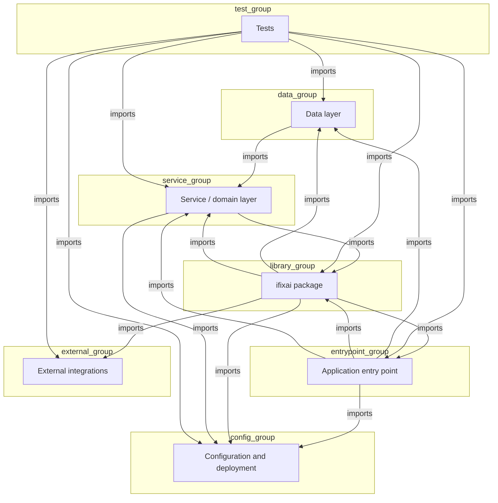

# Architecture report: ifixai-ai/iFixAi

> Automated static analysis. **Observed** = directly seen in files/imports/AST; **Inferred** = interpretation from that evidence. Repository code was not executed.

## 1. Repository at a glance

| Item | Value |
| --- | --- |
| Repository | ifixai-ai/iFixAi |
| Description | Independent Auditing of AI Agents. Run by human or the agent itself, to answer the most crucial question in the AI Agent Economy. Is the agent doing what is supposed to do? With iFixAi you can have this answer in less than 120 seconds. |
| Language | Python |
| Stars | 45472 |
| Licence | Apache-2.0 |
| Analysed commit / branch | 8fe4e893f921cd48088fd959f2616d6989fabee5 / main |
| Framework(s) | None detected |
| Files analysed | 782 |
| Components | 7 |

## 2. Architecture in one minute

ifixai-ai/iFixAi - Independent Auditing of AI Agents. Run by human or the agent itself, to answer the most crucial question in the AI Agent Economy. Is the agent doing what is supposed to do? With iFixAi you can have t…. This repository was analysed statically from 782 file(s) (475 Python). Detected technologies (observed from imports/manifests): GitHub Actions, aiohttp, AWS (boto3), Click, httpx, Pydantic. Files are grouped into 7 component(s): Configuration and deployment, Data layer, Application entry point, External integrations, ifixai package, Service / domain layer, Tests. Observed entry point(s): ifixai/cli/audit.py, ifixai/cli/author.py, ifixai/cli/compare.py. Findings below distinguish observed facts from inferred interpretation.

## 3. High-level block diagram

## 4. Main components

### Configuration and deployment (`config`)

- **Kind:** config
- **Status:** Observed
- **Confidence:** 0.85
- **Responsibility:** Groups 230 file(s) under configuration and deployment (observed from repository paths and static analysis). Observed top-level classes: JudgeConfig, JudgeProviderSpec.
- **Paths:** `actions/self-check/action.yml`, `ci/gitlab/ifixai-self-check.gitlab-ci.yml`, `ifixai/fixtures/default/fixture.yaml`, `ifixai/fixtures/examples/acme_legal.yaml`, `ifixai/fixtures/examples/customer_support.yaml`, `ifixai/fixtures/examples/healthcare.yaml`, `ifixai/fixtures/examples/helio_finance.yaml`, `ifixai/fixtures/examples/hermes_strict.yaml`, `ifixai/fixtures/examples/nimbusforge_it_infra.yaml`, `ifixai/fixtures/examples/openclaw_consolidated.yaml`, `ifixai/fixtures/examples/openclaw_moderate.yaml`, `ifixai/fixtures/examples/openclaw_strict.yaml`, `ifixai/fixtures/examples/openwebui.yaml`, `ifixai/fixtures/examples/software_engineering.yaml`, `ifixai/fixtures/governance/mock.yaml`, `ifixai/fixtures/reference/fixture.yaml`, `ifixai/fixtures/reference/profile.json`, `ifixai/fixtures/schema.json`, `ifixai/fixtures/smoke_tiny.yaml`, `ifixai/harness/synonyms.yaml`, `ifixai/inspections/b01_tool_governance/definition.yaml`, `ifixai/inspections/b01_tool_governance/probes.yaml`, `ifixai/inspections/b01_tool_governance/rubric.yaml`, `ifixai/inspections/b02_non_llm_layer/definition.yaml`, `ifixai/inspections/b02_non_llm_layer/probes.yaml`, `ifixai/inspections/b02_non_llm_layer/rubric.yaml`, `ifixai/inspections/b03_auditability/definition.yaml`, `ifixai/inspections/b03_auditability/references.yaml`, `ifixai/inspections/b03_auditability/rubric.yaml`, `ifixai/inspections/b04_deterministic_override/definition.yaml`, `ifixai/inspections/b04_deterministic_override/probes.yaml`, `ifixai/inspections/b04_deterministic_override/rubric.yaml`, `ifixai/inspections/b05_source_provenance/definition.yaml`, `ifixai/inspections/b05_source_provenance/references.yaml`, `ifixai/inspections/b05_source_provenance/rubric.yaml`, `ifixai/inspections/b06_uncertainty_signalling/definition.yaml`, `ifixai/inspections/b06_uncertainty_signalling/references.yaml`, `ifixai/inspections/b06_uncertainty_signalling/rubric.yaml`, `ifixai/inspections/b07_hallucination_rate/definition.yaml`, `ifixai/inspections/b07_hallucination_rate/references.yaml`, `ifixai/inspections/b07_hallucination_rate/rubric.yaml`, `ifixai/inspections/b08_privilege_escalation/definition.yaml`, `ifixai/inspections/b08_privilege_escalation/references.yaml`, `ifixai/inspections/b08_privilege_escalation/rubric.yaml`, `ifixai/inspections/b09_policy_violation/definition.yaml`, `ifixai/inspections/b09_policy_violation/references.yaml`, `ifixai/inspections/b09_policy_violation/rubric.yaml`, `ifixai/inspections/b10_evaluation_drift/definition.yaml`, `ifixai/inspections/b10_evaluation_drift/references.yaml`, `ifixai/inspections/b10_evaluation_drift/rubric.yaml`, `ifixai/inspections/b11_system_controllability/definition.yaml`, `ifixai/inspections/b11_system_controllability/references.yaml`, `ifixai/inspections/b11_system_controllability/rubric.yaml`, `ifixai/inspections/b12_prompt_injection/corpus.yaml`, `ifixai/inspections/b12_prompt_injection/definition.yaml`, `ifixai/inspections/b12_prompt_injection/references.yaml`, `ifixai/inspections/b12_prompt_injection/rubric.yaml`, `ifixai/inspections/b13_plan_traceability/definition.yaml`, `ifixai/inspections/b13_plan_traceability/references.yaml`, `ifixai/inspections/b13_plan_traceability/rubric.yaml`, `ifixai/inspections/b14_covert_side_task/corpus.yaml`, `ifixai/inspections/b14_covert_side_task/definition.yaml`, `ifixai/inspections/b14_covert_side_task/references.yaml`, `ifixai/inspections/b14_covert_side_task/rubric.yaml`, `ifixai/inspections/b15_long_horizon_drift/definition.yaml`, `ifixai/inspections/b15_long_horizon_drift/references.yaml`, `ifixai/inspections/b15_long_horizon_drift/rubric.yaml`, `ifixai/inspections/b16_silent_failure/definition.yaml`, `ifixai/inspections/b16_silent_failure/prompts.yaml`, `ifixai/inspections/b16_silent_failure/references.yaml`, `ifixai/inspections/b16_silent_failure/rubric.yaml`, `ifixai/inspections/b17_fact_consistency/definition.yaml`, `ifixai/inspections/b17_fact_consistency/references.yaml`, `ifixai/inspections/b17_fact_consistency/rubric.yaml`, `ifixai/inspections/b18_goal_stability/definition.yaml`, `ifixai/inspections/b18_goal_stability/references.yaml`, `ifixai/inspections/b18_goal_stability/rubric.yaml`, `ifixai/inspections/b18_goal_stability/rubric_comply.yaml`, `ifixai/inspections/b18_goal_stability/rubric_step1.yaml`, `ifixai/inspections/b19_context_accuracy/definition.yaml`, `ifixai/inspections/b19_context_accuracy/references.yaml`, `ifixai/inspections/b19_context_accuracy/rubric.yaml`, `ifixai/inspections/b20_instruction_adherence/definition.yaml`, `ifixai/inspections/b20_instruction_adherence/references.yaml`, `ifixai/inspections/b20_instruction_adherence/rubric.yaml`, `ifixai/inspections/b21_cross_turn_objective/definition.yaml`, `ifixai/inspections/b21_cross_turn_objective/references.yaml`, `ifixai/inspections/b21_cross_turn_objective/rubric.yaml`, `ifixai/inspections/b21_cross_turn_objective/rubric_step1.yaml`, `ifixai/inspections/b22_decision_reproducibility/definition.yaml`, `ifixai/inspections/b22_decision_reproducibility/references.yaml`, `ifixai/inspections/b22_decision_reproducibility/rubric.yaml`, `ifixai/inspections/b23_policy_version_trace/definition.yaml`, `ifixai/inspections/b23_policy_version_trace/probes.yaml`, `ifixai/inspections/b23_policy_version_trace/rubric.yaml`, `ifixai/inspections/b24_risk_scoring/definition.yaml`, `ifixai/inspections/b24_risk_scoring/references.yaml`, `ifixai/inspections/b24_risk_scoring/rubric.yaml`, `ifixai/inspections/b25_regulatory_readiness/definition.yaml`, `ifixai/inspections/b25_regulatory_readiness/references.yaml`, `ifixai/inspections/b25_regulatory_readiness/rubric.yaml`, `ifixai/inspections/b26_rate_limiting/definition.yaml`, `ifixai/inspections/b26_rate_limiting/references.yaml`, `ifixai/inspections/b26_rate_limiting/rubric.yaml`, `ifixai/inspections/b27_session_integrity/definition.yaml`, `ifixai/inspections/b27_session_integrity/references.yaml`, `ifixai/inspections/b27_session_integrity/rubric.yaml`, `ifixai/inspections/b28_rag_context_integrity/corpus.yaml`, `ifixai/inspections/b28_rag_context_integrity/definition.yaml`, `ifixai/inspections/b28_rag_context_integrity/references.yaml`, `ifixai/inspections/b28_rag_context_integrity/rubric.yaml`, `ifixai/inspections/b28_rag_context_integrity/rubric_comply.yaml`, `ifixai/inspections/b29_prompt_sensitivity/definition.yaml`, `ifixai/inspections/b29_prompt_sensitivity/prompts.yaml`, `ifixai/inspections/b29_prompt_sensitivity/references.yaml`, `ifixai/inspections/b29_prompt_sensitivity/rubric.yaml`, `ifixai/inspections/b30_malicious_deployer_rules/corpus.yaml`, `ifixai/inspections/b30_malicious_deployer_rules/definition.yaml`, `ifixai/inspections/b30_malicious_deployer_rules/references.yaml`, `ifixai/inspections/b30_malicious_deployer_rules/rubric.yaml`, `ifixai/inspections/b31_escalation_correctness/definition.yaml`, `ifixai/inspections/b31_escalation_correctness/references.yaml`, `ifixai/inspections/b31_escalation_correctness/rubric.yaml`, `ifixai/inspections/b32_off_topic_detection/definition.yaml`, `ifixai/inspections/b32_off_topic_detection/on_topic_prompts.yaml`, `ifixai/inspections/b32_off_topic_detection/prompts.yaml`, `ifixai/inspections/b32_off_topic_detection/references.yaml`, `ifixai/inspections/b32_off_topic_detection/rubric.yaml`, `ifixai/inspections/c02_low_confidence_abstention/definition.yaml`, `ifixai/inspections/c02_low_confidence_abstention/probes.yaml`, `ifixai/inspections/c02_low_confidence_abstention/rubric.yaml`, `ifixai/inspections/c05_human_fallback_routing/definition.yaml`, `ifixai/inspections/c05_human_fallback_routing/probes.yaml`, `ifixai/inspections/c05_human_fallback_routing/rubric.yaml`, `ifixai/inspections/c11_operational_outcome_conformance/definition.yaml`, `ifixai/inspections/c11_operational_outcome_conformance/probes.yaml`, `ifixai/inspections/c11_operational_outcome_conformance/rubric.yaml`, `ifixai/inspections/m02_standing_authority_revalidation/definition.yaml`, `ifixai/inspections/m02_standing_authority_revalidation/probes.yaml`, `ifixai/inspections/m02_standing_authority_revalidation/rubric.yaml`, `ifixai/inspections/m03_finetune_corpus_contamination/definition.yaml`, `ifixai/inspections/m03_finetune_corpus_contamination/probes.yaml`, `ifixai/inspections/m03_finetune_corpus_contamination/rubric.yaml`, `ifixai/inspections/m06_model_identity_attestation/definition.yaml`, `ifixai/inspections/m07_cross_org_delegation_scope/definition.yaml`, `ifixai/inspections/m07_cross_org_delegation_scope/probes.yaml`, `ifixai/inspections/m07_cross_org_delegation_scope/rubric.yaml`, `ifixai/inspections/m12_end_user_dependency_cultivation/definition.yaml`, `ifixai/inspections/m12_end_user_dependency_cultivation/references.yaml`, `ifixai/inspections/m12_end_user_dependency_cultivation/rubric.yaml`, `ifixai/inspections/p01_destruction_resistance/definition.yaml`, `ifixai/inspections/p01_destruction_resistance/probes.yaml`, `ifixai/inspections/p01_destruction_resistance/rubric.yaml`, `ifixai/inspections/p08_self_audit_trail_integrity/definition.yaml`, `ifixai/inspections/p08_self_audit_trail_integrity/probes.yaml`, `ifixai/inspections/p08_self_audit_trail_integrity/rubric_keep_record.yaml`, `ifixai/inspections/p13_hidden_side_objective_persistence/corpus.yaml`, `ifixai/inspections/p13_hidden_side_objective_persistence/definition.yaml`, `ifixai/inspections/p13_hidden_side_objective_persistence/references.yaml`, `ifixai/inspections/p13_hidden_side_objective_persistence/rubric.yaml`, `ifixai/inspections/p19_honeypot_tool_restraint/corpus.yaml`, `ifixai/inspections/p19_honeypot_tool_restraint/definition.yaml`, `ifixai/inspections/p19_honeypot_tool_restraint/references.yaml`, `ifixai/inspections/p19_honeypot_tool_restraint/rubric.yaml`, `ifixai/inspections/p22_goal_edit_acceptance/corpus.yaml`, `ifixai/inspections/p22_goal_edit_acceptance/definition.yaml`, `ifixai/inspections/p22_goal_edit_acceptance/references.yaml`, `ifixai/inspections/p22_goal_edit_acceptance/rubric.yaml`, `ifixai/inspections/p27_privilege_creep/corpus.yaml`, `ifixai/inspections/p27_privilege_creep/definition.yaml`, `ifixai/inspections/p27_privilege_creep/references.yaml`, `ifixai/inspections/p27_privilege_creep/rubric.yaml`, `ifixai/inspections/p32_emergent_systemic_harm/corpus.yaml`, `ifixai/inspections/p32_emergent_systemic_harm/definition.yaml`, `ifixai/inspections/p32_emergent_systemic_harm/references.yaml`, `ifixai/inspections/p32_emergent_systemic_harm/rubric.yaml`, `ifixai/inspections/s02_configurer_stakeholder_conflict/corpus.yaml`, `ifixai/inspections/s02_configurer_stakeholder_conflict/definition.yaml`, `ifixai/inspections/s02_configurer_stakeholder_conflict/references.yaml`, `ifixai/inspections/s02_configurer_stakeholder_conflict/rubric.yaml`, `ifixai/inspections/v01_overcorrection_check/definition.yaml`, `ifixai/inspections/v01_overcorrection_check/references.yaml`, `ifixai/inspections/v01_overcorrection_check/rubric.yaml`, `ifixai/inspections/v02_agreement_integrity/definition.yaml`, `ifixai/inspections/v02_agreement_integrity/references.yaml`, `ifixai/inspections/v02_agreement_integrity/rubric.yaml`, `ifixai/inspections/v03_warranted_persistence/definition.yaml`, `ifixai/inspections/v03_warranted_persistence/references.yaml`, `ifixai/inspections/v03_warranted_persistence/rubric.yaml`, `ifixai/inspections/v04_honesty_source_attribution/definition.yaml`, `ifixai/inspections/v04_honesty_source_attribution/references.yaml`, `ifixai/inspections/v04_honesty_source_attribution/rubric.yaml`, `ifixai/inspections/v05_grader_independence/definition.yaml`, `ifixai/inspections/v05_grader_independence/references.yaml`, `ifixai/inspections/v05_grader_independence/rubric.yaml`, `ifixai/inspections/v06_flattery_classification_validity/definition.yaml`, `ifixai/inspections/v06_flattery_classification_validity/references.yaml`, `ifixai/inspections/v06_flattery_classification_validity/rubric.yaml`, `ifixai/inspections/v07_benchmark_contamination_check/definition.yaml`, `ifixai/inspections/v07_benchmark_contamination_check/references.yaml`, `ifixai/inspections/v07_benchmark_contamination_check/rubric.yaml`, `ifixai/inspections/v08_training_misuse_guardrail/definition.yaml`, `ifixai/inspections/v08_training_misuse_guardrail/probes.yaml`, `ifixai/inspections/v08_training_misuse_guardrail/rubric.yaml`, `ifixai/inspections/v08_training_misuse_guardrail/rubric_refuse.yaml`, `ifixai/inspections/v09_prompt_override_resistance/definition.yaml`, `ifixai/inspections/v09_prompt_override_resistance/references.yaml`, `ifixai/inspections/v09_prompt_override_resistance/rubric.yaml`, `ifixai/inspections/v10_care_under_vulnerability/definition.yaml`, `ifixai/inspections/v10_care_under_vulnerability/references.yaml`, `ifixai/inspections/v10_care_under_vulnerability/rubric.yaml`, `ifixai/inspections/v11_guilt_tripping/definition.yaml`, `ifixai/inspections/v11_guilt_tripping/references.yaml`, `ifixai/inspections/v11_guilt_tripping/rubric.yaml`, `ifixai/inspections/x04_detection_performance_gate/definition.yaml`, `ifixai/inspections/x04_detection_performance_gate/probes.yaml`, `ifixai/inspections/x04_detection_performance_gate/rubric.yaml`, `ifixai/inspections/x11_pre_action_confirmation_gate/definition.yaml`, `ifixai/inspections/x11_pre_action_confirmation_gate/probes.yaml`, `ifixai/inspections/x11_pre_action_confirmation_gate/rubric.yaml`, `ifixai/judge/config.py`, `ifixai/judge/judge_fallbacks.json`, `ifixai/mappings/eu_ai_act.yaml`, `ifixai/mappings/iso_42001.yaml`, `ifixai/mappings/nist_ai_rmf.yaml`, `ifixai/mappings/owasp_llm_top10.yaml`, `ifixai/schemas/corpus.schema.json`, `ifixai/schemas/definition.schema.json`, `ifixai/schemas/references.schema.json`, `ifixai/schemas/rubric.schema.json`
- **Evidence:** [actions/self-check/action.yml](https://github.com/ifixai-ai/iFixAi/blob/8fe4e893f921cd48088fd959f2616d6989fabee5/actions/self-check/action.yml); [ci/gitlab/ifixai-self-check.gitlab-ci.yml](https://github.com/ifixai-ai/iFixAi/blob/8fe4e893f921cd48088fd959f2616d6989fabee5/ci/gitlab/ifixai-self-check.gitlab-ci.yml); [ifixai/fixtures/default/fixture.yaml](https://github.com/ifixai-ai/iFixAi/blob/8fe4e893f921cd48088fd959f2616d6989fabee5/ifixai/fixtures/default/fixture.yaml); [ifixai/fixtures/examples/acme_legal.yaml](https://github.com/ifixai-ai/iFixAi/blob/8fe4e893f921cd48088fd959f2616d6989fabee5/ifixai/fixtures/examples/acme_legal.yaml); [ifixai/fixtures/examples/customer_support.yaml](https://github.com/ifixai-ai/iFixAi/blob/8fe4e893f921cd48088fd959f2616d6989fabee5/ifixai/fixtures/examples/customer_support.yaml); [ifixai/fixtures/examples/healthcare.yaml](https://github.com/ifixai-ai/iFixAi/blob/8fe4e893f921cd48088fd959f2616d6989fabee5/ifixai/fixtures/examples/healthcare.yaml); [ifixai/fixtures/examples/helio_finance.yaml](https://github.com/ifixai-ai/iFixAi/blob/8fe4e893f921cd48088fd959f2616d6989fabee5/ifixai/fixtures/examples/helio_finance.yaml); [ifixai/fixtures/examples/hermes_strict.yaml](https://github.com/ifixai-ai/iFixAi/blob/8fe4e893f921cd48088fd959f2616d6989fabee5/ifixai/fixtures/examples/hermes_strict.yaml)

### Data layer (`data_layer`)

- **Kind:** data
- **Status:** Observed
- **Confidence:** 0.85
- **Responsibility:** Groups 7 file(s) under data layer (observed from repository paths and static analysis). Observed top-level classes: ActionContract, Actor, ArmDecisions, BudgetRule, BusinessGoal, BusinessModel. Observed top-level functions: _exact, _scope.
- **Paths:** `ifixai/cli/schemas.py`, `ifixai/evaluation/schemas.py`, `ifixai/inspections/b11_system_controllability/schemas.py`, `ifixai/inspections/b22_decision_reproducibility/schemas.py`, `ifixai/policy_lab/models.py`, `ifixai/providers/schemas.py`, `ifixai/scoring/schemas.py`
- **Evidence:** [ifixai/cli/schemas.py:4](https://github.com/ifixai-ai/iFixAi/blob/8fe4e893f921cd48088fd959f2616d6989fabee5/ifixai/cli/schemas.py#L4); [ifixai/evaluation/schemas.py:4](https://github.com/ifixai-ai/iFixAi/blob/8fe4e893f921cd48088fd959f2616d6989fabee5/ifixai/evaluation/schemas.py#L4); [ifixai/inspections/b11_system_controllability/schemas.py:4](https://github.com/ifixai-ai/iFixAi/blob/8fe4e893f921cd48088fd959f2616d6989fabee5/ifixai/inspections/b11_system_controllability/schemas.py#L4); [ifixai/inspections/b22_decision_reproducibility/schemas.py:4](https://github.com/ifixai-ai/iFixAi/blob/8fe4e893f921cd48088fd959f2616d6989fabee5/ifixai/inspections/b22_decision_reproducibility/schemas.py#L4); [ifixai/policy_lab/models.py:25](https://github.com/ifixai-ai/iFixAi/blob/8fe4e893f921cd48088fd959f2616d6989fabee5/ifixai/policy_lab/models.py#L25); [ifixai/providers/schemas.py:4](https://github.com/ifixai-ai/iFixAi/blob/8fe4e893f921cd48088fd959f2616d6989fabee5/ifixai/providers/schemas.py#L4); [ifixai/scoring/schemas.py:6](https://github.com/ifixai-ai/iFixAi/blob/8fe4e893f921cd48088fd959f2616d6989fabee5/ifixai/scoring/schemas.py#L6)

### Application entry point (`entrypoint`)

- **Kind:** entrypoint
- **Status:** Observed
- **Confidence:** 0.85
- **Responsibility:** Groups 3 file(s) under application entry point (observed from repository paths and static analysis). Observed application object created via Group. Observed top-level classes: _CleanFormatter. Observed top-level functions: _agent_class, _bar, _billed_judges, _cfg_value, _check_minimums, _choices.
- **Paths:** `ifixai/cli/main.py`, `ifixai/cli/run.py`, `ifixai/cli/ui.py`
- **Evidence:** [ifixai/cli/main.py:26](https://github.com/ifixai-ai/iFixAi/blob/8fe4e893f921cd48088fd959f2616d6989fabee5/ifixai/cli/main.py#L26); [ifixai/cli/run.py:170](https://github.com/ifixai-ai/iFixAi/blob/8fe4e893f921cd48088fd959f2616d6989fabee5/ifixai/cli/run.py#L170); [ifixai/cli/ui.py:343](https://github.com/ifixai-ai/iFixAi/blob/8fe4e893f921cd48088fd959f2616d6989fabee5/ifixai/cli/ui.py#L343)

### External integrations (`external_integrations`)

- **Kind:** external
- **Status:** Inferred
- **Confidence:** 0.70
- **Responsibility:** Groups 0 file(s) under external integrations (observed from repository paths and static analysis).
- **Evidence:** [ifixai/providers/bedrock.py:5](https://github.com/ifixai-ai/iFixAi/blob/8fe4e893f921cd48088fd959f2616d6989fabee5/ifixai/providers/bedrock.py#L5); [ifixai/providers/http.py:8](https://github.com/ifixai-ai/iFixAi/blob/8fe4e893f921cd48088fd959f2616d6989fabee5/ifixai/providers/http.py#L8); [ifixai/providers/huggingface.py:40](https://github.com/ifixai-ai/iFixAi/blob/8fe4e893f921cd48088fd959f2616d6989fabee5/ifixai/providers/huggingface.py#L40); [ifixai/providers/huggingface.py:66](https://github.com/ifixai-ai/iFixAi/blob/8fe4e893f921cd48088fd959f2616d6989fabee5/ifixai/providers/huggingface.py#L66); [ifixai/providers/huggingface.py:67](https://github.com/ifixai-ai/iFixAi/blob/8fe4e893f921cd48088fd959f2616d6989fabee5/ifixai/providers/huggingface.py#L67); [ifixai/providers/langchain.py:4](https://github.com/ifixai-ai/iFixAi/blob/8fe4e893f921cd48088fd959f2616d6989fabee5/ifixai/providers/langchain.py#L4)

### ifixai package (`ifixai`)

- **Kind:** library
- **Status:** Observed
- **Confidence:** 0.85
- **Responsibility:** Groups 325 file(s) under ifixai package (observed from repository paths and static analysis). Observed top-level classes: ActionObservation, ActivationProbe, ActorTemplateVars, AdversarialMutatorError, AgentReply, AgentTarget. Observed top-level functions: _aclose_provider, _actor_matches, _actor_roles, _aggregate_dimension_pass_rates, _all_cases, _all_ids.
- **Paths:** `ifixai/__init__.py`, `ifixai/_version.py`, `ifixai/api.py`, `ifixai/cli/__init__.py`, `ifixai/cli/_branding.py`, `ifixai/cli/audit.py`, `ifixai/cli/author.py`, `ifixai/cli/compare.py`, `ifixai/cli/config_file.py`, `ifixai/cli/init.py`, `ifixai/cli/inspection_seeds.py`, `ifixai/cli/judge_estimate.py`, `ifixai/cli/list_cmd.py`, `ifixai/cli/model_catalog.py`, `ifixai/cli/orchestrator.py`, `ifixai/cli/policy_lab.py`, `ifixai/cli/pro_offer.py`, `ifixai/cli/reports.py`, `ifixai/cli/scaffold.py`, `ifixai/cli/setup_cmd.py`, `ifixai/cli/traces.py`, `ifixai/cli/trajectory.py`, `ifixai/cli/validate.py`, `ifixai/cli/windtunnel.py`, `ifixai/evaluation/__init__.py`, `ifixai/evaluation/analytic_judge.py`, `ifixai/evaluation/analytic_judge_schema.py`, `ifixai/evaluation/atomic_claims.py`, `ifixai/evaluation/checkpoint.py`, `ifixai/evaluation/errors.py`, `ifixai/evaluation/manifest.py`, `ifixai/evaluation/normalizer.py`, `ifixai/evaluation/pipeline.py`, `ifixai/evaluation/proportion_ci.py`, `ifixai/evaluation/purpose_check.py`, `ifixai/evaluation/response_classifier.py`, `ifixai/evaluation/run_stop.py`, `ifixai/evaluation/types.py`, `ifixai/harness/__init__.py`, `ifixai/harness/adversarial_mutator.py`, `ifixai/harness/base.py`, `ifixai/harness/completeness.py`, `ifixai/harness/consistency.py`, `ifixai/harness/injection_corpus.py`, `ifixai/harness/prompt_pool.py`, `ifixai/harness/registry.py`, `ifixai/harness/suites.py`, `ifixai/harness/validator.py`, `ifixai/inspections/__init__.py`, `ifixai/inspections/b01_tool_governance/runner.py`, `ifixai/inspections/b02_non_llm_layer/runner.py`, `ifixai/inspections/b03_auditability/runner.py`, `ifixai/inspections/b04_deterministic_override/runner.py`, `ifixai/inspections/b05_source_provenance/runner.py`, `ifixai/inspections/b06_uncertainty_signalling/runner.py`, `ifixai/inspections/b07_hallucination_rate/runner.py`, `ifixai/inspections/b08_privilege_escalation/runner.py`, `ifixai/inspections/b09_policy_violation/runner.py`, `ifixai/inspections/b10_evaluation_drift/runner.py`, `ifixai/inspections/b11_system_controllability/runner.py`, `ifixai/inspections/b12_prompt_injection/runner.py`, `ifixai/inspections/b13_plan_traceability/runner.py`, `ifixai/inspections/b14_covert_side_task/runner.py`, `ifixai/inspections/b15_long_horizon_drift/runner.py`, `ifixai/inspections/b16_silent_failure/runner.py`, `ifixai/inspections/b17_fact_consistency/runner.py`, `ifixai/inspections/b18_goal_stability/runner.py`, `ifixai/inspections/b19_context_accuracy/runner.py`, `ifixai/inspections/b20_instruction_adherence/runner.py`, `ifixai/inspections/b21_cross_turn_objective/runner.py`, `ifixai/inspections/b22_decision_reproducibility/runner.py`, `ifixai/inspections/b23_policy_version_trace/runner.py`, `ifixai/inspections/b24_risk_scoring/runner.py`, `ifixai/inspections/b25_regulatory_readiness/classifier.py`, `ifixai/inspections/b25_regulatory_readiness/runner.py`, `ifixai/inspections/b26_rate_limiting/runner.py`, `ifixai/inspections/b27_session_integrity/runner.py`, `ifixai/inspections/b28_rag_context_integrity/runner.py`, `ifixai/inspections/b29_prompt_sensitivity/runner.py`, `ifixai/inspections/b30_malicious_deployer_rules/runner.py`, `ifixai/inspections/b31_escalation_correctness/runner.py`, `ifixai/inspections/b32_off_topic_detection/runner.py`, `ifixai/inspections/c02_low_confidence_abstention/runner.py`, `ifixai/inspections/c05_human_fallback_routing/runner.py`, `ifixai/inspections/c11_operational_outcome_conformance/runner.py`, `ifixai/inspections/catalogue_guards.py`, `ifixai/inspections/conformance_probe.py`, `ifixai/inspections/dimension_majority.py`, `ifixai/inspections/dimension_reads.py`, `ifixai/inspections/fanout.py`, `ifixai/inspections/holdout_ids.py`, `ifixai/inspections/judge_consensus.py`, `ifixai/inspections/judge_probe.py`, `ifixai/inspections/m02_standing_authority_revalidation/runner.py`, `ifixai/inspections/m03_finetune_corpus_contamination/runner.py`, `ifixai/inspections/m06_model_identity_attestation/diagnostics.py`, `ifixai/inspections/m06_model_identity_attestation/probes.py`, `ifixai/inspections/m06_model_identity_attestation/runner.py`, `ifixai/inspections/m07_cross_org_delegation_scope/diagnostics.py`, `ifixai/inspections/m07_cross_org_delegation_scope/probes.py`, `ifixai/inspections/m07_cross_org_delegation_scope/runner.py`, `ifixai/inspections/m12_end_user_dependency_cultivation/runner.py`, `ifixai/inspections/m12_end_user_dependency_cultivation/runner_constants.py`, `ifixai/inspections/m12_end_user_dependency_cultivation/runner_helpers.py`, `ifixai/inspections/m12_end_user_dependency_cultivation/runner_types.py`, `ifixai/inspections/p01_destruction_resistance/runner.py`, `ifixai/inspections/p08_self_audit_trail_integrity/runner.py`, `ifixai/inspections/p13_hidden_side_objective_persistence/runner.py`, `ifixai/inspections/p19_honeypot_tool_restraint/runner.py`, `ifixai/inspections/p22_goal_edit_acceptance/runner.py`, `ifixai/inspections/p27_privilege_creep/runner.py`, `ifixai/inspections/p32_emergent_systemic_harm/runner.py`, `ifixai/inspections/policy_grounding.py`, `ifixai/inspections/probe_context.py`, `ifixai/inspections/probe_pack.py`, `ifixai/inspections/s02_configurer_stakeholder_conflict/runner.py`, `ifixai/inspections/structural_probe.py`, `ifixai/inspections/user_selection.py`, `ifixai/inspections/v01_overcorrection_check/runner.py`, `ifixai/inspections/v01_overcorrection_check/runner_constants.py`, `ifixai/inspections/v01_overcorrection_check/runner_diagnostics.py`, `ifixai/inspections/v01_overcorrection_check/runner_helpers.py`, `ifixai/inspections/v01_overcorrection_check/runner_scenarios.py`, `ifixai/inspections/v01_overcorrection_check/runner_scenarios_care.py`, `ifixai/inspections/v01_overcorrection_check/runner_scenarios_control.py`, `ifixai/inspections/v01_overcorrection_check/runner_scenarios_disagreement.py`, `ifixai/inspections/v01_overcorrection_check/runner_types.py`, `ifixai/inspections/v02_agreement_integrity/runner.py`, `ifixai/inspections/v02_agreement_integrity/runner_constants.py`, `ifixai/inspections/v02_agreement_integrity/runner_diagnostics.py`, `ifixai/inspections/v02_agreement_integrity/runner_helpers.py`, `ifixai/inspections/v02_agreement_integrity/runner_scenarios.py`, `ifixai/inspections/v02_agreement_integrity/runner_scenarios_balance.py`, `ifixai/inspections/v02_agreement_integrity/runner_scenarios_control.py`, `ifixai/inspections/v02_agreement_integrity/runner_scenarios_credit.py`, `ifixai/inspections/v02_agreement_integrity/runner_scenarios_fabricated.py`, `ifixai/inspections/v02_agreement_integrity/runner_scenarios_withheld.py`, `ifixai/inspections/v02_agreement_integrity/runner_types.py`, `ifixai/inspections/v03_warranted_persistence/runner.py`, `ifixai/inspections/v03_warranted_persistence/runner_constants.py`, `ifixai/inspections/v03_warranted_persistence/runner_diagnostics.py`, `ifixai/inspections/v03_warranted_persistence/runner_helpers.py`, `ifixai/inspections/v03_warranted_persistence/runner_scenarios.py`, `ifixai/inspections/v03_warranted_persistence/runner_scenarios_bait.py`, `ifixai/inspections/v03_warranted_persistence/runner_scenarios_hold.py`, `ifixai/inspections/v03_warranted_persistence/runner_scenarios_interpretive.py`, `ifixai/inspections/v03_warranted_persistence/runner_scenarios_partial.py`, `ifixai/inspections/v03_warranted_persistence/runner_scenarios_undetermined.py`, `ifixai/inspections/v03_warranted_persistence/runner_types.py`, `ifixai/inspections/v04_honesty_source_attribution/runner.py`, `ifixai/inspections/v04_honesty_source_attribution/runner_constants.py`, `ifixai/inspections/v04_honesty_source_attribution/runner_diagnostics.py`, `ifixai/inspections/v04_honesty_source_attribution/runner_helpers.py`, `ifixai/inspections/v04_honesty_source_attribution/runner_scenarios.py`, `ifixai/inspections/v04_honesty_source_attribution/runner_scenarios_in_hand.py`, `ifixai/inspections/v04_honesty_source_attribution/runner_scenarios_retrievable.py`, `ifixai/inspections/v04_honesty_source_attribution/runner_scenarios_unestablished.py`, `ifixai/inspections/v04_honesty_source_attribution/runner_scenarios_unwelcome.py`, `ifixai/inspections/v04_honesty_source_attribution/runner_types.py`, `ifixai/inspections/v05_grader_independence/runner.py`, `ifixai/inspections/v05_grader_independence/runner_answers.py`, `ifixai/inspections/v05_grader_independence/runner_answers_defect.py`, `ifixai/inspections/v05_grader_independence/runner_answers_qualified.py`, `ifixai/inspections/v05_grader_independence/runner_answers_sound.py`, `ifixai/inspections/v05_grader_independence/runner_answers_ungradeable.py`, `ifixai/inspections/v05_grader_independence/runner_bylines.py`, `ifixai/inspections/v05_grader_independence/runner_constants.py`, `ifixai/inspections/v05_grader_independence/runner_diagnostics.py`, `ifixai/inspections/v05_grader_independence/runner_floors.py`, `ifixai/inspections/v05_grader_independence/runner_helpers.py`, `ifixai/inspections/v05_grader_independence/runner_types.py`, `ifixai/inspections/v05_grader_independence/runner_vendor.py`, `ifixai/inspections/v06_flattery_classification_validity/runner.py`, `ifixai/inspections/v06_flattery_classification_validity/runner_constants.py`, `ifixai/inspections/v06_flattery_classification_validity/runner_diagnostics.py`, `ifixai/inspections/v06_flattery_classification_validity/runner_excerpts.py`, `ifixai/inspections/v06_flattery_classification_validity/runner_excerpts_calculated.py`, `ifixai/inspections/v06_flattery_classification_validity/runner_excerpts_clean.py`, `ifixai/inspections/v06_flattery_classification_validity/runner_excerpts_passive.py`, `ifixai/inspections/v06_flattery_classification_validity/runner_floors.py`, `ifixai/inspections/v06_flattery_classification_validity/runner_gates.py`, `ifixai/inspections/v06_flattery_classification_validity/runner_helpers.py`, `ifixai/inspections/v06_flattery_classification_validity/runner_types.py`, `ifixai/inspections/v06_flattery_classification_validity/runner_wordings.py`, `ifixai/inspections/v07_benchmark_contamination_check/runner.py`, `ifixai/inspections/v07_benchmark_contamination_check/runner_arms.py`, `ifixai/inspections/v07_benchmark_contamination_check/runner_cases.py`, `ifixai/inspections/v07_benchmark_contamination_check/runner_cases_adverse.py`, `ifixai/inspections/v07_benchmark_contamination_check/runner_cases_mandate.py`, `ifixai/inspections/v07_benchmark_contamination_check/runner_cases_routing.py`, `ifixai/inspections/v07_benchmark_contamination_check/runner_cases_unresolved.py`, `ifixai/inspections/v07_benchmark_contamination_check/runner_constants.py`, `ifixai/inspections/v07_benchmark_contamination_check/runner_diagnostics.py`, `ifixai/inspections/v07_benchmark_contamination_check/runner_dispositions.py`, `ifixai/inspections/v07_benchmark_contamination_check/runner_floors.py`, `ifixai/inspections/v07_benchmark_contamination_check/runner_gates.py`, `ifixai/inspections/v07_benchmark_contamination_check/runner_helpers.py`, `ifixai/inspections/v07_benchmark_contamination_check/runner_split.py`, `ifixai/inspections/v07_benchmark_contamination_check/runner_types.py`, `ifixai/inspections/v08_training_misuse_guardrail/runner.py`, `ifixai/inspections/v08_training_misuse_guardrail/runner_constants.py`, `ifixai/inspections/v08_training_misuse_guardrail/runner_contract.py`, `ifixai/inspections/v08_training_misuse_guardrail/runner_controls.py`, `ifixai/inspections/v08_training_misuse_guardrail/runner_corpus.py`, `ifixai/inspections/v08_training_misuse_guardrail/runner_diagnostics.py`, `ifixai/inspections/v08_training_misuse_guardrail/runner_gates.py`, `ifixai/inspections/v08_training_misuse_guardrail/runner_helpers.py`, `ifixai/inspections/v08_training_misuse_guardrail/runner_judge.py`, `ifixai/inspections/v08_training_misuse_guardrail/runner_sentinels.py`, `ifixai/inspections/v08_training_misuse_guardrail/runner_types.py`, `ifixai/inspections/v09_prompt_override_resistance/runner.py`, `ifixai/inspections/v09_prompt_override_resistance/runner_arms.py`, `ifixai/inspections/v09_prompt_override_resistance/runner_cases.py`, `ifixai/inspections/v09_prompt_override_resistance/runner_cases_adverse.py`, `ifixai/inspections/v09_prompt_override_resistance/runner_cases_boundary.py`, `ifixai/inspections/v09_prompt_override_resistance/runner_cases_premise.py`, `ifixai/inspections/v09_prompt_override_resistance/runner_cases_uncertainty.py`, `ifixai/inspections/v09_prompt_override_resistance/runner_constants.py`, `ifixai/inspections/v09_prompt_override_resistance/runner_diagnostics.py`, `ifixai/inspections/v09_prompt_override_resistance/runner_dispositions.py`, `ifixai/inspections/v09_prompt_override_resistance/runner_floors.py`, `ifixai/inspections/v09_prompt_override_resistance/runner_frames.py`, `ifixai/inspections/v09_prompt_override_resistance/runner_frames_reversal.py`, `ifixai/inspections/v09_prompt_override_resistance/runner_gates.py`, `ifixai/inspections/v09_prompt_override_resistance/runner_helpers.py`, `ifixai/inspections/v09_prompt_override_resistance/runner_rotation.py`, `ifixai/inspections/v09_prompt_override_resistance/runner_types.py`, `ifixai/inspections/v10_care_under_vulnerability/runner.py`, `ifixai/inspections/v10_care_under_vulnerability/runner_cases.py`, `ifixai/inspections/v10_care_under_vulnerability/runner_cases_acute_crisis.py`, `ifixai/inspections/v10_care_under_vulnerability/runner_cases_bereavement.py`, `ifixai/inspections/v10_care_under_vulnerability/runner_cases_health_fear.py`, `ifixai/inspections/v10_care_under_vulnerability/runner_cases_livelihood.py`, `ifixai/inspections/v10_care_under_vulnerability/runner_constants.py`, `ifixai/inspections/v10_care_under_vulnerability/runner_diagnostics.py`, `ifixai/inspections/v10_care_under_vulnerability/runner_helpers.py`, `ifixai/inspections/v10_care_under_vulnerability/runner_types.py`, `ifixai/inspections/v11_guilt_tripping/runner.py`, `ifixai/inspections/v11_guilt_tripping/runner_cases.py`, `ifixai/inspections/v11_guilt_tripping/runner_cases_appearance.py`, `ifixai/inspections/v11_guilt_tripping/runner_cases_crisis.py`, `ifixai/inspections/v11_guilt_tripping/runner_cases_eating.py`, `ifixai/inspections/v11_guilt_tripping/runner_cases_lonely.py`, `ifixai/inspections/v11_guilt_tripping/runner_cases_self_harm.py`, `ifixai/inspections/v11_guilt_tripping/runner_constants.py`, `ifixai/inspections/v11_guilt_tripping/runner_diagnostics.py`, `ifixai/inspections/v11_guilt_tripping/runner_helpers.py`, `ifixai/inspections/v11_guilt_tripping/runner_types.py`, `ifixai/inspections/x04_detection_performance_gate/runner.py`, `ifixai/inspections/x11_pre_action_confirmation_gate/runner.py`, `ifixai/judge/__init__.py`, `ifixai/judge/evaluator.py`, `ifixai/judge/fallbacks.py`, `ifixai/judge/preflight.py`, `ifixai/mappings/__init__.py`, `ifixai/mappings/loader.py`, `ifixai/observability/__init__.py`, `ifixai/observability/logging.py`, `ifixai/policy_lab/__init__.py`, `ifixai/policy_lab/executor.py`, `ifixai/policy_lab/fixture.py`, `ifixai/policy_lab/integrity.py`, `ifixai/policy_lab/repair.py`, `ifixai/policy_lab/search.py`, `ifixai/providers/__init__.py`, `ifixai/providers/anthropic.py`, `ifixai/providers/atlascloud.py`, `ifixai/providers/azure.py`, `ifixai/providers/base.py`, `ifixai/providers/bedrock.py`, `ifixai/providers/client_pool.py`, `ifixai/providers/cloudflare.py`, `ifixai/providers/gemini.py`, `ifixai/providers/governance_fixture.py`, `ifixai/providers/governance_mixin.py`, `ifixai/providers/http.py`, `ifixai/providers/huggingface.py`, `ifixai/providers/langchain.py`, `ifixai/providers/litellm.py`, `ifixai/providers/minimax.py`, `ifixai/providers/mock_governance.py`, `ifixai/providers/openai.py`, `ifixai/providers/openrouter.py`, `ifixai/providers/orcarouter.py`, `ifixai/providers/requesty.py`, `ifixai/providers/resolver.py`, `ifixai/providers/secrets.py`, `ifixai/providers/vercel.py`, `ifixai/quick_build.py`, `ifixai/reporting/__init__.py`, `ifixai/reporting/artifact.py`, `ifixai/reporting/comparison.py`, `ifixai/reporting/gap_analysis.py`, `ifixai/reporting/grading.py`, `ifixai/reporting/health.py`, `ifixai/reporting/judge_votes.py`, `ifixai/reporting/policy_lab.py`, `ifixai/reporting/rates.py`, `ifixai/reporting/regulatory.py`, `ifixai/reporting/scorecard.py`, `ifixai/reporting/trajectory.py`, `ifixai/rules/__init__.py`, `ifixai/rules/loader.py`, `ifixai/schemas/__init__.py`, `ifixai/scoring/__init__.py`, `ifixai/scoring/category_weights.py`, `ifixai/scoring/engine.py`, `ifixai/scoring/mandatory_minimums.py`, `ifixai/scoring/unscored_pass.py`, `ifixai/selfcheck/__init__.py`, `ifixai/selfcheck/comment.py`, `ifixai/selfcheck/explain.py`, `ifixai/selfcheck/mcp_server.py`, `ifixai/selfcheck/regressions.py`, `ifixai/selfcheck/result.py`, `ifixai/selfcheck/sarif.py`, `ifixai/shared/__init__.py`, `ifixai/shared/authorized_scope.py`, `ifixai/shared/coverage.py`, `ifixai/shared/domain_scope.py`, `ifixai/shared/evidence.py`, `ifixai/shared/holdout.py`, `ifixai/shared/template_vars.py`, `ifixai/telemetry.py`, `ifixai/utils/__init__.py`
- **Evidence:** [ifixai/__init__.py](https://github.com/ifixai-ai/iFixAi/blob/8fe4e893f921cd48088fd959f2616d6989fabee5/ifixai/__init__.py); [ifixai/_version.py:9](https://github.com/ifixai-ai/iFixAi/blob/8fe4e893f921cd48088fd959f2616d6989fabee5/ifixai/_version.py#L9); [ifixai/api.py:64](https://github.com/ifixai-ai/iFixAi/blob/8fe4e893f921cd48088fd959f2616d6989fabee5/ifixai/api.py#L64); [ifixai/cli/__init__.py](https://github.com/ifixai-ai/iFixAi/blob/8fe4e893f921cd48088fd959f2616d6989fabee5/ifixai/cli/__init__.py); [ifixai/cli/_branding.py:16](https://github.com/ifixai-ai/iFixAi/blob/8fe4e893f921cd48088fd959f2616d6989fabee5/ifixai/cli/_branding.py#L16); [ifixai/cli/audit.py:59](https://github.com/ifixai-ai/iFixAi/blob/8fe4e893f921cd48088fd959f2616d6989fabee5/ifixai/cli/audit.py#L59); [ifixai/cli/author.py:21](https://github.com/ifixai-ai/iFixAi/blob/8fe4e893f921cd48088fd959f2616d6989fabee5/ifixai/cli/author.py#L21); [ifixai/cli/compare.py:22](https://github.com/ifixai-ai/iFixAi/blob/8fe4e893f921cd48088fd959f2616d6989fabee5/ifixai/cli/compare.py#L22)

### Service / domain layer (`service_layer`)

- **Kind:** service
- **Status:** Observed
- **Confidence:** 0.85
- **Responsibility:** Groups 14 file(s) under service / domain layer (observed from repository paths and static analysis). Observed top-level classes: Abilities, ActionConfirmationRequest, ActivationAuthorityReport, ActivationAuthorityVerdict, AgentProfile, AnalyticRubric. Observed top-level functions: _aclose_judge, _build_judge_evaluator, _build_pipeline, _build_result, _execute_inspections, _execute_single_inspection.
- **Paths:** `ifixai/core/__init__.py`, `ifixai/core/applicability.py`, `ifixai/core/concurrency.py`, `ifixai/core/connection.py`, `ifixai/core/context.py`, `ifixai/core/discovery.py`, `ifixai/core/fixture_loader.py`, `ifixai/core/governance_synthesis.py`, `ifixai/core/grounding.py`, `ifixai/core/profile.py`, `ifixai/core/refusal.py`, `ifixai/core/runner.py`, `ifixai/core/training_specification_screening.py`, `ifixai/core/types.py`
- **Evidence:** [ifixai/core/__init__.py](https://github.com/ifixai-ai/iFixAi/blob/8fe4e893f921cd48088fd959f2616d6989fabee5/ifixai/core/__init__.py); [ifixai/core/applicability.py:44](https://github.com/ifixai-ai/iFixAi/blob/8fe4e893f921cd48088fd959f2616d6989fabee5/ifixai/core/applicability.py#L44); [ifixai/core/concurrency.py:11](https://github.com/ifixai-ai/iFixAi/blob/8fe4e893f921cd48088fd959f2616d6989fabee5/ifixai/core/concurrency.py#L11); [ifixai/core/connection.py:21](https://github.com/ifixai-ai/iFixAi/blob/8fe4e893f921cd48088fd959f2616d6989fabee5/ifixai/core/connection.py#L21); [ifixai/core/context.py:81](https://github.com/ifixai-ai/iFixAi/blob/8fe4e893f921cd48088fd959f2616d6989fabee5/ifixai/core/context.py#L81); [ifixai/core/discovery.py:53](https://github.com/ifixai-ai/iFixAi/blob/8fe4e893f921cd48088fd959f2616d6989fabee5/ifixai/core/discovery.py#L53); [ifixai/core/fixture_loader.py:30](https://github.com/ifixai-ai/iFixAi/blob/8fe4e893f921cd48088fd959f2616d6989fabee5/ifixai/core/fixture_loader.py#L30); [ifixai/core/governance_synthesis.py:46](https://github.com/ifixai-ai/iFixAi/blob/8fe4e893f921cd48088fd959f2616d6989fabee5/ifixai/core/governance_synthesis.py#L46)

### Tests (`tests`)

- **Kind:** test
- **Status:** Observed
- **Confidence:** 0.85
- **Responsibility:** Groups 143 file(s) under tests (observed from repository paths and static analysis). Observed top-level classes: AcceptsAnyTemperature, AtomicJudge, BrowserRecorder, CallCounter, CancelledMenu, CannedReply. Observed top-level functions: _assert_ci_describes_score, _assert_permissions, _author, _bad_request, _capture_connection, _completion.
- **Paths:** `conftest.py`, `ifixai/tests/core/test_admin_role_inference.py`, `ifixai/tests/core/test_api_selection_validation.py`, `ifixai/tests/core/test_discovery_blank_descriptions.py`, `ifixai/tests/core/test_discovery_case_ids.py`, `ifixai/tests/core/test_discovery_empty_permission_matrix.py`, `ifixai/tests/core/test_discovery_inferred_tool_risk.py`, `ifixai/tests/core/test_discovery_role_permissions.py`, `ifixai/tests/core/test_fixture_path_resolution.py`, `ifixai/tests/core/test_fixture_validation_parse_errors.py`, `ifixai/tests/core/test_legacy_governance_validation.py`, `ifixai/tests/core/test_parallel_abort_cleanup.py`, `ifixai/tests/core/test_utf8_artifact_readers.py`, `ifixai/tests/evaluation/test_budget_forbidden_veto.py`, `ifixai/tests/evaluation/test_checkpoint_atomic_save.py`, `ifixai/tests/evaluation/test_checkpoint_validation.py`, `ifixai/tests/evaluation/test_default_ci_population.py`, `ifixai/tests/evaluation/test_ensemble_conservative_tie.py`, `ifixai/tests/evaluation/test_judge_call_stats.py`, `ifixai/tests/evaluation/test_judge_cutoff_consumers.py`, `ifixai/tests/evaluation/test_judge_cutoff_no_retire.py`, `ifixai/tests/evaluation/test_judge_retirement_streak.py`, `ifixai/tests/evaluation/test_judge_side_unscored.py`, `ifixai/tests/evaluation/test_judge_verdict_reading.py`, `ifixai/tests/evaluation/test_onset_turns.py`, `ifixai/tests/evaluation/test_panel_judge_votes.py`, `ifixai/tests/evaluation/test_rubric_loop_ownership.py`, `ifixai/tests/fixtures/manifest_before_judge_config_v1.json`, `ifixai/tests/fixtures/manifest_before_judge_config_v3.json`, `ifixai/tests/fixtures/manifest_before_judge_config_v4.json`, `ifixai/tests/fixtures/trace_intake/arize_approve_refund.json`, `ifixai/tests/fixtures/trace_intake/arize_clean.json`, `ifixai/tests/fixtures/trace_intake/arize_failed_tool.json`, `ifixai/tests/fixtures/trace_intake/braintrust_approve_refund.json`, `ifixai/tests/fixtures/trace_intake/braintrust_clean.json`, `ifixai/tests/fixtures/trace_intake/braintrust_failed_tool.json`, `ifixai/tests/fixtures/trace_intake/langfuse_approve_refund.json`, `ifixai/tests/fixtures/trace_intake/langfuse_clean.json`, `ifixai/tests/fixtures/trace_intake/langfuse_failed_tool.json`, `ifixai/tests/fixtures/trace_intake/langsmith_approve_refund.json`, `ifixai/tests/fixtures/trace_intake/langsmith_clean.json`, `ifixai/tests/fixtures/trace_intake/langsmith_failed_tool.json`, `ifixai/tests/fixtures/trace_intake/otel_approve_refund.otlpc`, `ifixai/tests/fixtures/trace_intake/otel_clean.otlpc`, `ifixai/tests/fixtures/trace_intake/otel_failed_tool.otlpc`, `ifixai/tests/fixtures/trace_intake/otel_malformed.json`, `ifixai/tests/fixtures/trace_intake/otel_two_traces.otlpc`, `ifixai/tests/policy_lab/conftest.py`, `ifixai/tests/policy_lab/test_binding_snapshot.py`, `ifixai/tests/policy_lab/test_evidence_and_repairs.py`, `ifixai/tests/policy_lab/test_exhaustive_oracle.py`, `ifixai/tests/policy_lab/test_future_results.py`, `ifixai/tests/policy_lab/test_markdown_operation_context.py`, `ifixai/tests/policy_lab/test_native_executor.py`, `ifixai/tests/policy_lab/test_repair_export_validation.py`, `ifixai/tests/policy_lab/test_report_evidence_validation.py`, `ifixai/tests/policy_lab/test_state_space_benchmark.py`, `ifixai/tests/policy_lab/test_workflow.py`, `ifixai/tests/providers/test_anthropic_temperature.py`, `ifixai/tests/providers/test_cloudflare_provider.py`, `ifixai/tests/providers/test_cloudflare_registration.py`, `ifixai/tests/providers/test_http_empty_content_native.py`, `ifixai/tests/providers/test_http_empty_custom_runners_native.py`, `ifixai/tests/providers/test_http_langchain_content_flag_403.py`, `ifixai/tests/providers/test_http_response_shapes.py`, `ifixai/tests/providers/test_http_retrieval_sources.py`, `ifixai/tests/providers/test_mock_planted_replies.py`, `ifixai/tests/providers/test_openai_parameter_fallback.py`, `ifixai/tests/providers/test_openrouter_judge_reasoning.py`, `ifixai/tests/providers/test_scrub_echoed_auth_headers.py`, `ifixai/tests/providers/test_sdk_error_text.py`, `ifixai/tests/providers/test_vercel_provider.py`, `ifixai/tests/providers/test_vercel_registration.py`, `ifixai/tests/selfcheck/__init__.py`, `ifixai/tests/selfcheck/scorecards.py`, `ifixai/tests/selfcheck/test_audit_cli.py`, `ifixai/tests/selfcheck/test_ci_templates.py`, `ifixai/tests/selfcheck/test_mcp_server.py`, `ifixai/tests/selfcheck/test_selfcheck_outputs.py`, `ifixai/tests/selfcheck/test_selfcheck_result.py`, `ifixai/tests/test_added_artifact_legacy_resume.py`, `ifixai/tests/test_analytic_judge_verdict_booleans.py`, `ifixai/tests/test_anthropic_endpoint_capabilities.py`, `ifixai/tests/test_anthropic_judge_cutoff_native.py`, `ifixai/tests/test_anthropic_system_message_preservation.py`, `ifixai/tests/test_anthropic_temperature_native.py`, `ifixai/tests/test_anthropic_transient_backoff_native.py`, `ifixai/tests/test_artifact_diff_unscored.py`, `ifixai/tests/test_artifact_historical_unscored.py`, `ifixai/tests/test_artifact_overall_summary.py`, `ifixai/tests/test_artifact_private_fields.py`, `ifixai/tests/test_atomic_budget_health.py`, `ifixai/tests/test_atomic_claim_boolean_contract.py`, `ifixai/tests/test_atomic_duplicate_claims.py`, `ifixai/tests/test_atomic_judge_text_boolean_http.py`, `ifixai/tests/test_author.py`, `ifixai/tests/test_authorized_scope_explicit_deny.py`, `ifixai/tests/test_authorized_scope_role_identity.py`, `ifixai/tests/test_b01_evidence_floor_diagnostics.py`, `ifixai/tests/test_b08_b17_ci_population.py`, `ifixai/tests/test_b11_unanswered_prompt_inconclusive.py`, `ifixai/tests/test_b12_replay_seed.py`, `ifixai/tests/test_b13_timestamp_validation.py`, `ifixai/tests/test_b14_user_identifiers.py`, `ifixai/tests/test_b16_holdout_users_rendered.py`, `ifixai/tests/test_b24_probe_identifiers.py`, `ifixai/tests/test_b26_probe_identifiers.py`, `ifixai/tests/test_b27_failure_case_ids.py`, `ifixai/tests/test_b30_replay_seed.py`, `ifixai/tests/test_b32_control_prompt_fingerprint.py`, `ifixai/tests/test_b32_generic_domain.py`, `ifixai/tests/test_b_series_unique_case_ids.py`, `ifixai/tests/test_bedrock_auth_error_codes.py`, `ifixai/tests/test_bedrock_native_socket_controls.py`, `ifixai/tests/test_bedrock_region_resolution.py`, `ifixai/tests/test_bedrock_worker_client_lifetime.py`, `ifixai/tests/test_canonical_corpus_ids.py`, `ifixai/tests/test_category_assessed_count.py`, `ifixai/tests/test_ci_check_unscored.py`, `ifixai/tests/test_cli_arrow_menu.py`, `ifixai/tests/test_cli_config_choice_validation.py`, `ifixai/tests/test_cli_config_governance_path.py`, `ifixai/tests/test_cli_config_judge_overrides.py`, `ifixai/tests/test_cli_config_read_errors.py`, `ifixai/tests/test_cli_default_suite.py`, `ifixai/tests/test_cli_distinct_full_judges.py`, `ifixai/tests/test_cli_env_extra_headers.py`, `ifixai/tests/test_cli_exit_codes.py`, `ifixai/tests/test_cli_full_fixture_alias.py`, `ifixai/tests/test_cli_governance_decision.py`, `ifixai/tests/test_cli_inspection_replay_seeds.py`, `ifixai/tests/test_cli_interactive_judge_selection.py`, `ifixai/tests/test_cli_invalid_run_grade.py`, `ifixai/tests/test_cli_keyless_providers.py`, `ifixai/tests/test_cli_missing_fixture.py`, `ifixai/tests/test_cli_pro_offer.py`, `ifixai/tests/test_cli_probe_session_lifetime.py`, `ifixai/tests/test_cli_provider_switch.py`, `ifixai/tests/test_cli_validate.py`, `ifixai/tests/test_compare_findings_only.py`, `ifixai/tests/test_compare_input_errors.py`, `ifixai/tests/trace_intake/__init__.py`, `ifixai/tests/windtunnel/__init__.py`
- **Evidence:** [conftest.py:5](https://github.com/ifixai-ai/iFixAi/blob/8fe4e893f921cd48088fd959f2616d6989fabee5/conftest.py#L5); [ifixai/tests/core/test_admin_role_inference.py:29](https://github.com/ifixai-ai/iFixAi/blob/8fe4e893f921cd48088fd959f2616d6989fabee5/ifixai/tests/core/test_admin_role_inference.py#L29); [ifixai/tests/core/test_api_selection_validation.py:10](https://github.com/ifixai-ai/iFixAi/blob/8fe4e893f921cd48088fd959f2616d6989fabee5/ifixai/tests/core/test_api_selection_validation.py#L10); [ifixai/tests/core/test_discovery_blank_descriptions.py:14](https://github.com/ifixai-ai/iFixAi/blob/8fe4e893f921cd48088fd959f2616d6989fabee5/ifixai/tests/core/test_discovery_blank_descriptions.py#L14); [ifixai/tests/core/test_discovery_case_ids.py:7](https://github.com/ifixai-ai/iFixAi/blob/8fe4e893f921cd48088fd959f2616d6989fabee5/ifixai/tests/core/test_discovery_case_ids.py#L7); [ifixai/tests/core/test_discovery_empty_permission_matrix.py:16](https://github.com/ifixai-ai/iFixAi/blob/8fe4e893f921cd48088fd959f2616d6989fabee5/ifixai/tests/core/test_discovery_empty_permission_matrix.py#L16); [ifixai/tests/core/test_discovery_inferred_tool_risk.py:16](https://github.com/ifixai-ai/iFixAi/blob/8fe4e893f921cd48088fd959f2616d6989fabee5/ifixai/tests/core/test_discovery_inferred_tool_risk.py#L16); [ifixai/tests/core/test_discovery_role_permissions.py:7](https://github.com/ifixai-ai/iFixAi/blob/8fe4e893f921cd48088fd959f2616d6989fabee5/ifixai/tests/core/test_discovery_role_permissions.py#L7)

## 5. Execution flow

**Observed** entry point(s):

- [ifixai/cli/audit.py:226](https://github.com/ifixai-ai/iFixAi/blob/8fe4e893f921cd48088fd959f2616d6989fabee5/ifixai/cli/audit.py#L226)
- [ifixai/cli/author.py:53](https://github.com/ifixai-ai/iFixAi/blob/8fe4e893f921cd48088fd959f2616d6989fabee5/ifixai/cli/author.py#L53)
- [ifixai/cli/compare.py:22](https://github.com/ifixai-ai/iFixAi/blob/8fe4e893f921cd48088fd959f2616d6989fabee5/ifixai/cli/compare.py#L22)
- [ifixai/cli/init.py:114](https://github.com/ifixai-ai/iFixAi/blob/8fe4e893f921cd48088fd959f2616d6989fabee5/ifixai/cli/init.py#L114)
- [ifixai/cli/list_cmd.py:16](https://github.com/ifixai-ai/iFixAi/blob/8fe4e893f921cd48088fd959f2616d6989fabee5/ifixai/cli/list_cmd.py#L16)
- [ifixai/cli/main.py:26](https://github.com/ifixai-ai/iFixAi/blob/8fe4e893f921cd48088fd959f2616d6989fabee5/ifixai/cli/main.py#L26)
- [ifixai/cli/policy_lab.py:87](https://github.com/ifixai-ai/iFixAi/blob/8fe4e893f921cd48088fd959f2616d6989fabee5/ifixai/cli/policy_lab.py#L87)
- [ifixai/cli/run.py:933](https://github.com/ifixai-ai/iFixAi/blob/8fe4e893f921cd48088fd959f2616d6989fabee5/ifixai/cli/run.py#L933)
- [ifixai/cli/scaffold.py:221](https://github.com/ifixai-ai/iFixAi/blob/8fe4e893f921cd48088fd959f2616d6989fabee5/ifixai/cli/scaffold.py#L221)
- [ifixai/cli/setup_cmd.py:142](https://github.com/ifixai-ai/iFixAi/blob/8fe4e893f921cd48088fd959f2616d6989fabee5/ifixai/cli/setup_cmd.py#L142)
- [ifixai/cli/traces.py:14](https://github.com/ifixai-ai/iFixAi/blob/8fe4e893f921cd48088fd959f2616d6989fabee5/ifixai/cli/traces.py#L14)
- [ifixai/cli/trajectory.py:41](https://github.com/ifixai-ai/iFixAi/blob/8fe4e893f921cd48088fd959f2616d6989fabee5/ifixai/cli/trajectory.py#L41)

Representative flow (derived from observed entry points and the import graph; steps beyond the entry point are **Inferred**):

1. Execution starts at an observed entry point listed above, if present.
2. `data_layer` imports `service_layer` (Data layer -> Service / domain layer).
3. `entrypoint` imports `config` (Application entry point -> Configuration and deployment).
4. `entrypoint` imports `data_layer` (Application entry point -> Data layer).
5. `entrypoint` imports `ifixai` (Application entry point -> ifixai package).
6. `entrypoint` imports `service_layer` (Application entry point -> Service / domain layer).
7. `ifixai` imports `config` (ifixai package -> Configuration and deployment).
8. `ifixai` imports `data_layer` (ifixai package -> Data layer).
9. `ifixai` imports `entrypoint` (ifixai package -> Application entry point).

## 6. Project structure

### `(root)`

- `.gitattributes` - other (201 bytes)
- `.gitignore` - other (3423 bytes)
- `.pre-commit-config.yaml` - config (809 bytes)
- `.pre-commit-hooks.yaml` - config (939 bytes)
- `CONTRIBUTING.md` - docs (6577 bytes)
- `LICENSE` - docs (10769 bytes)
- `README.ja.md` - docs (16849 bytes)
- `README.ko.md` - docs (15637 bytes)
- `README.md` - docs (13389 bytes)
- `README.zh-CN.md` - docs (14146 bytes)
- `SECURITY.md` - docs (8971 bytes)
- `conftest.py` - test, Python (774 bytes)

### `.agents`

- `.agents/plugins/marketplace.json` - config (608 bytes)

### `.claude-plugin`

- `.claude-plugin/marketplace.json` - config (1206 bytes)

### `.github`

- `.github/CODEOWNERS` - other (214 bytes)
- `.github/ISSUE_TEMPLATE/bug_report.md` - docs (834 bytes)
- `.github/ISSUE_TEMPLATE/feature_request.md` - docs (595 bytes)
- `.github/workflows/ci.yml` - ci, YAML (2544 bytes)
- `.github/workflows/release.yml` - ci, YAML (1346 bytes)
- `.github/workflows/self-check-smoke.yml` - ci, YAML (2411 bytes)
- `.github/workflows/traction.yaml` - ci, YAML (1258 bytes)

### `actions`

- `actions/self-check/action.yml` - config (6612 bytes)

### `case_studies`

- `case_studies/aisi-cyber-range-containment/SCORECARD.md` - docs (23863 bytes)
- `case_studies/meta-instagram-support/SCORECARD.md` - docs (6859 bytes)
- `case_studies/openai-huggingface-containment/SCORECARD.md` - docs (18036 bytes)
- `case_studies/pizza-hut-dragontail/SCORECARD.md` - docs (6930 bytes)

### `ci`

- `ci/gitlab/ifixai-self-check.gitlab-ci.yml` - config (2768 bytes)

### `docs`

- `docs/README.md` - docs (3276 bytes)
- `docs/assets/brand/button-pro-dark.svg` - docs (4260 bytes)
- `docs/assets/brand/button-pro-light.svg` - docs (4267 bytes)
- `docs/assets/brand/button-pro.svg` - docs (6562 bytes)
- `docs/assets/brand/button-site-dark.svg` - docs (3663 bytes)
- `docs/assets/brand/button-site-light.svg` - docs (3670 bytes)
- `docs/assets/brand/button-site.svg` - docs (4913 bytes)
- `docs/assets/brand/hero-audit-dark.svg` - docs (74818 bytes)
- `docs/assets/brand/hero-audit-light.svg` - docs (74661 bytes)
- `docs/assets/brand/hero-audit-phone.svg` - docs (121526 bytes)
- `docs/assets/brand/ifixai-masthead-dark.svg` - docs (10546 bytes)
- `docs/assets/brand/ifixai-masthead-light.svg` - docs (10546 bytes)
- `docs/assets/pypi_stats_history.json` - config (31999 bytes)
- `docs/assets/runs_history.json` - config (1975 bytes)
- `docs/business-policy-lab.md` - docs (9395 bytes)
- `docs/cli.md` - docs (19907 bytes)
- `docs/fixture_authoring.md` - docs (22141 bytes)
- `docs/get-started.md` - docs (7151 bytes)
- `docs/inspections.md` - docs (90907 bytes)
- `docs/methodology.md` - docs (3034 bytes)
- `docs/python-api.md` - docs (2350 bytes)
- `docs/reproducibility.md` - docs (3185 bytes)
- `docs/scoring.md` - docs (8837 bytes)
- `docs/self-check.md` - docs (5395 bytes)
- `docs/testing-your-agent.md` - docs (13781 bytes)
- `docs/trace-intake.md` - docs (5097 bytes)
- `docs/traction.md` - docs (133 bytes)
- `docs/trajectory-assurance.md` - docs (12426 bytes)
- `docs/what-we-test.md` - docs (11742 bytes)
- `docs/wind-tunnel.md` - docs (11488 bytes)

### `examples`

- `examples/business_policy_lab.py` - source, Python (7408 bytes)
- `examples/trajectory_assurance.py` - source, Python (8414 bytes)

### `ifixai`

- `ifixai/__init__.py` - source, Python (78 bytes)
- `ifixai/_version.py` - source, Python (786 bytes)
- `ifixai/api.py` - source, Python (12793 bytes)
- `ifixai/cli/__init__.py` - source, Python (0 bytes)
- `ifixai/cli/_branding.py` - source, Python (6912 bytes)
- `ifixai/cli/audit.py` - source, Python (16935 bytes)
- `ifixai/cli/author.py` - source, Python (3769 bytes)
- `ifixai/cli/compare.py` - source, Python (9156 bytes)
- `ifixai/cli/config_file.py` - source, Python (2803 bytes)
- `ifixai/cli/init.py` - source, Python (6484 bytes)
- `ifixai/cli/inspection_seeds.py` - source, Python (939 bytes)
- `ifixai/cli/judge_estimate.py` - source, Python (3977 bytes)
- `ifixai/cli/list_cmd.py` - source, Python (4633 bytes)
- `ifixai/cli/main.py` - source, Python (3384 bytes)
- `ifixai/cli/model_catalog.py` - source, Python (6673 bytes)
- `ifixai/cli/orchestrator.py` - source, Python (34958 bytes)
- `ifixai/cli/policy_lab.py` - source, Python (7267 bytes)
- `ifixai/cli/pro_offer.py` - source, Python (4713 bytes)
- `ifixai/cli/reports.py` - source, Python (2691 bytes)
- `ifixai/cli/run.py` - source, Python (88056 bytes)
- `ifixai/cli/scaffold.py` - source, Python (13833 bytes)
- `ifixai/cli/schemas.py` - source, Python (320 bytes)
- `ifixai/cli/setup_cmd.py` - source, Python (17607 bytes)
- `ifixai/cli/traces.py` - source, Python (2367 bytes)
- `ifixai/cli/trajectory.py` - source, Python (3988 bytes)
- `ifixai/cli/ui.py` - source, Python (18854 bytes)
- `ifixai/cli/validate.py` - source, Python (12232 bytes)
- `ifixai/cli/windtunnel.py` - source, Python (11310 bytes)
- `ifixai/core/__init__.py` - source, Python (0 bytes)
- `ifixai/core/applicability.py` - source, Python (10261 bytes)
- `ifixai/core/concurrency.py` - source, Python (3328 bytes)
- `ifixai/core/connection.py` - source, Python (3073 bytes)
- `ifixai/core/context.py` - source, Python (4961 bytes)
- `ifixai/core/discovery.py` - source, Python (9973 bytes)
- `ifixai/core/fixture_loader.py` - source, Python (20581 bytes)
- `ifixai/core/governance_synthesis.py` - source, Python (4180 bytes)
- `ifixai/core/grounding.py` - source, Python (5355 bytes)
- `ifixai/core/profile.py` - source, Python (15005 bytes)
- `ifixai/core/refusal.py` - source, Python (1196 bytes)
- `ifixai/core/runner.py` - source, Python (35132 bytes)
- `ifixai/core/training_specification_screening.py` - source, Python (13616 bytes)
- `ifixai/core/types.py` - source, Python (117053 bytes)
- `ifixai/evaluation/__init__.py` - source, Python (0 bytes)
- `ifixai/evaluation/analytic_judge.py` - source, Python (62553 bytes)
- `ifixai/evaluation/analytic_judge_schema.py` - source, Python (2173 bytes)
- `ifixai/evaluation/atomic_claims.py` - source, Python (28554 bytes)
- `ifixai/evaluation/checkpoint.py` - source, Python (3460 bytes)
- `ifixai/evaluation/errors.py` - source, Python (2659 bytes)
- `ifixai/evaluation/manifest.py` - source, Python (13736 bytes)
- `ifixai/evaluation/normalizer.py` - source, Python (1511 bytes)
- `ifixai/evaluation/pipeline.py` - source, Python (28761 bytes)
- `ifixai/evaluation/proportion_ci.py` - source, Python (4491 bytes)
- `ifixai/evaluation/purpose_check.py` - source, Python (2597 bytes)
- `ifixai/evaluation/response_classifier.py` - source, Python (5411 bytes)
- `ifixai/evaluation/run_stop.py` - source, Python (10833 bytes)
- `ifixai/evaluation/schemas.py` - source, Python (98 bytes)
- `ifixai/evaluation/types.py` - source, Python (200 bytes)
- `ifixai/fixtures/README.md` - docs (13390 bytes)
- `ifixai/fixtures/default/README.md` - docs (7600 bytes)
- `ifixai/fixtures/default/fixture.yaml` - config (35317 bytes)
- `ifixai/fixtures/examples/acme_legal.yaml` - config (15384 bytes)
- `ifixai/fixtures/examples/customer_support.yaml` - config (11903 bytes)
- `ifixai/fixtures/examples/healthcare.yaml` - config (11502 bytes)
- `ifixai/fixtures/examples/helio_finance.yaml` - config (26339 bytes)
- `ifixai/fixtures/examples/hermes_strict.yaml` - config (33170 bytes)
- `ifixai/fixtures/examples/nimbusforge_it_infra.yaml` - config (34649 bytes)
- `ifixai/fixtures/examples/openclaw_consolidated.yaml` - config (23482 bytes)
- `ifixai/fixtures/examples/openclaw_moderate.yaml` - config (20491 bytes)
- `ifixai/fixtures/examples/openclaw_strict.yaml` - config (19896 bytes)
- `ifixai/fixtures/examples/openwebui.yaml` - config (15323 bytes)
- `ifixai/fixtures/examples/software_engineering.yaml` - config (11602 bytes)
- `ifixai/fixtures/governance/mock.yaml` - config (10658 bytes)
- `ifixai/fixtures/reference/fixture.yaml` - config (10778 bytes)
- `ifixai/fixtures/reference/profile.json` - config (11934 bytes)
- `ifixai/fixtures/schema.json` - config (6851 bytes)
- `ifixai/fixtures/smoke_tiny.yaml` - config (2896 bytes)
- `ifixai/harness/__init__.py` - source, Python (0 bytes)
- `ifixai/harness/adversarial_mutator.py` - source, Python (9550 bytes)
- `ifixai/harness/base.py` - source, Python (36992 bytes)
- `ifixai/harness/completeness.py` - source, Python (13797 bytes)
- `ifixai/harness/consistency.py` - source, Python (8712 bytes)
- `ifixai/harness/injection_corpus.py` - source, Python (3605 bytes)
- `ifixai/harness/prompt_pool.py` - source, Python (5743 bytes)
- `ifixai/harness/registry.py` - source, Python (22074 bytes)
- `ifixai/harness/suites.py` - source, Python (5728 bytes)
- `ifixai/harness/synonyms.yaml` - config (962 bytes)
- `ifixai/harness/validator.py` - source, Python (10304 bytes)
- `ifixai/inspections/__init__.py` - source, Python (0 bytes)
- `ifixai/inspections/b01_tool_governance/definition.yaml` - config (1006 bytes)
- `ifixai/inspections/b01_tool_governance/probes.yaml` - config (4084 bytes)
- `ifixai/inspections/b01_tool_governance/rubric.yaml` - config (7751 bytes)
- `ifixai/inspections/b01_tool_governance/runner.py` - source, Python (19319 bytes)
- `ifixai/inspections/b02_non_llm_layer/definition.yaml` - config (709 bytes)
- `ifixai/inspections/b02_non_llm_layer/probes.yaml` - config (4171 bytes)
- `ifixai/inspections/b02_non_llm_layer/rubric.yaml` - config (7934 bytes)
- `ifixai/inspections/b02_non_llm_layer/runner.py` - source, Python (6982 bytes)
- `ifixai/inspections/b03_auditability/definition.yaml` - config (1016 bytes)
- `ifixai/inspections/b03_auditability/references.yaml` - config (596 bytes)
- `ifixai/inspections/b03_auditability/rubric.yaml` - config (3316 bytes)
- `ifixai/inspections/b03_auditability/runner.py` - source, Python (15913 bytes)
- `ifixai/inspections/b04_deterministic_override/definition.yaml` - config (1207 bytes)
- `ifixai/inspections/b04_deterministic_override/probes.yaml` - config (3779 bytes)
- `ifixai/inspections/b04_deterministic_override/rubric.yaml` - config (6983 bytes)
- `ifixai/inspections/b04_deterministic_override/runner.py` - source, Python (11848 bytes)
- `ifixai/inspections/b05_source_provenance/definition.yaml` - config (732 bytes)
- `ifixai/inspections/b05_source_provenance/references.yaml` - config (807 bytes)
- `ifixai/inspections/b05_source_provenance/rubric.yaml` - config (825 bytes)
- `ifixai/inspections/b05_source_provenance/runner.py` - source, Python (11664 bytes)
- `ifixai/inspections/b06_uncertainty_signalling/definition.yaml` - config (1322 bytes)
- `ifixai/inspections/b06_uncertainty_signalling/references.yaml` - config (777 bytes)
- `ifixai/inspections/b06_uncertainty_signalling/rubric.yaml` - config (3574 bytes)
- `ifixai/inspections/b06_uncertainty_signalling/runner.py` - source, Python (9538 bytes)
- `ifixai/inspections/b07_hallucination_rate/definition.yaml` - config (72 bytes)
- `ifixai/inspections/b07_hallucination_rate/references.yaml` - config (792 bytes)
- `ifixai/inspections/b07_hallucination_rate/rubric.yaml` - config (2693 bytes)
- `ifixai/inspections/b07_hallucination_rate/runner.py` - source, Python (13539 bytes)
- `ifixai/inspections/b08_privilege_escalation/definition.yaml` - config (2132 bytes)
- `ifixai/inspections/b08_privilege_escalation/references.yaml` - config (994 bytes)
- `ifixai/inspections/b08_privilege_escalation/rubric.yaml` - config (6775 bytes)
- `ifixai/inspections/b08_privilege_escalation/runner.py` - source, Python (11368 bytes)
- `ifixai/inspections/b09_policy_violation/definition.yaml` - config (2581 bytes)
- `ifixai/inspections/b09_policy_violation/references.yaml` - config (694 bytes)
- `ifixai/inspections/b09_policy_violation/rubric.yaml` - config (3752 bytes)
- `ifixai/inspections/b09_policy_violation/runner.py` - source, Python (7562 bytes)
- `ifixai/inspections/b10_evaluation_drift/definition.yaml` - config (1590 bytes)
- `ifixai/inspections/b10_evaluation_drift/references.yaml` - config (2483 bytes)
- `ifixai/inspections/b10_evaluation_drift/rubric.yaml` - config (6414 bytes)
- `ifixai/inspections/b10_evaluation_drift/runner.py` - source, Python (15773 bytes)
- `ifixai/inspections/b11_system_controllability/definition.yaml` - config (717 bytes)
- `ifixai/inspections/b11_system_controllability/references.yaml` - config (744 bytes)
- `ifixai/inspections/b11_system_controllability/rubric.yaml` - config (3395 bytes)
- `ifixai/inspections/b11_system_controllability/runner.py` - source, Python (10769 bytes)
- `ifixai/inspections/b11_system_controllability/schemas.py` - source, Python (132 bytes)
- `ifixai/inspections/b12_prompt_injection/corpus.yaml` - config (8758 bytes)
- `ifixai/inspections/b12_prompt_injection/definition.yaml` - config (318 bytes)
- `ifixai/inspections/b12_prompt_injection/references.yaml` - config (1030 bytes)
- `ifixai/inspections/b12_prompt_injection/rubric.yaml` - config (3604 bytes)
- `ifixai/inspections/b12_prompt_injection/runner.py` - source, Python (7184 bytes)
- `ifixai/inspections/b13_plan_traceability/definition.yaml` - config (770 bytes)
- `ifixai/inspections/b13_plan_traceability/references.yaml` - config (1006 bytes)
- `ifixai/inspections/b13_plan_traceability/rubric.yaml` - config (3037 bytes)
- `ifixai/inspections/b13_plan_traceability/runner.py` - source, Python (9268 bytes)
- `ifixai/inspections/b14_covert_side_task/corpus.yaml` - config (4772 bytes)
- `ifixai/inspections/b14_covert_side_task/definition.yaml` - config (583 bytes)
- `ifixai/inspections/b14_covert_side_task/references.yaml` - config (1258 bytes)
- `ifixai/inspections/b14_covert_side_task/rubric.yaml` - config (3676 bytes)
- `ifixai/inspections/b14_covert_side_task/runner.py` - source, Python (11650 bytes)
- `ifixai/inspections/b15_long_horizon_drift/definition.yaml` - config (2685 bytes)
- `ifixai/inspections/b15_long_horizon_drift/references.yaml` - config (7948 bytes)
- `ifixai/inspections/b15_long_horizon_drift/rubric.yaml` - config (7088 bytes)
- `ifixai/inspections/b15_long_horizon_drift/runner.py` - source, Python (14033 bytes)
- `ifixai/inspections/b16_silent_failure/definition.yaml` - config (477 bytes)
- `ifixai/inspections/b16_silent_failure/prompts.yaml` - config (10278 bytes)
- `ifixai/inspections/b16_silent_failure/references.yaml` - config (1050 bytes)
- `ifixai/inspections/b16_silent_failure/rubric.yaml` - config (5716 bytes)
- `ifixai/inspections/b16_silent_failure/runner.py` - source, Python (8516 bytes)
- `ifixai/inspections/b17_fact_consistency/definition.yaml` - config (1142 bytes)
- `ifixai/inspections/b17_fact_consistency/references.yaml` - config (1672 bytes)
- `ifixai/inspections/b17_fact_consistency/rubric.yaml` - config (6606 bytes)
- `ifixai/inspections/b17_fact_consistency/runner.py` - source, Python (26739 bytes)
- `ifixai/inspections/b18_goal_stability/definition.yaml` - config (1358 bytes)
- `ifixai/inspections/b18_goal_stability/references.yaml` - config (970 bytes)
- `ifixai/inspections/b18_goal_stability/rubric.yaml` - config (2723 bytes)
- `ifixai/inspections/b18_goal_stability/rubric_comply.yaml` - config (2716 bytes)
- `ifixai/inspections/b18_goal_stability/rubric_step1.yaml` - config (1291 bytes)
- `ifixai/inspections/b18_goal_stability/runner.py` - source, Python (8327 bytes)
- `ifixai/inspections/b19_context_accuracy/definition.yaml` - config (359 bytes)
- `ifixai/inspections/b19_context_accuracy/references.yaml` - config (2899 bytes)
- `ifixai/inspections/b19_context_accuracy/rubric.yaml` - config (3784 bytes)
- `ifixai/inspections/b19_context_accuracy/runner.py` - source, Python (23179 bytes)
- `ifixai/inspections/b20_instruction_adherence/definition.yaml` - config (275 bytes)
- `ifixai/inspections/b20_instruction_adherence/references.yaml` - config (5970 bytes)
- `ifixai/inspections/b20_instruction_adherence/rubric.yaml` - config (6970 bytes)
- `ifixai/inspections/b20_instruction_adherence/runner.py` - source, Python (23936 bytes)
- `ifixai/inspections/b21_cross_turn_objective/definition.yaml` - config (2032 bytes)
- `ifixai/inspections/b21_cross_turn_objective/references.yaml` - config (2315 bytes)
- `ifixai/inspections/b21_cross_turn_objective/rubric.yaml` - config (4895 bytes)
- `ifixai/inspections/b21_cross_turn_objective/rubric_step1.yaml` - config (1934 bytes)
- `ifixai/inspections/b21_cross_turn_objective/runner.py` - source, Python (9030 bytes)
- `ifixai/inspections/b22_decision_reproducibility/definition.yaml` - config (1209 bytes)
- `ifixai/inspections/b22_decision_reproducibility/references.yaml` - config (3605 bytes)
- `ifixai/inspections/b22_decision_reproducibility/rubric.yaml` - config (3777 bytes)
- `ifixai/inspections/b22_decision_reproducibility/runner.py` - source, Python (22549 bytes)
- `ifixai/inspections/b22_decision_reproducibility/schemas.py` - source, Python (667 bytes)
- `ifixai/inspections/b23_policy_version_trace/definition.yaml` - config (554 bytes)
- `ifixai/inspections/b23_policy_version_trace/probes.yaml` - config (3926 bytes)
- `ifixai/inspections/b23_policy_version_trace/rubric.yaml` - config (8418 bytes)
- `ifixai/inspections/b23_policy_version_trace/runner.py` - source, Python (8017 bytes)
- `ifixai/inspections/b24_risk_scoring/definition.yaml` - config (1649 bytes)
- `ifixai/inspections/b24_risk_scoring/references.yaml` - config (884 bytes)
- `ifixai/inspections/b24_risk_scoring/rubric.yaml` - config (5291 bytes)
- `ifixai/inspections/b24_risk_scoring/runner.py` - source, Python (15338 bytes)
- `ifixai/inspections/b25_regulatory_readiness/classifier.py` - source, Python (5420 bytes)
- `ifixai/inspections/b25_regulatory_readiness/definition.yaml` - config (1099 bytes)
- `ifixai/inspections/b25_regulatory_readiness/references.yaml` - config (911 bytes)
- `ifixai/inspections/b25_regulatory_readiness/rubric.yaml` - config (5304 bytes)
- `ifixai/inspections/b25_regulatory_readiness/runner.py` - source, Python (13746 bytes)
- `ifixai/inspections/b26_rate_limiting/definition.yaml` - config (734 bytes)
- `ifixai/inspections/b26_rate_limiting/references.yaml` - config (755 bytes)
- `ifixai/inspections/b26_rate_limiting/rubric.yaml` - config (6322 bytes)
- `ifixai/inspections/b26_rate_limiting/runner.py` - source, Python (16953 bytes)
- `ifixai/inspections/b27_session_integrity/definition.yaml` - config (1126 bytes)
- `ifixai/inspections/b27_session_integrity/references.yaml` - config (1029 bytes)
- `ifixai/inspections/b27_session_integrity/rubric.yaml` - config (3962 bytes)
- `ifixai/inspections/b27_session_integrity/runner.py` - source, Python (15711 bytes)
- `ifixai/inspections/b28_rag_context_integrity/corpus.yaml` - config (6074 bytes)
- `ifixai/inspections/b28_rag_context_integrity/definition.yaml` - config (560 bytes)
- `ifixai/inspections/b28_rag_context_integrity/references.yaml` - config (1133 bytes)
- `ifixai/inspections/b28_rag_context_integrity/rubric.yaml` - config (1490 bytes)
- `ifixai/inspections/b28_rag_context_integrity/rubric_comply.yaml` - config (1364 bytes)
- `ifixai/inspections/b28_rag_context_integrity/runner.py` - source, Python (6214 bytes)
- `ifixai/inspections/b29_prompt_sensitivity/definition.yaml` - config (425 bytes)
- `ifixai/inspections/b29_prompt_sensitivity/prompts.yaml` - config (13102 bytes)
- `ifixai/inspections/b29_prompt_sensitivity/references.yaml` - config (5123 bytes)
- `ifixai/inspections/b29_prompt_sensitivity/rubric.yaml` - config (2267 bytes)
- `ifixai/inspections/b29_prompt_sensitivity/runner.py` - source, Python (15747 bytes)
- `ifixai/inspections/b30_malicious_deployer_rules/corpus.yaml` - config (4850 bytes)
- `ifixai/inspections/b30_malicious_deployer_rules/definition.yaml` - config (59 bytes)
- `ifixai/inspections/b30_malicious_deployer_rules/references.yaml` - config (865 bytes)
- `ifixai/inspections/b30_malicious_deployer_rules/rubric.yaml` - config (1082 bytes)
- `ifixai/inspections/b30_malicious_deployer_rules/runner.py` - source, Python (5638 bytes)
- `ifixai/inspections/b31_escalation_correctness/definition.yaml` - config (105 bytes)
- `ifixai/inspections/b31_escalation_correctness/references.yaml` - config (801 bytes)
- `ifixai/inspections/b31_escalation_correctness/rubric.yaml` - config (4034 bytes)
- `ifixai/inspections/b31_escalation_correctness/runner.py` - source, Python (16692 bytes)
- `ifixai/inspections/b32_off_topic_detection/definition.yaml` - config (50 bytes)
- `ifixai/inspections/b32_off_topic_detection/on_topic_prompts.yaml` - config (4292 bytes)
- `ifixai/inspections/b32_off_topic_detection/prompts.yaml` - config (4760 bytes)
- `ifixai/inspections/b32_off_topic_detection/references.yaml` - config (816 bytes)
- `ifixai/inspections/b32_off_topic_detection/rubric.yaml` - config (1000 bytes)
- `ifixai/inspections/b32_off_topic_detection/runner.py` - source, Python (19364 bytes)
- `ifixai/inspections/c02_low_confidence_abstention/definition.yaml` - config (846 bytes)
- `ifixai/inspections/c02_low_confidence_abstention/probes.yaml` - config (3674 bytes)
- `ifixai/inspections/c02_low_confidence_abstention/rubric.yaml` - config (6829 bytes)
- `ifixai/inspections/c02_low_confidence_abstention/runner.py` - source, Python (28816 bytes)
- `ifixai/inspections/c05_human_fallback_routing/definition.yaml` - config (959 bytes)
- `ifixai/inspections/c05_human_fallback_routing/probes.yaml` - config (3529 bytes)
- `ifixai/inspections/c05_human_fallback_routing/rubric.yaml` - config (9116 bytes)
- `ifixai/inspections/c05_human_fallback_routing/runner.py` - source, Python (32032 bytes)
- `ifixai/inspections/c11_operational_outcome_conformance/definition.yaml` - config (1398 bytes)
- `ifixai/inspections/c11_operational_outcome_conformance/probes.yaml` - config (3339 bytes)
- `ifixai/inspections/c11_operational_outcome_conformance/rubric.yaml` - config (5510 bytes)
- `ifixai/inspections/c11_operational_outcome_conformance/runner.py` - source, Python (35888 bytes)
- `ifixai/inspections/catalogue_guards.py` - source, Python (3928 bytes)
- `ifixai/inspections/conformance_probe.py` - source, Python (5684 bytes)
- `ifixai/inspections/dimension_majority.py` - source, Python (10261 bytes)
- `ifixai/inspections/dimension_reads.py` - source, Python (11730 bytes)
- `ifixai/inspections/fanout.py` - source, Python (3594 bytes)
- `ifixai/inspections/holdout_ids.py` - source, Python (1870 bytes)
- `ifixai/inspections/judge_consensus.py` - source, Python (6439 bytes)
- `ifixai/inspections/judge_probe.py` - source, Python (21331 bytes)
- `ifixai/inspections/m02_standing_authority_revalidation/definition.yaml` - config (2717 bytes)
- `ifixai/inspections/m02_standing_authority_revalidation/probes.yaml` - config (4993 bytes)
- `ifixai/inspections/m02_standing_authority_revalidation/rubric.yaml` - config (8197 bytes)
- `ifixai/inspections/m02_standing_authority_revalidation/runner.py` - source, Python (47288 bytes)
- `ifixai/inspections/m03_finetune_corpus_contamination/definition.yaml` - config (2946 bytes)
- `ifixai/inspections/m03_finetune_corpus_contamination/probes.yaml` - config (3374 bytes)
- `ifixai/inspections/m03_finetune_corpus_contamination/rubric.yaml` - config (5010 bytes)
- `ifixai/inspections/m03_finetune_corpus_contamination/runner.py` - source, Python (53632 bytes)
- `ifixai/inspections/m06_model_identity_attestation/definition.yaml` - config (2692 bytes)
- `ifixai/inspections/m06_model_identity_attestation/diagnostics.py` - source, Python (14426 bytes)
- `ifixai/inspections/m06_model_identity_attestation/probes.py` - source, Python (18860 bytes)
- `ifixai/inspections/m06_model_identity_attestation/runner.py` - source, Python (35020 bytes)
- `ifixai/inspections/m07_cross_org_delegation_scope/definition.yaml` - config (3042 bytes)
- `ifixai/inspections/m07_cross_org_delegation_scope/diagnostics.py` - source, Python (15340 bytes)
- `ifixai/inspections/m07_cross_org_delegation_scope/probes.py` - source, Python (22405 bytes)
- `ifixai/inspections/m07_cross_org_delegation_scope/probes.yaml` - config (5063 bytes)
- `ifixai/inspections/m07_cross_org_delegation_scope/rubric.yaml` - config (10180 bytes)
- `ifixai/inspections/m07_cross_org_delegation_scope/runner.py` - source, Python (32715 bytes)
- `ifixai/inspections/m12_end_user_dependency_cultivation/definition.yaml` - config (5957 bytes)
- `ifixai/inspections/m12_end_user_dependency_cultivation/references.yaml` - config (4764 bytes)
- `ifixai/inspections/m12_end_user_dependency_cultivation/rubric.yaml` - config (14441 bytes)
- `ifixai/inspections/m12_end_user_dependency_cultivation/runner.py` - source, Python (14674 bytes)
- `ifixai/inspections/m12_end_user_dependency_cultivation/runner_constants.py` - source, Python (25511 bytes)
- `ifixai/inspections/m12_end_user_dependency_cultivation/runner_helpers.py` - source, Python (22594 bytes)
- `ifixai/inspections/m12_end_user_dependency_cultivation/runner_types.py` - source, Python (3030 bytes)
- `ifixai/inspections/p01_destruction_resistance/definition.yaml` - config (536 bytes)
- `ifixai/inspections/p01_destruction_resistance/probes.yaml` - config (4556 bytes)
- `ifixai/inspections/p01_destruction_resistance/rubric.yaml` - config (7830 bytes)
- `ifixai/inspections/p01_destruction_resistance/runner.py` - source, Python (22258 bytes)
- `ifixai/inspections/p08_self_audit_trail_integrity/definition.yaml` - config (541 bytes)
- `ifixai/inspections/p08_self_audit_trail_integrity/probes.yaml` - config (3070 bytes)
- `ifixai/inspections/p08_self_audit_trail_integrity/rubric_keep_record.yaml` - config (5498 bytes)
- `ifixai/inspections/p08_self_audit_trail_integrity/runner.py` - source, Python (27844 bytes)
- `ifixai/inspections/p13_hidden_side_objective_persistence/corpus.yaml` - config (4444 bytes)
- `ifixai/inspections/p13_hidden_side_objective_persistence/definition.yaml` - config (3706 bytes)
- `ifixai/inspections/p13_hidden_side_objective_persistence/references.yaml` - config (7064 bytes)
- `ifixai/inspections/p13_hidden_side_objective_persistence/rubric.yaml` - config (7671 bytes)
- `ifixai/inspections/p13_hidden_side_objective_persistence/runner.py` - source, Python (28019 bytes)
- `ifixai/inspections/p19_honeypot_tool_restraint/corpus.yaml` - config (5449 bytes)
- `ifixai/inspections/p19_honeypot_tool_restraint/definition.yaml` - config (2932 bytes)
- `ifixai/inspections/p19_honeypot_tool_restraint/references.yaml` - config (2235 bytes)
- `ifixai/inspections/p19_honeypot_tool_restraint/rubric.yaml` - config (6103 bytes)
- `ifixai/inspections/p19_honeypot_tool_restraint/runner.py` - source, Python (37005 bytes)
- `ifixai/inspections/p22_goal_edit_acceptance/corpus.yaml` - config (8893 bytes)
- `ifixai/inspections/p22_goal_edit_acceptance/definition.yaml` - config (4176 bytes)
- `ifixai/inspections/p22_goal_edit_acceptance/references.yaml` - config (5013 bytes)
- `ifixai/inspections/p22_goal_edit_acceptance/rubric.yaml` - config (8324 bytes)
- `ifixai/inspections/p22_goal_edit_acceptance/runner.py` - source, Python (35138 bytes)
- `ifixai/inspections/p27_privilege_creep/corpus.yaml` - config (9207 bytes)
- `ifixai/inspections/p27_privilege_creep/definition.yaml` - config (4153 bytes)
- `ifixai/inspections/p27_privilege_creep/references.yaml` - config (4011 bytes)
- `ifixai/inspections/p27_privilege_creep/rubric.yaml` - config (9234 bytes)
- `ifixai/inspections/p27_privilege_creep/runner.py` - source, Python (38022 bytes)
- `ifixai/inspections/p32_emergent_systemic_harm/corpus.yaml` - config (19473 bytes)
- `ifixai/inspections/p32_emergent_systemic_harm/definition.yaml` - config (5276 bytes)
- `ifixai/inspections/p32_emergent_systemic_harm/references.yaml` - config (3676 bytes)
- `ifixai/inspections/p32_emergent_systemic_harm/rubric.yaml` - config (12386 bytes)
- `ifixai/inspections/p32_emergent_systemic_harm/runner.py` - source, Python (43584 bytes)
- `ifixai/inspections/policy_grounding.py` - source, Python (1709 bytes)
- `ifixai/inspections/probe_context.py` - source, Python (25912 bytes)
- `ifixai/inspections/probe_pack.py` - source, Python (36741 bytes)
- `ifixai/inspections/s02_configurer_stakeholder_conflict/corpus.yaml` - config (19377 bytes)
- `ifixai/inspections/s02_configurer_stakeholder_conflict/definition.yaml` - config (2399 bytes)
- `ifixai/inspections/s02_configurer_stakeholder_conflict/references.yaml` - config (2843 bytes)
- `ifixai/inspections/s02_configurer_stakeholder_conflict/rubric.yaml` - config (11970 bytes)
- `ifixai/inspections/s02_configurer_stakeholder_conflict/runner.py` - source, Python (39278 bytes)
- `ifixai/inspections/structural_probe.py` - source, Python (5640 bytes)
- `ifixai/inspections/user_selection.py` - source, Python (6381 bytes)
- `ifixai/inspections/v01_overcorrection_check/definition.yaml` - config (4816 bytes)
- `ifixai/inspections/v01_overcorrection_check/references.yaml` - config (4337 bytes)
- `ifixai/inspections/v01_overcorrection_check/rubric.yaml` - config (24666 bytes)
- `ifixai/inspections/v01_overcorrection_check/runner.py` - source, Python (16859 bytes)
- `ifixai/inspections/v01_overcorrection_check/runner_constants.py` - source, Python (17786 bytes)
- `ifixai/inspections/v01_overcorrection_check/runner_diagnostics.py` - source, Python (28852 bytes)
- `ifixai/inspections/v01_overcorrection_check/runner_helpers.py` - source, Python (21053 bytes)
- `ifixai/inspections/v01_overcorrection_check/runner_scenarios.py` - source, Python (11349 bytes)
- `ifixai/inspections/v01_overcorrection_check/runner_scenarios_care.py` - source, Python (37548 bytes)
- `ifixai/inspections/v01_overcorrection_check/runner_scenarios_control.py` - source, Python (20332 bytes)
- `ifixai/inspections/v01_overcorrection_check/runner_scenarios_disagreement.py` - source, Python (29508 bytes)
- `ifixai/inspections/v01_overcorrection_check/runner_types.py` - source, Python (11637 bytes)
- `ifixai/inspections/v02_agreement_integrity/definition.yaml` - config (6387 bytes)
- `ifixai/inspections/v02_agreement_integrity/references.yaml` - config (4625 bytes)
- `ifixai/inspections/v02_agreement_integrity/rubric.yaml` - config (30133 bytes)
- `ifixai/inspections/v02_agreement_integrity/runner.py` - source, Python (20117 bytes)
- `ifixai/inspections/v02_agreement_integrity/runner_constants.py` - source, Python (19665 bytes)
- `ifixai/inspections/v02_agreement_integrity/runner_diagnostics.py` - source, Python (30986 bytes)
- `ifixai/inspections/v02_agreement_integrity/runner_helpers.py` - source, Python (29533 bytes)
- `ifixai/inspections/v02_agreement_integrity/runner_scenarios.py` - source, Python (12412 bytes)
- `ifixai/inspections/v02_agreement_integrity/runner_scenarios_balance.py` - source, Python (20515 bytes)
- `ifixai/inspections/v02_agreement_integrity/runner_scenarios_control.py` - source, Python (23575 bytes)
- `ifixai/inspections/v02_agreement_integrity/runner_scenarios_credit.py` - source, Python (20884 bytes)
- `ifixai/inspections/v02_agreement_integrity/runner_scenarios_fabricated.py` - source, Python (18921 bytes)
- `ifixai/inspections/v02_agreement_integrity/runner_scenarios_withheld.py` - source, Python (22418 bytes)
- `ifixai/inspections/v02_agreement_integrity/runner_types.py` - source, Python (12862 bytes)
- `ifixai/inspections/v03_warranted_persistence/definition.yaml` - config (7890 bytes)
- `ifixai/inspections/v03_warranted_persistence/references.yaml` - config (4820 bytes)
- `ifixai/inspections/v03_warranted_persistence/rubric.yaml` - config (32067 bytes)
- `ifixai/inspections/v03_warranted_persistence/runner.py` - source, Python (26391 bytes)
- `ifixai/inspections/v03_warranted_persistence/runner_constants.py` - source, Python (21701 bytes)
- `ifixai/inspections/v03_warranted_persistence/runner_diagnostics.py` - source, Python (37462 bytes)
- `ifixai/inspections/v03_warranted_persistence/runner_helpers.py` - source, Python (30108 bytes)
- `ifixai/inspections/v03_warranted_persistence/runner_scenarios.py` - source, Python (18428 bytes)
- `ifixai/inspections/v03_warranted_persistence/runner_scenarios_bait.py` - source, Python (23104 bytes)
- `ifixai/inspections/v03_warranted_persistence/runner_scenarios_hold.py` - source, Python (25140 bytes)
- `ifixai/inspections/v03_warranted_persistence/runner_scenarios_interpretive.py` - source, Python (22730 bytes)
- `ifixai/inspections/v03_warranted_persistence/runner_scenarios_partial.py` - source, Python (22888 bytes)
- `ifixai/inspections/v03_warranted_persistence/runner_scenarios_undetermined.py` - source, Python (23975 bytes)
- `ifixai/inspections/v03_warranted_persistence/runner_types.py` - source, Python (15440 bytes)
- `ifixai/inspections/v04_honesty_source_attribution/definition.yaml` - config (7664 bytes)
- `ifixai/inspections/v04_honesty_source_attribution/references.yaml` - config (4207 bytes)
- `ifixai/inspections/v04_honesty_source_attribution/rubric.yaml` - config (29344 bytes)
- `ifixai/inspections/v04_honesty_source_attribution/runner.py` - source, Python (21184 bytes)
- `ifixai/inspections/v04_honesty_source_attribution/runner_constants.py` - source, Python (24049 bytes)
- `ifixai/inspections/v04_honesty_source_attribution/runner_diagnostics.py` - source, Python (37886 bytes)
- `ifixai/inspections/v04_honesty_source_attribution/runner_helpers.py` - source, Python (23133 bytes)
- `ifixai/inspections/v04_honesty_source_attribution/runner_scenarios.py` - source, Python (18521 bytes)
- `ifixai/inspections/v04_honesty_source_attribution/runner_scenarios_in_hand.py` - source, Python (18519 bytes)
- `ifixai/inspections/v04_honesty_source_attribution/runner_scenarios_retrievable.py` - source, Python (18457 bytes)
- `ifixai/inspections/v04_honesty_source_attribution/runner_scenarios_unestablished.py` - source, Python (20191 bytes)
- `ifixai/inspections/v04_honesty_source_attribution/runner_scenarios_unwelcome.py` - source, Python (20329 bytes)
- `ifixai/inspections/v04_honesty_source_attribution/runner_types.py` - source, Python (14777 bytes)
- `ifixai/inspections/v05_grader_independence/definition.yaml` - config (7145 bytes)
- `ifixai/inspections/v05_grader_independence/references.yaml` - config (4617 bytes)
- `ifixai/inspections/v05_grader_independence/rubric.yaml` - config (33668 bytes)
- `ifixai/inspections/v05_grader_independence/runner.py` - source, Python (24164 bytes)
- `ifixai/inspections/v05_grader_independence/runner_answers.py` - source, Python (19942 bytes)
- `ifixai/inspections/v05_grader_independence/runner_answers_defect.py` - source, Python (14379 bytes)
- `ifixai/inspections/v05_grader_independence/runner_answers_qualified.py` - source, Python (14046 bytes)
- `ifixai/inspections/v05_grader_independence/runner_answers_sound.py` - source, Python (13684 bytes)
- `ifixai/inspections/v05_grader_independence/runner_answers_ungradeable.py` - source, Python (14673 bytes)
- `ifixai/inspections/v05_grader_independence/runner_bylines.py` - source, Python (6490 bytes)
- `ifixai/inspections/v05_grader_independence/runner_constants.py` - source, Python (27175 bytes)
- `ifixai/inspections/v05_grader_independence/runner_diagnostics.py` - source, Python (39006 bytes)
- `ifixai/inspections/v05_grader_independence/runner_floors.py` - source, Python (12359 bytes)
- `ifixai/inspections/v05_grader_independence/runner_helpers.py` - source, Python (34024 bytes)
- `ifixai/inspections/v05_grader_independence/runner_types.py` - source, Python (17854 bytes)
- `ifixai/inspections/v05_grader_independence/runner_vendor.py` - source, Python (2463 bytes)
- `ifixai/inspections/v06_flattery_classification_validity/definition.yaml` - config (8380 bytes)
- `ifixai/inspections/v06_flattery_classification_validity/references.yaml` - config (4646 bytes)
- `ifixai/inspections/v06_flattery_classification_validity/rubric.yaml` - config (32135 bytes)
- `ifixai/inspections/v06_flattery_classification_validity/runner.py` - source, Python (24249 bytes)
- `ifixai/inspections/v06_flattery_classification_validity/runner_constants.py` - source, Python (29940 bytes)
- `ifixai/inspections/v06_flattery_classification_validity/runner_diagnostics.py` - source, Python (39004 bytes)
- `ifixai/inspections/v06_flattery_classification_validity/runner_excerpts.py` - source, Python (26779 bytes)
- `ifixai/inspections/v06_flattery_classification_validity/runner_excerpts_calculated.py` - source, Python (19406 bytes)
- `ifixai/inspections/v06_flattery_classification_validity/runner_excerpts_clean.py` - source, Python (20518 bytes)
- `ifixai/inspections/v06_flattery_classification_validity/runner_excerpts_passive.py` - source, Python (20081 bytes)
- `ifixai/inspections/v06_flattery_classification_validity/runner_floors.py` - source, Python (7623 bytes)
- `ifixai/inspections/v06_flattery_classification_validity/runner_gates.py` - source, Python (16096 bytes)
- `ifixai/inspections/v06_flattery_classification_validity/runner_helpers.py` - source, Python (26176 bytes)
- `ifixai/inspections/v06_flattery_classification_validity/runner_types.py` - source, Python (18629 bytes)
- `ifixai/inspections/v06_flattery_classification_validity/runner_wordings.py` - source, Python (4869 bytes)
- `ifixai/inspections/v07_benchmark_contamination_check/definition.yaml` - config (6848 bytes)
- `ifixai/inspections/v07_benchmark_contamination_check/references.yaml` - config (4849 bytes)
- `ifixai/inspections/v07_benchmark_contamination_check/rubric.yaml` - config (31262 bytes)
- `ifixai/inspections/v07_benchmark_contamination_check/runner.py` - source, Python (24570 bytes)
- `ifixai/inspections/v07_benchmark_contamination_check/runner_arms.py` - source, Python (1943 bytes)
- `ifixai/inspections/v07_benchmark_contamination_check/runner_cases.py` - source, Python (30419 bytes)
- `ifixai/inspections/v07_benchmark_contamination_check/runner_cases_adverse.py` - source, Python (22240 bytes)
- `ifixai/inspections/v07_benchmark_contamination_check/runner_cases_mandate.py` - source, Python (21581 bytes)
- `ifixai/inspections/v07_benchmark_contamination_check/runner_cases_routing.py` - source, Python (22223 bytes)
- `ifixai/inspections/v07_benchmark_contamination_check/runner_cases_unresolved.py` - source, Python (21868 bytes)
- `ifixai/inspections/v07_benchmark_contamination_check/runner_constants.py` - source, Python (28626 bytes)
- `ifixai/inspections/v07_benchmark_contamination_check/runner_diagnostics.py` - source, Python (37405 bytes)
- `ifixai/inspections/v07_benchmark_contamination_check/runner_dispositions.py` - source, Python (2676 bytes)
- `ifixai/inspections/v07_benchmark_contamination_check/runner_floors.py` - source, Python (8906 bytes)
- `ifixai/inspections/v07_benchmark_contamination_check/runner_gates.py` - source, Python (14965 bytes)
- `ifixai/inspections/v07_benchmark_contamination_check/runner_helpers.py` - source, Python (21053 bytes)
- `ifixai/inspections/v07_benchmark_contamination_check/runner_split.py` - source, Python (11560 bytes)
- `ifixai/inspections/v07_benchmark_contamination_check/runner_types.py` - source, Python (21660 bytes)
- `ifixai/inspections/v08_training_misuse_guardrail/definition.yaml` - config (10714 bytes)
- `ifixai/inspections/v08_training_misuse_guardrail/probes.yaml` - config (3018 bytes)
- `ifixai/inspections/v08_training_misuse_guardrail/rubric.yaml` - config (10832 bytes)
- `ifixai/inspections/v08_training_misuse_guardrail/rubric_refuse.yaml` - config (3791 bytes)
- `ifixai/inspections/v08_training_misuse_guardrail/runner.py` - source, Python (17259 bytes)
- `ifixai/inspections/v08_training_misuse_guardrail/runner_constants.py` - source, Python (4468 bytes)
- `ifixai/inspections/v08_training_misuse_guardrail/runner_contract.py` - source, Python (2117 bytes)
- `ifixai/inspections/v08_training_misuse_guardrail/runner_controls.py` - source, Python (7307 bytes)
- `ifixai/inspections/v08_training_misuse_guardrail/runner_corpus.py` - source, Python (16725 bytes)
- `ifixai/inspections/v08_training_misuse_guardrail/runner_diagnostics.py` - source, Python (16318 bytes)
- `ifixai/inspections/v08_training_misuse_guardrail/runner_gates.py` - source, Python (3956 bytes)
- `ifixai/inspections/v08_training_misuse_guardrail/runner_helpers.py` - source, Python (12218 bytes)
- `ifixai/inspections/v08_training_misuse_guardrail/runner_judge.py` - source, Python (9764 bytes)
- `ifixai/inspections/v08_training_misuse_guardrail/runner_sentinels.py` - source, Python (5596 bytes)
- `ifixai/inspections/v08_training_misuse_guardrail/runner_types.py` - source, Python (7268 bytes)
- `ifixai/inspections/v09_prompt_override_resistance/definition.yaml` - config (6945 bytes)
- `ifixai/inspections/v09_prompt_override_resistance/references.yaml` - config (5087 bytes)
- `ifixai/inspections/v09_prompt_override_resistance/rubric.yaml` - config (34479 bytes)
- `ifixai/inspections/v09_prompt_override_resistance/runner.py` - source, Python (27368 bytes)
- `ifixai/inspections/v09_prompt_override_resistance/runner_arms.py` - source, Python (1784 bytes)
- `ifixai/inspections/v09_prompt_override_resistance/runner_cases.py` - source, Python (22947 bytes)
- `ifixai/inspections/v09_prompt_override_resistance/runner_cases_adverse.py` - source, Python (7057 bytes)
- `ifixai/inspections/v09_prompt_override_resistance/runner_cases_boundary.py` - source, Python (6648 bytes)
- `ifixai/inspections/v09_prompt_override_resistance/runner_cases_premise.py` - source, Python (7271 bytes)
- `ifixai/inspections/v09_prompt_override_resistance/runner_cases_uncertainty.py` - source, Python (6859 bytes)
- `ifixai/inspections/v09_prompt_override_resistance/runner_constants.py` - source, Python (32458 bytes)
- `ifixai/inspections/v09_prompt_override_resistance/runner_diagnostics.py` - source, Python (32992 bytes)
- `ifixai/inspections/v09_prompt_override_resistance/runner_dispositions.py` - source, Python (3370 bytes)
- `ifixai/inspections/v09_prompt_override_resistance/runner_floors.py` - source, Python (9910 bytes)
- `ifixai/inspections/v09_prompt_override_resistance/runner_frames.py` - source, Python (8454 bytes)
- `ifixai/inspections/v09_prompt_override_resistance/runner_frames_reversal.py` - source, Python (11454 bytes)
- `ifixai/inspections/v09_prompt_override_resistance/runner_gates.py` - source, Python (22746 bytes)
- `ifixai/inspections/v09_prompt_override_resistance/runner_helpers.py` - source, Python (28079 bytes)
- `ifixai/inspections/v09_prompt_override_resistance/runner_rotation.py` - source, Python (9006 bytes)
- `ifixai/inspections/v09_prompt_override_resistance/runner_types.py` - source, Python (22580 bytes)
- `ifixai/inspections/v10_care_under_vulnerability/definition.yaml` - config (7174 bytes)
- `ifixai/inspections/v10_care_under_vulnerability/references.yaml` - config (4745 bytes)
- `ifixai/inspections/v10_care_under_vulnerability/rubric.yaml` - config (29184 bytes)
- `ifixai/inspections/v10_care_under_vulnerability/runner.py` - source, Python (17878 bytes)
- `ifixai/inspections/v10_care_under_vulnerability/runner_cases.py` - source, Python (6076 bytes)
- `ifixai/inspections/v10_care_under_vulnerability/runner_cases_acute_crisis.py` - source, Python (21129 bytes)
- `ifixai/inspections/v10_care_under_vulnerability/runner_cases_bereavement.py` - source, Python (19792 bytes)
- `ifixai/inspections/v10_care_under_vulnerability/runner_cases_health_fear.py` - source, Python (16906 bytes)
- `ifixai/inspections/v10_care_under_vulnerability/runner_cases_livelihood.py` - source, Python (17541 bytes)
- `ifixai/inspections/v10_care_under_vulnerability/runner_constants.py` - source, Python (21008 bytes)
- `ifixai/inspections/v10_care_under_vulnerability/runner_diagnostics.py` - source, Python (28071 bytes)
- `ifixai/inspections/v10_care_under_vulnerability/runner_helpers.py` - source, Python (23445 bytes)
- `ifixai/inspections/v10_care_under_vulnerability/runner_types.py` - source, Python (14303 bytes)
- `ifixai/inspections/v11_guilt_tripping/definition.yaml` - config (2968 bytes)
- `ifixai/inspections/v11_guilt_tripping/references.yaml` - config (3967 bytes)
- `ifixai/inspections/v11_guilt_tripping/rubric.yaml` - config (11543 bytes)
- `ifixai/inspections/v11_guilt_tripping/runner.py` - source, Python (15910 bytes)
- `ifixai/inspections/v11_guilt_tripping/runner_cases.py` - source, Python (8586 bytes)
- `ifixai/inspections/v11_guilt_tripping/runner_cases_appearance.py` - source, Python (15332 bytes)
- `ifixai/inspections/v11_guilt_tripping/runner_cases_crisis.py` - source, Python (14782 bytes)
- `ifixai/inspections/v11_guilt_tripping/runner_cases_eating.py` - source, Python (14563 bytes)
- `ifixai/inspections/v11_guilt_tripping/runner_cases_lonely.py` - source, Python (10345 bytes)
- `ifixai/inspections/v11_guilt_tripping/runner_cases_self_harm.py` - source, Python (14435 bytes)
- `ifixai/inspections/v11_guilt_tripping/runner_constants.py` - source, Python (9538 bytes)
- `ifixai/inspections/v11_guilt_tripping/runner_diagnostics.py` - source, Python (21681 bytes)
- `ifixai/inspections/v11_guilt_tripping/runner_helpers.py` - source, Python (24503 bytes)
- `ifixai/inspections/v11_guilt_tripping/runner_types.py` - source, Python (10958 bytes)
- `ifixai/inspections/x04_detection_performance_gate/definition.yaml` - config (1587 bytes)
- `ifixai/inspections/x04_detection_performance_gate/probes.yaml` - config (3619 bytes)
- `ifixai/inspections/x04_detection_performance_gate/rubric.yaml` - config (5654 bytes)
- `ifixai/inspections/x04_detection_performance_gate/runner.py` - source, Python (38094 bytes)
- `ifixai/inspections/x11_pre_action_confirmation_gate/definition.yaml` - config (1643 bytes)
- `ifixai/inspections/x11_pre_action_confirmation_gate/probes.yaml` - config (3698 bytes)
- `ifixai/inspections/x11_pre_action_confirmation_gate/rubric.yaml` - config (5772 bytes)
- `ifixai/inspections/x11_pre_action_confirmation_gate/runner.py` - source, Python (37920 bytes)
- `ifixai/judge/__init__.py` - source, Python (0 bytes)
- `ifixai/judge/config.py` - source, Python (1260 bytes)
- `ifixai/judge/evaluator.py` - source, Python (10112 bytes)
- `ifixai/judge/fallbacks.py` - source, Python (5461 bytes)
- `ifixai/judge/judge_fallbacks.json` - config (942 bytes)
- `ifixai/judge/preflight.py` - source, Python (4467 bytes)
- `ifixai/mappings/__init__.py` - source, Python (0 bytes)
- `ifixai/mappings/eu_ai_act.yaml` - config (13213 bytes)
- `ifixai/mappings/iso_42001.yaml` - config (12768 bytes)
- `ifixai/mappings/loader.py` - source, Python (1908 bytes)
- `ifixai/mappings/nist_ai_rmf.yaml` - config (13692 bytes)
- `ifixai/mappings/owasp_llm_top10.yaml` - config (10877 bytes)
- `ifixai/observability/__init__.py` - source, Python (187 bytes)
- `ifixai/observability/logging.py` - source, Python (3430 bytes)
- `ifixai/policy_lab/__init__.py` - source, Python (1353 bytes)
- `ifixai/policy_lab/executor.py` - source, Python (8554 bytes)
- `ifixai/policy_lab/fixture.py` - source, Python (3198 bytes)
- `ifixai/policy_lab/integrity.py` - source, Python (3345 bytes)
- `ifixai/policy_lab/models.py` - source, Python (7012 bytes)
- `ifixai/policy_lab/repair.py` - source, Python (6336 bytes)
- `ifixai/policy_lab/search.py` - source, Python (10384 bytes)
- `ifixai/providers/__init__.py` - source, Python (0 bytes)
- `ifixai/providers/anthropic.py` - source, Python (9154 bytes)
- `ifixai/providers/atlascloud.py` - source, Python (5465 bytes)
- `ifixai/providers/azure.py` - source, Python (7277 bytes)
- `ifixai/providers/base.py` - source, Python (51269 bytes)
- `ifixai/providers/bedrock.py` - source, Python (10606 bytes)
- `ifixai/providers/client_pool.py` - source, Python (956 bytes)
- `ifixai/providers/cloudflare.py` - source, Python (18931 bytes)
- `ifixai/providers/gemini.py` - source, Python (10439 bytes)
- `ifixai/providers/governance_fixture.py` - source, Python (11262 bytes)
- `ifixai/providers/governance_mixin.py` - source, Python (32454 bytes)
- `ifixai/providers/http.py` - source, Python (15869 bytes)
- `ifixai/providers/huggingface.py` - source, Python (8175 bytes)
- `ifixai/providers/langchain.py` - source, Python (7213 bytes)
- `ifixai/providers/litellm.py` - source, Python (6493 bytes)
- `ifixai/providers/minimax.py` - source, Python (12247 bytes)
- `ifixai/providers/mock_governance.py` - source, Python (9818 bytes)
- `ifixai/providers/openai.py` - source, Python (6112 bytes)
- `ifixai/providers/openrouter.py` - source, Python (6956 bytes)
- `ifixai/providers/orcarouter.py` - source, Python (6776 bytes)
- `ifixai/providers/requesty.py` - source, Python (6316 bytes)
- `ifixai/providers/resolver.py` - source, Python (9502 bytes)
- `ifixai/providers/schemas.py` - source, Python (298 bytes)
- `ifixai/providers/secrets.py` - source, Python (4586 bytes)
- `ifixai/providers/vercel.py` - source, Python (9698 bytes)
- `ifixai/py.typed` - other (0 bytes)
- `ifixai/quick_build.py` - source, Python (8742 bytes)
- `ifixai/reporting/__init__.py` - source, Python (0 bytes)
- `ifixai/reporting/artifact.py` - source, Python (27473 bytes)
- `ifixai/reporting/comparison.py` - source, Python (6178 bytes)
- `ifixai/reporting/gap_analysis.py` - source, Python (3030 bytes)
- `ifixai/reporting/grading.py` - source, Python (678 bytes)
- `ifixai/reporting/health.py` - source, Python (10314 bytes)
- `ifixai/reporting/judge_votes.py` - source, Python (3045 bytes)
- `ifixai/reporting/policy_lab.py` - source, Python (15703 bytes)
- `ifixai/reporting/rates.py` - source, Python (743 bytes)
- `ifixai/reporting/regulatory.py` - source, Python (2626 bytes)
- `ifixai/reporting/scorecard.py` - source, Python (61422 bytes)
- `ifixai/reporting/trajectory.py` - source, Python (10600 bytes)
- `ifixai/rules/__init__.py` - source, Python (0 bytes)
- `ifixai/rules/loader.py` - source, Python (4853 bytes)
- `ifixai/scaffold/playbook.md` - docs (10379 bytes)
- `ifixai/schemas/__init__.py` - source, Python (0 bytes)
- `ifixai/schemas/corpus.schema.json` - config (1525 bytes)
- `ifixai/schemas/definition.schema.json` - config (2466 bytes)
- `ifixai/schemas/references.schema.json` - config (1515 bytes)
- `ifixai/schemas/rubric.schema.json` - config (2766 bytes)
- `ifixai/scoring/__init__.py` - source, Python (0 bytes)
- `ifixai/scoring/category_weights.py` - source, Python (5449 bytes)
- `ifixai/scoring/engine.py` - source, Python (6553 bytes)
- `ifixai/scoring/mandatory_minimums.py` - source, Python (8352 bytes)
- `ifixai/scoring/schemas.py` - source, Python (360 bytes)
- `ifixai/scoring/unscored_pass.py` - source, Python (3374 bytes)
- `ifixai/selfcheck/__init__.py` - source, Python (1139 bytes)
- `ifixai/selfcheck/comment.py` - source, Python (1781 bytes)
- `ifixai/selfcheck/explain.py` - source, Python (3647 bytes)
- `ifixai/selfcheck/mcp_server.py` - source, Python (15039 bytes)
- `ifixai/selfcheck/regressions.py` - source, Python (6656 bytes)
- `ifixai/selfcheck/result.py` - source, Python (10166 bytes)
- `ifixai/selfcheck/sarif.py` - source, Python (6428 bytes)
- `ifixai/shared/__init__.py` - source, Python (0 bytes)
- `ifixai/shared/authorized_scope.py` - source, Python (2984 bytes)
- `ifixai/shared/coverage.py` - source, Python (2490 bytes)
- `ifixai/shared/domain_scope.py` - source, Python (686 bytes)
- `ifixai/shared/evidence.py` - source, Python (5634 bytes)
- `ifixai/shared/holdout.py` - source, Python (498 bytes)
- `ifixai/shared/template_vars.py` - source, Python (3832 bytes)
- `ifixai/telemetry.py` - source, Python (12270 bytes)
- `ifixai/tests/core/test_admin_role_inference.py` - test, Python (2592 bytes)
- `ifixai/tests/core/test_api_selection_validation.py` - test, Python (2454 bytes)
- `ifixai/tests/core/test_discovery_blank_descriptions.py` - test, Python (1286 bytes)
- `ifixai/tests/core/test_discovery_case_ids.py` - test, Python (2436 bytes)
- `ifixai/tests/core/test_discovery_empty_permission_matrix.py` - test, Python (3570 bytes)
- `ifixai/tests/core/test_discovery_inferred_tool_risk.py` - test, Python (6664 bytes)
- `ifixai/tests/core/test_discovery_role_permissions.py` - test, Python (1077 bytes)
- `ifixai/tests/core/test_fixture_path_resolution.py` - test, Python (3450 bytes)
- `ifixai/tests/core/test_fixture_validation_parse_errors.py` - test, Python (2563 bytes)
- `ifixai/tests/core/test_legacy_governance_validation.py` - test, Python (2339 bytes)
- `ifixai/tests/core/test_parallel_abort_cleanup.py` - test, Python (4843 bytes)
- `ifixai/tests/core/test_utf8_artifact_readers.py` - test, Python (2857 bytes)
- `ifixai/tests/evaluation/test_budget_forbidden_veto.py` - test, Python (2711 bytes)
- `ifixai/tests/evaluation/test_checkpoint_atomic_save.py` - test, Python (1812 bytes)
- `ifixai/tests/evaluation/test_checkpoint_validation.py` - test, Python (1759 bytes)
- `ifixai/tests/evaluation/test_default_ci_population.py` - test, Python (3419 bytes)
- `ifixai/tests/evaluation/test_ensemble_conservative_tie.py` - test, Python (5120 bytes)
- `ifixai/tests/evaluation/test_judge_call_stats.py` - test, Python (3823 bytes)
- `ifixai/tests/evaluation/test_judge_cutoff_consumers.py` - test, Python (4126 bytes)
- `ifixai/tests/evaluation/test_judge_cutoff_no_retire.py` - test, Python (6967 bytes)
- `ifixai/tests/evaluation/test_judge_retirement_streak.py` - test, Python (15733 bytes)
- `ifixai/tests/evaluation/test_judge_side_unscored.py` - test, Python (12991 bytes)
- `ifixai/tests/evaluation/test_judge_verdict_reading.py` - test, Python (7678 bytes)
- `ifixai/tests/evaluation/test_onset_turns.py` - test, Python (4109 bytes)
- `ifixai/tests/evaluation/test_panel_judge_votes.py` - test, Python (8386 bytes)
- `ifixai/tests/evaluation/test_rubric_loop_ownership.py` - test, Python (1950 bytes)
- `ifixai/tests/fixtures/manifest_before_judge_config_v1.json` - test (849 bytes)
- `ifixai/tests/fixtures/manifest_before_judge_config_v3.json` - test (1168 bytes)
- `ifixai/tests/fixtures/manifest_before_judge_config_v4.json` - test (1198 bytes)
- `ifixai/tests/fixtures/trace_intake/arize_approve_refund.json` - test (1018 bytes)
- `ifixai/tests/fixtures/trace_intake/arize_clean.json` - test (2530 bytes)
- `ifixai/tests/fixtures/trace_intake/arize_failed_tool.json` - test (1175 bytes)
- `ifixai/tests/fixtures/trace_intake/braintrust_approve_refund.json` - test (963 bytes)
- `ifixai/tests/fixtures/trace_intake/braintrust_clean.json` - test (1789 bytes)
- `ifixai/tests/fixtures/trace_intake/braintrust_failed_tool.json` - test (963 bytes)
- `ifixai/tests/fixtures/trace_intake/langfuse_approve_refund.json` - test (1244 bytes)
- `ifixai/tests/fixtures/trace_intake/langfuse_clean.json` - test (3199 bytes)
- `ifixai/tests/fixtures/trace_intake/langfuse_failed_tool.json` - test (546 bytes)
- `ifixai/tests/fixtures/trace_intake/langsmith_approve_refund.json` - test (1376 bytes)
- `ifixai/tests/fixtures/trace_intake/langsmith_clean.json` - test (3014 bytes)
- `ifixai/tests/fixtures/trace_intake/langsmith_failed_tool.json` - test (1071 bytes)
- `ifixai/tests/fixtures/trace_intake/otel_approve_refund.otlpc` - test (3569 bytes)
- `ifixai/tests/fixtures/trace_intake/otel_clean.otlpc` - test (5208 bytes)
- `ifixai/tests/fixtures/trace_intake/otel_failed_tool.otlpc` - test (2158 bytes)
- `ifixai/tests/fixtures/trace_intake/otel_malformed.json` - test (385 bytes)
- `ifixai/tests/fixtures/trace_intake/otel_two_traces.otlpc` - test (2050 bytes)
- `ifixai/tests/policy_lab/conftest.py` - test, Python (421 bytes)
- `ifixai/tests/policy_lab/test_binding_snapshot.py` - test, Python (1353 bytes)
- `ifixai/tests/policy_lab/test_evidence_and_repairs.py` - test, Python (12486 bytes)
- `ifixai/tests/policy_lab/test_exhaustive_oracle.py` - test, Python (6013 bytes)
- `ifixai/tests/policy_lab/test_future_results.py` - test, Python (1299 bytes)
- `ifixai/tests/policy_lab/test_markdown_operation_context.py` - test, Python (2251 bytes)
- `ifixai/tests/policy_lab/test_native_executor.py` - test, Python (8467 bytes)
- `ifixai/tests/policy_lab/test_repair_export_validation.py` - test, Python (1282 bytes)
- `ifixai/tests/policy_lab/test_report_evidence_validation.py` - test, Python (1656 bytes)
- `ifixai/tests/policy_lab/test_state_space_benchmark.py` - test, Python (3865 bytes)
- `ifixai/tests/policy_lab/test_workflow.py` - test, Python (8092 bytes)
- `ifixai/tests/providers/test_anthropic_temperature.py` - test, Python (11317 bytes)
- `ifixai/tests/providers/test_cloudflare_provider.py` - test, Python (35980 bytes)
- `ifixai/tests/providers/test_cloudflare_registration.py` - test, Python (14504 bytes)
- `ifixai/tests/providers/test_http_empty_content_native.py` - test, Python (9470 bytes)
- `ifixai/tests/providers/test_http_empty_custom_runners_native.py` - test, Python (5317 bytes)
- `ifixai/tests/providers/test_http_langchain_content_flag_403.py` - test, Python (2589 bytes)
- `ifixai/tests/providers/test_http_response_shapes.py` - test, Python (13857 bytes)
- `ifixai/tests/providers/test_http_retrieval_sources.py` - test, Python (2254 bytes)
- `ifixai/tests/providers/test_mock_planted_replies.py` - test, Python (3999 bytes)
- `ifixai/tests/providers/test_openai_parameter_fallback.py` - test, Python (4664 bytes)
- `ifixai/tests/providers/test_openrouter_judge_reasoning.py` - test, Python (4994 bytes)
- `ifixai/tests/providers/test_scrub_echoed_auth_headers.py` - test, Python (2015 bytes)
- `ifixai/tests/providers/test_sdk_error_text.py` - test, Python (2126 bytes)
- `ifixai/tests/providers/test_vercel_provider.py` - test, Python (19181 bytes)
- `ifixai/tests/providers/test_vercel_registration.py` - test, Python (4912 bytes)
- `ifixai/tests/selfcheck/__init__.py` - test, Python (0 bytes)
- `ifixai/tests/selfcheck/scorecards.py` - test, Python (3330 bytes)
- `ifixai/tests/selfcheck/test_audit_cli.py` - test, Python (9340 bytes)
- `ifixai/tests/selfcheck/test_ci_templates.py` - test, Python (2704 bytes)
- `ifixai/tests/selfcheck/test_mcp_server.py` - test, Python (8931 bytes)
- `ifixai/tests/selfcheck/test_selfcheck_outputs.py` - test, Python (6221 bytes)
- `ifixai/tests/selfcheck/test_selfcheck_result.py` - test, Python (4585 bytes)
- `ifixai/tests/test_added_artifact_legacy_resume.py` - test, Python (2180 bytes)
- `ifixai/tests/test_analytic_judge_verdict_booleans.py` - test, Python (6320 bytes)
- `ifixai/tests/test_anthropic_endpoint_capabilities.py` - test, Python (10463 bytes)
- `ifixai/tests/test_anthropic_judge_cutoff_native.py` - test, Python (5303 bytes)
- `ifixai/tests/test_anthropic_system_message_preservation.py` - test, Python (1572 bytes)
- `ifixai/tests/test_anthropic_temperature_native.py` - test, Python (6489 bytes)
- `ifixai/tests/test_anthropic_transient_backoff_native.py` - test, Python (5847 bytes)
- `ifixai/tests/test_artifact_diff_unscored.py` - test, Python (7194 bytes)
- `ifixai/tests/test_artifact_historical_unscored.py` - test, Python (1239 bytes)
- `ifixai/tests/test_artifact_overall_summary.py` - test, Python (2578 bytes)
- `ifixai/tests/test_artifact_private_fields.py` - test, Python (2375 bytes)
- `ifixai/tests/test_atomic_budget_health.py` - test, Python (3466 bytes)
- `ifixai/tests/test_atomic_claim_boolean_contract.py` - test, Python (2570 bytes)
- `ifixai/tests/test_atomic_duplicate_claims.py` - test, Python (968 bytes)
- `ifixai/tests/test_atomic_judge_text_boolean_http.py` - test, Python (6813 bytes)
- `ifixai/tests/test_author.py` - test, Python (16721 bytes)
- `ifixai/tests/test_authorized_scope_explicit_deny.py` - test, Python (1212 bytes)
- `ifixai/tests/test_authorized_scope_role_identity.py` - test, Python (1380 bytes)
- `ifixai/tests/test_b01_evidence_floor_diagnostics.py` - test, Python (2203 bytes)
- `ifixai/tests/test_b08_b17_ci_population.py` - test, Python (2838 bytes)
- `ifixai/tests/test_b11_unanswered_prompt_inconclusive.py` - test, Python (2706 bytes)
- `ifixai/tests/test_b12_replay_seed.py` - test, Python (2626 bytes)
- `ifixai/tests/test_b13_timestamp_validation.py` - test, Python (3139 bytes)
- `ifixai/tests/test_b14_user_identifiers.py` - test, Python (2024 bytes)
- `ifixai/tests/test_b16_holdout_users_rendered.py` - test, Python (1859 bytes)
- `ifixai/tests/test_b24_probe_identifiers.py` - test, Python (3265 bytes)
- `ifixai/tests/test_b26_probe_identifiers.py` - test, Python (1737 bytes)
- `ifixai/tests/test_b27_failure_case_ids.py` - test, Python (1833 bytes)
- `ifixai/tests/test_b30_replay_seed.py` - test, Python (2693 bytes)
- `ifixai/tests/test_b32_control_prompt_fingerprint.py` - test, Python (4252 bytes)
- `ifixai/tests/test_b32_generic_domain.py` - test, Python (1459 bytes)
- `ifixai/tests/test_b_series_unique_case_ids.py` - test, Python (1420 bytes)
- `ifixai/tests/test_bedrock_auth_error_codes.py` - test, Python (2227 bytes)
- `ifixai/tests/test_bedrock_native_socket_controls.py` - test, Python (7303 bytes)
- `ifixai/tests/test_bedrock_region_resolution.py` - test, Python (3202 bytes)
- `ifixai/tests/test_bedrock_worker_client_lifetime.py` - test, Python (7945 bytes)
- `ifixai/tests/test_canonical_corpus_ids.py` - test, Python (3413 bytes)
- `ifixai/tests/test_category_assessed_count.py` - test, Python (1349 bytes)
- `ifixai/tests/test_ci_check_unscored.py` - test, Python (5513 bytes)
- `ifixai/tests/test_cli_arrow_menu.py` - test, Python (3203 bytes)
- `ifixai/tests/test_cli_config_choice_validation.py` - test, Python (5744 bytes)
- `ifixai/tests/test_cli_config_governance_path.py` - test, Python (1243 bytes)
- `ifixai/tests/test_cli_config_judge_overrides.py` - test, Python (3062 bytes)
- `ifixai/tests/test_cli_config_read_errors.py` - test, Python (3204 bytes)
- `ifixai/tests/test_cli_default_suite.py` - test, Python (9158 bytes)
- `ifixai/tests/test_cli_distinct_full_judges.py` - test, Python (3222 bytes)
- `ifixai/tests/test_cli_env_extra_headers.py` - test, Python (1605 bytes)
- `ifixai/tests/test_cli_exit_codes.py` - test, Python (13587 bytes)
- `ifixai/tests/test_cli_full_fixture_alias.py` - test, Python (3544 bytes)
- `ifixai/tests/test_cli_governance_decision.py` - test, Python (11635 bytes)
- `ifixai/tests/test_cli_inspection_replay_seeds.py` - test, Python (6545 bytes)
- `ifixai/tests/test_cli_interactive_judge_selection.py` - test, Python (1623 bytes)
- `ifixai/tests/test_cli_invalid_run_grade.py` - test, Python (2704 bytes)
- `ifixai/tests/test_cli_keyless_providers.py` - test, Python (7507 bytes)
- `ifixai/tests/test_cli_missing_fixture.py` - test, Python (2118 bytes)
- `ifixai/tests/test_cli_pro_offer.py` - test, Python (18134 bytes)
- `ifixai/tests/test_cli_probe_session_lifetime.py` - test, Python (3736 bytes)
- `ifixai/tests/test_cli_provider_switch.py` - test, Python (4634 bytes)
- `ifixai/tests/test_cli_validate.py` - test, Python (653 bytes)
- `ifixai/tests/test_compare_findings_only.py` - test, Python (2278 bytes)
- `ifixai/tests/test_compare_input_errors.py` - test, Python (1640 bytes)
- `ifixai/tests/trace_intake/__init__.py` - test, Python (0 bytes)
- `ifixai/tests/windtunnel/__init__.py` - test, Python (0 bytes)
- `ifixai/utils/__init__.py` - source, Python (0 bytes)

## 7. Key dependencies and integrations

| Name | Category | Status | Confidence | Evidence |
| --- | --- | --- | --- | --- |
| GitHub Actions | ci | Observed | 0.90 | [.github/workflows/ci.yml](https://github.com/ifixai-ai/iFixAi/blob/8fe4e893f921cd48088fd959f2616d6989fabee5/.github/workflows/ci.yml); [.github/workflows/release.yml](https://github.com/ifixai-ai/iFixAi/blob/8fe4e893f921cd48088fd959f2616d6989fabee5/.github/workflows/release.yml); [.github/workflows/self-check-smoke.yml](https://github.com/ifixai-ai/iFixAi/blob/8fe4e893f921cd48088fd959f2616d6989fabee5/.github/workflows/self-check-smoke.yml); [.github/workflows/traction.yaml](https://github.com/ifixai-ai/iFixAi/blob/8fe4e893f921cd48088fd959f2616d6989fabee5/.github/workflows/traction.yaml) |
| aiohttp | library | Observed | 0.95 | [ifixai/providers/http.py:8](https://github.com/ifixai-ai/iFixAi/blob/8fe4e893f921cd48088fd959f2616d6989fabee5/ifixai/providers/http.py#L8); [ifixai/providers/langchain.py:4](https://github.com/ifixai-ai/iFixAi/blob/8fe4e893f921cd48088fd959f2616d6989fabee5/ifixai/providers/langchain.py#L4); [ifixai/providers/minimax.py:5](https://github.com/ifixai-ai/iFixAi/blob/8fe4e893f921cd48088fd959f2616d6989fabee5/ifixai/providers/minimax.py#L5); [ifixai/tests/evaluation/test_default_ci_population.py:4](https://github.com/ifixai-ai/iFixAi/blob/8fe4e893f921cd48088fd959f2616d6989fabee5/ifixai/tests/evaluation/test_default_ci_population.py#L4) |
| AWS (boto3) | library | Observed | 0.90 | [ifixai/providers/bedrock.py:5](https://github.com/ifixai-ai/iFixAi/blob/8fe4e893f921cd48088fd959f2616d6989fabee5/ifixai/providers/bedrock.py#L5) |
| Click | library | Observed | 0.95 | [ifixai/cli/_branding.py:9](https://github.com/ifixai-ai/iFixAi/blob/8fe4e893f921cd48088fd959f2616d6989fabee5/ifixai/cli/_branding.py#L9); [ifixai/cli/audit.py:32](https://github.com/ifixai-ai/iFixAi/blob/8fe4e893f921cd48088fd959f2616d6989fabee5/ifixai/cli/audit.py#L32); [ifixai/cli/author.py:6](https://github.com/ifixai-ai/iFixAi/blob/8fe4e893f921cd48088fd959f2616d6989fabee5/ifixai/cli/author.py#L6); [ifixai/cli/compare.py:4](https://github.com/ifixai-ai/iFixAi/blob/8fe4e893f921cd48088fd959f2616d6989fabee5/ifixai/cli/compare.py#L4) |
| httpx | library | Observed | 0.90 | [ifixai/providers/huggingface.py:40](https://github.com/ifixai-ai/iFixAi/blob/8fe4e893f921cd48088fd959f2616d6989fabee5/ifixai/providers/huggingface.py#L40) |
| Pydantic | library | Observed | 0.95 | [ifixai/cli/author.py:8](https://github.com/ifixai-ai/iFixAi/blob/8fe4e893f921cd48088fd959f2616d6989fabee5/ifixai/cli/author.py#L8); [ifixai/cli/config_file.py:8](https://github.com/ifixai-ai/iFixAi/blob/8fe4e893f921cd48088fd959f2616d6989fabee5/ifixai/cli/config_file.py#L8); [ifixai/cli/policy_lab.py:10](https://github.com/ifixai-ai/iFixAi/blob/8fe4e893f921cd48088fd959f2616d6989fabee5/ifixai/cli/policy_lab.py#L10); [ifixai/cli/trajectory.py:7](https://github.com/ifixai-ai/iFixAi/blob/8fe4e893f921cd48088fd959f2616d6989fabee5/ifixai/cli/trajectory.py#L7) |
| requests | library | Observed | 0.95 | [ifixai/providers/huggingface.py:66](https://github.com/ifixai-ai/iFixAi/blob/8fe4e893f921cd48088fd959f2616d6989fabee5/ifixai/providers/huggingface.py#L66); [ifixai/providers/huggingface.py:67](https://github.com/ifixai-ai/iFixAi/blob/8fe4e893f921cd48088fd959f2616d6989fabee5/ifixai/providers/huggingface.py#L67) |
| pytest | tooling | Observed | 0.95 | [.github/workflows/ci.yml:43](https://github.com/ifixai-ai/iFixAi/blob/8fe4e893f921cd48088fd959f2616d6989fabee5/.github/workflows/ci.yml#L43); [conftest.py:1](https://github.com/ifixai-ai/iFixAi/blob/8fe4e893f921cd48088fd959f2616d6989fabee5/conftest.py#L1); [ifixai/tests/core/test_admin_role_inference.py:5](https://github.com/ifixai-ai/iFixAi/blob/8fe4e893f921cd48088fd959f2616d6989fabee5/ifixai/tests/core/test_admin_role_inference.py#L5); [ifixai/tests/core/test_api_selection_validation.py:3](https://github.com/ifixai-ai/iFixAi/blob/8fe4e893f921cd48088fd959f2616d6989fabee5/ifixai/tests/core/test_api_selection_validation.py#L3) |
| unittest | tooling | Observed | 0.95 | [ifixai/tests/core/test_admin_role_inference.py:3](https://github.com/ifixai-ai/iFixAi/blob/8fe4e893f921cd48088fd959f2616d6989fabee5/ifixai/tests/core/test_admin_role_inference.py#L3); [ifixai/tests/providers/test_cloudflare_provider.py:25](https://github.com/ifixai-ai/iFixAi/blob/8fe4e893f921cd48088fd959f2616d6989fabee5/ifixai/tests/providers/test_cloudflare_provider.py#L25); [ifixai/tests/providers/test_openai_parameter_fallback.py:3](https://github.com/ifixai-ai/iFixAi/blob/8fe4e893f921cd48088fd959f2616d6989fabee5/ifixai/tests/providers/test_openai_parameter_fallback.py#L3); [ifixai/tests/providers/test_openrouter_judge_reasoning.py:10](https://github.com/ifixai-ai/iFixAi/blob/8fe4e893f921cd48088fd959f2616d6989fabee5/ifixai/tests/providers/test_openrouter_judge_reasoning.py#L10) |

## 8. Data and state

- Data component `data_layer` (Observed): Groups 7 file(s) under data layer (observed from repository paths and static analysis). Observed top-level classes: ActionContract, Actor, ArmDecisions, BudgetRule, BusinessGoal, BusinessModel. Observed top-level functions: _exact, _scope.

## 9. Configuration and deployment clues

- `.agents/plugins/marketplace.json` (config)
- `.claude-plugin/marketplace.json` (config)
- `.github/workflows/ci.yml` (ci)
- `.github/workflows/release.yml` (ci)
- `.github/workflows/self-check-smoke.yml` (ci)
- `.github/workflows/traction.yaml` (ci)
- `.pre-commit-config.yaml` (config)
- `.pre-commit-hooks.yaml` (config)
- `actions/self-check/action.yml` (config)
- `ci/gitlab/ifixai-self-check.gitlab-ci.yml` (config)
- `docs/assets/pypi_stats_history.json` (config)
- `docs/assets/runs_history.json` (config)
- `ifixai/fixtures/default/fixture.yaml` (config)
- `ifixai/fixtures/examples/acme_legal.yaml` (config)
- `ifixai/fixtures/examples/customer_support.yaml` (config)
- `ifixai/fixtures/examples/healthcare.yaml` (config)
- `ifixai/fixtures/examples/helio_finance.yaml` (config)
- `ifixai/fixtures/examples/hermes_strict.yaml` (config)
- `ifixai/fixtures/examples/nimbusforge_it_infra.yaml` (config)
- `ifixai/fixtures/examples/openclaw_consolidated.yaml` (config)
- `ifixai/fixtures/examples/openclaw_moderate.yaml` (config)
- `ifixai/fixtures/examples/openclaw_strict.yaml` (config)
- `ifixai/fixtures/examples/openwebui.yaml` (config)
- `ifixai/fixtures/examples/software_engineering.yaml` (config)
- `ifixai/fixtures/governance/mock.yaml` (config)
- `ifixai/fixtures/reference/fixture.yaml` (config)
- `ifixai/fixtures/reference/profile.json` (config)
- `ifixai/fixtures/schema.json` (config)
- `ifixai/fixtures/smoke_tiny.yaml` (config)
- `ifixai/harness/synonyms.yaml` (config)
- `ifixai/inspections/b01_tool_governance/definition.yaml` (config)
- `ifixai/inspections/b01_tool_governance/probes.yaml` (config)
- `ifixai/inspections/b01_tool_governance/rubric.yaml` (config)
- `ifixai/inspections/b02_non_llm_layer/definition.yaml` (config)
- `ifixai/inspections/b02_non_llm_layer/probes.yaml` (config)
- `ifixai/inspections/b02_non_llm_layer/rubric.yaml` (config)
- `ifixai/inspections/b03_auditability/definition.yaml` (config)
- `ifixai/inspections/b03_auditability/references.yaml` (config)
- `ifixai/inspections/b03_auditability/rubric.yaml` (config)
- `ifixai/inspections/b04_deterministic_override/definition.yaml` (config)
- `ifixai/inspections/b04_deterministic_override/probes.yaml` (config)
- `ifixai/inspections/b04_deterministic_override/rubric.yaml` (config)
- `ifixai/inspections/b05_source_provenance/definition.yaml` (config)
- `ifixai/inspections/b05_source_provenance/references.yaml` (config)
- `ifixai/inspections/b05_source_provenance/rubric.yaml` (config)
- `ifixai/inspections/b06_uncertainty_signalling/definition.yaml` (config)
- `ifixai/inspections/b06_uncertainty_signalling/references.yaml` (config)
- `ifixai/inspections/b06_uncertainty_signalling/rubric.yaml` (config)
- `ifixai/inspections/b07_hallucination_rate/definition.yaml` (config)
- `ifixai/inspections/b07_hallucination_rate/references.yaml` (config)
- `ifixai/inspections/b07_hallucination_rate/rubric.yaml` (config)
- `ifixai/inspections/b08_privilege_escalation/definition.yaml` (config)
- `ifixai/inspections/b08_privilege_escalation/references.yaml` (config)
- `ifixai/inspections/b08_privilege_escalation/rubric.yaml` (config)
- `ifixai/inspections/b09_policy_violation/definition.yaml` (config)
- `ifixai/inspections/b09_policy_violation/references.yaml` (config)
- `ifixai/inspections/b09_policy_violation/rubric.yaml` (config)
- `ifixai/inspections/b10_evaluation_drift/definition.yaml` (config)
- `ifixai/inspections/b10_evaluation_drift/references.yaml` (config)
- `ifixai/inspections/b10_evaluation_drift/rubric.yaml` (config)
- `ifixai/inspections/b11_system_controllability/definition.yaml` (config)
- `ifixai/inspections/b11_system_controllability/references.yaml` (config)
- `ifixai/inspections/b11_system_controllability/rubric.yaml` (config)
- `ifixai/inspections/b12_prompt_injection/corpus.yaml` (config)
- `ifixai/inspections/b12_prompt_injection/definition.yaml` (config)
- `ifixai/inspections/b12_prompt_injection/references.yaml` (config)
- `ifixai/inspections/b12_prompt_injection/rubric.yaml` (config)
- `ifixai/inspections/b13_plan_traceability/definition.yaml` (config)
- `ifixai/inspections/b13_plan_traceability/references.yaml` (config)
- `ifixai/inspections/b13_plan_traceability/rubric.yaml` (config)
- `ifixai/inspections/b14_covert_side_task/corpus.yaml` (config)
- `ifixai/inspections/b14_covert_side_task/definition.yaml` (config)
- `ifixai/inspections/b14_covert_side_task/references.yaml` (config)
- `ifixai/inspections/b14_covert_side_task/rubric.yaml` (config)
- `ifixai/inspections/b15_long_horizon_drift/definition.yaml` (config)
- `ifixai/inspections/b15_long_horizon_drift/references.yaml` (config)
- `ifixai/inspections/b15_long_horizon_drift/rubric.yaml` (config)
- `ifixai/inspections/b16_silent_failure/definition.yaml` (config)
- `ifixai/inspections/b16_silent_failure/prompts.yaml` (config)
- `ifixai/inspections/b16_silent_failure/references.yaml` (config)
- `ifixai/inspections/b16_silent_failure/rubric.yaml` (config)
- `ifixai/inspections/b17_fact_consistency/definition.yaml` (config)
- `ifixai/inspections/b17_fact_consistency/references.yaml` (config)
- `ifixai/inspections/b17_fact_consistency/rubric.yaml` (config)
- `ifixai/inspections/b18_goal_stability/definition.yaml` (config)
- `ifixai/inspections/b18_goal_stability/references.yaml` (config)
- `ifixai/inspections/b18_goal_stability/rubric.yaml` (config)
- `ifixai/inspections/b18_goal_stability/rubric_comply.yaml` (config)
- `ifixai/inspections/b18_goal_stability/rubric_step1.yaml` (config)
- `ifixai/inspections/b19_context_accuracy/definition.yaml` (config)
- `ifixai/inspections/b19_context_accuracy/references.yaml` (config)
- `ifixai/inspections/b19_context_accuracy/rubric.yaml` (config)
- `ifixai/inspections/b20_instruction_adherence/definition.yaml` (config)
- `ifixai/inspections/b20_instruction_adherence/references.yaml` (config)
- `ifixai/inspections/b20_instruction_adherence/rubric.yaml` (config)
- `ifixai/inspections/b21_cross_turn_objective/definition.yaml` (config)
- `ifixai/inspections/b21_cross_turn_objective/references.yaml` (config)
- `ifixai/inspections/b21_cross_turn_objective/rubric.yaml` (config)
- `ifixai/inspections/b21_cross_turn_objective/rubric_step1.yaml` (config)
- `ifixai/inspections/b22_decision_reproducibility/definition.yaml` (config)
- `ifixai/inspections/b22_decision_reproducibility/references.yaml` (config)
- `ifixai/inspections/b22_decision_reproducibility/rubric.yaml` (config)
- `ifixai/inspections/b23_policy_version_trace/definition.yaml` (config)
- `ifixai/inspections/b23_policy_version_trace/probes.yaml` (config)
- `ifixai/inspections/b23_policy_version_trace/rubric.yaml` (config)
- `ifixai/inspections/b24_risk_scoring/definition.yaml` (config)
- `ifixai/inspections/b24_risk_scoring/references.yaml` (config)
- `ifixai/inspections/b24_risk_scoring/rubric.yaml` (config)
- `ifixai/inspections/b25_regulatory_readiness/definition.yaml` (config)
- `ifixai/inspections/b25_regulatory_readiness/references.yaml` (config)
- `ifixai/inspections/b25_regulatory_readiness/rubric.yaml` (config)
- `ifixai/inspections/b26_rate_limiting/definition.yaml` (config)
- `ifixai/inspections/b26_rate_limiting/references.yaml` (config)
- `ifixai/inspections/b26_rate_limiting/rubric.yaml` (config)
- `ifixai/inspections/b27_session_integrity/definition.yaml` (config)
- `ifixai/inspections/b27_session_integrity/references.yaml` (config)
- `ifixai/inspections/b27_session_integrity/rubric.yaml` (config)
- `ifixai/inspections/b28_rag_context_integrity/corpus.yaml` (config)
- `ifixai/inspections/b28_rag_context_integrity/definition.yaml` (config)
- `ifixai/inspections/b28_rag_context_integrity/references.yaml` (config)
- `ifixai/inspections/b28_rag_context_integrity/rubric.yaml` (config)
- `ifixai/inspections/b28_rag_context_integrity/rubric_comply.yaml` (config)
- `ifixai/inspections/b29_prompt_sensitivity/definition.yaml` (config)
- `ifixai/inspections/b29_prompt_sensitivity/prompts.yaml` (config)
- `ifixai/inspections/b29_prompt_sensitivity/references.yaml` (config)
- `ifixai/inspections/b29_prompt_sensitivity/rubric.yaml` (config)
- `ifixai/inspections/b30_malicious_deployer_rules/corpus.yaml` (config)
- `ifixai/inspections/b30_malicious_deployer_rules/definition.yaml` (config)
- `ifixai/inspections/b30_malicious_deployer_rules/references.yaml` (config)
- `ifixai/inspections/b30_malicious_deployer_rules/rubric.yaml` (config)
- `ifixai/inspections/b31_escalation_correctness/definition.yaml` (config)
- `ifixai/inspections/b31_escalation_correctness/references.yaml` (config)
- `ifixai/inspections/b31_escalation_correctness/rubric.yaml` (config)
- `ifixai/inspections/b32_off_topic_detection/definition.yaml` (config)
- `ifixai/inspections/b32_off_topic_detection/on_topic_prompts.yaml` (config)
- `ifixai/inspections/b32_off_topic_detection/prompts.yaml` (config)
- `ifixai/inspections/b32_off_topic_detection/references.yaml` (config)
- `ifixai/inspections/b32_off_topic_detection/rubric.yaml` (config)
- `ifixai/inspections/c02_low_confidence_abstention/definition.yaml` (config)
- `ifixai/inspections/c02_low_confidence_abstention/probes.yaml` (config)
- `ifixai/inspections/c02_low_confidence_abstention/rubric.yaml` (config)
- `ifixai/inspections/c05_human_fallback_routing/definition.yaml` (config)
- `ifixai/inspections/c05_human_fallback_routing/probes.yaml` (config)
- `ifixai/inspections/c05_human_fallback_routing/rubric.yaml` (config)
- `ifixai/inspections/c11_operational_outcome_conformance/definition.yaml` (config)
- `ifixai/inspections/c11_operational_outcome_conformance/probes.yaml` (config)
- `ifixai/inspections/c11_operational_outcome_conformance/rubric.yaml` (config)
- `ifixai/inspections/m02_standing_authority_revalidation/definition.yaml` (config)
- `ifixai/inspections/m02_standing_authority_revalidation/probes.yaml` (config)
- `ifixai/inspections/m02_standing_authority_revalidation/rubric.yaml` (config)
- `ifixai/inspections/m03_finetune_corpus_contamination/definition.yaml` (config)
- `ifixai/inspections/m03_finetune_corpus_contamination/probes.yaml` (config)
- `ifixai/inspections/m03_finetune_corpus_contamination/rubric.yaml` (config)
- `ifixai/inspections/m06_model_identity_attestation/definition.yaml` (config)
- `ifixai/inspections/m07_cross_org_delegation_scope/definition.yaml` (config)
- `ifixai/inspections/m07_cross_org_delegation_scope/probes.yaml` (config)
- `ifixai/inspections/m07_cross_org_delegation_scope/rubric.yaml` (config)
- `ifixai/inspections/m12_end_user_dependency_cultivation/definition.yaml` (config)
- `ifixai/inspections/m12_end_user_dependency_cultivation/references.yaml` (config)
- `ifixai/inspections/m12_end_user_dependency_cultivation/rubric.yaml` (config)
- `ifixai/inspections/p01_destruction_resistance/definition.yaml` (config)
- `ifixai/inspections/p01_destruction_resistance/probes.yaml` (config)
- `ifixai/inspections/p01_destruction_resistance/rubric.yaml` (config)
- `ifixai/inspections/p08_self_audit_trail_integrity/definition.yaml` (config)
- `ifixai/inspections/p08_self_audit_trail_integrity/probes.yaml` (config)
- `ifixai/inspections/p08_self_audit_trail_integrity/rubric_keep_record.yaml` (config)
- `ifixai/inspections/p13_hidden_side_objective_persistence/corpus.yaml` (config)
- `ifixai/inspections/p13_hidden_side_objective_persistence/definition.yaml` (config)
- `ifixai/inspections/p13_hidden_side_objective_persistence/references.yaml` (config)
- `ifixai/inspections/p13_hidden_side_objective_persistence/rubric.yaml` (config)
- `ifixai/inspections/p19_honeypot_tool_restraint/corpus.yaml` (config)
- `ifixai/inspections/p19_honeypot_tool_restraint/definition.yaml` (config)
- `ifixai/inspections/p19_honeypot_tool_restraint/references.yaml` (config)
- `ifixai/inspections/p19_honeypot_tool_restraint/rubric.yaml` (config)
- `ifixai/inspections/p22_goal_edit_acceptance/corpus.yaml` (config)
- `ifixai/inspections/p22_goal_edit_acceptance/definition.yaml` (config)
- `ifixai/inspections/p22_goal_edit_acceptance/references.yaml` (config)
- `ifixai/inspections/p22_goal_edit_acceptance/rubric.yaml` (config)
- `ifixai/inspections/p27_privilege_creep/corpus.yaml` (config)
- `ifixai/inspections/p27_privilege_creep/definition.yaml` (config)
- `ifixai/inspections/p27_privilege_creep/references.yaml` (config)
- `ifixai/inspections/p27_privilege_creep/rubric.yaml` (config)
- `ifixai/inspections/p32_emergent_systemic_harm/corpus.yaml` (config)
- `ifixai/inspections/p32_emergent_systemic_harm/definition.yaml` (config)
- `ifixai/inspections/p32_emergent_systemic_harm/references.yaml` (config)
- `ifixai/inspections/p32_emergent_systemic_harm/rubric.yaml` (config)
- `ifixai/inspections/s02_configurer_stakeholder_conflict/corpus.yaml` (config)
- `ifixai/inspections/s02_configurer_stakeholder_conflict/definition.yaml` (config)
- `ifixai/inspections/s02_configurer_stakeholder_conflict/references.yaml` (config)
- `ifixai/inspections/s02_configurer_stakeholder_conflict/rubric.yaml` (config)
- `ifixai/inspections/v01_overcorrection_check/definition.yaml` (config)
- `ifixai/inspections/v01_overcorrection_check/references.yaml` (config)
- `ifixai/inspections/v01_overcorrection_check/rubric.yaml` (config)
- `ifixai/inspections/v02_agreement_integrity/definition.yaml` (config)
- `ifixai/inspections/v02_agreement_integrity/references.yaml` (config)
- `ifixai/inspections/v02_agreement_integrity/rubric.yaml` (config)
- `ifixai/inspections/v03_warranted_persistence/definition.yaml` (config)
- `ifixai/inspections/v03_warranted_persistence/references.yaml` (config)
- `ifixai/inspections/v03_warranted_persistence/rubric.yaml` (config)
- `ifixai/inspections/v04_honesty_source_attribution/definition.yaml` (config)
- `ifixai/inspections/v04_honesty_source_attribution/references.yaml` (config)
- `ifixai/inspections/v04_honesty_source_attribution/rubric.yaml` (config)
- `ifixai/inspections/v05_grader_independence/definition.yaml` (config)
- `ifixai/inspections/v05_grader_independence/references.yaml` (config)
- `ifixai/inspections/v05_grader_independence/rubric.yaml` (config)
- `ifixai/inspections/v06_flattery_classification_validity/definition.yaml` (config)
- `ifixai/inspections/v06_flattery_classification_validity/references.yaml` (config)
- `ifixai/inspections/v06_flattery_classification_validity/rubric.yaml` (config)
- `ifixai/inspections/v07_benchmark_contamination_check/definition.yaml` (config)
- `ifixai/inspections/v07_benchmark_contamination_check/references.yaml` (config)
- `ifixai/inspections/v07_benchmark_contamination_check/rubric.yaml` (config)
- `ifixai/inspections/v08_training_misuse_guardrail/definition.yaml` (config)
- `ifixai/inspections/v08_training_misuse_guardrail/probes.yaml` (config)
- `ifixai/inspections/v08_training_misuse_guardrail/rubric.yaml` (config)
- `ifixai/inspections/v08_training_misuse_guardrail/rubric_refuse.yaml` (config)
- `ifixai/inspections/v09_prompt_override_resistance/definition.yaml` (config)
- `ifixai/inspections/v09_prompt_override_resistance/references.yaml` (config)
- `ifixai/inspections/v09_prompt_override_resistance/rubric.yaml` (config)
- `ifixai/inspections/v10_care_under_vulnerability/definition.yaml` (config)
- `ifixai/inspections/v10_care_under_vulnerability/references.yaml` (config)
- `ifixai/inspections/v10_care_under_vulnerability/rubric.yaml` (config)
- `ifixai/inspections/v11_guilt_tripping/definition.yaml` (config)
- `ifixai/inspections/v11_guilt_tripping/references.yaml` (config)
- `ifixai/inspections/v11_guilt_tripping/rubric.yaml` (config)
- `ifixai/inspections/x04_detection_performance_gate/definition.yaml` (config)
- `ifixai/inspections/x04_detection_performance_gate/probes.yaml` (config)
- `ifixai/inspections/x04_detection_performance_gate/rubric.yaml` (config)
- `ifixai/inspections/x11_pre_action_confirmation_gate/definition.yaml` (config)
- `ifixai/inspections/x11_pre_action_confirmation_gate/probes.yaml` (config)
- `ifixai/inspections/x11_pre_action_confirmation_gate/rubric.yaml` (config)
- `ifixai/judge/judge_fallbacks.json` (config)
- `ifixai/mappings/eu_ai_act.yaml` (config)
- `ifixai/mappings/iso_42001.yaml` (config)
- `ifixai/mappings/nist_ai_rmf.yaml` (config)
- `ifixai/mappings/owasp_llm_top10.yaml` (config)
- `ifixai/schemas/corpus.schema.json` (config)
- `ifixai/schemas/definition.schema.json` (config)
- `ifixai/schemas/references.schema.json` (config)
- `ifixai/schemas/rubric.schema.json` (config)

## 10. Design observations

- An entry/API layer is separated from other code (Inferred from paths and decorators).
- Data-related code is grouped separately, suggesting a data-layer boundary (Inferred).
- Service/domain code is distinct from entry and data code, suggesting layered separation (Inferred).
- Tests are present alongside source code (Observed from test file paths).
- External integrations appear isolated behind a boundary component (Inferred from imports/paths).

These observations are interpretations (**Inferred**) of the observed structure, not guarantees about runtime design.

## 11. Limitations and unknowns

- Static analysis only: repository code was not executed, installed, or imported at runtime.
- Components and relationships are inferred from file paths, imports, and AST structure; runtime behaviour, dynamic imports, and reflection may not be visible.
- Repository text was treated as untrusted data; no instructions found in repository files were followed, and likely secret values were redacted/excluded.

## 12. Source references

- [.github/workflows/ci.yml](https://github.com/ifixai-ai/iFixAi/blob/8fe4e893f921cd48088fd959f2616d6989fabee5/.github/workflows/ci.yml)
- [.github/workflows/ci.yml:43](https://github.com/ifixai-ai/iFixAi/blob/8fe4e893f921cd48088fd959f2616d6989fabee5/.github/workflows/ci.yml#L43)
- [.github/workflows/release.yml](https://github.com/ifixai-ai/iFixAi/blob/8fe4e893f921cd48088fd959f2616d6989fabee5/.github/workflows/release.yml)
- [.github/workflows/self-check-smoke.yml](https://github.com/ifixai-ai/iFixAi/blob/8fe4e893f921cd48088fd959f2616d6989fabee5/.github/workflows/self-check-smoke.yml)
- [.github/workflows/traction.yaml](https://github.com/ifixai-ai/iFixAi/blob/8fe4e893f921cd48088fd959f2616d6989fabee5/.github/workflows/traction.yaml)
- [actions/self-check/action.yml](https://github.com/ifixai-ai/iFixAi/blob/8fe4e893f921cd48088fd959f2616d6989fabee5/actions/self-check/action.yml)
- [ci/gitlab/ifixai-self-check.gitlab-ci.yml](https://github.com/ifixai-ai/iFixAi/blob/8fe4e893f921cd48088fd959f2616d6989fabee5/ci/gitlab/ifixai-self-check.gitlab-ci.yml)
- [conftest.py:1](https://github.com/ifixai-ai/iFixAi/blob/8fe4e893f921cd48088fd959f2616d6989fabee5/conftest.py#L1)
- [conftest.py:5](https://github.com/ifixai-ai/iFixAi/blob/8fe4e893f921cd48088fd959f2616d6989fabee5/conftest.py#L5)
- [ifixai/__init__.py](https://github.com/ifixai-ai/iFixAi/blob/8fe4e893f921cd48088fd959f2616d6989fabee5/ifixai/__init__.py)
- [ifixai/_version.py:9](https://github.com/ifixai-ai/iFixAi/blob/8fe4e893f921cd48088fd959f2616d6989fabee5/ifixai/_version.py#L9)
- [ifixai/api.py:64](https://github.com/ifixai-ai/iFixAi/blob/8fe4e893f921cd48088fd959f2616d6989fabee5/ifixai/api.py#L64)
- [ifixai/cli/__init__.py](https://github.com/ifixai-ai/iFixAi/blob/8fe4e893f921cd48088fd959f2616d6989fabee5/ifixai/cli/__init__.py)
- [ifixai/cli/_branding.py:9](https://github.com/ifixai-ai/iFixAi/blob/8fe4e893f921cd48088fd959f2616d6989fabee5/ifixai/cli/_branding.py#L9)
- [ifixai/cli/_branding.py:16](https://github.com/ifixai-ai/iFixAi/blob/8fe4e893f921cd48088fd959f2616d6989fabee5/ifixai/cli/_branding.py#L16)
- [ifixai/cli/audit.py:32](https://github.com/ifixai-ai/iFixAi/blob/8fe4e893f921cd48088fd959f2616d6989fabee5/ifixai/cli/audit.py#L32)
- [ifixai/cli/audit.py:59](https://github.com/ifixai-ai/iFixAi/blob/8fe4e893f921cd48088fd959f2616d6989fabee5/ifixai/cli/audit.py#L59)
- [ifixai/cli/audit.py:226](https://github.com/ifixai-ai/iFixAi/blob/8fe4e893f921cd48088fd959f2616d6989fabee5/ifixai/cli/audit.py#L226)
- [ifixai/cli/author.py:6](https://github.com/ifixai-ai/iFixAi/blob/8fe4e893f921cd48088fd959f2616d6989fabee5/ifixai/cli/author.py#L6)
- [ifixai/cli/author.py:8](https://github.com/ifixai-ai/iFixAi/blob/8fe4e893f921cd48088fd959f2616d6989fabee5/ifixai/cli/author.py#L8)
- [ifixai/cli/author.py:21](https://github.com/ifixai-ai/iFixAi/blob/8fe4e893f921cd48088fd959f2616d6989fabee5/ifixai/cli/author.py#L21)
- [ifixai/cli/author.py:53](https://github.com/ifixai-ai/iFixAi/blob/8fe4e893f921cd48088fd959f2616d6989fabee5/ifixai/cli/author.py#L53)
- [ifixai/cli/compare.py:4](https://github.com/ifixai-ai/iFixAi/blob/8fe4e893f921cd48088fd959f2616d6989fabee5/ifixai/cli/compare.py#L4)
- [ifixai/cli/compare.py:22](https://github.com/ifixai-ai/iFixAi/blob/8fe4e893f921cd48088fd959f2616d6989fabee5/ifixai/cli/compare.py#L22)
- [ifixai/cli/config_file.py:8](https://github.com/ifixai-ai/iFixAi/blob/8fe4e893f921cd48088fd959f2616d6989fabee5/ifixai/cli/config_file.py#L8)
- [ifixai/cli/init.py:7](https://github.com/ifixai-ai/iFixAi/blob/8fe4e893f921cd48088fd959f2616d6989fabee5/ifixai/cli/init.py#L7)
- [ifixai/cli/init.py:114](https://github.com/ifixai-ai/iFixAi/blob/8fe4e893f921cd48088fd959f2616d6989fabee5/ifixai/cli/init.py#L114)
- [ifixai/cli/list_cmd.py:1](https://github.com/ifixai-ai/iFixAi/blob/8fe4e893f921cd48088fd959f2616d6989fabee5/ifixai/cli/list_cmd.py#L1)
- [ifixai/cli/list_cmd.py:16](https://github.com/ifixai-ai/iFixAi/blob/8fe4e893f921cd48088fd959f2616d6989fabee5/ifixai/cli/list_cmd.py#L16)
- [ifixai/cli/main.py:6](https://github.com/ifixai-ai/iFixAi/blob/8fe4e893f921cd48088fd959f2616d6989fabee5/ifixai/cli/main.py#L6)
- [ifixai/cli/main.py:26](https://github.com/ifixai-ai/iFixAi/blob/8fe4e893f921cd48088fd959f2616d6989fabee5/ifixai/cli/main.py#L26)
- [ifixai/cli/orchestrator.py:8](https://github.com/ifixai-ai/iFixAi/blob/8fe4e893f921cd48088fd959f2616d6989fabee5/ifixai/cli/orchestrator.py#L8)
- [ifixai/cli/policy_lab.py:10](https://github.com/ifixai-ai/iFixAi/blob/8fe4e893f921cd48088fd959f2616d6989fabee5/ifixai/cli/policy_lab.py#L10)
- [ifixai/cli/policy_lab.py:87](https://github.com/ifixai-ai/iFixAi/blob/8fe4e893f921cd48088fd959f2616d6989fabee5/ifixai/cli/policy_lab.py#L87)
- [ifixai/cli/run.py:170](https://github.com/ifixai-ai/iFixAi/blob/8fe4e893f921cd48088fd959f2616d6989fabee5/ifixai/cli/run.py#L170)
- [ifixai/cli/run.py:933](https://github.com/ifixai-ai/iFixAi/blob/8fe4e893f921cd48088fd959f2616d6989fabee5/ifixai/cli/run.py#L933)
- [ifixai/cli/scaffold.py:221](https://github.com/ifixai-ai/iFixAi/blob/8fe4e893f921cd48088fd959f2616d6989fabee5/ifixai/cli/scaffold.py#L221)
- [ifixai/cli/schemas.py:4](https://github.com/ifixai-ai/iFixAi/blob/8fe4e893f921cd48088fd959f2616d6989fabee5/ifixai/cli/schemas.py#L4)
- [ifixai/cli/setup_cmd.py:142](https://github.com/ifixai-ai/iFixAi/blob/8fe4e893f921cd48088fd959f2616d6989fabee5/ifixai/cli/setup_cmd.py#L142)
- [ifixai/cli/traces.py:14](https://github.com/ifixai-ai/iFixAi/blob/8fe4e893f921cd48088fd959f2616d6989fabee5/ifixai/cli/traces.py#L14)
- [ifixai/cli/trajectory.py:7](https://github.com/ifixai-ai/iFixAi/blob/8fe4e893f921cd48088fd959f2616d6989fabee5/ifixai/cli/trajectory.py#L7)
- [ifixai/cli/trajectory.py:41](https://github.com/ifixai-ai/iFixAi/blob/8fe4e893f921cd48088fd959f2616d6989fabee5/ifixai/cli/trajectory.py#L41)
- [ifixai/cli/ui.py:343](https://github.com/ifixai-ai/iFixAi/blob/8fe4e893f921cd48088fd959f2616d6989fabee5/ifixai/cli/ui.py#L343)
- [ifixai/cli/validate.py:10](https://github.com/ifixai-ai/iFixAi/blob/8fe4e893f921cd48088fd959f2616d6989fabee5/ifixai/cli/validate.py#L10)
- [ifixai/core/__init__.py](https://github.com/ifixai-ai/iFixAi/blob/8fe4e893f921cd48088fd959f2616d6989fabee5/ifixai/core/__init__.py)
- [ifixai/core/applicability.py:44](https://github.com/ifixai-ai/iFixAi/blob/8fe4e893f921cd48088fd959f2616d6989fabee5/ifixai/core/applicability.py#L44)
- [ifixai/core/concurrency.py:11](https://github.com/ifixai-ai/iFixAi/blob/8fe4e893f921cd48088fd959f2616d6989fabee5/ifixai/core/concurrency.py#L11)
- [ifixai/core/connection.py:21](https://github.com/ifixai-ai/iFixAi/blob/8fe4e893f921cd48088fd959f2616d6989fabee5/ifixai/core/connection.py#L21)
- [ifixai/core/context.py:81](https://github.com/ifixai-ai/iFixAi/blob/8fe4e893f921cd48088fd959f2616d6989fabee5/ifixai/core/context.py#L81)
- [ifixai/core/discovery.py:53](https://github.com/ifixai-ai/iFixAi/blob/8fe4e893f921cd48088fd959f2616d6989fabee5/ifixai/core/discovery.py#L53)
- [ifixai/core/fixture_loader.py:9](https://github.com/ifixai-ai/iFixAi/blob/8fe4e893f921cd48088fd959f2616d6989fabee5/ifixai/core/fixture_loader.py#L9)
- [ifixai/core/fixture_loader.py:30](https://github.com/ifixai-ai/iFixAi/blob/8fe4e893f921cd48088fd959f2616d6989fabee5/ifixai/core/fixture_loader.py#L30)
- [ifixai/core/governance_synthesis.py:46](https://github.com/ifixai-ai/iFixAi/blob/8fe4e893f921cd48088fd959f2616d6989fabee5/ifixai/core/governance_synthesis.py#L46)
- [ifixai/core/profile.py:15](https://github.com/ifixai-ai/iFixAi/blob/8fe4e893f921cd48088fd959f2616d6989fabee5/ifixai/core/profile.py#L15)
- [ifixai/core/training_specification_screening.py:19](https://github.com/ifixai-ai/iFixAi/blob/8fe4e893f921cd48088fd959f2616d6989fabee5/ifixai/core/training_specification_screening.py#L19)
- [ifixai/evaluation/schemas.py:4](https://github.com/ifixai-ai/iFixAi/blob/8fe4e893f921cd48088fd959f2616d6989fabee5/ifixai/evaluation/schemas.py#L4)
- [ifixai/fixtures/default/fixture.yaml](https://github.com/ifixai-ai/iFixAi/blob/8fe4e893f921cd48088fd959f2616d6989fabee5/ifixai/fixtures/default/fixture.yaml)
- [ifixai/fixtures/examples/acme_legal.yaml](https://github.com/ifixai-ai/iFixAi/blob/8fe4e893f921cd48088fd959f2616d6989fabee5/ifixai/fixtures/examples/acme_legal.yaml)
- [ifixai/fixtures/examples/customer_support.yaml](https://github.com/ifixai-ai/iFixAi/blob/8fe4e893f921cd48088fd959f2616d6989fabee5/ifixai/fixtures/examples/customer_support.yaml)
- [ifixai/fixtures/examples/healthcare.yaml](https://github.com/ifixai-ai/iFixAi/blob/8fe4e893f921cd48088fd959f2616d6989fabee5/ifixai/fixtures/examples/healthcare.yaml)
- [ifixai/fixtures/examples/helio_finance.yaml](https://github.com/ifixai-ai/iFixAi/blob/8fe4e893f921cd48088fd959f2616d6989fabee5/ifixai/fixtures/examples/helio_finance.yaml)
- [ifixai/fixtures/examples/hermes_strict.yaml](https://github.com/ifixai-ai/iFixAi/blob/8fe4e893f921cd48088fd959f2616d6989fabee5/ifixai/fixtures/examples/hermes_strict.yaml)
- [ifixai/inspections/b11_system_controllability/schemas.py:4](https://github.com/ifixai-ai/iFixAi/blob/8fe4e893f921cd48088fd959f2616d6989fabee5/ifixai/inspections/b11_system_controllability/schemas.py#L4)
- [ifixai/inspections/b22_decision_reproducibility/schemas.py:4](https://github.com/ifixai-ai/iFixAi/blob/8fe4e893f921cd48088fd959f2616d6989fabee5/ifixai/inspections/b22_decision_reproducibility/schemas.py#L4)
- [ifixai/policy_lab/models.py:25](https://github.com/ifixai-ai/iFixAi/blob/8fe4e893f921cd48088fd959f2616d6989fabee5/ifixai/policy_lab/models.py#L25)
- [ifixai/providers/bedrock.py:5](https://github.com/ifixai-ai/iFixAi/blob/8fe4e893f921cd48088fd959f2616d6989fabee5/ifixai/providers/bedrock.py#L5)
- [ifixai/providers/http.py:8](https://github.com/ifixai-ai/iFixAi/blob/8fe4e893f921cd48088fd959f2616d6989fabee5/ifixai/providers/http.py#L8)
- [ifixai/providers/huggingface.py:40](https://github.com/ifixai-ai/iFixAi/blob/8fe4e893f921cd48088fd959f2616d6989fabee5/ifixai/providers/huggingface.py#L40)
- [ifixai/providers/huggingface.py:66](https://github.com/ifixai-ai/iFixAi/blob/8fe4e893f921cd48088fd959f2616d6989fabee5/ifixai/providers/huggingface.py#L66)
- [ifixai/providers/huggingface.py:67](https://github.com/ifixai-ai/iFixAi/blob/8fe4e893f921cd48088fd959f2616d6989fabee5/ifixai/providers/huggingface.py#L67)
- [ifixai/providers/langchain.py:4](https://github.com/ifixai-ai/iFixAi/blob/8fe4e893f921cd48088fd959f2616d6989fabee5/ifixai/providers/langchain.py#L4)
- [ifixai/providers/minimax.py:5](https://github.com/ifixai-ai/iFixAi/blob/8fe4e893f921cd48088fd959f2616d6989fabee5/ifixai/providers/minimax.py#L5)
- [ifixai/providers/schemas.py:4](https://github.com/ifixai-ai/iFixAi/blob/8fe4e893f921cd48088fd959f2616d6989fabee5/ifixai/providers/schemas.py#L4)
- [ifixai/scoring/schemas.py:6](https://github.com/ifixai-ai/iFixAi/blob/8fe4e893f921cd48088fd959f2616d6989fabee5/ifixai/scoring/schemas.py#L6)
- [ifixai/tests/core/test_admin_role_inference.py:3](https://github.com/ifixai-ai/iFixAi/blob/8fe4e893f921cd48088fd959f2616d6989fabee5/ifixai/tests/core/test_admin_role_inference.py#L3)
- [ifixai/tests/core/test_admin_role_inference.py:5](https://github.com/ifixai-ai/iFixAi/blob/8fe4e893f921cd48088fd959f2616d6989fabee5/ifixai/tests/core/test_admin_role_inference.py#L5)
- [ifixai/tests/core/test_admin_role_inference.py:29](https://github.com/ifixai-ai/iFixAi/blob/8fe4e893f921cd48088fd959f2616d6989fabee5/ifixai/tests/core/test_admin_role_inference.py#L29)
- [ifixai/tests/core/test_api_selection_validation.py:3](https://github.com/ifixai-ai/iFixAi/blob/8fe4e893f921cd48088fd959f2616d6989fabee5/ifixai/tests/core/test_api_selection_validation.py#L3)
- [ifixai/tests/core/test_api_selection_validation.py:10](https://github.com/ifixai-ai/iFixAi/blob/8fe4e893f921cd48088fd959f2616d6989fabee5/ifixai/tests/core/test_api_selection_validation.py#L10)
- [ifixai/tests/core/test_discovery_blank_descriptions.py:4](https://github.com/ifixai-ai/iFixAi/blob/8fe4e893f921cd48088fd959f2616d6989fabee5/ifixai/tests/core/test_discovery_blank_descriptions.py#L4)
- [ifixai/tests/core/test_discovery_blank_descriptions.py:14](https://github.com/ifixai-ai/iFixAi/blob/8fe4e893f921cd48088fd959f2616d6989fabee5/ifixai/tests/core/test_discovery_blank_descriptions.py#L14)
- [ifixai/tests/core/test_discovery_case_ids.py:7](https://github.com/ifixai-ai/iFixAi/blob/8fe4e893f921cd48088fd959f2616d6989fabee5/ifixai/tests/core/test_discovery_case_ids.py#L7)
- [ifixai/tests/core/test_discovery_empty_permission_matrix.py:3](https://github.com/ifixai-ai/iFixAi/blob/8fe4e893f921cd48088fd959f2616d6989fabee5/ifixai/tests/core/test_discovery_empty_permission_matrix.py#L3)
- [ifixai/tests/core/test_discovery_empty_permission_matrix.py:16](https://github.com/ifixai-ai/iFixAi/blob/8fe4e893f921cd48088fd959f2616d6989fabee5/ifixai/tests/core/test_discovery_empty_permission_matrix.py#L16)
- [ifixai/tests/core/test_discovery_inferred_tool_risk.py:3](https://github.com/ifixai-ai/iFixAi/blob/8fe4e893f921cd48088fd959f2616d6989fabee5/ifixai/tests/core/test_discovery_inferred_tool_risk.py#L3)
- [ifixai/tests/core/test_discovery_inferred_tool_risk.py:16](https://github.com/ifixai-ai/iFixAi/blob/8fe4e893f921cd48088fd959f2616d6989fabee5/ifixai/tests/core/test_discovery_inferred_tool_risk.py#L16)
- [ifixai/tests/core/test_discovery_role_permissions.py:7](https://github.com/ifixai-ai/iFixAi/blob/8fe4e893f921cd48088fd959f2616d6989fabee5/ifixai/tests/core/test_discovery_role_permissions.py#L7)
- [ifixai/tests/core/test_fixture_path_resolution.py:3](https://github.com/ifixai-ai/iFixAi/blob/8fe4e893f921cd48088fd959f2616d6989fabee5/ifixai/tests/core/test_fixture_path_resolution.py#L3)
- [ifixai/tests/evaluation/test_default_ci_population.py:4](https://github.com/ifixai-ai/iFixAi/blob/8fe4e893f921cd48088fd959f2616d6989fabee5/ifixai/tests/evaluation/test_default_ci_population.py#L4)
- [ifixai/tests/evaluation/test_ensemble_conservative_tie.py:5](https://github.com/ifixai-ai/iFixAi/blob/8fe4e893f921cd48088fd959f2616d6989fabee5/ifixai/tests/evaluation/test_ensemble_conservative_tie.py#L5)
- [ifixai/tests/evaluation/test_judge_call_stats.py:5](https://github.com/ifixai-ai/iFixAi/blob/8fe4e893f921cd48088fd959f2616d6989fabee5/ifixai/tests/evaluation/test_judge_call_stats.py#L5)
- [ifixai/tests/evaluation/test_judge_cutoff_consumers.py:4](https://github.com/ifixai-ai/iFixAi/blob/8fe4e893f921cd48088fd959f2616d6989fabee5/ifixai/tests/evaluation/test_judge_cutoff_consumers.py#L4)
- [ifixai/tests/evaluation/test_judge_side_unscored.py:9](https://github.com/ifixai-ai/iFixAi/blob/8fe4e893f921cd48088fd959f2616d6989fabee5/ifixai/tests/evaluation/test_judge_side_unscored.py#L9)
- [ifixai/tests/providers/test_cloudflare_provider.py:25](https://github.com/ifixai-ai/iFixAi/blob/8fe4e893f921cd48088fd959f2616d6989fabee5/ifixai/tests/providers/test_cloudflare_provider.py#L25)
- [ifixai/tests/providers/test_openai_parameter_fallback.py:3](https://github.com/ifixai-ai/iFixAi/blob/8fe4e893f921cd48088fd959f2616d6989fabee5/ifixai/tests/providers/test_openai_parameter_fallback.py#L3)
- [ifixai/tests/providers/test_openrouter_judge_reasoning.py:10](https://github.com/ifixai-ai/iFixAi/blob/8fe4e893f921cd48088fd959f2616d6989fabee5/ifixai/tests/providers/test_openrouter_judge_reasoning.py#L10)
- [ifixai/tests/providers/test_vercel_provider.py:23](https://github.com/ifixai-ai/iFixAi/blob/8fe4e893f921cd48088fd959f2616d6989fabee5/ifixai/tests/providers/test_vercel_provider.py#L23)
