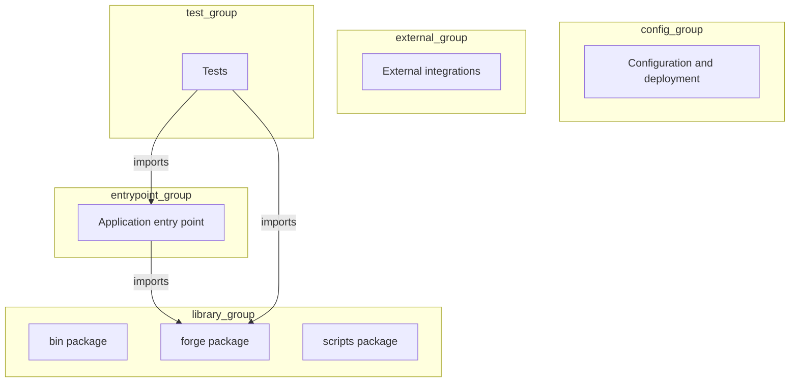

# Architecture report: img2threejs/img2threejs

> Automated static analysis. **Observed** = directly seen in files/imports/AST; **Inferred** = interpretation from that evidence. Repository code was not executed.

## 1. Repository at a glance

| Item | Value |
| --- | --- |
| Repository | img2threejs/img2threejs |
| Description | Rebuild the object in a reference image as a code-only, procedural, quality-gated, animation-ready Three.js model. Token-efficient image-to-3D. |
| Language | Python |
| Stars | 21369 |
| Licence | Apache-2.0 |
| Analysed commit / branch | 0c0c49bc168e648dbaf9c8c080474de0b3a941b6 / main |
| Framework(s) | None detected |
| Files analysed | 357 |
| Components | 7 |

## 2. Architecture in one minute

img2threejs/img2threejs - Rebuild the object in a reference image as a code-only, procedural, quality-gated, animation-ready Three.js model. Token-efficient image-to-3D.. This repository was analysed statically from 357 file(s) (233 Python). Detected technologies (observed from imports/manifests): GitHub Actions, NumPy, Poetry, unittest. Files are grouped into 7 component(s): bin package, Configuration and deployment, Application entry point, External integrations, forge package, scripts package, Tests. Observed entry point(s): forge/materials/compatibility.py, forge/next.py, forge/report.py. Findings below distinguish observed facts from inferred interpretation.

## 3. High-level block diagram

## 4. Main components

### bin package (`bin`)

- **Kind:** library
- **Status:** Observed
- **Confidence:** 0.85
- **Responsibility:** Groups 2 file(s) under bin package (observed from repository paths and static analysis).
- **Paths:** `bin/img2threejs.mjs`, `bin/img2threejs.mjs-test.mjs`
- **Evidence:** [bin/img2threejs.mjs](https://github.com/img2threejs/img2threejs/blob/0c0c49bc168e648dbaf9c8c080474de0b3a941b6/bin/img2threejs.mjs); [bin/img2threejs.mjs-test.mjs](https://github.com/img2threejs/img2threejs/blob/0c0c49bc168e648dbaf9c8c080474de0b3a941b6/bin/img2threejs.mjs-test.mjs)

### Configuration and deployment (`config`)

- **Kind:** config
- **Status:** Observed
- **Confidence:** 0.85
- **Responsibility:** Groups 10 file(s) under configuration and deployment (observed from repository paths and static analysis).
- **Paths:** `forge/_shared/spec_search_profiles.json`, `forge/requirements.txt`, `grimoire/character/threejs_hair_parameter_contract.json`, `integrations/glb_character_pipeline/configs/girl-character-section-regions.json`, `integrations/glb_character_pipeline/configs/girl-character-spokes.json`, `integrations/glb_character_pipeline/node/package.json`, `integrations/glb_character_pipeline/pyproject.toml`, `integrations/vision/pyproject.toml`, `package.json`, `scripts/ci/skill-budget.json`
- **Evidence:** [forge/_shared/spec_search_profiles.json](https://github.com/img2threejs/img2threejs/blob/0c0c49bc168e648dbaf9c8c080474de0b3a941b6/forge/_shared/spec_search_profiles.json); [forge/requirements.txt](https://github.com/img2threejs/img2threejs/blob/0c0c49bc168e648dbaf9c8c080474de0b3a941b6/forge/requirements.txt); [grimoire/character/threejs_hair_parameter_contract.json](https://github.com/img2threejs/img2threejs/blob/0c0c49bc168e648dbaf9c8c080474de0b3a941b6/grimoire/character/threejs_hair_parameter_contract.json); [integrations/glb_character_pipeline/configs/girl-character-section-regions.json](https://github.com/img2threejs/img2threejs/blob/0c0c49bc168e648dbaf9c8c080474de0b3a941b6/integrations/glb_character_pipeline/configs/girl-character-section-regions.json); [integrations/glb_character_pipeline/configs/girl-character-spokes.json](https://github.com/img2threejs/img2threejs/blob/0c0c49bc168e648dbaf9c8c080474de0b3a941b6/integrations/glb_character_pipeline/configs/girl-character-spokes.json); [integrations/glb_character_pipeline/node/package.json](https://github.com/img2threejs/img2threejs/blob/0c0c49bc168e648dbaf9c8c080474de0b3a941b6/integrations/glb_character_pipeline/node/package.json); [integrations/glb_character_pipeline/pyproject.toml](https://github.com/img2threejs/img2threejs/blob/0c0c49bc168e648dbaf9c8c080474de0b3a941b6/integrations/glb_character_pipeline/pyproject.toml); [integrations/vision/pyproject.toml](https://github.com/img2threejs/img2threejs/blob/0c0c49bc168e648dbaf9c8c080474de0b3a941b6/integrations/vision/pyproject.toml)

### Application entry point (`entrypoint`)

- **Kind:** entrypoint
- **Status:** Observed
- **Confidence:** 0.85
- **Responsibility:** Groups 91 file(s) under application entry point (observed from repository paths and static analysis). Observed top-level classes: Acceptance, BandCheck, BlendReport, BoneMatch, Chain, ChainResolutionError. Observed top-level functions: _accessor_bounds, _add, _aligned_pixels, _analyze_holes, _anchor_extent, _anchor_id.
- **Paths:** `forge/materials/compatibility.py`, `forge/next.py`, `forge/report.py`, `forge/stage1_intake/analyze_texture.py`, `forge/stage1_intake/bind_detail_properties.py`, `forge/stage1_intake/build_detail_inventory.py`, `forge/stage1_intake/check_intake_correctness.py`, `forge/stage1_intake/check_reference_admission.py`, `forge/stage1_intake/delight_albedo.py`, `forge/stage1_intake/detect_reference_effects.py`, `forge/stage1_intake/extract_gradient_stops.py`, `forge/stage1_intake/extract_hair_evidence.py`, `forge/stage1_intake/extract_landmarks.py`, `forge/stage1_intake/extract_part_color_recipe.py`, `forge/stage1_intake/extract_pbr_evidence.py`, `forge/stage1_intake/label_glb_nodes.py`, `forge/stage1_intake/material_region_analysis.py`, `forge/stage1_intake/probe_glb.py`, `forge/stage1_intake/probe_image.py`, `forge/stage1_intake/run_vision_adapter.py`, `forge/stage1_intake/search_specs.py`, `forge/stage1_intake/solve_camera_pose.py`, `forge/stage2_spec/apply_material_analysis.py`, `forge/stage2_spec/derive_geometry.py`, `forge/stage2_spec/humanoid_proportions.py`, `forge/stage2_spec/new_pre_spec_assessment.py`, `forge/stage2_spec/new_sculpt_spec.py`, `forge/stage2_spec/validate_sculpt_spec.py`, `forge/stage3_build/bake_projected_texture.py`, `forge/stage3_build/decimate.py`, `forge/stage3_build/emit_target.py`, `forge/stage3_build/module_cache.py`, `forge/stage3_build/morph_targets.py`, `forge/stage3_build/orchestrate_passes.py`, `forge/stage3_build/run_gates.py`, `forge/stage3_build/uv_unwrap.py`, `forge/stage3_build/visual_hull.py`, `forge/stage4_review/append_review.py`, `forge/stage4_review/attachment_anchor.py`, `forge/stage4_review/calibrate_eye.py`, `forge/stage4_review/check_part_coverage.py`, `forge/stage4_review/compare_region_passes.py`, `forge/stage4_review/correction_loop.py`, `forge/stage4_review/diagnose_render.py`, `forge/stage4_review/diagnose_render_multi_angle.py`, `forge/stage4_review/divine_eye.py`, `forge/stage4_review/fit_params.py`, `forge/stage4_review/hair_gate.py`, `forge/stage4_review/interior_difference.py`, `forge/stage4_review/joint_loops.py`, `forge/stage4_review/make_comparison_sheet.py`, `forge/stage4_review/material_comparator.py`, `forge/stage4_review/material_feedback.py`, `forge/stage4_review/material_gate.py`, `forge/stage4_review/material_views.py`, `forge/stage4_review/mesh_reference_compare.py`, `forge/stage4_review/objectness.py`, `forge/stage4_review/pairwise_penetration.py`, `forge/stage4_review/per_feature.py`, `forge/stage4_review/render_bridge.py`, `forge/stage4_review/scalp_exposure.py`, `forge/stage4_review/self_intersection.py`, `forge/stage4_review/swept_arc_gate.py`, `forge/stage4_review/turntable_gate.py`, `forge/stage4_review/validate_render_profile.py`, `forge/stage4_review/vertex_region_gate.py`, `forge/stage4_review/vlm_gate.py`, `forge/stage5_rig/action_design.py`, `forge/stage5_rig/clip_features.py`, `forge/stage5_rig/geodesic_skinning.py`, `forge/stage5_rig/glb_rig_reference.py`, `forge/stage5_rig/mesh_parity.py`, `forge/stage5_rig/rig_gates.py`, `forge/stage5_rig/skin_conditioning.py`, `forge/stage5_rig/validate_rig_payload.py`, `forge/state.py`, `integrations/glb_character_pipeline/python/bake_atlas_uvs.py`, `integrations/glb_character_pipeline/python/build_cross_sections.py`, `integrations/glb_character_pipeline/python/measure_density_convergence.py`, `integrations/glb_character_pipeline/python/slice_node.py`, `integrations/mesh3d/generate_reference_mesh.py`, `integrations/vision/reference_vision.py`, `scripts/capture_threejs_playwright.py`, `scripts/ci/md_links.py`, `scripts/ci/md_tables.py`, `scripts/ci/plugin_table.py`, `scripts/ci/pr_scope.py`, `scripts/ci/showcase_table.py`, `scripts/ci/skill_budget.py`, `scripts/issue_triage.py`, `scripts/release_metadata.py`
- **Evidence:** [forge/materials/compatibility.py:13](https://github.com/img2threejs/img2threejs/blob/0c0c49bc168e648dbaf9c8c080474de0b3a941b6/forge/materials/compatibility.py#L13); [forge/next.py:22](https://github.com/img2threejs/img2threejs/blob/0c0c49bc168e648dbaf9c8c080474de0b3a941b6/forge/next.py#L22); [forge/report.py:15](https://github.com/img2threejs/img2threejs/blob/0c0c49bc168e648dbaf9c8c080474de0b3a941b6/forge/report.py#L15); [forge/stage1_intake/analyze_texture.py:44](https://github.com/img2threejs/img2threejs/blob/0c0c49bc168e648dbaf9c8c080474de0b3a941b6/forge/stage1_intake/analyze_texture.py#L44); [forge/stage1_intake/bind_detail_properties.py:59](https://github.com/img2threejs/img2threejs/blob/0c0c49bc168e648dbaf9c8c080474de0b3a941b6/forge/stage1_intake/bind_detail_properties.py#L59); [forge/stage1_intake/build_detail_inventory.py:48](https://github.com/img2threejs/img2threejs/blob/0c0c49bc168e648dbaf9c8c080474de0b3a941b6/forge/stage1_intake/build_detail_inventory.py#L48); [forge/stage1_intake/check_intake_correctness.py:31](https://github.com/img2threejs/img2threejs/blob/0c0c49bc168e648dbaf9c8c080474de0b3a941b6/forge/stage1_intake/check_intake_correctness.py#L31); [forge/stage1_intake/check_reference_admission.py:39](https://github.com/img2threejs/img2threejs/blob/0c0c49bc168e648dbaf9c8c080474de0b3a941b6/forge/stage1_intake/check_reference_admission.py#L39)

### External integrations (`external_integrations`)

- **Kind:** external
- **Status:** Observed
- **Confidence:** 0.85
- **Responsibility:** Groups 9 file(s) under external integrations (observed from repository paths and static analysis). Observed top-level functions: acc, embedded_image, sample_texture.
- **Paths:** `integrations/glb_character_pipeline/build-character.sh`, `integrations/glb_character_pipeline/node/capture-character.mjs`, `integrations/glb_character_pipeline/node/compare_views.mjs`, `integrations/glb_character_pipeline/node/emit_surface_module.mjs`, `integrations/glb_character_pipeline/node/encode_surfaces.mjs`, `integrations/glb_character_pipeline/node/verify_cells.mjs`, `integrations/glb_character_pipeline/node/verify_roundtrip.mjs`, `integrations/glb_character_pipeline/python/build_head_surface.py`, `integrations/glb_character_pipeline/python/export_sdf_surfaces.py`
- **Evidence:** [integrations/glb_character_pipeline/build-character.sh](https://github.com/img2threejs/img2threejs/blob/0c0c49bc168e648dbaf9c8c080474de0b3a941b6/integrations/glb_character_pipeline/build-character.sh); [integrations/glb_character_pipeline/node/capture-character.mjs](https://github.com/img2threejs/img2threejs/blob/0c0c49bc168e648dbaf9c8c080474de0b3a941b6/integrations/glb_character_pipeline/node/capture-character.mjs); [integrations/glb_character_pipeline/node/compare_views.mjs](https://github.com/img2threejs/img2threejs/blob/0c0c49bc168e648dbaf9c8c080474de0b3a941b6/integrations/glb_character_pipeline/node/compare_views.mjs); [integrations/glb_character_pipeline/node/emit_surface_module.mjs](https://github.com/img2threejs/img2threejs/blob/0c0c49bc168e648dbaf9c8c080474de0b3a941b6/integrations/glb_character_pipeline/node/emit_surface_module.mjs); [integrations/glb_character_pipeline/node/encode_surfaces.mjs](https://github.com/img2threejs/img2threejs/blob/0c0c49bc168e648dbaf9c8c080474de0b3a941b6/integrations/glb_character_pipeline/node/encode_surfaces.mjs); [integrations/glb_character_pipeline/node/verify_cells.mjs](https://github.com/img2threejs/img2threejs/blob/0c0c49bc168e648dbaf9c8c080474de0b3a941b6/integrations/glb_character_pipeline/node/verify_cells.mjs); [integrations/glb_character_pipeline/node/verify_roundtrip.mjs](https://github.com/img2threejs/img2threejs/blob/0c0c49bc168e648dbaf9c8c080474de0b3a941b6/integrations/glb_character_pipeline/node/verify_roundtrip.mjs); [integrations/glb_character_pipeline/python/build_head_surface.py:46](https://github.com/img2threejs/img2threejs/blob/0c0c49bc168e648dbaf9c8c080474de0b3a941b6/integrations/glb_character_pipeline/python/build_head_surface.py#L46)

### forge package (`forge`)

- **Kind:** library
- **Status:** Observed
- **Confidence:** 0.85
- **Responsibility:** Groups 35 file(s) under forge package (observed from repository paths and static analysis). Observed top-level classes: AliasSettings, AspectDescriptor, Bm25Config, Bm25Index, Bm25Settings, BoneSpec. Observed top-level functions: _accent_companion, _alias_mapping, _anchor_index, _approval_state, _as_number, _as_vec3.
- **Paths:** `forge/_shared/artifact_cache.py`, `forge/_shared/chirality.py`, `forge/_shared/color_metrics.py`, `forge/_shared/domains/__init__.py`, `forge/_shared/domains/character.py`, `forge/_shared/feature_acceptance_policy.py`, `forge/_shared/glb_container.py`, `forge/_shared/image_hash.py`, `forge/_shared/jpeg.py`, `forge/_shared/material_physics.py`, `forge/_shared/pipeline_routing.py`, `forge/_shared/scalp_field.py`, `forge/_shared/sdf_primitives.py`, `forge/_shared/spec_augmentation.py`, `forge/_shared/spec_search.py`, `forge/_shared/status_banner.py`, `forge/_shared/subdivision.py`, `forge/_shared/targets.py`, `forge/_shared/vertex_paint.py`, `forge/_shared/workflow_state.py`, `forge/materials/__init__.py`, `forge/materials/reference.py`, `forge/stage1_intake/camera_fitting_math.py`, `forge/stage1_intake/camera_fitting_solver.py`, `forge/stage1_intake/camera_fitting_types.py`, `forge/stage1_intake/camera_image_helpers.py`, `forge/stage1_intake/semantic_decomposition.py`, `forge/stage2_spec/hair_profile.py`, `forge/stage4_review/_fit_divine_eye.py`, `forge/stage4_review/geometry_integrity.py`, `forge/stage4_review/multi_pass.py`, `forge/stage5_rig/__init__.py`, `forge/stage5_rig/emit_animation_runtime.py`, `forge/stage5_rig/emit_rig.py`, `forge/stage5_rig/rig_spec.py`
- **Evidence:** [forge/_shared/artifact_cache.py:21](https://github.com/img2threejs/img2threejs/blob/0c0c49bc168e648dbaf9c8c080474de0b3a941b6/forge/_shared/artifact_cache.py#L21); [forge/_shared/chirality.py:62](https://github.com/img2threejs/img2threejs/blob/0c0c49bc168e648dbaf9c8c080474de0b3a941b6/forge/_shared/chirality.py#L62); [forge/_shared/color_metrics.py:19](https://github.com/img2threejs/img2threejs/blob/0c0c49bc168e648dbaf9c8c080474de0b3a941b6/forge/_shared/color_metrics.py#L19); [forge/_shared/domains/__init__.py:45](https://github.com/img2threejs/img2threejs/blob/0c0c49bc168e648dbaf9c8c080474de0b3a941b6/forge/_shared/domains/__init__.py#L45); [forge/_shared/domains/character.py](https://github.com/img2threejs/img2threejs/blob/0c0c49bc168e648dbaf9c8c080474de0b3a941b6/forge/_shared/domains/character.py); [forge/_shared/feature_acceptance_policy.py:9](https://github.com/img2threejs/img2threejs/blob/0c0c49bc168e648dbaf9c8c080474de0b3a941b6/forge/_shared/feature_acceptance_policy.py#L9); [forge/_shared/glb_container.py:24](https://github.com/img2threejs/img2threejs/blob/0c0c49bc168e648dbaf9c8c080474de0b3a941b6/forge/_shared/glb_container.py#L24); [forge/_shared/image_hash.py:22](https://github.com/img2threejs/img2threejs/blob/0c0c49bc168e648dbaf9c8c080474de0b3a941b6/forge/_shared/image_hash.py#L22)

### scripts package (`scripts`)

- **Kind:** library
- **Status:** Observed
- **Confidence:** 0.85
- **Responsibility:** Groups 2 file(s) under scripts package (observed from repository paths and static analysis). Observed top-level functions: changed_files, files_from_args, iter_lines, report, strip_frontmatter_lines.
- **Paths:** `scripts/character_audit.sh`, `scripts/ci/mdcommon.py`
- **Evidence:** [scripts/character_audit.sh](https://github.com/img2threejs/img2threejs/blob/0c0c49bc168e648dbaf9c8c080474de0b3a941b6/scripts/character_audit.sh); [scripts/ci/mdcommon.py:9](https://github.com/img2threejs/img2threejs/blob/0c0c49bc168e648dbaf9c8c080474de0b3a941b6/scripts/ci/mdcommon.py#L9)

### Tests (`tests`)

- **Kind:** test
- **Status:** Observed
- **Confidence:** 0.85
- **Responsibility:** Groups 111 file(s) under tests (observed from repository paths and static analysis). Observed top-level classes: Accepted, ActionReadyPrecondition, AlbedoColorSpace, AnalyzeTextureTest, AreaWeighting, ArgvDriftGuard. Observed top-level functions: _action_ready_state, _action_ready_state_path, _as_rig_spec, _asset, _bar, _base_spec.
- **Paths:** `forge/tests/fixtures/implicit_character_torso_limb.json`, `forge/tests/fixtures/knife_review_scene.json`, `forge/tests/fixtures/reference_target_conformance_spec.json`, `forge/tests/fixtures/reference_target_oracle.ts`, `forge/tests/fixtures/stand_proud_hair_on_head.json`, `forge/tests/fixtures/subdivision_cage.json`, `forge/tests/fixtures/visual_hull_two_views.json`, `forge/tests/oracle_support.py`, `forge/tests/showcase_test_support.py`, `forge/tests/test_action_design.py`, `forge/tests/test_albedo_color_space.py`, `forge/tests/test_analyze_texture.py`, `forge/tests/test_attachment_anchor.py`, `forge/tests/test_attachment_does_not_override_primitive.py`, `forge/tests/test_calibrate_eye.py`, `forge/tests/test_camera_fitting.py`, `forge/tests/test_camera_fitting_cli.py`, `forge/tests/test_camera_fitting_safety.py`, `forge/tests/test_character_rig_derivation.py`, `forge/tests/test_chirality.py`, `forge/tests/test_clip_features.py`, `forge/tests/test_color_metrics.py`, `forge/tests/test_color_recipe.py`, `forge/tests/test_correction_loop.py`, `forge/tests/test_decimation_wiring.py`, `forge/tests/test_divine_eye.py`, `forge/tests/test_domain_registry.py`, `forge/tests/test_domain_spec_contract.py`, `forge/tests/test_emit_animation_runtime.py`, `forge/tests/test_emit_animation_runtime_tsc_smoke.py`, `forge/tests/test_emit_target.py`, `forge/tests/test_fit_params.py`, `forge/tests/test_geodesic_skinning.py`, `forge/tests/test_geometry_derivation.py`, `forge/tests/test_glb_reference.py`, `forge/tests/test_glb_rig_reference.py`, `forge/tests/test_gradient_stops.py`, `forge/tests/test_hair_evidence.py`, `forge/tests/test_hair_gate.py`, `forge/tests/test_hair_material.py`, `forge/tests/test_hair_profile.py`, `forge/tests/test_hierarchy_scale.py`, `forge/tests/test_hue_zone_parity.py`, `forge/tests/test_humanoid_proportions.py`, `forge/tests/test_humanoid_silhouette_profile.py`, `forge/tests/test_intake_binding.py`, `forge/tests/test_interior_difference.py`, `forge/tests/test_issue_triage.py`, `forge/tests/test_joint_admission_gate.py`, `forge/tests/test_joint_loops.py`, `forge/tests/test_jpeg.py`, `forge/tests/test_label_glb_nodes.py`, `forge/tests/test_material_physics.py`, `forge/tests/test_material_pipeline.py`, `forge/tests/test_material_reference.py`, `forge/tests/test_mesh_parity.py`, `forge/tests/test_module_cache.py`, `forge/tests/test_multi_angle.py`, `forge/tests/test_objectness.py`, `forge/tests/test_optional_vision_tooling.py`, `forge/tests/test_part_collision_morphs_lod.py`, `forge/tests/test_pass_identifier_authority.py`, `forge/tests/test_per_feature.py`, `forge/tests/test_pipeline.py`, `forge/tests/test_pipeline_routing.py`, `forge/tests/test_primitive_watertightness.py`, `forge/tests/test_recessed_and_open_shell_topology.py`, `forge/tests/test_reference_admission.py`, `forge/tests/test_reference_effects.py`, `forge/tests/test_region_and_arc_gates.py`, `forge/tests/test_release_metadata.py`, `forge/tests/test_render_bridge.py`, `forge/tests/test_render_profile.py`, `forge/tests/test_repetition_system_scale.py`, `forge/tests/test_rig_gates.py`, `forge/tests/test_rig_hierarchy_emission.py`, `forge/tests/test_rig_milestone0.py`, `forge/tests/test_rig_workflow_steps.py`, `forge/tests/test_rigid_hair_binding.py`, `forge/tests/test_run_gates.py`, `forge/tests/test_scalp_exposure.py`, `forge/tests/test_scalp_field.py`, `forge/tests/test_sculpt_echo_failure_matrix.py`, `forge/tests/test_sculpt_echo_roundtrip.py`, `forge/tests/test_sdf_primitives.py`, `forge/tests/test_search_specs.py`, `forge/tests/test_self_intersection.py`, `forge/tests/test_showcase_tsc_smoke.py`, `forge/tests/test_skin_conditioning.py`, `forge/tests/test_specular_wash.py`, `forge/tests/test_stand_proud.py`, `forge/tests/test_stand_proud_emission.py`, `forge/tests/test_structure_gates.py`, `forge/tests/test_subdivision.py`, `forge/tests/test_suite_integrity.py`, `forge/tests/test_tapered_sweep.py`, `forge/tests/test_target_reference_conformance.py`, `forge/tests/test_targets.py`, `forge/tests/test_tessellation_tiers.py`, `forge/tests/test_textureless_material.py`, `forge/tests/test_tier1_diagnostics.py`, `forge/tests/test_turntable_gate.py`, `forge/tests/test_uv_unwrap.py`, `forge/tests/test_validate_rig_payload.py`, `forge/tests/test_vertex_paint.py`, `forge/tests/test_visual_hull.py`, `forge/tests/test_visual_hull_carve.py`, `forge/tests/test_vlm_gate.py`, `forge/tests/test_workflow_state.py`, `forge/tests/test_ws6_docs.py`, `scripts/ci/tests/test_ci_scripts.py`
- **Evidence:** [forge/tests/fixtures/implicit_character_torso_limb.json](https://github.com/img2threejs/img2threejs/blob/0c0c49bc168e648dbaf9c8c080474de0b3a941b6/forge/tests/fixtures/implicit_character_torso_limb.json); [forge/tests/fixtures/knife_review_scene.json](https://github.com/img2threejs/img2threejs/blob/0c0c49bc168e648dbaf9c8c080474de0b3a941b6/forge/tests/fixtures/knife_review_scene.json); [forge/tests/fixtures/reference_target_conformance_spec.json](https://github.com/img2threejs/img2threejs/blob/0c0c49bc168e648dbaf9c8c080474de0b3a941b6/forge/tests/fixtures/reference_target_conformance_spec.json); [forge/tests/fixtures/reference_target_oracle.ts](https://github.com/img2threejs/img2threejs/blob/0c0c49bc168e648dbaf9c8c080474de0b3a941b6/forge/tests/fixtures/reference_target_oracle.ts); [forge/tests/fixtures/stand_proud_hair_on_head.json](https://github.com/img2threejs/img2threejs/blob/0c0c49bc168e648dbaf9c8c080474de0b3a941b6/forge/tests/fixtures/stand_proud_hair_on_head.json); [forge/tests/fixtures/subdivision_cage.json](https://github.com/img2threejs/img2threejs/blob/0c0c49bc168e648dbaf9c8c080474de0b3a941b6/forge/tests/fixtures/subdivision_cage.json); [forge/tests/fixtures/visual_hull_two_views.json](https://github.com/img2threejs/img2threejs/blob/0c0c49bc168e648dbaf9c8c080474de0b3a941b6/forge/tests/fixtures/visual_hull_two_views.json); [forge/tests/oracle_support.py:21](https://github.com/img2threejs/img2threejs/blob/0c0c49bc168e648dbaf9c8c080474de0b3a941b6/forge/tests/oracle_support.py#L21)

## 5. Execution flow

**Observed** entry point(s):

- [forge/materials/compatibility.py:105](https://github.com/img2threejs/img2threejs/blob/0c0c49bc168e648dbaf9c8c080474de0b3a941b6/forge/materials/compatibility.py#L105)
- [forge/next.py:115](https://github.com/img2threejs/img2threejs/blob/0c0c49bc168e648dbaf9c8c080474de0b3a941b6/forge/next.py#L115)
- [forge/report.py:37](https://github.com/img2threejs/img2threejs/blob/0c0c49bc168e648dbaf9c8c080474de0b3a941b6/forge/report.py#L37)
- [forge/stage1_intake/analyze_texture.py:254](https://github.com/img2threejs/img2threejs/blob/0c0c49bc168e648dbaf9c8c080474de0b3a941b6/forge/stage1_intake/analyze_texture.py#L254)
- [forge/stage1_intake/bind_detail_properties.py:98](https://github.com/img2threejs/img2threejs/blob/0c0c49bc168e648dbaf9c8c080474de0b3a941b6/forge/stage1_intake/bind_detail_properties.py#L98)
- [forge/stage1_intake/build_detail_inventory.py:348](https://github.com/img2threejs/img2threejs/blob/0c0c49bc168e648dbaf9c8c080474de0b3a941b6/forge/stage1_intake/build_detail_inventory.py#L348)
- [forge/stage1_intake/check_intake_correctness.py:115](https://github.com/img2threejs/img2threejs/blob/0c0c49bc168e648dbaf9c8c080474de0b3a941b6/forge/stage1_intake/check_intake_correctness.py#L115)
- [forge/stage1_intake/check_reference_admission.py:215](https://github.com/img2threejs/img2threejs/blob/0c0c49bc168e648dbaf9c8c080474de0b3a941b6/forge/stage1_intake/check_reference_admission.py#L215)
- [forge/stage1_intake/delight_albedo.py:351](https://github.com/img2threejs/img2threejs/blob/0c0c49bc168e648dbaf9c8c080474de0b3a941b6/forge/stage1_intake/delight_albedo.py#L351)
- [forge/stage1_intake/detect_reference_effects.py:274](https://github.com/img2threejs/img2threejs/blob/0c0c49bc168e648dbaf9c8c080474de0b3a941b6/forge/stage1_intake/detect_reference_effects.py#L274)
- [forge/stage1_intake/extract_gradient_stops.py:148](https://github.com/img2threejs/img2threejs/blob/0c0c49bc168e648dbaf9c8c080474de0b3a941b6/forge/stage1_intake/extract_gradient_stops.py#L148)
- [forge/stage1_intake/extract_hair_evidence.py:384](https://github.com/img2threejs/img2threejs/blob/0c0c49bc168e648dbaf9c8c080474de0b3a941b6/forge/stage1_intake/extract_hair_evidence.py#L384)

Representative flow (derived from observed entry points and the import graph; steps beyond the entry point are **Inferred**):

1. Execution starts at an observed entry point listed above, if present.
2. `entrypoint` imports `forge` (Application entry point -> forge package).
3. `tests` imports `entrypoint` (Tests -> Application entry point).
4. `tests` imports `forge` (Tests -> forge package).

## 6. Project structure

### `(root)`

- `.gitignore` - other (3640 bytes)
- `CHANGELOG.md` - docs (41875 bytes)
- `CLAUDE.md` - docs (3413 bytes)
- `CONTRIBUTING.md` - docs (8218 bytes)
- `LAB-FINDINGS.md` - docs (5828 bytes)
- `LICENSE` - docs (11337 bytes)
- `README.md` - docs (46391 bytes)
- `ROADMAP.md` - docs (20066 bytes)
- `SKILL.md` - docs (34273 bytes)
- `package.json` - manifest (924 bytes)

### `.github`

- `.github/FUNDING.yml` - config (94 bytes)
- `.github/ISSUE_TEMPLATE/bug_report.yml` - config (2360 bytes)
- `.github/ISSUE_TEMPLATE/contribution_intent.yml` - config (1887 bytes)
- `.github/ISSUE_TEMPLATE/feature_request.yml` - config (1392 bytes)
- `.github/pull_request_template.md` - docs (1749 bytes)
- `.github/release.yml` - config (471 bytes)
- `.github/workflows/beta-release.yml` - ci, YAML (1956 bytes)
- `.github/workflows/ci.yml` - ci, YAML (638 bytes)
- `.github/workflows/cli-publish.yml` - ci, YAML (977 bytes)
- `.github/workflows/docs-quality.yml` - ci, YAML (1930 bytes)
- `.github/workflows/issue-triage.yml` - ci, YAML (783 bytes)
- `.github/workflows/pr-issue-close-policy.yml` - ci, YAML (279 bytes)
- `.github/workflows/readme-tables-sync.yml` - ci, YAML (3630 bytes)
- `.github/workflows/release.yml` - ci, YAML (600 bytes)

### `assets`

- `assets/logo.svg` - other (2092 bytes)
- `assets/sponsors/atlas-cloud-logomark-black.svg` - other (595 bytes)
- `assets/sponsors/atlas-cloud-logomark-white.svg` - other (595 bytes)
- `assets/sponsors/minimax-logomark.svg` - other (1092 bytes)
- `assets/sponsors/tripo-logomark-black.svg` - other (1002 bytes)
- `assets/sponsors/tripo-logomark-white.svg` - other (1002 bytes)

### `bin`

- `bin/img2threejs.mjs` - source, JavaScript (14444 bytes)
- `bin/img2threejs.mjs-test.mjs` - source, JavaScript (14887 bytes)

### `docs`

- `docs/ARCHITECTURE.md` - docs (14672 bytes)
- `docs/EMISSION_TARGET_SOCKET.md` - docs (6917 bytes)
- `docs/GLB_ANIMATED_CHARACTER_PROMPT.md` - docs (13926 bytes)
- `docs/GLB_CHARACTER_ANIMATION_PROMPT.md` - docs (14908 bytes)
- `docs/GLB_CHARACTER_POLISH_PROMPT.md` - docs (10866 bytes)
- `docs/GLB_CHARACTER_PROMPT.md` - docs (19557 bytes)
- `docs/HAIR_PIPELINE.md` - docs (10736 bytes)
- `docs/INSTALL.md` - docs (15815 bytes)
- `docs/PLUGINS.md` - docs (14012 bytes)
- `docs/RESEARCH_TRELLIS2_TO_IMG2THREEJS.md` - docs (36287 bytes)
- `docs/STAGE_R_BACKLOG.md` - docs (18892 bytes)
- `docs/STAGE_R_TEST_PLAN.md` - docs (14856 bytes)
- `docs/TOKEN_COST.md` - docs (2576 bytes)
- `docs/UPGRADE_PLAN.md` - docs (31126 bytes)
- `docs/integrations/reference_fidelity_tooling.md` - docs (6339 bytes)
- `docs/issue-triage.md` - docs (1860 bytes)
- `docs/materials/IMAGE_MATERIAL_ANALYSIS.md` - docs (5097 bytes)
- `docs/materials/README.md` - docs (5306 bytes)
- `docs/materials/THREEJS_MATERIAL_REFERENCE.md` - docs (11710 bytes)
- `docs/materials/material-reference.json` - config (56355 bytes)
- `docs/pipelines/character-rigging-animation-1.5.2.md` - docs (22807 bytes)
- `docs/raw/.keep` - docs (0 bytes)
- `docs/raw/img2threejs-skill-dataset.json` - config (109920 bytes)
- `docs/specs/render-profile.v2.example.json` - config (2678 bytes)
- `docs/specs/render-profile.v2.schema.json` - config (3844 bytes)
- `docs/specs/vocabulary/README.md` - docs (4518 bytes)
- `docs/specs/vocabulary/core_3d.jsonl` - docs (13534 bytes)
- `docs/specs/vocabulary/core_3d_reconstruction.jsonl` - docs (57402 bytes)
- `docs/standard-prompts/README.md` - docs (2301 bytes)
- `docs/standard-prompts/build.md` - docs (5400 bytes)
- `docs/standard-prompts/glb-force-measured.md` - docs (8817 bytes)
- `docs/standard-prompts/polish.md` - docs (2813 bytes)
- `docs/standard-prompts/vfx.md` - docs (5870 bytes)

### `forge`

- `forge/_shared/artifact_cache.py` - source, Python (1783 bytes)
- `forge/_shared/chirality.py` - source, Python (12364 bytes)
- `forge/_shared/color_metrics.py` - source, Python (3697 bytes)
- `forge/_shared/domains/__init__.py` - source, Python (7251 bytes)
- `forge/_shared/domains/character.py` - source, Python (933 bytes)
- `forge/_shared/feature_acceptance_policy.py` - source, Python (4350 bytes)
- `forge/_shared/glb_container.py` - source, Python (4071 bytes)
- `forge/_shared/image_hash.py` - source, Python (4077 bytes)
- `forge/_shared/jpeg.py` - source, Python (16395 bytes)
- `forge/_shared/material_physics.py` - source, Python (12508 bytes)
- `forge/_shared/pipeline_routing.py` - source, Python (7208 bytes)
- `forge/_shared/scalp_field.py` - source, Python (14692 bytes)
- `forge/_shared/sdf_primitives.py` - source, Python (8488 bytes)
- `forge/_shared/spec_augmentation.py` - source, Python (7922 bytes)
- `forge/_shared/spec_search.py` - source, Python (66886 bytes)
- `forge/_shared/spec_search_profiles.json` - config (898 bytes)
- `forge/_shared/status_banner.py` - source, Python (1473 bytes)
- `forge/_shared/subdivision.py` - source, Python (10763 bytes)
- `forge/_shared/targets.py` - source, Python (15989 bytes)
- `forge/_shared/vertex_paint.py` - source, Python (11043 bytes)
- `forge/_shared/workflow_state.py` - source, Python (20401 bytes)
- `forge/materials/__init__.py` - source, Python (355 bytes)
- `forge/materials/compatibility.py` - source, Python (5247 bytes)
- `forge/materials/reference.py` - source, Python (10480 bytes)
- `forge/next.py` - source, Python (4545 bytes)
- `forge/report.py` - source, Python (1530 bytes)
- `forge/requirements.txt` - manifest (335 bytes)
- `forge/stage1_intake/analyze_texture.py` - source, Python (12429 bytes)
- `forge/stage1_intake/bind_detail_properties.py` - source, Python (4685 bytes)
- `forge/stage1_intake/build_detail_inventory.py` - source, Python (13306 bytes)
- `forge/stage1_intake/camera_fitting_math.py` - source, Python (5588 bytes)
- `forge/stage1_intake/camera_fitting_solver.py` - source, Python (8436 bytes)
- `forge/stage1_intake/camera_fitting_types.py` - source, Python (8393 bytes)
- `forge/stage1_intake/camera_image_helpers.py` - source, Python (6160 bytes)
- `forge/stage1_intake/check_intake_correctness.py` - source, Python (4892 bytes)
- `forge/stage1_intake/check_reference_admission.py` - source, Python (8901 bytes)
- `forge/stage1_intake/delight_albedo.py` - source, Python (14493 bytes)
- `forge/stage1_intake/detect_reference_effects.py` - source, Python (9142 bytes)
- `forge/stage1_intake/extract_gradient_stops.py` - source, Python (5937 bytes)
- `forge/stage1_intake/extract_hair_evidence.py` - source, Python (19056 bytes)
- `forge/stage1_intake/extract_landmarks.py` - source, Python (16350 bytes)
- `forge/stage1_intake/extract_part_color_recipe.py` - source, Python (21332 bytes)
- `forge/stage1_intake/extract_pbr_evidence.py` - source, Python (33266 bytes)
- `forge/stage1_intake/label_glb_nodes.py` - source, Python (13322 bytes)
- `forge/stage1_intake/material_region_analysis.py` - source, Python (10078 bytes)
- `forge/stage1_intake/probe_glb.py` - source, Python (13636 bytes)
- `forge/stage1_intake/probe_image.py` - source, Python (5915 bytes)
- `forge/stage1_intake/run_vision_adapter.py` - source, Python (1594 bytes)
- `forge/stage1_intake/search_specs.py` - source, Python (7643 bytes)
- `forge/stage1_intake/semantic_decomposition.py` - source, Python (4605 bytes)
- `forge/stage1_intake/solve_camera_pose.py` - source, Python (10945 bytes)
- `forge/stage2_spec/apply_material_analysis.py` - source, Python (8847 bytes)
- `forge/stage2_spec/derive_geometry.py` - source, Python (4427 bytes)
- `forge/stage2_spec/hair_profile.py` - source, Python (14812 bytes)
- `forge/stage2_spec/humanoid_proportions.py` - source, Python (9257 bytes)
- `forge/stage2_spec/new_pre_spec_assessment.py` - source, Python (12429 bytes)
- `forge/stage2_spec/new_sculpt_spec.py` - source, Python (103972 bytes)
- `forge/stage2_spec/validate_sculpt_spec.py` - source, Python (149997 bytes)
- `forge/stage3_build/bake_projected_texture.py` - source, Python (9024 bytes)
- `forge/stage3_build/decimate.py` - source, Python (10631 bytes)
- `forge/stage3_build/emit_target.py` - source, Python (25485 bytes)
- `forge/stage3_build/module_cache.py` - source, Python (5723 bytes)
- `forge/stage3_build/morph_targets.py` - source, Python (7495 bytes)
- `forge/stage3_build/orchestrate_passes.py` - source, Python (28232 bytes)
- `forge/stage3_build/run_gates.py` - source, Python (16153 bytes)
- `forge/stage3_build/uv_unwrap.py` - source, Python (25303 bytes)
- `forge/stage3_build/visual_hull.py` - source, Python (16761 bytes)
- `forge/stage4_review/_fit_divine_eye.py` - source, Python (2663 bytes)
- `forge/stage4_review/append_review.py` - source, Python (22118 bytes)
- `forge/stage4_review/attachment_anchor.py` - source, Python (16596 bytes)
- `forge/stage4_review/calibrate_eye.py` - source, Python (5559 bytes)
- `forge/stage4_review/check_part_coverage.py` - source, Python (13404 bytes)
- `forge/stage4_review/compare_region_passes.py` - source, Python (7833 bytes)
- `forge/stage4_review/correction_loop.py` - source, Python (10467 bytes)
- `forge/stage4_review/diagnose_render.py` - source, Python (15880 bytes)
- `forge/stage4_review/diagnose_render_multi_angle.py` - source, Python (5708 bytes)
- `forge/stage4_review/divine_eye.py` - source, Python (21454 bytes)
- `forge/stage4_review/fit_params.py` - source, Python (16953 bytes)
- `forge/stage4_review/geometry_integrity.py` - source, Python (15471 bytes)
- `forge/stage4_review/hair_gate.py` - source, Python (9687 bytes)
- `forge/stage4_review/interior_difference.py` - source, Python (7955 bytes)
- `forge/stage4_review/joint_loops.py` - source, Python (8437 bytes)
- `forge/stage4_review/make_comparison_sheet.py` - source, Python (11166 bytes)
- `forge/stage4_review/material_comparator.py` - source, Python (8114 bytes)
- `forge/stage4_review/material_feedback.py` - source, Python (6846 bytes)
- `forge/stage4_review/material_gate.py` - source, Python (5888 bytes)
- `forge/stage4_review/material_views.py` - source, Python (7704 bytes)
- `forge/stage4_review/mesh_reference_compare.py` - source, Python (16627 bytes)
- `forge/stage4_review/multi_pass.py` - source, Python (3191 bytes)
- `forge/stage4_review/objectness.py` - source, Python (5530 bytes)
- `forge/stage4_review/pairwise_penetration.py` - source, Python (16599 bytes)
- `forge/stage4_review/per_feature.py` - source, Python (6977 bytes)
- `forge/stage4_review/render_bridge.py` - source, Python (24723 bytes)
- `forge/stage4_review/scalp_exposure.py` - source, Python (11809 bytes)
- `forge/stage4_review/self_intersection.py` - source, Python (26880 bytes)
- `forge/stage4_review/swept_arc_gate.py` - source, Python (14694 bytes)
- `forge/stage4_review/turntable_gate.py` - source, Python (18057 bytes)
- `forge/stage4_review/validate_render_profile.py` - source, Python (9101 bytes)
- `forge/stage4_review/vertex_region_gate.py` - source, Python (20813 bytes)
- `forge/stage4_review/vlm_gate.py` - source, Python (9022 bytes)
- `forge/stage5_rig/CONTRACT_1.5.2.md` - docs (3647 bytes)
- `forge/stage5_rig/NOTES.md` - docs (8708 bytes)
- `forge/stage5_rig/__init__.py` - source, Python (302 bytes)
- `forge/stage5_rig/action_design.py` - source, Python (90362 bytes)
- `forge/stage5_rig/clip_features.py` - source, Python (34033 bytes)
- `forge/stage5_rig/emit_animation_runtime.py` - source, Python (18158 bytes)
- `forge/stage5_rig/emit_rig.py` - source, Python (18031 bytes)
- `forge/stage5_rig/geodesic_skinning.py` - source, Python (23507 bytes)
- `forge/stage5_rig/glb_rig_reference.py` - source, Python (60240 bytes)
- `forge/stage5_rig/mesh_parity.py` - source, Python (37619 bytes)
- `forge/stage5_rig/rig_gates.py` - source, Python (80538 bytes)
- `forge/stage5_rig/rig_spec.py` - source, Python (6569 bytes)
- `forge/stage5_rig/skin_conditioning.py` - source, Python (26551 bytes)
- `forge/stage5_rig/validate_rig_payload.py` - source, Python (9015 bytes)
- `forge/state.py` - source, Python (4295 bytes)
- `forge/tests/fixtures/implicit_character_torso_limb.json` - test (1442 bytes)
- `forge/tests/fixtures/knife_review_scene.json` - test (1359 bytes)
- `forge/tests/fixtures/reference_target_conformance_spec.json` - test (103246 bytes)
- `forge/tests/fixtures/reference_target_oracle.ts` - test, TypeScript (63765 bytes)
- `forge/tests/fixtures/stand_proud_hair_on_head.json` - test (3087 bytes)
- `forge/tests/fixtures/subdivision_cage.json` - test (812 bytes)
- `forge/tests/fixtures/visual_hull_two_views.json` - test (2661 bytes)
- `forge/tests/oracle_support.py` - test, Python (2238 bytes)
- `forge/tests/showcase_test_support.py` - test, Python (698 bytes)
- `forge/tests/test_action_design.py` - test, Python (38231 bytes)
- `forge/tests/test_albedo_color_space.py` - test, Python (4805 bytes)
- `forge/tests/test_analyze_texture.py` - test, Python (6172 bytes)
- `forge/tests/test_attachment_anchor.py` - test, Python (8382 bytes)
- `forge/tests/test_attachment_does_not_override_primitive.py` - test, Python (7380 bytes)
- `forge/tests/test_calibrate_eye.py` - test, Python (3117 bytes)
- `forge/tests/test_camera_fitting.py` - test, Python (8522 bytes)
- `forge/tests/test_camera_fitting_cli.py` - test, Python (4721 bytes)
- `forge/tests/test_camera_fitting_safety.py` - test, Python (5539 bytes)
- `forge/tests/test_character_rig_derivation.py` - test, Python (9136 bytes)
- `forge/tests/test_chirality.py` - test, Python (14178 bytes)
- `forge/tests/test_clip_features.py` - test, Python (29787 bytes)
- `forge/tests/test_color_metrics.py` - test, Python (2242 bytes)
- `forge/tests/test_color_recipe.py` - test, Python (5857 bytes)
- `forge/tests/test_correction_loop.py` - test, Python (13013 bytes)
- `forge/tests/test_decimation_wiring.py` - test, Python (6001 bytes)
- `forge/tests/test_divine_eye.py` - test, Python (6829 bytes)
- `forge/tests/test_domain_registry.py` - test, Python (7216 bytes)
- `forge/tests/test_domain_spec_contract.py` - test, Python (9377 bytes)
- `forge/tests/test_emit_animation_runtime.py` - test, Python (12681 bytes)
- `forge/tests/test_emit_animation_runtime_tsc_smoke.py` - test, Python (3011 bytes)
- `forge/tests/test_emit_target.py` - test, Python (13065 bytes)
- `forge/tests/test_fit_params.py` - test, Python (23623 bytes)
- `forge/tests/test_geodesic_skinning.py` - test, Python (8501 bytes)
- `forge/tests/test_geometry_derivation.py` - test, Python (3043 bytes)
- `forge/tests/test_glb_reference.py` - test, Python (6999 bytes)
- `forge/tests/test_glb_rig_reference.py` - test, Python (38373 bytes)
- `forge/tests/test_gradient_stops.py` - test, Python (3352 bytes)
- `forge/tests/test_hair_evidence.py` - test, Python (15054 bytes)
- `forge/tests/test_hair_gate.py` - test, Python (11856 bytes)
- `forge/tests/test_hair_material.py` - test, Python (8171 bytes)
- `forge/tests/test_hair_profile.py` - test, Python (11901 bytes)
- `forge/tests/test_hierarchy_scale.py` - test, Python (10468 bytes)
- `forge/tests/test_hue_zone_parity.py` - test, Python (2270 bytes)
- `forge/tests/test_humanoid_proportions.py` - test, Python (4423 bytes)
- `forge/tests/test_humanoid_silhouette_profile.py` - test, Python (13996 bytes)
- `forge/tests/test_intake_binding.py` - test, Python (3387 bytes)
- `forge/tests/test_interior_difference.py` - test, Python (7298 bytes)
- `forge/tests/test_issue_triage.py` - test, Python (13435 bytes)
- `forge/tests/test_joint_admission_gate.py` - test, Python (7138 bytes)
- `forge/tests/test_joint_loops.py` - test, Python (5410 bytes)
- `forge/tests/test_jpeg.py` - test, Python (5600 bytes)
- `forge/tests/test_label_glb_nodes.py` - test, Python (8709 bytes)
- `forge/tests/test_material_physics.py` - test, Python (7270 bytes)
- `forge/tests/test_material_pipeline.py` - test, Python (7722 bytes)
- `forge/tests/test_material_reference.py` - test, Python (5933 bytes)
- `forge/tests/test_mesh_parity.py` - test, Python (23879 bytes)
- `forge/tests/test_module_cache.py` - test, Python (3736 bytes)
- `forge/tests/test_multi_angle.py` - test, Python (4874 bytes)
- `forge/tests/test_objectness.py` - test, Python (3321 bytes)
- `forge/tests/test_optional_vision_tooling.py` - test, Python (2047 bytes)
- `forge/tests/test_part_collision_morphs_lod.py` - test, Python (9488 bytes)
- `forge/tests/test_pass_identifier_authority.py` - test, Python (6971 bytes)
- `forge/tests/test_per_feature.py` - test, Python (3831 bytes)
- `forge/tests/test_pipeline.py` - test, Python (52088 bytes)
- `forge/tests/test_pipeline_routing.py` - test, Python (7756 bytes)
- `forge/tests/test_primitive_watertightness.py` - test, Python (19572 bytes)
- `forge/tests/test_recessed_and_open_shell_topology.py` - test, Python (23732 bytes)
- `forge/tests/test_reference_admission.py` - test, Python (6051 bytes)
- `forge/tests/test_reference_effects.py` - test, Python (4489 bytes)
- `forge/tests/test_region_and_arc_gates.py` - test, Python (21664 bytes)
- `forge/tests/test_release_metadata.py` - test, Python (4368 bytes)
- `forge/tests/test_render_bridge.py` - test, Python (3369 bytes)
- `forge/tests/test_render_profile.py` - test, Python (3405 bytes)
- `forge/tests/test_repetition_system_scale.py` - test, Python (8795 bytes)
- `forge/tests/test_rig_gates.py` - test, Python (40327 bytes)
- `forge/tests/test_rig_hierarchy_emission.py` - test, Python (24053 bytes)
- `forge/tests/test_rig_milestone0.py` - test, Python (20343 bytes)
- `forge/tests/test_rig_workflow_steps.py` - test, Python (10041 bytes)
- `forge/tests/test_rigid_hair_binding.py` - test, Python (14295 bytes)
- `forge/tests/test_run_gates.py` - test, Python (27684 bytes)
- `forge/tests/test_scalp_exposure.py` - test, Python (16424 bytes)
- `forge/tests/test_scalp_field.py` - test, Python (13168 bytes)
- `forge/tests/test_sculpt_echo_failure_matrix.py` - test, Python (7418 bytes)
- `forge/tests/test_sculpt_echo_roundtrip.py` - test, Python (8465 bytes)
- `forge/tests/test_sdf_primitives.py` - test, Python (18569 bytes)
- `forge/tests/test_search_specs.py` - test, Python (48407 bytes)
- `forge/tests/test_self_intersection.py` - test, Python (19951 bytes)
- `forge/tests/test_showcase_tsc_smoke.py` - test, Python (4913 bytes)
- `forge/tests/test_skin_conditioning.py` - test, Python (22460 bytes)
- `forge/tests/test_specular_wash.py` - test, Python (2161 bytes)
- `forge/tests/test_stand_proud.py` - test, Python (7608 bytes)
- `forge/tests/test_stand_proud_emission.py` - test, Python (24815 bytes)
- `forge/tests/test_structure_gates.py` - test, Python (9279 bytes)
- `forge/tests/test_subdivision.py` - test, Python (40594 bytes)
- `forge/tests/test_suite_integrity.py` - test, Python (5204 bytes)
- `forge/tests/test_tapered_sweep.py` - test, Python (16457 bytes)
- `forge/tests/test_target_reference_conformance.py` - test, Python (13994 bytes)
- `forge/tests/test_targets.py` - test, Python (11519 bytes)
- `forge/tests/test_tessellation_tiers.py` - test, Python (9539 bytes)
- `forge/tests/test_textureless_material.py` - test, Python (8546 bytes)
- `forge/tests/test_tier1_diagnostics.py` - test, Python (6953 bytes)
- `forge/tests/test_turntable_gate.py` - test, Python (8864 bytes)
- `forge/tests/test_uv_unwrap.py` - test, Python (11010 bytes)
- `forge/tests/test_validate_rig_payload.py` - test, Python (2280 bytes)
- `forge/tests/test_vertex_paint.py` - test, Python (16208 bytes)
- `forge/tests/test_visual_hull.py` - test, Python (13049 bytes)
- `forge/tests/test_visual_hull_carve.py` - test, Python (8216 bytes)
- `forge/tests/test_vlm_gate.py` - test, Python (5809 bytes)
- `forge/tests/test_workflow_state.py` - test, Python (21803 bytes)
- `forge/tests/test_ws6_docs.py` - test, Python (4109 bytes)

### `grimoire`

- `grimoire/character/head_construction.md` - docs (16409 bytes)
- `grimoire/character/likeness_maximization.md` - docs (6978 bytes)
- `grimoire/character/reconstruction.md` - docs (4093 bytes)
- `grimoire/character/structure_decomposition.md` - docs (14483 bytes)
- `grimoire/character/stylized_hair_threejs.md` - docs (14814 bytes)
- `grimoire/character/threejs_hair_parameter_contract.json` - config (2849 bytes)
- `grimoire/feedback/render_capture.md` - docs (8128 bytes)
- `grimoire/feedback/shading_realism.md` - docs (9553 bytes)
- `grimoire/glossary/3d_vocabulary.md` - docs (4825 bytes)
- `grimoire/intake/detail_inventory.md` - docs (7117 bytes)
- `grimoire/intake/image_analysis.md` - docs (7347 bytes)
- `grimoire/intake/local_spec_search.md` - docs (1665 bytes)
- `grimoire/intake/quality_contract.md` - docs (4038 bytes)
- `grimoire/intake/surface_topology.md` - docs (4139 bytes)
- `grimoire/intake/validation_rubric.md` - docs (4127 bytes)
- `grimoire/readiness/action_rigging.md` - docs (2491 bytes)
- `grimoire/readiness/animation_contract.md` - docs (4780 bytes)
- `grimoire/readiness/joint_attachment.md` - docs (2552 bytes)
- `grimoire/readiness/procedural_rigging_contract.md` - docs (2330 bytes)
- `grimoire/readiness/standard_character_pipeline.md` - docs (8463 bytes)
- `grimoire/review/divine_eye_microscope.md` - docs (10869 bytes)
- `grimoire/review/gates_reference.md` - docs (9942 bytes)
- `grimoire/review/self_correction.md` - docs (7580 bytes)
- `grimoire/scripts.md` - docs (32141 bytes)

### `integrations`

- `integrations/glb_character_pipeline/.python-version` - other (5 bytes)
- `integrations/glb_character_pipeline/PIPELINE.md` - docs (30597 bytes)
- `integrations/glb_character_pipeline/README.md` - docs (7054 bytes)
- `integrations/glb_character_pipeline/build-character.sh` - source, Shell (9676 bytes)
- `integrations/glb_character_pipeline/configs/example.env` - other (7395 bytes)
- `integrations/glb_character_pipeline/configs/girl-character-section-regions.json` - config (281 bytes)
- `integrations/glb_character_pipeline/configs/girl-character-spokes.json` - config (194 bytes)
- `integrations/glb_character_pipeline/configs/girl-character.env` - other (3124 bytes)
- `integrations/glb_character_pipeline/node/.gitignore` - other (14 bytes)
- `integrations/glb_character_pipeline/node/capture-character.mjs` - source, JavaScript (14017 bytes)
- `integrations/glb_character_pipeline/node/compare_views.mjs` - source, JavaScript (5281 bytes)
- `integrations/glb_character_pipeline/node/emit_surface_module.mjs` - source, JavaScript (2853 bytes)
- `integrations/glb_character_pipeline/node/encode_surfaces.mjs` - source, JavaScript (13780 bytes)
- `integrations/glb_character_pipeline/node/package.json` - manifest (313 bytes)
- `integrations/glb_character_pipeline/node/verify_cells.mjs` - source, JavaScript (8942 bytes)
- `integrations/glb_character_pipeline/node/verify_roundtrip.mjs` - source, JavaScript (7457 bytes)
- `integrations/glb_character_pipeline/pyproject.toml` - manifest (330 bytes)
- `integrations/glb_character_pipeline/python/bake_atlas_uvs.py` - source, Python (11997 bytes)
- `integrations/glb_character_pipeline/python/build_cross_sections.py` - source, Python (10569 bytes)
- `integrations/glb_character_pipeline/python/build_head_surface.py` - source, Python (8904 bytes)
- `integrations/glb_character_pipeline/python/export_sdf_surfaces.py` - source, Python (14586 bytes)
- `integrations/glb_character_pipeline/python/measure_density_convergence.py` - source, Python (10304 bytes)
- `integrations/glb_character_pipeline/python/slice_node.py` - source, Python (12337 bytes)
- `integrations/mesh3d/generate_reference_mesh.py` - source, Python (10129 bytes)
- `integrations/vision/.python-version` - other (5 bytes)
- `integrations/vision/README.md` - docs (1482 bytes)
- `integrations/vision/pyproject.toml` - manifest (373 bytes)
- `integrations/vision/reference_vision.py` - source, Python (15305 bytes)

### `scripts`

- `scripts/capture_threejs_playwright.py` - source, Python (11705 bytes)
- `scripts/character_audit.sh` - source, Shell (3136 bytes)
- `scripts/ci/link-baseline.txt` - docs (158 bytes)
- `scripts/ci/md_links.py` - source, Python (4370 bytes)
- `scripts/ci/md_tables.py` - source, Python (2006 bytes)
- `scripts/ci/mdcommon.py` - source, Python (1929 bytes)
- `scripts/ci/plugin_table.py` - source, Python (3406 bytes)
- `scripts/ci/pr_scope.py` - source, Python (3506 bytes)
- `scripts/ci/showcase_table.py` - source, Python (3438 bytes)
- `scripts/ci/skill-budget.json` - config (168 bytes)
- `scripts/ci/skill_budget.py` - source, Python (1341 bytes)
- `scripts/ci/tests/test_ci_scripts.py` - test, Python (8225 bytes)
- `scripts/issue_triage.py` - source, Python (8452 bytes)
- `scripts/release_metadata.py` - source, Python (6511 bytes)

### `skills`

- `skills/generic-extract-skill.md` - docs (1048 bytes)

## 7. Key dependencies and integrations

| Name | Category | Status | Confidence | Evidence |
| --- | --- | --- | --- | --- |
| GitHub Actions | ci | Observed | 0.90 | [.github/workflows/beta-release.yml](https://github.com/img2threejs/img2threejs/blob/0c0c49bc168e648dbaf9c8c080474de0b3a941b6/.github/workflows/beta-release.yml); [.github/workflows/ci.yml](https://github.com/img2threejs/img2threejs/blob/0c0c49bc168e648dbaf9c8c080474de0b3a941b6/.github/workflows/ci.yml); [.github/workflows/cli-publish.yml](https://github.com/img2threejs/img2threejs/blob/0c0c49bc168e648dbaf9c8c080474de0b3a941b6/.github/workflows/cli-publish.yml); [.github/workflows/docs-quality.yml](https://github.com/img2threejs/img2threejs/blob/0c0c49bc168e648dbaf9c8c080474de0b3a941b6/.github/workflows/docs-quality.yml) |
| NumPy | library | Observed | 0.95 | [integrations/glb_character_pipeline/pyproject.toml:7](https://github.com/img2threejs/img2threejs/blob/0c0c49bc168e648dbaf9c8c080474de0b3a941b6/integrations/glb_character_pipeline/pyproject.toml#L7); [integrations/glb_character_pipeline/python/bake_atlas_uvs.py:46](https://github.com/img2threejs/img2threejs/blob/0c0c49bc168e648dbaf9c8c080474de0b3a941b6/integrations/glb_character_pipeline/python/bake_atlas_uvs.py#L46); [integrations/glb_character_pipeline/python/build_head_surface.py:20](https://github.com/img2threejs/img2threejs/blob/0c0c49bc168e648dbaf9c8c080474de0b3a941b6/integrations/glb_character_pipeline/python/build_head_surface.py#L20); [integrations/glb_character_pipeline/python/export_sdf_surfaces.py:26](https://github.com/img2threejs/img2threejs/blob/0c0c49bc168e648dbaf9c8c080474de0b3a941b6/integrations/glb_character_pipeline/python/export_sdf_surfaces.py#L26) |
| Poetry | packaging | Observed | 0.90 | [integrations/glb_character_pipeline/pyproject.toml](https://github.com/img2threejs/img2threejs/blob/0c0c49bc168e648dbaf9c8c080474de0b3a941b6/integrations/glb_character_pipeline/pyproject.toml); [integrations/vision/pyproject.toml](https://github.com/img2threejs/img2threejs/blob/0c0c49bc168e648dbaf9c8c080474de0b3a941b6/integrations/vision/pyproject.toml) |
| unittest | tooling | Observed | 0.95 | [forge/tests/showcase_test_support.py:4](https://github.com/img2threejs/img2threejs/blob/0c0c49bc168e648dbaf9c8c080474de0b3a941b6/forge/tests/showcase_test_support.py#L4); [forge/tests/test_action_design.py:27](https://github.com/img2threejs/img2threejs/blob/0c0c49bc168e648dbaf9c8c080474de0b3a941b6/forge/tests/test_action_design.py#L27); [forge/tests/test_albedo_color_space.py:8](https://github.com/img2threejs/img2threejs/blob/0c0c49bc168e648dbaf9c8c080474de0b3a941b6/forge/tests/test_albedo_color_space.py#L8); [forge/tests/test_analyze_texture.py:8](https://github.com/img2threejs/img2threejs/blob/0c0c49bc168e648dbaf9c8c080474de0b3a941b6/forge/tests/test_analyze_texture.py#L8) |

## 8. Data and state

No database, cache, queue, or persistent-state usage was observed in the analysed files. State handling, if any, may be in-memory or in files that were not analysed.

## 9. Configuration and deployment clues

- `.github/FUNDING.yml` (config)
- `.github/ISSUE_TEMPLATE/bug_report.yml` (config)
- `.github/ISSUE_TEMPLATE/contribution_intent.yml` (config)
- `.github/ISSUE_TEMPLATE/feature_request.yml` (config)
- `.github/release.yml` (config)
- `.github/workflows/beta-release.yml` (ci)
- `.github/workflows/ci.yml` (ci)
- `.github/workflows/cli-publish.yml` (ci)
- `.github/workflows/docs-quality.yml` (ci)
- `.github/workflows/issue-triage.yml` (ci)
- `.github/workflows/pr-issue-close-policy.yml` (ci)
- `.github/workflows/readme-tables-sync.yml` (ci)
- `.github/workflows/release.yml` (ci)
- `docs/materials/material-reference.json` (config)
- `docs/raw/img2threejs-skill-dataset.json` (config)
- `docs/specs/render-profile.v2.example.json` (config)
- `docs/specs/render-profile.v2.schema.json` (config)
- `forge/_shared/spec_search_profiles.json` (config)
- `forge/requirements.txt` (manifest)
- `grimoire/character/threejs_hair_parameter_contract.json` (config)
- `integrations/glb_character_pipeline/configs/girl-character-section-regions.json` (config)
- `integrations/glb_character_pipeline/configs/girl-character-spokes.json` (config)
- `integrations/glb_character_pipeline/node/package.json` (manifest)
- `integrations/glb_character_pipeline/pyproject.toml` (manifest)
- `integrations/vision/pyproject.toml` (manifest)
- `package.json` (manifest)
- `scripts/ci/skill-budget.json` (config)

## 10. Design observations

- An entry/API layer is separated from other code (Inferred from paths and decorators).
- Tests are present alongside source code (Observed from test file paths).
- External integrations appear isolated behind a boundary component (Inferred from imports/paths).

These observations are interpretations (**Inferred**) of the observed structure, not guarantees about runtime design.

## 11. Limitations and unknowns

- Static analysis only: repository code was not executed, installed, or imported at runtime.
- Components and relationships are inferred from file paths, imports, and AST structure; runtime behaviour, dynamic imports, and reflection may not be visible.
- 11 file(s) were skipped during inventory (3 x lockfile excluded; 8 x vendored/generated directory excluded).
- Repository text was treated as untrusted data; no instructions found in repository files were followed, and likely secret values were redacted/excluded.

## 12. Source references

- [.github/workflows/beta-release.yml](https://github.com/img2threejs/img2threejs/blob/0c0c49bc168e648dbaf9c8c080474de0b3a941b6/.github/workflows/beta-release.yml)
- [.github/workflows/ci.yml](https://github.com/img2threejs/img2threejs/blob/0c0c49bc168e648dbaf9c8c080474de0b3a941b6/.github/workflows/ci.yml)
- [.github/workflows/cli-publish.yml](https://github.com/img2threejs/img2threejs/blob/0c0c49bc168e648dbaf9c8c080474de0b3a941b6/.github/workflows/cli-publish.yml)
- [.github/workflows/docs-quality.yml](https://github.com/img2threejs/img2threejs/blob/0c0c49bc168e648dbaf9c8c080474de0b3a941b6/.github/workflows/docs-quality.yml)
- [.github/workflows/issue-triage.yml](https://github.com/img2threejs/img2threejs/blob/0c0c49bc168e648dbaf9c8c080474de0b3a941b6/.github/workflows/issue-triage.yml)
- [.github/workflows/pr-issue-close-policy.yml](https://github.com/img2threejs/img2threejs/blob/0c0c49bc168e648dbaf9c8c080474de0b3a941b6/.github/workflows/pr-issue-close-policy.yml)
- [.github/workflows/readme-tables-sync.yml](https://github.com/img2threejs/img2threejs/blob/0c0c49bc168e648dbaf9c8c080474de0b3a941b6/.github/workflows/readme-tables-sync.yml)
- [.github/workflows/release.yml](https://github.com/img2threejs/img2threejs/blob/0c0c49bc168e648dbaf9c8c080474de0b3a941b6/.github/workflows/release.yml)
- [bin/img2threejs.mjs](https://github.com/img2threejs/img2threejs/blob/0c0c49bc168e648dbaf9c8c080474de0b3a941b6/bin/img2threejs.mjs)
- [bin/img2threejs.mjs-test.mjs](https://github.com/img2threejs/img2threejs/blob/0c0c49bc168e648dbaf9c8c080474de0b3a941b6/bin/img2threejs.mjs-test.mjs)
- [forge/_shared/artifact_cache.py:21](https://github.com/img2threejs/img2threejs/blob/0c0c49bc168e648dbaf9c8c080474de0b3a941b6/forge/_shared/artifact_cache.py#L21)
- [forge/_shared/chirality.py:62](https://github.com/img2threejs/img2threejs/blob/0c0c49bc168e648dbaf9c8c080474de0b3a941b6/forge/_shared/chirality.py#L62)
- [forge/_shared/color_metrics.py:19](https://github.com/img2threejs/img2threejs/blob/0c0c49bc168e648dbaf9c8c080474de0b3a941b6/forge/_shared/color_metrics.py#L19)
- [forge/_shared/domains/__init__.py:45](https://github.com/img2threejs/img2threejs/blob/0c0c49bc168e648dbaf9c8c080474de0b3a941b6/forge/_shared/domains/__init__.py#L45)
- [forge/_shared/domains/character.py](https://github.com/img2threejs/img2threejs/blob/0c0c49bc168e648dbaf9c8c080474de0b3a941b6/forge/_shared/domains/character.py)
- [forge/_shared/feature_acceptance_policy.py:9](https://github.com/img2threejs/img2threejs/blob/0c0c49bc168e648dbaf9c8c080474de0b3a941b6/forge/_shared/feature_acceptance_policy.py#L9)
- [forge/_shared/glb_container.py:24](https://github.com/img2threejs/img2threejs/blob/0c0c49bc168e648dbaf9c8c080474de0b3a941b6/forge/_shared/glb_container.py#L24)
- [forge/_shared/image_hash.py:22](https://github.com/img2threejs/img2threejs/blob/0c0c49bc168e648dbaf9c8c080474de0b3a941b6/forge/_shared/image_hash.py#L22)
- [forge/_shared/spec_search_profiles.json](https://github.com/img2threejs/img2threejs/blob/0c0c49bc168e648dbaf9c8c080474de0b3a941b6/forge/_shared/spec_search_profiles.json)
- [forge/materials/compatibility.py:13](https://github.com/img2threejs/img2threejs/blob/0c0c49bc168e648dbaf9c8c080474de0b3a941b6/forge/materials/compatibility.py#L13)
- [forge/materials/compatibility.py:105](https://github.com/img2threejs/img2threejs/blob/0c0c49bc168e648dbaf9c8c080474de0b3a941b6/forge/materials/compatibility.py#L105)
- [forge/next.py:22](https://github.com/img2threejs/img2threejs/blob/0c0c49bc168e648dbaf9c8c080474de0b3a941b6/forge/next.py#L22)
- [forge/next.py:115](https://github.com/img2threejs/img2threejs/blob/0c0c49bc168e648dbaf9c8c080474de0b3a941b6/forge/next.py#L115)
- [forge/report.py:15](https://github.com/img2threejs/img2threejs/blob/0c0c49bc168e648dbaf9c8c080474de0b3a941b6/forge/report.py#L15)
- [forge/report.py:37](https://github.com/img2threejs/img2threejs/blob/0c0c49bc168e648dbaf9c8c080474de0b3a941b6/forge/report.py#L37)
- [forge/requirements.txt](https://github.com/img2threejs/img2threejs/blob/0c0c49bc168e648dbaf9c8c080474de0b3a941b6/forge/requirements.txt)
- [forge/stage1_intake/analyze_texture.py:44](https://github.com/img2threejs/img2threejs/blob/0c0c49bc168e648dbaf9c8c080474de0b3a941b6/forge/stage1_intake/analyze_texture.py#L44)
- [forge/stage1_intake/analyze_texture.py:254](https://github.com/img2threejs/img2threejs/blob/0c0c49bc168e648dbaf9c8c080474de0b3a941b6/forge/stage1_intake/analyze_texture.py#L254)
- [forge/stage1_intake/bind_detail_properties.py:59](https://github.com/img2threejs/img2threejs/blob/0c0c49bc168e648dbaf9c8c080474de0b3a941b6/forge/stage1_intake/bind_detail_properties.py#L59)
- [forge/stage1_intake/bind_detail_properties.py:98](https://github.com/img2threejs/img2threejs/blob/0c0c49bc168e648dbaf9c8c080474de0b3a941b6/forge/stage1_intake/bind_detail_properties.py#L98)
- [forge/stage1_intake/build_detail_inventory.py:48](https://github.com/img2threejs/img2threejs/blob/0c0c49bc168e648dbaf9c8c080474de0b3a941b6/forge/stage1_intake/build_detail_inventory.py#L48)
- [forge/stage1_intake/build_detail_inventory.py:348](https://github.com/img2threejs/img2threejs/blob/0c0c49bc168e648dbaf9c8c080474de0b3a941b6/forge/stage1_intake/build_detail_inventory.py#L348)
- [forge/stage1_intake/check_intake_correctness.py:31](https://github.com/img2threejs/img2threejs/blob/0c0c49bc168e648dbaf9c8c080474de0b3a941b6/forge/stage1_intake/check_intake_correctness.py#L31)
- [forge/stage1_intake/check_intake_correctness.py:115](https://github.com/img2threejs/img2threejs/blob/0c0c49bc168e648dbaf9c8c080474de0b3a941b6/forge/stage1_intake/check_intake_correctness.py#L115)
- [forge/stage1_intake/check_reference_admission.py:39](https://github.com/img2threejs/img2threejs/blob/0c0c49bc168e648dbaf9c8c080474de0b3a941b6/forge/stage1_intake/check_reference_admission.py#L39)
- [forge/stage1_intake/check_reference_admission.py:215](https://github.com/img2threejs/img2threejs/blob/0c0c49bc168e648dbaf9c8c080474de0b3a941b6/forge/stage1_intake/check_reference_admission.py#L215)
- [forge/stage1_intake/delight_albedo.py:351](https://github.com/img2threejs/img2threejs/blob/0c0c49bc168e648dbaf9c8c080474de0b3a941b6/forge/stage1_intake/delight_albedo.py#L351)
- [forge/stage1_intake/detect_reference_effects.py:274](https://github.com/img2threejs/img2threejs/blob/0c0c49bc168e648dbaf9c8c080474de0b3a941b6/forge/stage1_intake/detect_reference_effects.py#L274)
- [forge/stage1_intake/extract_gradient_stops.py:148](https://github.com/img2threejs/img2threejs/blob/0c0c49bc168e648dbaf9c8c080474de0b3a941b6/forge/stage1_intake/extract_gradient_stops.py#L148)
- [forge/stage1_intake/extract_hair_evidence.py:384](https://github.com/img2threejs/img2threejs/blob/0c0c49bc168e648dbaf9c8c080474de0b3a941b6/forge/stage1_intake/extract_hair_evidence.py#L384)
- [forge/tests/fixtures/implicit_character_torso_limb.json](https://github.com/img2threejs/img2threejs/blob/0c0c49bc168e648dbaf9c8c080474de0b3a941b6/forge/tests/fixtures/implicit_character_torso_limb.json)
- [forge/tests/fixtures/knife_review_scene.json](https://github.com/img2threejs/img2threejs/blob/0c0c49bc168e648dbaf9c8c080474de0b3a941b6/forge/tests/fixtures/knife_review_scene.json)
- [forge/tests/fixtures/reference_target_conformance_spec.json](https://github.com/img2threejs/img2threejs/blob/0c0c49bc168e648dbaf9c8c080474de0b3a941b6/forge/tests/fixtures/reference_target_conformance_spec.json)
- [forge/tests/fixtures/reference_target_oracle.ts](https://github.com/img2threejs/img2threejs/blob/0c0c49bc168e648dbaf9c8c080474de0b3a941b6/forge/tests/fixtures/reference_target_oracle.ts)
- [forge/tests/fixtures/stand_proud_hair_on_head.json](https://github.com/img2threejs/img2threejs/blob/0c0c49bc168e648dbaf9c8c080474de0b3a941b6/forge/tests/fixtures/stand_proud_hair_on_head.json)
- [forge/tests/fixtures/subdivision_cage.json](https://github.com/img2threejs/img2threejs/blob/0c0c49bc168e648dbaf9c8c080474de0b3a941b6/forge/tests/fixtures/subdivision_cage.json)
- [forge/tests/fixtures/visual_hull_two_views.json](https://github.com/img2threejs/img2threejs/blob/0c0c49bc168e648dbaf9c8c080474de0b3a941b6/forge/tests/fixtures/visual_hull_two_views.json)
- [forge/tests/oracle_support.py:21](https://github.com/img2threejs/img2threejs/blob/0c0c49bc168e648dbaf9c8c080474de0b3a941b6/forge/tests/oracle_support.py#L21)
- [forge/tests/showcase_test_support.py:4](https://github.com/img2threejs/img2threejs/blob/0c0c49bc168e648dbaf9c8c080474de0b3a941b6/forge/tests/showcase_test_support.py#L4)
- [forge/tests/test_action_design.py:27](https://github.com/img2threejs/img2threejs/blob/0c0c49bc168e648dbaf9c8c080474de0b3a941b6/forge/tests/test_action_design.py#L27)
- [forge/tests/test_albedo_color_space.py:8](https://github.com/img2threejs/img2threejs/blob/0c0c49bc168e648dbaf9c8c080474de0b3a941b6/forge/tests/test_albedo_color_space.py#L8)
- [forge/tests/test_analyze_texture.py:8](https://github.com/img2threejs/img2threejs/blob/0c0c49bc168e648dbaf9c8c080474de0b3a941b6/forge/tests/test_analyze_texture.py#L8)
- [forge/tests/test_attachment_anchor.py:14](https://github.com/img2threejs/img2threejs/blob/0c0c49bc168e648dbaf9c8c080474de0b3a941b6/forge/tests/test_attachment_anchor.py#L14)
- [forge/tests/test_attachment_does_not_override_primitive.py:4](https://github.com/img2threejs/img2threejs/blob/0c0c49bc168e648dbaf9c8c080474de0b3a941b6/forge/tests/test_attachment_does_not_override_primitive.py#L4)
- [forge/tests/test_calibrate_eye.py:9](https://github.com/img2threejs/img2threejs/blob/0c0c49bc168e648dbaf9c8c080474de0b3a941b6/forge/tests/test_calibrate_eye.py#L9)
- [forge/tests/test_camera_fitting.py:7](https://github.com/img2threejs/img2threejs/blob/0c0c49bc168e648dbaf9c8c080474de0b3a941b6/forge/tests/test_camera_fitting.py#L7)
- [grimoire/character/threejs_hair_parameter_contract.json](https://github.com/img2threejs/img2threejs/blob/0c0c49bc168e648dbaf9c8c080474de0b3a941b6/grimoire/character/threejs_hair_parameter_contract.json)
- [integrations/glb_character_pipeline/build-character.sh](https://github.com/img2threejs/img2threejs/blob/0c0c49bc168e648dbaf9c8c080474de0b3a941b6/integrations/glb_character_pipeline/build-character.sh)
- [integrations/glb_character_pipeline/configs/girl-character-section-regions.json](https://github.com/img2threejs/img2threejs/blob/0c0c49bc168e648dbaf9c8c080474de0b3a941b6/integrations/glb_character_pipeline/configs/girl-character-section-regions.json)
- [integrations/glb_character_pipeline/configs/girl-character-spokes.json](https://github.com/img2threejs/img2threejs/blob/0c0c49bc168e648dbaf9c8c080474de0b3a941b6/integrations/glb_character_pipeline/configs/girl-character-spokes.json)
- [integrations/glb_character_pipeline/node/capture-character.mjs](https://github.com/img2threejs/img2threejs/blob/0c0c49bc168e648dbaf9c8c080474de0b3a941b6/integrations/glb_character_pipeline/node/capture-character.mjs)
- [integrations/glb_character_pipeline/node/compare_views.mjs](https://github.com/img2threejs/img2threejs/blob/0c0c49bc168e648dbaf9c8c080474de0b3a941b6/integrations/glb_character_pipeline/node/compare_views.mjs)
- [integrations/glb_character_pipeline/node/emit_surface_module.mjs](https://github.com/img2threejs/img2threejs/blob/0c0c49bc168e648dbaf9c8c080474de0b3a941b6/integrations/glb_character_pipeline/node/emit_surface_module.mjs)
- [integrations/glb_character_pipeline/node/encode_surfaces.mjs](https://github.com/img2threejs/img2threejs/blob/0c0c49bc168e648dbaf9c8c080474de0b3a941b6/integrations/glb_character_pipeline/node/encode_surfaces.mjs)
- [integrations/glb_character_pipeline/node/package.json](https://github.com/img2threejs/img2threejs/blob/0c0c49bc168e648dbaf9c8c080474de0b3a941b6/integrations/glb_character_pipeline/node/package.json)
- [integrations/glb_character_pipeline/node/verify_cells.mjs](https://github.com/img2threejs/img2threejs/blob/0c0c49bc168e648dbaf9c8c080474de0b3a941b6/integrations/glb_character_pipeline/node/verify_cells.mjs)
- [integrations/glb_character_pipeline/node/verify_roundtrip.mjs](https://github.com/img2threejs/img2threejs/blob/0c0c49bc168e648dbaf9c8c080474de0b3a941b6/integrations/glb_character_pipeline/node/verify_roundtrip.mjs)
- [integrations/glb_character_pipeline/pyproject.toml](https://github.com/img2threejs/img2threejs/blob/0c0c49bc168e648dbaf9c8c080474de0b3a941b6/integrations/glb_character_pipeline/pyproject.toml)
- [integrations/glb_character_pipeline/pyproject.toml:7](https://github.com/img2threejs/img2threejs/blob/0c0c49bc168e648dbaf9c8c080474de0b3a941b6/integrations/glb_character_pipeline/pyproject.toml#L7)
- [integrations/glb_character_pipeline/python/bake_atlas_uvs.py:46](https://github.com/img2threejs/img2threejs/blob/0c0c49bc168e648dbaf9c8c080474de0b3a941b6/integrations/glb_character_pipeline/python/bake_atlas_uvs.py#L46)
- [integrations/glb_character_pipeline/python/build_head_surface.py:20](https://github.com/img2threejs/img2threejs/blob/0c0c49bc168e648dbaf9c8c080474de0b3a941b6/integrations/glb_character_pipeline/python/build_head_surface.py#L20)
- [integrations/glb_character_pipeline/python/build_head_surface.py:46](https://github.com/img2threejs/img2threejs/blob/0c0c49bc168e648dbaf9c8c080474de0b3a941b6/integrations/glb_character_pipeline/python/build_head_surface.py#L46)
- [integrations/glb_character_pipeline/python/export_sdf_surfaces.py:26](https://github.com/img2threejs/img2threejs/blob/0c0c49bc168e648dbaf9c8c080474de0b3a941b6/integrations/glb_character_pipeline/python/export_sdf_surfaces.py#L26)
- [integrations/vision/pyproject.toml](https://github.com/img2threejs/img2threejs/blob/0c0c49bc168e648dbaf9c8c080474de0b3a941b6/integrations/vision/pyproject.toml)
- [integrations/vision/pyproject.toml:8](https://github.com/img2threejs/img2threejs/blob/0c0c49bc168e648dbaf9c8c080474de0b3a941b6/integrations/vision/pyproject.toml#L8)
- [integrations/vision/reference_vision.py:152](https://github.com/img2threejs/img2threejs/blob/0c0c49bc168e648dbaf9c8c080474de0b3a941b6/integrations/vision/reference_vision.py#L152)
- [integrations/vision/reference_vision.py:217](https://github.com/img2threejs/img2threejs/blob/0c0c49bc168e648dbaf9c8c080474de0b3a941b6/integrations/vision/reference_vision.py#L217)
- [scripts/character_audit.sh](https://github.com/img2threejs/img2threejs/blob/0c0c49bc168e648dbaf9c8c080474de0b3a941b6/scripts/character_audit.sh)
- [scripts/ci/mdcommon.py:9](https://github.com/img2threejs/img2threejs/blob/0c0c49bc168e648dbaf9c8c080474de0b3a941b6/scripts/ci/mdcommon.py#L9)
