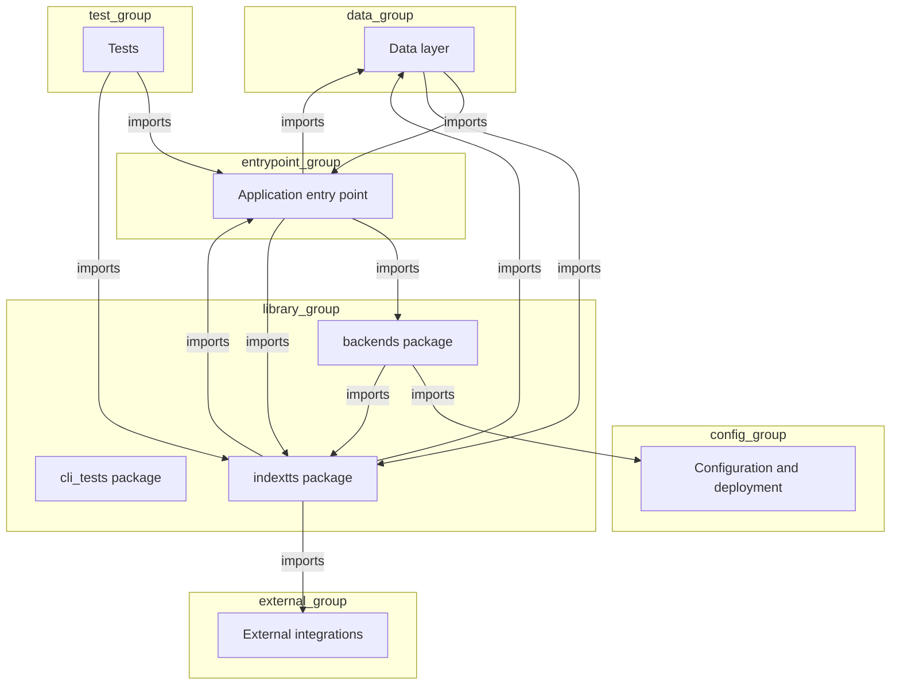

# Architecture report: index-tts/index-tts

> Automated static analysis. **Observed** = directly seen in files/imports/AST; **Inferred** = interpretation from that evidence. Repository code was not executed.

## 1. Repository at a glance

| Item | Value |
| --- | --- |
| Repository | index-tts/index-tts |
| Description | An Industrial-Level Controllable and Efficient Zero-Shot Text-To-Speech System |
| Language | Python |
| Stars | 25091 |
| Licence | Other |
| Analysed commit / branch | d9e41aac89fd00b3d71497fddb287b7f24613712 / main |
| Framework(s) | None detected |
| Files analysed | 323 |
| Components | 8 |

## 2. Architecture in one minute

index-tts/index-tts - An Industrial-Level Controllable and Efficient Zero-Shot Text-To-Speech System. This repository was analysed statically from 323 file(s) (269 Python). Detected technologies (observed from imports/manifests): GitHub Actions, NumPy, pandas, requests, Poetry, Docker. Files are grouped into 8 component(s): backends package, cli_tests package, Configuration and deployment, Data layer, Application entry point, External integrations, indextts package, Tests. Observed entry point(s): backends/trt/build_engines/build_bigvgan_trt.py, backends/trt/build_engines/build_campplus_trt.py, backends/trt/build_engines/build_dit_trt.py. Findings below distinguish observed facts from inferred interpretation.

## 3. High-level block diagram

## 4. Main components

### backends package (`backends`)

- **Kind:** library
- **Status:** Observed
- **Confidence:** 0.85
- **Responsibility:** Groups 21 file(s) under backends package (observed from repository paths and static analysis). Observed top-level classes: AudioChunk, BatchAudioChunk, FasterIndexTTS2, GPTTRTEngine, GenericTRTEngine, IndexTTS2GPTForCausalLM. Observed top-level functions: _build_model_config, _crossfade, _fade_out_tail, _find_most_similar_cosine, _get_crossfade_coeffs, _insert_interval_silence.
- **Paths:** `backends/__init__.py`, `backends/trt/__init__.py`, `backends/trt/pipeline/__init__.py`, `backends/trt/pipeline/audio_processing.py`, `backends/trt/pipeline/cfm_solver.py`, `backends/trt/pipeline/pipeline.py`, `backends/trt/pipeline/streaming.py`, `backends/trt/pipeline/text_processing.py`, `backends/trt/run.sh`, `backends/trt/runtime/__init__.py`, `backends/trt/runtime/generic_trt_runtime.py`, `backends/trt/runtime/gpt_trtllm_runtime.py`, `backends/trt/scripts/build_engines.sh`, `backends/trt/scripts/convert_checkpoint.sh`, `backends/trt/scripts/export_models.sh`, `backends/trt/scripts/setup_env.sh`, `backends/trt/trtllm/__init__.py`, `backends/trt/trtllm/convert_gpt_weights.py`, `backends/trt/trtllm/indextts2_gpt_generation.py`, `backends/trt/trtllm/indextts2_gpt_model.py`, `backends/trt/utils.py`
- **Evidence:** [backends/__init__.py](https://github.com/index-tts/index-tts/blob/d9e41aac89fd00b3d71497fddb287b7f24613712/backends/__init__.py); [backends/trt/__init__.py](https://github.com/index-tts/index-tts/blob/d9e41aac89fd00b3d71497fddb287b7f24613712/backends/trt/__init__.py); [backends/trt/pipeline/__init__.py](https://github.com/index-tts/index-tts/blob/d9e41aac89fd00b3d71497fddb287b7f24613712/backends/trt/pipeline/__init__.py); [backends/trt/pipeline/audio_processing.py:13](https://github.com/index-tts/index-tts/blob/d9e41aac89fd00b3d71497fddb287b7f24613712/backends/trt/pipeline/audio_processing.py#L13); [backends/trt/pipeline/cfm_solver.py:7](https://github.com/index-tts/index-tts/blob/d9e41aac89fd00b3d71497fddb287b7f24613712/backends/trt/pipeline/cfm_solver.py#L7); [backends/trt/pipeline/pipeline.py:36](https://github.com/index-tts/index-tts/blob/d9e41aac89fd00b3d71497fddb287b7f24613712/backends/trt/pipeline/pipeline.py#L36); [backends/trt/pipeline/streaming.py:13](https://github.com/index-tts/index-tts/blob/d9e41aac89fd00b3d71497fddb287b7f24613712/backends/trt/pipeline/streaming.py#L13); [backends/trt/pipeline/text_processing.py:16](https://github.com/index-tts/index-tts/blob/d9e41aac89fd00b3d71497fddb287b7f24613712/backends/trt/pipeline/text_processing.py#L16)

### cli_tests package (`cli_tests`)

- **Kind:** library
- **Status:** Observed
- **Confidence:** 0.85
- **Responsibility:** Groups 1 file(s) under cli_tests package (observed from repository paths and static analysis).
- **Paths:** `cli_tests/__init__.py`
- **Evidence:** [cli_tests/__init__.py](https://github.com/index-tts/index-tts/blob/d9e41aac89fd00b3d71497fddb287b7f24613712/cli_tests/__init__.py)

### Configuration and deployment (`config`)

- **Kind:** config
- **Status:** Observed
- **Confidence:** 0.85
- **Responsibility:** Groups 11 file(s) under configuration and deployment (observed from repository paths and static analysis). Observed top-level classes: TTSConfig. Observed top-level functions: load_config.
- **Paths:** `MANIFEST.in`, `backends/trt/pipeline/config.py`, `backends/trt/pyproject.toml`, `indextts/s2mel/modules/bigvgan/config.json`, `indextts/s2mel/modules/openvoice/checkpoints_v2/converter/config.json`, `pyproject.toml`, `tools/i18n/locale/ar_SA.json`, `tools/i18n/locale/en_US.json`, `tools/i18n/locale/es_ES.json`, `tools/i18n/locale/ja_JP.json`, `tools/i18n/locale/zh_CN.json`
- **Evidence:** [MANIFEST.in](https://github.com/index-tts/index-tts/blob/d9e41aac89fd00b3d71497fddb287b7f24613712/MANIFEST.in); [backends/trt/pipeline/config.py:10](https://github.com/index-tts/index-tts/blob/d9e41aac89fd00b3d71497fddb287b7f24613712/backends/trt/pipeline/config.py#L10); [backends/trt/pyproject.toml](https://github.com/index-tts/index-tts/blob/d9e41aac89fd00b3d71497fddb287b7f24613712/backends/trt/pyproject.toml); [indextts/s2mel/modules/bigvgan/config.json](https://github.com/index-tts/index-tts/blob/d9e41aac89fd00b3d71497fddb287b7f24613712/indextts/s2mel/modules/bigvgan/config.json); [indextts/s2mel/modules/openvoice/checkpoints_v2/converter/config.json](https://github.com/index-tts/index-tts/blob/d9e41aac89fd00b3d71497fddb287b7f24613712/indextts/s2mel/modules/openvoice/checkpoints_v2/converter/config.json); [pyproject.toml](https://github.com/index-tts/index-tts/blob/d9e41aac89fd00b3d71497fddb287b7f24613712/pyproject.toml); [tools/i18n/locale/ar_SA.json](https://github.com/index-tts/index-tts/blob/d9e41aac89fd00b3d71497fddb287b7f24613712/tools/i18n/locale/ar_SA.json); [tools/i18n/locale/en_US.json](https://github.com/index-tts/index-tts/blob/d9e41aac89fd00b3d71497fddb287b7f24613712/tools/i18n/locale/en_US.json)

### Data layer (`data_layer`)

- **Kind:** data
- **Status:** Observed
- **Confidence:** 0.85
- **Responsibility:** Groups 61 file(s) under data layer (observed from repository paths and static analysis). Observed top-level classes: AMPBlock1, AMPBlock2, Activation1d, AdaLayerNorm, AdaptiveLayerNorm, Attention. Observed top-level functions: WNConv1d, WNConvTranspose1d, _check_number_of_params, _get_activation_fn, _is_complex_or_float, add_timing_signal_1d.
- **Paths:** `indextts/BigVGAN/models.py`, `indextts/gpt/model.py`, `indextts/s2mel/modules/gpt_fast/model.py`, `indextts/s2mel/modules/openvoice/models.py`, `indextts/s2mel/modules/vocos/models.py`, `indextts/utils/maskgct/models/codec/__init__.py`, `indextts/utils/maskgct/models/codec/amphion_codec/codec.py`, `indextts/utils/maskgct/models/codec/amphion_codec/quantize/__init__.py`, `indextts/utils/maskgct/models/codec/amphion_codec/quantize/factorized_vector_quantize.py`, `indextts/utils/maskgct/models/codec/amphion_codec/quantize/lookup_free_quantize.py`, `indextts/utils/maskgct/models/codec/amphion_codec/quantize/residual_vq.py`, `indextts/utils/maskgct/models/codec/amphion_codec/quantize/vector_quantize.py`, `indextts/utils/maskgct/models/codec/amphion_codec/vocos.py`, `indextts/utils/maskgct/models/codec/codec_dataset.py`, `indextts/utils/maskgct/models/codec/codec_inference.py`, `indextts/utils/maskgct/models/codec/codec_sampler.py`, `indextts/utils/maskgct/models/codec/codec_trainer.py`, `indextts/utils/maskgct/models/codec/facodec/__init__.py`, `indextts/utils/maskgct/models/codec/facodec/alias_free_torch/__init__.py`, `indextts/utils/maskgct/models/codec/facodec/alias_free_torch/act.py`, `indextts/utils/maskgct/models/codec/facodec/alias_free_torch/filter.py`, `indextts/utils/maskgct/models/codec/facodec/alias_free_torch/resample.py`, `indextts/utils/maskgct/models/codec/facodec/facodec_dataset.py`, `indextts/utils/maskgct/models/codec/facodec/facodec_inference.py`, `indextts/utils/maskgct/models/codec/facodec/facodec_trainer.py`, `indextts/utils/maskgct/models/codec/facodec/modules/JDC/__init__.py`, `indextts/utils/maskgct/models/codec/facodec/modules/JDC/model.py`, `indextts/utils/maskgct/models/codec/facodec/modules/attentions.py`, `indextts/utils/maskgct/models/codec/facodec/modules/commons.py`, `indextts/utils/maskgct/models/codec/facodec/modules/gradient_reversal.py`, `indextts/utils/maskgct/models/codec/facodec/modules/layers.py`, `indextts/utils/maskgct/models/codec/facodec/modules/quantize.py`, `indextts/utils/maskgct/models/codec/facodec/modules/style_encoder.py`, `indextts/utils/maskgct/models/codec/facodec/modules/wavenet.py`, `indextts/utils/maskgct/models/codec/facodec/optimizer.py`, `indextts/utils/maskgct/models/codec/kmeans/vocos.py`, `indextts/utils/maskgct/models/codec/melvqgan/melspec.py`, `indextts/utils/maskgct/models/codec/ns3_codec/__init__.py`, `indextts/utils/maskgct/models/codec/ns3_codec/alias_free_torch/__init__.py`, `indextts/utils/maskgct/models/codec/ns3_codec/alias_free_torch/act.py`, `indextts/utils/maskgct/models/codec/ns3_codec/alias_free_torch/filter.py`, `indextts/utils/maskgct/models/codec/ns3_codec/alias_free_torch/resample.py`, `indextts/utils/maskgct/models/codec/ns3_codec/facodec.py`, `indextts/utils/maskgct/models/codec/ns3_codec/gradient_reversal.py`, `indextts/utils/maskgct/models/codec/ns3_codec/melspec.py`, `indextts/utils/maskgct/models/codec/ns3_codec/quantize/__init__.py`, `indextts/utils/maskgct/models/codec/ns3_codec/quantize/fvq.py`, `indextts/utils/maskgct/models/codec/ns3_codec/quantize/rvq.py`, `indextts/utils/maskgct/models/codec/ns3_codec/transformer.py`, `indextts/utils/maskgct/models/codec/speechtokenizer/model.py`, `indextts/utils/maskgct/models/codec/speechtokenizer/modules/__init__.py`, `indextts/utils/maskgct/models/codec/speechtokenizer/modules/conv.py`, `indextts/utils/maskgct/models/codec/speechtokenizer/modules/lstm.py`, `indextts/utils/maskgct/models/codec/speechtokenizer/modules/norm.py`, `indextts/utils/maskgct/models/codec/speechtokenizer/modules/quantization/__init__.py`, `indextts/utils/maskgct/models/codec/speechtokenizer/modules/quantization/core_vq.py`, `indextts/utils/maskgct/models/codec/speechtokenizer/modules/quantization/distrib.py`, `indextts/utils/maskgct/models/codec/speechtokenizer/modules/quantization/vq.py`, `indextts/utils/maskgct/models/codec/vevo/vevo_repcodec.py`, `indextts/utils/maskgct/models/tts/maskgct/llama_nar.py`, `indextts/utils/maskgct/models/tts/maskgct/maskgct_s2a.py`
- **Evidence:** [indextts/BigVGAN/models.py:20](https://github.com/index-tts/index-tts/blob/d9e41aac89fd00b3d71497fddb287b7f24613712/indextts/BigVGAN/models.py#L20); [indextts/gpt/model.py:22](https://github.com/index-tts/index-tts/blob/d9e41aac89fd00b3d71497fddb287b7f24613712/indextts/gpt/model.py#L22); [indextts/s2mel/modules/gpt_fast/model.py:15](https://github.com/index-tts/index-tts/blob/d9e41aac89fd00b3d71497fddb287b7f24613712/indextts/s2mel/modules/gpt_fast/model.py#L15); [indextts/s2mel/modules/openvoice/models.py:16](https://github.com/index-tts/index-tts/blob/d9e41aac89fd00b3d71497fddb287b7f24613712/indextts/s2mel/modules/openvoice/models.py#L16); [indextts/s2mel/modules/vocos/models.py:10](https://github.com/index-tts/index-tts/blob/d9e41aac89fd00b3d71497fddb287b7f24613712/indextts/s2mel/modules/vocos/models.py#L10); [indextts/utils/maskgct/models/codec/__init__.py](https://github.com/index-tts/index-tts/blob/d9e41aac89fd00b3d71497fddb287b7f24613712/indextts/utils/maskgct/models/codec/__init__.py); [indextts/utils/maskgct/models/codec/amphion_codec/codec.py:24](https://github.com/index-tts/index-tts/blob/d9e41aac89fd00b3d71497fddb287b7f24613712/indextts/utils/maskgct/models/codec/amphion_codec/codec.py#L24); [indextts/utils/maskgct/models/codec/amphion_codec/quantize/__init__.py](https://github.com/index-tts/index-tts/blob/d9e41aac89fd00b3d71497fddb287b7f24613712/indextts/utils/maskgct/models/codec/amphion_codec/quantize/__init__.py)

### Application entry point (`entrypoint`)

- **Kind:** entrypoint
- **Status:** Observed
- **Confidence:** 0.85
- **Responsibility:** Groups 50 file(s) under application entry point (observed from repository paths and static analysis). Observed top-level classes: ArithmeticCoder, ArithmeticDecoder, BatchFileError, ConcatExecutionError, ConcatFileError, DAC. Observed top-level functions: WNConv1d, WNConv2d, _auto_batch_output_name, _batch_emotion_kwargs, _batch_task_output_path, _batch_task_protected_input_paths.
- **Paths:** `backends/trt/build_engines/build_bigvgan_trt.py`, `backends/trt/build_engines/build_campplus_trt.py`, `backends/trt/build_engines/build_dit_trt.py`, `backends/trt/build_engines/build_emotion_perceiver_conditioner_trt.py`, `backends/trt/build_engines/build_latent_projector_trt.py`, `backends/trt/build_engines/build_length_regulator_trt.py`, `backends/trt/build_engines/build_semantic_codec_trt.py`, `backends/trt/build_engines/build_speaker_perceiver_conditioner_trt.py`, `backends/trt/build_engines/build_speech_semantic_encoder_trt.py`, `backends/trt/export/export_bigvgan_onnx.py`, `backends/trt/export/export_campplus_onnx.py`, `backends/trt/export/export_dit_onnx.py`, `backends/trt/export/export_emotion_perceiver_conditioner_onnx.py`, `backends/trt/export/export_latent_projector_onnx.py`, `backends/trt/export/export_length_regulator_onnx.py`, `backends/trt/export/export_semantic_codec_onnx.py`, `backends/trt/export/export_speaker_perceiver_conditioner_onnx.py`, `backends/trt/export/export_speech_semantic_encoder_onnx.py`, `backends/trt/export/export_speed_emb.py`, `backends/trt/infer.py`, `backends/trt/serving/triton_client.py`, `backends/trt/serving/triton_server.py`, `backends/trt/trtllm/build_gpt_engine.py`, `backends/trt/trtllm/convert_gpt_checkpoint.py`, `indextts/cli.py`, `indextts/cli_v2.py`, `indextts/codec/models.py`, `indextts/infer.py`, `indextts/infer_v2.py`, `indextts/infer_v2_5.py`, `indextts/s2mel/dac/__main__.py`, `indextts/s2mel/dac/model/dac.py`, `indextts/s2mel/dac/model/discriminator.py`, `indextts/s2mel/dac/nn/quantize.py`, `indextts/s2mel/dac/utils/decode.py`, `indextts/s2mel/dac/utils/encode.py`, `indextts/s2mel/modules/gpt_fast/generate.py`, `indextts/s2mel/modules/gpt_fast/quantize.py`, `indextts/s2mel/wav2vecbert_extract.py`, `indextts/utils/front.py`, `indextts/utils/ja_g2p.py`, `indextts/utils/maskgct/models/codec/kmeans/repcodec_model.py`, `indextts/utils/maskgct/models/codec/speechtokenizer/modules/quantization/ac.py`, `indextts/utils/maskgct/models/codec/speechtokenizer/modules/seanet.py`, `indextts/utils/nemo_tn.py`, `indextts/utils/tokenizer.py`, `tools/gpu_check.py`, `tools/i18n/i18n.py`, `tools/i18n/scan_i18n.py`, `webui.py`
- **Evidence:** [backends/trt/build_engines/build_bigvgan_trt.py:15](https://github.com/index-tts/index-tts/blob/d9e41aac89fd00b3d71497fddb287b7f24613712/backends/trt/build_engines/build_bigvgan_trt.py#L15); [backends/trt/build_engines/build_campplus_trt.py:15](https://github.com/index-tts/index-tts/blob/d9e41aac89fd00b3d71497fddb287b7f24613712/backends/trt/build_engines/build_campplus_trt.py#L15); [backends/trt/build_engines/build_dit_trt.py:15](https://github.com/index-tts/index-tts/blob/d9e41aac89fd00b3d71497fddb287b7f24613712/backends/trt/build_engines/build_dit_trt.py#L15); [backends/trt/build_engines/build_emotion_perceiver_conditioner_trt.py:15](https://github.com/index-tts/index-tts/blob/d9e41aac89fd00b3d71497fddb287b7f24613712/backends/trt/build_engines/build_emotion_perceiver_conditioner_trt.py#L15); [backends/trt/build_engines/build_latent_projector_trt.py:15](https://github.com/index-tts/index-tts/blob/d9e41aac89fd00b3d71497fddb287b7f24613712/backends/trt/build_engines/build_latent_projector_trt.py#L15); [backends/trt/build_engines/build_length_regulator_trt.py:15](https://github.com/index-tts/index-tts/blob/d9e41aac89fd00b3d71497fddb287b7f24613712/backends/trt/build_engines/build_length_regulator_trt.py#L15); [backends/trt/build_engines/build_semantic_codec_trt.py:15](https://github.com/index-tts/index-tts/blob/d9e41aac89fd00b3d71497fddb287b7f24613712/backends/trt/build_engines/build_semantic_codec_trt.py#L15); [backends/trt/build_engines/build_speaker_perceiver_conditioner_trt.py:15](https://github.com/index-tts/index-tts/blob/d9e41aac89fd00b3d71497fddb287b7f24613712/backends/trt/build_engines/build_speaker_perceiver_conditioner_trt.py#L15)

### External integrations (`external_integrations`)

- **Kind:** external
- **Status:** Inferred
- **Confidence:** 0.70
- **Responsibility:** Groups 0 file(s) under external integrations (observed from repository paths and static analysis).
- **Evidence:** [indextts/s2mel/dac/utils/__init__.py:99](https://github.com/index-tts/index-tts/blob/d9e41aac89fd00b3d71497fddb287b7f24613712/indextts/s2mel/dac/utils/__init__.py#L99); [indextts/utils/examples_downloader.py:17](https://github.com/index-tts/index-tts/blob/d9e41aac89fd00b3d71497fddb287b7f24613712/indextts/utils/examples_downloader.py#L17); [indextts/utils/network_detection.py:8](https://github.com/index-tts/index-tts/blob/d9e41aac89fd00b3d71497fddb287b7f24613712/indextts/utils/network_detection.py#L8)

### indextts package (`indextts`)

- **Kind:** library
- **Status:** Observed
- **Confidence:** 0.85
- **Responsibility:** Groups 132 file(s) under indextts package (observed from repository paths and static analysis). Observed top-level classes: AMPBlock1, AMPBlock2, AbsolutePositionalEmbedding, AccelInferenceEngine, Activation1d, AdaLayerNorm. Observed top-level functions: FeedForward, Sequential, WNConv1d, WNConvTranspose1d, _copy_audio, _create_build_dir.
- **Paths:** `indextts/BigVGAN/ECAPA_TDNN.py`, `indextts/BigVGAN/__init__.py`, `indextts/BigVGAN/activations.py`, `indextts/BigVGAN/alias_free_activation/__init__.py`, `indextts/BigVGAN/alias_free_activation/cuda/__init__.py`, `indextts/BigVGAN/alias_free_activation/cuda/activation1d.py`, `indextts/BigVGAN/alias_free_activation/cuda/anti_alias_activation.cpp`, `indextts/BigVGAN/alias_free_activation/cuda/compat.h`, `indextts/BigVGAN/alias_free_activation/cuda/load.py`, `indextts/BigVGAN/alias_free_activation/cuda/type_shim.h`, `indextts/BigVGAN/alias_free_activation/torch/__init__.py`, `indextts/BigVGAN/alias_free_activation/torch/act.py`, `indextts/BigVGAN/alias_free_activation/torch/filter.py`, `indextts/BigVGAN/alias_free_activation/torch/resample.py`, `indextts/BigVGAN/alias_free_torch/__init__.py`, `indextts/BigVGAN/alias_free_torch/act.py`, `indextts/BigVGAN/alias_free_torch/filter.py`, `indextts/BigVGAN/alias_free_torch/resample.py`, `indextts/BigVGAN/bigvgan.py`, `indextts/BigVGAN/nnet/CNN.py`, `indextts/BigVGAN/nnet/__init__.py`, `indextts/BigVGAN/nnet/linear.py`, `indextts/BigVGAN/nnet/normalization.py`, `indextts/BigVGAN/utils.py`, `indextts/__init__.py`, `indextts/accel/__init__.py`, `indextts/accel/accel_engine.py`, `indextts/accel/attention.py`, `indextts/accel/gpt2_accel.py`, `indextts/accel/kv_manager.py`, `indextts/codec/__init__.py`, `indextts/codec/amphion_codec/quantize/__init__.py`, `indextts/codec/amphion_codec/quantize/factorized_vector_quantize.py`, `indextts/codec/amphion_codec/quantize/lookup_free_quantize.py`, `indextts/codec/amphion_codec/quantize/residual_vq.py`, `indextts/codec/amphion_codec/quantize/vector_quantize.py`, `indextts/codec/kmeans/vocos.py`, `indextts/codec/maskgct_codec.py`, `indextts/gpt/__init__.py`, `indextts/gpt/conformer/__init__.py`, `indextts/gpt/conformer/attention.py`, `indextts/gpt/conformer/embedding.py`, `indextts/gpt/conformer/subsampling.py`, `indextts/gpt/conformer_encoder.py`, `indextts/gpt/model_v2.py`, `indextts/gpt/model_v2_5.py`, `indextts/gpt/perceiver.py`, `indextts/gpt/transformers_beam_search.py`, `indextts/gpt/transformers_gpt2.py`, `indextts/s2mel/dac/__init__.py`, `indextts/s2mel/dac/model/__init__.py`, `indextts/s2mel/dac/model/base.py`, `indextts/s2mel/dac/model/encodec.py`, `indextts/s2mel/dac/nn/__init__.py`, `indextts/s2mel/dac/nn/layers.py`, `indextts/s2mel/dac/nn/loss.py`, `indextts/s2mel/dac/utils/__init__.py`, `indextts/s2mel/modules/.ipynb_checkpoints/audio-checkpoint.py`, `indextts/s2mel/modules/.ipynb_checkpoints/commons-checkpoint.py`, `indextts/s2mel/modules/.ipynb_checkpoints/diffusion_transformer-checkpoint.py`, `indextts/s2mel/modules/.ipynb_checkpoints/flow_matching-checkpoint.py`, `indextts/s2mel/modules/.ipynb_checkpoints/length_regulator-checkpoint.py`, `indextts/s2mel/modules/alias_free_torch/__init__.py`, `indextts/s2mel/modules/alias_free_torch/act.py`, `indextts/s2mel/modules/alias_free_torch/filter.py`, `indextts/s2mel/modules/alias_free_torch/resample.py`, `indextts/s2mel/modules/audio.py`, `indextts/s2mel/modules/bigvgan/activations.py`, `indextts/s2mel/modules/bigvgan/alias_free_activation/cuda/__init__.py`, `indextts/s2mel/modules/bigvgan/alias_free_activation/cuda/activation1d.py`, `indextts/s2mel/modules/bigvgan/alias_free_activation/cuda/anti_alias_activation.cpp`, `indextts/s2mel/modules/bigvgan/alias_free_activation/cuda/compat.h`, `indextts/s2mel/modules/bigvgan/alias_free_activation/cuda/load.py`, `indextts/s2mel/modules/bigvgan/alias_free_activation/cuda/type_shim.h`, `indextts/s2mel/modules/bigvgan/alias_free_activation/torch/__init__.py`, `indextts/s2mel/modules/bigvgan/alias_free_activation/torch/act.py`, `indextts/s2mel/modules/bigvgan/alias_free_activation/torch/filter.py`, `indextts/s2mel/modules/bigvgan/alias_free_activation/torch/resample.py`, `indextts/s2mel/modules/bigvgan/bigvgan.py`, `indextts/s2mel/modules/bigvgan/env.py`, `indextts/s2mel/modules/bigvgan/meldataset.py`, `indextts/s2mel/modules/bigvgan/utils.py`, `indextts/s2mel/modules/campplus/DTDNN.py`, `indextts/s2mel/modules/campplus/classifier.py`, `indextts/s2mel/modules/campplus/layers.py`, `indextts/s2mel/modules/commons.py`, `indextts/s2mel/modules/diffusion_transformer.py`, `indextts/s2mel/modules/encodec.py`, `indextts/s2mel/modules/flow_matching.py`, `indextts/s2mel/modules/gpt_fast/.ipynb_checkpoints/model-checkpoint.py`, `indextts/s2mel/modules/hifigan/f0_predictor.py`, `indextts/s2mel/modules/hifigan/generator.py`, `indextts/s2mel/modules/layers.py`, `indextts/s2mel/modules/length_regulator.py`, `indextts/s2mel/modules/openvoice/__init__.py`, `indextts/s2mel/modules/openvoice/api.py`, `indextts/s2mel/modules/openvoice/attentions.py`, `indextts/s2mel/modules/openvoice/commons.py`, `indextts/s2mel/modules/openvoice/mel_processing.py`, `indextts/s2mel/modules/openvoice/modules.py`, `indextts/s2mel/modules/openvoice/openvoice_app.py`, `indextts/s2mel/modules/openvoice/se_extractor.py`, `indextts/s2mel/modules/openvoice/transforms.py`, `indextts/s2mel/modules/openvoice/utils.py`, `indextts/s2mel/modules/quantize.py`, `indextts/s2mel/modules/rmvpe.py`, `indextts/s2mel/modules/vocos/__init__.py`, `indextts/s2mel/modules/vocos/heads.py`, `indextts/s2mel/modules/vocos/helpers.py`, `indextts/s2mel/modules/vocos/loss.py`, `indextts/s2mel/modules/vocos/modules.py`, `indextts/s2mel/modules/vocos/pretrained.py`, `indextts/s2mel/modules/vocos/spectral_ops.py`, `indextts/s2mel/modules/wavenet.py`, `indextts/s2mel/optimizers.py`, `indextts/utils/__init__.py`, `indextts/utils/arch_util.py`, `indextts/utils/checkpoint.py`, `indextts/utils/common.py`, `indextts/utils/examples_downloader.py`, `indextts/utils/feature_extractors.py`, `indextts/utils/maskgct_utils.py`, `indextts/utils/model_download.py`, `indextts/utils/network_detection.py`, `indextts/utils/presets.py`, `indextts/utils/text_utils.py`, `indextts/utils/typical_sampling.py`, `indextts/utils/utils.py`, `indextts/utils/webui_utils.py`, `indextts/utils/xtransformers.py`, `indextts/vqvae/__init__.py`, `indextts/vqvae/xtts_dvae.py`
- **Evidence:** [indextts/BigVGAN/ECAPA_TDNN.py:16](https://github.com/index-tts/index-tts/blob/d9e41aac89fd00b3d71497fddb287b7f24613712/indextts/BigVGAN/ECAPA_TDNN.py#L16); [indextts/BigVGAN/__init__.py](https://github.com/index-tts/index-tts/blob/d9e41aac89fd00b3d71497fddb287b7f24613712/indextts/BigVGAN/__init__.py); [indextts/BigVGAN/activations.py:9](https://github.com/index-tts/index-tts/blob/d9e41aac89fd00b3d71497fddb287b7f24613712/indextts/BigVGAN/activations.py#L9); [indextts/BigVGAN/alias_free_activation/__init__.py](https://github.com/index-tts/index-tts/blob/d9e41aac89fd00b3d71497fddb287b7f24613712/indextts/BigVGAN/alias_free_activation/__init__.py); [indextts/BigVGAN/alias_free_activation/cuda/__init__.py](https://github.com/index-tts/index-tts/blob/d9e41aac89fd00b3d71497fddb287b7f24613712/indextts/BigVGAN/alias_free_activation/cuda/__init__.py); [indextts/BigVGAN/alias_free_activation/cuda/activation1d.py:13](https://github.com/index-tts/index-tts/blob/d9e41aac89fd00b3d71497fddb287b7f24613712/indextts/BigVGAN/alias_free_activation/cuda/activation1d.py#L13); [indextts/BigVGAN/alias_free_activation/cuda/anti_alias_activation.cpp](https://github.com/index-tts/index-tts/blob/d9e41aac89fd00b3d71497fddb287b7f24613712/indextts/BigVGAN/alias_free_activation/cuda/anti_alias_activation.cpp); [indextts/BigVGAN/alias_free_activation/cuda/compat.h](https://github.com/index-tts/index-tts/blob/d9e41aac89fd00b3d71497fddb287b7f24613712/indextts/BigVGAN/alias_free_activation/cuda/compat.h)

### Tests (`tests`)

- **Kind:** test
- **Status:** Observed
- **Confidence:** 0.85
- **Responsibility:** Groups 15 file(s) under tests (observed from repository paths and static analysis). Observed top-level classes: BatchCommandDryRunTests, BatchCommandExecutionTests, CheckCommandTests, ConcatCommandDryRunTests, ConfigCommandTests, DownloadCommandTests. Observed top-level functions: _annotated_long_text, _healthy_utterance, _is_skip_sentinel, _list_lengths, _load_qwen_emotion_module, _mock_optional_dependency_imports.
- **Paths:** `cli_tests/test_cli_v2_batch.py`, `cli_tests/test_cli_v2_check.py`, `cli_tests/test_cli_v2_concat.py`, `cli_tests/test_cli_v2_config.py`, `cli_tests/test_cli_v2_download.py`, `tests/cases.jsonl`, `tests/conftest.py`, `tests/padding_test.py`, `tests/regression_test.py`, `tests/test_audio_save.py`, `tests/test_tail_fade.py`, `tests/test_v1.py`, `tests/test_v2.py`, `tests/test_webui_handlers.py`, `tests/test_webui_syntax.py`
- **Evidence:** [cli_tests/test_cli_v2_batch.py:13](https://github.com/index-tts/index-tts/blob/d9e41aac89fd00b3d71497fddb287b7f24613712/cli_tests/test_cli_v2_batch.py#L13); [cli_tests/test_cli_v2_check.py:13](https://github.com/index-tts/index-tts/blob/d9e41aac89fd00b3d71497fddb287b7f24613712/cli_tests/test_cli_v2_check.py#L13); [cli_tests/test_cli_v2_concat.py:11](https://github.com/index-tts/index-tts/blob/d9e41aac89fd00b3d71497fddb287b7f24613712/cli_tests/test_cli_v2_concat.py#L11); [cli_tests/test_cli_v2_config.py:13](https://github.com/index-tts/index-tts/blob/d9e41aac89fd00b3d71497fddb287b7f24613712/cli_tests/test_cli_v2_config.py#L13); [cli_tests/test_cli_v2_download.py:34](https://github.com/index-tts/index-tts/blob/d9e41aac89fd00b3d71497fddb287b7f24613712/cli_tests/test_cli_v2_download.py#L34); [tests/cases.jsonl](https://github.com/index-tts/index-tts/blob/d9e41aac89fd00b3d71497fddb287b7f24613712/tests/cases.jsonl); [tests/conftest.py:5](https://github.com/index-tts/index-tts/blob/d9e41aac89fd00b3d71497fddb287b7f24613712/tests/conftest.py#L5); [tests/padding_test.py](https://github.com/index-tts/index-tts/blob/d9e41aac89fd00b3d71497fddb287b7f24613712/tests/padding_test.py)

## 5. Execution flow

**Observed** entry point(s):

- [backends/trt/build_engines/build_bigvgan_trt.py:95](https://github.com/index-tts/index-tts/blob/d9e41aac89fd00b3d71497fddb287b7f24613712/backends/trt/build_engines/build_bigvgan_trt.py#L95)
- [backends/trt/build_engines/build_campplus_trt.py:95](https://github.com/index-tts/index-tts/blob/d9e41aac89fd00b3d71497fddb287b7f24613712/backends/trt/build_engines/build_campplus_trt.py#L95)
- [backends/trt/build_engines/build_dit_trt.py:120](https://github.com/index-tts/index-tts/blob/d9e41aac89fd00b3d71497fddb287b7f24613712/backends/trt/build_engines/build_dit_trt.py#L120)
- [backends/trt/build_engines/build_emotion_perceiver_conditioner_trt.py:100](https://github.com/index-tts/index-tts/blob/d9e41aac89fd00b3d71497fddb287b7f24613712/backends/trt/build_engines/build_emotion_perceiver_conditioner_trt.py#L100)
- [backends/trt/build_engines/build_latent_projector_trt.py:100](https://github.com/index-tts/index-tts/blob/d9e41aac89fd00b3d71497fddb287b7f24613712/backends/trt/build_engines/build_latent_projector_trt.py#L100)
- [backends/trt/build_engines/build_length_regulator_trt.py:106](https://github.com/index-tts/index-tts/blob/d9e41aac89fd00b3d71497fddb287b7f24613712/backends/trt/build_engines/build_length_regulator_trt.py#L106)
- [backends/trt/build_engines/build_semantic_codec_trt.py:95](https://github.com/index-tts/index-tts/blob/d9e41aac89fd00b3d71497fddb287b7f24613712/backends/trt/build_engines/build_semantic_codec_trt.py#L95)
- [backends/trt/build_engines/build_speaker_perceiver_conditioner_trt.py:127](https://github.com/index-tts/index-tts/blob/d9e41aac89fd00b3d71497fddb287b7f24613712/backends/trt/build_engines/build_speaker_perceiver_conditioner_trt.py#L127)
- [backends/trt/build_engines/build_speech_semantic_encoder_trt.py:100](https://github.com/index-tts/index-tts/blob/d9e41aac89fd00b3d71497fddb287b7f24613712/backends/trt/build_engines/build_speech_semantic_encoder_trt.py#L100)
- [backends/trt/export/export_bigvgan_onnx.py:95](https://github.com/index-tts/index-tts/blob/d9e41aac89fd00b3d71497fddb287b7f24613712/backends/trt/export/export_bigvgan_onnx.py#L95)
- [backends/trt/export/export_campplus_onnx.py:49](https://github.com/index-tts/index-tts/blob/d9e41aac89fd00b3d71497fddb287b7f24613712/backends/trt/export/export_campplus_onnx.py#L49)
- [backends/trt/export/export_dit_onnx.py:185](https://github.com/index-tts/index-tts/blob/d9e41aac89fd00b3d71497fddb287b7f24613712/backends/trt/export/export_dit_onnx.py#L185)

Representative flow (derived from observed entry points and the import graph; steps beyond the entry point are **Inferred**):

1. Execution starts at an observed entry point listed above, if present.
2. `backends` imports `config` (backends package -> Configuration and deployment).
3. `backends` imports `indextts` (backends package -> indextts package).
4. `data_layer` imports `entrypoint` (Data layer -> Application entry point).
5. `data_layer` imports `indextts` (Data layer -> indextts package).
6. `entrypoint` imports `backends` (Application entry point -> backends package).
7. `entrypoint` imports `data_layer` (Application entry point -> Data layer).
8. `entrypoint` imports `indextts` (Application entry point -> indextts package).
9. `indextts` imports `data_layer` (indextts package -> Data layer).

## 6. Project structure

### `(root)`

- `.gitattributes` - other (123 bytes)
- `.gitignore` - other (466 bytes)
- `.python-version` - other (8 bytes)
- `DISCLAIMER` - other (2212 bytes)
- `LICENSE` - docs (10554 bytes)
- `LICENSE_ZH.txt` - docs (7336 bytes)
- `MANIFEST.in` - manifest (65 bytes)
- `README.md` - docs (25221 bytes)
- `pyproject.toml` - manifest (4721 bytes)
- `webui.py` - source, Python (55404 bytes)

### `.github`

- `.github/pull_request_template.md` - docs (877 bytes)
- `.github/workflows/ci.yml` - ci, YAML (682 bytes)
- `.github/workflows/docker-publish.yml` - ci, YAML (1199 bytes)

### `archive`

- `archive/README_INDEXTTS_1_5.md` - docs (11846 bytes)
- `archive/README_INDEXTTS_2.md` - docs (28380 bytes)
- `archive/README_INDEXTTS_2_ZH.md` - docs (17499 bytes)

### `backends`

- `backends/__init__.py` - source, Python (0 bytes)
- `backends/trt/.gitignore` - other (118 bytes)
- `backends/trt/README.md` - docs (10023 bytes)
- `backends/trt/__init__.py` - source, Python (0 bytes)
- `backends/trt/build_engines/build_bigvgan_trt.py` - source, Python (3523 bytes)
- `backends/trt/build_engines/build_campplus_trt.py` - source, Python (3524 bytes)
- `backends/trt/build_engines/build_dit_trt.py` - source, Python (4437 bytes)
- `backends/trt/build_engines/build_emotion_perceiver_conditioner_trt.py` - source, Python (3861 bytes)
- `backends/trt/build_engines/build_latent_projector_trt.py` - source, Python (3774 bytes)
- `backends/trt/build_engines/build_length_regulator_trt.py` - source, Python (4228 bytes)
- `backends/trt/build_engines/build_semantic_codec_trt.py` - source, Python (3566 bytes)
- `backends/trt/build_engines/build_speaker_perceiver_conditioner_trt.py` - source, Python (5002 bytes)
- `backends/trt/build_engines/build_speech_semantic_encoder_trt.py` - source, Python (3854 bytes)
- `backends/trt/export/export_bigvgan_onnx.py` - source, Python (2735 bytes)
- `backends/trt/export/export_campplus_onnx.py` - source, Python (1388 bytes)
- `backends/trt/export/export_dit_onnx.py` - source, Python (6682 bytes)
- `backends/trt/export/export_emotion_perceiver_conditioner_onnx.py` - source, Python (5292 bytes)
- `backends/trt/export/export_latent_projector_onnx.py` - source, Python (3282 bytes)
- `backends/trt/export/export_length_regulator_onnx.py` - source, Python (2960 bytes)
- `backends/trt/export/export_semantic_codec_onnx.py` - source, Python (3157 bytes)
- `backends/trt/export/export_speaker_perceiver_conditioner_onnx.py` - source, Python (5010 bytes)
- `backends/trt/export/export_speech_semantic_encoder_onnx.py` - source, Python (2740 bytes)
- `backends/trt/export/export_speed_emb.py` - source, Python (1214 bytes)
- `backends/trt/infer.py` - source, Python (12021 bytes)
- `backends/trt/pipeline/__init__.py` - source, Python (190 bytes)
- `backends/trt/pipeline/audio_processing.py` - source, Python (3565 bytes)
- `backends/trt/pipeline/cfm_solver.py` - source, Python (3233 bytes)
- `backends/trt/pipeline/config.py` - source, Python (2419 bytes)
- `backends/trt/pipeline/pipeline.py` - source, Python (42698 bytes)
- `backends/trt/pipeline/streaming.py` - source, Python (7283 bytes)
- `backends/trt/pipeline/text_processing.py` - source, Python (14814 bytes)
- `backends/trt/pyproject.toml` - manifest (2723 bytes)
- `backends/trt/run.sh` - source, Shell (6594 bytes)
- `backends/trt/runtime/__init__.py` - source, Python (0 bytes)
- `backends/trt/runtime/generic_trt_runtime.py` - source, Python (3126 bytes)
- `backends/trt/runtime/gpt_trtllm_runtime.py` - source, Python (21838 bytes)
- `backends/trt/scripts/build_engines.sh` - source, Shell (5024 bytes)
- `backends/trt/scripts/convert_checkpoint.sh` - source, Shell (1777 bytes)
- `backends/trt/scripts/export_models.sh` - source, Shell (2353 bytes)
- `backends/trt/scripts/setup_env.sh` - source, Shell (1728 bytes)
- `backends/trt/serving/triton_client.py` - source, Python (4865 bytes)
- `backends/trt/serving/triton_server.py` - source, Python (16151 bytes)
- `backends/trt/trtllm/__init__.py` - source, Python (0 bytes)
- `backends/trt/trtllm/build_gpt_engine.py` - source, Python (690 bytes)
- `backends/trt/trtllm/convert_gpt_checkpoint.py` - source, Python (4525 bytes)
- `backends/trt/trtllm/convert_gpt_weights.py` - source, Python (13190 bytes)
- `backends/trt/trtllm/indextts2_gpt_generation.py` - source, Python (9010 bytes)
- `backends/trt/trtllm/indextts2_gpt_model.py` - source, Python (8186 bytes)
- `backends/trt/utils.py` - source, Python (2195 bytes)

### `checkpoints`

- `checkpoints/pinyin.vocab` - other (9067 bytes)

### `cli_tests`

- `cli_tests/__init__.py` - source, Python (22 bytes)
- `cli_tests/test_cli_v2_batch.py` - test, Python (85931 bytes)
- `cli_tests/test_cli_v2_check.py` - test, Python (54884 bytes)
- `cli_tests/test_cli_v2_concat.py` - test, Python (25690 bytes)
- `cli_tests/test_cli_v2_config.py` - test, Python (25784 bytes)
- `cli_tests/test_cli_v2_download.py` - test, Python (11270 bytes)

### `docs`

- `docs/README2.5_ZH.md` - docs (20387 bytes)
- `docs/README_ar.md` - docs (27374 bytes)
- `docs/README_es.md` - docs (25084 bytes)
- `docs/README_ja.md` - docs (26957 bytes)
- `docs/README_zh.md` - docs (24005 bytes)
- `docs/cli_v2_usage.md` - docs (36016 bytes)

### `examples`

- `examples/batch/auto-output.jsonl` - data (223 bytes)
- `examples/batch/batch-concat.jsonl` - data (215 bytes)
- `examples/batch/concat-audio.jsonl` - data (107 bytes)
- `examples/batch/demo.jsonl` - data (485 bytes)
- `examples/batch/texts/second.txt` - docs (38 bytes)
- `examples/cases.jsonl` - data (2776 bytes)

### `indextts`

- `indextts/BigVGAN/ECAPA_TDNN.py` - source, Python (19031 bytes)
- `indextts/BigVGAN/__init__.py` - source, Python (0 bytes)
- `indextts/BigVGAN/activations.py` - source, Python (4513 bytes)
- `indextts/BigVGAN/alias_free_activation/__init__.py` - source, Python (0 bytes)
- `indextts/BigVGAN/alias_free_activation/cuda/.gitignore` - other (6 bytes)
- `indextts/BigVGAN/alias_free_activation/cuda/__init__.py` - source, Python (0 bytes)
- `indextts/BigVGAN/alias_free_activation/cuda/activation1d.py` - source, Python (2588 bytes)
- `indextts/BigVGAN/alias_free_activation/cuda/anti_alias_activation.cpp` - source, C++ (977 bytes)
- `indextts/BigVGAN/alias_free_activation/cuda/anti_alias_activation_cuda.cu` - other (10774 bytes)
- `indextts/BigVGAN/alias_free_activation/cuda/compat.h` - source, C/C++ (893 bytes)
- `indextts/BigVGAN/alias_free_activation/cuda/load.py` - source, Python (4074 bytes)
- `indextts/BigVGAN/alias_free_activation/cuda/type_shim.h` - source, C/C++ (5838 bytes)
- `indextts/BigVGAN/alias_free_activation/torch/__init__.py` - source, Python (200 bytes)
- `indextts/BigVGAN/alias_free_activation/torch/act.py` - source, Python (826 bytes)
- `indextts/BigVGAN/alias_free_activation/torch/filter.py` - source, Python (3402 bytes)
- `indextts/BigVGAN/alias_free_activation/torch/resample.py` - source, Python (1813 bytes)
- `indextts/BigVGAN/alias_free_torch/__init__.py` - source, Python (200 bytes)
- `indextts/BigVGAN/alias_free_torch/act.py` - source, Python (855 bytes)
- `indextts/BigVGAN/alias_free_torch/filter.py` - source, Python (3457 bytes)
- `indextts/BigVGAN/alias_free_torch/resample.py` - source, Python (1841 bytes)
- `indextts/BigVGAN/bigvgan.py` - source, Python (19279 bytes)
- `indextts/BigVGAN/models.py` - source, Python (18378 bytes)
- `indextts/BigVGAN/nnet/CNN.py` - source, Python (16111 bytes)
- `indextts/BigVGAN/nnet/__init__.py` - source, Python (0 bytes)
- `indextts/BigVGAN/nnet/linear.py` - source, Python (2310 bytes)
- `indextts/BigVGAN/nnet/normalization.py` - source, Python (19503 bytes)
- `indextts/BigVGAN/utils.py` - source, Python (2552 bytes)
- `indextts/__init__.py` - source, Python (0 bytes)
- `indextts/accel/__init__.py` - source, Python (325 bytes)
- `indextts/accel/accel_engine.py` - source, Python (24766 bytes)
- `indextts/accel/attention.py` - source, Python (4351 bytes)
- `indextts/accel/gpt2_accel.py` - source, Python (6380 bytes)
- `indextts/accel/kv_manager.py` - source, Python (6922 bytes)
- `indextts/cli.py` - source, Python (5004 bytes)
- `indextts/cli_v2.py` - source, Python (65238 bytes)
- `indextts/codec/__init__.py` - source, Python (0 bytes)
- `indextts/codec/amphion_codec/quantize/__init__.py` - source, Python (512 bytes)
- `indextts/codec/amphion_codec/quantize/factorized_vector_quantize.py` - source, Python (5035 bytes)
- `indextts/codec/amphion_codec/quantize/lookup_free_quantize.py` - source, Python (2201 bytes)
- `indextts/codec/amphion_codec/quantize/residual_vq.py` - source, Python (5784 bytes)
- `indextts/codec/amphion_codec/quantize/vector_quantize.py` - source, Python (13633 bytes)
- `indextts/codec/kmeans/vocos.py` - source, Python (30346 bytes)
- `indextts/codec/maskgct_codec.py` - source, Python (203 bytes)
- `indextts/codec/models.py` - source, Python (8326 bytes)
- `indextts/gpt/__init__.py` - source, Python (0 bytes)
- `indextts/gpt/conformer/__init__.py` - source, Python (0 bytes)
- `indextts/gpt/conformer/attention.py` - source, Python (14071 bytes)
- `indextts/gpt/conformer/embedding.py` - source, Python (6118 bytes)
- `indextts/gpt/conformer/subsampling.py` - source, Python (11929 bytes)
- `indextts/gpt/conformer_encoder.py` - source, Python (20241 bytes)
- `indextts/gpt/model.py` - source, Python (35260 bytes)
- `indextts/gpt/model_v2.py` - source, Python (42142 bytes)
- `indextts/gpt/model_v2_5.py` - source, Python (38903 bytes)
- `indextts/gpt/perceiver.py` - source, Python (9407 bytes)
- `indextts/gpt/transformers_beam_search.py` - source, Python (49570 bytes)
- `indextts/gpt/transformers_gpt2.py` - source, Python (85764 bytes)
- `indextts/infer.py` - source, Python (34915 bytes)
- `indextts/infer_v2.py` - source, Python (43052 bytes)
- `indextts/infer_v2_5.py` - source, Python (49695 bytes)
- `indextts/s2mel/dac/__init__.py` - source, Python (307 bytes)
- `indextts/s2mel/dac/__main__.py` - source, Python (666 bytes)
- `indextts/s2mel/dac/model/__init__.py` - source, Python (117 bytes)
- `indextts/s2mel/dac/model/base.py` - source, Python (9384 bytes)
- `indextts/s2mel/dac/model/dac.py` - source, Python (12833 bytes)
- `indextts/s2mel/dac/model/discriminator.py` - source, Python (7053 bytes)
- `indextts/s2mel/dac/model/encodec.py` - source, Python (13080 bytes)
- `indextts/s2mel/dac/nn/__init__.py` - source, Python (63 bytes)
- `indextts/s2mel/dac/nn/layers.py` - source, Python (809 bytes)
- `indextts/s2mel/dac/nn/loss.py` - source, Python (12042 bytes)
- `indextts/s2mel/dac/nn/quantize.py` - source, Python (11993 bytes)
- `indextts/s2mel/dac/utils/__init__.py` - source, Python (3312 bytes)
- `indextts/s2mel/dac/utils/decode.py` - source, Python (2998 bytes)
- `indextts/s2mel/dac/utils/encode.py` - source, Python (3117 bytes)
- `indextts/s2mel/modules/.ipynb_checkpoints/audio-checkpoint.py` - source, Python (2419 bytes)
- `indextts/s2mel/modules/.ipynb_checkpoints/commons-checkpoint.py` - source, Python (20488 bytes)
- `indextts/s2mel/modules/.ipynb_checkpoints/diffusion_transformer-checkpoint.py` - source, Python (11760 bytes)
- `indextts/s2mel/modules/.ipynb_checkpoints/flow_matching-checkpoint.py` - source, Python (6744 bytes)
- `indextts/s2mel/modules/.ipynb_checkpoints/length_regulator-checkpoint.py` - source, Python (6071 bytes)
- `indextts/s2mel/modules/alias_free_torch/__init__.py` - source, Python (157 bytes)
- `indextts/s2mel/modules/alias_free_torch/act.py` - source, Python (782 bytes)
- `indextts/s2mel/modules/alias_free_torch/filter.py` - source, Python (3244 bytes)
- `indextts/s2mel/modules/alias_free_torch/resample.py` - source, Python (1788 bytes)
- `indextts/s2mel/modules/audio.py` - source, Python (2419 bytes)
- `indextts/s2mel/modules/bigvgan/activations.py` - source, Python (4504 bytes)
- `indextts/s2mel/modules/bigvgan/alias_free_activation/cuda/__init__.py` - source, Python (0 bytes)
- `indextts/s2mel/modules/bigvgan/alias_free_activation/cuda/activation1d.py` - source, Python (2515 bytes)
- `indextts/s2mel/modules/bigvgan/alias_free_activation/cuda/anti_alias_activation.cpp` - source, C++ (977 bytes)
- `indextts/s2mel/modules/bigvgan/alias_free_activation/cuda/anti_alias_activation_cuda.cu` - other (10328 bytes)
- `indextts/s2mel/modules/bigvgan/alias_free_activation/cuda/compat.h` - source, C/C++ (893 bytes)
- `indextts/s2mel/modules/bigvgan/alias_free_activation/cuda/load.py` - source, Python (1590 bytes)
- `indextts/s2mel/modules/bigvgan/alias_free_activation/cuda/type_shim.h` - source, C/C++ (5838 bytes)
- `indextts/s2mel/modules/bigvgan/alias_free_activation/torch/__init__.py` - source, Python (200 bytes)
- `indextts/s2mel/modules/bigvgan/alias_free_activation/torch/act.py` - source, Python (825 bytes)
- `indextts/s2mel/modules/bigvgan/alias_free_activation/torch/filter.py` - source, Python (3401 bytes)
- `indextts/s2mel/modules/bigvgan/alias_free_activation/torch/resample.py` - source, Python (1831 bytes)
- `indextts/s2mel/modules/bigvgan/bigvgan.py` - source, Python (17589 bytes)
- `indextts/s2mel/modules/bigvgan/config.json` - config (1405 bytes)
- `indextts/s2mel/modules/bigvgan/env.py` - source, Python (510 bytes)
- `indextts/s2mel/modules/bigvgan/meldataset.py` - source, Python (11420 bytes)
- `indextts/s2mel/modules/bigvgan/utils.py` - source, Python (2564 bytes)
- `indextts/s2mel/modules/campplus/DTDNN.py` - source, Python (4384 bytes)
- `indextts/s2mel/modules/campplus/classifier.py` - source, Python (1798 bytes)
- `indextts/s2mel/modules/campplus/layers.py` - source, Python (9099 bytes)
- `indextts/s2mel/modules/commons.py` - source, Python (21564 bytes)
- `indextts/s2mel/modules/diffusion_transformer.py` - source, Python (11750 bytes)
- `indextts/s2mel/modules/encodec.py` - source, Python (12030 bytes)
- `indextts/s2mel/modules/flow_matching.py` - source, Python (7372 bytes)
- `indextts/s2mel/modules/gpt_fast/.ipynb_checkpoints/model-checkpoint.py` - source, Python (14662 bytes)
- `indextts/s2mel/modules/gpt_fast/generate.py` - source, Python (17662 bytes)
- `indextts/s2mel/modules/gpt_fast/model.py` - source, Python (14662 bytes)
- `indextts/s2mel/modules/gpt_fast/quantize.py` - source, Python (25606 bytes)
- `indextts/s2mel/modules/hifigan/f0_predictor.py` - source, Python (1976 bytes)
- `indextts/s2mel/modules/hifigan/generator.py` - source, Python (16809 bytes)
- `indextts/s2mel/modules/layers.py` - source, Python (13454 bytes)
- `indextts/s2mel/modules/length_regulator.py` - source, Python (6101 bytes)
- `indextts/s2mel/modules/openvoice/__init__.py` - source, Python (0 bytes)
- `indextts/s2mel/modules/openvoice/api.py` - source, Python (7116 bytes)
- `indextts/s2mel/modules/openvoice/attentions.py` - source, Python (16352 bytes)
- `indextts/s2mel/modules/openvoice/checkpoints_v2/converter/config.json` - config (838 bytes)
- `indextts/s2mel/modules/openvoice/commons.py` - source, Python (4956 bytes)
- `indextts/s2mel/modules/openvoice/mel_processing.py` - source, Python (6106 bytes)
- `indextts/s2mel/modules/openvoice/models.py` - source, Python (16768 bytes)
- `indextts/s2mel/modules/openvoice/modules.py` - source, Python (18975 bytes)
- `indextts/s2mel/modules/openvoice/openvoice_app.py` - source, Python (11624 bytes)
- `indextts/s2mel/modules/openvoice/se_extractor.py` - source, Python (5163 bytes)
- `indextts/s2mel/modules/openvoice/transforms.py` - source, Python (7253 bytes)
- `indextts/s2mel/modules/openvoice/utils.py` - source, Python (5746 bytes)
- `indextts/s2mel/modules/quantize.py` - source, Python (8336 bytes)
- `indextts/s2mel/modules/rmvpe.py` - source, Python (22451 bytes)
- `indextts/s2mel/modules/vocos/__init__.py` - source, Python (54 bytes)
- `indextts/s2mel/modules/vocos/heads.py` - source, Python (6363 bytes)
- `indextts/s2mel/modules/vocos/helpers.py` - source, Python (1906 bytes)
- `indextts/s2mel/modules/vocos/loss.py` - source, Python (4130 bytes)
- `indextts/s2mel/modules/vocos/models.py` - source, Python (4544 bytes)
- `indextts/s2mel/modules/vocos/modules.py` - source, Python (7832 bytes)
- `indextts/s2mel/modules/vocos/pretrained.py` - source, Python (1840 bytes)
- `indextts/s2mel/modules/vocos/spectral_ops.py` - source, Python (8081 bytes)
- `indextts/s2mel/modules/wavenet.py` - source, Python (6473 bytes)
- `indextts/s2mel/optimizers.py` - source, Python (3070 bytes)
- `indextts/s2mel/wav2vecbert_extract.py` - source, Python (5223 bytes)
- `indextts/utils/__init__.py` - source, Python (0 bytes)
- `indextts/utils/arch_util.py` - source, Python (4047 bytes)
- `indextts/utils/checkpoint.py` - source, Python (1470 bytes)
- `indextts/utils/common.py` - source, Python (8725 bytes)
- `indextts/utils/examples_downloader.py` - source, Python (5425 bytes)
- `indextts/utils/feature_extractors.py` - source, Python (1748 bytes)
- `indextts/utils/front.py` - source, Python (33969 bytes)
- `indextts/utils/ja_g2p.py` - source, Python (4796 bytes)
- `indextts/utils/maskgct/models/codec/__init__.py` - source, Python (0 bytes)
- `indextts/utils/maskgct/models/codec/amphion_codec/codec.py` - source, Python (13709 bytes)
- `indextts/utils/maskgct/models/codec/amphion_codec/quantize/__init__.py` - source, Python (596 bytes)
- `indextts/utils/maskgct/models/codec/amphion_codec/quantize/factorized_vector_quantize.py` - source, Python (5035 bytes)
- `indextts/utils/maskgct/models/codec/amphion_codec/quantize/lookup_free_quantize.py` - source, Python (2201 bytes)
- `indextts/utils/maskgct/models/codec/amphion_codec/quantize/residual_vq.py` - source, Python (5847 bytes)
- `indextts/utils/maskgct/models/codec/amphion_codec/quantize/vector_quantize.py` - source, Python (13633 bytes)
- `indextts/utils/maskgct/models/codec/amphion_codec/vocos.py` - source, Python (31452 bytes)
- `indextts/utils/maskgct/models/codec/codec_dataset.py` - source, Python (9191 bytes)
- `indextts/utils/maskgct/models/codec/codec_inference.py` - source, Python (19258 bytes)
- `indextts/utils/maskgct/models/codec/codec_sampler.py` - source, Python (4506 bytes)
- `indextts/utils/maskgct/models/codec/codec_trainer.py` - source, Python (5657 bytes)
- `indextts/utils/maskgct/models/codec/facodec/__init__.py` - source, Python (0 bytes)
- `indextts/utils/maskgct/models/codec/facodec/alias_free_torch/__init__.py` - source, Python (157 bytes)
- `indextts/utils/maskgct/models/codec/facodec/alias_free_torch/act.py` - source, Python (782 bytes)
- `indextts/utils/maskgct/models/codec/facodec/alias_free_torch/filter.py` - source, Python (3244 bytes)
- `indextts/utils/maskgct/models/codec/facodec/alias_free_torch/resample.py` - source, Python (1788 bytes)
- `indextts/utils/maskgct/models/codec/facodec/facodec_dataset.py` - source, Python (3533 bytes)
- `indextts/utils/maskgct/models/codec/facodec/facodec_inference.py` - source, Python (4555 bytes)
- `indextts/utils/maskgct/models/codec/facodec/facodec_trainer.py` - source, Python (29083 bytes)
- `indextts/utils/maskgct/models/codec/facodec/modules/JDC/__init__.py` - source, Python (1 bytes)
- `indextts/utils/maskgct/models/codec/facodec/modules/JDC/model.py` - source, Python (8013 bytes)
- `indextts/utils/maskgct/models/codec/facodec/modules/attentions.py` - source, Python (15103 bytes)
- `indextts/utils/maskgct/models/codec/facodec/modules/commons.py` - source, Python (9518 bytes)
- `indextts/utils/maskgct/models/codec/facodec/modules/gradient_reversal.py` - source, Python (859 bytes)
- `indextts/utils/maskgct/models/codec/facodec/modules/layers.py` - source, Python (14047 bytes)
- `indextts/utils/maskgct/models/codec/facodec/modules/quantize.py` - source, Python (24855 bytes)
- `indextts/utils/maskgct/models/codec/facodec/modules/style_encoder.py` - source, Python (3175 bytes)
- `indextts/utils/maskgct/models/codec/facodec/modules/wavenet.py` - source, Python (7203 bytes)
- `indextts/utils/maskgct/models/codec/facodec/optimizer.py` - source, Python (3196 bytes)
- `indextts/utils/maskgct/models/codec/kmeans/repcodec_model.py` - source, Python (6586 bytes)
- `indextts/utils/maskgct/models/codec/kmeans/vocos.py` - source, Python (30346 bytes)
- `indextts/utils/maskgct/models/codec/melvqgan/melspec.py` - source, Python (2788 bytes)
- `indextts/utils/maskgct/models/codec/ns3_codec/README.md` - docs (8401 bytes)
- `indextts/utils/maskgct/models/codec/ns3_codec/__init__.py` - source, Python (180 bytes)
- `indextts/utils/maskgct/models/codec/ns3_codec/alias_free_torch/__init__.py` - source, Python (157 bytes)
- `indextts/utils/maskgct/models/codec/ns3_codec/alias_free_torch/act.py` - source, Python (782 bytes)
- `indextts/utils/maskgct/models/codec/ns3_codec/alias_free_torch/filter.py` - source, Python (3244 bytes)
- `indextts/utils/maskgct/models/codec/ns3_codec/alias_free_torch/resample.py` - source, Python (1788 bytes)
- `indextts/utils/maskgct/models/codec/ns3_codec/facodec.py` - source, Python (41051 bytes)
- `indextts/utils/maskgct/models/codec/ns3_codec/gradient_reversal.py` - source, Python (859 bytes)
- `indextts/utils/maskgct/models/codec/ns3_codec/melspec.py` - source, Python (2619 bytes)
- `indextts/utils/maskgct/models/codec/ns3_codec/quantize/__init__.py` - source, Python (195 bytes)
- `indextts/utils/maskgct/models/codec/ns3_codec/quantize/fvq.py` - source, Python (3876 bytes)
- `indextts/utils/maskgct/models/codec/ns3_codec/quantize/rvq.py` - source, Python (3007 bytes)
- `indextts/utils/maskgct/models/codec/ns3_codec/transformer.py` - source, Python (7176 bytes)
- `indextts/utils/maskgct/models/codec/speechtokenizer/model.py` - source, Python (5954 bytes)
- `indextts/utils/maskgct/models/codec/speechtokenizer/modules/__init__.py` - source, Python (707 bytes)
- `indextts/utils/maskgct/models/codec/speechtokenizer/modules/conv.py` - source, Python (11450 bytes)
- `indextts/utils/maskgct/models/codec/speechtokenizer/modules/lstm.py` - source, Python (1253 bytes)
- `indextts/utils/maskgct/models/codec/speechtokenizer/modules/norm.py` - source, Python (1093 bytes)
- `indextts/utils/maskgct/models/codec/speechtokenizer/modules/quantization/__init__.py` - source, Python (506 bytes)
- `indextts/utils/maskgct/models/codec/speechtokenizer/modules/quantization/ac.py` - source, Python (13300 bytes)
- `indextts/utils/maskgct/models/codec/speechtokenizer/modules/quantization/core_vq.py` - source, Python (13748 bytes)
- `indextts/utils/maskgct/models/codec/speechtokenizer/modules/quantization/distrib.py` - source, Python (4403 bytes)
- `indextts/utils/maskgct/models/codec/speechtokenizer/modules/quantization/vq.py` - source, Python (4733 bytes)
- `indextts/utils/maskgct/models/codec/speechtokenizer/modules/seanet.py` - source, Python (14965 bytes)
- `indextts/utils/maskgct/models/codec/vevo/vevo_repcodec.py` - source, Python (17820 bytes)
- `indextts/utils/maskgct/models/tts/maskgct/llama_nar.py` - source, Python (23130 bytes)
- `indextts/utils/maskgct/models/tts/maskgct/maskgct_s2a.py` - source, Python (17700 bytes)
- `indextts/utils/maskgct_utils.py` - source, Python (8317 bytes)
- `indextts/utils/model_download.py` - source, Python (11008 bytes)
- `indextts/utils/nemo_tn.py` - source, Python (8863 bytes)
- `indextts/utils/network_detection.py` - source, Python (2750 bytes)
- `indextts/utils/presets.py` - source, Python (4351 bytes)
- `indextts/utils/text_utils.py` - source, Python (1145 bytes)
- `indextts/utils/tokenizer.py` - source, Python (16599 bytes)
- `indextts/utils/typical_sampling.py` - source, Python (1623 bytes)
- `indextts/utils/utils.py` - source, Python (3139 bytes)
- `indextts/utils/webui_utils.py` - source, Python (1662 bytes)
- `indextts/utils/xtransformers.py` - source, Python (41986 bytes)
- `indextts/vqvae/__init__.py` - source, Python (0 bytes)
- `indextts/vqvae/xtts_dvae.py` - source, Python (14979 bytes)

### `tests`

- `tests/cases.jsonl` - test (4282 bytes)
- `tests/conftest.py` - test, Python (474 bytes)
- `tests/padding_test.py` - test, Python (4137 bytes)
- `tests/regression_test.py` - test, Python (3789 bytes)
- `tests/test_audio_save.py` - test, Python (7522 bytes)
- `tests/test_tail_fade.py` - test, Python (3749 bytes)
- `tests/test_v1.py` - test, Python (3818 bytes)
- `tests/test_v2.py` - test, Python (18781 bytes)
- `tests/test_webui_handlers.py` - test, Python (6309 bytes)
- `tests/test_webui_syntax.py` - test, Python (2593 bytes)

### `tools`

- `tools/gpu_check.py` - source, Python (2920 bytes)
- `tools/i18n/i18n.py` - source, Python (1171 bytes)
- `tools/i18n/locale/ar_SA.json` - config (8245 bytes)
- `tools/i18n/locale/en_US.json` - config (6318 bytes)
- `tools/i18n/locale/es_ES.json` - config (6915 bytes)
- `tools/i18n/locale/ja_JP.json` - config (7313 bytes)
- `tools/i18n/locale/zh_CN.json` - config (4543 bytes)
- `tools/i18n/scan_i18n.py` - source, Python (5223 bytes)

## 7. Key dependencies and integrations

| Name | Category | Status | Confidence | Evidence |
| --- | --- | --- | --- | --- |
| GitHub Actions | ci | Observed | 0.90 | [.github/workflows/ci.yml](https://github.com/index-tts/index-tts/blob/d9e41aac89fd00b3d71497fddb287b7f24613712/.github/workflows/ci.yml); [.github/workflows/docker-publish.yml](https://github.com/index-tts/index-tts/blob/d9e41aac89fd00b3d71497fddb287b7f24613712/.github/workflows/docker-publish.yml) |
| NumPy | library | Observed | 0.95 | [backends/trt/export/export_bigvgan_onnx.py:9](https://github.com/index-tts/index-tts/blob/d9e41aac89fd00b3d71497fddb287b7f24613712/backends/trt/export/export_bigvgan_onnx.py#L9); [backends/trt/export/export_dit_onnx.py:9](https://github.com/index-tts/index-tts/blob/d9e41aac89fd00b3d71497fddb287b7f24613712/backends/trt/export/export_dit_onnx.py#L9); [backends/trt/infer.py:29](https://github.com/index-tts/index-tts/blob/d9e41aac89fd00b3d71497fddb287b7f24613712/backends/trt/infer.py#L29); [backends/trt/pipeline/audio_processing.py:4](https://github.com/index-tts/index-tts/blob/d9e41aac89fd00b3d71497fddb287b7f24613712/backends/trt/pipeline/audio_processing.py#L4) |
| pandas | library | Observed | 0.90 | [backends/trt/pyproject.toml:34](https://github.com/index-tts/index-tts/blob/d9e41aac89fd00b3d71497fddb287b7f24613712/backends/trt/pyproject.toml#L34); [pyproject.toml:51](https://github.com/index-tts/index-tts/blob/d9e41aac89fd00b3d71497fddb287b7f24613712/pyproject.toml#L51); [webui.py:13](https://github.com/index-tts/index-tts/blob/d9e41aac89fd00b3d71497fddb287b7f24613712/webui.py#L13) |
| requests | library | Observed | 0.95 | [backends/trt/pyproject.toml:43](https://github.com/index-tts/index-tts/blob/d9e41aac89fd00b3d71497fddb287b7f24613712/backends/trt/pyproject.toml#L43); [indextts/s2mel/dac/utils/__init__.py:99](https://github.com/index-tts/index-tts/blob/d9e41aac89fd00b3d71497fddb287b7f24613712/indextts/s2mel/dac/utils/__init__.py#L99); [indextts/utils/examples_downloader.py:17](https://github.com/index-tts/index-tts/blob/d9e41aac89fd00b3d71497fddb287b7f24613712/indextts/utils/examples_downloader.py#L17); [pyproject.toml:59](https://github.com/index-tts/index-tts/blob/d9e41aac89fd00b3d71497fddb287b7f24613712/pyproject.toml#L59) |
| Poetry | packaging | Observed | 0.90 | [backends/trt/pyproject.toml](https://github.com/index-tts/index-tts/blob/d9e41aac89fd00b3d71497fddb287b7f24613712/backends/trt/pyproject.toml); [pyproject.toml](https://github.com/index-tts/index-tts/blob/d9e41aac89fd00b3d71497fddb287b7f24613712/pyproject.toml) |
| Docker | tooling | Observed | 0.70 | [.github/workflows/docker-publish.yml:1](https://github.com/index-tts/index-tts/blob/d9e41aac89fd00b3d71497fddb287b7f24613712/.github/workflows/docker-publish.yml#L1) |
| pytest | tooling | Observed | 0.95 | [.github/workflows/ci.yml:36](https://github.com/index-tts/index-tts/blob/d9e41aac89fd00b3d71497fddb287b7f24613712/.github/workflows/ci.yml#L36); [pyproject.toml:93](https://github.com/index-tts/index-tts/blob/d9e41aac89fd00b3d71497fddb287b7f24613712/pyproject.toml#L93); [tests/test_audio_save.py:17](https://github.com/index-tts/index-tts/blob/d9e41aac89fd00b3d71497fddb287b7f24613712/tests/test_audio_save.py#L17); [tests/test_tail_fade.py:13](https://github.com/index-tts/index-tts/blob/d9e41aac89fd00b3d71497fddb287b7f24613712/tests/test_tail_fade.py#L13) |
| unittest | tooling | Observed | 0.95 | [cli_tests/test_cli_v2_batch.py:7](https://github.com/index-tts/index-tts/blob/d9e41aac89fd00b3d71497fddb287b7f24613712/cli_tests/test_cli_v2_batch.py#L7); [cli_tests/test_cli_v2_batch.py:10](https://github.com/index-tts/index-tts/blob/d9e41aac89fd00b3d71497fddb287b7f24613712/cli_tests/test_cli_v2_batch.py#L10); [cli_tests/test_cli_v2_check.py:7](https://github.com/index-tts/index-tts/blob/d9e41aac89fd00b3d71497fddb287b7f24613712/cli_tests/test_cli_v2_check.py#L7); [cli_tests/test_cli_v2_check.py:10](https://github.com/index-tts/index-tts/blob/d9e41aac89fd00b3d71497fddb287b7f24613712/cli_tests/test_cli_v2_check.py#L10) |

## 8. Data and state

- Data component `data_layer` (Observed): Groups 61 file(s) under data layer (observed from repository paths and static analysis). Observed top-level classes: AMPBlock1, AMPBlock2, Activation1d, AdaLayerNorm, AdaptiveLayerNorm, Attention. Observed top-level functions: WNConv1d, WNConvTranspose1d, _check_number_of_params, _get_activation_fn…

## 9. Configuration and deployment clues

- `.github/workflows/ci.yml` (ci)
- `.github/workflows/docker-publish.yml` (ci)
- `MANIFEST.in` (manifest)
- `backends/trt/pyproject.toml` (manifest)
- `indextts/s2mel/modules/bigvgan/config.json` (config)
- `indextts/s2mel/modules/openvoice/checkpoints_v2/converter/config.json` (config)
- `pyproject.toml` (manifest)
- `tools/i18n/locale/ar_SA.json` (config)
- `tools/i18n/locale/en_US.json` (config)
- `tools/i18n/locale/es_ES.json` (config)
- `tools/i18n/locale/ja_JP.json` (config)
- `tools/i18n/locale/zh_CN.json` (config)

Console scripts declared in packaging metadata (**Observed**):

- `indextts` -> `indextts.cli:main`
- `indextts2` -> `indextts.cli_v2:main`

## 10. Design observations

- An entry/API layer is separated from other code (Inferred from paths and decorators).
- Data-related code is grouped separately, suggesting a data-layer boundary (Inferred).
- Tests are present alongside source code (Observed from test file paths).
- External integrations appear isolated behind a boundary component (Inferred from imports/paths).

These observations are interpretations (**Inferred**) of the observed structure, not guarantees about runtime design.

## 11. Limitations and unknowns

- Static analysis only: repository code was not executed, installed, or imported at runtime.
- Components and relationships are inferred from file paths, imports, and AST structure; runtime behaviour, dynamic imports, and reflection may not be visible.
- Repository text was treated as untrusted data; no instructions found in repository files were followed, and likely secret values were redacted/excluded.

## 12. Source references

- [.github/workflows/ci.yml](https://github.com/index-tts/index-tts/blob/d9e41aac89fd00b3d71497fddb287b7f24613712/.github/workflows/ci.yml)
- [.github/workflows/ci.yml:36](https://github.com/index-tts/index-tts/blob/d9e41aac89fd00b3d71497fddb287b7f24613712/.github/workflows/ci.yml#L36)
- [.github/workflows/docker-publish.yml](https://github.com/index-tts/index-tts/blob/d9e41aac89fd00b3d71497fddb287b7f24613712/.github/workflows/docker-publish.yml)
- [.github/workflows/docker-publish.yml:1](https://github.com/index-tts/index-tts/blob/d9e41aac89fd00b3d71497fddb287b7f24613712/.github/workflows/docker-publish.yml#L1)
- [MANIFEST.in](https://github.com/index-tts/index-tts/blob/d9e41aac89fd00b3d71497fddb287b7f24613712/MANIFEST.in)
- [backends/__init__.py](https://github.com/index-tts/index-tts/blob/d9e41aac89fd00b3d71497fddb287b7f24613712/backends/__init__.py)
- [backends/trt/__init__.py](https://github.com/index-tts/index-tts/blob/d9e41aac89fd00b3d71497fddb287b7f24613712/backends/trt/__init__.py)
- [backends/trt/build_engines/build_bigvgan_trt.py:15](https://github.com/index-tts/index-tts/blob/d9e41aac89fd00b3d71497fddb287b7f24613712/backends/trt/build_engines/build_bigvgan_trt.py#L15)
- [backends/trt/build_engines/build_bigvgan_trt.py:95](https://github.com/index-tts/index-tts/blob/d9e41aac89fd00b3d71497fddb287b7f24613712/backends/trt/build_engines/build_bigvgan_trt.py#L95)
- [backends/trt/build_engines/build_campplus_trt.py:15](https://github.com/index-tts/index-tts/blob/d9e41aac89fd00b3d71497fddb287b7f24613712/backends/trt/build_engines/build_campplus_trt.py#L15)
- [backends/trt/build_engines/build_campplus_trt.py:95](https://github.com/index-tts/index-tts/blob/d9e41aac89fd00b3d71497fddb287b7f24613712/backends/trt/build_engines/build_campplus_trt.py#L95)
- [backends/trt/build_engines/build_dit_trt.py:15](https://github.com/index-tts/index-tts/blob/d9e41aac89fd00b3d71497fddb287b7f24613712/backends/trt/build_engines/build_dit_trt.py#L15)
- [backends/trt/build_engines/build_dit_trt.py:120](https://github.com/index-tts/index-tts/blob/d9e41aac89fd00b3d71497fddb287b7f24613712/backends/trt/build_engines/build_dit_trt.py#L120)
- [backends/trt/build_engines/build_emotion_perceiver_conditioner_trt.py:15](https://github.com/index-tts/index-tts/blob/d9e41aac89fd00b3d71497fddb287b7f24613712/backends/trt/build_engines/build_emotion_perceiver_conditioner_trt.py#L15)
- [backends/trt/build_engines/build_emotion_perceiver_conditioner_trt.py:100](https://github.com/index-tts/index-tts/blob/d9e41aac89fd00b3d71497fddb287b7f24613712/backends/trt/build_engines/build_emotion_perceiver_conditioner_trt.py#L100)
- [backends/trt/build_engines/build_latent_projector_trt.py:15](https://github.com/index-tts/index-tts/blob/d9e41aac89fd00b3d71497fddb287b7f24613712/backends/trt/build_engines/build_latent_projector_trt.py#L15)
- [backends/trt/build_engines/build_latent_projector_trt.py:100](https://github.com/index-tts/index-tts/blob/d9e41aac89fd00b3d71497fddb287b7f24613712/backends/trt/build_engines/build_latent_projector_trt.py#L100)
- [backends/trt/build_engines/build_length_regulator_trt.py:15](https://github.com/index-tts/index-tts/blob/d9e41aac89fd00b3d71497fddb287b7f24613712/backends/trt/build_engines/build_length_regulator_trt.py#L15)
- [backends/trt/build_engines/build_length_regulator_trt.py:106](https://github.com/index-tts/index-tts/blob/d9e41aac89fd00b3d71497fddb287b7f24613712/backends/trt/build_engines/build_length_regulator_trt.py#L106)
- [backends/trt/build_engines/build_semantic_codec_trt.py:15](https://github.com/index-tts/index-tts/blob/d9e41aac89fd00b3d71497fddb287b7f24613712/backends/trt/build_engines/build_semantic_codec_trt.py#L15)
- [backends/trt/build_engines/build_semantic_codec_trt.py:95](https://github.com/index-tts/index-tts/blob/d9e41aac89fd00b3d71497fddb287b7f24613712/backends/trt/build_engines/build_semantic_codec_trt.py#L95)
- [backends/trt/build_engines/build_speaker_perceiver_conditioner_trt.py:15](https://github.com/index-tts/index-tts/blob/d9e41aac89fd00b3d71497fddb287b7f24613712/backends/trt/build_engines/build_speaker_perceiver_conditioner_trt.py#L15)
- [backends/trt/build_engines/build_speaker_perceiver_conditioner_trt.py:127](https://github.com/index-tts/index-tts/blob/d9e41aac89fd00b3d71497fddb287b7f24613712/backends/trt/build_engines/build_speaker_perceiver_conditioner_trt.py#L127)
- [backends/trt/build_engines/build_speech_semantic_encoder_trt.py:100](https://github.com/index-tts/index-tts/blob/d9e41aac89fd00b3d71497fddb287b7f24613712/backends/trt/build_engines/build_speech_semantic_encoder_trt.py#L100)
- [backends/trt/export/export_bigvgan_onnx.py:9](https://github.com/index-tts/index-tts/blob/d9e41aac89fd00b3d71497fddb287b7f24613712/backends/trt/export/export_bigvgan_onnx.py#L9)
- [backends/trt/export/export_bigvgan_onnx.py:95](https://github.com/index-tts/index-tts/blob/d9e41aac89fd00b3d71497fddb287b7f24613712/backends/trt/export/export_bigvgan_onnx.py#L95)
- [backends/trt/export/export_campplus_onnx.py:49](https://github.com/index-tts/index-tts/blob/d9e41aac89fd00b3d71497fddb287b7f24613712/backends/trt/export/export_campplus_onnx.py#L49)
- [backends/trt/export/export_dit_onnx.py:9](https://github.com/index-tts/index-tts/blob/d9e41aac89fd00b3d71497fddb287b7f24613712/backends/trt/export/export_dit_onnx.py#L9)
- [backends/trt/export/export_dit_onnx.py:185](https://github.com/index-tts/index-tts/blob/d9e41aac89fd00b3d71497fddb287b7f24613712/backends/trt/export/export_dit_onnx.py#L185)
- [backends/trt/infer.py:29](https://github.com/index-tts/index-tts/blob/d9e41aac89fd00b3d71497fddb287b7f24613712/backends/trt/infer.py#L29)
- [backends/trt/pipeline/__init__.py](https://github.com/index-tts/index-tts/blob/d9e41aac89fd00b3d71497fddb287b7f24613712/backends/trt/pipeline/__init__.py)
- [backends/trt/pipeline/audio_processing.py:4](https://github.com/index-tts/index-tts/blob/d9e41aac89fd00b3d71497fddb287b7f24613712/backends/trt/pipeline/audio_processing.py#L4)
- [backends/trt/pipeline/audio_processing.py:13](https://github.com/index-tts/index-tts/blob/d9e41aac89fd00b3d71497fddb287b7f24613712/backends/trt/pipeline/audio_processing.py#L13)
- [backends/trt/pipeline/cfm_solver.py:7](https://github.com/index-tts/index-tts/blob/d9e41aac89fd00b3d71497fddb287b7f24613712/backends/trt/pipeline/cfm_solver.py#L7)
- [backends/trt/pipeline/config.py:10](https://github.com/index-tts/index-tts/blob/d9e41aac89fd00b3d71497fddb287b7f24613712/backends/trt/pipeline/config.py#L10)
- [backends/trt/pipeline/pipeline.py:8](https://github.com/index-tts/index-tts/blob/d9e41aac89fd00b3d71497fddb287b7f24613712/backends/trt/pipeline/pipeline.py#L8)
- [backends/trt/pipeline/pipeline.py:36](https://github.com/index-tts/index-tts/blob/d9e41aac89fd00b3d71497fddb287b7f24613712/backends/trt/pipeline/pipeline.py#L36)
- [backends/trt/pipeline/streaming.py:6](https://github.com/index-tts/index-tts/blob/d9e41aac89fd00b3d71497fddb287b7f24613712/backends/trt/pipeline/streaming.py#L6)
- [backends/trt/pipeline/streaming.py:13](https://github.com/index-tts/index-tts/blob/d9e41aac89fd00b3d71497fddb287b7f24613712/backends/trt/pipeline/streaming.py#L13)
- [backends/trt/pipeline/text_processing.py:16](https://github.com/index-tts/index-tts/blob/d9e41aac89fd00b3d71497fddb287b7f24613712/backends/trt/pipeline/text_processing.py#L16)
- [backends/trt/pyproject.toml](https://github.com/index-tts/index-tts/blob/d9e41aac89fd00b3d71497fddb287b7f24613712/backends/trt/pyproject.toml)
- [backends/trt/pyproject.toml:31](https://github.com/index-tts/index-tts/blob/d9e41aac89fd00b3d71497fddb287b7f24613712/backends/trt/pyproject.toml#L31)
- [backends/trt/pyproject.toml:34](https://github.com/index-tts/index-tts/blob/d9e41aac89fd00b3d71497fddb287b7f24613712/backends/trt/pyproject.toml#L34)
- [backends/trt/pyproject.toml:43](https://github.com/index-tts/index-tts/blob/d9e41aac89fd00b3d71497fddb287b7f24613712/backends/trt/pyproject.toml#L43)
- [backends/trt/serving/triton_client.py:21](https://github.com/index-tts/index-tts/blob/d9e41aac89fd00b3d71497fddb287b7f24613712/backends/trt/serving/triton_client.py#L21)
- [cli_tests/__init__.py](https://github.com/index-tts/index-tts/blob/d9e41aac89fd00b3d71497fddb287b7f24613712/cli_tests/__init__.py)
- [cli_tests/test_cli_v2_batch.py:7](https://github.com/index-tts/index-tts/blob/d9e41aac89fd00b3d71497fddb287b7f24613712/cli_tests/test_cli_v2_batch.py#L7)
- [cli_tests/test_cli_v2_batch.py:10](https://github.com/index-tts/index-tts/blob/d9e41aac89fd00b3d71497fddb287b7f24613712/cli_tests/test_cli_v2_batch.py#L10)
- [cli_tests/test_cli_v2_batch.py:13](https://github.com/index-tts/index-tts/blob/d9e41aac89fd00b3d71497fddb287b7f24613712/cli_tests/test_cli_v2_batch.py#L13)
- [cli_tests/test_cli_v2_check.py:7](https://github.com/index-tts/index-tts/blob/d9e41aac89fd00b3d71497fddb287b7f24613712/cli_tests/test_cli_v2_check.py#L7)
- [cli_tests/test_cli_v2_check.py:10](https://github.com/index-tts/index-tts/blob/d9e41aac89fd00b3d71497fddb287b7f24613712/cli_tests/test_cli_v2_check.py#L10)
- [cli_tests/test_cli_v2_check.py:13](https://github.com/index-tts/index-tts/blob/d9e41aac89fd00b3d71497fddb287b7f24613712/cli_tests/test_cli_v2_check.py#L13)
- [cli_tests/test_cli_v2_concat.py:5](https://github.com/index-tts/index-tts/blob/d9e41aac89fd00b3d71497fddb287b7f24613712/cli_tests/test_cli_v2_concat.py#L5)
- [cli_tests/test_cli_v2_concat.py:8](https://github.com/index-tts/index-tts/blob/d9e41aac89fd00b3d71497fddb287b7f24613712/cli_tests/test_cli_v2_concat.py#L8)
- [cli_tests/test_cli_v2_concat.py:11](https://github.com/index-tts/index-tts/blob/d9e41aac89fd00b3d71497fddb287b7f24613712/cli_tests/test_cli_v2_concat.py#L11)
- [cli_tests/test_cli_v2_config.py:7](https://github.com/index-tts/index-tts/blob/d9e41aac89fd00b3d71497fddb287b7f24613712/cli_tests/test_cli_v2_config.py#L7)
- [cli_tests/test_cli_v2_config.py:10](https://github.com/index-tts/index-tts/blob/d9e41aac89fd00b3d71497fddb287b7f24613712/cli_tests/test_cli_v2_config.py#L10)
- [cli_tests/test_cli_v2_config.py:13](https://github.com/index-tts/index-tts/blob/d9e41aac89fd00b3d71497fddb287b7f24613712/cli_tests/test_cli_v2_config.py#L13)
- [cli_tests/test_cli_v2_download.py:34](https://github.com/index-tts/index-tts/blob/d9e41aac89fd00b3d71497fddb287b7f24613712/cli_tests/test_cli_v2_download.py#L34)
- [indextts/BigVGAN/ECAPA_TDNN.py:16](https://github.com/index-tts/index-tts/blob/d9e41aac89fd00b3d71497fddb287b7f24613712/indextts/BigVGAN/ECAPA_TDNN.py#L16)
- [indextts/BigVGAN/__init__.py](https://github.com/index-tts/index-tts/blob/d9e41aac89fd00b3d71497fddb287b7f24613712/indextts/BigVGAN/__init__.py)
- [indextts/BigVGAN/activations.py:9](https://github.com/index-tts/index-tts/blob/d9e41aac89fd00b3d71497fddb287b7f24613712/indextts/BigVGAN/activations.py#L9)
- [indextts/BigVGAN/alias_free_activation/__init__.py](https://github.com/index-tts/index-tts/blob/d9e41aac89fd00b3d71497fddb287b7f24613712/indextts/BigVGAN/alias_free_activation/__init__.py)
- [indextts/BigVGAN/alias_free_activation/cuda/__init__.py](https://github.com/index-tts/index-tts/blob/d9e41aac89fd00b3d71497fddb287b7f24613712/indextts/BigVGAN/alias_free_activation/cuda/__init__.py)
- [indextts/BigVGAN/alias_free_activation/cuda/activation1d.py:13](https://github.com/index-tts/index-tts/blob/d9e41aac89fd00b3d71497fddb287b7f24613712/indextts/BigVGAN/alias_free_activation/cuda/activation1d.py#L13)
- [indextts/BigVGAN/alias_free_activation/cuda/anti_alias_activation.cpp](https://github.com/index-tts/index-tts/blob/d9e41aac89fd00b3d71497fddb287b7f24613712/indextts/BigVGAN/alias_free_activation/cuda/anti_alias_activation.cpp)
- [indextts/BigVGAN/alias_free_activation/cuda/compat.h](https://github.com/index-tts/index-tts/blob/d9e41aac89fd00b3d71497fddb287b7f24613712/indextts/BigVGAN/alias_free_activation/cuda/compat.h)
- [indextts/BigVGAN/models.py:20](https://github.com/index-tts/index-tts/blob/d9e41aac89fd00b3d71497fddb287b7f24613712/indextts/BigVGAN/models.py#L20)
- [indextts/gpt/model.py:22](https://github.com/index-tts/index-tts/blob/d9e41aac89fd00b3d71497fddb287b7f24613712/indextts/gpt/model.py#L22)
- [indextts/s2mel/dac/utils/__init__.py:99](https://github.com/index-tts/index-tts/blob/d9e41aac89fd00b3d71497fddb287b7f24613712/indextts/s2mel/dac/utils/__init__.py#L99)
- [indextts/s2mel/modules/bigvgan/config.json](https://github.com/index-tts/index-tts/blob/d9e41aac89fd00b3d71497fddb287b7f24613712/indextts/s2mel/modules/bigvgan/config.json)
- [indextts/s2mel/modules/gpt_fast/model.py:15](https://github.com/index-tts/index-tts/blob/d9e41aac89fd00b3d71497fddb287b7f24613712/indextts/s2mel/modules/gpt_fast/model.py#L15)
- [indextts/s2mel/modules/openvoice/checkpoints_v2/converter/config.json](https://github.com/index-tts/index-tts/blob/d9e41aac89fd00b3d71497fddb287b7f24613712/indextts/s2mel/modules/openvoice/checkpoints_v2/converter/config.json)
- [indextts/s2mel/modules/openvoice/models.py:16](https://github.com/index-tts/index-tts/blob/d9e41aac89fd00b3d71497fddb287b7f24613712/indextts/s2mel/modules/openvoice/models.py#L16)
- [indextts/s2mel/modules/vocos/models.py:10](https://github.com/index-tts/index-tts/blob/d9e41aac89fd00b3d71497fddb287b7f24613712/indextts/s2mel/modules/vocos/models.py#L10)
- [indextts/utils/examples_downloader.py:17](https://github.com/index-tts/index-tts/blob/d9e41aac89fd00b3d71497fddb287b7f24613712/indextts/utils/examples_downloader.py#L17)
- [indextts/utils/maskgct/models/codec/__init__.py](https://github.com/index-tts/index-tts/blob/d9e41aac89fd00b3d71497fddb287b7f24613712/indextts/utils/maskgct/models/codec/__init__.py)
- [indextts/utils/maskgct/models/codec/amphion_codec/codec.py:24](https://github.com/index-tts/index-tts/blob/d9e41aac89fd00b3d71497fddb287b7f24613712/indextts/utils/maskgct/models/codec/amphion_codec/codec.py#L24)
- [indextts/utils/maskgct/models/codec/amphion_codec/quantize/__init__.py](https://github.com/index-tts/index-tts/blob/d9e41aac89fd00b3d71497fddb287b7f24613712/indextts/utils/maskgct/models/codec/amphion_codec/quantize/__init__.py)
- [indextts/utils/network_detection.py:8](https://github.com/index-tts/index-tts/blob/d9e41aac89fd00b3d71497fddb287b7f24613712/indextts/utils/network_detection.py#L8)
- [pyproject.toml](https://github.com/index-tts/index-tts/blob/d9e41aac89fd00b3d71497fddb287b7f24613712/pyproject.toml)
- [pyproject.toml:51](https://github.com/index-tts/index-tts/blob/d9e41aac89fd00b3d71497fddb287b7f24613712/pyproject.toml#L51)
- [pyproject.toml:59](https://github.com/index-tts/index-tts/blob/d9e41aac89fd00b3d71497fddb287b7f24613712/pyproject.toml#L59)
- [pyproject.toml:93](https://github.com/index-tts/index-tts/blob/d9e41aac89fd00b3d71497fddb287b7f24613712/pyproject.toml#L93)
- [tests/cases.jsonl](https://github.com/index-tts/index-tts/blob/d9e41aac89fd00b3d71497fddb287b7f24613712/tests/cases.jsonl)
- [tests/conftest.py:5](https://github.com/index-tts/index-tts/blob/d9e41aac89fd00b3d71497fddb287b7f24613712/tests/conftest.py#L5)
- [tests/padding_test.py](https://github.com/index-tts/index-tts/blob/d9e41aac89fd00b3d71497fddb287b7f24613712/tests/padding_test.py)
- [tests/test_audio_save.py:17](https://github.com/index-tts/index-tts/blob/d9e41aac89fd00b3d71497fddb287b7f24613712/tests/test_audio_save.py#L17)
- [tests/test_tail_fade.py:13](https://github.com/index-tts/index-tts/blob/d9e41aac89fd00b3d71497fddb287b7f24613712/tests/test_tail_fade.py#L13)
- [tests/test_v1.py:9](https://github.com/index-tts/index-tts/blob/d9e41aac89fd00b3d71497fddb287b7f24613712/tests/test_v1.py#L9)
- [tests/test_v2.py:15](https://github.com/index-tts/index-tts/blob/d9e41aac89fd00b3d71497fddb287b7f24613712/tests/test_v2.py#L15)
- [tools/i18n/locale/ar_SA.json](https://github.com/index-tts/index-tts/blob/d9e41aac89fd00b3d71497fddb287b7f24613712/tools/i18n/locale/ar_SA.json)
- [tools/i18n/locale/en_US.json](https://github.com/index-tts/index-tts/blob/d9e41aac89fd00b3d71497fddb287b7f24613712/tools/i18n/locale/en_US.json)
- [webui.py:13](https://github.com/index-tts/index-tts/blob/d9e41aac89fd00b3d71497fddb287b7f24613712/webui.py#L13)
