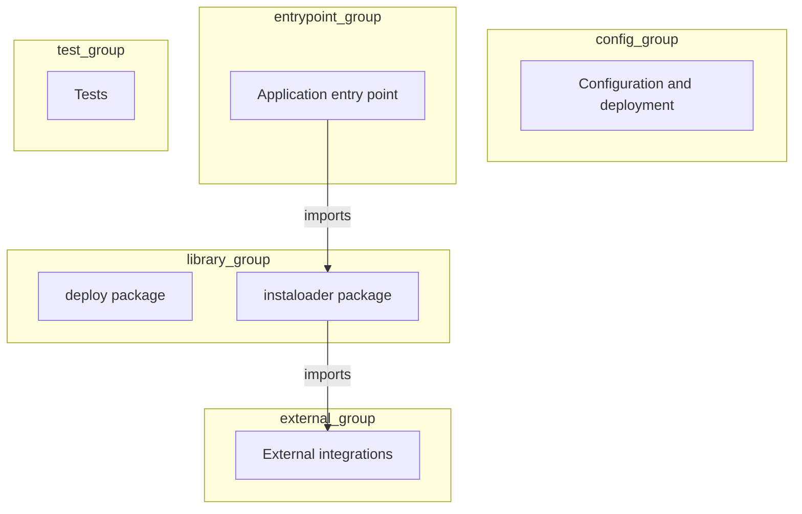

# Architecture report: instaloader/instaloader

> Automated static analysis. **Observed** = directly seen in files/imports/AST; **Inferred** = interpretation from that evidence. Repository code was not executed.

## 1. Repository at a glance

| Item | Value |
| --- | --- |
| Repository | instaloader/instaloader |
| Description | Download pictures (or videos) along with their captions and other metadata from Instagram. |
| Language | Python |
| Stars | 13891 |
| Licence | MIT |
| Analysed commit / branch | 7acd1b6a75d9964b6e7bf91c0769e172e2a64359 / master |
| Framework(s) | None detected |
| Files analysed | 71 |
| Components | 6 |

## 2. Architecture in one minute

instaloader/instaloader - Download pictures (or videos) along with their captions and other metadata from Instagram.. This repository was analysed statically from 71 file(s) (20 Python). Detected technologies (observed from imports/manifests): GitHub Actions, SQLite, requests, setuptools. Files are grouped into 6 component(s): Configuration and deployment, deploy package, Application entry point, External integrations, instaloader package, Tests. Observed entry point(s): instaloader.py, instaloader/__main__.py. Findings below distinguish observed facts from inferred interpretation.

## 3. High-level block diagram

## 4. Main components

### Configuration and deployment (`config`)

- **Kind:** config
- **Status:** Observed
- **Confidence:** 0.85
- **Responsibility:** Groups 2 file(s) under configuration and deployment (observed from repository paths and static analysis). Observed top-level functions: get_version.
- **Paths:** `Pipfile`, `setup.py`
- **Evidence:** [Pipfile](https://github.com/instaloader/instaloader/blob/7acd1b6a75d9964b6e7bf91c0769e172e2a64359/Pipfile); [setup.py:12](https://github.com/instaloader/instaloader/blob/7acd1b6a75d9964b6e7bf91c0769e172e2a64359/setup.py#L12)

### deploy package (`deploy`)

- **Kind:** library
- **Status:** Observed
- **Confidence:** 0.85
- **Responsibility:** Groups 2 file(s) under deploy package (observed from repository paths and static analysis).
- **Paths:** `deploy/arch/deploy.sh`, `deploy/windows/create_exe.py`
- **Evidence:** [deploy/arch/deploy.sh](https://github.com/instaloader/instaloader/blob/7acd1b6a75d9964b6e7bf91c0769e172e2a64359/deploy/arch/deploy.sh); [deploy/windows/create_exe.py](https://github.com/instaloader/instaloader/blob/7acd1b6a75d9964b6e7bf91c0769e172e2a64359/deploy/windows/create_exe.py)

### Application entry point (`entrypoint`)

- **Kind:** entrypoint
- **Status:** Observed
- **Confidence:** 0.85
- **Responsibility:** Groups 2 file(s) under application entry point (observed from repository paths and static analysis). Observed top-level classes: ExitCode. Observed top-level functions: _main, filterstr_to_filterfunc, get_cookies_from_instagram, http_status_code_list, import_session, main.
- **Paths:** `instaloader.py`, `instaloader/__main__.py`
- **Evidence:** [instaloader.py](https://github.com/instaloader/instaloader/blob/7acd1b6a75d9964b6e7bf91c0769e172e2a64359/instaloader.py); [instaloader/__main__.py:25](https://github.com/instaloader/instaloader/blob/7acd1b6a75d9964b6e7bf91c0769e172e2a64359/instaloader/__main__.py#L25)

### External integrations (`external_integrations`)

- **Kind:** external
- **Status:** Inferred
- **Confidence:** 0.70
- **Responsibility:** Groups 0 file(s) under external integrations (observed from repository paths and static analysis).
- **Evidence:** [docs/codesnippets/615_import_firefox_session.py:5](https://github.com/instaloader/instaloader/blob/7acd1b6a75d9964b6e7bf91c0769e172e2a64359/docs/codesnippets/615_import_firefox_session.py#L5); [instaloader/instaloader.py:18](https://github.com/instaloader/instaloader/blob/7acd1b6a75d9964b6e7bf91c0769e172e2a64359/instaloader/instaloader.py#L18); [instaloader/instaloader.py:19](https://github.com/instaloader/instaloader/blob/7acd1b6a75d9964b6e7bf91c0769e172e2a64359/instaloader/instaloader.py#L19); [instaloader/instaloadercontext.py:18](https://github.com/instaloader/instaloader/blob/7acd1b6a75d9964b6e7bf91c0769e172e2a64359/instaloader/instaloadercontext.py#L18); [instaloader/instaloadercontext.py:19](https://github.com/instaloader/instaloader/blob/7acd1b6a75d9964b6e7bf91c0769e172e2a64359/instaloader/instaloadercontext.py#L19)

### instaloader package (`instaloader`)

- **Kind:** library
- **Status:** Observed
- **Confidence:** 0.85
- **Responsibility:** Groups 8 file(s) under instaloader package (observed from repository paths and static analysis). Observed top-level classes: AbortDownloadException, BadCredentialsException, BadResponseException, ConnectionException, FrozenNodeIterator, Hashtag. Observed top-level functions: _embedded_query_data, _get_config_dir, _optional_normalize, _requires_login, _retry_on_connection_error, copy_session.
- **Paths:** `instaloader/__init__.py`, `instaloader/exceptions.py`, `instaloader/instaloader.py`, `instaloader/instaloadercontext.py`, `instaloader/lateststamps.py`, `instaloader/nodeiterator.py`, `instaloader/sectioniterator.py`, `instaloader/structures.py`
- **Evidence:** [instaloader/__init__.py](https://github.com/instaloader/instaloader/blob/7acd1b6a75d9964b6e7bf91c0769e172e2a64359/instaloader/__init__.py); [instaloader/exceptions.py:1](https://github.com/instaloader/instaloader/blob/7acd1b6a75d9964b6e7bf91c0769e172e2a64359/instaloader/exceptions.py#L1); [instaloader/instaloader.py:30](https://github.com/instaloader/instaloader/blob/7acd1b6a75d9964b6e7bf91c0769e172e2a64359/instaloader/instaloader.py#L30); [instaloader/instaloadercontext.py:24](https://github.com/instaloader/instaloader/blob/7acd1b6a75d9964b6e7bf91c0769e172e2a64359/instaloader/instaloadercontext.py#L24); [instaloader/lateststamps.py:8](https://github.com/instaloader/instaloader/blob/7acd1b6a75d9964b6e7bf91c0769e172e2a64359/instaloader/lateststamps.py#L8); [instaloader/nodeiterator.py:13](https://github.com/instaloader/instaloader/blob/7acd1b6a75d9964b6e7bf91c0769e172e2a64359/instaloader/nodeiterator.py#L13); [instaloader/sectioniterator.py:8](https://github.com/instaloader/instaloader/blob/7acd1b6a75d9964b6e7bf91c0769e172e2a64359/instaloader/sectioniterator.py#L8); [instaloader/structures.py:19](https://github.com/instaloader/instaloader/blob/7acd1b6a75d9964b6e7bf91c0769e172e2a64359/instaloader/structures.py#L19)

### Tests (`tests`)

- **Kind:** test
- **Status:** Observed
- **Confidence:** 0.85
- **Responsibility:** Groups 1 file(s) under tests (observed from repository paths and static analysis).
- **Paths:** `test/README.md`
- **Evidence:** [test/README.md](https://github.com/instaloader/instaloader/blob/7acd1b6a75d9964b6e7bf91c0769e172e2a64359/test/README.md)

## 5. Execution flow

**Observed** entry point(s):

- [instaloader.py:5](https://github.com/instaloader/instaloader/blob/7acd1b6a75d9964b6e7bf91c0769e172e2a64359/instaloader.py#L5)
- [instaloader/__main__.py](https://github.com/instaloader/instaloader/blob/7acd1b6a75d9964b6e7bf91c0769e172e2a64359/instaloader/__main__.py)

Representative flow (derived from observed entry points and the import graph; steps beyond the entry point are **Inferred**):

1. Execution starts at an observed entry point listed above, if present.
2. `entrypoint` imports `instaloader` (Application entry point -> instaloader package).
3. `instaloader` imports `external_integrations` (instaloader package -> External integrations).

## 6. Project structure

### `(root)`

- `.gitignore` - other (26 bytes)
- `.pylintrc` - other (21294 bytes)
- `AUTHORS.md` - docs (252 bytes)
- `CODE_OF_CONDUCT.md` - docs (5526 bytes)
- `LICENSE` - docs (1140 bytes)
- `Pipfile` - manifest (566 bytes)
- `README.rst` - docs (5502 bytes)
- `instaloader.py` - source, Python (101 bytes)
- `setup.py` - manifest, Python (2451 bytes)

### `.github`

- `.github/ISSUE_TEMPLATE/bug_report.md` - docs (787 bytes)
- `.github/ISSUE_TEMPLATE/config.yml` - config (494 bytes)
- `.github/ISSUE_TEMPLATE/feature_request.md` - docs (1064 bytes)
- `.github/ISSUE_TEMPLATE/question.md` - docs (628 bytes)
- `.github/dependabot.yml` - config (272 bytes)
- `.github/funding.yml` - config (73 bytes)
- `.github/pull_request_template.md` - docs (852 bytes)
- `.github/workflows/documentation.yml` - ci, YAML (1138 bytes)
- `.github/workflows/lint.yml` - ci, YAML (994 bytes)
- `.github/workflows/packages.yml` - ci, YAML (1167 bytes)
- `.github/workflows/stale.yml` - ci, YAML (1302 bytes)
- `.github/workflows/windows_exe.yml` - ci, YAML (1539 bytes)

### `deploy`

- `deploy/arch/.SRCINFO.template` - other (629 bytes)
- `deploy/arch/PKGBUILD.template` - other (868 bytes)
- `deploy/arch/deploy.sh` - source, Shell (1011 bytes)
- `deploy/windows/GPL-3.0.txt` - docs (35149 bytes)
- `deploy/windows/NOTICE.txt` - docs (1124 bytes)
- `deploy/windows/create_exe.py` - source, Python (3290 bytes)
- `deploy/windows/instaloader.spec` - other (789 bytes)

### `docs`

- `docs/.gitignore` - docs (8 bytes)
- `docs/Makefile` - docs (7830 bytes)
- `docs/README.md` - docs (366 bytes)
- `docs/_static/instaloaderdoc.css` - docs (78749 bytes)
- `docs/_static/instaloaderdoc.js` - docs (51960 bytes)
- `docs/_templates/layout.html` - docs (3314 bytes)
- `docs/_templates/page.html` - docs (217 bytes)
- `docs/_templates/search.html` - docs (919 bytes)
- `docs/as-module.rst` - docs (3213 bytes)
- `docs/basic-usage.rst` - docs (13416 bytes)
- `docs/cli-options.rst` - docs (12292 bytes)
- `docs/codesnippets.rst` - docs (4477 bytes)
- `docs/codesnippets/113_only_one_per_user.py` - docs (386 bytes)
- `docs/codesnippets/120_ghost_followers.py` - docs (712 bytes)
- `docs/codesnippets/121_since_until.py` - docs (416 bytes)
- `docs/codesnippets/194_top_x_of_user.py` - docs (577 bytes)
- `docs/codesnippets/56_track_deleted.py` - docs (1153 bytes)
- `docs/codesnippets/615_import_firefox_session.py` - docs (2287 bytes)
- `docs/codesnippets/666_historical_hashtag_data.py` - docs (762 bytes)
- `docs/codesnippets/README.md` - docs (140 bytes)
- `docs/conf.py` - docs (2564 bytes)
- `docs/contributing.rst` - docs (6259 bytes)
- `docs/index.rst` - docs (2745 bytes)
- `docs/installation.rst` - docs (1345 bytes)
- `docs/logo.svg` - docs (18936 bytes)
- `docs/module/exceptions.rst` - docs (1256 bytes)
- `docs/module/instaloader.rst` - docs (172 bytes)
- `docs/module/instaloadercontext.rst` - docs (415 bytes)
- `docs/module/nodeiterator.rst` - docs (948 bytes)
- `docs/module/structures.rst` - docs (1557 bytes)
- `docs/sponsors.rst` - docs (891 bytes)
- `docs/troubleshooting.rst` - docs (3534 bytes)

### `instaloader`

- `instaloader/__init__.py` - source, Python (1650 bytes)
- `instaloader/__main__.py` - source, Python (36663 bytes)
- `instaloader/exceptions.py` - source, Python (1574 bytes)
- `instaloader/instaloader.py` - source, Python (85556 bytes)
- `instaloader/instaloadercontext.py` - source, Python (53398 bytes)
- `instaloader/lateststamps.py` - source, Python (5440 bytes)
- `instaloader/nodeiterator.py` - source, Python (15744 bytes)
- `instaloader/py.typed` - other (0 bytes)
- `instaloader/sectioniterator.py` - source, Python (1894 bytes)
- `instaloader/structures.py` - source, Python (103624 bytes)

### `test`

- `test/README.md` - test (164 bytes)

## 7. Key dependencies and integrations

| Name | Category | Status | Confidence | Evidence |
| --- | --- | --- | --- | --- |
| GitHub Actions | ci | Observed | 0.90 | [.github/workflows/documentation.yml](https://github.com/instaloader/instaloader/blob/7acd1b6a75d9964b6e7bf91c0769e172e2a64359/.github/workflows/documentation.yml); [.github/workflows/lint.yml](https://github.com/instaloader/instaloader/blob/7acd1b6a75d9964b6e7bf91c0769e172e2a64359/.github/workflows/lint.yml); [.github/workflows/packages.yml](https://github.com/instaloader/instaloader/blob/7acd1b6a75d9964b6e7bf91c0769e172e2a64359/.github/workflows/packages.yml); [.github/workflows/stale.yml](https://github.com/instaloader/instaloader/blob/7acd1b6a75d9964b6e7bf91c0769e172e2a64359/.github/workflows/stale.yml) |
| SQLite | database | Observed | 0.90 | [docs/codesnippets/615_import_firefox_session.py:5](https://github.com/instaloader/instaloader/blob/7acd1b6a75d9964b6e7bf91c0769e172e2a64359/docs/codesnippets/615_import_firefox_session.py#L5) |
| requests | library | Observed | 0.95 | [Pipfile:12](https://github.com/instaloader/instaloader/blob/7acd1b6a75d9964b6e7bf91c0769e172e2a64359/Pipfile#L12); [instaloader/instaloader.py:18](https://github.com/instaloader/instaloader/blob/7acd1b6a75d9964b6e7bf91c0769e172e2a64359/instaloader/instaloader.py#L18); [instaloader/instaloadercontext.py:18](https://github.com/instaloader/instaloader/blob/7acd1b6a75d9964b6e7bf91c0769e172e2a64359/instaloader/instaloadercontext.py#L18); [instaloader/instaloadercontext.py:19](https://github.com/instaloader/instaloader/blob/7acd1b6a75d9964b6e7bf91c0769e172e2a64359/instaloader/instaloadercontext.py#L19) |
| setuptools | packaging | Observed | 0.90 | [setup.py:6](https://github.com/instaloader/instaloader/blob/7acd1b6a75d9964b6e7bf91c0769e172e2a64359/setup.py#L6) |

## 8. Data and state

- **SQLite** (Observed, confidence 0.90) - evidence: [docs/codesnippets/615_import_firefox_session.py:5](https://github.com/instaloader/instaloader/blob/7acd1b6a75d9964b6e7bf91c0769e172e2a64359/docs/codesnippets/615_import_firefox_session.py#L5)

## 9. Configuration and deployment clues

- `.github/ISSUE_TEMPLATE/config.yml` (config)
- `.github/dependabot.yml` (config)
- `.github/funding.yml` (config)
- `.github/workflows/documentation.yml` (ci)
- `.github/workflows/lint.yml` (ci)
- `.github/workflows/packages.yml` (ci)
- `.github/workflows/stale.yml` (ci)
- `.github/workflows/windows_exe.yml` (ci)
- `Pipfile` (manifest)
- `setup.py` (manifest)

Console scripts declared in packaging metadata (**Observed**):

- `instaloader` -> `instaloader.__main__:main`

## 10. Design observations

- An entry/API layer is separated from other code (Inferred from paths and decorators).
- Tests are present alongside source code (Observed from test file paths).
- External integrations appear isolated behind a boundary component (Inferred from imports/paths).

These observations are interpretations (**Inferred**) of the observed structure, not guarantees about runtime design.

## 11. Limitations and unknowns

- Static analysis only: repository code was not executed, installed, or imported at runtime.
- Components and relationships are inferred from file paths, imports, and AST structure; runtime behaviour, dynamic imports, and reflection may not be visible.
- 1 file(s) were skipped during inventory (1 x lockfile excluded).
- Repository text was treated as untrusted data; no instructions found in repository files were followed, and likely secret values were redacted/excluded.

## 12. Source references

- [.github/workflows/documentation.yml](https://github.com/instaloader/instaloader/blob/7acd1b6a75d9964b6e7bf91c0769e172e2a64359/.github/workflows/documentation.yml)
- [.github/workflows/lint.yml](https://github.com/instaloader/instaloader/blob/7acd1b6a75d9964b6e7bf91c0769e172e2a64359/.github/workflows/lint.yml)
- [.github/workflows/packages.yml](https://github.com/instaloader/instaloader/blob/7acd1b6a75d9964b6e7bf91c0769e172e2a64359/.github/workflows/packages.yml)
- [.github/workflows/stale.yml](https://github.com/instaloader/instaloader/blob/7acd1b6a75d9964b6e7bf91c0769e172e2a64359/.github/workflows/stale.yml)
- [.github/workflows/windows_exe.yml](https://github.com/instaloader/instaloader/blob/7acd1b6a75d9964b6e7bf91c0769e172e2a64359/.github/workflows/windows_exe.yml)
- [Pipfile](https://github.com/instaloader/instaloader/blob/7acd1b6a75d9964b6e7bf91c0769e172e2a64359/Pipfile)
- [Pipfile:12](https://github.com/instaloader/instaloader/blob/7acd1b6a75d9964b6e7bf91c0769e172e2a64359/Pipfile#L12)
- [deploy/arch/deploy.sh](https://github.com/instaloader/instaloader/blob/7acd1b6a75d9964b6e7bf91c0769e172e2a64359/deploy/arch/deploy.sh)
- [deploy/windows/create_exe.py](https://github.com/instaloader/instaloader/blob/7acd1b6a75d9964b6e7bf91c0769e172e2a64359/deploy/windows/create_exe.py)
- [docs/codesnippets/615_import_firefox_session.py:5](https://github.com/instaloader/instaloader/blob/7acd1b6a75d9964b6e7bf91c0769e172e2a64359/docs/codesnippets/615_import_firefox_session.py#L5)
- [instaloader.py](https://github.com/instaloader/instaloader/blob/7acd1b6a75d9964b6e7bf91c0769e172e2a64359/instaloader.py)
- [instaloader.py:5](https://github.com/instaloader/instaloader/blob/7acd1b6a75d9964b6e7bf91c0769e172e2a64359/instaloader.py#L5)
- [instaloader/__init__.py](https://github.com/instaloader/instaloader/blob/7acd1b6a75d9964b6e7bf91c0769e172e2a64359/instaloader/__init__.py)
- [instaloader/__main__.py](https://github.com/instaloader/instaloader/blob/7acd1b6a75d9964b6e7bf91c0769e172e2a64359/instaloader/__main__.py)
- [instaloader/__main__.py:25](https://github.com/instaloader/instaloader/blob/7acd1b6a75d9964b6e7bf91c0769e172e2a64359/instaloader/__main__.py#L25)
- [instaloader/exceptions.py:1](https://github.com/instaloader/instaloader/blob/7acd1b6a75d9964b6e7bf91c0769e172e2a64359/instaloader/exceptions.py#L1)
- [instaloader/instaloader.py:18](https://github.com/instaloader/instaloader/blob/7acd1b6a75d9964b6e7bf91c0769e172e2a64359/instaloader/instaloader.py#L18)
- [instaloader/instaloader.py:19](https://github.com/instaloader/instaloader/blob/7acd1b6a75d9964b6e7bf91c0769e172e2a64359/instaloader/instaloader.py#L19)
- [instaloader/instaloader.py:30](https://github.com/instaloader/instaloader/blob/7acd1b6a75d9964b6e7bf91c0769e172e2a64359/instaloader/instaloader.py#L30)
- [instaloader/instaloadercontext.py:18](https://github.com/instaloader/instaloader/blob/7acd1b6a75d9964b6e7bf91c0769e172e2a64359/instaloader/instaloadercontext.py#L18)
- [instaloader/instaloadercontext.py:19](https://github.com/instaloader/instaloader/blob/7acd1b6a75d9964b6e7bf91c0769e172e2a64359/instaloader/instaloadercontext.py#L19)
- [instaloader/instaloadercontext.py:24](https://github.com/instaloader/instaloader/blob/7acd1b6a75d9964b6e7bf91c0769e172e2a64359/instaloader/instaloadercontext.py#L24)
- [instaloader/lateststamps.py:8](https://github.com/instaloader/instaloader/blob/7acd1b6a75d9964b6e7bf91c0769e172e2a64359/instaloader/lateststamps.py#L8)
- [instaloader/nodeiterator.py:13](https://github.com/instaloader/instaloader/blob/7acd1b6a75d9964b6e7bf91c0769e172e2a64359/instaloader/nodeiterator.py#L13)
- [instaloader/sectioniterator.py:8](https://github.com/instaloader/instaloader/blob/7acd1b6a75d9964b6e7bf91c0769e172e2a64359/instaloader/sectioniterator.py#L8)
- [instaloader/structures.py:19](https://github.com/instaloader/instaloader/blob/7acd1b6a75d9964b6e7bf91c0769e172e2a64359/instaloader/structures.py#L19)
- [setup.py:6](https://github.com/instaloader/instaloader/blob/7acd1b6a75d9964b6e7bf91c0769e172e2a64359/setup.py#L6)
- [setup.py:12](https://github.com/instaloader/instaloader/blob/7acd1b6a75d9964b6e7bf91c0769e172e2a64359/setup.py#L12)
- [setup.py:24](https://github.com/instaloader/instaloader/blob/7acd1b6a75d9964b6e7bf91c0769e172e2a64359/setup.py#L24)
- [test/README.md](https://github.com/instaloader/instaloader/blob/7acd1b6a75d9964b6e7bf91c0769e172e2a64359/test/README.md)
