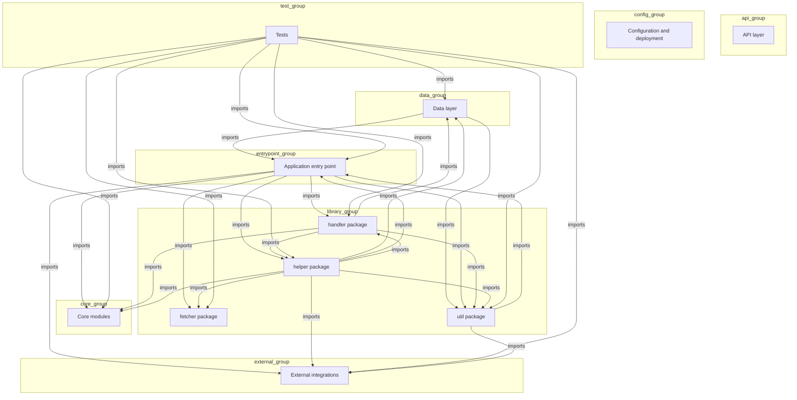

# Architecture report: jhao104/proxy_pool

> Automated static analysis. **Observed** = directly seen in files/imports/AST; **Inferred** = interpretation from that evidence. Repository code was not executed.

## 1. Repository at a glance

| Item | Value |
| --- | --- |
| Repository | jhao104/proxy_pool |
| Description | Python ProxyPool for web spider |
| Language | Python |
| Stars | 23793 |
| Licence | MIT |
| Analysed commit / branch | 9cc0cad4c47e84e34aaec2eead099421960dcd07 / master |
| Framework(s) | Flask |
| Files analysed | 91 |
| Components | 11 |

## 2. Architecture in one minute

jhao104/proxy_pool - Python ProxyPool for web spider. This repository was analysed statically from 91 file(s) (63 Python). Detected technologies (observed from imports/manifests): GitHub Actions, Redis, Flask, Click, Gunicorn, requests. Files are grouped into 11 component(s): API layer, Configuration and deployment, Core modules, Data layer, Application entry point, External integrations, fetcher package, handler package. Observed entry point(s): api/proxyApi.py, fetcher/sources/daili66.py, fetcher/sources/docip.py. Findings below distinguish observed facts from inferred interpretation.

## 3. High-level block diagram

## 4. Main components

### API layer (`api_layer`)

- **Kind:** api
- **Status:** Observed
- **Confidence:** 0.85
- **Responsibility:** Groups 1 file(s) under api layer (observed from repository paths and static analysis).
- **Paths:** `api/__init__.py`
- **Evidence:** [api/__init__.py](https://github.com/jhao104/proxy_pool/blob/9cc0cad4c47e84e34aaec2eead099421960dcd07/api/__init__.py)

### Configuration and deployment (`config`)

- **Kind:** config
- **Status:** Observed
- **Confidence:** 0.85
- **Responsibility:** Groups 8 file(s) under configuration and deployment (observed from repository paths and static analysis).
- **Paths:** `Dockerfile`, `_config.yml`, `docker-compose.yml`, `mkdocs.yml`, `pyproject.toml`, `requirements-test.txt`, `requirements.txt`, `tox.ini`
- **Evidence:** [Dockerfile](https://github.com/jhao104/proxy_pool/blob/9cc0cad4c47e84e34aaec2eead099421960dcd07/Dockerfile); [_config.yml](https://github.com/jhao104/proxy_pool/blob/9cc0cad4c47e84e34aaec2eead099421960dcd07/_config.yml); [docker-compose.yml](https://github.com/jhao104/proxy_pool/blob/9cc0cad4c47e84e34aaec2eead099421960dcd07/docker-compose.yml); [mkdocs.yml](https://github.com/jhao104/proxy_pool/blob/9cc0cad4c47e84e34aaec2eead099421960dcd07/mkdocs.yml); [pyproject.toml](https://github.com/jhao104/proxy_pool/blob/9cc0cad4c47e84e34aaec2eead099421960dcd07/pyproject.toml); [requirements-test.txt](https://github.com/jhao104/proxy_pool/blob/9cc0cad4c47e84e34aaec2eead099421960dcd07/requirements-test.txt); [requirements.txt](https://github.com/jhao104/proxy_pool/blob/9cc0cad4c47e84e34aaec2eead099421960dcd07/requirements.txt); [tox.ini](https://github.com/jhao104/proxy_pool/blob/9cc0cad4c47e84e34aaec2eead099421960dcd07/tox.ini)

### Core modules (`core`)

- **Kind:** core
- **Status:** Observed
- **Confidence:** 0.85
- **Responsibility:** Groups 2 file(s) under core modules (observed from repository paths and static analysis).
- **Paths:** `proxy_pool.sh`, `setting.py`
- **Evidence:** [proxy_pool.sh](https://github.com/jhao104/proxy_pool/blob/9cc0cad4c47e84e34aaec2eead099421960dcd07/proxy_pool.sh); [setting.py](https://github.com/jhao104/proxy_pool/blob/9cc0cad4c47e84e34aaec2eead099421960dcd07/setting.py)

### Data layer (`data_layer`)

- **Kind:** data
- **Status:** Observed
- **Confidence:** 0.85
- **Responsibility:** Groups 4 file(s) under data layer (observed from repository paths and static analysis). Observed top-level classes: DbClient, RedisClient, SsdbClient.
- **Paths:** `db/__init__.py`, `db/dbClient.py`, `db/redisClient.py`, `db/ssdbClient.py`
- **Evidence:** [db/__init__.py](https://github.com/jhao104/proxy_pool/blob/9cc0cad4c47e84e34aaec2eead099421960dcd07/db/__init__.py); [db/dbClient.py:26](https://github.com/jhao104/proxy_pool/blob/9cc0cad4c47e84e34aaec2eead099421960dcd07/db/dbClient.py#L26); [db/redisClient.py:25](https://github.com/jhao104/proxy_pool/blob/9cc0cad4c47e84e34aaec2eead099421960dcd07/db/redisClient.py#L25); [db/ssdbClient.py:27](https://github.com/jhao104/proxy_pool/blob/9cc0cad4c47e84e34aaec2eead099421960dcd07/db/ssdbClient.py#L27)

### Application entry point (`entrypoint`)

- **Kind:** entrypoint
- **Status:** Observed
- **Confidence:** 0.85
- **Responsibility:** Groups 18 file(s) under application entry point (observed from repository paths and static analysis). Observed application object created via Flask. Observed routes: ROUTE /, ROUTE /get/, ROUTE /pop/, ROUTE /refresh/, ROUTE /all/. Observed top-level classes: DaiLi66Fetcher, DocipFetcher, FreeVPNNodeFetcher, GeonodeFetcher, GoodipsFetcher, IhuanFetcher. Observed top-level functions: __runProxyCheck, __runProxyFetch, cli, delete, fetcher, get.
- **Paths:** `api/proxyApi.py`, `fetcher/sources/daili66.py`, `fetcher/sources/docip.py`, `fetcher/sources/freevpnnode.py`, `fetcher/sources/geonode.py`, `fetcher/sources/goodips.py`, `fetcher/sources/ihuan.py`, `fetcher/sources/ip3366.py`, `fetcher/sources/ip89.py`, `fetcher/sources/kuaidaili.py`, `fetcher/sources/kxdaili.py`, `fetcher/sources/proxifly.py`, `fetcher/sources/roundproxies.py`, `fetcher/sources/scdn.py`, `fetcher/sources/zdaye.py`, `handler/logHandler.py`, `helper/scheduler.py`, `proxyPool.py`
- **Evidence:** [api/proxyApi.py:28](https://github.com/jhao104/proxy_pool/blob/9cc0cad4c47e84e34aaec2eead099421960dcd07/api/proxyApi.py#L28); [fetcher/sources/daili66.py:21](https://github.com/jhao104/proxy_pool/blob/9cc0cad4c47e84e34aaec2eead099421960dcd07/fetcher/sources/daili66.py#L21); [fetcher/sources/docip.py:22](https://github.com/jhao104/proxy_pool/blob/9cc0cad4c47e84e34aaec2eead099421960dcd07/fetcher/sources/docip.py#L22); [fetcher/sources/freevpnnode.py:21](https://github.com/jhao104/proxy_pool/blob/9cc0cad4c47e84e34aaec2eead099421960dcd07/fetcher/sources/freevpnnode.py#L21); [fetcher/sources/geonode.py:22](https://github.com/jhao104/proxy_pool/blob/9cc0cad4c47e84e34aaec2eead099421960dcd07/fetcher/sources/geonode.py#L22); [fetcher/sources/goodips.py:19](https://github.com/jhao104/proxy_pool/blob/9cc0cad4c47e84e34aaec2eead099421960dcd07/fetcher/sources/goodips.py#L19); [fetcher/sources/ihuan.py:22](https://github.com/jhao104/proxy_pool/blob/9cc0cad4c47e84e34aaec2eead099421960dcd07/fetcher/sources/ihuan.py#L22); [fetcher/sources/ip3366.py:21](https://github.com/jhao104/proxy_pool/blob/9cc0cad4c47e84e34aaec2eead099421960dcd07/fetcher/sources/ip3366.py#L21)

### External integrations (`external_integrations`)

- **Kind:** external
- **Status:** Inferred
- **Confidence:** 0.70
- **Responsibility:** Groups 0 file(s) under external integrations (observed from repository paths and static analysis).
- **Evidence:** [db/redisClient.py:17](https://github.com/jhao104/proxy_pool/blob/9cc0cad4c47e84e34aaec2eead099421960dcd07/db/redisClient.py#L17); [db/redisClient.py:18](https://github.com/jhao104/proxy_pool/blob/9cc0cad4c47e84e34aaec2eead099421960dcd07/db/redisClient.py#L18); [db/redisClient.py:21](https://github.com/jhao104/proxy_pool/blob/9cc0cad4c47e84e34aaec2eead099421960dcd07/db/redisClient.py#L21); [db/ssdbClient.py:19](https://github.com/jhao104/proxy_pool/blob/9cc0cad4c47e84e34aaec2eead099421960dcd07/db/ssdbClient.py#L19); [db/ssdbClient.py:20](https://github.com/jhao104/proxy_pool/blob/9cc0cad4c47e84e34aaec2eead099421960dcd07/db/ssdbClient.py#L20); [db/ssdbClient.py:23](https://github.com/jhao104/proxy_pool/blob/9cc0cad4c47e84e34aaec2eead099421960dcd07/db/ssdbClient.py#L23)

### fetcher package (`fetcher`)

- **Kind:** library
- **Status:** Observed
- **Confidence:** 0.85
- **Responsibility:** Groups 3 file(s) under fetcher package (observed from repository paths and static analysis). Observed top-level classes: BaseFetcher.
- **Paths:** `fetcher/__init__.py`, `fetcher/baseFetcher.py`, `fetcher/sources/__init__.py`
- **Evidence:** [fetcher/__init__.py](https://github.com/jhao104/proxy_pool/blob/9cc0cad4c47e84e34aaec2eead099421960dcd07/fetcher/__init__.py); [fetcher/baseFetcher.py:18](https://github.com/jhao104/proxy_pool/blob/9cc0cad4c47e84e34aaec2eead099421960dcd07/fetcher/baseFetcher.py#L18); [fetcher/sources/__init__.py](https://github.com/jhao104/proxy_pool/blob/9cc0cad4c47e84e34aaec2eead099421960dcd07/fetcher/sources/__init__.py)

### handler package (`handler`)

- **Kind:** library
- **Status:** Observed
- **Confidence:** 0.85
- **Responsibility:** Groups 3 file(s) under handler package (observed from repository paths and static analysis). Observed top-level classes: ConfigHandler, ProxyHandler.
- **Paths:** `handler/__init__.py`, `handler/configHandler.py`, `handler/proxyHandler.py`
- **Evidence:** [handler/__init__.py](https://github.com/jhao104/proxy_pool/blob/9cc0cad4c47e84e34aaec2eead099421960dcd07/handler/__init__.py); [handler/configHandler.py:22](https://github.com/jhao104/proxy_pool/blob/9cc0cad4c47e84e34aaec2eead099421960dcd07/handler/configHandler.py#L22); [handler/proxyHandler.py:21](https://github.com/jhao104/proxy_pool/blob/9cc0cad4c47e84e34aaec2eead099421960dcd07/handler/proxyHandler.py#L21)

### helper package (`helper`)

- **Kind:** library
- **Status:** Observed
- **Confidence:** 0.85
- **Responsibility:** Groups 6 file(s) under helper package (observed from repository paths and static analysis). Observed top-level classes: DoValidator, Fetcher, Proxy, ProxyValidator, _ThreadChecker, _ThreadFetcher. Observed top-level functions: Checker, __beforeStart, __checkDBConfig, __showConfigure, __showVersion, _discover_fetchers.
- **Paths:** `helper/__init__.py`, `helper/check.py`, `helper/fetch.py`, `helper/launcher.py`, `helper/proxy.py`, `helper/validator.py`
- **Evidence:** [helper/__init__.py](https://github.com/jhao104/proxy_pool/blob/9cc0cad4c47e84e34aaec2eead099421960dcd07/helper/__init__.py); [helper/check.py:27](https://github.com/jhao104/proxy_pool/blob/9cc0cad4c47e84e34aaec2eead099421960dcd07/helper/check.py#L27); [helper/fetch.py:33](https://github.com/jhao104/proxy_pool/blob/9cc0cad4c47e84e34aaec2eead099421960dcd07/helper/fetch.py#L33); [helper/launcher.py:23](https://github.com/jhao104/proxy_pool/blob/9cc0cad4c47e84e34aaec2eead099421960dcd07/helper/launcher.py#L23); [helper/proxy.py:18](https://github.com/jhao104/proxy_pool/blob/9cc0cad4c47e84e34aaec2eead099421960dcd07/helper/proxy.py#L18); [helper/validator.py:31](https://github.com/jhao104/proxy_pool/blob/9cc0cad4c47e84e34aaec2eead099421960dcd07/helper/validator.py#L31)

### Tests (`tests`)

- **Kind:** test
- **Status:** Observed
- **Confidence:** 0.85
- **Responsibility:** Groups 22 file(s) under tests (observed from repository paths and static analysis). Observed routes: PATCH api.proxyApi.platform, PATCH api.proxyApi.app, PATCH helper.check.ConfigHandler, PATCH helper.check.ProxyValidator, PATCH helper.check.ConfigHandler. Observed top-level classes: TestAll, TestBaseFetcherInterface, TestBeforeStart, TestCheckDBConfig, TestCli, TestConfigHandlerDefaults. Observed top-level functions: _assert_valid_proxies, _get_attr, _html_table, _make_checker, _make_handler, _make_proxy.
- **Paths:** `tests/__init__.py`, `tests/api/__init__.py`, `tests/api/test_proxy_api.py`, `tests/conftest.py`, `tests/integration/__init__.py`, `tests/integration/test_redis_client.py`, `tests/integration/test_ssdb_client.py`, `tests/unit/__init__.py`, `tests/unit/test_base_fetcher.py`, `tests/unit/test_check.py`, `tests/unit/test_cli.py`, `tests/unit/test_config.py`, `tests/unit/test_db_client.py`, `tests/unit/test_fetch.py`, `tests/unit/test_fetcher_sources.py`, `tests/unit/test_launcher.py`, `tests/unit/test_log_handler.py`, `tests/unit/test_proxy.py`, `tests/unit/test_proxy_handler.py`, `tests/unit/test_scheduler.py`, `tests/unit/test_validator.py`, `tests/unit/test_web_request.py`
- **Evidence:** [tests/__init__.py](https://github.com/jhao104/proxy_pool/blob/9cc0cad4c47e84e34aaec2eead099421960dcd07/tests/__init__.py); [tests/api/__init__.py](https://github.com/jhao104/proxy_pool/blob/9cc0cad4c47e84e34aaec2eead099421960dcd07/tests/api/__init__.py); [tests/api/test_proxy_api.py:22](https://github.com/jhao104/proxy_pool/blob/9cc0cad4c47e84e34aaec2eead099421960dcd07/tests/api/test_proxy_api.py#L22); [tests/conftest.py:32](https://github.com/jhao104/proxy_pool/blob/9cc0cad4c47e84e34aaec2eead099421960dcd07/tests/conftest.py#L32); [tests/integration/__init__.py](https://github.com/jhao104/proxy_pool/blob/9cc0cad4c47e84e34aaec2eead099421960dcd07/tests/integration/__init__.py); [tests/integration/test_redis_client.py:24](https://github.com/jhao104/proxy_pool/blob/9cc0cad4c47e84e34aaec2eead099421960dcd07/tests/integration/test_redis_client.py#L24); [tests/integration/test_ssdb_client.py:23](https://github.com/jhao104/proxy_pool/blob/9cc0cad4c47e84e34aaec2eead099421960dcd07/tests/integration/test_ssdb_client.py#L23); [tests/unit/__init__.py](https://github.com/jhao104/proxy_pool/blob/9cc0cad4c47e84e34aaec2eead099421960dcd07/tests/unit/__init__.py)

### util package (`util`)

- **Kind:** library
- **Status:** Observed
- **Confidence:** 0.85
- **Responsibility:** Groups 5 file(s) under util package (observed from repository paths and static analysis). Observed top-level classes: LazyProperty, Singleton, WebRequest. Observed top-level functions: withMetaclass.
- **Paths:** `util/__init__.py`, `util/lazyProperty.py`, `util/singleton.py`, `util/six.py`, `util/webRequest.py`
- **Evidence:** [util/__init__.py](https://github.com/jhao104/proxy_pool/blob/9cc0cad4c47e84e34aaec2eead099421960dcd07/util/__init__.py); [util/lazyProperty.py:16](https://github.com/jhao104/proxy_pool/blob/9cc0cad4c47e84e34aaec2eead099421960dcd07/util/lazyProperty.py#L16); [util/singleton.py:16](https://github.com/jhao104/proxy_pool/blob/9cc0cad4c47e84e34aaec2eead099421960dcd07/util/singleton.py#L16); [util/six.py:46](https://github.com/jhao104/proxy_pool/blob/9cc0cad4c47e84e34aaec2eead099421960dcd07/util/six.py#L46); [util/webRequest.py:26](https://github.com/jhao104/proxy_pool/blob/9cc0cad4c47e84e34aaec2eead099421960dcd07/util/webRequest.py#L26)

## 5. Execution flow

**Observed** entry point(s):

- [api/proxyApi.py:28](https://github.com/jhao104/proxy_pool/blob/9cc0cad4c47e84e34aaec2eead099421960dcd07/api/proxyApi.py#L28)
- [fetcher/sources/daili66.py:40](https://github.com/jhao104/proxy_pool/blob/9cc0cad4c47e84e34aaec2eead099421960dcd07/fetcher/sources/daili66.py#L40)
- [fetcher/sources/docip.py:37](https://github.com/jhao104/proxy_pool/blob/9cc0cad4c47e84e34aaec2eead099421960dcd07/fetcher/sources/docip.py#L37)
- [fetcher/sources/freevpnnode.py:44](https://github.com/jhao104/proxy_pool/blob/9cc0cad4c47e84e34aaec2eead099421960dcd07/fetcher/sources/freevpnnode.py#L44)
- [fetcher/sources/geonode.py:47](https://github.com/jhao104/proxy_pool/blob/9cc0cad4c47e84e34aaec2eead099421960dcd07/fetcher/sources/geonode.py#L47)
- [fetcher/sources/goodips.py:35](https://github.com/jhao104/proxy_pool/blob/9cc0cad4c47e84e34aaec2eead099421960dcd07/fetcher/sources/goodips.py#L35)
- [fetcher/sources/ihuan.py:43](https://github.com/jhao104/proxy_pool/blob/9cc0cad4c47e84e34aaec2eead099421960dcd07/fetcher/sources/ihuan.py#L43)
- [fetcher/sources/ip3366.py:41](https://github.com/jhao104/proxy_pool/blob/9cc0cad4c47e84e34aaec2eead099421960dcd07/fetcher/sources/ip3366.py#L41)
- [fetcher/sources/ip89.py:36](https://github.com/jhao104/proxy_pool/blob/9cc0cad4c47e84e34aaec2eead099421960dcd07/fetcher/sources/ip89.py#L36)
- [fetcher/sources/kuaidaili.py:45](https://github.com/jhao104/proxy_pool/blob/9cc0cad4c47e84e34aaec2eead099421960dcd07/fetcher/sources/kuaidaili.py#L45)
- [fetcher/sources/kxdaili.py:38](https://github.com/jhao104/proxy_pool/blob/9cc0cad4c47e84e34aaec2eead099421960dcd07/fetcher/sources/kxdaili.py#L38)
- [fetcher/sources/proxifly.py:40](https://github.com/jhao104/proxy_pool/blob/9cc0cad4c47e84e34aaec2eead099421960dcd07/fetcher/sources/proxifly.py#L40)

**Observed** routes (from decorators):

- `ROUTE /` -> `index` in `api/proxyApi.py:55`
- `ROUTE /get/` -> `get` in `api/proxyApi.py:60`
- `ROUTE /pop/` -> `pop` in `api/proxyApi.py:67`
- `ROUTE /refresh/` -> `refresh` in `api/proxyApi.py:74`
- `ROUTE /all/` -> `getAll` in `api/proxyApi.py:80`
- `ROUTE /delete/` -> `delete` in `api/proxyApi.py:87`
- `ROUTE /count/` -> `getCount` in `api/proxyApi.py:94`
- `PATCH api.proxyApi.platform` -> `test_runflask_windows_path` in `tests/api/test_proxy_api.py:186`
- `PATCH api.proxyApi.app` -> `test_runflask_windows_path` in `tests/api/test_proxy_api.py:186`
- `PATCH helper.check.ConfigHandler` -> `test_validator_http_pass_https_pass` in `tests/unit/test_check.py:28`
- `PATCH helper.check.ProxyValidator` -> `test_validator_http_pass_https_pass` in `tests/unit/test_check.py:28`
- `PATCH helper.check.ConfigHandler` -> `test_validator_http_pass_https_fail` in `tests/unit/test_check.py:54`
- `PATCH helper.check.ProxyValidator` -> `test_validator_http_pass_https_fail` in `tests/unit/test_check.py:54`
- `PATCH helper.check.ConfigHandler` -> `test_validator_http_fail` in `tests/unit/test_check.py:72`
- `PATCH helper.check.ProxyValidator` -> `test_validator_http_fail` in `tests/unit/test_check.py:72`
- `PATCH helper.check.ConfigHandler` -> `test_validator_fail_count_decrement` in `tests/unit/test_check.py:90`
- `PATCH helper.check.ProxyValidator` -> `test_validator_fail_count_decrement` in `tests/unit/test_check.py:90`
- `PATCH helper.check.DoValidator.regionGetter` -> `test_validator_raw_sets_region` in `tests/unit/test_check.py:109`
- `PATCH helper.check.ConfigHandler` -> `test_validator_raw_sets_region` in `tests/unit/test_check.py:109`
- `PATCH helper.check.ProxyValidator` -> `test_validator_raw_sets_region` in `tests/unit/test_check.py:109`
- `PATCH helper.check.DoValidator.regionGetter` -> `test_validator_use_skips_region` in `tests/unit/test_check.py:128`
- `PATCH helper.check.ConfigHandler` -> `test_validator_use_skips_region` in `tests/unit/test_check.py:128`
- `PATCH helper.check.ProxyValidator` -> `test_validator_use_skips_region` in `tests/unit/test_check.py:128`
- `PATCH helper.check.WebRequest` -> `test_success_returns_country_code` in `tests/unit/test_check.py:148`
- `PATCH helper.check.WebRequest` -> `test_exception_returns_error` in `tests/unit/test_check.py:159`
- `PATCH proxyPool.startScheduler` -> `test_schedule_command` in `tests/unit/test_cli.py:37`
- `PATCH proxyPool.startServer` -> `test_server_command` in `tests/unit/test_cli.py:44`
- `PATCH handler.configHandler.ConfigHandler` -> `test_fetcher_command` in `tests/unit/test_cli.py:52`
- `PATCH helper.fetch._discover_fetchers` -> `test_fetcher_command` in `tests/unit/test_cli.py:52`
- `PATCH db.dbClient.DbClient.parseDbConn` -> `test_redis_init` in `tests/unit/test_db_client.py:70`
- `PATCH db.dbClient.DbClient.parseDbConn` -> `test_ssdb_init` in `tests/unit/test_db_client.py:79`
- `PATCH helper.fetch.os.path.getmtime` -> `test_import_exception_returns_none` in `tests/unit/test_fetch.py:67`
- `PATCH helper.fetch.importlib` -> `test_import_exception_returns_none` in `tests/unit/test_fetch.py:67`
- `PATCH fetcher.sources.kxdaili.WebRequest` -> `test_fetch` in `tests/unit/test_fetcher_sources.py:101`
- `PATCH fetcher.sources.ip3366.WebRequest` -> `test_fetch` in `tests/unit/test_fetcher_sources.py:114`
- `PATCH fetcher.sources.ip89.WebRequest` -> `test_fetch` in `tests/unit/test_fetcher_sources.py:126`
- `PATCH fetcher.sources.docip.WebRequest` -> `test_fetch` in `tests/unit/test_fetcher_sources.py:137`
- `PATCH fetcher.sources.goodips.WebRequest` -> `test_fetch` in `tests/unit/test_fetcher_sources.py:149`
- `PATCH fetcher.sources.geonode.WebRequest` -> `test_fetch_json` in `tests/unit/test_fetcher_sources.py:161`
- `PATCH fetcher.sources.geonode.WebRequest` -> `test_fetch_text_fallback` in `tests/unit/test_fetcher_sources.py:169`
- `PATCH fetcher.sources.kuaidaili.WebRequest` -> `test_fetch` in `tests/unit/test_fetcher_sources.py:181`
- `PATCH fetcher.sources.kuaidaili.sleep` -> `test_fetch` in `tests/unit/test_fetcher_sources.py:181`
- `PATCH fetcher.sources.freevpnnode.WebRequest` -> `test_fetch` in `tests/unit/test_fetcher_sources.py:194`
- `PATCH fetcher.sources.scdn.WebRequest` -> `test_fetch_json` in `tests/unit/test_fetcher_sources.py:208`
- `PATCH fetcher.sources.scdn.WebRequest` -> `test_fetch_table_html` in `tests/unit/test_fetcher_sources.py:216`
- `PATCH fetcher.sources.zdaye.WebRequest` -> `test_fetch_recent` in `tests/unit/test_fetcher_sources.py:230`
- `PATCH fetcher.sources.zdaye.sleep` -> `test_fetch_recent` in `tests/unit/test_fetcher_sources.py:230`
- `PATCH fetcher.sources.zdaye.datetime` -> `test_fetch_recent` in `tests/unit/test_fetcher_sources.py:230`
- `PATCH fetcher.sources.zdaye.WebRequest` -> `test_fetch_old_returns_empty` in `tests/unit/test_fetcher_sources.py:256`
- `PATCH fetcher.sources.zdaye.datetime` -> `test_fetch_old_returns_empty` in `tests/unit/test_fetcher_sources.py:256`
- `PATCH fetcher.sources.zdaye.WebRequest` -> `test_fetch_old_cross_day_returns_empty` in `tests/unit/test_fetcher_sources.py:272`
- `PATCH fetcher.sources.zdaye.datetime` -> `test_fetch_old_cross_day_returns_empty` in `tests/unit/test_fetcher_sources.py:272`
- `PATCH fetcher.sources.ihuan.requests` -> `test_fetch` in `tests/unit/test_fetcher_sources.py:291`
- `PATCH fetcher.sources.ihuan.requests` -> `test_fetch_empty_table_returns_empty` in `tests/unit/test_fetcher_sources.py:312`
- `PATCH fetcher.sources.proxifly.WebRequest` -> `test_fetch` in `tests/unit/test_fetcher_sources.py:328`
- `PATCH fetcher.sources.proxifly.WebRequest` -> `test_fetch_filters_non_cn` in `tests/unit/test_fetcher_sources.py:340`
- `PATCH fetcher.sources.proxifly.WebRequest` -> `test_fetch_filters_non_http` in `tests/unit/test_fetcher_sources.py:352`
- `PATCH fetcher.sources.daili66.WebRequest` -> `test_fetch` in `tests/unit/test_fetcher_sources.py:367`
- `PATCH fetcher.sources.daili66.WebRequest` -> `test_fetch_empty_data_returns_empty` in `tests/unit/test_fetcher_sources.py:381`
- `PATCH fetcher.sources.roundproxies.WebRequest` -> `test_fetch` in `tests/unit/test_fetcher_sources.py:391`
- `PATCH fetcher.sources.roundproxies.WebRequest` -> `test_fetch_empty_data_returns_empty` in `tests/unit/test_fetcher_sources.py:405`
- `PATCH fetcher.sources.roundproxies.WebRequest` -> `test_fetch_exception_returns_empty` in `tests/unit/test_fetcher_sources.py:412`
- `PATCH handler.logHandler.platform` -> `test_file_handler_on_linux` in `tests/unit/test_log_handler.py:32`
- `PATCH handler.logHandler.platform` -> `test_no_file_handler_on_windows` in `tests/unit/test_log_handler.py:40`
- `PATCH handler.logHandler.platform` -> `test_file_handler_default_level` in `tests/unit/test_log_handler.py:77`
- `PATCH handler.logHandler.platform` -> `test_file_handler_explicit_level` in `tests/unit/test_log_handler.py:87`
- `PATCH os.path.exists` -> `test_creates_log_dir_when_missing` in `tests/unit/test_log_handler.py:101`
- `PATCH os.mkdir` -> `test_creates_log_dir_when_missing` in `tests/unit/test_log_handler.py:101`
- `PATCH os.path.exists` -> `test_handles_file_exists_race_condition` in `tests/unit/test_log_handler.py:111`
- `PATCH os.mkdir` -> `test_handles_file_exists_race_condition` in `tests/unit/test_log_handler.py:111`
- `PATCH helper.scheduler.Checker` -> `test_fetcher_yields_go_to_queue` in `tests/unit/test_scheduler.py:41`
- `PATCH helper.scheduler.Fetcher` -> `test_fetcher_yields_go_to_queue` in `tests/unit/test_scheduler.py:41`
- `PATCH helper.scheduler.__runProxyFetch` -> `test_triggers_fetch_when_pool_low` in `tests/unit/test_scheduler.py:61`
- `PATCH helper.scheduler.Checker` -> `test_triggers_fetch_when_pool_low` in `tests/unit/test_scheduler.py:61`
- `PATCH helper.scheduler.ProxyHandler` -> `test_triggers_fetch_when_pool_low` in `tests/unit/test_scheduler.py:61`
- `PATCH helper.scheduler.__runProxyFetch` -> `test_skips_fetch_when_pool_sufficient` in `tests/unit/test_scheduler.py:76`
- `PATCH helper.scheduler.Checker` -> `test_skips_fetch_when_pool_sufficient` in `tests/unit/test_scheduler.py:76`
- `PATCH helper.scheduler.ProxyHandler` -> `test_skips_fetch_when_pool_sufficient` in `tests/unit/test_scheduler.py:76`
- `PATCH helper.scheduler.BlockingScheduler` -> `test_adds_two_jobs` in `tests/unit/test_scheduler.py:95`
- `PATCH helper.scheduler.__runProxyFetch` -> `test_adds_two_jobs` in `tests/unit/test_scheduler.py:95`
- `PATCH helper.scheduler.ConfigHandler` -> `test_adds_two_jobs` in `tests/unit/test_scheduler.py:95`
- `PATCH helper.scheduler.LogHandler` -> `test_adds_two_jobs` in `tests/unit/test_scheduler.py:95`
- `PATCH helper.scheduler.BlockingScheduler` -> `test_fetch_job_interval_5min` in `tests/unit/test_scheduler.py:111`
- `PATCH helper.scheduler.__runProxyFetch` -> `test_fetch_job_interval_5min` in `tests/unit/test_scheduler.py:111`
- `PATCH helper.scheduler.ConfigHandler` -> `test_fetch_job_interval_5min` in `tests/unit/test_scheduler.py:111`
- `PATCH helper.scheduler.LogHandler` -> `test_fetch_job_interval_5min` in `tests/unit/test_scheduler.py:111`
- `PATCH helper.scheduler.BlockingScheduler` -> `test_check_job_interval_2min` in `tests/unit/test_scheduler.py:130`
- `PATCH helper.scheduler.__runProxyFetch` -> `test_check_job_interval_2min` in `tests/unit/test_scheduler.py:130`
- `PATCH helper.scheduler.ConfigHandler` -> `test_check_job_interval_2min` in `tests/unit/test_scheduler.py:130`
- `PATCH helper.scheduler.LogHandler` -> `test_check_job_interval_2min` in `tests/unit/test_scheduler.py:130`
- `PATCH helper.validator.head` -> `test_returns_true_on_200` in `tests/unit/test_validator.py:76`
- `PATCH helper.validator.head` -> `test_returns_false_on_non_200` in `tests/unit/test_validator.py:82`
- `PATCH helper.validator.head` -> `test_returns_false_on_exception` in `tests/unit/test_validator.py:88`
- `PATCH helper.validator.head` -> `test_returns_true_on_200` in `tests/unit/test_validator.py:98`
- `PATCH helper.validator.head` -> `test_returns_false_on_non_200` in `tests/unit/test_validator.py:107`
- `PATCH helper.validator.head` -> `test_returns_false_on_exception` in `tests/unit/test_validator.py:113`
- `PATCH util.webRequest.time.sleep` -> `test_success_path` in `tests/unit/test_web_request.py:44`
- `PATCH util.webRequest.requests.get` -> `test_success_path` in `tests/unit/test_web_request.py:44`
- `PATCH util.webRequest.time.sleep` -> `test_custom_header_merge` in `tests/unit/test_web_request.py:56`
- `PATCH util.webRequest.requests.get` -> `test_custom_header_merge` in `tests/unit/test_web_request.py:56`
- `PATCH util.webRequest.time.sleep` -> `test_retry_exhaustion` in `tests/unit/test_web_request.py:68`
- `PATCH util.webRequest.requests.get` -> `test_retry_exhaustion` in `tests/unit/test_web_request.py:68`
- `PATCH util.webRequest.time.sleep` -> `test_success_path` in `tests/unit/test_web_request.py:85`
- `PATCH util.webRequest.requests.post` -> `test_success_path` in `tests/unit/test_web_request.py:85`
- `PATCH util.webRequest.time.sleep` -> `test_custom_header_merge` in `tests/unit/test_web_request.py:97`
- `PATCH util.webRequest.requests.post` -> `test_custom_header_merge` in `tests/unit/test_web_request.py:97`
- `PATCH util.webRequest.time.sleep` -> `test_retry_exhaustion` in `tests/unit/test_web_request.py:109`
- `PATCH util.webRequest.requests.post` -> `test_retry_exhaustion` in `tests/unit/test_web_request.py:109`

Representative flow (derived from observed entry points and the import graph; steps beyond the entry point are **Inferred**):

1. Execution starts at an observed entry point listed above, if present.
2. `data_layer` imports `entrypoint` (Data layer -> Application entry point).
3. `data_layer` imports `util` (Data layer -> util package).
4. `entrypoint` imports `core` (Application entry point -> Core modules).
5. `entrypoint` imports `external_integrations` (Application entry point -> External integrations).
6. `entrypoint` imports `fetcher` (Application entry point -> fetcher package).
7. `entrypoint` imports `handler` (Application entry point -> handler package).
8. `entrypoint` imports `helper` (Application entry point -> helper package).
9. `entrypoint` imports `util` (Application entry point -> util package).

## 6. Project structure

### `(root)`

- `.gitignore` - other (117 bytes)
- `CLAUDE.md` - docs (7175 bytes)
- `Dockerfile` - container (503 bytes)
- `LICENSE` - docs (1065 bytes)
- `README.md` - docs (11684 bytes)
- `_config.yml` - config (26 bytes)
- `docker-compose.yml` - container (270 bytes)
- `mkdocs.yml` - config (2188 bytes)
- `proxyPool.py` - source, Python (1455 bytes)
- `proxy_pool.sh` - source, Shell (5225 bytes)
- `pyproject.toml` - manifest (319 bytes)
- `requirements-test.txt` - manifest (193 bytes)
- `requirements.txt` - manifest (188 bytes)
- `setting.py` - source, Python (2690 bytes)
- `tox.ini` - config (195 bytes)

### `.github`

- `.github/workflows/docker-image-latest.yml` - ci, YAML (795 bytes)
- `.github/workflows/docker-image-tags.yml` - ci, YAML (840 bytes)
- `.github/workflows/docs.yml` - ci, YAML (345 bytes)
- `.github/workflows/test.yml` - ci, YAML (1046 bytes)

### `api`

- `api/__init__.py` - source, Python (360 bytes)
- `api/proxyApi.py` - source, Python (4247 bytes)

### `db`

- `db/__init__.py` - source, Python (341 bytes)
- `db/dbClient.py` - source, Python (3665 bytes)
- `db/redisClient.py` - source, Python (4705 bytes)
- `db/ssdbClient.py` - source, Python (4814 bytes)

### `docs`

- `docs/api.md` - docs (2370 bytes)
- `docs/assets/logo.svg` - docs (587 bytes)
- `docs/changelog.md` - docs (4230 bytes)
- `docs/configuration.md` - docs (2715 bytes)
- `docs/docker.md` - docs (1009 bytes)
- `docs/extending/fetcher.md` - docs (3128 bytes)
- `docs/extending/validator.md` - docs (2751 bytes)
- `docs/getting-started.md` - docs (3150 bytes)
- `docs/index.md` - docs (2587 bytes)
- `docs/project-structure.md` - docs (4472 bytes)
- `docs/stylesheets/extra.css` - docs (2389 bytes)

### `fetcher`

- `fetcher/__init__.py` - source, Python (338 bytes)
- `fetcher/baseFetcher.py` - source, Python (1352 bytes)
- `fetcher/sources/__init__.py` - source, Python (373 bytes)
- `fetcher/sources/daili66.py` - source, Python (1104 bytes)
- `fetcher/sources/docip.py` - source, Python (1036 bytes)
- `fetcher/sources/freevpnnode.py` - source, Python (1506 bytes)
- `fetcher/sources/geonode.py` - source, Python (1537 bytes)
- `fetcher/sources/goodips.py` - source, Python (1085 bytes)
- `fetcher/sources/ihuan.py` - source, Python (1347 bytes)
- `fetcher/sources/ip3366.py` - source, Python (1140 bytes)
- `fetcher/sources/ip89.py` - source, Python (1029 bytes)
- `fetcher/sources/kuaidaili.py` - source, Python (1379 bytes)
- `fetcher/sources/kxdaili.py` - source, Python (1195 bytes)
- `fetcher/sources/proxifly.py` - source, Python (1270 bytes)
- `fetcher/sources/roundproxies.py` - source, Python (1268 bytes)
- `fetcher/sources/scdn.py` - source, Python (2295 bytes)
- `fetcher/sources/zdaye.py` - source, Python (1921 bytes)

### `handler`

- `handler/__init__.py` - source, Python (406 bytes)
- `handler/configHandler.py` - source, Python (2144 bytes)
- `handler/logHandler.py` - source, Python (2883 bytes)
- `handler/proxyHandler.py` - source, Python (2079 bytes)

### `helper`

- `helper/__init__.py` - source, Python (0 bytes)
- `helper/check.py` - source, Python (5445 bytes)
- `helper/fetch.py` - source, Python (4961 bytes)
- `helper/launcher.py` - source, Python (1823 bytes)
- `helper/proxy.py` - source, Python (3762 bytes)
- `helper/scheduler.py` - source, Python (2099 bytes)
- `helper/validator.py` - source, Python (2537 bytes)

### `tests`

- `tests/__init__.py` - test, Python (0 bytes)
- `tests/api/__init__.py` - test, Python (0 bytes)
- `tests/api/test_proxy_api.py` - test, Python (5490 bytes)
- `tests/conftest.py` - test, Python (2932 bytes)
- `tests/integration/__init__.py` - test, Python (0 bytes)
- `tests/integration/test_redis_client.py` - test, Python (4745 bytes)
- `tests/integration/test_ssdb_client.py` - test, Python (4652 bytes)
- `tests/unit/__init__.py` - test, Python (0 bytes)
- `tests/unit/test_base_fetcher.py` - test, Python (3575 bytes)
- `tests/unit/test_check.py` - test, Python (9446 bytes)
- `tests/unit/test_cli.py` - test, Python (2095 bytes)
- `tests/unit/test_config.py` - test, Python (2922 bytes)
- `tests/unit/test_db_client.py` - test, Python (5474 bytes)
- `tests/unit/test_fetch.py` - test, Python (5305 bytes)
- `tests/unit/test_fetcher_sources.py` - test, Python (16624 bytes)
- `tests/unit/test_launcher.py` - test, Python (2862 bytes)
- `tests/unit/test_log_handler.py` - test, Python (4741 bytes)
- `tests/unit/test_proxy.py` - test, Python (5651 bytes)
- `tests/unit/test_proxy_handler.py` - test, Python (5284 bytes)
- `tests/unit/test_scheduler.py` - test, Python (5159 bytes)
- `tests/unit/test_validator.py` - test, Python (4020 bytes)
- `tests/unit/test_web_request.py` - test, Python (6233 bytes)

### `util`

- `util/__init__.py` - source, Python (350 bytes)
- `util/lazyProperty.py` - source, Python (749 bytes)
- `util/singleton.py` - source, Python (605 bytes)
- `util/six.py` - source, Python (1346 bytes)
- `util/webRequest.py` - source, Python (4557 bytes)

## 7. Key dependencies and integrations

| Name | Category | Status | Confidence | Evidence |
| --- | --- | --- | --- | --- |
| GitHub Actions | ci | Observed | 0.90 | [.github/workflows/docker-image-latest.yml](https://github.com/jhao104/proxy_pool/blob/9cc0cad4c47e84e34aaec2eead099421960dcd07/.github/workflows/docker-image-latest.yml); [.github/workflows/docker-image-tags.yml](https://github.com/jhao104/proxy_pool/blob/9cc0cad4c47e84e34aaec2eead099421960dcd07/.github/workflows/docker-image-tags.yml); [.github/workflows/docs.yml](https://github.com/jhao104/proxy_pool/blob/9cc0cad4c47e84e34aaec2eead099421960dcd07/.github/workflows/docs.yml); [.github/workflows/test.yml](https://github.com/jhao104/proxy_pool/blob/9cc0cad4c47e84e34aaec2eead099421960dcd07/.github/workflows/test.yml) |
| Redis | database | Observed | 0.95 | [db/redisClient.py:17](https://github.com/jhao104/proxy_pool/blob/9cc0cad4c47e84e34aaec2eead099421960dcd07/db/redisClient.py#L17); [db/redisClient.py:18](https://github.com/jhao104/proxy_pool/blob/9cc0cad4c47e84e34aaec2eead099421960dcd07/db/redisClient.py#L18); [db/redisClient.py:21](https://github.com/jhao104/proxy_pool/blob/9cc0cad4c47e84e34aaec2eead099421960dcd07/db/redisClient.py#L21); [db/ssdbClient.py:19](https://github.com/jhao104/proxy_pool/blob/9cc0cad4c47e84e34aaec2eead099421960dcd07/db/ssdbClient.py#L19) |
| Flask | framework | Observed | 0.90 | [api/proxyApi.py:21](https://github.com/jhao104/proxy_pool/blob/9cc0cad4c47e84e34aaec2eead099421960dcd07/api/proxyApi.py#L21); [requirements.txt:8](https://github.com/jhao104/proxy_pool/blob/9cc0cad4c47e84e34aaec2eead099421960dcd07/requirements.txt#L8) |
| Click | library | Observed | 0.95 | [proxyPool.py:15](https://github.com/jhao104/proxy_pool/blob/9cc0cad4c47e84e34aaec2eead099421960dcd07/proxyPool.py#L15); [requirements.txt:7](https://github.com/jhao104/proxy_pool/blob/9cc0cad4c47e84e34aaec2eead099421960dcd07/requirements.txt#L7); [tests/unit/test_cli.py:17](https://github.com/jhao104/proxy_pool/blob/9cc0cad4c47e84e34aaec2eead099421960dcd07/tests/unit/test_cli.py#L17) |
| Gunicorn | library | Observed | 0.90 | [api/proxyApi.py:110](https://github.com/jhao104/proxy_pool/blob/9cc0cad4c47e84e34aaec2eead099421960dcd07/api/proxyApi.py#L110); [requirements.txt:2](https://github.com/jhao104/proxy_pool/blob/9cc0cad4c47e84e34aaec2eead099421960dcd07/requirements.txt#L2) |
| requests | library | Observed | 0.95 | [fetcher/sources/ihuan.py:16](https://github.com/jhao104/proxy_pool/blob/9cc0cad4c47e84e34aaec2eead099421960dcd07/fetcher/sources/ihuan.py#L16); [helper/validator.py:16](https://github.com/jhao104/proxy_pool/blob/9cc0cad4c47e84e34aaec2eead099421960dcd07/helper/validator.py#L16); [requirements.txt:1](https://github.com/jhao104/proxy_pool/blob/9cc0cad4c47e84e34aaec2eead099421960dcd07/requirements.txt#L1); [tests/unit/test_web_request.py:17](https://github.com/jhao104/proxy_pool/blob/9cc0cad4c47e84e34aaec2eead099421960dcd07/tests/unit/test_web_request.py#L17) |
| Poetry | packaging | Observed | 0.85 | [pyproject.toml](https://github.com/jhao104/proxy_pool/blob/9cc0cad4c47e84e34aaec2eead099421960dcd07/pyproject.toml) |
| Docker | tooling | Observed | 0.90 | [.github/workflows/docker-image-latest.yml:1](https://github.com/jhao104/proxy_pool/blob/9cc0cad4c47e84e34aaec2eead099421960dcd07/.github/workflows/docker-image-latest.yml#L1); [.github/workflows/docker-image-tags.yml:1](https://github.com/jhao104/proxy_pool/blob/9cc0cad4c47e84e34aaec2eead099421960dcd07/.github/workflows/docker-image-tags.yml#L1); [Dockerfile](https://github.com/jhao104/proxy_pool/blob/9cc0cad4c47e84e34aaec2eead099421960dcd07/Dockerfile) |
| Docker Compose | tooling | Observed | 0.85 | [docker-compose.yml](https://github.com/jhao104/proxy_pool/blob/9cc0cad4c47e84e34aaec2eead099421960dcd07/docker-compose.yml) |
| pytest | tooling | Observed | 0.95 | [.github/workflows/test.yml:34](https://github.com/jhao104/proxy_pool/blob/9cc0cad4c47e84e34aaec2eead099421960dcd07/.github/workflows/test.yml#L34); [requirements-test.txt:1](https://github.com/jhao104/proxy_pool/blob/9cc0cad4c47e84e34aaec2eead099421960dcd07/requirements-test.txt#L1); [tests/api/test_proxy_api.py:15](https://github.com/jhao104/proxy_pool/blob/9cc0cad4c47e84e34aaec2eead099421960dcd07/tests/api/test_proxy_api.py#L15); [tests/conftest.py:19](https://github.com/jhao104/proxy_pool/blob/9cc0cad4c47e84e34aaec2eead099421960dcd07/tests/conftest.py#L19) |
| unittest | tooling | Observed | 0.95 | [tests/api/test_proxy_api.py:16](https://github.com/jhao104/proxy_pool/blob/9cc0cad4c47e84e34aaec2eead099421960dcd07/tests/api/test_proxy_api.py#L16); [tests/conftest.py:17](https://github.com/jhao104/proxy_pool/blob/9cc0cad4c47e84e34aaec2eead099421960dcd07/tests/conftest.py#L17); [tests/integration/test_redis_client.py:18](https://github.com/jhao104/proxy_pool/blob/9cc0cad4c47e84e34aaec2eead099421960dcd07/tests/integration/test_redis_client.py#L18); [tests/integration/test_ssdb_client.py:17](https://github.com/jhao104/proxy_pool/blob/9cc0cad4c47e84e34aaec2eead099421960dcd07/tests/integration/test_ssdb_client.py#L17) |

## 8. Data and state

- **Redis** (Observed, confidence 0.95) - evidence: [db/redisClient.py:17](https://github.com/jhao104/proxy_pool/blob/9cc0cad4c47e84e34aaec2eead099421960dcd07/db/redisClient.py#L17); [db/redisClient.py:18](https://github.com/jhao104/proxy_pool/blob/9cc0cad4c47e84e34aaec2eead099421960dcd07/db/redisClient.py#L18); [db/redisClient.py:21](https://github.com/jhao104/proxy_pool/blob/9cc0cad4c47e84e34aaec2eead099421960dcd07/db/redisClient.py#L21); [db/ssdbClient.py:19](https://github.com/jhao104/proxy_pool/blob/9cc0cad4c47e84e34aaec2eead099421960dcd07/db/ssdbClient.py#L19)
- Data component `data_layer` (Observed): Groups 4 file(s) under data layer (observed from repository paths and static analysis). Observed top-level classes: DbClient, RedisClient, SsdbClient.

## 9. Configuration and deployment clues

- `.github/workflows/docker-image-latest.yml` (ci)
- `.github/workflows/docker-image-tags.yml` (ci)
- `.github/workflows/docs.yml` (ci)
- `.github/workflows/test.yml` (ci)
- `Dockerfile` (container)
- `_config.yml` (config)
- `docker-compose.yml` (container)
- `mkdocs.yml` (config)
- `pyproject.toml` (manifest)
- `requirements-test.txt` (manifest)
- `requirements.txt` (manifest)
- `tox.ini` (config)

## 10. Design observations

- An entry/API layer is separated from other code (Inferred from paths and decorators).
- Data-related code is grouped separately, suggesting a data-layer boundary (Inferred).
- Tests are present alongside source code (Observed from test file paths).
- External integrations appear isolated behind a boundary component (Inferred from imports/paths).

These observations are interpretations (**Inferred**) of the observed structure, not guarantees about runtime design.

## 11. Limitations and unknowns

- Static analysis only: repository code was not executed, installed, or imported at runtime.
- Components and relationships are inferred from file paths, imports, and AST structure; runtime behaviour, dynamic imports, and reflection may not be visible.
- Repository text was treated as untrusted data; no instructions found in repository files were followed, and likely secret values were redacted/excluded.

## 12. Source references

- [.github/workflows/docker-image-latest.yml](https://github.com/jhao104/proxy_pool/blob/9cc0cad4c47e84e34aaec2eead099421960dcd07/.github/workflows/docker-image-latest.yml)
- [.github/workflows/docker-image-latest.yml:1](https://github.com/jhao104/proxy_pool/blob/9cc0cad4c47e84e34aaec2eead099421960dcd07/.github/workflows/docker-image-latest.yml#L1)
- [.github/workflows/docker-image-tags.yml](https://github.com/jhao104/proxy_pool/blob/9cc0cad4c47e84e34aaec2eead099421960dcd07/.github/workflows/docker-image-tags.yml)
- [.github/workflows/docker-image-tags.yml:1](https://github.com/jhao104/proxy_pool/blob/9cc0cad4c47e84e34aaec2eead099421960dcd07/.github/workflows/docker-image-tags.yml#L1)
- [.github/workflows/docs.yml](https://github.com/jhao104/proxy_pool/blob/9cc0cad4c47e84e34aaec2eead099421960dcd07/.github/workflows/docs.yml)
- [.github/workflows/test.yml](https://github.com/jhao104/proxy_pool/blob/9cc0cad4c47e84e34aaec2eead099421960dcd07/.github/workflows/test.yml)
- [.github/workflows/test.yml:34](https://github.com/jhao104/proxy_pool/blob/9cc0cad4c47e84e34aaec2eead099421960dcd07/.github/workflows/test.yml#L34)
- [Dockerfile](https://github.com/jhao104/proxy_pool/blob/9cc0cad4c47e84e34aaec2eead099421960dcd07/Dockerfile)
- [_config.yml](https://github.com/jhao104/proxy_pool/blob/9cc0cad4c47e84e34aaec2eead099421960dcd07/_config.yml)
- [api/__init__.py](https://github.com/jhao104/proxy_pool/blob/9cc0cad4c47e84e34aaec2eead099421960dcd07/api/__init__.py)
- [api/proxyApi.py:21](https://github.com/jhao104/proxy_pool/blob/9cc0cad4c47e84e34aaec2eead099421960dcd07/api/proxyApi.py#L21)
- [api/proxyApi.py:28](https://github.com/jhao104/proxy_pool/blob/9cc0cad4c47e84e34aaec2eead099421960dcd07/api/proxyApi.py#L28)
- [api/proxyApi.py:110](https://github.com/jhao104/proxy_pool/blob/9cc0cad4c47e84e34aaec2eead099421960dcd07/api/proxyApi.py#L110)
- [db/__init__.py](https://github.com/jhao104/proxy_pool/blob/9cc0cad4c47e84e34aaec2eead099421960dcd07/db/__init__.py)
- [db/dbClient.py:26](https://github.com/jhao104/proxy_pool/blob/9cc0cad4c47e84e34aaec2eead099421960dcd07/db/dbClient.py#L26)
- [db/redisClient.py:17](https://github.com/jhao104/proxy_pool/blob/9cc0cad4c47e84e34aaec2eead099421960dcd07/db/redisClient.py#L17)
- [db/redisClient.py:18](https://github.com/jhao104/proxy_pool/blob/9cc0cad4c47e84e34aaec2eead099421960dcd07/db/redisClient.py#L18)
- [db/redisClient.py:21](https://github.com/jhao104/proxy_pool/blob/9cc0cad4c47e84e34aaec2eead099421960dcd07/db/redisClient.py#L21)
- [db/redisClient.py:25](https://github.com/jhao104/proxy_pool/blob/9cc0cad4c47e84e34aaec2eead099421960dcd07/db/redisClient.py#L25)
- [db/ssdbClient.py:19](https://github.com/jhao104/proxy_pool/blob/9cc0cad4c47e84e34aaec2eead099421960dcd07/db/ssdbClient.py#L19)
- [db/ssdbClient.py:20](https://github.com/jhao104/proxy_pool/blob/9cc0cad4c47e84e34aaec2eead099421960dcd07/db/ssdbClient.py#L20)
- [db/ssdbClient.py:23](https://github.com/jhao104/proxy_pool/blob/9cc0cad4c47e84e34aaec2eead099421960dcd07/db/ssdbClient.py#L23)
- [db/ssdbClient.py:27](https://github.com/jhao104/proxy_pool/blob/9cc0cad4c47e84e34aaec2eead099421960dcd07/db/ssdbClient.py#L27)
- [docker-compose.yml](https://github.com/jhao104/proxy_pool/blob/9cc0cad4c47e84e34aaec2eead099421960dcd07/docker-compose.yml)
- [docker-compose.yml:9](https://github.com/jhao104/proxy_pool/blob/9cc0cad4c47e84e34aaec2eead099421960dcd07/docker-compose.yml#L9)
- [fetcher/__init__.py](https://github.com/jhao104/proxy_pool/blob/9cc0cad4c47e84e34aaec2eead099421960dcd07/fetcher/__init__.py)
- [fetcher/baseFetcher.py:18](https://github.com/jhao104/proxy_pool/blob/9cc0cad4c47e84e34aaec2eead099421960dcd07/fetcher/baseFetcher.py#L18)
- [fetcher/sources/__init__.py](https://github.com/jhao104/proxy_pool/blob/9cc0cad4c47e84e34aaec2eead099421960dcd07/fetcher/sources/__init__.py)
- [fetcher/sources/daili66.py:21](https://github.com/jhao104/proxy_pool/blob/9cc0cad4c47e84e34aaec2eead099421960dcd07/fetcher/sources/daili66.py#L21)
- [fetcher/sources/daili66.py:40](https://github.com/jhao104/proxy_pool/blob/9cc0cad4c47e84e34aaec2eead099421960dcd07/fetcher/sources/daili66.py#L40)
- [fetcher/sources/docip.py:22](https://github.com/jhao104/proxy_pool/blob/9cc0cad4c47e84e34aaec2eead099421960dcd07/fetcher/sources/docip.py#L22)
- [fetcher/sources/docip.py:37](https://github.com/jhao104/proxy_pool/blob/9cc0cad4c47e84e34aaec2eead099421960dcd07/fetcher/sources/docip.py#L37)
- [fetcher/sources/freevpnnode.py:21](https://github.com/jhao104/proxy_pool/blob/9cc0cad4c47e84e34aaec2eead099421960dcd07/fetcher/sources/freevpnnode.py#L21)
- [fetcher/sources/freevpnnode.py:44](https://github.com/jhao104/proxy_pool/blob/9cc0cad4c47e84e34aaec2eead099421960dcd07/fetcher/sources/freevpnnode.py#L44)
- [fetcher/sources/geonode.py:22](https://github.com/jhao104/proxy_pool/blob/9cc0cad4c47e84e34aaec2eead099421960dcd07/fetcher/sources/geonode.py#L22)
- [fetcher/sources/geonode.py:47](https://github.com/jhao104/proxy_pool/blob/9cc0cad4c47e84e34aaec2eead099421960dcd07/fetcher/sources/geonode.py#L47)
- [fetcher/sources/goodips.py:19](https://github.com/jhao104/proxy_pool/blob/9cc0cad4c47e84e34aaec2eead099421960dcd07/fetcher/sources/goodips.py#L19)
- [fetcher/sources/goodips.py:35](https://github.com/jhao104/proxy_pool/blob/9cc0cad4c47e84e34aaec2eead099421960dcd07/fetcher/sources/goodips.py#L35)
- [fetcher/sources/ihuan.py:16](https://github.com/jhao104/proxy_pool/blob/9cc0cad4c47e84e34aaec2eead099421960dcd07/fetcher/sources/ihuan.py#L16)
- [fetcher/sources/ihuan.py:22](https://github.com/jhao104/proxy_pool/blob/9cc0cad4c47e84e34aaec2eead099421960dcd07/fetcher/sources/ihuan.py#L22)
- [fetcher/sources/ihuan.py:43](https://github.com/jhao104/proxy_pool/blob/9cc0cad4c47e84e34aaec2eead099421960dcd07/fetcher/sources/ihuan.py#L43)
- [fetcher/sources/ip3366.py:21](https://github.com/jhao104/proxy_pool/blob/9cc0cad4c47e84e34aaec2eead099421960dcd07/fetcher/sources/ip3366.py#L21)
- [fetcher/sources/ip3366.py:41](https://github.com/jhao104/proxy_pool/blob/9cc0cad4c47e84e34aaec2eead099421960dcd07/fetcher/sources/ip3366.py#L41)
- [fetcher/sources/ip89.py:36](https://github.com/jhao104/proxy_pool/blob/9cc0cad4c47e84e34aaec2eead099421960dcd07/fetcher/sources/ip89.py#L36)
- [fetcher/sources/kuaidaili.py:45](https://github.com/jhao104/proxy_pool/blob/9cc0cad4c47e84e34aaec2eead099421960dcd07/fetcher/sources/kuaidaili.py#L45)
- [fetcher/sources/kxdaili.py:38](https://github.com/jhao104/proxy_pool/blob/9cc0cad4c47e84e34aaec2eead099421960dcd07/fetcher/sources/kxdaili.py#L38)
- [fetcher/sources/proxifly.py:40](https://github.com/jhao104/proxy_pool/blob/9cc0cad4c47e84e34aaec2eead099421960dcd07/fetcher/sources/proxifly.py#L40)
- [handler/__init__.py](https://github.com/jhao104/proxy_pool/blob/9cc0cad4c47e84e34aaec2eead099421960dcd07/handler/__init__.py)
- [handler/configHandler.py:22](https://github.com/jhao104/proxy_pool/blob/9cc0cad4c47e84e34aaec2eead099421960dcd07/handler/configHandler.py#L22)
- [handler/proxyHandler.py:21](https://github.com/jhao104/proxy_pool/blob/9cc0cad4c47e84e34aaec2eead099421960dcd07/handler/proxyHandler.py#L21)
- [helper/__init__.py](https://github.com/jhao104/proxy_pool/blob/9cc0cad4c47e84e34aaec2eead099421960dcd07/helper/__init__.py)
- [helper/check.py:27](https://github.com/jhao104/proxy_pool/blob/9cc0cad4c47e84e34aaec2eead099421960dcd07/helper/check.py#L27)
- [helper/fetch.py:33](https://github.com/jhao104/proxy_pool/blob/9cc0cad4c47e84e34aaec2eead099421960dcd07/helper/fetch.py#L33)
- [helper/launcher.py:23](https://github.com/jhao104/proxy_pool/blob/9cc0cad4c47e84e34aaec2eead099421960dcd07/helper/launcher.py#L23)
- [helper/proxy.py:18](https://github.com/jhao104/proxy_pool/blob/9cc0cad4c47e84e34aaec2eead099421960dcd07/helper/proxy.py#L18)
- [helper/validator.py:16](https://github.com/jhao104/proxy_pool/blob/9cc0cad4c47e84e34aaec2eead099421960dcd07/helper/validator.py#L16)
- [helper/validator.py:31](https://github.com/jhao104/proxy_pool/blob/9cc0cad4c47e84e34aaec2eead099421960dcd07/helper/validator.py#L31)
- [mkdocs.yml](https://github.com/jhao104/proxy_pool/blob/9cc0cad4c47e84e34aaec2eead099421960dcd07/mkdocs.yml)
- [proxyPool.py:15](https://github.com/jhao104/proxy_pool/blob/9cc0cad4c47e84e34aaec2eead099421960dcd07/proxyPool.py#L15)
- [proxy_pool.sh](https://github.com/jhao104/proxy_pool/blob/9cc0cad4c47e84e34aaec2eead099421960dcd07/proxy_pool.sh)
- [pyproject.toml](https://github.com/jhao104/proxy_pool/blob/9cc0cad4c47e84e34aaec2eead099421960dcd07/pyproject.toml)
- [requirements-test.txt](https://github.com/jhao104/proxy_pool/blob/9cc0cad4c47e84e34aaec2eead099421960dcd07/requirements-test.txt)
- [requirements-test.txt:1](https://github.com/jhao104/proxy_pool/blob/9cc0cad4c47e84e34aaec2eead099421960dcd07/requirements-test.txt#L1)
- [requirements.txt](https://github.com/jhao104/proxy_pool/blob/9cc0cad4c47e84e34aaec2eead099421960dcd07/requirements.txt)
- [requirements.txt:1](https://github.com/jhao104/proxy_pool/blob/9cc0cad4c47e84e34aaec2eead099421960dcd07/requirements.txt#L1)
- [requirements.txt:2](https://github.com/jhao104/proxy_pool/blob/9cc0cad4c47e84e34aaec2eead099421960dcd07/requirements.txt#L2)
- [requirements.txt:4](https://github.com/jhao104/proxy_pool/blob/9cc0cad4c47e84e34aaec2eead099421960dcd07/requirements.txt#L4)
- [requirements.txt:7](https://github.com/jhao104/proxy_pool/blob/9cc0cad4c47e84e34aaec2eead099421960dcd07/requirements.txt#L7)
- [requirements.txt:8](https://github.com/jhao104/proxy_pool/blob/9cc0cad4c47e84e34aaec2eead099421960dcd07/requirements.txt#L8)
- [setting.py](https://github.com/jhao104/proxy_pool/blob/9cc0cad4c47e84e34aaec2eead099421960dcd07/setting.py)
- [tests/__init__.py](https://github.com/jhao104/proxy_pool/blob/9cc0cad4c47e84e34aaec2eead099421960dcd07/tests/__init__.py)
- [tests/api/__init__.py](https://github.com/jhao104/proxy_pool/blob/9cc0cad4c47e84e34aaec2eead099421960dcd07/tests/api/__init__.py)
- [tests/api/test_proxy_api.py:15](https://github.com/jhao104/proxy_pool/blob/9cc0cad4c47e84e34aaec2eead099421960dcd07/tests/api/test_proxy_api.py#L15)
- [tests/api/test_proxy_api.py:16](https://github.com/jhao104/proxy_pool/blob/9cc0cad4c47e84e34aaec2eead099421960dcd07/tests/api/test_proxy_api.py#L16)
- [tests/api/test_proxy_api.py:22](https://github.com/jhao104/proxy_pool/blob/9cc0cad4c47e84e34aaec2eead099421960dcd07/tests/api/test_proxy_api.py#L22)
- [tests/conftest.py:17](https://github.com/jhao104/proxy_pool/blob/9cc0cad4c47e84e34aaec2eead099421960dcd07/tests/conftest.py#L17)
- [tests/conftest.py:19](https://github.com/jhao104/proxy_pool/blob/9cc0cad4c47e84e34aaec2eead099421960dcd07/tests/conftest.py#L19)
- [tests/conftest.py:32](https://github.com/jhao104/proxy_pool/blob/9cc0cad4c47e84e34aaec2eead099421960dcd07/tests/conftest.py#L32)
- [tests/integration/__init__.py](https://github.com/jhao104/proxy_pool/blob/9cc0cad4c47e84e34aaec2eead099421960dcd07/tests/integration/__init__.py)
- [tests/integration/test_redis_client.py:16](https://github.com/jhao104/proxy_pool/blob/9cc0cad4c47e84e34aaec2eead099421960dcd07/tests/integration/test_redis_client.py#L16)
- [tests/integration/test_redis_client.py:18](https://github.com/jhao104/proxy_pool/blob/9cc0cad4c47e84e34aaec2eead099421960dcd07/tests/integration/test_redis_client.py#L18)
- [tests/integration/test_redis_client.py:24](https://github.com/jhao104/proxy_pool/blob/9cc0cad4c47e84e34aaec2eead099421960dcd07/tests/integration/test_redis_client.py#L24)
- [tests/integration/test_ssdb_client.py:16](https://github.com/jhao104/proxy_pool/blob/9cc0cad4c47e84e34aaec2eead099421960dcd07/tests/integration/test_ssdb_client.py#L16)
- [tests/integration/test_ssdb_client.py:17](https://github.com/jhao104/proxy_pool/blob/9cc0cad4c47e84e34aaec2eead099421960dcd07/tests/integration/test_ssdb_client.py#L17)
- [tests/integration/test_ssdb_client.py:23](https://github.com/jhao104/proxy_pool/blob/9cc0cad4c47e84e34aaec2eead099421960dcd07/tests/integration/test_ssdb_client.py#L23)
- [tests/unit/__init__.py](https://github.com/jhao104/proxy_pool/blob/9cc0cad4c47e84e34aaec2eead099421960dcd07/tests/unit/__init__.py)
- [tests/unit/test_check.py:15](https://github.com/jhao104/proxy_pool/blob/9cc0cad4c47e84e34aaec2eead099421960dcd07/tests/unit/test_check.py#L15)
- [tests/unit/test_check.py:16](https://github.com/jhao104/proxy_pool/blob/9cc0cad4c47e84e34aaec2eead099421960dcd07/tests/unit/test_check.py#L16)
- [tests/unit/test_cli.py:15](https://github.com/jhao104/proxy_pool/blob/9cc0cad4c47e84e34aaec2eead099421960dcd07/tests/unit/test_cli.py#L15)
- [tests/unit/test_cli.py:16](https://github.com/jhao104/proxy_pool/blob/9cc0cad4c47e84e34aaec2eead099421960dcd07/tests/unit/test_cli.py#L16)
- [tests/unit/test_cli.py:17](https://github.com/jhao104/proxy_pool/blob/9cc0cad4c47e84e34aaec2eead099421960dcd07/tests/unit/test_cli.py#L17)
- [tests/unit/test_db_client.py:16](https://github.com/jhao104/proxy_pool/blob/9cc0cad4c47e84e34aaec2eead099421960dcd07/tests/unit/test_db_client.py#L16)
- [tests/unit/test_fetch.py:18](https://github.com/jhao104/proxy_pool/blob/9cc0cad4c47e84e34aaec2eead099421960dcd07/tests/unit/test_fetch.py#L18)
- [tests/unit/test_web_request.py:17](https://github.com/jhao104/proxy_pool/blob/9cc0cad4c47e84e34aaec2eead099421960dcd07/tests/unit/test_web_request.py#L17)
- [tox.ini](https://github.com/jhao104/proxy_pool/blob/9cc0cad4c47e84e34aaec2eead099421960dcd07/tox.ini)
- [util/__init__.py](https://github.com/jhao104/proxy_pool/blob/9cc0cad4c47e84e34aaec2eead099421960dcd07/util/__init__.py)
- [util/lazyProperty.py:16](https://github.com/jhao104/proxy_pool/blob/9cc0cad4c47e84e34aaec2eead099421960dcd07/util/lazyProperty.py#L16)
- [util/singleton.py:16](https://github.com/jhao104/proxy_pool/blob/9cc0cad4c47e84e34aaec2eead099421960dcd07/util/singleton.py#L16)
- [util/six.py:46](https://github.com/jhao104/proxy_pool/blob/9cc0cad4c47e84e34aaec2eead099421960dcd07/util/six.py#L46)
- [util/webRequest.py:15](https://github.com/jhao104/proxy_pool/blob/9cc0cad4c47e84e34aaec2eead099421960dcd07/util/webRequest.py#L15)
- [util/webRequest.py:17](https://github.com/jhao104/proxy_pool/blob/9cc0cad4c47e84e34aaec2eead099421960dcd07/util/webRequest.py#L17)
- [util/webRequest.py:26](https://github.com/jhao104/proxy_pool/blob/9cc0cad4c47e84e34aaec2eead099421960dcd07/util/webRequest.py#L26)
