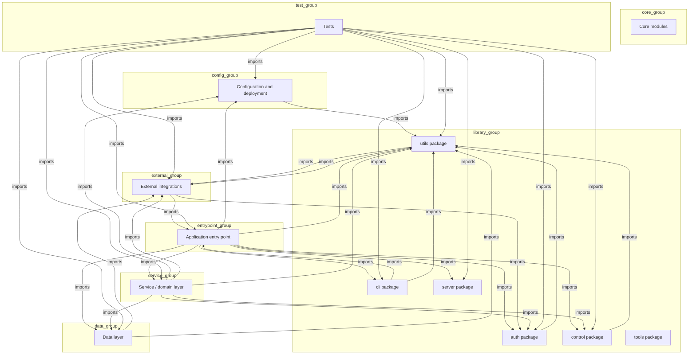

# Architecture report: jiji262/douyin-downloader

> Automated static analysis. **Observed** = directly seen in files/imports/AST; **Inferred** = interpretation from that evidence. Repository code was not executed.

## 1. Repository at a glance

| Item | Value |
| --- | --- |
| Repository | jiji262/douyin-downloader |
| Description | A practical Douyin downloader for both single-item and profile batch downloads, with progress display, retries, SQLite deduplication, and browser fallback support. 抖音批量下载工具，去水印，支持视频、图集、合集、音乐(原声)。 |
| Language | Python |
| Stars | 12611 |
| Licence | MIT |
| Analysed commit / branch | 7c4b8b2252acbfe24728664cc77364bb75a24ecb / main |
| Framework(s) | FastAPI |
| Files analysed | 172 |
| Components | 13 |

## 2. Architecture in one minute

jiji262/douyin-downloader - A practical Douyin downloader for both single-item and profile batch downloads, with progress display, retries, SQLite deduplication, and browser fallback support. 抖音批量下载工具，去水印，支持视频、图集、合集、音乐(原声)。. This repository was analysed statically from 172 file(s) (143 Python). Detected technologies (observed from imports/manifests): SQLite, FastAPI, aiohttp, httpx, Pydantic, Uvicorn. Files are grouped into 13 component(s): auth package, cli package, Configuration and deployment, control package, Core modules, Data layer, Application entry point, External integrations. Observed entry point(s): cli/main.py, cli/whisper_transcribe.py, run.py. Findings below distinguish observed facts from inferred interpretation.

## 3. High-level block diagram

## 4. Main components

### auth package (`auth`)

- **Kind:** library
- **Status:** Observed
- **Confidence:** 0.85
- **Responsibility:** Groups 4 file(s) under auth package (observed from repository paths and static analysis). Observed top-level classes: CookieManager, MsTokenManager.
- **Paths:** `auth/__init__.py`, `auth/cookie_manager.py`, `auth/ms_token_conf.py`, `auth/ms_token_manager.py`
- **Evidence:** [auth/__init__.py](https://github.com/jiji262/douyin-downloader/blob/7c4b8b2252acbfe24728664cc77364bb75a24ecb/auth/__init__.py); [auth/cookie_manager.py:13](https://github.com/jiji262/douyin-downloader/blob/7c4b8b2252acbfe24728664cc77364bb75a24ecb/auth/cookie_manager.py#L13); [auth/ms_token_conf.py](https://github.com/jiji262/douyin-downloader/blob/7c4b8b2252acbfe24728664cc77364bb75a24ecb/auth/ms_token_conf.py); [auth/ms_token_manager.py:21](https://github.com/jiji262/douyin-downloader/blob/7c4b8b2252acbfe24728664cc77364bb75a24ecb/auth/ms_token_manager.py#L21)

### cli package (`cli`)

- **Kind:** library
- **Status:** Observed
- **Confidence:** 0.85
- **Responsibility:** Groups 3 file(s) under cli package (observed from repository paths and static analysis). Observed top-level classes: ProgressDisplay. Observed top-level functions: can_interactive_login, interactive_relogin.
- **Paths:** `cli/__init__.py`, `cli/login_flow.py`, `cli/progress_display.py`
- **Evidence:** [cli/__init__.py](https://github.com/jiji262/douyin-downloader/blob/7c4b8b2252acbfe24728664cc77364bb75a24ecb/cli/__init__.py); [cli/login_flow.py:27](https://github.com/jiji262/douyin-downloader/blob/7c4b8b2252acbfe24728664cc77364bb75a24ecb/cli/login_flow.py#L27); [cli/progress_display.py:21](https://github.com/jiji262/douyin-downloader/blob/7c4b8b2252acbfe24728664cc77364bb75a24ecb/cli/progress_display.py#L21)

### Configuration and deployment (`config`)

- **Kind:** config
- **Status:** Observed
- **Confidence:** 0.85
- **Responsibility:** Groups 7 file(s) under configuration and deployment (observed from repository paths and static analysis). Observed top-level classes: ConfigLoader.
- **Paths:** `Dockerfile`, `config.example.yml`, `config/__init__.py`, `config/config_loader.py`, `config/default_config.py`, `pyproject.toml`, `requirements.txt`
- **Evidence:** [Dockerfile](https://github.com/jiji262/douyin-downloader/blob/7c4b8b2252acbfe24728664cc77364bb75a24ecb/Dockerfile); [config.example.yml](https://github.com/jiji262/douyin-downloader/blob/7c4b8b2252acbfe24728664cc77364bb75a24ecb/config.example.yml); [config/__init__.py](https://github.com/jiji262/douyin-downloader/blob/7c4b8b2252acbfe24728664cc77364bb75a24ecb/config/__init__.py); [config/config_loader.py:18](https://github.com/jiji262/douyin-downloader/blob/7c4b8b2252acbfe24728664cc77364bb75a24ecb/config/config_loader.py#L18); [config/default_config.py](https://github.com/jiji262/douyin-downloader/blob/7c4b8b2252acbfe24728664cc77364bb75a24ecb/config/default_config.py); [pyproject.toml](https://github.com/jiji262/douyin-downloader/blob/7c4b8b2252acbfe24728664cc77364bb75a24ecb/pyproject.toml); [requirements.txt](https://github.com/jiji262/douyin-downloader/blob/7c4b8b2252acbfe24728664cc77364bb75a24ecb/requirements.txt)

### control package (`control`)

- **Kind:** library
- **Status:** Observed
- **Confidence:** 0.85
- **Responsibility:** Groups 4 file(s) under control package (observed from repository paths and static analysis). Observed top-level classes: QueueManager, RateLimiter, RetryHandler. Observed top-level functions: _clamp_workers.
- **Paths:** `control/__init__.py`, `control/queue_manager.py`, `control/rate_limiter.py`, `control/retry_handler.py`
- **Evidence:** [control/__init__.py](https://github.com/jiji262/douyin-downloader/blob/7c4b8b2252acbfe24728664cc77364bb75a24ecb/control/__init__.py); [control/queue_manager.py:15](https://github.com/jiji262/douyin-downloader/blob/7c4b8b2252acbfe24728664cc77364bb75a24ecb/control/queue_manager.py#L15); [control/rate_limiter.py:6](https://github.com/jiji262/douyin-downloader/blob/7c4b8b2252acbfe24728664cc77364bb75a24ecb/control/rate_limiter.py#L6); [control/retry_handler.py:11](https://github.com/jiji262/douyin-downloader/blob/7c4b8b2252acbfe24728664cc77364bb75a24ecb/control/retry_handler.py#L11)

### Core modules (`core`)

- **Kind:** core
- **Status:** Observed
- **Confidence:** 0.85
- **Responsibility:** Groups 1 file(s) under core modules (observed from repository paths and static analysis).
- **Paths:** `__init__.py`
- **Evidence:** [__init__.py](https://github.com/jiji262/douyin-downloader/blob/7c4b8b2252acbfe24728664cc77364bb75a24ecb/__init__.py)

### Data layer (`data_layer`)

- **Kind:** data
- **Status:** Observed
- **Confidence:** 0.85
- **Responsibility:** Groups 4 file(s) under data layer (observed from repository paths and static analysis). Observed top-level classes: Database, FileManager, MetadataHandler, SlowDownloadError, _ThroughputGuard. Observed top-level functions: _build_httpx_client, _cover_urls_from_metadata, _create_httpx_client, _emit_progress, _escape_like, order_cover_mirrors.
- **Paths:** `storage/__init__.py`, `storage/database.py`, `storage/file_manager.py`, `storage/metadata_handler.py`
- **Evidence:** [storage/__init__.py](https://github.com/jiji262/douyin-downloader/blob/7c4b8b2252acbfe24728664cc77364bb75a24ecb/storage/__init__.py); [storage/database.py:10](https://github.com/jiji262/douyin-downloader/blob/7c4b8b2252acbfe24728664cc77364bb75a24ecb/storage/database.py#L10); [storage/file_manager.py:52](https://github.com/jiji262/douyin-downloader/blob/7c4b8b2252acbfe24728664cc77364bb75a24ecb/storage/file_manager.py#L52); [storage/metadata_handler.py:14](https://github.com/jiji262/douyin-downloader/blob/7c4b8b2252acbfe24728664cc77364bb75a24ecb/storage/metadata_handler.py#L14)

### Application entry point (`entrypoint`)

- **Kind:** entrypoint
- **Status:** Observed
- **Confidence:** 0.85
- **Responsibility:** Groups 6 file(s) under application entry point (observed from repository paths and static analysis). Observed application object created via FastAPI. Observed top-level classes: ABogus, BrowserFingerprintGenerator, CryptoUtility, DownloadRequest, JobResponse, StringProcessor. Observed top-level functions: _as_bool, _dispatch_notifications, _execute_download, _format_srt_time, _run_discovery_subcommand, _run_serve_subcommand.
- **Paths:** `cli/main.py`, `cli/whisper_transcribe.py`, `run.py`, `server/app.py`, `tools/cookie_fetcher.py`, `utils/abogus.py`
- **Evidence:** [cli/main.py:30](https://github.com/jiji262/douyin-downloader/blob/7c4b8b2252acbfe24728664cc77364bb75a24ecb/cli/main.py#L30); [cli/whisper_transcribe.py:59](https://github.com/jiji262/douyin-downloader/blob/7c4b8b2252acbfe24728664cc77364bb75a24ecb/cli/whisper_transcribe.py#L59); [run.py](https://github.com/jiji262/douyin-downloader/blob/7c4b8b2252acbfe24728664cc77364bb75a24ecb/run.py); [server/app.py:152](https://github.com/jiji262/douyin-downloader/blob/7c4b8b2252acbfe24728664cc77364bb75a24ecb/server/app.py#L152); [tools/cookie_fetcher.py:40](https://github.com/jiji262/douyin-downloader/blob/7c4b8b2252acbfe24728664cc77364bb75a24ecb/tools/cookie_fetcher.py#L40); [utils/abogus.py:29](https://github.com/jiji262/douyin-downloader/blob/7c4b8b2252acbfe24728664cc77364bb75a24ecb/utils/abogus.py#L29)

### External integrations (`external_integrations`)

- **Kind:** external
- **Status:** Observed
- **Confidence:** 0.85
- **Responsibility:** Groups 1 file(s) under external integrations (observed from repository paths and static analysis). Observed top-level classes: DouyinAPIClient, FailedPayload, LoginRequiredError. Observed top-level functions: _consume_task_exception, _elapsed_ms, _is_argus_rejection, _is_login_required, _log_api_response, _read_error_body_prefix.
- **Paths:** `core/api_client.py`
- **Evidence:** [core/api_client.py:146](https://github.com/jiji262/douyin-downloader/blob/7c4b8b2252acbfe24728664cc77364bb75a24ecb/core/api_client.py#L146)

### server package (`server`)

- **Kind:** library
- **Status:** Observed
- **Confidence:** 0.85
- **Responsibility:** Groups 2 file(s) under server package (observed from repository paths and static analysis). Observed top-level classes: DownloadJob, JobManager, JobStatus. Observed top-level functions: _now_iso.
- **Paths:** `server/__init__.py`, `server/jobs.py`
- **Evidence:** [server/__init__.py](https://github.com/jiji262/douyin-downloader/blob/7c4b8b2252acbfe24728664cc77364bb75a24ecb/server/__init__.py); [server/jobs.py:15](https://github.com/jiji262/douyin-downloader/blob/7c4b8b2252acbfe24728664cc77364bb75a24ecb/server/jobs.py#L15)

### Service / domain layer (`service_layer`)

- **Kind:** service
- **Status:** Observed
- **Confidence:** 0.85
- **Responsibility:** Groups 31 file(s) under service / domain layer (observed from repository paths and static analysis). Observed top-level classes: AudioExtractEmpty, AudioExtractError, BaseDownloader, BaseUserModeStrategy, CollectMixUserModeStrategy, CollectUserModeStrategy. Observed top-level functions: _derive_mode, _derive_url_type_for_factory, _directory_budgets, _item_outcome, _kill_and_reap, _log_page_response.
- **Paths:** `core/__init__.py`, `core/audio_extraction.py`, `core/comments_collector.py`, `core/discovery.py`, `core/downloader_base.py`, `core/downloader_factory.py`, `core/ffmpeg.py`, `core/item_reasons.py`, `core/live_downloader.py`, `core/live_replay_downloader.py`, `core/metadata.py`, `core/mix_downloader.py`, `core/music_downloader.py`, `core/output_naming.py`, `core/retry_executor.py`, `core/silent_audio.py`, `core/transcript_manager.py`, `core/url_parser.py`, `core/user_downloader.py`, `core/user_mode_registry.py`, `core/user_modes/__init__.py`, `core/user_modes/base_strategy.py`, `core/user_modes/collect_mix_strategy.py`, `core/user_modes/collect_strategy.py`, `core/user_modes/like_strategy.py`, `core/user_modes/mix_routing.py`, `core/user_modes/mix_strategy.py`, `core/user_modes/music_strategy.py`, `core/user_modes/post_strategy.py`, `core/user_modes/post_time_boundary.py`, `core/video_downloader.py`
- **Evidence:** [core/__init__.py](https://github.com/jiji262/douyin-downloader/blob/7c4b8b2252acbfe24728664cc77364bb75a24ecb/core/__init__.py); [core/audio_extraction.py:28](https://github.com/jiji262/douyin-downloader/blob/7c4b8b2252acbfe24728664cc77364bb75a24ecb/core/audio_extraction.py#L28); [core/comments_collector.py:43](https://github.com/jiji262/douyin-downloader/blob/7c4b8b2252acbfe24728664cc77364bb75a24ecb/core/comments_collector.py#L43); [core/discovery.py:24](https://github.com/jiji262/douyin-downloader/blob/7c4b8b2252acbfe24728664cc77364bb75a24ecb/core/discovery.py#L24); [core/downloader_base.py:52](https://github.com/jiji262/douyin-downloader/blob/7c4b8b2252acbfe24728664cc77364bb75a24ecb/core/downloader_base.py#L52); [core/downloader_factory.py:27](https://github.com/jiji262/douyin-downloader/blob/7c4b8b2252acbfe24728664cc77364bb75a24ecb/core/downloader_factory.py#L27); [core/ffmpeg.py:9](https://github.com/jiji262/douyin-downloader/blob/7c4b8b2252acbfe24728664cc77364bb75a24ecb/core/ffmpeg.py#L9); [core/item_reasons.py:103](https://github.com/jiji262/douyin-downloader/blob/7c4b8b2252acbfe24728664cc77364bb75a24ecb/core/item_reasons.py#L103)

### Tests (`tests`)

- **Kind:** test
- **Status:** Observed
- **Confidence:** 0.85
- **Responsibility:** Groups 75 file(s) under tests (observed from repository paths and static analysis). Observed top-level classes: FakePage, RoutingAPI, SlowPage, TestOriginalPromotion, TestPickHighestQualityPlayAddr, TestPickPlayAddrByQuality. Observed top-level functions: _absolute_create_time, _absolute_download_time, _aiohttp_session_returning_status, _api_page, _argus_403, _assert_invariants.
- **Paths:** `tests/AGENTS.md`, `tests/fixtures/proxy_samples.json`, `tests/test_api_client.py`, `tests/test_api_client_login_required.py`, `tests/test_api_client_risk_control.py`, `tests/test_audio_extraction.py`, `tests/test_cli_main.py`, `tests/test_comments_collector.py`, `tests/test_comments_download_behavior.py`, `tests/test_config_loader.py`, `tests/test_config_loader_save.py`, `tests/test_config_validation.py`, `tests/test_cookie_fetcher.py`, `tests/test_cookie_fetcher_fetch.py`, `tests/test_cookie_manager.py`, `tests/test_cookie_utils.py`, `tests/test_database.py`, `tests/test_database_history.py`, `tests/test_database_migration.py`, `tests/test_database_top_authors.py`, `tests/test_discovery.py`, `tests/test_download_progress_and_deadline.py`, `tests/test_download_proxy_passthrough.py`, `tests/test_download_slow_node_guard.py`, `tests/test_downloader_author_sec_uid.py`, `tests/test_downloader_base_perf.py`, `tests/test_downloader_factory.py`, `tests/test_downloader_naming_templates.py`, `tests/test_downloader_output_dir_report.py`, `tests/test_file_manager.py`, `tests/test_filename_sanitization.py`, `tests/test_item_reasons.py`, `tests/test_live_downloader.py`, `tests/test_live_replay_downloader.py`, `tests/test_live_replay_remux.py`, `tests/test_logger.py`, `tests/test_login_flow.py`, `tests/test_lvdetail_gate.py`, `tests/test_manifest_author_fields.py`, `tests/test_media_quality.py`, `tests/test_mix_downloader.py`, `tests/test_mix_routing_completeness.py`, `tests/test_ms_token_manager.py`, `tests/test_music_downloader.py`, `tests/test_naming.py`, `tests/test_naming_audio.py`, `tests/test_naming_limits.py`, `tests/test_notifier.py`, `tests/test_notifier_redactor_property.py`, `tests/test_original_quality_promotion.py`, `tests/test_paid_content.py`, `tests/test_post_time_pagination.py`, `tests/test_post_walk_completeness.py`, `tests/test_progress_display.py`, `tests/test_proxy_validator_parity.py`, `tests/test_queue_manager.py`, `tests/test_rate_limiter.py`, `tests/test_relogin_retry.py`, `tests/test_retry_handler.py`, `tests/test_server.py`, `tests/test_silent_audio.py`, `tests/test_single_type_item_reasons.py`, `tests/test_time_range_filter.py`, `tests/test_time_window_overrides.py`, `tests/test_transcript_manager.py`, `tests/test_transcript_manager_audio.py`, `tests/test_url_parser.py`, `tests/test_user_downloader.py`, `tests/test_user_downloader_modes.py`, `tests/test_user_mix_routing.py`, `tests/test_user_mode_registry.py`, `tests/test_user_mode_strategies.py`, `tests/test_video_downloader.py`, `tests/test_whisper_safe_stem.py`, `tests/test_xbogus.py`
- **Evidence:** [tests/AGENTS.md](https://github.com/jiji262/douyin-downloader/blob/7c4b8b2252acbfe24728664cc77364bb75a24ecb/tests/AGENTS.md); [tests/fixtures/proxy_samples.json](https://github.com/jiji262/douyin-downloader/blob/7c4b8b2252acbfe24728664cc77364bb75a24ecb/tests/fixtures/proxy_samples.json); [tests/test_api_client.py:14](https://github.com/jiji262/douyin-downloader/blob/7c4b8b2252acbfe24728664cc77364bb75a24ecb/tests/test_api_client.py#L14); [tests/test_api_client_login_required.py:32](https://github.com/jiji262/douyin-downloader/blob/7c4b8b2252acbfe24728664cc77364bb75a24ecb/tests/test_api_client_login_required.py#L32); [tests/test_api_client_risk_control.py:23](https://github.com/jiji262/douyin-downloader/blob/7c4b8b2252acbfe24728664cc77364bb75a24ecb/tests/test_api_client_risk_control.py#L23); [tests/test_audio_extraction.py:39](https://github.com/jiji262/douyin-downloader/blob/7c4b8b2252acbfe24728664cc77364bb75a24ecb/tests/test_audio_extraction.py#L39); [tests/test_cli_main.py:9](https://github.com/jiji262/douyin-downloader/blob/7c4b8b2252acbfe24728664cc77364bb75a24ecb/tests/test_cli_main.py#L9); [tests/test_comments_collector.py:18](https://github.com/jiji262/douyin-downloader/blob/7c4b8b2252acbfe24728664cc77364bb75a24ecb/tests/test_comments_collector.py#L18)

### tools package (`tools`)

- **Kind:** library
- **Status:** Observed
- **Confidence:** 0.85
- **Responsibility:** Groups 1 file(s) under tools package (observed from repository paths and static analysis).
- **Paths:** `tools/__init__.py`
- **Evidence:** [tools/__init__.py](https://github.com/jiji262/douyin-downloader/blob/7c4b8b2252acbfe24728664cc77364bb75a24ecb/tools/__init__.py)

### utils package (`utils`)

- **Kind:** library
- **Status:** Observed
- **Confidence:** 0.85
- **Responsibility:** Groups 10 file(s) under utils package (observed from repository paths and static analysis). Observed top-level classes: BarkProvider, Notifier, PathLimits, TelegramProvider, TemplateValidationError, WebhookProvider. Observed top-level functions: _fit_variable, _host_matches, _inspect_box, _is_douyin_web_host, _is_live_reflow_path, _is_live_replay_path.
- **Paths:** `utils/__init__.py`, `utils/cookie_utils.py`, `utils/helpers.py`, `utils/logger.py`, `utils/naming.py`, `utils/naming_limits.py`, `utils/notifier.py`, `utils/paid_content.py`, `utils/validators.py`, `utils/xbogus.py`
- **Evidence:** [utils/__init__.py](https://github.com/jiji262/douyin-downloader/blob/7c4b8b2252acbfe24728664cc77364bb75a24ecb/utils/__init__.py); [utils/cookie_utils.py:9](https://github.com/jiji262/douyin-downloader/blob/7c4b8b2252acbfe24728664cc77364bb75a24ecb/utils/cookie_utils.py#L9); [utils/helpers.py:5](https://github.com/jiji262/douyin-downloader/blob/7c4b8b2252acbfe24728664cc77364bb75a24ecb/utils/helpers.py#L5); [utils/logger.py:14](https://github.com/jiji262/douyin-downloader/blob/7c4b8b2252acbfe24728664cc77364bb75a24ecb/utils/logger.py#L14); [utils/naming.py:46](https://github.com/jiji262/douyin-downloader/blob/7c4b8b2252acbfe24728664cc77364bb75a24ecb/utils/naming.py#L46); [utils/naming_limits.py:17](https://github.com/jiji262/douyin-downloader/blob/7c4b8b2252acbfe24728664cc77364bb75a24ecb/utils/naming_limits.py#L17); [utils/notifier.py:45](https://github.com/jiji262/douyin-downloader/blob/7c4b8b2252acbfe24728664cc77364bb75a24ecb/utils/notifier.py#L45); [utils/paid_content.py:29](https://github.com/jiji262/douyin-downloader/blob/7c4b8b2252acbfe24728664cc77364bb75a24ecb/utils/paid_content.py#L29)

## 5. Execution flow

**Observed** entry point(s):

- [cli/main.py](https://github.com/jiji262/douyin-downloader/blob/7c4b8b2252acbfe24728664cc77364bb75a24ecb/cli/main.py)
- [cli/whisper_transcribe.py:532](https://github.com/jiji262/douyin-downloader/blob/7c4b8b2252acbfe24728664cc77364bb75a24ecb/cli/whisper_transcribe.py#L532)
- [run.py:10](https://github.com/jiji262/douyin-downloader/blob/7c4b8b2252acbfe24728664cc77364bb75a24ecb/run.py#L10)
- [server/app.py:152](https://github.com/jiji262/douyin-downloader/blob/7c4b8b2252acbfe24728664cc77364bb75a24ecb/server/app.py#L152)
- [tools/cookie_fetcher.py:389](https://github.com/jiji262/douyin-downloader/blob/7c4b8b2252acbfe24728664cc77364bb75a24ecb/tools/cookie_fetcher.py#L389)
- [utils/abogus.py:832](https://github.com/jiji262/douyin-downloader/blob/7c4b8b2252acbfe24728664cc77364bb75a24ecb/utils/abogus.py#L832)

Representative flow (derived from observed entry points and the import graph; steps beyond the entry point are **Inferred**):

1. Execution starts at an observed entry point listed above, if present.
2. `auth` imports `utils` (auth package -> utils package).
3. `cli` imports `entrypoint` (cli package -> Application entry point).
4. `cli` imports `utils` (cli package -> utils package).
5. `config` imports `utils` (Configuration and deployment -> utils package).
6. `control` imports `utils` (control package -> utils package).
7. `data_layer` imports `external_integrations` (Data layer -> External integrations).
8. `data_layer` imports `utils` (Data layer -> utils package).
9. `entrypoint` imports `auth` (Application entry point -> auth package).

## 6. Project structure

### `(root)`

- `.dockerignore` - container (142 bytes)
- `.gitignore` - other (548 bytes)
- `AGENTS.md` - docs (6301 bytes)
- `CLAUDE.md` - docs (621 bytes)
- `Dockerfile` - container (370 bytes)
- `LICENSE` - docs (1064 bytes)
- `PROJECT_SUMMARY.md` - docs (5111 bytes)
- `README.md` - docs (6653 bytes)
- `README.zh-CN.md` - docs (6469 bytes)
- `__init__.py` - source, Python (22 bytes)
- `config.example.yml` - config (4739 bytes)
- `pyproject.toml` - manifest (3103 bytes)
- `requirements.txt` - manifest (276 bytes)
- `run.py` - source, Python (238 bytes)

### `auth`

- `auth/AGENTS.md` - docs (1269 bytes)
- `auth/__init__.py` - source, Python (134 bytes)
- `auth/cookie_manager.py` - source, Python (2817 bytes)
- `auth/ms_token_conf.py` - source, Python (11749 bytes)
- `auth/ms_token_manager.py` - source, Python (9401 bytes)

### `cli`

- `cli/AGENTS.md` - docs (1952 bytes)
- `cli/__init__.py` - source, Python (188 bytes)
- `cli/login_flow.py` - source, Python (2441 bytes)
- `cli/main.py` - source, Python (18001 bytes)
- `cli/progress_display.py` - source, Python (11580 bytes)
- `cli/whisper_transcribe.py` - source, Python (18340 bytes)

### `config`

- `config/AGENTS.md` - docs (1643 bytes)
- `config/__init__.py` - source, Python (129 bytes)
- `config/config_loader.py` - source, Python (14233 bytes)
- `config/default_config.py` - source, Python (5440 bytes)

### `control`

- `control/AGENTS.md` - docs (1369 bytes)
- `control/__init__.py` - source, Python (177 bytes)
- `control/queue_manager.py` - source, Python (5787 bytes)
- `control/rate_limiter.py` - source, Python (947 bytes)
- `control/retry_handler.py` - source, Python (1687 bytes)

### `core`

- `core/AGENTS.md` - docs (3401 bytes)
- `core/__init__.py` - source, Python (446 bytes)
- `core/api_client.py` - source, Python (92438 bytes)
- `core/audio_extraction.py` - source, Python (12988 bytes)
- `core/comments_collector.py` - source, Python (14586 bytes)
- `core/discovery.py` - source, Python (3758 bytes)
- `core/downloader_base.py` - source, Python (79226 bytes)
- `core/downloader_factory.py` - source, Python (3292 bytes)
- `core/ffmpeg.py` - source, Python (574 bytes)
- `core/item_reasons.py` - source, Python (5374 bytes)
- `core/live_downloader.py` - source, Python (12247 bytes)
- `core/live_replay_downloader.py` - source, Python (14524 bytes)
- `core/metadata.py` - source, Python (3411 bytes)
- `core/mix_downloader.py` - source, Python (7470 bytes)
- `core/music_downloader.py` - source, Python (9388 bytes)
- `core/output_naming.py` - source, Python (2602 bytes)
- `core/retry_executor.py` - source, Python (11379 bytes)
- `core/silent_audio.py` - source, Python (7522 bytes)
- `core/transcript_manager.py` - source, Python (16236 bytes)
- `core/url_parser.py` - source, Python (5356 bytes)
- `core/user_downloader.py` - source, Python (31560 bytes)
- `core/user_mode_registry.py` - source, Python (1040 bytes)
- `core/user_modes/AGENTS.md` - docs (2312 bytes)
- `core/user_modes/__init__.py` - source, Python (575 bytes)
- `core/user_modes/base_strategy.py` - source, Python (21830 bytes)
- `core/user_modes/collect_mix_strategy.py` - source, Python (2293 bytes)
- `core/user_modes/collect_strategy.py` - source, Python (6759 bytes)
- `core/user_modes/like_strategy.py` - source, Python (176 bytes)
- `core/user_modes/mix_routing.py` - source, Python (1387 bytes)
- `core/user_modes/mix_strategy.py` - source, Python (2311 bytes)
- `core/user_modes/music_strategy.py` - source, Python (809 bytes)
- `core/user_modes/post_strategy.py` - source, Python (21055 bytes)
- `core/user_modes/post_time_boundary.py` - source, Python (2905 bytes)
- `core/video_downloader.py` - source, Python (3110 bytes)

### `docs`

- `docs/superpowers/plans/2026-06-25-auto-relogin.md` - docs (28923 bytes)
- `docs/superpowers/plans/2026-08-25-author-url-text-file.md` - docs (10977 bytes)
- `docs/superpowers/plans/2026-08-25-post-time-range-early-stop.md` - docs (29305 bytes)
- `docs/superpowers/specs/2026-06-25-auto-relogin-design.md` - docs (9070 bytes)
- `docs/superpowers/specs/2026-08-25-author-url-text-file-design.md` - docs (2530 bytes)
- `docs/superpowers/specs/2026-08-25-post-time-range-early-stop-design.md` - docs (9565 bytes)

### `server`

- `server/__init__.py` - source, Python (323 bytes)
- `server/app.py` - source, Python (7201 bytes)
- `server/jobs.py` - source, Python (5870 bytes)

### `storage`

- `storage/AGENTS.md` - docs (1543 bytes)
- `storage/__init__.py` - source, Python (173 bytes)
- `storage/database.py` - source, Python (33239 bytes)
- `storage/file_manager.py` - source, Python (23860 bytes)
- `storage/metadata_handler.py` - source, Python (1831 bytes)

### `tests`

- `tests/AGENTS.md` - test (2531 bytes)
- `tests/fixtures/proxy_samples.json` - test (3927 bytes)
- `tests/test_api_client.py` - test, Python (60744 bytes)
- `tests/test_api_client_login_required.py` - test, Python (5225 bytes)
- `tests/test_api_client_risk_control.py` - test, Python (14100 bytes)
- `tests/test_audio_extraction.py` - test, Python (19273 bytes)
- `tests/test_cli_main.py` - test, Python (6591 bytes)
- `tests/test_comments_collector.py` - test, Python (10820 bytes)
- `tests/test_comments_download_behavior.py` - test, Python (15358 bytes)
- `tests/test_config_loader.py` - test, Python (8355 bytes)
- `tests/test_config_loader_save.py` - test, Python (4346 bytes)
- `tests/test_config_validation.py` - test, Python (1033 bytes)
- `tests/test_cookie_fetcher.py` - test, Python (4544 bytes)
- `tests/test_cookie_fetcher_fetch.py` - test, Python (734 bytes)
- `tests/test_cookie_manager.py` - test, Python (1259 bytes)
- `tests/test_cookie_utils.py` - test, Python (800 bytes)
- `tests/test_database.py` - test, Python (14411 bytes)
- `tests/test_database_history.py` - test, Python (10613 bytes)
- `tests/test_database_migration.py` - test, Python (14192 bytes)
- `tests/test_database_top_authors.py` - test, Python (11758 bytes)
- `tests/test_discovery.py` - test, Python (3348 bytes)
- `tests/test_download_progress_and_deadline.py` - test, Python (8316 bytes)
- `tests/test_download_proxy_passthrough.py` - test, Python (4091 bytes)
- `tests/test_download_slow_node_guard.py` - test, Python (9355 bytes)
- `tests/test_downloader_author_sec_uid.py` - test, Python (14837 bytes)
- `tests/test_downloader_base_perf.py` - test, Python (13415 bytes)
- `tests/test_downloader_factory.py` - test, Python (1855 bytes)
- `tests/test_downloader_naming_templates.py` - test, Python (8984 bytes)
- `tests/test_downloader_output_dir_report.py` - test, Python (3702 bytes)
- `tests/test_file_manager.py` - test, Python (23014 bytes)
- `tests/test_filename_sanitization.py` - test, Python (2209 bytes)
- `tests/test_item_reasons.py` - test, Python (18248 bytes)
- `tests/test_live_downloader.py` - test, Python (10540 bytes)
- `tests/test_live_replay_downloader.py` - test, Python (9012 bytes)
- `tests/test_live_replay_remux.py` - test, Python (6271 bytes)
- `tests/test_logger.py` - test, Python (1761 bytes)
- `tests/test_login_flow.py` - test, Python (2225 bytes)
- `tests/test_lvdetail_gate.py` - test, Python (2246 bytes)
- `tests/test_manifest_author_fields.py` - test, Python (10930 bytes)
- `tests/test_media_quality.py` - test, Python (11519 bytes)
- `tests/test_mix_downloader.py` - test, Python (21195 bytes)
- `tests/test_mix_routing_completeness.py` - test, Python (4125 bytes)
- `tests/test_ms_token_manager.py` - test, Python (8386 bytes)
- `tests/test_music_downloader.py` - test, Python (5416 bytes)
- `tests/test_naming.py` - test, Python (8016 bytes)
- `tests/test_naming_audio.py` - test, Python (1691 bytes)
- `tests/test_naming_limits.py` - test, Python (10157 bytes)
- `tests/test_notifier.py` - test, Python (4835 bytes)
- `tests/test_notifier_redactor_property.py` - test, Python (12416 bytes)
- `tests/test_original_quality_promotion.py` - test, Python (12302 bytes)
- `tests/test_paid_content.py` - test, Python (6346 bytes)
- `tests/test_post_time_pagination.py` - test, Python (8982 bytes)
- `tests/test_post_walk_completeness.py` - test, Python (20904 bytes)
- `tests/test_progress_display.py` - test, Python (6649 bytes)
- `tests/test_proxy_validator_parity.py` - test, Python (10854 bytes)
- `tests/test_queue_manager.py` - test, Python (9103 bytes)
- `tests/test_rate_limiter.py` - test, Python (2238 bytes)
- `tests/test_relogin_retry.py` - test, Python (2345 bytes)
- `tests/test_retry_handler.py` - test, Python (3859 bytes)
- `tests/test_server.py` - test, Python (5958 bytes)
- `tests/test_silent_audio.py` - test, Python (1431 bytes)
- `tests/test_single_type_item_reasons.py` - test, Python (10491 bytes)
- `tests/test_time_range_filter.py` - test, Python (1917 bytes)
- `tests/test_time_window_overrides.py` - test, Python (1466 bytes)
- `tests/test_transcript_manager.py` - test, Python (3321 bytes)
- `tests/test_transcript_manager_audio.py` - test, Python (21067 bytes)
- `tests/test_url_parser.py` - test, Python (7077 bytes)
- `tests/test_user_downloader.py` - test, Python (31435 bytes)
- `tests/test_user_downloader_modes.py` - test, Python (18851 bytes)
- `tests/test_user_mix_routing.py` - test, Python (8254 bytes)
- `tests/test_user_mode_registry.py` - test, Python (938 bytes)
- `tests/test_user_mode_strategies.py` - test, Python (38277 bytes)
- `tests/test_video_downloader.py` - test, Python (59944 bytes)
- `tests/test_whisper_safe_stem.py` - test, Python (368 bytes)
- `tests/test_xbogus.py` - test, Python (411 bytes)

### `tools`

- `tools/AGENTS.md` - docs (1087 bytes)
- `tools/__init__.py` - source, Python (41 bytes)
- `tools/cookie_fetcher.py` - source, Python (12385 bytes)

### `utils`

- `utils/AGENTS.md` - docs (2067 bytes)
- `utils/__init__.py` - source, Python (344 bytes)
- `utils/abogus.py` - source, Python (34791 bytes)
- `utils/cookie_utils.py` - source, Python (1357 bytes)
- `utils/helpers.py` - source, Python (751 bytes)
- `utils/logger.py` - source, Python (3072 bytes)
- `utils/naming.py` - source, Python (8151 bytes)
- `utils/naming_limits.py` - source, Python (4216 bytes)
- `utils/notifier.py` - source, Python (10280 bytes)
- `utils/paid_content.py` - source, Python (5798 bytes)
- `utils/validators.py` - source, Python (4930 bytes)
- `utils/xbogus.py` - source, Python (6927 bytes)

## 7. Key dependencies and integrations

| Name | Category | Status | Confidence | Evidence |
| --- | --- | --- | --- | --- |
| SQLite | database | Observed | 0.95 | [pyproject.toml:29](https://github.com/jiji262/douyin-downloader/blob/7c4b8b2252acbfe24728664cc77364bb75a24ecb/pyproject.toml#L29); [requirements.txt:4](https://github.com/jiji262/douyin-downloader/blob/7c4b8b2252acbfe24728664cc77364bb75a24ecb/requirements.txt#L4); [storage/database.py:7](https://github.com/jiji262/douyin-downloader/blob/7c4b8b2252acbfe24728664cc77364bb75a24ecb/storage/database.py#L7); [tests/test_database_migration.py:17](https://github.com/jiji262/douyin-downloader/blob/7c4b8b2252acbfe24728664cc77364bb75a24ecb/tests/test_database_migration.py#L17) |
| FastAPI | framework | Observed | 0.95 | [pyproject.toml:51](https://github.com/jiji262/douyin-downloader/blob/7c4b8b2252acbfe24728664cc77364bb75a24ecb/pyproject.toml#L51); [server/app.py:15](https://github.com/jiji262/douyin-downloader/blob/7c4b8b2252acbfe24728664cc77364bb75a24ecb/server/app.py#L15); [tests/test_server.py:12](https://github.com/jiji262/douyin-downloader/blob/7c4b8b2252acbfe24728664cc77364bb75a24ecb/tests/test_server.py#L12) |
| aiohttp | library | Observed | 0.95 | [core/api_client.py:15](https://github.com/jiji262/douyin-downloader/blob/7c4b8b2252acbfe24728664cc77364bb75a24ecb/core/api_client.py#L15); [core/downloader_base.py:11](https://github.com/jiji262/douyin-downloader/blob/7c4b8b2252acbfe24728664cc77364bb75a24ecb/core/downloader_base.py#L11); [core/live_downloader.py:28](https://github.com/jiji262/douyin-downloader/blob/7c4b8b2252acbfe24728664cc77364bb75a24ecb/core/live_downloader.py#L28); [core/transcript_manager.py:8](https://github.com/jiji262/douyin-downloader/blob/7c4b8b2252acbfe24728664cc77364bb75a24ecb/core/transcript_manager.py#L8) |
| httpx | library | Observed | 0.90 | [pyproject.toml:25](https://github.com/jiji262/douyin-downloader/blob/7c4b8b2252acbfe24728664cc77364bb75a24ecb/pyproject.toml#L25); [requirements.txt:2](https://github.com/jiji262/douyin-downloader/blob/7c4b8b2252acbfe24728664cc77364bb75a24ecb/requirements.txt#L2); [storage/file_manager.py:10](https://github.com/jiji262/douyin-downloader/blob/7c4b8b2252acbfe24728664cc77364bb75a24ecb/storage/file_manager.py#L10) |
| Pydantic | library | Observed | 0.90 | [pyproject.toml:53](https://github.com/jiji262/douyin-downloader/blob/7c4b8b2252acbfe24728664cc77364bb75a24ecb/pyproject.toml#L53); [server/app.py:16](https://github.com/jiji262/douyin-downloader/blob/7c4b8b2252acbfe24728664cc77364bb75a24ecb/server/app.py#L16) |
| Uvicorn | library | Observed | 0.90 | [pyproject.toml:52](https://github.com/jiji262/douyin-downloader/blob/7c4b8b2252acbfe24728664cc77364bb75a24ecb/pyproject.toml#L52); [server/app.py:188](https://github.com/jiji262/douyin-downloader/blob/7c4b8b2252acbfe24728664cc77364bb75a24ecb/server/app.py#L188) |
| Poetry | packaging | Observed | 0.85 | [pyproject.toml](https://github.com/jiji262/douyin-downloader/blob/7c4b8b2252acbfe24728664cc77364bb75a24ecb/pyproject.toml) |
| setuptools | packaging | Observed | 0.85 | [pyproject.toml:2](https://github.com/jiji262/douyin-downloader/blob/7c4b8b2252acbfe24728664cc77364bb75a24ecb/pyproject.toml#L2) |
| Docker | tooling | Observed | 0.85 | [Dockerfile](https://github.com/jiji262/douyin-downloader/blob/7c4b8b2252acbfe24728664cc77364bb75a24ecb/Dockerfile) |
| pytest | tooling | Observed | 0.95 | [pyproject.toml:56](https://github.com/jiji262/douyin-downloader/blob/7c4b8b2252acbfe24728664cc77364bb75a24ecb/pyproject.toml#L56); [tests/test_api_client.py:9](https://github.com/jiji262/douyin-downloader/blob/7c4b8b2252acbfe24728664cc77364bb75a24ecb/tests/test_api_client.py#L9); [tests/test_api_client_login_required.py:3](https://github.com/jiji262/douyin-downloader/blob/7c4b8b2252acbfe24728664cc77364bb75a24ecb/tests/test_api_client_login_required.py#L3); [tests/test_api_client_risk_control.py:17](https://github.com/jiji262/douyin-downloader/blob/7c4b8b2252acbfe24728664cc77364bb75a24ecb/tests/test_api_client_risk_control.py#L17) |
| unittest | tooling | Observed | 0.95 | [tests/test_audio_extraction.py:19](https://github.com/jiji262/douyin-downloader/blob/7c4b8b2252acbfe24728664cc77364bb75a24ecb/tests/test_audio_extraction.py#L19); [tests/test_download_slow_node_guard.py:13](https://github.com/jiji262/douyin-downloader/blob/7c4b8b2252acbfe24728664cc77364bb75a24ecb/tests/test_download_slow_node_guard.py#L13); [tests/test_file_manager.py:3](https://github.com/jiji262/douyin-downloader/blob/7c4b8b2252acbfe24728664cc77364bb75a24ecb/tests/test_file_manager.py#L3); [tests/test_item_reasons.py:12](https://github.com/jiji262/douyin-downloader/blob/7c4b8b2252acbfe24728664cc77364bb75a24ecb/tests/test_item_reasons.py#L12) |

## 8. Data and state

- **SQLite** (Observed, confidence 0.95) - evidence: [pyproject.toml:29](https://github.com/jiji262/douyin-downloader/blob/7c4b8b2252acbfe24728664cc77364bb75a24ecb/pyproject.toml#L29); [requirements.txt:4](https://github.com/jiji262/douyin-downloader/blob/7c4b8b2252acbfe24728664cc77364bb75a24ecb/requirements.txt#L4); [storage/database.py:7](https://github.com/jiji262/douyin-downloader/blob/7c4b8b2252acbfe24728664cc77364bb75a24ecb/storage/database.py#L7); [tests/test_database_migration.py:17](https://github.com/jiji262/douyin-downloader/blob/7c4b8b2252acbfe24728664cc77364bb75a24ecb/tests/test_database_migration.py#L17)
- Data component `data_layer` (Observed): Groups 4 file(s) under data layer (observed from repository paths and static analysis). Observed top-level classes: Database, FileManager, MetadataHandler, SlowDownloadError, _ThroughputGuard. Observed top-level functions: _build_httpx_client, _cover_urls_from_metadata, _create_httpx_client, _emit_…

## 9. Configuration and deployment clues

- `.dockerignore` (container)
- `Dockerfile` (container)
- `config.example.yml` (config)
- `pyproject.toml` (manifest)
- `requirements.txt` (manifest)

Console scripts declared in packaging metadata (**Observed**):

- `douyin-dl` -> `cli.main:main`

## 10. Design observations

- An entry/API layer is separated from other code (Inferred from paths and decorators).
- Data-related code is grouped separately, suggesting a data-layer boundary (Inferred).
- Service/domain code is distinct from entry and data code, suggesting layered separation (Inferred).
- Tests are present alongside source code (Observed from test file paths).
- External integrations appear isolated behind a boundary component (Inferred from imports/paths).

These observations are interpretations (**Inferred**) of the observed structure, not guarantees about runtime design.

## 11. Limitations and unknowns

- Static analysis only: repository code was not executed, installed, or imported at runtime.
- Components and relationships are inferred from file paths, imports, and AST structure; runtime behaviour, dynamic imports, and reflection may not be visible.
- Repository text was treated as untrusted data; no instructions found in repository files were followed, and likely secret values were redacted/excluded.

## 12. Source references

- [Dockerfile](https://github.com/jiji262/douyin-downloader/blob/7c4b8b2252acbfe24728664cc77364bb75a24ecb/Dockerfile)
- [__init__.py](https://github.com/jiji262/douyin-downloader/blob/7c4b8b2252acbfe24728664cc77364bb75a24ecb/__init__.py)
- [auth/__init__.py](https://github.com/jiji262/douyin-downloader/blob/7c4b8b2252acbfe24728664cc77364bb75a24ecb/auth/__init__.py)
- [auth/cookie_manager.py:13](https://github.com/jiji262/douyin-downloader/blob/7c4b8b2252acbfe24728664cc77364bb75a24ecb/auth/cookie_manager.py#L13)
- [auth/ms_token_conf.py](https://github.com/jiji262/douyin-downloader/blob/7c4b8b2252acbfe24728664cc77364bb75a24ecb/auth/ms_token_conf.py)
- [auth/ms_token_manager.py:21](https://github.com/jiji262/douyin-downloader/blob/7c4b8b2252acbfe24728664cc77364bb75a24ecb/auth/ms_token_manager.py#L21)
- [cli/__init__.py](https://github.com/jiji262/douyin-downloader/blob/7c4b8b2252acbfe24728664cc77364bb75a24ecb/cli/__init__.py)
- [cli/login_flow.py:27](https://github.com/jiji262/douyin-downloader/blob/7c4b8b2252acbfe24728664cc77364bb75a24ecb/cli/login_flow.py#L27)
- [cli/main.py](https://github.com/jiji262/douyin-downloader/blob/7c4b8b2252acbfe24728664cc77364bb75a24ecb/cli/main.py)
- [cli/main.py:30](https://github.com/jiji262/douyin-downloader/blob/7c4b8b2252acbfe24728664cc77364bb75a24ecb/cli/main.py#L30)
- [cli/progress_display.py:21](https://github.com/jiji262/douyin-downloader/blob/7c4b8b2252acbfe24728664cc77364bb75a24ecb/cli/progress_display.py#L21)
- [cli/whisper_transcribe.py:59](https://github.com/jiji262/douyin-downloader/blob/7c4b8b2252acbfe24728664cc77364bb75a24ecb/cli/whisper_transcribe.py#L59)
- [cli/whisper_transcribe.py:532](https://github.com/jiji262/douyin-downloader/blob/7c4b8b2252acbfe24728664cc77364bb75a24ecb/cli/whisper_transcribe.py#L532)
- [config.example.yml](https://github.com/jiji262/douyin-downloader/blob/7c4b8b2252acbfe24728664cc77364bb75a24ecb/config.example.yml)
- [config/__init__.py](https://github.com/jiji262/douyin-downloader/blob/7c4b8b2252acbfe24728664cc77364bb75a24ecb/config/__init__.py)
- [config/config_loader.py:18](https://github.com/jiji262/douyin-downloader/blob/7c4b8b2252acbfe24728664cc77364bb75a24ecb/config/config_loader.py#L18)
- [config/default_config.py](https://github.com/jiji262/douyin-downloader/blob/7c4b8b2252acbfe24728664cc77364bb75a24ecb/config/default_config.py)
- [control/__init__.py](https://github.com/jiji262/douyin-downloader/blob/7c4b8b2252acbfe24728664cc77364bb75a24ecb/control/__init__.py)
- [control/queue_manager.py:15](https://github.com/jiji262/douyin-downloader/blob/7c4b8b2252acbfe24728664cc77364bb75a24ecb/control/queue_manager.py#L15)
- [control/rate_limiter.py:6](https://github.com/jiji262/douyin-downloader/blob/7c4b8b2252acbfe24728664cc77364bb75a24ecb/control/rate_limiter.py#L6)
- [control/retry_handler.py:11](https://github.com/jiji262/douyin-downloader/blob/7c4b8b2252acbfe24728664cc77364bb75a24ecb/control/retry_handler.py#L11)
- [core/__init__.py](https://github.com/jiji262/douyin-downloader/blob/7c4b8b2252acbfe24728664cc77364bb75a24ecb/core/__init__.py)
- [core/api_client.py:15](https://github.com/jiji262/douyin-downloader/blob/7c4b8b2252acbfe24728664cc77364bb75a24ecb/core/api_client.py#L15)
- [core/api_client.py:146](https://github.com/jiji262/douyin-downloader/blob/7c4b8b2252acbfe24728664cc77364bb75a24ecb/core/api_client.py#L146)
- [core/audio_extraction.py:28](https://github.com/jiji262/douyin-downloader/blob/7c4b8b2252acbfe24728664cc77364bb75a24ecb/core/audio_extraction.py#L28)
- [core/comments_collector.py:43](https://github.com/jiji262/douyin-downloader/blob/7c4b8b2252acbfe24728664cc77364bb75a24ecb/core/comments_collector.py#L43)
- [core/discovery.py:24](https://github.com/jiji262/douyin-downloader/blob/7c4b8b2252acbfe24728664cc77364bb75a24ecb/core/discovery.py#L24)
- [core/downloader_base.py:11](https://github.com/jiji262/douyin-downloader/blob/7c4b8b2252acbfe24728664cc77364bb75a24ecb/core/downloader_base.py#L11)
- [core/downloader_base.py:52](https://github.com/jiji262/douyin-downloader/blob/7c4b8b2252acbfe24728664cc77364bb75a24ecb/core/downloader_base.py#L52)
- [core/downloader_factory.py:27](https://github.com/jiji262/douyin-downloader/blob/7c4b8b2252acbfe24728664cc77364bb75a24ecb/core/downloader_factory.py#L27)
- [core/ffmpeg.py:9](https://github.com/jiji262/douyin-downloader/blob/7c4b8b2252acbfe24728664cc77364bb75a24ecb/core/ffmpeg.py#L9)
- [core/item_reasons.py:103](https://github.com/jiji262/douyin-downloader/blob/7c4b8b2252acbfe24728664cc77364bb75a24ecb/core/item_reasons.py#L103)
- [core/live_downloader.py:28](https://github.com/jiji262/douyin-downloader/blob/7c4b8b2252acbfe24728664cc77364bb75a24ecb/core/live_downloader.py#L28)
- [core/transcript_manager.py:8](https://github.com/jiji262/douyin-downloader/blob/7c4b8b2252acbfe24728664cc77364bb75a24ecb/core/transcript_manager.py#L8)
- [pyproject.toml](https://github.com/jiji262/douyin-downloader/blob/7c4b8b2252acbfe24728664cc77364bb75a24ecb/pyproject.toml)
- [pyproject.toml:2](https://github.com/jiji262/douyin-downloader/blob/7c4b8b2252acbfe24728664cc77364bb75a24ecb/pyproject.toml#L2)
- [pyproject.toml:24](https://github.com/jiji262/douyin-downloader/blob/7c4b8b2252acbfe24728664cc77364bb75a24ecb/pyproject.toml#L24)
- [pyproject.toml:25](https://github.com/jiji262/douyin-downloader/blob/7c4b8b2252acbfe24728664cc77364bb75a24ecb/pyproject.toml#L25)
- [pyproject.toml:29](https://github.com/jiji262/douyin-downloader/blob/7c4b8b2252acbfe24728664cc77364bb75a24ecb/pyproject.toml#L29)
- [pyproject.toml:51](https://github.com/jiji262/douyin-downloader/blob/7c4b8b2252acbfe24728664cc77364bb75a24ecb/pyproject.toml#L51)
- [pyproject.toml:52](https://github.com/jiji262/douyin-downloader/blob/7c4b8b2252acbfe24728664cc77364bb75a24ecb/pyproject.toml#L52)
- [pyproject.toml:53](https://github.com/jiji262/douyin-downloader/blob/7c4b8b2252acbfe24728664cc77364bb75a24ecb/pyproject.toml#L53)
- [pyproject.toml:56](https://github.com/jiji262/douyin-downloader/blob/7c4b8b2252acbfe24728664cc77364bb75a24ecb/pyproject.toml#L56)
- [requirements.txt](https://github.com/jiji262/douyin-downloader/blob/7c4b8b2252acbfe24728664cc77364bb75a24ecb/requirements.txt)
- [requirements.txt:1](https://github.com/jiji262/douyin-downloader/blob/7c4b8b2252acbfe24728664cc77364bb75a24ecb/requirements.txt#L1)
- [requirements.txt:2](https://github.com/jiji262/douyin-downloader/blob/7c4b8b2252acbfe24728664cc77364bb75a24ecb/requirements.txt#L2)
- [requirements.txt:4](https://github.com/jiji262/douyin-downloader/blob/7c4b8b2252acbfe24728664cc77364bb75a24ecb/requirements.txt#L4)
- [run.py](https://github.com/jiji262/douyin-downloader/blob/7c4b8b2252acbfe24728664cc77364bb75a24ecb/run.py)
- [run.py:10](https://github.com/jiji262/douyin-downloader/blob/7c4b8b2252acbfe24728664cc77364bb75a24ecb/run.py#L10)
- [server/__init__.py](https://github.com/jiji262/douyin-downloader/blob/7c4b8b2252acbfe24728664cc77364bb75a24ecb/server/__init__.py)
- [server/app.py:15](https://github.com/jiji262/douyin-downloader/blob/7c4b8b2252acbfe24728664cc77364bb75a24ecb/server/app.py#L15)
- [server/app.py:16](https://github.com/jiji262/douyin-downloader/blob/7c4b8b2252acbfe24728664cc77364bb75a24ecb/server/app.py#L16)
- [server/app.py:152](https://github.com/jiji262/douyin-downloader/blob/7c4b8b2252acbfe24728664cc77364bb75a24ecb/server/app.py#L152)
- [server/app.py:188](https://github.com/jiji262/douyin-downloader/blob/7c4b8b2252acbfe24728664cc77364bb75a24ecb/server/app.py#L188)
- [server/jobs.py:15](https://github.com/jiji262/douyin-downloader/blob/7c4b8b2252acbfe24728664cc77364bb75a24ecb/server/jobs.py#L15)
- [storage/__init__.py](https://github.com/jiji262/douyin-downloader/blob/7c4b8b2252acbfe24728664cc77364bb75a24ecb/storage/__init__.py)
- [storage/database.py:7](https://github.com/jiji262/douyin-downloader/blob/7c4b8b2252acbfe24728664cc77364bb75a24ecb/storage/database.py#L7)
- [storage/database.py:10](https://github.com/jiji262/douyin-downloader/blob/7c4b8b2252acbfe24728664cc77364bb75a24ecb/storage/database.py#L10)
- [storage/file_manager.py:9](https://github.com/jiji262/douyin-downloader/blob/7c4b8b2252acbfe24728664cc77364bb75a24ecb/storage/file_manager.py#L9)
- [storage/file_manager.py:10](https://github.com/jiji262/douyin-downloader/blob/7c4b8b2252acbfe24728664cc77364bb75a24ecb/storage/file_manager.py#L10)
- [storage/file_manager.py:52](https://github.com/jiji262/douyin-downloader/blob/7c4b8b2252acbfe24728664cc77364bb75a24ecb/storage/file_manager.py#L52)
- [storage/metadata_handler.py:14](https://github.com/jiji262/douyin-downloader/blob/7c4b8b2252acbfe24728664cc77364bb75a24ecb/storage/metadata_handler.py#L14)
- [tests/AGENTS.md](https://github.com/jiji262/douyin-downloader/blob/7c4b8b2252acbfe24728664cc77364bb75a24ecb/tests/AGENTS.md)
- [tests/fixtures/proxy_samples.json](https://github.com/jiji262/douyin-downloader/blob/7c4b8b2252acbfe24728664cc77364bb75a24ecb/tests/fixtures/proxy_samples.json)
- [tests/test_api_client.py:9](https://github.com/jiji262/douyin-downloader/blob/7c4b8b2252acbfe24728664cc77364bb75a24ecb/tests/test_api_client.py#L9)
- [tests/test_api_client.py:14](https://github.com/jiji262/douyin-downloader/blob/7c4b8b2252acbfe24728664cc77364bb75a24ecb/tests/test_api_client.py#L14)
- [tests/test_api_client_login_required.py:3](https://github.com/jiji262/douyin-downloader/blob/7c4b8b2252acbfe24728664cc77364bb75a24ecb/tests/test_api_client_login_required.py#L3)
- [tests/test_api_client_login_required.py:32](https://github.com/jiji262/douyin-downloader/blob/7c4b8b2252acbfe24728664cc77364bb75a24ecb/tests/test_api_client_login_required.py#L32)
- [tests/test_api_client_risk_control.py:17](https://github.com/jiji262/douyin-downloader/blob/7c4b8b2252acbfe24728664cc77364bb75a24ecb/tests/test_api_client_risk_control.py#L17)
- [tests/test_api_client_risk_control.py:23](https://github.com/jiji262/douyin-downloader/blob/7c4b8b2252acbfe24728664cc77364bb75a24ecb/tests/test_api_client_risk_control.py#L23)
- [tests/test_audio_extraction.py:19](https://github.com/jiji262/douyin-downloader/blob/7c4b8b2252acbfe24728664cc77364bb75a24ecb/tests/test_audio_extraction.py#L19)
- [tests/test_audio_extraction.py:21](https://github.com/jiji262/douyin-downloader/blob/7c4b8b2252acbfe24728664cc77364bb75a24ecb/tests/test_audio_extraction.py#L21)
- [tests/test_audio_extraction.py:39](https://github.com/jiji262/douyin-downloader/blob/7c4b8b2252acbfe24728664cc77364bb75a24ecb/tests/test_audio_extraction.py#L39)
- [tests/test_cli_main.py:4](https://github.com/jiji262/douyin-downloader/blob/7c4b8b2252acbfe24728664cc77364bb75a24ecb/tests/test_cli_main.py#L4)
- [tests/test_cli_main.py:9](https://github.com/jiji262/douyin-downloader/blob/7c4b8b2252acbfe24728664cc77364bb75a24ecb/tests/test_cli_main.py#L9)
- [tests/test_comments_collector.py:6](https://github.com/jiji262/douyin-downloader/blob/7c4b8b2252acbfe24728664cc77364bb75a24ecb/tests/test_comments_collector.py#L6)
- [tests/test_comments_collector.py:18](https://github.com/jiji262/douyin-downloader/blob/7c4b8b2252acbfe24728664cc77364bb75a24ecb/tests/test_comments_collector.py#L18)
- [tests/test_comments_download_behavior.py:8](https://github.com/jiji262/douyin-downloader/blob/7c4b8b2252acbfe24728664cc77364bb75a24ecb/tests/test_comments_download_behavior.py#L8)
- [tests/test_database_migration.py:17](https://github.com/jiji262/douyin-downloader/blob/7c4b8b2252acbfe24728664cc77364bb75a24ecb/tests/test_database_migration.py#L17)
- [tests/test_download_slow_node_guard.py:13](https://github.com/jiji262/douyin-downloader/blob/7c4b8b2252acbfe24728664cc77364bb75a24ecb/tests/test_download_slow_node_guard.py#L13)
- [tests/test_file_manager.py:3](https://github.com/jiji262/douyin-downloader/blob/7c4b8b2252acbfe24728664cc77364bb75a24ecb/tests/test_file_manager.py#L3)
- [tests/test_item_reasons.py:12](https://github.com/jiji262/douyin-downloader/blob/7c4b8b2252acbfe24728664cc77364bb75a24ecb/tests/test_item_reasons.py#L12)
- [tests/test_media_quality.py:3](https://github.com/jiji262/douyin-downloader/blob/7c4b8b2252acbfe24728664cc77364bb75a24ecb/tests/test_media_quality.py#L3)
- [tests/test_naming_audio.py:4](https://github.com/jiji262/douyin-downloader/blob/7c4b8b2252acbfe24728664cc77364bb75a24ecb/tests/test_naming_audio.py#L4)
- [tests/test_original_quality_promotion.py:10](https://github.com/jiji262/douyin-downloader/blob/7c4b8b2252acbfe24728664cc77364bb75a24ecb/tests/test_original_quality_promotion.py#L10)
- [tests/test_server.py:12](https://github.com/jiji262/douyin-downloader/blob/7c4b8b2252acbfe24728664cc77364bb75a24ecb/tests/test_server.py#L12)
- [tests/test_single_type_item_reasons.py:10](https://github.com/jiji262/douyin-downloader/blob/7c4b8b2252acbfe24728664cc77364bb75a24ecb/tests/test_single_type_item_reasons.py#L10)
- [tests/test_transcript_manager_audio.py:23](https://github.com/jiji262/douyin-downloader/blob/7c4b8b2252acbfe24728664cc77364bb75a24ecb/tests/test_transcript_manager_audio.py#L23)
- [tools/__init__.py](https://github.com/jiji262/douyin-downloader/blob/7c4b8b2252acbfe24728664cc77364bb75a24ecb/tools/__init__.py)
- [tools/cookie_fetcher.py:40](https://github.com/jiji262/douyin-downloader/blob/7c4b8b2252acbfe24728664cc77364bb75a24ecb/tools/cookie_fetcher.py#L40)
- [tools/cookie_fetcher.py:389](https://github.com/jiji262/douyin-downloader/blob/7c4b8b2252acbfe24728664cc77364bb75a24ecb/tools/cookie_fetcher.py#L389)
- [utils/__init__.py](https://github.com/jiji262/douyin-downloader/blob/7c4b8b2252acbfe24728664cc77364bb75a24ecb/utils/__init__.py)
- [utils/abogus.py:29](https://github.com/jiji262/douyin-downloader/blob/7c4b8b2252acbfe24728664cc77364bb75a24ecb/utils/abogus.py#L29)
- [utils/abogus.py:832](https://github.com/jiji262/douyin-downloader/blob/7c4b8b2252acbfe24728664cc77364bb75a24ecb/utils/abogus.py#L832)
- [utils/cookie_utils.py:9](https://github.com/jiji262/douyin-downloader/blob/7c4b8b2252acbfe24728664cc77364bb75a24ecb/utils/cookie_utils.py#L9)
- [utils/helpers.py:5](https://github.com/jiji262/douyin-downloader/blob/7c4b8b2252acbfe24728664cc77364bb75a24ecb/utils/helpers.py#L5)
- [utils/logger.py:14](https://github.com/jiji262/douyin-downloader/blob/7c4b8b2252acbfe24728664cc77364bb75a24ecb/utils/logger.py#L14)
- [utils/naming.py:46](https://github.com/jiji262/douyin-downloader/blob/7c4b8b2252acbfe24728664cc77364bb75a24ecb/utils/naming.py#L46)
- [utils/naming_limits.py:17](https://github.com/jiji262/douyin-downloader/blob/7c4b8b2252acbfe24728664cc77364bb75a24ecb/utils/naming_limits.py#L17)
- [utils/notifier.py:45](https://github.com/jiji262/douyin-downloader/blob/7c4b8b2252acbfe24728664cc77364bb75a24ecb/utils/notifier.py#L45)
- [utils/paid_content.py:29](https://github.com/jiji262/douyin-downloader/blob/7c4b8b2252acbfe24728664cc77364bb75a24ecb/utils/paid_content.py#L29)
