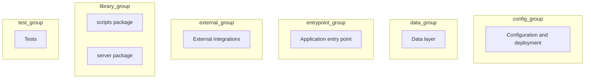

# Architecture report: jina-ai/clip-as-service

> Automated static analysis. **Observed** = directly seen in files/imports/AST; **Inferred** = interpretation from that evidence. Repository code was not executed.

## 1. Repository at a glance

| Item | Value |
| --- | --- |
| Repository | jina-ai/clip-as-service |
| Description | 🏄 Scalable embedding, reasoning, ranking for images and sentences with CLIP |
| Language | Python |
| Stars | 12841 |
| Licence | Other |
| Analysed commit / branch | 03410570d4398084f5ca5c88ad968248e0f3fc5d / main |
| Framework(s) | None detected |
| Files analysed | 123 |
| Components | 7 |

## 2. Architecture in one minute

jina-ai/clip-as-service - 🏄 Scalable embedding, reasoning, ranking for images and sentences with CLIP. This repository was analysed statically from 123 file(s) (45 Python). Detected technologies (observed from imports/manifests): GitHub Actions, Click, NumPy, setuptools, Docker, pytest. Files are grouped into 7 component(s): Configuration and deployment, Data layer, Application entry point, External integrations, scripts package, server package, Tests. Observed entry point(s): scripts/benchmark.py, server/clip_server/__main__.py. Findings below distinguish observed facts from inferred interpretation.

## 3. High-level block diagram

## 4. Main components

### Configuration and deployment (`config`)

- **Kind:** config
- **Status:** Observed
- **Confidence:** 0.85
- **Responsibility:** Groups 8 file(s) under configuration and deployment (observed from repository paths and static analysis).
- **Paths:** `client/setup.py`, `scripts/MANIFEST.in`, `scripts/setup.py`, `server/MANIFEST.in`, `server/clip_server/onnx-flow.yml`, `server/clip_server/tensorrt-flow.yml`, `server/clip_server/torch-flow.yml`, `server/setup.py`
- **Evidence:** [client/setup.py](https://github.com/jina-ai/clip-as-service/blob/03410570d4398084f5ca5c88ad968248e0f3fc5d/client/setup.py); [scripts/MANIFEST.in](https://github.com/jina-ai/clip-as-service/blob/03410570d4398084f5ca5c88ad968248e0f3fc5d/scripts/MANIFEST.in); [scripts/setup.py](https://github.com/jina-ai/clip-as-service/blob/03410570d4398084f5ca5c88ad968248e0f3fc5d/scripts/setup.py); [server/MANIFEST.in](https://github.com/jina-ai/clip-as-service/blob/03410570d4398084f5ca5c88ad968248e0f3fc5d/server/MANIFEST.in); [server/clip_server/onnx-flow.yml](https://github.com/jina-ai/clip-as-service/blob/03410570d4398084f5ca5c88ad968248e0f3fc5d/server/clip_server/onnx-flow.yml); [server/clip_server/tensorrt-flow.yml](https://github.com/jina-ai/clip-as-service/blob/03410570d4398084f5ca5c88ad968248e0f3fc5d/server/clip_server/tensorrt-flow.yml); [server/clip_server/torch-flow.yml](https://github.com/jina-ai/clip-as-service/blob/03410570d4398084f5ca5c88ad968248e0f3fc5d/server/clip_server/torch-flow.yml); [server/setup.py](https://github.com/jina-ai/clip-as-service/blob/03410570d4398084f5ca5c88ad968248e0f3fc5d/server/setup.py)

### Data layer (`data_layer`)

- **Kind:** data
- **Status:** Observed
- **Confidence:** 0.85
- **Responsibility:** Groups 1 file(s) under data layer (observed from repository paths and static analysis). Observed top-level classes: CLIP, CLIPTextCfg, CLIPVisionCfg, CustomTextCLIP, ModifiedResNet, ResidualAttentionBlock. Observed top-level functions: _build_text_tower, _build_vision_tower, build_model_from_openai_state_dict, convert_weights_to_lp, load_openai_model, load_openclip_model.
- **Paths:** `server/clip_server/model/model.py`
- **Evidence:** [server/clip_server/model/model.py:40](https://github.com/jina-ai/clip-as-service/blob/03410570d4398084f5ca5c88ad968248e0f3fc5d/server/clip_server/model/model.py#L40)

### Application entry point (`entrypoint`)

- **Kind:** entrypoint
- **Status:** Observed
- **Confidence:** 0.85
- **Responsibility:** Groups 2 file(s) under application entry point (observed from repository paths and static analysis). Observed top-level classes: BenchmarkClient. Observed top-level functions: main, warn.
- **Paths:** `scripts/benchmark.py`, `server/clip_server/__main__.py`
- **Evidence:** [scripts/benchmark.py:10](https://github.com/jina-ai/clip-as-service/blob/03410570d4398084f5ca5c88ad968248e0f3fc5d/scripts/benchmark.py#L10); [server/clip_server/__main__.py](https://github.com/jina-ai/clip-as-service/blob/03410570d4398084f5ca5c88ad968248e0f3fc5d/server/clip_server/__main__.py)

### External integrations (`external_integrations`)

- **Kind:** external
- **Status:** Observed
- **Confidence:** 0.85
- **Responsibility:** Groups 3 file(s) under external integrations (observed from repository paths and static analysis). Observed top-level classes: Client. Observed top-level functions: _version_check, is_latest_version.
- **Paths:** `client/clip_client/__init__.py`, `client/clip_client/client.py`, `client/clip_client/helper.py`
- **Evidence:** [client/clip_client/__init__.py](https://github.com/jina-ai/clip-as-service/blob/03410570d4398084f5ca5c88ad968248e0f3fc5d/client/clip_client/__init__.py); [client/clip_client/client.py:25](https://github.com/jina-ai/clip-as-service/blob/03410570d4398084f5ca5c88ad968248e0f3fc5d/client/clip_client/client.py#L25); [client/clip_client/helper.py:12](https://github.com/jina-ai/clip-as-service/blob/03410570d4398084f5ca5c88ad968248e0f3fc5d/client/clip_client/helper.py#L12)

### scripts package (`scripts`)

- **Kind:** library
- **Status:** Observed
- **Confidence:** 0.85
- **Responsibility:** Groups 7 file(s) under scripts package (observed from repository paths and static analysis). Observed top-level functions: convert_float_to_float16, quantize.
- **Paths:** `scripts/black.sh`, `scripts/docstrings_lint.sh`, `scripts/get-all-test-paths.sh`, `scripts/get-last-release-note.py`, `scripts/get-requirements.py`, `scripts/onnx_helper.py`, `scripts/release.sh`
- **Evidence:** [scripts/black.sh](https://github.com/jina-ai/clip-as-service/blob/03410570d4398084f5ca5c88ad968248e0f3fc5d/scripts/black.sh); [scripts/docstrings_lint.sh](https://github.com/jina-ai/clip-as-service/blob/03410570d4398084f5ca5c88ad968248e0f3fc5d/scripts/docstrings_lint.sh); [scripts/get-all-test-paths.sh](https://github.com/jina-ai/clip-as-service/blob/03410570d4398084f5ca5c88ad968248e0f3fc5d/scripts/get-all-test-paths.sh); [scripts/get-last-release-note.py](https://github.com/jina-ai/clip-as-service/blob/03410570d4398084f5ca5c88ad968248e0f3fc5d/scripts/get-last-release-note.py); [scripts/get-requirements.py](https://github.com/jina-ai/clip-as-service/blob/03410570d4398084f5ca5c88ad968248e0f3fc5d/scripts/get-requirements.py); [scripts/onnx_helper.py:1](https://github.com/jina-ai/clip-as-service/blob/03410570d4398084f5ca5c88ad968248e0f3fc5d/scripts/onnx_helper.py#L1); [scripts/release.sh](https://github.com/jina-ai/clip-as-service/blob/03410570d4398084f5ca5c88ad968248e0f3fc5d/scripts/release.sh)

### server package (`server`)

- **Kind:** library
- **Status:** Observed
- **Confidence:** 0.85
- **Responsibility:** Groups 20 file(s) under server package (observed from repository paths and static analysis). Observed top-level classes: BaseCLIPModel, CLIPEncoder, CLIPModel, CLIPOnnxModel, CLIPTensorRTModel, CNClipModel. Observed top-level functions: _blob2image, _convert_image_to_rgb, _transform_blob, _transform_ndarray, _version_check, basic_clean.
- **Paths:** `server/clip_server/__init__.py`, `server/clip_server/executors/__init__.py`, `server/clip_server/executors/clip_onnx.py`, `server/clip_server/executors/clip_tensorrt.py`, `server/clip_server/executors/clip_torch.py`, `server/clip_server/executors/helper.py`, `server/clip_server/helper.py`, `server/clip_server/model/__init__.py`, `server/clip_server/model/clip.py`, `server/clip_server/model/clip_model.py`, `server/clip_server/model/clip_onnx.py`, `server/clip_server/model/clip_trt.py`, `server/clip_server/model/cnclip_model.py`, `server/clip_server/model/flash_attention.py`, `server/clip_server/model/mclip_model.py`, `server/clip_server/model/openclip_model.py`, `server/clip_server/model/pretrained_models.py`, `server/clip_server/model/simple_tokenizer.py`, `server/clip_server/model/tokenization.py`, `server/clip_server/model/trt_utils.py`
- **Evidence:** [server/clip_server/__init__.py](https://github.com/jina-ai/clip-as-service/blob/03410570d4398084f5ca5c88ad968248e0f3fc5d/server/clip_server/__init__.py); [server/clip_server/executors/__init__.py](https://github.com/jina-ai/clip-as-service/blob/03410570d4398084f5ca5c88ad968248e0f3fc5d/server/clip_server/executors/__init__.py); [server/clip_server/executors/clip_onnx.py:21](https://github.com/jina-ai/clip-as-service/blob/03410570d4398084f5ca5c88ad968248e0f3fc5d/server/clip_server/executors/clip_onnx.py#L21); [server/clip_server/executors/clip_tensorrt.py:20](https://github.com/jina-ai/clip-as-service/blob/03410570d4398084f5ca5c88ad968248e0f3fc5d/server/clip_server/executors/clip_tensorrt.py#L20); [server/clip_server/executors/clip_torch.py:23](https://github.com/jina-ai/clip-as-service/blob/03410570d4398084f5ca5c88ad968248e0f3fc5d/server/clip_server/executors/clip_torch.py#L23); [server/clip_server/executors/helper.py:12](https://github.com/jina-ai/clip-as-service/blob/03410570d4398084f5ca5c88ad968248e0f3fc5d/server/clip_server/executors/helper.py#L12); [server/clip_server/helper.py:26](https://github.com/jina-ai/clip-as-service/blob/03410570d4398084f5ca5c88ad968248e0f3fc5d/server/clip_server/helper.py#L26); [server/clip_server/model/__init__.py](https://github.com/jina-ai/clip-as-service/blob/03410570d4398084f5ca5c88ad968248e0f3fc5d/server/clip_server/model/__init__.py)

### Tests (`tests`)

- **Kind:** test
- **Status:** Observed
- **Confidence:** 0.85
- **Responsibility:** Groups 12 file(s) under tests (observed from repository paths and static analysis). Observed top-level classes: ErrorExec, Exec1, Exec2. Observed top-level functions: another_heavylifting_job, make_flow, make_search_flow, make_torch_flow, make_trt_flow, port_generator.
- **Paths:** `tests/__init__.py`, `tests/conftest.py`, `tests/test_asyncio.py`, `tests/test_client.py`, `tests/test_helper.py`, `tests/test_model.py`, `tests/test_ranker.py`, `tests/test_search.py`, `tests/test_server.py`, `tests/test_simple.py`, `tests/test_tensorrt.py`, `tests/test_tokenization.py`
- **Evidence:** [tests/__init__.py](https://github.com/jina-ai/clip-as-service/blob/03410570d4398084f5ca5c88ad968248e0f3fc5d/tests/__init__.py); [tests/conftest.py:6](https://github.com/jina-ai/clip-as-service/blob/03410570d4398084f5ca5c88ad968248e0f3fc5d/tests/conftest.py#L6); [tests/test_asyncio.py:9](https://github.com/jina-ai/clip-as-service/blob/03410570d4398084f5ca5c88ad968248e0f3fc5d/tests/test_asyncio.py#L9); [tests/test_client.py:10](https://github.com/jina-ai/clip-as-service/blob/03410570d4398084f5ca5c88ad968248e0f3fc5d/tests/test_client.py#L10); [tests/test_helper.py:11](https://github.com/jina-ai/clip-as-service/blob/03410570d4398084f5ca5c88ad968248e0f3fc5d/tests/test_helper.py#L11); [tests/test_model.py:19](https://github.com/jina-ai/clip-as-service/blob/03410570d4398084f5ca5c88ad968248e0f3fc5d/tests/test_model.py#L19); [tests/test_ranker.py:14](https://github.com/jina-ai/clip-as-service/blob/03410570d4398084f5ca5c88ad968248e0f3fc5d/tests/test_ranker.py#L14); [tests/test_search.py:34](https://github.com/jina-ai/clip-as-service/blob/03410570d4398084f5ca5c88ad968248e0f3fc5d/tests/test_search.py#L34)

## 5. Execution flow

**Observed** entry point(s):

- [scripts/benchmark.py:107](https://github.com/jina-ai/clip-as-service/blob/03410570d4398084f5ca5c88ad968248e0f3fc5d/scripts/benchmark.py#L107)
- [server/clip_server/__main__.py:5](https://github.com/jina-ai/clip-as-service/blob/03410570d4398084f5ca5c88ad968248e0f3fc5d/server/clip_server/__main__.py#L5)

Representative flow (derived from observed entry points and the import graph; steps beyond the entry point are **Inferred**):

1. Execution starts at an observed entry point listed above, if present.
2. No internal import relationships between components were observed.

## 6. Project structure

### `(root)`

- `.dockerignore` - container (25 bytes)
- `.gitignore` - other (1775 bytes)
- `.pre-commit-config.yaml` - config (295 bytes)
- `CHANGELOG.md` - docs (75020 bytes)
- `LICENSE` - docs (11045 bytes)
- `README.md` - docs (22328 bytes)

### `.github`

- `.github/README-exec/onnx.readme.md` - docs (9036 bytes)
- `.github/README-exec/torch.readme.md` - docs (9542 bytes)
- `.github/README-img/banner.svg` - other (194894 bytes)
- `.github/README-img/rerank-chart.svg` - other (122986 bytes)
- `.github/codecov.yml` - config (476 bytes)
- `.github/labeler.yml` - config (475 bytes)
- `.github/release-template.ejs` - other (4646 bytes)
- `.github/workflows/cd.yml` - ci, YAML (5424 bytes)
- `.github/workflows/ci.yml` - ci, YAML (9714 bytes)
- `.github/workflows/force-docker-build-cas.yml` - ci, YAML (5781 bytes)
- `.github/workflows/force-docker-build.yml` - ci, YAML (4876 bytes)
- `.github/workflows/force-docs-build.yml` - ci, YAML (1855 bytes)
- `.github/workflows/force-hub-push.yml` - ci, YAML (7321 bytes)
- `.github/workflows/force-release.yml` - ci, YAML (1490 bytes)
- `.github/workflows/label-pr.yml` - ci, YAML (2884 bytes)
- `.github/workflows/tag.yml` - ci, YAML (2289 bytes)

### `Dockerfiles`

- `Dockerfiles/base.Dockerfile` - other (1306 bytes)
- `Dockerfiles/cuda.Dockerfile` - other (1592 bytes)
- `Dockerfiles/server.Dockerfile` - other (1724 bytes)
- `Dockerfiles/tensorrt.Dockerfile` - other (1273 bytes)

### `client`

- `client/clip_client/__init__.py` - source, Python (221 bytes)
- `client/clip_client/client.py` - source, Python (36690 bytes)
- `client/clip_client/helper.py` - source, Python (1987 bytes)
- `client/setup.py` - manifest, Python (3270 bytes)

### `docs`

- `docs/Makefile` - docs (609 bytes)
- `docs/_static/JCloud-dark.svg` - docs (2930 bytes)
- `docs/_static/JCloud-light.svg` - docs (2917 bytes)
- `docs/_static/cas-dark.svg` - docs (2442 bytes)
- `docs/_static/cas-grafana.json` - config (21834 bytes)
- `docs/_static/cas-light.svg` - docs (2442 bytes)
- `docs/_static/demo-embed.html` - docs (6280 bytes)
- `docs/_static/demo-text-rank.html` - docs (7377 bytes)
- `docs/_static/docarray-dark.svg` - docs (3318 bytes)
- `docs/_static/docarray-light.svg` - docs (3322 bytes)
- `docs/_static/finetuner-dark.svg` - docs (5530 bytes)
- `docs/_static/finetuner-light.svg` - docs (5530 bytes)
- `docs/_static/hub-dark.svg` - docs (912 bytes)
- `docs/_static/hub-light.svg` - docs (912 bytes)
- `docs/_static/logo-dark.svg` - docs (12462 bytes)
- `docs/_static/logo-light.svg` - docs (13603 bytes)
- `docs/_static/main.css` - docs (3435 bytes)
- `docs/_static/now-dark.svg` - docs (2712 bytes)
- `docs/_static/now-light.svg` - docs (2730 bytes)
- `docs/_static/search-dark.svg` - docs (1095 bytes)
- `docs/_static/search-light.svg` - docs (1095 bytes)
- `docs/_templates/page.html` - docs (10837 bytes)
- `docs/_templates/sidebar/brand.html` - docs (1981 bytes)
- `docs/_templates/sidebar/navigation.html` - docs (2579 bytes)
- `docs/changelog/index.md` - docs (1125 bytes)
- `docs/conf.py` - docs (6795 bytes)
- `docs/hosting/by-jina.md` - docs (3317 bytes)
- `docs/hosting/cas-on-colab.ipynb` - docs (12448 bytes)
- `docs/hosting/cas-on-colab.svg` - docs (54360 bytes)
- `docs/hosting/colab.md` - docs (1239 bytes)
- `docs/hosting/on-jcloud.md` - docs (2250 bytes)
- `docs/html_extra/robots.txt` - docs (66 bytes)
- `docs/index.md` - docs (3714 bytes)
- `docs/makedoc.sh` - docs (69 bytes)
- `docs/playground/embedding.md` - docs (890 bytes)
- `docs/playground/reasoning.md` - docs (1075 bytes)
- `docs/playground/searching.md` - docs (1286 bytes)
- `docs/requirements.txt` - manifest (451 bytes)
- `docs/user-guides/benchmark.rst` - docs (49499 bytes)
- `docs/user-guides/client.md` - docs (28875 bytes)
- `docs/user-guides/faq.md` - docs (3349 bytes)
- `docs/user-guides/finetuner.md` - docs (16971 bytes)
- `docs/user-guides/retriever.md` - docs (7899 bytes)
- `docs/user-guides/server.md` - docs (25175 bytes)

### `scripts`

- `scripts/MANIFEST.in` - manifest (45 bytes)
- `scripts/benchmark.py` - source, Python (4201 bytes)
- `scripts/black.sh` - source, Shell (464 bytes)
- `scripts/docstrings_lint.sh` - source, Shell (1334 bytes)
- `scripts/get-all-test-paths.sh` - source, Shell (763 bytes)
- `scripts/get-last-release-note.py` - source, Python (292 bytes)
- `scripts/get-requirements.py` - source, Python (397 bytes)
- `scripts/onnx_helper.py` - source, Python (2083 bytes)
- `scripts/release.sh` - source, Shell (4208 bytes)
- `scripts/setup.py` - manifest, Python (2771 bytes)

### `server`

- `server/MANIFEST.in` - manifest (68 bytes)
- `server/clip_server/__init__.py` - source, Python (22 bytes)
- `server/clip_server/__main__.py` - source, Python (605 bytes)
- `server/clip_server/executors/__init__.py` - source, Python (0 bytes)
- `server/clip_server/executors/clip_onnx.py` - source, Python (9096 bytes)
- `server/clip_server/executors/clip_tensorrt.py` - source, Python (7670 bytes)
- `server/clip_server/executors/clip_torch.py` - source, Python (9685 bytes)
- `server/clip_server/executors/helper.py` - source, Python (3875 bytes)
- `server/clip_server/helper.py` - source, Python (2283 bytes)
- `server/clip_server/model/__init__.py` - source, Python (0 bytes)
- `server/clip_server/model/clip.py` - source, Python (1220 bytes)
- `server/clip_server/model/clip_model.py` - source, Python (1885 bytes)
- `server/clip_server/model/clip_onnx.py` - source, Python (12608 bytes)
- `server/clip_server/model/clip_trt.py` - source, Python (4889 bytes)
- `server/clip_server/model/cnclip_model.py` - source, Python (1431 bytes)
- `server/clip_server/model/flash_attention.py` - source, Python (3549 bytes)
- `server/clip_server/model/mclip_model.py` - source, Python (2592 bytes)
- `server/clip_server/model/model.py` - source, Python (20554 bytes)
- `server/clip_server/model/openclip_model.py` - source, Python (1992 bytes)
- `server/clip_server/model/pretrained_models.py` - source, Python (8457 bytes)
- `server/clip_server/model/simple_tokenizer.py` - source, Python (4958 bytes)
- `server/clip_server/model/tokenization.py` - source, Python (3901 bytes)
- `server/clip_server/model/trt_utils.py` - source, Python (11395 bytes)
- `server/clip_server/onnx-flow.yml` - config (227 bytes)
- `server/clip_server/tensorrt-flow.yml` - config (231 bytes)
- `server/clip_server/torch-flow.yml` - config (228 bytes)
- `server/setup.py` - manifest, Python (3593 bytes)

### `tests`

- `tests/__init__.py` - test, Python (47 bytes)
- `tests/conftest.py` - test, Python (2153 bytes)
- `tests/test_asyncio.py` - test, Python (2293 bytes)
- `tests/test_client.py` - test, Python (7448 bytes)
- `tests/test_helper.py` - test, Python (3234 bytes)
- `tests/test_model.py` - test, Python (1152 bytes)
- `tests/test_ranker.py` - test, Python (8447 bytes)
- `tests/test_search.py` - test, Python (2894 bytes)
- `tests/test_server.py` - test, Python (3417 bytes)
- `tests/test_simple.py` - test, Python (5443 bytes)
- `tests/test_tensorrt.py` - test, Python (2445 bytes)
- `tests/test_tokenization.py` - test, Python (564 bytes)

## 7. Key dependencies and integrations

| Name | Category | Status | Confidence | Evidence |
| --- | --- | --- | --- | --- |
| GitHub Actions | ci | Observed | 0.90 | [.github/workflows/cd.yml](https://github.com/jina-ai/clip-as-service/blob/03410570d4398084f5ca5c88ad968248e0f3fc5d/.github/workflows/cd.yml); [.github/workflows/ci.yml](https://github.com/jina-ai/clip-as-service/blob/03410570d4398084f5ca5c88ad968248e0f3fc5d/.github/workflows/ci.yml); [.github/workflows/force-docker-build-cas.yml](https://github.com/jina-ai/clip-as-service/blob/03410570d4398084f5ca5c88ad968248e0f3fc5d/.github/workflows/force-docker-build-cas.yml); [.github/workflows/force-docker-build.yml](https://github.com/jina-ai/clip-as-service/blob/03410570d4398084f5ca5c88ad968248e0f3fc5d/.github/workflows/force-docker-build.yml) |
| Click | library | Observed | 0.90 | [scripts/benchmark.py:5](https://github.com/jina-ai/clip-as-service/blob/03410570d4398084f5ca5c88ad968248e0f3fc5d/scripts/benchmark.py#L5) |
| NumPy | library | Observed | 0.95 | [client/clip_client/client.py:20](https://github.com/jina-ai/clip-as-service/blob/03410570d4398084f5ca5c88ad968248e0f3fc5d/client/clip_client/client.py#L20); [scripts/benchmark.py:6](https://github.com/jina-ai/clip-as-service/blob/03410570d4398084f5ca5c88ad968248e0f3fc5d/scripts/benchmark.py#L6); [server/clip_server/executors/clip_tensorrt.py:6](https://github.com/jina-ai/clip-as-service/blob/03410570d4398084f5ca5c88ad968248e0f3fc5d/server/clip_server/executors/clip_tensorrt.py#L6); [server/clip_server/executors/clip_torch.py:7](https://github.com/jina-ai/clip-as-service/blob/03410570d4398084f5ca5c88ad968248e0f3fc5d/server/clip_server/executors/clip_torch.py#L7) |
| setuptools | packaging | Observed | 0.95 | [client/setup.py:4](https://github.com/jina-ai/clip-as-service/blob/03410570d4398084f5ca5c88ad968248e0f3fc5d/client/setup.py#L4); [client/setup.py:5](https://github.com/jina-ai/clip-as-service/blob/03410570d4398084f5ca5c88ad968248e0f3fc5d/client/setup.py#L5); [scripts/setup.py:4](https://github.com/jina-ai/clip-as-service/blob/03410570d4398084f5ca5c88ad968248e0f3fc5d/scripts/setup.py#L4); [scripts/setup.py:5](https://github.com/jina-ai/clip-as-service/blob/03410570d4398084f5ca5c88ad968248e0f3fc5d/scripts/setup.py#L5) |
| Docker | tooling | Observed | 0.75 | [.github/workflows/cd.yml:131](https://github.com/jina-ai/clip-as-service/blob/03410570d4398084f5ca5c88ad968248e0f3fc5d/.github/workflows/cd.yml#L131); [.github/workflows/force-docker-build-cas.yml:1](https://github.com/jina-ai/clip-as-service/blob/03410570d4398084f5ca5c88ad968248e0f3fc5d/.github/workflows/force-docker-build-cas.yml#L1); [.github/workflows/force-docker-build.yml:1](https://github.com/jina-ai/clip-as-service/blob/03410570d4398084f5ca5c88ad968248e0f3fc5d/.github/workflows/force-docker-build.yml#L1); [.github/workflows/force-hub-push.yml:118](https://github.com/jina-ai/clip-as-service/blob/03410570d4398084f5ca5c88ad968248e0f3fc5d/.github/workflows/force-hub-push.yml#L118) |
| pytest | tooling | Observed | 0.95 | [.github/workflows/cd.yml:51](https://github.com/jina-ai/clip-as-service/blob/03410570d4398084f5ca5c88ad968248e0f3fc5d/.github/workflows/cd.yml#L51); [.github/workflows/ci.yml:111](https://github.com/jina-ai/clip-as-service/blob/03410570d4398084f5ca5c88ad968248e0f3fc5d/.github/workflows/ci.yml#L111); [client/setup.py:51](https://github.com/jina-ai/clip-as-service/blob/03410570d4398084f5ca5c88ad968248e0f3fc5d/client/setup.py#L51); [tests/conftest.py:1](https://github.com/jina-ai/clip-as-service/blob/03410570d4398084f5ca5c88ad968248e0f3fc5d/tests/conftest.py#L1) |

## 8. Data and state

- Data component `data_layer` (Observed): Groups 1 file(s) under data layer (observed from repository paths and static analysis). Observed top-level classes: CLIP, CLIPTextCfg, CLIPVisionCfg, CustomTextCLIP, ModifiedResNet, ResidualAttentionBlock. Observed top-level functions: _build_text_tower, _build_vision_tower, build_model_from_openai…

## 9. Configuration and deployment clues

- `.dockerignore` (container)
- `.github/codecov.yml` (config)
- `.github/labeler.yml` (config)
- `.github/workflows/cd.yml` (ci)
- `.github/workflows/ci.yml` (ci)
- `.github/workflows/force-docker-build-cas.yml` (ci)
- `.github/workflows/force-docker-build.yml` (ci)
- `.github/workflows/force-docs-build.yml` (ci)
- `.github/workflows/force-hub-push.yml` (ci)
- `.github/workflows/force-release.yml` (ci)
- `.github/workflows/label-pr.yml` (ci)
- `.github/workflows/tag.yml` (ci)
- `.pre-commit-config.yaml` (config)
- `client/setup.py` (manifest)
- `docs/_static/cas-grafana.json` (config)
- `docs/requirements.txt` (manifest)
- `scripts/MANIFEST.in` (manifest)
- `scripts/setup.py` (manifest)
- `server/MANIFEST.in` (manifest)
- `server/clip_server/onnx-flow.yml` (config)
- `server/clip_server/tensorrt-flow.yml` (config)
- `server/clip_server/torch-flow.yml` (config)
- `server/setup.py` (manifest)

## 10. Design observations

- An entry/API layer is separated from other code (Inferred from paths and decorators).
- Data-related code is grouped separately, suggesting a data-layer boundary (Inferred).
- Tests are present alongside source code (Observed from test file paths).
- External integrations appear isolated behind a boundary component (Inferred from imports/paths).

These observations are interpretations (**Inferred**) of the observed structure, not guarantees about runtime design.

## 11. Limitations and unknowns

- Static analysis only: repository code was not executed, installed, or imported at runtime.
- Components and relationships are inferred from file paths, imports, and AST structure; runtime behaviour, dynamic imports, and reflection may not be visible.
- Repository text was treated as untrusted data; no instructions found in repository files were followed, and likely secret values were redacted/excluded.

## 12. Source references

- [.github/workflows/cd.yml](https://github.com/jina-ai/clip-as-service/blob/03410570d4398084f5ca5c88ad968248e0f3fc5d/.github/workflows/cd.yml)
- [.github/workflows/cd.yml:51](https://github.com/jina-ai/clip-as-service/blob/03410570d4398084f5ca5c88ad968248e0f3fc5d/.github/workflows/cd.yml#L51)
- [.github/workflows/cd.yml:131](https://github.com/jina-ai/clip-as-service/blob/03410570d4398084f5ca5c88ad968248e0f3fc5d/.github/workflows/cd.yml#L131)
- [.github/workflows/ci.yml](https://github.com/jina-ai/clip-as-service/blob/03410570d4398084f5ca5c88ad968248e0f3fc5d/.github/workflows/ci.yml)
- [.github/workflows/ci.yml:111](https://github.com/jina-ai/clip-as-service/blob/03410570d4398084f5ca5c88ad968248e0f3fc5d/.github/workflows/ci.yml#L111)
- [.github/workflows/force-docker-build-cas.yml](https://github.com/jina-ai/clip-as-service/blob/03410570d4398084f5ca5c88ad968248e0f3fc5d/.github/workflows/force-docker-build-cas.yml)
- [.github/workflows/force-docker-build-cas.yml:1](https://github.com/jina-ai/clip-as-service/blob/03410570d4398084f5ca5c88ad968248e0f3fc5d/.github/workflows/force-docker-build-cas.yml#L1)
- [.github/workflows/force-docker-build.yml](https://github.com/jina-ai/clip-as-service/blob/03410570d4398084f5ca5c88ad968248e0f3fc5d/.github/workflows/force-docker-build.yml)
- [.github/workflows/force-docker-build.yml:1](https://github.com/jina-ai/clip-as-service/blob/03410570d4398084f5ca5c88ad968248e0f3fc5d/.github/workflows/force-docker-build.yml#L1)
- [.github/workflows/force-docs-build.yml](https://github.com/jina-ai/clip-as-service/blob/03410570d4398084f5ca5c88ad968248e0f3fc5d/.github/workflows/force-docs-build.yml)
- [.github/workflows/force-hub-push.yml](https://github.com/jina-ai/clip-as-service/blob/03410570d4398084f5ca5c88ad968248e0f3fc5d/.github/workflows/force-hub-push.yml)
- [.github/workflows/force-hub-push.yml:118](https://github.com/jina-ai/clip-as-service/blob/03410570d4398084f5ca5c88ad968248e0f3fc5d/.github/workflows/force-hub-push.yml#L118)
- [.github/workflows/force-release.yml](https://github.com/jina-ai/clip-as-service/blob/03410570d4398084f5ca5c88ad968248e0f3fc5d/.github/workflows/force-release.yml)
- [.github/workflows/label-pr.yml](https://github.com/jina-ai/clip-as-service/blob/03410570d4398084f5ca5c88ad968248e0f3fc5d/.github/workflows/label-pr.yml)
- [.github/workflows/tag.yml:20](https://github.com/jina-ai/clip-as-service/blob/03410570d4398084f5ca5c88ad968248e0f3fc5d/.github/workflows/tag.yml#L20)
- [client/clip_client/__init__.py](https://github.com/jina-ai/clip-as-service/blob/03410570d4398084f5ca5c88ad968248e0f3fc5d/client/clip_client/__init__.py)
- [client/clip_client/client.py:20](https://github.com/jina-ai/clip-as-service/blob/03410570d4398084f5ca5c88ad968248e0f3fc5d/client/clip_client/client.py#L20)
- [client/clip_client/client.py:25](https://github.com/jina-ai/clip-as-service/blob/03410570d4398084f5ca5c88ad968248e0f3fc5d/client/clip_client/client.py#L25)
- [client/clip_client/helper.py:12](https://github.com/jina-ai/clip-as-service/blob/03410570d4398084f5ca5c88ad968248e0f3fc5d/client/clip_client/helper.py#L12)
- [client/setup.py](https://github.com/jina-ai/clip-as-service/blob/03410570d4398084f5ca5c88ad968248e0f3fc5d/client/setup.py)
- [client/setup.py:4](https://github.com/jina-ai/clip-as-service/blob/03410570d4398084f5ca5c88ad968248e0f3fc5d/client/setup.py#L4)
- [client/setup.py:5](https://github.com/jina-ai/clip-as-service/blob/03410570d4398084f5ca5c88ad968248e0f3fc5d/client/setup.py#L5)
- [client/setup.py:51](https://github.com/jina-ai/clip-as-service/blob/03410570d4398084f5ca5c88ad968248e0f3fc5d/client/setup.py#L51)
- [scripts/MANIFEST.in](https://github.com/jina-ai/clip-as-service/blob/03410570d4398084f5ca5c88ad968248e0f3fc5d/scripts/MANIFEST.in)
- [scripts/benchmark.py:5](https://github.com/jina-ai/clip-as-service/blob/03410570d4398084f5ca5c88ad968248e0f3fc5d/scripts/benchmark.py#L5)
- [scripts/benchmark.py:6](https://github.com/jina-ai/clip-as-service/blob/03410570d4398084f5ca5c88ad968248e0f3fc5d/scripts/benchmark.py#L6)
- [scripts/benchmark.py:10](https://github.com/jina-ai/clip-as-service/blob/03410570d4398084f5ca5c88ad968248e0f3fc5d/scripts/benchmark.py#L10)
- [scripts/benchmark.py:107](https://github.com/jina-ai/clip-as-service/blob/03410570d4398084f5ca5c88ad968248e0f3fc5d/scripts/benchmark.py#L107)
- [scripts/black.sh](https://github.com/jina-ai/clip-as-service/blob/03410570d4398084f5ca5c88ad968248e0f3fc5d/scripts/black.sh)
- [scripts/docstrings_lint.sh](https://github.com/jina-ai/clip-as-service/blob/03410570d4398084f5ca5c88ad968248e0f3fc5d/scripts/docstrings_lint.sh)
- [scripts/get-all-test-paths.sh](https://github.com/jina-ai/clip-as-service/blob/03410570d4398084f5ca5c88ad968248e0f3fc5d/scripts/get-all-test-paths.sh)
- [scripts/get-last-release-note.py](https://github.com/jina-ai/clip-as-service/blob/03410570d4398084f5ca5c88ad968248e0f3fc5d/scripts/get-last-release-note.py)
- [scripts/get-requirements.py](https://github.com/jina-ai/clip-as-service/blob/03410570d4398084f5ca5c88ad968248e0f3fc5d/scripts/get-requirements.py)
- [scripts/onnx_helper.py:1](https://github.com/jina-ai/clip-as-service/blob/03410570d4398084f5ca5c88ad968248e0f3fc5d/scripts/onnx_helper.py#L1)
- [scripts/release.sh](https://github.com/jina-ai/clip-as-service/blob/03410570d4398084f5ca5c88ad968248e0f3fc5d/scripts/release.sh)
- [scripts/setup.py](https://github.com/jina-ai/clip-as-service/blob/03410570d4398084f5ca5c88ad968248e0f3fc5d/scripts/setup.py)
- [scripts/setup.py:4](https://github.com/jina-ai/clip-as-service/blob/03410570d4398084f5ca5c88ad968248e0f3fc5d/scripts/setup.py#L4)
- [scripts/setup.py:5](https://github.com/jina-ai/clip-as-service/blob/03410570d4398084f5ca5c88ad968248e0f3fc5d/scripts/setup.py#L5)
- [server/MANIFEST.in](https://github.com/jina-ai/clip-as-service/blob/03410570d4398084f5ca5c88ad968248e0f3fc5d/server/MANIFEST.in)
- [server/clip_server/__init__.py](https://github.com/jina-ai/clip-as-service/blob/03410570d4398084f5ca5c88ad968248e0f3fc5d/server/clip_server/__init__.py)
- [server/clip_server/__main__.py](https://github.com/jina-ai/clip-as-service/blob/03410570d4398084f5ca5c88ad968248e0f3fc5d/server/clip_server/__main__.py)
- [server/clip_server/__main__.py:5](https://github.com/jina-ai/clip-as-service/blob/03410570d4398084f5ca5c88ad968248e0f3fc5d/server/clip_server/__main__.py#L5)
- [server/clip_server/executors/__init__.py](https://github.com/jina-ai/clip-as-service/blob/03410570d4398084f5ca5c88ad968248e0f3fc5d/server/clip_server/executors/__init__.py)
- [server/clip_server/executors/clip_onnx.py:21](https://github.com/jina-ai/clip-as-service/blob/03410570d4398084f5ca5c88ad968248e0f3fc5d/server/clip_server/executors/clip_onnx.py#L21)
- [server/clip_server/executors/clip_tensorrt.py:6](https://github.com/jina-ai/clip-as-service/blob/03410570d4398084f5ca5c88ad968248e0f3fc5d/server/clip_server/executors/clip_tensorrt.py#L6)
- [server/clip_server/executors/clip_tensorrt.py:20](https://github.com/jina-ai/clip-as-service/blob/03410570d4398084f5ca5c88ad968248e0f3fc5d/server/clip_server/executors/clip_tensorrt.py#L20)
- [server/clip_server/executors/clip_torch.py:7](https://github.com/jina-ai/clip-as-service/blob/03410570d4398084f5ca5c88ad968248e0f3fc5d/server/clip_server/executors/clip_torch.py#L7)
- [server/clip_server/executors/clip_torch.py:23](https://github.com/jina-ai/clip-as-service/blob/03410570d4398084f5ca5c88ad968248e0f3fc5d/server/clip_server/executors/clip_torch.py#L23)
- [server/clip_server/executors/helper.py:3](https://github.com/jina-ai/clip-as-service/blob/03410570d4398084f5ca5c88ad968248e0f3fc5d/server/clip_server/executors/helper.py#L3)
- [server/clip_server/executors/helper.py:12](https://github.com/jina-ai/clip-as-service/blob/03410570d4398084f5ca5c88ad968248e0f3fc5d/server/clip_server/executors/helper.py#L12)
- [server/clip_server/helper.py:26](https://github.com/jina-ai/clip-as-service/blob/03410570d4398084f5ca5c88ad968248e0f3fc5d/server/clip_server/helper.py#L26)
- [server/clip_server/model/__init__.py](https://github.com/jina-ai/clip-as-service/blob/03410570d4398084f5ca5c88ad968248e0f3fc5d/server/clip_server/model/__init__.py)
- [server/clip_server/model/model.py:13](https://github.com/jina-ai/clip-as-service/blob/03410570d4398084f5ca5c88ad968248e0f3fc5d/server/clip_server/model/model.py#L13)
- [server/clip_server/model/model.py:40](https://github.com/jina-ai/clip-as-service/blob/03410570d4398084f5ca5c88ad968248e0f3fc5d/server/clip_server/model/model.py#L40)
- [server/clip_server/onnx-flow.yml](https://github.com/jina-ai/clip-as-service/blob/03410570d4398084f5ca5c88ad968248e0f3fc5d/server/clip_server/onnx-flow.yml)
- [server/clip_server/tensorrt-flow.yml](https://github.com/jina-ai/clip-as-service/blob/03410570d4398084f5ca5c88ad968248e0f3fc5d/server/clip_server/tensorrt-flow.yml)
- [server/clip_server/torch-flow.yml](https://github.com/jina-ai/clip-as-service/blob/03410570d4398084f5ca5c88ad968248e0f3fc5d/server/clip_server/torch-flow.yml)
- [server/setup.py](https://github.com/jina-ai/clip-as-service/blob/03410570d4398084f5ca5c88ad968248e0f3fc5d/server/setup.py)
- [server/setup.py:4](https://github.com/jina-ai/clip-as-service/blob/03410570d4398084f5ca5c88ad968248e0f3fc5d/server/setup.py#L4)
- [tests/__init__.py](https://github.com/jina-ai/clip-as-service/blob/03410570d4398084f5ca5c88ad968248e0f3fc5d/tests/__init__.py)
- [tests/conftest.py:1](https://github.com/jina-ai/clip-as-service/blob/03410570d4398084f5ca5c88ad968248e0f3fc5d/tests/conftest.py#L1)
- [tests/conftest.py:6](https://github.com/jina-ai/clip-as-service/blob/03410570d4398084f5ca5c88ad968248e0f3fc5d/tests/conftest.py#L6)
- [tests/test_asyncio.py:3](https://github.com/jina-ai/clip-as-service/blob/03410570d4398084f5ca5c88ad968248e0f3fc5d/tests/test_asyncio.py#L3)
- [tests/test_asyncio.py:9](https://github.com/jina-ai/clip-as-service/blob/03410570d4398084f5ca5c88ad968248e0f3fc5d/tests/test_asyncio.py#L9)
- [tests/test_client.py:4](https://github.com/jina-ai/clip-as-service/blob/03410570d4398084f5ca5c88ad968248e0f3fc5d/tests/test_client.py#L4)
- [tests/test_client.py:5](https://github.com/jina-ai/clip-as-service/blob/03410570d4398084f5ca5c88ad968248e0f3fc5d/tests/test_client.py#L5)
- [tests/test_client.py:10](https://github.com/jina-ai/clip-as-service/blob/03410570d4398084f5ca5c88ad968248e0f3fc5d/tests/test_client.py#L10)
- [tests/test_helper.py:1](https://github.com/jina-ai/clip-as-service/blob/03410570d4398084f5ca5c88ad968248e0f3fc5d/tests/test_helper.py#L1)
- [tests/test_helper.py:2](https://github.com/jina-ai/clip-as-service/blob/03410570d4398084f5ca5c88ad968248e0f3fc5d/tests/test_helper.py#L2)
- [tests/test_helper.py:11](https://github.com/jina-ai/clip-as-service/blob/03410570d4398084f5ca5c88ad968248e0f3fc5d/tests/test_helper.py#L11)
- [tests/test_model.py:1](https://github.com/jina-ai/clip-as-service/blob/03410570d4398084f5ca5c88ad968248e0f3fc5d/tests/test_model.py#L1)
- [tests/test_model.py:19](https://github.com/jina-ai/clip-as-service/blob/03410570d4398084f5ca5c88ad968248e0f3fc5d/tests/test_model.py#L19)
- [tests/test_ranker.py:14](https://github.com/jina-ai/clip-as-service/blob/03410570d4398084f5ca5c88ad968248e0f3fc5d/tests/test_ranker.py#L14)
- [tests/test_search.py:34](https://github.com/jina-ai/clip-as-service/blob/03410570d4398084f5ca5c88ad968248e0f3fc5d/tests/test_search.py#L34)
