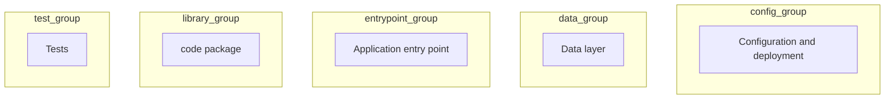

# Architecture report: jindongwang/transferlearning

> Automated static analysis. **Observed** = directly seen in files/imports/AST; **Inferred** = interpretation from that evidence. Repository code was not executed.

## 1. Repository at a glance

| Item | Value |
| --- | --- |
| Repository | jindongwang/transferlearning |
| Description | Transfer learning / domain adaptation / domain generalization / multi-task learning etc. Papers, codes, datasets, applications, tutorials.-迁移学习 |
| Language | Python |
| Stars | 14387 |
| Licence | MIT |
| Analysed commit / branch | d77ef50a2e7ecdd4f3354148205666970ba809b6 / master |
| Framework(s) | None detected |
| Files analysed | 458 |
| Components | 5 |

## 2. Architecture in one minute

jindongwang/transferlearning - Transfer learning / domain adaptation / domain generalization / multi-task learning etc. Papers, codes, datasets, applications, tutorials.-迁移学习. This repository was analysed statically from 458 file(s) (275 Python). Detected technologies (observed from imports/manifests): NumPy, pandas. Files are grouped into 5 component(s): code package, Configuration and deployment, Data layer, Application entry point, Tests. Observed entry point(s): code/ASR/Adapter/train.py, code/ASR/CMatch/train.py, code/DeepDA/main.py. Findings below distinguish observed facts from inferred interpretation.

## 3. High-level block diagram

## 4. Main components

### code package (`code`)

- **Kind:** library
- **Status:** Observed
- **Confidence:** 0.85
- **Responsibility:** Groups 235 file(s) under code package (observed from repository paths and static analysis). Observed top-level classes: ANDMask, ActList, ActNetwork, AdaRNN, Adapter, AdaptiveDecoder. Observed top-level functions: BNM, CORAL, CORAL_loss, CORAL_map, EasyTL, GFK_map.
- **Paths:** `code/ASR/Adapter/balanced_sampler.py`, `code/ASR/Adapter/data_load.py`, `code/ASR/Adapter/e2e_asr_adaptertransformer.py`, `code/ASR/Adapter/utils.py`, `code/ASR/CMatch/ctc_aligner.py`, `code/ASR/CMatch/data_load.py`, `code/ASR/CMatch/distances.py`, `code/ASR/CMatch/e2e_asr_udatransformer.py`, `code/ASR/CMatch/utils.py`, `code/DeepDA/BNM/BNM.sh`, `code/DeepDA/DAAN/DAAN.sh`, `code/DeepDA/DAN/DAN.sh`, `code/DeepDA/DANN/DANN.sh`, `code/DeepDA/DSAN/DSAN.sh`, `code/DeepDA/DeepCoral/DeepCoral.sh`, `code/DeepDA/backbones.py`, `code/DeepDA/data_loader.py`, `code/DeepDA/loss_funcs/__init__.py`, `code/DeepDA/loss_funcs/adv.py`, `code/DeepDA/loss_funcs/bnm.py`, `code/DeepDA/loss_funcs/coral.py`, `code/DeepDA/loss_funcs/daan.py`, `code/DeepDA/loss_funcs/lmmd.py`, `code/DeepDA/loss_funcs/mmd.py`, `code/DeepDA/transfer_losses.py`, `code/DeepDA/utils.py`, `code/DeepDG/alg/alg.py`, `code/DeepDG/alg/algs/ANDMask.py`, `code/DeepDG/alg/algs/CORAL.py`, `code/DeepDG/alg/algs/DANN.py`, `code/DeepDG/alg/algs/DIFEX.py`, `code/DeepDG/alg/algs/ERM.py`, `code/DeepDG/alg/algs/GroupDRO.py`, `code/DeepDG/alg/algs/MLDG.py`, `code/DeepDG/alg/algs/MMD.py`, `code/DeepDG/alg/algs/Mixup.py`, `code/DeepDG/alg/algs/RSC.py`, `code/DeepDG/alg/algs/VREx.py`, `code/DeepDG/alg/algs/base.py`, `code/DeepDG/alg/modelopera.py`, `code/DeepDG/alg/opt.py`, `code/DeepDG/datautil/getdataloader.py`, `code/DeepDG/datautil/imgdata/imgdataload.py`, `code/DeepDG/datautil/imgdata/util.py`, `code/DeepDG/datautil/mydataloader.py`, `code/DeepDG/datautil/util.py`, `code/DeepDG/network/Adver_network.py`, `code/DeepDG/network/common_network.py`, `code/DeepDG/network/img_network.py`, `code/DeepDG/network/util.py`, `code/DeepDG/scripts/run.sh`, `code/DeepDG/utils/util.py`, `code/clip/__init__.py`, `code/clip/utils.py`, `code/deep/B-JMMD/caffe/kmake.sh`, `code/deep/B-JMMD/caffe/src/caffe/layers/bjmmd_layer.cpp`, `code/deep/CSG/a-domainbed/prepare_data.sh`, `code/deep/CSG/a-domainbed/run_da.sh`, `code/deep/CSG/a-domainbed/run_ood.sh`, `code/deep/CSG/a-imageclef/prepare_data.sh`, `code/deep/CSG/a-imageclef/run_da.sh`, `code/deep/CSG/a-imageclef/run_ood.sh`, `code/deep/CSG/a-mnist/makedata.sh`, `code/deep/CSG/a-mnist/run_da.sh`, `code/deep/CSG/a-mnist/run_ood.sh`, `code/deep/CSG/arch/__init__.py`, `code/deep/CSG/arch/backbone.py`, `code/deep/CSG/arch/cnn.py`, `code/deep/CSG/arch/mlp.py`, `code/deep/CSG/distr/__init__.py`, `code/deep/CSG/distr/base.py`, `code/deep/CSG/distr/instances.py`, `code/deep/CSG/distr/tools.py`, `code/deep/CSG/distr/utils.py`, `code/deep/CSG/methods/__init__.py`, `code/deep/CSG/methods/cnbb.py`, `code/deep/CSG/methods/semvar.py`, `code/deep/CSG/methods/supvae.py`, `code/deep/CSG/methods/xdistr.py`, `code/deep/CSG/utils/__init__.py`, `code/deep/CSG/utils/preprocess/__init__.py`, `code/deep/CSG/utils/preprocess/data_list.py`, `code/deep/CSG/utils/preprocess/data_loader.py`, `code/deep/CSG/utils/preprocess/data_provider.py`, `code/deep/CSG/utils/reprun.sh`, `code/deep/CSG/utils/utils.py`, `code/deep/CSG/utils/utils_main.py`, `code/deep/DAAN/data_loader.py`, `code/deep/DAAN/functions.py`, `code/deep/DAAN/model/DAAN.py`, `code/deep/DAAN/model/__init__.py`, `code/deep/DAAN/model/backbone.py`, `code/deep/DAAN/scripts/train.sh`, `code/deep/DANN(RevGrad)/adv_layer.py`, `code/deep/DaNN/DaNN.py`, `code/deep/DaNN/data_loader.py`, `code/deep/DaNN/mmd.py`, `code/deep/DeepMEDA/ResNet.py`, `code/deep/DeepMEDA/Weight.py`, `code/deep/DeepMEDA/data_loader.py`, `code/deep/DeepMEDA/deep_meda.py`, `code/deep/DeepMEDA/dynamic_factor.py`, `code/deep/DeepMEDA/mmd.py`, `code/deep/MRAN/ResNet.py`, `code/deep/MRAN/data_loader.py`, `code/deep/MRAN/mmd.py`, `code/deep/ReMoS/CV_adv/DNNtest/coverage/my_neuron_coverage.py`, `code/deep/ReMoS/CV_adv/DNNtest/coverage/neuron_coverage.py`, `code/deep/ReMoS/CV_adv/DNNtest/coverage/pytorch_wrapper.py`, `code/deep/ReMoS/CV_adv/DNNtest/coverage/strong_neuron_activation_coverage.py`, `code/deep/ReMoS/CV_adv/DNNtest/coverage/top_k_coverage.py`, `code/deep/ReMoS/CV_adv/DNNtest/coverage/utils/__init__.py`, `code/deep/ReMoS/CV_adv/DNNtest/coverage/utils/common.py`, `code/deep/ReMoS/CV_adv/DNNtest/coverage/utils/keras.py`, `code/deep/ReMoS/CV_adv/DNNtest/coverage/utils/mxnet.py`, `code/deep/ReMoS/CV_adv/DNNtest/coverage/utils/pytorch.py`, `code/deep/ReMoS/CV_adv/DNNtest/coverage/utils/tensorflow.py`, `code/deep/ReMoS/CV_adv/DNNtest/strategy/__init__.py`, `code/deep/ReMoS/CV_adv/DNNtest/strategy/adapt.py`, `code/deep/ReMoS/CV_adv/DNNtest/strategy/deepxplore.py`, `code/deep/ReMoS/CV_adv/DNNtest/strategy/dlfuzz.py`, `code/deep/ReMoS/CV_adv/DNNtest/strategy/random.py`, `code/deep/ReMoS/CV_adv/DNNtest/strategy/strategy.py`, `code/deep/ReMoS/CV_adv/examples/finetune.sh`, `code/deep/ReMoS/CV_adv/examples/nc_guided_defect.py`, `code/deep/ReMoS/CV_adv/examples/nc_guided_defect.sh`, `code/deep/ReMoS/CV_adv/examples/nc_profile.sh`, `code/deep/ReMoS/CV_adv/examples/penul_guided_defect.py`, `code/deep/ReMoS/CV_adv/examples/remos.sh`, `code/deep/ReMoS/CV_adv/finetuner.py`, `code/deep/ReMoS/CV_adv/model/__init__.py`, `code/deep/ReMoS/CV_adv/model/fe_resnet.py`, `code/deep/ReMoS/CV_adv/nc_prune/coverage/my_neuron_coverage.py`, `code/deep/ReMoS/CV_adv/nc_prune/coverage/pytorch_wrapper.py`, `code/deep/ReMoS/CV_adv/nc_prune/coverage/strong_neuron_activation_coverage.py`, `code/deep/ReMoS/CV_adv/nc_prune/coverage/top_k_coverage.py`, `code/deep/ReMoS/CV_adv/nc_prune/coverage/utils/__init__.py`, `code/deep/ReMoS/CV_adv/nc_prune/coverage/utils/common.py`, `code/deep/ReMoS/CV_adv/nc_prune/coverage/utils/keras.py`, `code/deep/ReMoS/CV_adv/nc_prune/coverage/utils/mxnet.py`, `code/deep/ReMoS/CV_adv/nc_prune/coverage/utils/pytorch.py`, `code/deep/ReMoS/CV_adv/nc_prune/coverage/utils/tensorflow.py`, `code/deep/ReMoS/CV_adv/nc_prune/nc_pruner.py`, `code/deep/ReMoS/CV_adv/nc_prune/nc_weight_rank_pruner.py`, `code/deep/ReMoS/CV_adv/utils.py`, `code/deep/ReMoS/CV_adv/weight_pruner.py`, `code/deep/ReMoS/CV_backdoor/attack_finetuner.py`, `code/deep/ReMoS/CV_backdoor/examples/backdoor.py`, `code/deep/ReMoS/CV_backdoor/examples/eval_backdoor.sh`, `code/deep/ReMoS/CV_backdoor/examples/r50_baseline.sh`, `code/deep/ReMoS/CV_backdoor/examples/r50_magprune.sh`, `code/deep/ReMoS/CV_backdoor/examples/r50_poison.sh`, `code/deep/ReMoS/CV_backdoor/examples/remos/profile.sh`, `code/deep/ReMoS/CV_backdoor/examples/remos/ratio_ncprune_weight_rank.sh`, `code/deep/ReMoS/CV_backdoor/examples/remos/remos.sh`, `code/deep/ReMoS/CV_backdoor/finetuner.py`, `code/deep/ReMoS/CV_backdoor/model/__init__.py`, `code/deep/ReMoS/CV_backdoor/model/fe_resnet.py`, `code/deep/ReMoS/CV_backdoor/prune.py`, `code/deep/ReMoS/CV_backdoor/remos/coverage/my_neuron_coverage.py`, `code/deep/ReMoS/CV_backdoor/remos/coverage/pytorch_wrapper.py`, `code/deep/ReMoS/CV_backdoor/remos/coverage/strong_neuron_activation_coverage.py`, `code/deep/ReMoS/CV_backdoor/remos/coverage/top_k_coverage.py`, `code/deep/ReMoS/CV_backdoor/remos/coverage/utils/__init__.py`, `code/deep/ReMoS/CV_backdoor/remos/coverage/utils/common.py`, `code/deep/ReMoS/CV_backdoor/remos/coverage/utils/keras.py`, `code/deep/ReMoS/CV_backdoor/remos/coverage/utils/mxnet.py`, `code/deep/ReMoS/CV_backdoor/remos/coverage/utils/pytorch.py`, `code/deep/ReMoS/CV_backdoor/remos/coverage/utils/tensorflow.py`, `code/deep/ReMoS/CV_backdoor/remos/nc_pruner.py`, `code/deep/ReMoS/CV_backdoor/remos/remos_pruner.py`, `code/deep/ReMoS/CV_backdoor/trigger.py`, `code/deep/ReMoS/CV_backdoor/utils.py`, `code/deep/ReMoS/CV_backdoor/weight_pruner.py`, `code/deep/ReMoS/unpack_downloads.sh`, `code/deep/TCP/dataset.py`, `code/deep/TCP/mmd.py`, `code/deep/TCP/prune.py`, `code/deep/adarnn/base/AdaRNN.py`, `code/deep/adarnn/base/__init__.py`, `code/deep/adarnn/base/loss/__init__.py`, `code/deep/adarnn/base/loss/adv_loss.py`, `code/deep/adarnn/base/loss/coral.py`, `code/deep/adarnn/base/loss/cos.py`, `code/deep/adarnn/base/loss/kl_js.py`, `code/deep/adarnn/base/loss/mmd.py`, `code/deep/adarnn/base/loss/mutual_info.py`, `code/deep/adarnn/dataset/__init__.py`, `code/deep/adarnn/dataset/data_act.py`, `code/deep/adarnn/dataset/data_process.py`, `code/deep/adarnn/dataset/data_weather.py`, `code/deep/adarnn/tst/__init__.py`, `code/deep/adarnn/tst/decoder.py`, `code/deep/adarnn/tst/encoder.py`, `code/deep/adarnn/tst/loss.py`, `code/deep/adarnn/tst/multiHeadAttention.py`, `code/deep/adarnn/tst/positionwiseFeedForward.py`, `code/deep/adarnn/tst/transformer.py`, `code/deep/adarnn/tst/utils.py`, `code/deep/adarnn/utils/__init__.py`, `code/deep/adarnn/utils/heat_map.py`, `code/deep/adarnn/utils/metrics.py`, `code/deep/adarnn/utils/utils.py`, `code/deep/finetune_AlexNet_ResNet/data_loader.py`, `code/deep/fixed/alg/alg.py`, `code/deep/fixed/alg/algs/Fixed.py`, `code/deep/fixed/alg/algs/base.py`, `code/deep/fixed/alg/modelopera.py`, `code/deep/fixed/alg/opt.py`, `code/deep/fixed/datautil/actdata/cross_people.py`, `code/deep/fixed/datautil/actdata/util.py`, `code/deep/fixed/datautil/getdataloader.py`, `code/deep/fixed/datautil/mydataloader.py`, `code/deep/fixed/datautil/util.py`, `code/deep/fixed/loss/margin_loss.py`, `code/deep/fixed/network/Adver_network.py`, `code/deep/fixed/network/act_network.py`, `code/deep/fixed/network/common_network.py`, `code/deep/fixed/utils/util.py`, `code/distance/coral_pytorch.py`, `code/distance/mmd_pytorch.py`, `code/distance/proxy_a_distance.py`, `code/feature_extractor/for_digit_data/digit_data_loader.py`, `code/feature_extractor/for_digit_data/digit_network.py`, `code/feature_extractor/for_image_data/backbone.py`, `code/feature_extractor/for_image_data/data_load.py`, `code/traditional/SCL.py`, `code/traditional/SFA.py`, `code/traditional/TrAdaBoost.py`, `code/traditional/pyEasyTL/EasyTL.py`, `code/traditional/pyEasyTL/intra_alignment.py`, `code/traditional/pyEasyTL/label_prop.py`, `code/traditional/pyEasyTL/label_prop_v2.py`, `code/traditional/sot/SOT.py`, `code/utils/grl.py`
- **Evidence:** [code/ASR/Adapter/balanced_sampler.py:11](https://github.com/jindongwang/transferlearning/blob/d77ef50a2e7ecdd4f3354148205666970ba809b6/code/ASR/Adapter/balanced_sampler.py#L11); [code/ASR/Adapter/data_load.py:33](https://github.com/jindongwang/transferlearning/blob/d77ef50a2e7ecdd4f3354148205666970ba809b6/code/ASR/Adapter/data_load.py#L33); [code/ASR/Adapter/e2e_asr_adaptertransformer.py:38](https://github.com/jindongwang/transferlearning/blob/d77ef50a2e7ecdd4f3354148205666970ba809b6/code/ASR/Adapter/e2e_asr_adaptertransformer.py#L38); [code/ASR/Adapter/utils.py:10](https://github.com/jindongwang/transferlearning/blob/d77ef50a2e7ecdd4f3354148205666970ba809b6/code/ASR/Adapter/utils.py#L10); [code/ASR/CMatch/ctc_aligner.py:12](https://github.com/jindongwang/transferlearning/blob/d77ef50a2e7ecdd4f3354148205666970ba809b6/code/ASR/CMatch/ctc_aligner.py#L12); [code/ASR/CMatch/data_load.py:118](https://github.com/jindongwang/transferlearning/blob/d77ef50a2e7ecdd4f3354148205666970ba809b6/code/ASR/CMatch/data_load.py#L118); [code/ASR/CMatch/distances.py:3](https://github.com/jindongwang/transferlearning/blob/d77ef50a2e7ecdd4f3354148205666970ba809b6/code/ASR/CMatch/distances.py#L3); [code/ASR/CMatch/e2e_asr_udatransformer.py:13](https://github.com/jindongwang/transferlearning/blob/d77ef50a2e7ecdd4f3354148205666970ba809b6/code/ASR/CMatch/e2e_asr_udatransformer.py#L13)

### Configuration and deployment (`config`)

- **Kind:** config
- **Status:** Observed
- **Confidence:** 0.85
- **Responsibility:** Groups 23 file(s) under configuration and deployment (observed from repository paths and static analysis).
- **Paths:** `code/ASR/Adapter/config/adapter_example.yaml`, `code/ASR/Adapter/config/adapterfusion_example.yaml`, `code/ASR/Adapter/config/finetune_meta_adapter_example.yaml`, `code/ASR/Adapter/config/meta_adapter_example.yaml`, `code/ASR/CMatch/config/adv_example.yaml`, `code/ASR/CMatch/config/ctc_align_example.yaml`, `code/ASR/CMatch/config/frame_average_example.yaml`, `code/ASR/CMatch/config/mmd_example.yaml`, `code/ASR/CMatch/config/pseudo_ctc_pred_example.yaml`, `code/ASR/CMatch/config/train.yaml`, `code/DeepDA/BNM/BNM.yaml`, `code/DeepDA/DAAN/DAAN.yaml`, `code/DeepDA/DAN/DAN.yaml`, `code/DeepDA/DANN/DANN.yaml`, `code/DeepDA/DSAN/DSAN.yaml`, `code/DeepDA/DeepCoral/DeepCoral.yaml`, `code/DeepDA/requirements.txt`, `code/DeepDG/requirements.txt`, `code/clip/requirements.txt`, `code/deep/CSG/arch/mlpstru.json`, `code/deep/CSG/requirements.txt`, `code/deep/adarnn/requirements.txt`, `code/deep/fixed/requirements.txt`
- **Evidence:** [code/ASR/Adapter/config/adapter_example.yaml](https://github.com/jindongwang/transferlearning/blob/d77ef50a2e7ecdd4f3354148205666970ba809b6/code/ASR/Adapter/config/adapter_example.yaml); [code/ASR/Adapter/config/adapterfusion_example.yaml](https://github.com/jindongwang/transferlearning/blob/d77ef50a2e7ecdd4f3354148205666970ba809b6/code/ASR/Adapter/config/adapterfusion_example.yaml); [code/ASR/Adapter/config/finetune_meta_adapter_example.yaml](https://github.com/jindongwang/transferlearning/blob/d77ef50a2e7ecdd4f3354148205666970ba809b6/code/ASR/Adapter/config/finetune_meta_adapter_example.yaml); [code/ASR/Adapter/config/meta_adapter_example.yaml](https://github.com/jindongwang/transferlearning/blob/d77ef50a2e7ecdd4f3354148205666970ba809b6/code/ASR/Adapter/config/meta_adapter_example.yaml); [code/ASR/CMatch/config/adv_example.yaml](https://github.com/jindongwang/transferlearning/blob/d77ef50a2e7ecdd4f3354148205666970ba809b6/code/ASR/CMatch/config/adv_example.yaml); [code/ASR/CMatch/config/ctc_align_example.yaml](https://github.com/jindongwang/transferlearning/blob/d77ef50a2e7ecdd4f3354148205666970ba809b6/code/ASR/CMatch/config/ctc_align_example.yaml); [code/ASR/CMatch/config/frame_average_example.yaml](https://github.com/jindongwang/transferlearning/blob/d77ef50a2e7ecdd4f3354148205666970ba809b6/code/ASR/CMatch/config/frame_average_example.yaml); [code/ASR/CMatch/config/mmd_example.yaml](https://github.com/jindongwang/transferlearning/blob/d77ef50a2e7ecdd4f3354148205666970ba809b6/code/ASR/CMatch/config/mmd_example.yaml)

### Data layer (`data_layer`)

- **Kind:** data
- **Status:** Observed
- **Confidence:** 0.85
- **Responsibility:** Groups 2 file(s) under data layer (observed from repository paths and static analysis). Observed top-level classes: Network, TransferNet.
- **Paths:** `code/DeepDA/models.py`, `code/feature_extractor/for_image_data/models.py`
- **Evidence:** [code/DeepDA/models.py:7](https://github.com/jindongwang/transferlearning/blob/d77ef50a2e7ecdd4f3354148205666970ba809b6/code/DeepDA/models.py#L7); [code/feature_extractor/for_image_data/models.py:6](https://github.com/jindongwang/transferlearning/blob/d77ef50a2e7ecdd4f3354148205666970ba809b6/code/feature_extractor/for_image_data/models.py#L6)

### Application entry point (`entrypoint`)

- **Kind:** entrypoint
- **Status:** Observed
- **Confidence:** 0.85
- **Responsibility:** Groups 65 file(s) under application entry point (observed from repository paths and static analysis). Observed top-level classes: BDA, CORAL, CUB200Data, ClipModel, DANNet, FeatureExtractor. Observed top-level functions: add4trig, add_custom_arguments, addtrigger, adv_coverage, adv_teacher_plain, adv_whitebox.
- **Paths:** `code/ASR/Adapter/train.py`, `code/ASR/CMatch/train.py`, `code/DeepDA/main.py`, `code/DeepDG/train.py`, `code/clip/clip_model.py`, `code/clip/data/data_loader.py`, `code/clip/data/download_data.py`, `code/clip/data/download_data_azcopy.py`, `code/clip/main.py`, `code/deep/CSG/a-domainbed/main.py`, `code/deep/CSG/a-domainbed/visual.py`, `code/deep/CSG/a-imageclef/main.py`, `code/deep/CSG/a-imageclef/visual.py`, `code/deep/CSG/a-mnist/main.py`, `code/deep/CSG/a-mnist/makedata.py`, `code/deep/DAAN/train.py`, `code/deep/DaNN/main.py`, `code/deep/DeepMEDA/main.py`, `code/deep/MRAN/MRAN.py`, `code/deep/ReMoS/CV_adv/DNNtest/eval_nc.py`, `code/deep/ReMoS/CV_adv/dataset/cub200.py`, `code/deep/ReMoS/CV_adv/dataset/flower102.py`, `code/deep/ReMoS/CV_adv/dataset/mit67.py`, `code/deep/ReMoS/CV_adv/dataset/stanford_40.py`, `code/deep/ReMoS/CV_adv/dataset/stanford_dog.py`, `code/deep/ReMoS/CV_adv/distillation_training.py`, `code/deep/ReMoS/CV_adv/eval_robustness.py`, `code/deep/ReMoS/CV_adv/finetune.py`, `code/deep/ReMoS/CV_adv/nc_prune/analyze_coverage.py`, `code/deep/ReMoS/CV_adv/nc_prune/my_profile.py`, `code/deep/ReMoS/CV_backdoor/backdoor_dataset/cub200.py`, `code/deep/ReMoS/CV_backdoor/backdoor_dataset/mit67.py`, `code/deep/ReMoS/CV_backdoor/backdoor_dataset/stanford_40.py`, `code/deep/ReMoS/CV_backdoor/clean_dataset/cub200.py`, `code/deep/ReMoS/CV_backdoor/clean_dataset/mit67.py`, `code/deep/ReMoS/CV_backdoor/clean_dataset/stanford_40.py`, `code/deep/ReMoS/CV_backdoor/eval.py`, `code/deep/ReMoS/CV_backdoor/eval_robustness.py`, `code/deep/ReMoS/CV_backdoor/finetune.py`, `code/deep/ReMoS/CV_backdoor/remos/analyze_coverage.py`, `code/deep/ReMoS/CV_backdoor/remos/my_profile.py`, `code/deep/TCP/finetune.py`, `code/deep/TCP/tools.py`, `code/deep/adarnn/base/loss/pair_dist.py`, `code/deep/adarnn/base/loss_transfer.py`, `code/deep/adarnn/train_weather.py`, `code/deep/adarnn/transformer_adapt.py`, `code/deep/adarnn/utils/visualize.py`, `code/deep/finetune_AlexNet_ResNet/finetune_office31.py`, `code/deep/fixed/train.py`, `code/distance/mmd_numpy_sklearn.py`, `code/feature_extractor/for_digit_data/digit_deep_feature.py`, `code/feature_extractor/for_image_data/main.py`, `code/traditional/BDA/BDA.py`, `code/traditional/CORAL/CORAL.py`, `code/traditional/GFK/GFK.py`, `code/traditional/JDA/JDA.py`, `code/traditional/KMM.py`, `code/traditional/MEDA/MEDA.py`, `code/traditional/TCA/TCA.py`, `code/traditional/pyEasyTL/demo_amazon_review.py`, `code/traditional/pyEasyTL/demo_image.py`, `code/traditional/pyEasyTL/demo_office_caltech.py`, `code/traditional/sot/main.py`, `code/utils/feature_vis.py`
- **Evidence:** [code/ASR/Adapter/train.py:26](https://github.com/jindongwang/transferlearning/blob/d77ef50a2e7ecdd4f3354148205666970ba809b6/code/ASR/Adapter/train.py#L26); [code/ASR/CMatch/train.py:24](https://github.com/jindongwang/transferlearning/blob/d77ef50a2e7ecdd4f3354148205666970ba809b6/code/ASR/CMatch/train.py#L24); [code/DeepDA/main.py:11](https://github.com/jindongwang/transferlearning/blob/d77ef50a2e7ecdd4f3354148205666970ba809b6/code/DeepDA/main.py#L11); [code/DeepDG/train.py:15](https://github.com/jindongwang/transferlearning/blob/d77ef50a2e7ecdd4f3354148205666970ba809b6/code/DeepDG/train.py#L15); [code/clip/clip_model.py:14](https://github.com/jindongwang/transferlearning/blob/d77ef50a2e7ecdd4f3354148205666970ba809b6/code/clip/clip_model.py#L14); [code/clip/data/data_loader.py:10](https://github.com/jindongwang/transferlearning/blob/d77ef50a2e7ecdd4f3354148205666970ba809b6/code/clip/data/data_loader.py#L10); [code/clip/data/download_data.py:20](https://github.com/jindongwang/transferlearning/blob/d77ef50a2e7ecdd4f3354148205666970ba809b6/code/clip/data/download_data.py#L20); [code/clip/data/download_data_azcopy.py:19](https://github.com/jindongwang/transferlearning/blob/d77ef50a2e7ecdd4f3354148205666970ba809b6/code/clip/data/download_data_azcopy.py#L19)

### Tests (`tests`)

- **Kind:** test
- **Status:** Observed
- **Confidence:** 0.85
- **Responsibility:** Groups 6 file(s) under tests (observed from repository paths and static analysis). Observed top-level functions: classify_imagenetr, gather_res, get_args, get_max_values, load_data, load_model.
- **Paths:** `code/clip/test_clip.py`, `code/deep/CSG/test/distr_test.ipynb`, `code/deep/CSG/test/distr_test.py`, `code/deep/CSG/test/utils_test.py`, `code/deep/ReMoS/CV_adv/nc_prune/coverage/test_max.py`, `code/deep/ReMoS/CV_backdoor/remos/coverage/test_max.py`
- **Evidence:** [code/clip/test_clip.py:44](https://github.com/jindongwang/transferlearning/blob/d77ef50a2e7ecdd4f3354148205666970ba809b6/code/clip/test_clip.py#L44); [code/deep/CSG/test/distr_test.ipynb](https://github.com/jindongwang/transferlearning/blob/d77ef50a2e7ecdd4f3354148205666970ba809b6/code/deep/CSG/test/distr_test.ipynb); [code/deep/CSG/test/distr_test.py:18](https://github.com/jindongwang/transferlearning/blob/d77ef50a2e7ecdd4f3354148205666970ba809b6/code/deep/CSG/test/distr_test.py#L18); [code/deep/CSG/test/utils_test.py](https://github.com/jindongwang/transferlearning/blob/d77ef50a2e7ecdd4f3354148205666970ba809b6/code/deep/CSG/test/utils_test.py); [code/deep/ReMoS/CV_adv/nc_prune/coverage/test_max.py:5](https://github.com/jindongwang/transferlearning/blob/d77ef50a2e7ecdd4f3354148205666970ba809b6/code/deep/ReMoS/CV_adv/nc_prune/coverage/test_max.py#L5); [code/deep/ReMoS/CV_backdoor/remos/coverage/test_max.py:5](https://github.com/jindongwang/transferlearning/blob/d77ef50a2e7ecdd4f3354148205666970ba809b6/code/deep/ReMoS/CV_backdoor/remos/coverage/test_max.py#L5)

## 5. Execution flow

**Observed** entry point(s):

- [code/ASR/Adapter/train.py:317](https://github.com/jindongwang/transferlearning/blob/d77ef50a2e7ecdd4f3354148205666970ba809b6/code/ASR/Adapter/train.py#L317)
- [code/ASR/CMatch/train.py:212](https://github.com/jindongwang/transferlearning/blob/d77ef50a2e7ecdd4f3354148205666970ba809b6/code/ASR/CMatch/train.py#L212)
- [code/DeepDA/main.py:193](https://github.com/jindongwang/transferlearning/blob/d77ef50a2e7ecdd4f3354148205666970ba809b6/code/DeepDA/main.py#L193)
- [code/DeepDG/train.py:102](https://github.com/jindongwang/transferlearning/blob/d77ef50a2e7ecdd4f3354148205666970ba809b6/code/DeepDG/train.py#L102)
- [code/clip/clip_model.py:163](https://github.com/jindongwang/transferlearning/blob/d77ef50a2e7ecdd4f3354148205666970ba809b6/code/clip/clip_model.py#L163)
- [code/clip/data/data_loader.py:96](https://github.com/jindongwang/transferlearning/blob/d77ef50a2e7ecdd4f3354148205666970ba809b6/code/clip/data/data_loader.py#L96)
- [code/clip/data/download_data.py:261](https://github.com/jindongwang/transferlearning/blob/d77ef50a2e7ecdd4f3354148205666970ba809b6/code/clip/data/download_data.py#L261)
- [code/clip/data/download_data_azcopy.py:26](https://github.com/jindongwang/transferlearning/blob/d77ef50a2e7ecdd4f3354148205666970ba809b6/code/clip/data/download_data_azcopy.py#L26)
- [code/clip/main.py:103](https://github.com/jindongwang/transferlearning/blob/d77ef50a2e7ecdd4f3354148205666970ba809b6/code/clip/main.py#L103)
- [code/deep/CSG/a-domainbed/main.py:30](https://github.com/jindongwang/transferlearning/blob/d77ef50a2e7ecdd4f3354148205666970ba809b6/code/deep/CSG/a-domainbed/main.py#L30)
- [code/deep/CSG/a-domainbed/visual.py:214](https://github.com/jindongwang/transferlearning/blob/d77ef50a2e7ecdd4f3354148205666970ba809b6/code/deep/CSG/a-domainbed/visual.py#L214)
- [code/deep/CSG/a-imageclef/main.py:13](https://github.com/jindongwang/transferlearning/blob/d77ef50a2e7ecdd4f3354148205666970ba809b6/code/deep/CSG/a-imageclef/main.py#L13)

Representative flow (derived from observed entry points and the import graph; steps beyond the entry point are **Inferred**):

1. Execution starts at an observed entry point listed above, if present.
2. No internal import relationships between components were observed.

## 6. Project structure

### `(root)`

- `.gitattributes` - other (42 bytes)
- `.gitignore` - other (74 bytes)
- `CONTRIBUTING.md` - docs (714 bytes)
- `LICENSE` - docs (1069 bytes)
- `README.md` - docs (23013 bytes)

### `.github`

- `.github/FUNDING.yml` - config (645 bytes)
- `.github/ISSUE_TEMPLATE/bug_report.md` - docs (439 bytes)

### `code`

- `code/ASR/Adapter/README.md` - docs (4660 bytes)
- `code/ASR/Adapter/balanced_sampler.py` - source, Python (2255 bytes)
- `code/ASR/Adapter/config/adapter_example.yaml` - config (1620 bytes)
- `code/ASR/Adapter/config/adapterfusion_example.yaml` - config (1487 bytes)
- `code/ASR/Adapter/config/finetune_meta_adapter_example.yaml` - config (1483 bytes)
- `code/ASR/Adapter/config/meta_adapter_example.yaml` - config (1635 bytes)
- `code/ASR/Adapter/data_load.py` - source, Python (13219 bytes)
- `code/ASR/Adapter/e2e_asr_adaptertransformer.py` - source, Python (42203 bytes)
- `code/ASR/Adapter/train.py` - source, Python (25581 bytes)
- `code/ASR/Adapter/utils.py` - source, Python (11166 bytes)
- `code/ASR/CMatch/README.md` - docs (4023 bytes)
- `code/ASR/CMatch/config/adv_example.yaml` - config (1451 bytes)
- `code/ASR/CMatch/config/ctc_align_example.yaml` - config (1677 bytes)
- `code/ASR/CMatch/config/frame_average_example.yaml` - config (1645 bytes)
- `code/ASR/CMatch/config/mmd_example.yaml` - config (1452 bytes)
- `code/ASR/CMatch/config/pseudo_ctc_pred_example.yaml` - config (1800 bytes)
- `code/ASR/CMatch/config/train.yaml` - config (1106 bytes)
- `code/ASR/CMatch/ctc_aligner.py` - source, Python (11037 bytes)
- `code/ASR/CMatch/data_load.py` - source, Python (12664 bytes)
- `code/ASR/CMatch/distances.py` - source, Python (2668 bytes)
- `code/ASR/CMatch/e2e_asr_udatransformer.py` - source, Python (31468 bytes)
- `code/ASR/CMatch/train.py` - source, Python (19088 bytes)
- `code/ASR/CMatch/utils.py` - source, Python (10126 bytes)
- `code/ASR/readme.md` - docs (647 bytes)
- `code/BDA/readme.md` - docs (197 bytes)
- `code/DeepDA/BNM/BNM.sh` - source, Shell (2744 bytes)
- `code/DeepDA/BNM/BNM.yaml` - config (300 bytes)
- `code/DeepDA/BNM/README.md` - docs (343 bytes)
- `code/DeepDA/DAAN/DAAN.sh` - source, Shell (2821 bytes)
- `code/DeepDA/DAAN/DAAN.yaml` - config (302 bytes)
- `code/DeepDA/DAN/DAN.sh` - source, Shell (2767 bytes)
- `code/DeepDA/DAN/DAN.yaml` - config (301 bytes)
- `code/DeepDA/DAN/README.md` - docs (690 bytes)
- `code/DeepDA/DANN/DANN.sh` - source, Shell (2822 bytes)
- `code/DeepDA/DANN/DANN.yaml` - config (308 bytes)
- `code/DeepDA/DANN/readme.md` - docs (275 bytes)
- `code/DeepDA/DSAN/DSAN.sh` - source, Shell (2821 bytes)
- `code/DeepDA/DSAN/DSAN.yaml` - config (302 bytes)
- `code/DeepDA/DSAN/README.md` - docs (1144 bytes)
- `code/DeepDA/DeepCoral/DeepCoral.sh` - source, Shell (3092 bytes)
- `code/DeepDA/DeepCoral/DeepCoral.yaml` - config (304 bytes)
- `code/DeepDA/DeepCoral/README.md` - docs (545 bytes)
- `code/DeepDA/README.md` - docs (5777 bytes)
- `code/DeepDA/backbones.py` - source, Python (2629 bytes)
- `code/DeepDA/data_loader.py` - source, Python (2826 bytes)
- `code/DeepDA/loss_funcs/__init__.py` - source, Python (177 bytes)
- `code/DeepDA/loss_funcs/adv.py` - source, Python (2858 bytes)
- `code/DeepDA/loss_funcs/bnm.py` - source, Python (261 bytes)
- `code/DeepDA/loss_funcs/coral.py` - source, Python (508 bytes)
- `code/DeepDA/loss_funcs/daan.py` - source, Python (2405 bytes)
- `code/DeepDA/loss_funcs/lmmd.py` - source, Python (3835 bytes)
- `code/DeepDA/loss_funcs/mmd.py` - source, Python (2174 bytes)
- `code/DeepDA/main.py` - source, Python (8082 bytes)
- `code/DeepDA/models.py` - source, Python (3872 bytes)
- `code/DeepDA/requirements.txt` - manifest (91 bytes)
- `code/DeepDA/transfer_losses.py` - source, Python (932 bytes)
- `code/DeepDA/utils.py` - source, Python (662 bytes)
- `code/DeepDG/alg/alg.py` - source, Python (743 bytes)
- `code/DeepDG/alg/algs/ANDMask.py` - source, Python (1827 bytes)
- `code/DeepDG/alg/algs/CORAL.py` - source, Python (1639 bytes)
- `code/DeepDG/alg/algs/DANN.py` - source, Python (1752 bytes)
- `code/DeepDG/alg/algs/DIFEX.py` - source, Python (5157 bytes)
- `code/DeepDG/alg/algs/ERM.py` - source, Python (1056 bytes)
- `code/DeepDG/alg/algs/GroupDRO.py` - source, Python (1056 bytes)
- `code/DeepDG/alg/algs/MLDG.py` - source, Python (2186 bytes)
- `code/DeepDG/alg/algs/MMD.py` - source, Python (2026 bytes)
- `code/DeepDG/alg/algs/Mixup.py` - source, Python (986 bytes)
- `code/DeepDG/alg/algs/RSC.py` - source, Python (2138 bytes)
- `code/DeepDG/alg/algs/VREx.py` - source, Python (1399 bytes)
- `code/DeepDG/alg/algs/base.py` - source, Python (278 bytes)
- `code/DeepDG/alg/modelopera.py` - source, Python (803 bytes)
- `code/DeepDG/alg/opt.py` - source, Python (2318 bytes)
- `code/DeepDG/datautil/getdataloader.py` - source, Python (2418 bytes)
- `code/DeepDG/datautil/imgdata/imgdataload.py` - source, Python (2178 bytes)
- `code/DeepDG/datautil/imgdata/util.py` - source, Python (1595 bytes)
- `code/DeepDG/datautil/mydataloader.py` - source, Python (1397 bytes)
- `code/DeepDG/datautil/util.py` - source, Python (1912 bytes)
- `code/DeepDG/network/Adver_network.py` - source, Python (964 bytes)
- `code/DeepDG/network/common_network.py` - source, Python (1685 bytes)
- `code/DeepDG/network/img_network.py` - source, Python (3295 bytes)
- `code/DeepDG/network/util.py` - source, Python (688 bytes)
- `code/DeepDG/readme.md` - docs (8426 bytes)
- `code/DeepDG/requirements.txt` - manifest (105 bytes)
- `code/DeepDG/scripts/paramsref.md` - docs (2426 bytes)
- `code/DeepDG/scripts/run.sh` - source, Shell (3472 bytes)
- `code/DeepDG/train.py` - source, Python (8530 bytes)
- `code/DeepDG/utils/util.py` - source, Python (4166 bytes)
- `code/Integrated sensing and communication (LSTM and VGG 16 model for digit and image classification, will be used for sensing and communication in 6G networks)` - other (1 bytes)
- `code/README.md` - docs (32453 bytes)
- `code/clip/README.md` - docs (8395 bytes)
- `code/clip/__init__.py` - source, Python (49 bytes)
- `code/clip/clip_model.py` - source, Python (6618 bytes)
- `code/clip/data/data_loader.py` - source, Python (2910 bytes)
- `code/clip/data/download_data.py` - source, Python (9102 bytes)
- `code/clip/data/download_data_azcopy.py` - source, Python (2011 bytes)
- `code/clip/log/log.txt` - docs (24 bytes)
- `code/clip/main.py` - source, Python (4909 bytes)
- `code/clip/requirements.txt` - manifest (181 bytes)
- `code/clip/test_clip.py` - test, Python (4650 bytes)
- `code/clip/utils.py` - source, Python (2314 bytes)
- `code/deep/B-JMMD/README.md` - docs (829 bytes)
- `code/deep/B-JMMD/caffe/CMakeLists.txt` - docs (3012 bytes)
- `code/deep/B-JMMD/caffe/CONTRIBUTING.md` - docs (1917 bytes)
- `code/deep/B-JMMD/caffe/CONTRIBUTORS.md` - docs (620 bytes)
- `code/deep/B-JMMD/caffe/INSTALL.md` - docs (210 bytes)
- `code/deep/B-JMMD/caffe/LICENSE` - docs (2095 bytes)
- `code/deep/B-JMMD/caffe/Makefile` - other (24074 bytes)
- `code/deep/B-JMMD/caffe/Makefile.config.example` - other (4292 bytes)
- `code/deep/B-JMMD/caffe/README.md` - docs (3482 bytes)
- `code/deep/B-JMMD/caffe/caffe.cloc` - other (1180 bytes)
- `code/deep/B-JMMD/caffe/data/imageCLEF/bList.txt` - docs (32678 bytes)
- `code/deep/B-JMMD/caffe/data/imageCLEF/cList.txt` - docs (27100 bytes)
- `code/deep/B-JMMD/caffe/data/imageCLEF/iList.txt` - docs (31530 bytes)
- `code/deep/B-JMMD/caffe/data/imageCLEF/pList.txt` - docs (28900 bytes)
- `code/deep/B-JMMD/caffe/data/office/bList.txt` - docs (32678 bytes)
- `code/deep/B-JMMD/caffe/data/office/cList.txt` - docs (27100 bytes)
- `code/deep/B-JMMD/caffe/data/office/dslr_list.txt` - docs (44736 bytes)
- `code/deep/B-JMMD/caffe/data/office/iList.txt` - docs (31530 bytes)
- `code/deep/B-JMMD/caffe/data/office/pList.txt` - docs (28900 bytes)
- `code/deep/B-JMMD/caffe/data/office/webcam_list.txt` - docs (72846 bytes)
- `code/deep/B-JMMD/caffe/include/caffe/layers/bjmmd_layer.hpp` - other (1905 bytes)
- `code/deep/B-JMMD/caffe/kmake.sh` - source, Shell (78 bytes)
- `code/deep/B-JMMD/caffe/models/B-JMMD/alexnet/solver.prototxt` - other (385 bytes)
- `code/deep/B-JMMD/caffe/models/B-JMMD/alexnet/train_val.prototxt` - other (7838 bytes)
- `code/deep/B-JMMD/caffe/models/B-JMMD/resnet/solver.prototxt` - other (368 bytes)
- `code/deep/B-JMMD/caffe/models/B-JMMD/resnet/train_val.prototxt` - other (36370 bytes)
- `code/deep/B-JMMD/caffe/models/bvlc_reference_caffenet/deploy.prototxt` - other (2878 bytes)
- `code/deep/B-JMMD/caffe/models/bvlc_reference_caffenet/readme.md` - docs (1307 bytes)
- `code/deep/B-JMMD/caffe/models/bvlc_reference_caffenet/solver.prototxt` - other (315 bytes)
- `code/deep/B-JMMD/caffe/models/bvlc_reference_caffenet/train_val.prototxt` - other (5707 bytes)
- `code/deep/B-JMMD/caffe/src/caffe/layers/bjmmd_layer.cpp` - source, C++ (2677 bytes)
- `code/deep/B-JMMD/caffe/src/caffe/layers/bjmmd_layer.cu` - other (17791 bytes)
- `code/deep/B-JMMD/caffe/src/caffe/proto/caffe.proto` - other (58929 bytes)
- `code/deep/CSG/README.md` - docs (2684 bytes)
- `code/deep/CSG/a-domainbed/main.py` - source, Python (8273 bytes)
- `code/deep/CSG/a-domainbed/prepare_data.sh` - source, Shell (511 bytes)
- `code/deep/CSG/a-domainbed/run_da.sh` - source, Shell (4146 bytes)
- `code/deep/CSG/a-domainbed/run_ood.sh` - source, Shell (3536 bytes)
- `code/deep/CSG/a-domainbed/visual.py` - source, Python (17190 bytes)
- `code/deep/CSG/a-imageclef/main.py` - source, Python (3270 bytes)
- `code/deep/CSG/a-imageclef/prepare_data.sh` - source, Shell (168 bytes)
- `code/deep/CSG/a-imageclef/run_da.sh` - source, Shell (4402 bytes)
- `code/deep/CSG/a-imageclef/run_ood.sh` - source, Shell (4910 bytes)
- `code/deep/CSG/a-imageclef/visual.py` - source, Python (11529 bytes)
- `code/deep/CSG/a-mnist/main.py` - source, Python (3897 bytes)
- `code/deep/CSG/a-mnist/makedata.py` - source, Python (2073 bytes)
- `code/deep/CSG/a-mnist/makedata.sh` - source, Shell (314 bytes)
- `code/deep/CSG/a-mnist/run_da.sh` - source, Shell (1306 bytes)
- `code/deep/CSG/a-mnist/run_ood.sh` - source, Shell (1164 bytes)
- `code/deep/CSG/arch/__init__.py` - source, Python (0 bytes)
- `code/deep/CSG/arch/backbone.py` - source, Python (6075 bytes)
- `code/deep/CSG/arch/cnn.py` - source, Python (15657 bytes)
- `code/deep/CSG/arch/mlp.py` - source, Python (10084 bytes)
- `code/deep/CSG/arch/mlpstru.json` - config (1125 bytes)
- `code/deep/CSG/distr/__init__.py` - source, Python (856 bytes)
- `code/deep/CSG/distr/base.py` - source, Python (14414 bytes)
- `code/deep/CSG/distr/instances.py` - source, Python (15849 bytes)
- `code/deep/CSG/distr/tools.py` - source, Python (4511 bytes)
- `code/deep/CSG/distr/utils.py` - source, Python (8911 bytes)
- `code/deep/CSG/methods/__init__.py` - source, Python (170 bytes)
- `code/deep/CSG/methods/cnbb.py` - source, Python (2255 bytes)
- `code/deep/CSG/methods/semvar.py` - source, Python (14508 bytes)
- `code/deep/CSG/methods/supvae.py` - source, Python (8690 bytes)
- `code/deep/CSG/methods/xdistr.py` - source, Python (5561 bytes)
- `code/deep/CSG/requirements.txt` - manifest (163 bytes)
- `code/deep/CSG/test/distr_test.ipynb` - test (10218 bytes)
- `code/deep/CSG/test/distr_test.py` - test, Python (2525 bytes)
- `code/deep/CSG/test/utils_test.py` - test, Python (989 bytes)
- `code/deep/CSG/utils/__init__.py` - source, Python (110 bytes)
- `code/deep/CSG/utils/preprocess/__init__.py` - source, Python (116 bytes)
- `code/deep/CSG/utils/preprocess/data_list.py` - source, Python (3281 bytes)
- `code/deep/CSG/utils/preprocess/data_loader.py` - source, Python (5940 bytes)
- `code/deep/CSG/utils/preprocess/data_provider.py` - source, Python (2378 bytes)
- `code/deep/CSG/utils/reprun.sh` - source, Shell (71 bytes)
- `code/deep/CSG/utils/utils.py` - source, Python (14667 bytes)
- `code/deep/CSG/utils/utils_main.py` - source, Python (29180 bytes)
- `code/deep/DAAN/README.md` - docs (2438 bytes)
- `code/deep/DAAN/data_loader.py` - source, Python (1804 bytes)
- `code/deep/DAAN/functions.py` - source, Python (306 bytes)
- `code/deep/DAAN/model/DAAN.py` - source, Python (3370 bytes)
- `code/deep/DAAN/model/__init__.py` - source, Python (15 bytes)
- `code/deep/DAAN/model/backbone.py` - source, Python (5244 bytes)
- `code/deep/DAAN/scripts/train.sh` - source, Shell (322 bytes)
- `code/deep/DAAN/train.py` - source, Python (8818 bytes)
- `code/deep/DAN/README.md` - docs (1796 bytes)
- `code/deep/DANN(RevGrad)/adv_layer.py` - source, Python (860 bytes)
- `code/deep/DANN(RevGrad)/readme.md` - docs (198 bytes)
- `code/deep/DDC_DeepCoral/README.md` - docs (169 bytes)
- `code/deep/DSAN/README.md` - docs (1808 bytes)
- `code/deep/DaNN/DaNN.py` - source, Python (679 bytes)
- `code/deep/DaNN/data_loader.py` - source, Python (1139 bytes)
- `code/deep/DaNN/main.py` - source, Python (4151 bytes)
- `code/deep/DaNN/mmd.py` - source, Python (6773 bytes)
- `code/deep/DaNN/readme.md` - docs (1571 bytes)
- `code/deep/DeepCoral/README.md` - docs (188 bytes)
- `code/deep/DeepMEDA/README.md` - docs (1411 bytes)
- `code/deep/DeepMEDA/ResNet.py` - source, Python (5288 bytes)
- `code/deep/DeepMEDA/Weight.py` - source, Python (2119 bytes)
- `code/deep/DeepMEDA/data_loader.py` - source, Python (915 bytes)
- `code/deep/DeepMEDA/deep_meda.py` - source, Python (1434 bytes)
- `code/deep/DeepMEDA/dynamic_factor.py` - source, Python (2126 bytes)
- `code/deep/DeepMEDA/main.py` - source, Python (6090 bytes)
- `code/deep/DeepMEDA/mmd.py` - source, Python (3117 bytes)
- `code/deep/Learning-to-Match/README.md` - docs (88 bytes)
- `code/deep/MRAN/MRAN.py` - source, Python (6319 bytes)
- `code/deep/MRAN/README.md` - docs (1165 bytes)
- `code/deep/MRAN/ResNet.py` - source, Python (9159 bytes)
- `code/deep/MRAN/data_loader.py` - source, Python (879 bytes)
- `code/deep/MRAN/mmd.py` - source, Python (1965 bytes)
- `code/deep/README.md` - docs (517 bytes)
- `code/deep/ReMoS/CV_adv/DNNtest/coverage/my_neuron_coverage.py` - source, Python (10377 bytes)
- `code/deep/ReMoS/CV_adv/DNNtest/coverage/neuron_coverage.py` - source, Python (9611 bytes)
- `code/deep/ReMoS/CV_adv/DNNtest/coverage/pytorch_wrapper.py` - source, Python (7537 bytes)
- `code/deep/ReMoS/CV_adv/DNNtest/coverage/strong_neuron_activation_coverage.py` - source, Python (4403 bytes)
- `code/deep/ReMoS/CV_adv/DNNtest/coverage/top_k_coverage.py` - source, Python (4119 bytes)
- `code/deep/ReMoS/CV_adv/DNNtest/coverage/utils/__init__.py` - source, Python (0 bytes)
- `code/deep/ReMoS/CV_adv/DNNtest/coverage/utils/common.py` - source, Python (1029 bytes)
- `code/deep/ReMoS/CV_adv/DNNtest/coverage/utils/keras.py` - source, Python (19329 bytes)
- `code/deep/ReMoS/CV_adv/DNNtest/coverage/utils/mxnet.py` - source, Python (13032 bytes)
- `code/deep/ReMoS/CV_adv/DNNtest/coverage/utils/pytorch.py` - source, Python (13015 bytes)
- `code/deep/ReMoS/CV_adv/DNNtest/coverage/utils/tensorflow.py` - source, Python (34450 bytes)
- `code/deep/ReMoS/CV_adv/DNNtest/eval_nc.py` - source, Python (19380 bytes)
- `code/deep/ReMoS/CV_adv/DNNtest/strategy/__init__.py` - source, Python (418 bytes)
- `code/deep/ReMoS/CV_adv/DNNtest/strategy/adapt.py` - source, Python (17144 bytes)
- `code/deep/ReMoS/CV_adv/DNNtest/strategy/deepxplore.py` - source, Python (2924 bytes)
- `code/deep/ReMoS/CV_adv/DNNtest/strategy/dlfuzz.py` - source, Python (5994 bytes)
- `code/deep/ReMoS/CV_adv/DNNtest/strategy/random.py` - source, Python (1001 bytes)
- `code/deep/ReMoS/CV_adv/DNNtest/strategy/strategy.py` - source, Python (2423 bytes)
- `code/deep/ReMoS/CV_adv/dataset/cub200.py` - source, Python (3545 bytes)
- `code/deep/ReMoS/CV_adv/dataset/flower102.py` - source, Python (3055 bytes)
- `code/deep/ReMoS/CV_adv/dataset/mit67.py` - source, Python (3027 bytes)
- `code/deep/ReMoS/CV_adv/dataset/stanford_40.py` - source, Python (2899 bytes)
- `code/deep/ReMoS/CV_adv/dataset/stanford_dog.py` - source, Python (2916 bytes)
- `code/deep/ReMoS/CV_adv/distillation_training.py` - source, Python (22569 bytes)
- `code/deep/ReMoS/CV_adv/eval_robustness.py` - source, Python (4030 bytes)
- `code/deep/ReMoS/CV_adv/examples/finetune.sh` - source, Shell (685 bytes)
- `code/deep/ReMoS/CV_adv/examples/nc_guided_defect.py` - source, Python (1995 bytes)
- `code/deep/ReMoS/CV_adv/examples/nc_guided_defect.sh` - source, Shell (1787 bytes)
- `code/deep/ReMoS/CV_adv/examples/nc_profile.sh` - source, Shell (1025 bytes)
- `code/deep/ReMoS/CV_adv/examples/penul_guided_defect.py` - source, Python (2251 bytes)
- `code/deep/ReMoS/CV_adv/examples/remos.sh` - source, Shell (1144 bytes)
- `code/deep/ReMoS/CV_adv/finetune.py` - source, Python (6036 bytes)
- `code/deep/ReMoS/CV_adv/finetuner.py` - source, Python (8311 bytes)
- `code/deep/ReMoS/CV_adv/model/__init__.py` - source, Python (0 bytes)
- `code/deep/ReMoS/CV_adv/model/fe_resnet.py` - source, Python (16657 bytes)
- `code/deep/ReMoS/CV_adv/nc_prune/analyze_coverage.py` - source, Python (6664 bytes)
- `code/deep/ReMoS/CV_adv/nc_prune/coverage/my_neuron_coverage.py` - source, Python (12367 bytes)
- `code/deep/ReMoS/CV_adv/nc_prune/coverage/pytorch_wrapper.py` - source, Python (5109 bytes)
- `code/deep/ReMoS/CV_adv/nc_prune/coverage/strong_neuron_activation_coverage.py` - source, Python (4403 bytes)
- `code/deep/ReMoS/CV_adv/nc_prune/coverage/test_max.py` - test, Python (549 bytes)
- `code/deep/ReMoS/CV_adv/nc_prune/coverage/top_k_coverage.py` - source, Python (4119 bytes)
- `code/deep/ReMoS/CV_adv/nc_prune/coverage/utils/__init__.py` - source, Python (0 bytes)
- `code/deep/ReMoS/CV_adv/nc_prune/coverage/utils/common.py` - source, Python (1029 bytes)
- `code/deep/ReMoS/CV_adv/nc_prune/coverage/utils/keras.py` - source, Python (19329 bytes)
- `code/deep/ReMoS/CV_adv/nc_prune/coverage/utils/mxnet.py` - source, Python (13032 bytes)
- `code/deep/ReMoS/CV_adv/nc_prune/coverage/utils/pytorch.py` - source, Python (13015 bytes)
- `code/deep/ReMoS/CV_adv/nc_prune/coverage/utils/tensorflow.py` - source, Python (34450 bytes)
- `code/deep/ReMoS/CV_adv/nc_prune/my_profile.py` - source, Python (8141 bytes)
- `code/deep/ReMoS/CV_adv/nc_prune/nc_pruner.py` - source, Python (5510 bytes)
- `code/deep/ReMoS/CV_adv/nc_prune/nc_weight_rank_pruner.py` - source, Python (6034 bytes)
- `code/deep/ReMoS/CV_adv/utils.py` - source, Python (4141 bytes)
- `code/deep/ReMoS/CV_adv/weight_pruner.py` - source, Python (5807 bytes)
- `code/deep/ReMoS/CV_backdoor/attack_finetuner.py` - source, Python (9164 bytes)
- `code/deep/ReMoS/CV_backdoor/backdoor_dataset/cub200.py` - source, Python (5555 bytes)
- `code/deep/ReMoS/CV_backdoor/backdoor_dataset/mit67.py` - source, Python (5025 bytes)
- `code/deep/ReMoS/CV_backdoor/backdoor_dataset/stanford_40.py` - source, Python (4785 bytes)
- `code/deep/ReMoS/CV_backdoor/clean_dataset/cub200.py` - source, Python (3545 bytes)
- `code/deep/ReMoS/CV_backdoor/clean_dataset/mit67.py` - source, Python (3027 bytes)
- `code/deep/ReMoS/CV_backdoor/clean_dataset/stanford_40.py` - source, Python (2899 bytes)
- `code/deep/ReMoS/CV_backdoor/eval.py` - source, Python (8673 bytes)
- `code/deep/ReMoS/CV_backdoor/eval_robustness.py` - source, Python (4631 bytes)
- `code/deep/ReMoS/CV_backdoor/examples/backdoor.py` - source, Python (1041 bytes)
- `code/deep/ReMoS/CV_backdoor/examples/eval_backdoor.sh` - source, Shell (511 bytes)
- `code/deep/ReMoS/CV_backdoor/examples/r50_baseline.sh` - source, Shell (980 bytes)
- `code/deep/ReMoS/CV_backdoor/examples/r50_magprune.sh` - source, Shell (994 bytes)
- `code/deep/ReMoS/CV_backdoor/examples/r50_poison.sh` - source, Shell (890 bytes)
- `code/deep/ReMoS/CV_backdoor/examples/remos/profile.sh` - source, Shell (1030 bytes)
- `code/deep/ReMoS/CV_backdoor/examples/remos/ratio_ncprune_weight_rank.sh` - source, Shell (1964 bytes)
- `code/deep/ReMoS/CV_backdoor/examples/remos/remos.sh` - source, Shell (1486 bytes)
- `code/deep/ReMoS/CV_backdoor/finetune.py` - source, Python (13337 bytes)
- `code/deep/ReMoS/CV_backdoor/finetuner.py` - source, Python (8619 bytes)
- `code/deep/ReMoS/CV_backdoor/model/__init__.py` - source, Python (0 bytes)
- `code/deep/ReMoS/CV_backdoor/model/fe_resnet.py` - source, Python (16657 bytes)
- `code/deep/ReMoS/CV_backdoor/prune.py` - source, Python (1917 bytes)
- `code/deep/ReMoS/CV_backdoor/remos/analyze_coverage.py` - source, Python (6774 bytes)
- `code/deep/ReMoS/CV_backdoor/remos/coverage/my_neuron_coverage.py` - source, Python (12358 bytes)
- `code/deep/ReMoS/CV_backdoor/remos/coverage/pytorch_wrapper.py` - source, Python (5109 bytes)
- `code/deep/ReMoS/CV_backdoor/remos/coverage/strong_neuron_activation_coverage.py` - source, Python (4403 bytes)
- `code/deep/ReMoS/CV_backdoor/remos/coverage/test_max.py` - test, Python (549 bytes)
- `code/deep/ReMoS/CV_backdoor/remos/coverage/top_k_coverage.py` - source, Python (4119 bytes)
- `code/deep/ReMoS/CV_backdoor/remos/coverage/utils/__init__.py` - source, Python (0 bytes)
- `code/deep/ReMoS/CV_backdoor/remos/coverage/utils/common.py` - source, Python (1029 bytes)
- `code/deep/ReMoS/CV_backdoor/remos/coverage/utils/keras.py` - source, Python (19329 bytes)
- `code/deep/ReMoS/CV_backdoor/remos/coverage/utils/mxnet.py` - source, Python (13032 bytes)
- `code/deep/ReMoS/CV_backdoor/remos/coverage/utils/pytorch.py` - source, Python (13015 bytes)
- `code/deep/ReMoS/CV_backdoor/remos/coverage/utils/tensorflow.py` - source, Python (34450 bytes)
- `code/deep/ReMoS/CV_backdoor/remos/my_profile.py` - source, Python (10919 bytes)
- `code/deep/ReMoS/CV_backdoor/remos/nc_pruner.py` - source, Python (5301 bytes)
- `code/deep/ReMoS/CV_backdoor/remos/remos_pruner.py` - source, Python (5851 bytes)
- `code/deep/ReMoS/CV_backdoor/trigger.py` - source, Python (5017 bytes)
- `code/deep/ReMoS/CV_backdoor/utils.py` - source, Python (4500 bytes)
- `code/deep/ReMoS/CV_backdoor/weight_pruner.py` - source, Python (5494 bytes)
- `code/deep/ReMoS/README.md` - docs (1869 bytes)
- `code/deep/ReMoS/instructions.md` - docs (18650 bytes)
- `code/deep/ReMoS/unpack_downloads.sh` - source, Shell (145 bytes)
- `code/deep/TCP/README.md` - docs (1107 bytes)
- `code/deep/TCP/dataset.py` - source, Python (1701 bytes)
- `code/deep/TCP/finetune.py` - source, Python (16921 bytes)
- `code/deep/TCP/mmd.py` - source, Python (3688 bytes)
- `code/deep/TCP/prune.py` - source, Python (4891 bytes)
- `code/deep/TCP/tools.py` - source, Python (4919 bytes)
- `code/deep/adarnn/README.md` - docs (6156 bytes)
- `code/deep/adarnn/base/AdaRNN.py` - source, Python (7312 bytes)
- `code/deep/adarnn/base/__init__.py` - source, Python (261 bytes)
- `code/deep/adarnn/base/loss/__init__.py` - source, Python (384 bytes)
- `code/deep/adarnn/base/loss/adv_loss.py` - source, Python (1530 bytes)
- `code/deep/adarnn/base/loss/coral.py` - source, Python (494 bytes)
- `code/deep/adarnn/base/loss/cos.py` - source, Python (193 bytes)
- `code/deep/adarnn/base/loss/kl_js.py` - source, Python (602 bytes)
- `code/deep/adarnn/base/loss/mmd.py` - source, Python (2170 bytes)
- `code/deep/adarnn/base/loss/mutual_info.py` - source, Python (968 bytes)
- `code/deep/adarnn/base/loss/pair_dist.py` - source, Python (1001 bytes)
- `code/deep/adarnn/base/loss_transfer.py` - source, Python (1874 bytes)
- `code/deep/adarnn/dataset/__init__.py` - source, Python (1 bytes)
- `code/deep/adarnn/dataset/data_act.py` - source, Python (3412 bytes)
- `code/deep/adarnn/dataset/data_process.py` - source, Python (7128 bytes)
- `code/deep/adarnn/dataset/data_weather.py` - source, Python (4994 bytes)
- `code/deep/adarnn/requirements.txt` - manifest (150 bytes)
- `code/deep/adarnn/train_weather.py` - source, Python (16991 bytes)
- `code/deep/adarnn/transformer_adapt.py` - source, Python (11224 bytes)
- `code/deep/adarnn/tst/__init__.py` - source, Python (36 bytes)
- `code/deep/adarnn/tst/decoder.py` - source, Python (3580 bytes)
- `code/deep/adarnn/tst/encoder.py` - source, Python (3223 bytes)
- `code/deep/adarnn/tst/loss.py` - source, Python (1514 bytes)
- `code/deep/adarnn/tst/multiHeadAttention.py` - source, Python (13552 bytes)
- `code/deep/adarnn/tst/positionwiseFeedForward.py` - source, Python (1323 bytes)
- `code/deep/adarnn/tst/transformer.py` - source, Python (8155 bytes)
- `code/deep/adarnn/tst/utils.py` - source, Python (2252 bytes)
- `code/deep/adarnn/utils/__init__.py` - source, Python (189 bytes)
- `code/deep/adarnn/utils/heat_map.py` - source, Python (619 bytes)
- `code/deep/adarnn/utils/metrics.py` - source, Python (2084 bytes)
- `code/deep/adarnn/utils/utils.py` - source, Python (7276 bytes)
- `code/deep/adarnn/utils/visualize.py` - source, Python (1941 bytes)
- `code/deep/finetune_AlexNet_ResNet/data/readme.txt` - docs (235 bytes)
- `code/deep/finetune_AlexNet_ResNet/data_loader.py` - source, Python (2085 bytes)
- `code/deep/finetune_AlexNet_ResNet/finetune_office31.py` - source, Python (6270 bytes)
- `code/deep/finetune_AlexNet_ResNet/readme.md` - docs (2574 bytes)
- `code/deep/fixed/alg/alg.py` - source, Python (354 bytes)
- `code/deep/fixed/alg/algs/Fixed.py` - source, Python (2313 bytes)
- `code/deep/fixed/alg/algs/base.py` - source, Python (267 bytes)
- `code/deep/fixed/alg/modelopera.py` - source, Python (1227 bytes)
- `code/deep/fixed/alg/opt.py` - source, Python (874 bytes)
- `code/deep/fixed/datautil/actdata/cross_people.py` - source, Python (1611 bytes)
- `code/deep/fixed/datautil/actdata/util.py` - source, Python (494 bytes)
- `code/deep/fixed/datautil/getdataloader.py` - source, Python (2799 bytes)
- `code/deep/fixed/datautil/mydataloader.py` - source, Python (1364 bytes)
- `code/deep/fixed/datautil/util.py` - source, Python (3563 bytes)
- `code/deep/fixed/loss/margin_loss.py` - source, Python (2854 bytes)
- `code/deep/fixed/network/Adver_network.py` - source, Python (964 bytes)
- `code/deep/fixed/network/act_network.py` - source, Python (1127 bytes)
- `code/deep/fixed/network/common_network.py` - source, Python (1052 bytes)
- `code/deep/fixed/readme.md` - docs (4963 bytes)
- `code/deep/fixed/requirements.txt` - manifest (75 bytes)
- `code/deep/fixed/train.py` - source, Python (3324 bytes)
- `code/deep/fixed/utils/util.py` - source, Python (5192 bytes)
- `code/distance/coral_pytorch.py` - source, Python (1241 bytes)
- `code/distance/mmd_matlab.m` - other (1625 bytes)
- `code/distance/mmd_numpy_sklearn.py` - source, Python (2276 bytes)
- `code/distance/mmd_pytorch.py` - source, Python (2200 bytes)
- `code/distance/proxy_a_distance.py` - source, Python (1453 bytes)
- `code/feature_extractor/for_digit_data/digit_data_loader.py` - source, Python (7814 bytes)
- `code/feature_extractor/for_digit_data/digit_deep_feature.py` - source, Python (6201 bytes)
- `code/feature_extractor/for_digit_data/digit_network.py` - source, Python (2315 bytes)
- `code/feature_extractor/for_image_data/backbone.py` - source, Python (5961 bytes)
- `code/feature_extractor/for_image_data/data_load.py` - source, Python (5161 bytes)
- `code/feature_extractor/for_image_data/main.py` - source, Python (10195 bytes)
- `code/feature_extractor/for_image_data/models.py` - source, Python (703 bytes)
- `code/feature_extractor/readme.md` - docs (2341 bytes)
- `code/traditional/BDA/BDA.py` - source, Python (6392 bytes)
- `code/traditional/BDA/matlab/BDA.m` - other (5102 bytes)
- `code/traditional/BDA/matlab/demo_BDA.m` - other (719 bytes)
- `code/traditional/BDA/readme.md` - docs (1884 bytes)
- `code/traditional/CORAL/CORAL.m` - other (344 bytes)
- `code/traditional/CORAL/CORAL.py` - source, Python (2168 bytes)
- `code/traditional/CORAL/CORAL_SVM.m` - other (1324 bytes)
- `code/traditional/CORAL/readme.md` - docs (825 bytes)
- `code/traditional/EasyTL/CORAL_map.m` - other (183 bytes)
- `code/traditional/EasyTL/EasyTL.m` - other (3984 bytes)
- `code/traditional/EasyTL/GFK_map.m` - other (4981 bytes)
- `code/traditional/EasyTL/demo_amazon_review.m` - other (1094 bytes)
- `code/traditional/EasyTL/demo_image.m` - other (1426 bytes)
- `code/traditional/EasyTL/demo_office_caltech.m` - other (1075 bytes)
- `code/traditional/EasyTL/label_prop.m` - other (1519 bytes)
- `code/traditional/EasyTL/readme.md` - docs (2704 bytes)
- `code/traditional/GFK/GFK.m` - other (2412 bytes)
- `code/traditional/GFK/GFK.py` - source, Python (6811 bytes)
- `code/traditional/GFK/getGFKDim.m` - other (2845 bytes)
- `code/traditional/GFK/readme.md` - docs (1939 bytes)
- `code/traditional/JDA/JDA.m` - other (4570 bytes)
- `code/traditional/JDA/JDA.py` - source, Python (4175 bytes)
- `code/traditional/JDA/readme.md` - docs (970 bytes)
- `code/traditional/KMM.py` - source, Python (3689 bytes)
- `code/traditional/MEDA/MEDA.py` - source, Python (5675 bytes)
- `code/traditional/MEDA/matlab/GFK_Map.m` - other (1480 bytes)
- `code/traditional/MEDA/matlab/MEDA.m` - other (4153 bytes)
- `code/traditional/MEDA/matlab/README.md` - docs (403 bytes)
- `code/traditional/MEDA/matlab/demo_office_caltech_surf.m` - other (1005 bytes)
- `code/traditional/MEDA/matlab/estimate_mu.m` - other (1026 bytes)
- `code/traditional/MEDA/matlab/lapgraph.m` - other (20244 bytes)
- `code/traditional/MEDA/readme.md` - docs (8479 bytes)
- `code/traditional/MyTJM.m` - other (4132 bytes)
- `code/traditional/SA_SVM.m` - other (2824 bytes)
- `code/traditional/SCL.py` - source, Python (2146 bytes)
- `code/traditional/SFA.py` - source, Python (2779 bytes)
- `code/traditional/SVM.m` - other (868 bytes)
- `code/traditional/TCA/TCA.m` - other (3164 bytes)
- `code/traditional/TCA/TCA.py` - source, Python (7314 bytes)
- `code/traditional/TCA/readme.md` - docs (935 bytes)
- `code/traditional/TrAdaBoost.py` - source, Python (3917 bytes)
- `code/traditional/pyEasyTL/.gitignore` - other (23 bytes)
- `code/traditional/pyEasyTL/EasyTL.py` - source, Python (3693 bytes)
- `code/traditional/pyEasyTL/demo_amazon_review.py` - source, Python (1502 bytes)
- `code/traditional/pyEasyTL/demo_image.py` - source, Python (2173 bytes)
- `code/traditional/pyEasyTL/demo_office_caltech.py` - source, Python (1584 bytes)
- `code/traditional/pyEasyTL/intra_alignment.py` - source, Python (1676 bytes)
- `code/traditional/pyEasyTL/label_prop.py` - source, Python (1174 bytes)
- `code/traditional/pyEasyTL/label_prop_v2.py` - source, Python (1240 bytes)
- `code/traditional/pyEasyTL/license` - docs (1053 bytes)
- `code/traditional/pyEasyTL/readme.md` - docs (1367 bytes)
- `code/traditional/pyEasyTL/requirement.txt` - docs (23 bytes)
- `code/traditional/pyEasyTL/results.txt` - docs (10290 bytes)
- `code/traditional/readme.md` - docs (681 bytes)
- `code/traditional/sot/SOT.py` - source, Python (6708 bytes)
- `code/traditional/sot/main.py` - source, Python (484 bytes)
- `code/traditional/sot/readme.md` - docs (2831 bytes)
- `code/utils/feature_vis.py` - source, Python (1410 bytes)
- `code/utils/grl.py` - source, Python (947 bytes)

### `data`

- `data/benchmark.md` - docs (20979 bytes)
- `data/dataset.md` - docs (14392 bytes)
- `data/readme.md` - docs (4637 bytes)

### `doc`

- `doc/awesome_paper_date.md` - docs (115458 bytes)
- `doc/domain_adaptation.md` - docs (2669 bytes)
- `doc/scholar_TL.md` - docs (9017 bytes)
- `doc/transfer_learning_application.md` - docs (77138 bytes)
- `doc/venues.md` - docs (5042 bytes)
- `doc/迁移学习简介.md` - docs (4113 bytes)

### `docs`

- `docs/CNAME` - docs (20 bytes)
- `docs/_config.yml` - config (148 bytes)
- `docs/index.md` - docs (4755 bytes)

### `notebooks`

- `notebooks/deep_transfer_tutorial.ipynb` - other (32379 bytes)
- `notebooks/traditional_transfer_learning.ipynb` - other (18229 bytes)

## 7. Key dependencies and integrations

| Name | Category | Status | Confidence | Evidence |
| --- | --- | --- | --- | --- |
| NumPy | library | Observed | 0.95 | [code/ASR/Adapter/balanced_sampler.py:7](https://github.com/jindongwang/transferlearning/blob/d77ef50a2e7ecdd4f3354148205666970ba809b6/code/ASR/Adapter/balanced_sampler.py#L7); [code/ASR/Adapter/e2e_asr_adaptertransformer.py:11](https://github.com/jindongwang/transferlearning/blob/d77ef50a2e7ecdd4f3354148205666970ba809b6/code/ASR/Adapter/e2e_asr_adaptertransformer.py#L11); [code/ASR/Adapter/train.py:12](https://github.com/jindongwang/transferlearning/blob/d77ef50a2e7ecdd4f3354148205666970ba809b6/code/ASR/Adapter/train.py#L12); [code/ASR/Adapter/utils.py:5](https://github.com/jindongwang/transferlearning/blob/d77ef50a2e7ecdd4f3354148205666970ba809b6/code/ASR/Adapter/utils.py#L5) |
| pandas | library | Observed | 0.95 | [code/deep/ReMoS/CV_adv/DNNtest/eval_nc.py:17](https://github.com/jindongwang/transferlearning/blob/d77ef50a2e7ecdd4f3354148205666970ba809b6/code/deep/ReMoS/CV_adv/DNNtest/eval_nc.py#L17); [code/deep/ReMoS/CV_adv/examples/nc_guided_defect.py:3](https://github.com/jindongwang/transferlearning/blob/d77ef50a2e7ecdd4f3354148205666970ba809b6/code/deep/ReMoS/CV_adv/examples/nc_guided_defect.py#L3); [code/deep/ReMoS/CV_adv/examples/penul_guided_defect.py:3](https://github.com/jindongwang/transferlearning/blob/d77ef50a2e7ecdd4f3354148205666970ba809b6/code/deep/ReMoS/CV_adv/examples/penul_guided_defect.py#L3); [code/deep/ReMoS/CV_backdoor/examples/backdoor.py:3](https://github.com/jindongwang/transferlearning/blob/d77ef50a2e7ecdd4f3354148205666970ba809b6/code/deep/ReMoS/CV_backdoor/examples/backdoor.py#L3) |

## 8. Data and state

- Data component `data_layer` (Observed): Groups 2 file(s) under data layer (observed from repository paths and static analysis). Observed top-level classes: Network, TransferNet.

## 9. Configuration and deployment clues

- `.github/FUNDING.yml` (config)
- `code/ASR/Adapter/config/adapter_example.yaml` (config)
- `code/ASR/Adapter/config/adapterfusion_example.yaml` (config)
- `code/ASR/Adapter/config/finetune_meta_adapter_example.yaml` (config)
- `code/ASR/Adapter/config/meta_adapter_example.yaml` (config)
- `code/ASR/CMatch/config/adv_example.yaml` (config)
- `code/ASR/CMatch/config/ctc_align_example.yaml` (config)
- `code/ASR/CMatch/config/frame_average_example.yaml` (config)
- `code/ASR/CMatch/config/mmd_example.yaml` (config)
- `code/ASR/CMatch/config/pseudo_ctc_pred_example.yaml` (config)
- `code/ASR/CMatch/config/train.yaml` (config)
- `code/DeepDA/BNM/BNM.yaml` (config)
- `code/DeepDA/DAAN/DAAN.yaml` (config)
- `code/DeepDA/DAN/DAN.yaml` (config)
- `code/DeepDA/DANN/DANN.yaml` (config)
- `code/DeepDA/DSAN/DSAN.yaml` (config)
- `code/DeepDA/DeepCoral/DeepCoral.yaml` (config)
- `code/DeepDA/requirements.txt` (manifest)
- `code/DeepDG/requirements.txt` (manifest)
- `code/clip/requirements.txt` (manifest)
- `code/deep/CSG/arch/mlpstru.json` (config)
- `code/deep/CSG/requirements.txt` (manifest)
- `code/deep/adarnn/requirements.txt` (manifest)
- `code/deep/fixed/requirements.txt` (manifest)
- `docs/_config.yml` (config)

## 10. Design observations

- An entry/API layer is separated from other code (Inferred from paths and decorators).
- Data-related code is grouped separately, suggesting a data-layer boundary (Inferred).
- Tests are present alongside source code (Observed from test file paths).

These observations are interpretations (**Inferred**) of the observed structure, not guarantees about runtime design.

## 11. Limitations and unknowns

- Static analysis only: repository code was not executed, installed, or imported at runtime.
- Components and relationships are inferred from file paths, imports, and AST structure; runtime behaviour, dynamic imports, and reflection may not be visible.
- Repository text was treated as untrusted data; no instructions found in repository files were followed, and likely secret values were redacted/excluded.

## 12. Source references

- [code/ASR/Adapter/balanced_sampler.py:7](https://github.com/jindongwang/transferlearning/blob/d77ef50a2e7ecdd4f3354148205666970ba809b6/code/ASR/Adapter/balanced_sampler.py#L7)
- [code/ASR/Adapter/balanced_sampler.py:11](https://github.com/jindongwang/transferlearning/blob/d77ef50a2e7ecdd4f3354148205666970ba809b6/code/ASR/Adapter/balanced_sampler.py#L11)
- [code/ASR/Adapter/config/adapter_example.yaml](https://github.com/jindongwang/transferlearning/blob/d77ef50a2e7ecdd4f3354148205666970ba809b6/code/ASR/Adapter/config/adapter_example.yaml)
- [code/ASR/Adapter/config/adapterfusion_example.yaml](https://github.com/jindongwang/transferlearning/blob/d77ef50a2e7ecdd4f3354148205666970ba809b6/code/ASR/Adapter/config/adapterfusion_example.yaml)
- [code/ASR/Adapter/config/finetune_meta_adapter_example.yaml](https://github.com/jindongwang/transferlearning/blob/d77ef50a2e7ecdd4f3354148205666970ba809b6/code/ASR/Adapter/config/finetune_meta_adapter_example.yaml)
- [code/ASR/Adapter/config/meta_adapter_example.yaml](https://github.com/jindongwang/transferlearning/blob/d77ef50a2e7ecdd4f3354148205666970ba809b6/code/ASR/Adapter/config/meta_adapter_example.yaml)
- [code/ASR/Adapter/data_load.py:33](https://github.com/jindongwang/transferlearning/blob/d77ef50a2e7ecdd4f3354148205666970ba809b6/code/ASR/Adapter/data_load.py#L33)
- [code/ASR/Adapter/e2e_asr_adaptertransformer.py:11](https://github.com/jindongwang/transferlearning/blob/d77ef50a2e7ecdd4f3354148205666970ba809b6/code/ASR/Adapter/e2e_asr_adaptertransformer.py#L11)
- [code/ASR/Adapter/e2e_asr_adaptertransformer.py:38](https://github.com/jindongwang/transferlearning/blob/d77ef50a2e7ecdd4f3354148205666970ba809b6/code/ASR/Adapter/e2e_asr_adaptertransformer.py#L38)
- [code/ASR/Adapter/train.py:12](https://github.com/jindongwang/transferlearning/blob/d77ef50a2e7ecdd4f3354148205666970ba809b6/code/ASR/Adapter/train.py#L12)
- [code/ASR/Adapter/train.py:26](https://github.com/jindongwang/transferlearning/blob/d77ef50a2e7ecdd4f3354148205666970ba809b6/code/ASR/Adapter/train.py#L26)
- [code/ASR/Adapter/train.py:317](https://github.com/jindongwang/transferlearning/blob/d77ef50a2e7ecdd4f3354148205666970ba809b6/code/ASR/Adapter/train.py#L317)
- [code/ASR/Adapter/utils.py:5](https://github.com/jindongwang/transferlearning/blob/d77ef50a2e7ecdd4f3354148205666970ba809b6/code/ASR/Adapter/utils.py#L5)
- [code/ASR/Adapter/utils.py:10](https://github.com/jindongwang/transferlearning/blob/d77ef50a2e7ecdd4f3354148205666970ba809b6/code/ASR/Adapter/utils.py#L10)
- [code/ASR/CMatch/config/adv_example.yaml](https://github.com/jindongwang/transferlearning/blob/d77ef50a2e7ecdd4f3354148205666970ba809b6/code/ASR/CMatch/config/adv_example.yaml)
- [code/ASR/CMatch/config/ctc_align_example.yaml](https://github.com/jindongwang/transferlearning/blob/d77ef50a2e7ecdd4f3354148205666970ba809b6/code/ASR/CMatch/config/ctc_align_example.yaml)
- [code/ASR/CMatch/config/frame_average_example.yaml](https://github.com/jindongwang/transferlearning/blob/d77ef50a2e7ecdd4f3354148205666970ba809b6/code/ASR/CMatch/config/frame_average_example.yaml)
- [code/ASR/CMatch/config/mmd_example.yaml](https://github.com/jindongwang/transferlearning/blob/d77ef50a2e7ecdd4f3354148205666970ba809b6/code/ASR/CMatch/config/mmd_example.yaml)
- [code/ASR/CMatch/ctc_aligner.py:2](https://github.com/jindongwang/transferlearning/blob/d77ef50a2e7ecdd4f3354148205666970ba809b6/code/ASR/CMatch/ctc_aligner.py#L2)
- [code/ASR/CMatch/ctc_aligner.py:12](https://github.com/jindongwang/transferlearning/blob/d77ef50a2e7ecdd4f3354148205666970ba809b6/code/ASR/CMatch/ctc_aligner.py#L12)
- [code/ASR/CMatch/data_load.py:118](https://github.com/jindongwang/transferlearning/blob/d77ef50a2e7ecdd4f3354148205666970ba809b6/code/ASR/CMatch/data_load.py#L118)
- [code/ASR/CMatch/distances.py:3](https://github.com/jindongwang/transferlearning/blob/d77ef50a2e7ecdd4f3354148205666970ba809b6/code/ASR/CMatch/distances.py#L3)
- [code/ASR/CMatch/e2e_asr_udatransformer.py:10](https://github.com/jindongwang/transferlearning/blob/d77ef50a2e7ecdd4f3354148205666970ba809b6/code/ASR/CMatch/e2e_asr_udatransformer.py#L10)
- [code/ASR/CMatch/e2e_asr_udatransformer.py:13](https://github.com/jindongwang/transferlearning/blob/d77ef50a2e7ecdd4f3354148205666970ba809b6/code/ASR/CMatch/e2e_asr_udatransformer.py#L13)
- [code/ASR/CMatch/train.py:12](https://github.com/jindongwang/transferlearning/blob/d77ef50a2e7ecdd4f3354148205666970ba809b6/code/ASR/CMatch/train.py#L12)
- [code/ASR/CMatch/train.py:24](https://github.com/jindongwang/transferlearning/blob/d77ef50a2e7ecdd4f3354148205666970ba809b6/code/ASR/CMatch/train.py#L24)
- [code/ASR/CMatch/train.py:212](https://github.com/jindongwang/transferlearning/blob/d77ef50a2e7ecdd4f3354148205666970ba809b6/code/ASR/CMatch/train.py#L212)
- [code/ASR/CMatch/utils.py:5](https://github.com/jindongwang/transferlearning/blob/d77ef50a2e7ecdd4f3354148205666970ba809b6/code/ASR/CMatch/utils.py#L5)
- [code/DeepDA/main.py:11](https://github.com/jindongwang/transferlearning/blob/d77ef50a2e7ecdd4f3354148205666970ba809b6/code/DeepDA/main.py#L11)
- [code/DeepDA/main.py:193](https://github.com/jindongwang/transferlearning/blob/d77ef50a2e7ecdd4f3354148205666970ba809b6/code/DeepDA/main.py#L193)
- [code/DeepDA/models.py:7](https://github.com/jindongwang/transferlearning/blob/d77ef50a2e7ecdd4f3354148205666970ba809b6/code/DeepDA/models.py#L7)
- [code/DeepDG/train.py:15](https://github.com/jindongwang/transferlearning/blob/d77ef50a2e7ecdd4f3354148205666970ba809b6/code/DeepDG/train.py#L15)
- [code/DeepDG/train.py:102](https://github.com/jindongwang/transferlearning/blob/d77ef50a2e7ecdd4f3354148205666970ba809b6/code/DeepDG/train.py#L102)
- [code/clip/clip_model.py:14](https://github.com/jindongwang/transferlearning/blob/d77ef50a2e7ecdd4f3354148205666970ba809b6/code/clip/clip_model.py#L14)
- [code/clip/clip_model.py:163](https://github.com/jindongwang/transferlearning/blob/d77ef50a2e7ecdd4f3354148205666970ba809b6/code/clip/clip_model.py#L163)
- [code/clip/data/data_loader.py:10](https://github.com/jindongwang/transferlearning/blob/d77ef50a2e7ecdd4f3354148205666970ba809b6/code/clip/data/data_loader.py#L10)
- [code/clip/data/data_loader.py:96](https://github.com/jindongwang/transferlearning/blob/d77ef50a2e7ecdd4f3354148205666970ba809b6/code/clip/data/data_loader.py#L96)
- [code/clip/data/download_data.py:20](https://github.com/jindongwang/transferlearning/blob/d77ef50a2e7ecdd4f3354148205666970ba809b6/code/clip/data/download_data.py#L20)
- [code/clip/data/download_data.py:261](https://github.com/jindongwang/transferlearning/blob/d77ef50a2e7ecdd4f3354148205666970ba809b6/code/clip/data/download_data.py#L261)
- [code/clip/data/download_data_azcopy.py:19](https://github.com/jindongwang/transferlearning/blob/d77ef50a2e7ecdd4f3354148205666970ba809b6/code/clip/data/download_data_azcopy.py#L19)
- [code/clip/data/download_data_azcopy.py:26](https://github.com/jindongwang/transferlearning/blob/d77ef50a2e7ecdd4f3354148205666970ba809b6/code/clip/data/download_data_azcopy.py#L26)
- [code/clip/main.py:103](https://github.com/jindongwang/transferlearning/blob/d77ef50a2e7ecdd4f3354148205666970ba809b6/code/clip/main.py#L103)
- [code/clip/test_clip.py:44](https://github.com/jindongwang/transferlearning/blob/d77ef50a2e7ecdd4f3354148205666970ba809b6/code/clip/test_clip.py#L44)
- [code/deep/CSG/a-domainbed/main.py:30](https://github.com/jindongwang/transferlearning/blob/d77ef50a2e7ecdd4f3354148205666970ba809b6/code/deep/CSG/a-domainbed/main.py#L30)
- [code/deep/CSG/a-domainbed/visual.py:214](https://github.com/jindongwang/transferlearning/blob/d77ef50a2e7ecdd4f3354148205666970ba809b6/code/deep/CSG/a-domainbed/visual.py#L214)
- [code/deep/CSG/a-imageclef/main.py:13](https://github.com/jindongwang/transferlearning/blob/d77ef50a2e7ecdd4f3354148205666970ba809b6/code/deep/CSG/a-imageclef/main.py#L13)
- [code/deep/CSG/test/distr_test.ipynb](https://github.com/jindongwang/transferlearning/blob/d77ef50a2e7ecdd4f3354148205666970ba809b6/code/deep/CSG/test/distr_test.ipynb)
- [code/deep/CSG/test/distr_test.py:18](https://github.com/jindongwang/transferlearning/blob/d77ef50a2e7ecdd4f3354148205666970ba809b6/code/deep/CSG/test/distr_test.py#L18)
- [code/deep/CSG/test/utils_test.py](https://github.com/jindongwang/transferlearning/blob/d77ef50a2e7ecdd4f3354148205666970ba809b6/code/deep/CSG/test/utils_test.py)
- [code/deep/ReMoS/CV_adv/DNNtest/eval_nc.py:17](https://github.com/jindongwang/transferlearning/blob/d77ef50a2e7ecdd4f3354148205666970ba809b6/code/deep/ReMoS/CV_adv/DNNtest/eval_nc.py#L17)
- [code/deep/ReMoS/CV_adv/examples/nc_guided_defect.py:3](https://github.com/jindongwang/transferlearning/blob/d77ef50a2e7ecdd4f3354148205666970ba809b6/code/deep/ReMoS/CV_adv/examples/nc_guided_defect.py#L3)
- [code/deep/ReMoS/CV_adv/examples/penul_guided_defect.py:3](https://github.com/jindongwang/transferlearning/blob/d77ef50a2e7ecdd4f3354148205666970ba809b6/code/deep/ReMoS/CV_adv/examples/penul_guided_defect.py#L3)
- [code/deep/ReMoS/CV_adv/nc_prune/coverage/test_max.py:5](https://github.com/jindongwang/transferlearning/blob/d77ef50a2e7ecdd4f3354148205666970ba809b6/code/deep/ReMoS/CV_adv/nc_prune/coverage/test_max.py#L5)
- [code/deep/ReMoS/CV_backdoor/examples/backdoor.py:3](https://github.com/jindongwang/transferlearning/blob/d77ef50a2e7ecdd4f3354148205666970ba809b6/code/deep/ReMoS/CV_backdoor/examples/backdoor.py#L3)
- [code/deep/ReMoS/CV_backdoor/remos/coverage/test_max.py:5](https://github.com/jindongwang/transferlearning/blob/d77ef50a2e7ecdd4f3354148205666970ba809b6/code/deep/ReMoS/CV_backdoor/remos/coverage/test_max.py#L5)
- [code/deep/adarnn/dataset/data_process.py:4](https://github.com/jindongwang/transferlearning/blob/d77ef50a2e7ecdd4f3354148205666970ba809b6/code/deep/adarnn/dataset/data_process.py#L4)
- [code/deep/adarnn/dataset/data_weather.py:5](https://github.com/jindongwang/transferlearning/blob/d77ef50a2e7ecdd4f3354148205666970ba809b6/code/deep/adarnn/dataset/data_weather.py#L5)
- [code/deep/adarnn/dataset/data_weather.py:7](https://github.com/jindongwang/transferlearning/blob/d77ef50a2e7ecdd4f3354148205666970ba809b6/code/deep/adarnn/dataset/data_weather.py#L7)
- [code/deep/adarnn/requirements.txt:8](https://github.com/jindongwang/transferlearning/blob/d77ef50a2e7ecdd4f3354148205666970ba809b6/code/deep/adarnn/requirements.txt#L8)
- [code/feature_extractor/for_image_data/models.py:6](https://github.com/jindongwang/transferlearning/blob/d77ef50a2e7ecdd4f3354148205666970ba809b6/code/feature_extractor/for_image_data/models.py#L6)
