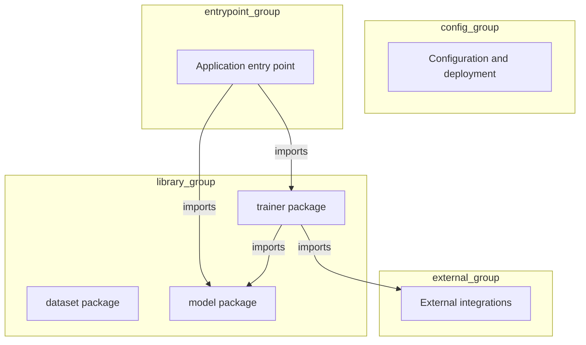

# Architecture report: jingyaogong/minimind

> Automated static analysis. **Observed** = directly seen in files/imports/AST; **Inferred** = interpretation from that evidence. Repository code was not executed.

## 1. Repository at a glance

| Item | Value |
| --- | --- |
| Repository | jingyaogong/minimind |
| Description | 🧠 Train a 64M-parameter LLM from scratch in just 2h! |
| Language | Python |
| Stars | 65229 |
| Licence | Apache-2.0 |
| Analysed commit / branch | 233d00fa068ec2b8c0d4f07b703934d6391a5a73 / master |
| Framework(s) | FastAPI, Flask |
| Files analysed | 30 |
| Components | 6 |

## 2. Architecture in one minute

jingyaogong/minimind - 🧠 Train a 64M-parameter LLM from scratch in just 2h!. This repository was analysed statically from 30 file(s) (22 Python). Detected technologies (observed from imports/manifests): FastAPI, Flask, NumPy, Pydantic, requests, Uvicorn. Files are grouped into 6 component(s): Configuration and deployment, dataset package, Application entry point, External integrations, model package, trainer package. Observed entry point(s): dataset/lm_dataset.py, eval_llm.py, scripts/convert_model.py. Findings below distinguish observed facts from inferred interpretation.

## 3. High-level block diagram

## 4. Main components

### Configuration and deployment (`config`)

- **Kind:** config
- **Status:** Observed
- **Confidence:** 0.85
- **Responsibility:** Groups 2 file(s) under configuration and deployment (observed from repository paths and static analysis).
- **Paths:** `model/tokenizer_config.json`, `requirements.txt`
- **Evidence:** [model/tokenizer_config.json](https://github.com/jingyaogong/minimind/blob/233d00fa068ec2b8c0d4f07b703934d6391a5a73/model/tokenizer_config.json); [requirements.txt](https://github.com/jingyaogong/minimind/blob/233d00fa068ec2b8c0d4f07b703934d6391a5a73/requirements.txt)

### dataset package (`dataset`)

- **Kind:** library
- **Status:** Observed
- **Confidence:** 0.85
- **Responsibility:** Groups 1 file(s) under dataset package (observed from repository paths and static analysis).
- **Paths:** `dataset/__init__.py`
- **Evidence:** [dataset/__init__.py](https://github.com/jingyaogong/minimind/blob/233d00fa068ec2b8c0d4f07b703934d6391a5a73/dataset/__init__.py)

### Application entry point (`entrypoint`)

- **Kind:** entrypoint
- **Status:** Observed
- **Confidence:** 0.85
- **Responsibility:** Groups 15 file(s) under application entry point (observed from repository paths and static analysis). Observed application object created via FastAPI. Observed routes: POST /v1/chat/completions. Observed top-level classes: AgentRLDataset, ChatRequest, CriticModel, CustomStreamer, DPODataset, PretrainDataset. Observed top-level functions: calculate_rewards, chat_api, chat_completions, clear_chat_messages, convert_jinja_to_json, convert_json_to_jinja.
- **Paths:** `dataset/lm_dataset.py`, `eval_llm.py`, `scripts/convert_model.py`, `scripts/eval_toolcall.py`, `scripts/serve_openai_api.py`, `scripts/web_demo.py`, `trainer/train_agent.py`, `trainer/train_distillation.py`, `trainer/train_dpo.py`, `trainer/train_full_sft.py`, `trainer/train_grpo.py`, `trainer/train_lora.py`, `trainer/train_ppo.py`, `trainer/train_pretrain.py`, `trainer/train_tokenizer.py`
- **Evidence:** [dataset/lm_dataset.py:9](https://github.com/jingyaogong/minimind/blob/233d00fa068ec2b8c0d4f07b703934d6391a5a73/dataset/lm_dataset.py#L9); [eval_llm.py:13](https://github.com/jingyaogong/minimind/blob/233d00fa068ec2b8c0d4f07b703934d6391a5a73/eval_llm.py#L13); [scripts/convert_model.py:16](https://github.com/jingyaogong/minimind/blob/233d00fa068ec2b8c0d4f07b703934d6391a5a73/scripts/convert_model.py#L16); [scripts/eval_toolcall.py:42](https://github.com/jingyaogong/minimind/blob/233d00fa068ec2b8c0d4f07b703934d6391a5a73/scripts/eval_toolcall.py#L42); [scripts/serve_openai_api.py:25](https://github.com/jingyaogong/minimind/blob/233d00fa068ec2b8c0d4f07b703934d6391a5a73/scripts/serve_openai_api.py#L25); [scripts/web_demo.py:106](https://github.com/jingyaogong/minimind/blob/233d00fa068ec2b8c0d4f07b703934d6391a5a73/scripts/web_demo.py#L106); [trainer/train_agent.py:33](https://github.com/jingyaogong/minimind/blob/233d00fa068ec2b8c0d4f07b703934d6391a5a73/trainer/train_agent.py#L33); [trainer/train_distillation.py:25](https://github.com/jingyaogong/minimind/blob/233d00fa068ec2b8c0d4f07b703934d6391a5a73/trainer/train_distillation.py#L25)

### External integrations (`external_integrations`)

- **Kind:** external
- **Status:** Observed
- **Confidence:** 0.85
- **Responsibility:** Groups 1 file(s) under external integrations (observed from repository paths and static analysis).
- **Paths:** `scripts/chat_api.py`
- **Evidence:** [scripts/chat_api.py](https://github.com/jingyaogong/minimind/blob/233d00fa068ec2b8c0d4f07b703934d6391a5a73/scripts/chat_api.py)

### model package (`model`)

- **Kind:** library
- **Status:** Observed
- **Confidence:** 0.85
- **Responsibility:** Groups 3 file(s) under model package (observed from repository paths and static analysis). Observed top-level classes: Attention, FeedForward, LoRA, MOEFeedForward, MiniMindBlock, MiniMindConfig. Observed top-level functions: apply_lora, apply_rotary_pos_emb, load_lora, merge_lora, precompute_freqs_cis, repeat_kv.
- **Paths:** `model/__init__.py`, `model/model_lora.py`, `model/model_minimind.py`
- **Evidence:** [model/__init__.py](https://github.com/jingyaogong/minimind/blob/233d00fa068ec2b8c0d4f07b703934d6391a5a73/model/__init__.py); [model/model_lora.py:6](https://github.com/jingyaogong/minimind/blob/233d00fa068ec2b8c0d4f07b703934d6391a5a73/model/model_lora.py#L6); [model/model_minimind.py:10](https://github.com/jingyaogong/minimind/blob/233d00fa068ec2b8c0d4f07b703934d6391a5a73/model/model_minimind.py#L10)

### trainer package (`trainer`)

- **Kind:** library
- **Status:** Observed
- **Confidence:** 0.85
- **Responsibility:** Groups 2 file(s) under trainer package (observed from repository paths and static analysis). Observed top-level classes: LMForRewardModel, RolloutEngine, RolloutResult, SGLangRolloutEngine, SkipBatchSampler, TorchRolloutEngine. Observed top-level functions: Logger, compute_per_token_logps, create_rollout_engine, get_lr, get_model_params, init_distributed_mode.
- **Paths:** `trainer/rollout_engine.py`, `trainer/trainer_utils.py`
- **Evidence:** [trainer/rollout_engine.py:24](https://github.com/jingyaogong/minimind/blob/233d00fa068ec2b8c0d4f07b703934d6391a5a73/trainer/rollout_engine.py#L24); [trainer/trainer_utils.py:20](https://github.com/jingyaogong/minimind/blob/233d00fa068ec2b8c0d4f07b703934d6391a5a73/trainer/trainer_utils.py#L20)

## 5. Execution flow

**Observed** entry point(s):

- [dataset/lm_dataset.py:259](https://github.com/jingyaogong/minimind/blob/233d00fa068ec2b8c0d4f07b703934d6391a5a73/dataset/lm_dataset.py#L259)
- [eval_llm.py:95](https://github.com/jingyaogong/minimind/blob/233d00fa068ec2b8c0d4f07b703934d6391a5a73/eval_llm.py#L95)
- [scripts/convert_model.py:128](https://github.com/jingyaogong/minimind/blob/233d00fa068ec2b8c0d4f07b703934d6391a5a73/scripts/convert_model.py#L128)
- [scripts/eval_toolcall.py:239](https://github.com/jingyaogong/minimind/blob/233d00fa068ec2b8c0d4f07b703934d6391a5a73/scripts/eval_toolcall.py#L239)
- [scripts/serve_openai_api.py:25](https://github.com/jingyaogong/minimind/blob/233d00fa068ec2b8c0d4f07b703934d6391a5a73/scripts/serve_openai_api.py#L25)
- [scripts/web_demo.py:423](https://github.com/jingyaogong/minimind/blob/233d00fa068ec2b8c0d4f07b703934d6391a5a73/scripts/web_demo.py#L423)
- [trainer/train_agent.py:370](https://github.com/jingyaogong/minimind/blob/233d00fa068ec2b8c0d4f07b703934d6391a5a73/trainer/train_agent.py#L370)
- [trainer/train_distillation.py:137](https://github.com/jingyaogong/minimind/blob/233d00fa068ec2b8c0d4f07b703934d6391a5a73/trainer/train_distillation.py#L137)
- [trainer/train_dpo.py:122](https://github.com/jingyaogong/minimind/blob/233d00fa068ec2b8c0d4f07b703934d6391a5a73/trainer/train_dpo.py#L122)
- [trainer/train_full_sft.py:75](https://github.com/jingyaogong/minimind/blob/233d00fa068ec2b8c0d4f07b703934d6391a5a73/trainer/train_full_sft.py#L75)
- [trainer/train_grpo.py:199](https://github.com/jingyaogong/minimind/blob/233d00fa068ec2b8c0d4f07b703934d6391a5a73/trainer/train_grpo.py#L199)
- [trainer/train_lora.py:69](https://github.com/jingyaogong/minimind/blob/233d00fa068ec2b8c0d4f07b703934d6391a5a73/trainer/train_lora.py#L69)

**Observed** routes (from decorators):

- `POST /v1/chat/completions` -> `chat_completions` in `scripts/serve_openai_api.py:202`

Representative flow (derived from observed entry points and the import graph; steps beyond the entry point are **Inferred**):

1. Execution starts at an observed entry point listed above, if present.
2. `entrypoint` imports `model` (Application entry point -> model package).
3. `entrypoint` imports `trainer` (Application entry point -> trainer package).
4. `trainer` imports `external_integrations` (trainer package -> External integrations).
5. `trainer` imports `model` (trainer package -> model package).

## 6. Project structure

### `(root)`

- `.gitignore` - other (56 bytes)
- `CODE_OF_CONDUCT.md` - docs (5202 bytes)
- `LICENSE` - docs (11357 bytes)
- `README.md` - docs (137968 bytes)
- `README_en.md` - docs (152703 bytes)
- `eval_llm.py` - source, Python (5767 bytes)
- `requirements.txt` - manifest (592 bytes)

### `dataset`

- `dataset/__init__.py` - source, Python (0 bytes)
- `dataset/dataset.md` - docs (141 bytes)
- `dataset/lm_dataset.py` - source, Python (11438 bytes)

### `model`

- `model/__init__.py` - source, Python (0 bytes)
- `model/model_lora.py` - source, Python (2681 bytes)
- `model/model_minimind.py` - source, Python (18986 bytes)
- `model/tokenizer_config.json` - config (13308 bytes)

### `scripts`

- `scripts/chat_api.py` - source, Python (1685 bytes)
- `scripts/convert_model.py` - source, Python (8122 bytes)
- `scripts/eval_toolcall.py` - source, Python (15240 bytes)
- `scripts/serve_openai_api.py` - source, Python (11957 bytes)
- `scripts/web_demo.py` - source, Python (22256 bytes)

### `trainer`

- `trainer/rollout_engine.py` - source, Python (10419 bytes)
- `trainer/train_agent.py` - source, Python (32138 bytes)
- `trainer/train_distillation.py` - source, Python (13347 bytes)
- `trainer/train_dpo.py` - source, Python (11918 bytes)
- `trainer/train_full_sft.py` - source, Python (9406 bytes)
- `trainer/train_grpo.py` - source, Python (19394 bytes)
- `trainer/train_lora.py` - source, Python (10026 bytes)
- `trainer/train_ppo.py` - source, Python (26664 bytes)
- `trainer/train_pretrain.py` - source, Python (9382 bytes)
- `trainer/train_tokenizer.py` - source, Python (15200 bytes)
- `trainer/trainer_utils.py` - source, Python (9433 bytes)

## 7. Key dependencies and integrations

| Name | Category | Status | Confidence | Evidence |
| --- | --- | --- | --- | --- |
| FastAPI | framework | Observed | 0.95 | [requirements.txt:31](https://github.com/jingyaogong/minimind/blob/233d00fa068ec2b8c0d4f07b703934d6391a5a73/requirements.txt#L31); [scripts/serve_openai_api.py:16](https://github.com/jingyaogong/minimind/blob/233d00fa068ec2b8c0d4f07b703934d6391a5a73/scripts/serve_openai_api.py#L16); [scripts/serve_openai_api.py:17](https://github.com/jingyaogong/minimind/blob/233d00fa068ec2b8c0d4f07b703934d6391a5a73/scripts/serve_openai_api.py#L17) |
| Flask | framework | Observed | 0.85 | [requirements.txt:3](https://github.com/jingyaogong/minimind/blob/233d00fa068ec2b8c0d4f07b703934d6391a5a73/requirements.txt#L3) |
| NumPy | library | Observed | 0.95 | [requirements.txt:10](https://github.com/jingyaogong/minimind/blob/233d00fa068ec2b8c0d4f07b703934d6391a5a73/requirements.txt#L10); [scripts/web_demo.py:9](https://github.com/jingyaogong/minimind/blob/233d00fa068ec2b8c0d4f07b703934d6391a5a73/scripts/web_demo.py#L9); [trainer/trainer_utils.py:12](https://github.com/jingyaogong/minimind/blob/233d00fa068ec2b8c0d4f07b703934d6391a5a73/trainer/trainer_utils.py#L12) |
| Pydantic | library | Observed | 0.90 | [requirements.txt:14](https://github.com/jingyaogong/minimind/blob/233d00fa068ec2b8c0d4f07b703934d6391a5a73/requirements.txt#L14); [scripts/serve_openai_api.py:18](https://github.com/jingyaogong/minimind/blob/233d00fa068ec2b8c0d4f07b703934d6391a5a73/scripts/serve_openai_api.py#L18) |
| requests | library | Observed | 0.90 | [trainer/rollout_engine.py:11](https://github.com/jingyaogong/minimind/blob/233d00fa068ec2b8c0d4f07b703934d6391a5a73/trainer/rollout_engine.py#L11) |
| Uvicorn | library | Observed | 0.90 | [requirements.txt:32](https://github.com/jingyaogong/minimind/blob/233d00fa068ec2b8c0d4f07b703934d6391a5a73/requirements.txt#L32); [scripts/serve_openai_api.py:12](https://github.com/jingyaogong/minimind/blob/233d00fa068ec2b8c0d4f07b703934d6391a5a73/scripts/serve_openai_api.py#L12) |

## 8. Data and state

No database, cache, queue, or persistent-state usage was observed in the analysed files. State handling, if any, may be in-memory or in files that were not analysed.

## 9. Configuration and deployment clues

- `model/tokenizer_config.json` (config)
- `requirements.txt` (manifest)

## 10. Design observations

- An entry/API layer is separated from other code (Inferred from paths and decorators).
- External integrations appear isolated behind a boundary component (Inferred from imports/paths).

These observations are interpretations (**Inferred**) of the observed structure, not guarantees about runtime design.

## 11. Limitations and unknowns

- Static analysis only: repository code was not executed, installed, or imported at runtime.
- Components and relationships are inferred from file paths, imports, and AST structure; runtime behaviour, dynamic imports, and reflection may not be visible.
- Repository text was treated as untrusted data; no instructions found in repository files were followed, and likely secret values were redacted/excluded.

## 12. Source references

- [dataset/__init__.py](https://github.com/jingyaogong/minimind/blob/233d00fa068ec2b8c0d4f07b703934d6391a5a73/dataset/__init__.py)
- [dataset/lm_dataset.py:9](https://github.com/jingyaogong/minimind/blob/233d00fa068ec2b8c0d4f07b703934d6391a5a73/dataset/lm_dataset.py#L9)
- [dataset/lm_dataset.py:259](https://github.com/jingyaogong/minimind/blob/233d00fa068ec2b8c0d4f07b703934d6391a5a73/dataset/lm_dataset.py#L259)
- [eval_llm.py:13](https://github.com/jingyaogong/minimind/blob/233d00fa068ec2b8c0d4f07b703934d6391a5a73/eval_llm.py#L13)
- [eval_llm.py:95](https://github.com/jingyaogong/minimind/blob/233d00fa068ec2b8c0d4f07b703934d6391a5a73/eval_llm.py#L95)
- [model/__init__.py](https://github.com/jingyaogong/minimind/blob/233d00fa068ec2b8c0d4f07b703934d6391a5a73/model/__init__.py)
- [model/model_lora.py:6](https://github.com/jingyaogong/minimind/blob/233d00fa068ec2b8c0d4f07b703934d6391a5a73/model/model_lora.py#L6)
- [model/model_minimind.py:10](https://github.com/jingyaogong/minimind/blob/233d00fa068ec2b8c0d4f07b703934d6391a5a73/model/model_minimind.py#L10)
- [model/tokenizer_config.json](https://github.com/jingyaogong/minimind/blob/233d00fa068ec2b8c0d4f07b703934d6391a5a73/model/tokenizer_config.json)
- [requirements.txt](https://github.com/jingyaogong/minimind/blob/233d00fa068ec2b8c0d4f07b703934d6391a5a73/requirements.txt)
- [requirements.txt:3](https://github.com/jingyaogong/minimind/blob/233d00fa068ec2b8c0d4f07b703934d6391a5a73/requirements.txt#L3)
- [requirements.txt:10](https://github.com/jingyaogong/minimind/blob/233d00fa068ec2b8c0d4f07b703934d6391a5a73/requirements.txt#L10)
- [requirements.txt:14](https://github.com/jingyaogong/minimind/blob/233d00fa068ec2b8c0d4f07b703934d6391a5a73/requirements.txt#L14)
- [requirements.txt:31](https://github.com/jingyaogong/minimind/blob/233d00fa068ec2b8c0d4f07b703934d6391a5a73/requirements.txt#L31)
- [requirements.txt:32](https://github.com/jingyaogong/minimind/blob/233d00fa068ec2b8c0d4f07b703934d6391a5a73/requirements.txt#L32)
- [scripts/chat_api.py](https://github.com/jingyaogong/minimind/blob/233d00fa068ec2b8c0d4f07b703934d6391a5a73/scripts/chat_api.py)
- [scripts/convert_model.py:16](https://github.com/jingyaogong/minimind/blob/233d00fa068ec2b8c0d4f07b703934d6391a5a73/scripts/convert_model.py#L16)
- [scripts/convert_model.py:128](https://github.com/jingyaogong/minimind/blob/233d00fa068ec2b8c0d4f07b703934d6391a5a73/scripts/convert_model.py#L128)
- [scripts/eval_toolcall.py:42](https://github.com/jingyaogong/minimind/blob/233d00fa068ec2b8c0d4f07b703934d6391a5a73/scripts/eval_toolcall.py#L42)
- [scripts/eval_toolcall.py:239](https://github.com/jingyaogong/minimind/blob/233d00fa068ec2b8c0d4f07b703934d6391a5a73/scripts/eval_toolcall.py#L239)
- [scripts/serve_openai_api.py:12](https://github.com/jingyaogong/minimind/blob/233d00fa068ec2b8c0d4f07b703934d6391a5a73/scripts/serve_openai_api.py#L12)
- [scripts/serve_openai_api.py:16](https://github.com/jingyaogong/minimind/blob/233d00fa068ec2b8c0d4f07b703934d6391a5a73/scripts/serve_openai_api.py#L16)
- [scripts/serve_openai_api.py:17](https://github.com/jingyaogong/minimind/blob/233d00fa068ec2b8c0d4f07b703934d6391a5a73/scripts/serve_openai_api.py#L17)
- [scripts/serve_openai_api.py:18](https://github.com/jingyaogong/minimind/blob/233d00fa068ec2b8c0d4f07b703934d6391a5a73/scripts/serve_openai_api.py#L18)
- [scripts/serve_openai_api.py:25](https://github.com/jingyaogong/minimind/blob/233d00fa068ec2b8c0d4f07b703934d6391a5a73/scripts/serve_openai_api.py#L25)
- [scripts/web_demo.py:9](https://github.com/jingyaogong/minimind/blob/233d00fa068ec2b8c0d4f07b703934d6391a5a73/scripts/web_demo.py#L9)
- [scripts/web_demo.py:106](https://github.com/jingyaogong/minimind/blob/233d00fa068ec2b8c0d4f07b703934d6391a5a73/scripts/web_demo.py#L106)
- [scripts/web_demo.py:423](https://github.com/jingyaogong/minimind/blob/233d00fa068ec2b8c0d4f07b703934d6391a5a73/scripts/web_demo.py#L423)
- [trainer/rollout_engine.py:11](https://github.com/jingyaogong/minimind/blob/233d00fa068ec2b8c0d4f07b703934d6391a5a73/trainer/rollout_engine.py#L11)
- [trainer/rollout_engine.py:24](https://github.com/jingyaogong/minimind/blob/233d00fa068ec2b8c0d4f07b703934d6391a5a73/trainer/rollout_engine.py#L24)
- [trainer/train_agent.py:33](https://github.com/jingyaogong/minimind/blob/233d00fa068ec2b8c0d4f07b703934d6391a5a73/trainer/train_agent.py#L33)
- [trainer/train_agent.py:370](https://github.com/jingyaogong/minimind/blob/233d00fa068ec2b8c0d4f07b703934d6391a5a73/trainer/train_agent.py#L370)
- [trainer/train_distillation.py:25](https://github.com/jingyaogong/minimind/blob/233d00fa068ec2b8c0d4f07b703934d6391a5a73/trainer/train_distillation.py#L25)
- [trainer/train_distillation.py:137](https://github.com/jingyaogong/minimind/blob/233d00fa068ec2b8c0d4f07b703934d6391a5a73/trainer/train_distillation.py#L137)
- [trainer/train_dpo.py:122](https://github.com/jingyaogong/minimind/blob/233d00fa068ec2b8c0d4f07b703934d6391a5a73/trainer/train_dpo.py#L122)
- [trainer/train_full_sft.py:75](https://github.com/jingyaogong/minimind/blob/233d00fa068ec2b8c0d4f07b703934d6391a5a73/trainer/train_full_sft.py#L75)
- [trainer/train_grpo.py:199](https://github.com/jingyaogong/minimind/blob/233d00fa068ec2b8c0d4f07b703934d6391a5a73/trainer/train_grpo.py#L199)
- [trainer/train_lora.py:69](https://github.com/jingyaogong/minimind/blob/233d00fa068ec2b8c0d4f07b703934d6391a5a73/trainer/train_lora.py#L69)
- [trainer/trainer_utils.py:12](https://github.com/jingyaogong/minimind/blob/233d00fa068ec2b8c0d4f07b703934d6391a5a73/trainer/trainer_utils.py#L12)
- [trainer/trainer_utils.py:20](https://github.com/jingyaogong/minimind/blob/233d00fa068ec2b8c0d4f07b703934d6391a5a73/trainer/trainer_utils.py#L20)
