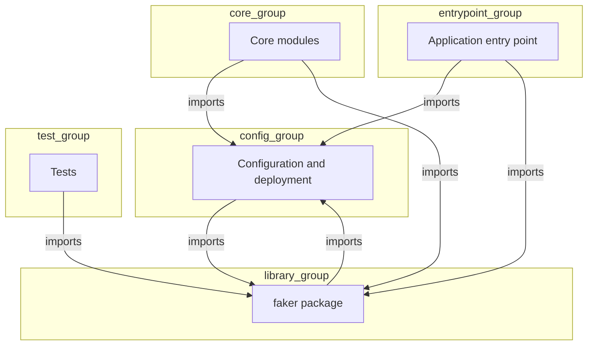

# Architecture report: joke2k/faker

> Automated static analysis. **Observed** = directly seen in files/imports/AST; **Inferred** = interpretation from that evidence. Repository code was not executed.

## 1. Repository at a glance

| Item | Value |
| --- | --- |
| Repository | joke2k/faker |
| Description | Faker is a Python package that generates fake data for you. |
| Language | Python |
| Stars | 19491 |
| Licence | MIT |
| Analysed commit / branch | affa2c5aada23fc5c00127298a8e904375d32832 / master |
| Framework(s) | None detected |
| Files analysed | 800 |
| Components | 5 |

## 2. Architecture in one minute

joke2k/faker - Faker is a Python package that generates fake data for you.. This repository was analysed statically from 800 file(s) (756 Python). Detected technologies (observed from imports/manifests): GitHub Actions, setuptools, pytest. Files are grouped into 5 component(s): Configuration and deployment, Core modules, Application entry point, faker package, Tests. Observed entry point(s): faker/__main__.py, faker/cli.py, scripts/check_test_class_order.py. Findings below distinguish observed facts from inferred interpretation.

## 3. High-level block diagram

## 4. Main components

### Configuration and deployment (`config`)

- **Kind:** config
- **Status:** Observed
- **Confidence:** 0.85
- **Responsibility:** Groups 6 file(s) under configuration and deployment (observed from repository paths and static analysis).
- **Paths:** `MANIFEST.in`, `faker/config.py`, `mypy.ini`, `readthedocs.yml`, `setup.cfg`, `setup.py`
- **Evidence:** [MANIFEST.in](https://github.com/joke2k/faker/blob/affa2c5aada23fc5c00127298a8e904375d32832/MANIFEST.in); [faker/config.py](https://github.com/joke2k/faker/blob/affa2c5aada23fc5c00127298a8e904375d32832/faker/config.py); [mypy.ini](https://github.com/joke2k/faker/blob/affa2c5aada23fc5c00127298a8e904375d32832/mypy.ini); [readthedocs.yml](https://github.com/joke2k/faker/blob/affa2c5aada23fc5c00127298a8e904375d32832/readthedocs.yml); [setup.cfg](https://github.com/joke2k/faker/blob/affa2c5aada23fc5c00127298a8e904375d32832/setup.cfg); [setup.py](https://github.com/joke2k/faker/blob/affa2c5aada23fc5c00127298a8e904375d32832/setup.py)

### Core modules (`core`)

- **Kind:** core
- **Status:** Observed
- **Confidence:** 0.85
- **Responsibility:** Groups 2 file(s) under core modules (observed from repository paths and static analysis). Observed top-level classes: UniqueMemberFunctionsAndVariables. Observed top-level functions: get_import_str, get_member_functions_and_variables, get_module_and_member_to_import, get_signatures_for_func.
- **Paths:** `build-alpine.sh`, `generate_stubs.py`
- **Evidence:** [build-alpine.sh](https://github.com/joke2k/faker/blob/affa2c5aada23fc5c00127298a8e904375d32832/build-alpine.sh); [generate_stubs.py:28](https://github.com/joke2k/faker/blob/affa2c5aada23fc5c00127298a8e904375d32832/generate_stubs.py#L28)

### Application entry point (`entrypoint`)

- **Kind:** entrypoint
- **Status:** Observed
- **Confidence:** 0.85
- **Responsibility:** Groups 3 file(s) under application entry point (observed from repository paths and static analysis). Observed application object created via Command. Observed top-level classes: Command. Observed top-level functions: _check_group, _encode_for_output, _local_bases, check_file, execute_from_command_line, main.
- **Paths:** `faker/__main__.py`, `faker/cli.py`, `scripts/check_test_class_order.py`
- **Evidence:** [faker/__main__.py](https://github.com/joke2k/faker/blob/affa2c5aada23fc5c00127298a8e904375d32832/faker/__main__.py); [faker/cli.py:305](https://github.com/joke2k/faker/blob/affa2c5aada23fc5c00127298a8e904375d32832/faker/cli.py#L305); [scripts/check_test_class_order.py:23](https://github.com/joke2k/faker/blob/affa2c5aada23fc5c00127298a8e904375d32832/scripts/check_test_class_order.py#L23)

### faker package (`faker`)

- **Kind:** library
- **Status:** Observed
- **Confidence:** 0.85
- **Responsibility:** Groups 745 file(s) under faker package (observed from repository paths and static analysis). Observed top-level classes: BaseFakerException, BaseProvider, Country, CreditCard, Documentor, DynamicProvider. Observed top-level functions: _create_source_files, _digits_of, _get_local_timezone, _get_localized_provider_info, _get_next_month_start, _get_provider_methods.
- **Paths:** `faker/__init__.py`, `faker/contrib/__init__.py`, `faker/contrib/pytest/__init__.py`, `faker/contrib/pytest/plugin.py`, `faker/decode/__init__.py`, `faker/documentor.py`, `faker/exceptions.py`, `faker/factory.py`, `faker/generator.py`, `faker/providers/__init__.py`, `faker/providers/address/__init__.py`, `faker/providers/address/ar_DZ/__init__.py`, `faker/providers/address/az_AZ/__init__.py`, `faker/providers/address/bn_BD/__init__.py`, `faker/providers/address/cs_CZ/__init__.py`, `faker/providers/address/da_DK/__init__.py`, `faker/providers/address/de/__init__.py`, `faker/providers/address/de_AT/__init__.py`, `faker/providers/address/de_CH/__init__.py`, `faker/providers/address/de_DE/__init__.py`, `faker/providers/address/el_GR/__init__.py`, `faker/providers/address/en/__init__.py`, `faker/providers/address/en_AU/__init__.py`, `faker/providers/address/en_BD/__init__.py`, `faker/providers/address/en_CA/__init__.py`, `faker/providers/address/en_GB/__init__.py`, `faker/providers/address/en_IE/__init__.py`, `faker/providers/address/en_IN/__init__.py`, `faker/providers/address/en_MS/__init__.py`, `faker/providers/address/en_NZ/__init__.py`, `faker/providers/address/en_PH/__init__.py`, `faker/providers/address/en_US/__init__.py`, `faker/providers/address/es/__init__.py`, `faker/providers/address/es_AR/__init__.py`, `faker/providers/address/es_CL/__init__.py`, `faker/providers/address/es_CO/__init__.py`, `faker/providers/address/es_ES/__init__.py`, `faker/providers/address/es_MX/__init__.py`, `faker/providers/address/fa_IR/__init__.py`, `faker/providers/address/fi_FI/__init__.py`, `faker/providers/address/fil_PH/__init__.py`, `faker/providers/address/fr_CA/__init__.py`, `faker/providers/address/fr_CH/__init__.py`, `faker/providers/address/fr_DZ/__init__.py`, `faker/providers/address/fr_FR/__init__.py`, `faker/providers/address/he_IL/__init__.py`, `faker/providers/address/hi_IN/__init__.py`, `faker/providers/address/hr_HR/__init__.py`, `faker/providers/address/hu_HU/__init__.py`, `faker/providers/address/hy_AM/__init__.py`, `faker/providers/address/id_ID/__init__.py`, `faker/providers/address/ja_JP/__init__.py`, `faker/providers/address/ka_GE/__init__.py`, `faker/providers/address/ko_KR/__init__.py`, `faker/providers/address/mk_MK/__init__.py`, `faker/providers/address/mr_IN/__init__.py`, `faker/providers/address/ne_NP/__init__.py`, `faker/providers/address/nl_BE/__init__.py`, `faker/providers/address/nl_NL/__init__.py`, `faker/providers/address/no_NO/__init__.py`, `faker/providers/address/pl_PL/__init__.py`, `faker/providers/address/pt_BR/__init__.py`, `faker/providers/address/pt_PT/__init__.py`, `faker/providers/address/ro_RO/__init__.py`, `faker/providers/address/ru_RU/__init__.py`, `faker/providers/address/sk_SK/__init__.py`, `faker/providers/address/sl_SI/__init__.py`, `faker/providers/address/sv_SE/__init__.py`, `faker/providers/address/ta_IN/__init__.py`, `faker/providers/address/th/__init__.py`, `faker/providers/address/th_TH/__init__.py`, `faker/providers/address/tl_PH/__init__.py`, `faker/providers/address/uk_UA/__init__.py`, `faker/providers/address/vi_VN/__init__.py`, `faker/providers/address/zh_CN/__init__.py`, `faker/providers/address/zh_TW/__init__.py`, `faker/providers/address/zu_ZA/__init__.py`, `faker/providers/automotive/__init__.py`, `faker/providers/automotive/ar_BH/__init__.py`, `faker/providers/automotive/ar_DZ/__init__.py`, `faker/providers/automotive/ar_JO/__init__.py`, `faker/providers/automotive/ar_PS/__init__.py`, `faker/providers/automotive/ar_SA/__init__.py`, `faker/providers/automotive/az_AZ/__init__.py`, `faker/providers/automotive/bn_BD/__init__.py`, `faker/providers/automotive/da_DK/__init__.py`, `faker/providers/automotive/de_AT/__init__.py`, `faker/providers/automotive/de_CH/__init__.py`, `faker/providers/automotive/de_DE/__init__.py`, `faker/providers/automotive/el_GR/__init__.py`, `faker/providers/automotive/en_CA/__init__.py`, `faker/providers/automotive/en_GB/__init__.py`, `faker/providers/automotive/en_NZ/__init__.py`, `faker/providers/automotive/en_PH/__init__.py`, `faker/providers/automotive/en_US/__init__.py`, `faker/providers/automotive/es_AR/__init__.py`, `faker/providers/automotive/es_CL/__init__.py`, `faker/providers/automotive/es_CO/__init__.py`, `faker/providers/automotive/es_ES/__init__.py`, `faker/providers/automotive/es_MX/__init__.py`, `faker/providers/automotive/et_EE/__init__.py`, `faker/providers/automotive/fi_FI/__init__.py`, `faker/providers/automotive/fil_PH/__init__.py`, `faker/providers/automotive/fr_DZ/__init__.py`, `faker/providers/automotive/fr_FR/__init__.py`, `faker/providers/automotive/he_IL/__init__.py`, `faker/providers/automotive/hu_HU/__init__.py`, `faker/providers/automotive/id_ID/__init__.py`, `faker/providers/automotive/it_IT/__init__.py`, `faker/providers/automotive/ja_JP/__init__.py`, `faker/providers/automotive/ko_KR/__init__.py`, `faker/providers/automotive/lt_LT/__init__.py`, `faker/providers/automotive/mk_MK/__init__.py`, `faker/providers/automotive/nl_BE/__init__.py`, `faker/providers/automotive/nl_NL/__init__.py`, `faker/providers/automotive/no_NO/__init__.py`, `faker/providers/automotive/pl_PL/__init__.py`, `faker/providers/automotive/pt_BR/__init__.py`, `faker/providers/automotive/pt_PT/__init__.py`, `faker/providers/automotive/ro_RO/__init__.py`, `faker/providers/automotive/ru_RU/__init__.py`, `faker/providers/automotive/sk_SK/__init__.py`, `faker/providers/automotive/sq_AL/__init__.py`, `faker/providers/automotive/sv_SE/__init__.py`, `faker/providers/automotive/th_TH/__init__.py`, `faker/providers/automotive/tl_PH/__init__.py`, `faker/providers/automotive/tr_TR/__init__.py`, `faker/providers/automotive/uk_UA/__init__.py`, `faker/providers/automotive/vi_VN/__init__.py`, `faker/providers/automotive/zh_CN/__init__.py`, `faker/providers/automotive/zh_TW/__init__.py`, `faker/providers/bank/__init__.py`, `faker/providers/bank/az_AZ/__init__.py`, `faker/providers/bank/bn_BD/__init__.py`, `faker/providers/bank/cs_CZ/__init__.py`, `faker/providers/bank/da_DK/__init__.py`, `faker/providers/bank/de_AT/__init__.py`, `faker/providers/bank/de_CH/__init__.py`, `faker/providers/bank/de_DE/__init__.py`, `faker/providers/bank/el_GR/__init__.py`, `faker/providers/bank/en_GB/__init__.py`, `faker/providers/bank/en_IE/__init__.py`, `faker/providers/bank/en_IN/__init__.py`, `faker/providers/bank/en_PH/__init__.py`, `faker/providers/bank/es_AR/__init__.py`, `faker/providers/bank/es_CO/__init__.py`, `faker/providers/bank/es_ES/__init__.py`, `faker/providers/bank/es_MX/__init__.py`, `faker/providers/bank/fa_IR/__init__.py`, `faker/providers/bank/fi_FI/__init__.py`, `faker/providers/bank/fil_PH/__init__.py`, `faker/providers/bank/fr_CH/__init__.py`, `faker/providers/bank/fr_FR/__init__.py`, `faker/providers/bank/it_CH/__init__.py`, `faker/providers/bank/it_IT/__init__.py`, `faker/providers/bank/mk_MK/__init__.py`, `faker/providers/bank/nl_BE/__init__.py`, `faker/providers/bank/nl_NL/__init__.py`, `faker/providers/bank/no_NO/__init__.py`, `faker/providers/bank/pl_PL/__init__.py`, `faker/providers/bank/pt_BR/__init__.py`, `faker/providers/bank/pt_PT/__init__.py`, `faker/providers/bank/ro_RO/__init__.py`, `faker/providers/bank/ru_RU/__init__.py`, `faker/providers/bank/sk_SK/__init__.py`, `faker/providers/bank/th_TH/__init__.py`, `faker/providers/bank/tl_PH/__init__.py`, `faker/providers/bank/tr_TR/__init__.py`, `faker/providers/bank/uk_UA/__init__.py`, `faker/providers/bank/zh_CN/__init__.py`, `faker/providers/barcode/__init__.py`, `faker/providers/barcode/en_CA/__init__.py`, `faker/providers/barcode/en_US/__init__.py`, `faker/providers/barcode/es_ES/__init__.py`, `faker/providers/barcode/fr_CA/__init__.py`, `faker/providers/barcode/ja_JP/__init__.py`, `faker/providers/color/__init__.py`, `faker/providers/color/ar_PS/__init__.py`, `faker/providers/color/az_AZ/__init__.py`, `faker/providers/color/bg_BG/__init__.py`, `faker/providers/color/bn_BD/__init__.py`, `faker/providers/color/color.py`, `faker/providers/color/cs_CZ/__init__.py`, `faker/providers/color/da_DK/__init__.py`, `faker/providers/color/de/__init__.py`, `faker/providers/color/de_AT/__init__.py`, `faker/providers/color/de_CH/__init__.py`, `faker/providers/color/de_DE/__init__.py`, `faker/providers/color/el_GR/__init__.py`, `faker/providers/color/en_US/__init__.py`, `faker/providers/color/es/__init__.py`, `faker/providers/color/es_CL/__init__.py`, `faker/providers/color/es_ES/__init__.py`, `faker/providers/color/fa_IR/__init__.py`, `faker/providers/color/fr_FR/__init__.py`, `faker/providers/color/he_IL/__init__.py`, `faker/providers/color/hr_HR/__init__.py`, `faker/providers/color/hu_HU/__init__.py`, `faker/providers/color/hy_AM/__init__.py`, `faker/providers/color/id_ID/__init__.py`, `faker/providers/color/ka_GE/__init__.py`, `faker/providers/color/mk_MK/__init__.py`, `faker/providers/color/pt_BR/__init__.py`, `faker/providers/color/ru_RU/__init__.py`, `faker/providers/color/sk_SK/__init__.py`, `faker/providers/color/th_TH/__init__.py`, `faker/providers/color/uk_UA/__init__.py`, `faker/providers/color/uz_UZ/__init__.py`, `faker/providers/color/vi_VN/__init__.py`, `faker/providers/company/__init__.py`, `faker/providers/company/ar_DZ/__init__.py`, `faker/providers/company/az_AZ/__init__.py`, `faker/providers/company/bg_BG/__init__.py`, `faker/providers/company/bn_BD/__init__.py`, `faker/providers/company/cs_CZ/__init__.py`, `faker/providers/company/da_DK/__init__.py`, `faker/providers/company/de_AT/__init__.py`, `faker/providers/company/de_CH/__init__.py`, `faker/providers/company/de_DE/__init__.py`, `faker/providers/company/el_GR/__init__.py`, `faker/providers/company/en_PH/__init__.py`, `faker/providers/company/en_US/__init__.py`, `faker/providers/company/es_CL/__init__.py`, `faker/providers/company/es_ES/__init__.py`, `faker/providers/company/es_MX/__init__.py`, `faker/providers/company/fa_IR/__init__.py`, `faker/providers/company/fi_FI/__init__.py`, `faker/providers/company/fil_PH/__init__.py`, `faker/providers/company/fr_CH/__init__.py`, `faker/providers/company/fr_DZ/__init__.py`, `faker/providers/company/fr_FR/__init__.py`, `faker/providers/company/hr_HR/__init__.py`, `faker/providers/company/hu_HU/__init__.py`, `faker/providers/company/hy_AM/__init__.py`, `faker/providers/company/id_ID/__init__.py`, `faker/providers/company/it_IT/__init__.py`, `faker/providers/company/ja_JP/__init__.py`, `faker/providers/company/ko_KR/__init__.py`, `faker/providers/company/mk_MK/__init__.py`, `faker/providers/company/nl_BE/__init__.py`, `faker/providers/company/nl_NL/__init__.py`, `faker/providers/company/no_NO/__init__.py`, `faker/providers/company/pl_PL/__init__.py`, `faker/providers/company/pt_BR/__init__.py`, `faker/providers/company/pt_PT/__init__.py`, `faker/providers/company/ro_RO/__init__.py`, `faker/providers/company/ru_RU/__init__.py`, `faker/providers/company/sk_SK/__init__.py`, `faker/providers/company/sl_SI/__init__.py`, `faker/providers/company/sv_SE/__init__.py`, `faker/providers/company/th_TH/__init__.py`, `faker/providers/company/tl_PH/__init__.py`, `faker/providers/company/tr_TR/__init__.py`, `faker/providers/company/vi_VN/__init__.py`, `faker/providers/company/zh_CN/__init__.py`, `faker/providers/company/zh_TW/__init__.py`, `faker/providers/credit_card/__init__.py`, `faker/providers/credit_card/en_US/__init__.py`, `faker/providers/credit_card/fa_IR/__init__.py`, `faker/providers/credit_card/pt_PT/__init__.py`, `faker/providers/credit_card/ru_RU/__init__.py`, `faker/providers/credit_card/uk_UA/__init__.py`, `faker/providers/credit_card/zh_CN/__init__.py`, `faker/providers/currency/__init__.py`, `faker/providers/currency/ar_DZ/__init__.py`, `faker/providers/currency/az_AZ/__init__.py`, `faker/providers/currency/bn_BD/__init__.py`, `faker/providers/currency/cs_CZ/__init__.py`, `faker/providers/currency/da_DK/__init__.py`, `faker/providers/currency/de/__init__.py`, `faker/providers/currency/de_AT/__init__.py`, `faker/providers/currency/de_CH/__init__.py`, `faker/providers/currency/de_DE/__init__.py`, `faker/providers/currency/el_GR/__init__.py`, `faker/providers/currency/en_AU/__init__.py`, `faker/providers/currency/en_CA/__init__.py`, `faker/providers/currency/en_US/__init__.py`, `faker/providers/currency/es/__init__.py`, `faker/providers/currency/es_AR/__init__.py`, `faker/providers/currency/es_CL/__init__.py`, `faker/providers/currency/es_ES/__init__.py`, `faker/providers/currency/fa_IR/__init__.py`, `faker/providers/currency/fr_CA/__init__.py`, `faker/providers/currency/fr_DZ/__init__.py`, `faker/providers/currency/fr_FR/__init__.py`, `faker/providers/currency/it_IT/__init__.py`, `faker/providers/currency/mk_MK/__init__.py`, `faker/providers/currency/ng_NG/__init__.py`, `faker/providers/currency/nl_NL/__init__.py`, `faker/providers/currency/pl_PL/__init__.py`, `faker/providers/currency/pt_BR/__init__.py`, `faker/providers/currency/ro_RO/__init__.py`, `faker/providers/currency/ru_RU/__init__.py`, `faker/providers/currency/sk_SK/__init__.py`, `faker/providers/currency/sv_SE/__init__.py`, `faker/providers/currency/th_TH/__init__.py`, `faker/providers/currency/tr_TR/__init__.py`, `faker/providers/currency/uk_UA/__init__.py`, `faker/providers/currency/uz_UZ/__init__.py`, `faker/providers/currency/vi_VN/__init__.py`, `faker/providers/date_time/__init__.py`, `faker/providers/date_time/ar_AA/__init__.py`, `faker/providers/date_time/ar_DZ/__init__.py`, `faker/providers/date_time/ar_EG/__init__.py`, `faker/providers/date_time/az_AZ/__init__.py`, `faker/providers/date_time/bn_BD/__init__.py`, `faker/providers/date_time/cs_CZ/__init__.py`, `faker/providers/date_time/da_DK/__init__.py`, `faker/providers/date_time/de_AT/__init__.py`, `faker/providers/date_time/de_DE/__init__.py`, `faker/providers/date_time/el_GR/__init__.py`, `faker/providers/date_time/en_PH/__init__.py`, `faker/providers/date_time/en_US/__init__.py`, `faker/providers/date_time/es/__init__.py`, `faker/providers/date_time/es_AR/__init__.py`, `faker/providers/date_time/es_CL/__init__.py`, `faker/providers/date_time/es_ES/__init__.py`, `faker/providers/date_time/fil_PH/__init__.py`, `faker/providers/date_time/fr_CA/__init__.py`, `faker/providers/date_time/fr_DZ/__init__.py`, `faker/providers/date_time/fr_FR/__init__.py`, `faker/providers/date_time/gu_IN/__init__.py`, `faker/providers/date_time/hi_IN/__init__.py`, `faker/providers/date_time/hr_HR/__init__.py`, `faker/providers/date_time/hu_HU/__init__.py`, `faker/providers/date_time/hy_AM/__init__.py`, `faker/providers/date_time/id_ID/__init__.py`, `faker/providers/date_time/it_IT/__init__.py`, `faker/providers/date_time/ja_JP/__init__.py`, `faker/providers/date_time/ka_GE/__init__.py`, `faker/providers/date_time/ko_KR/__init__.py`, `faker/providers/date_time/mk_MK/__init__.py`, `faker/providers/date_time/mr_IN/__init__.py`, `faker/providers/date_time/nl_NL/__init__.py`, `faker/providers/date_time/no_NO/__init__.py`, `faker/providers/date_time/pl_PL/__init__.py`, `faker/providers/date_time/pt_BR/__init__.py`, `faker/providers/date_time/pt_PT/__init__.py`, `faker/providers/date_time/ro_RO/__init__.py`, `faker/providers/date_time/ru_RU/__init__.py`, `faker/providers/date_time/sk_SK/__init__.py`, `faker/providers/date_time/sl_SI/__init__.py`, `faker/providers/date_time/ta_IN/__init__.py`, `faker/providers/date_time/th_TH/__init__.py`, `faker/providers/date_time/tl_PH/__init__.py`, `faker/providers/date_time/tr_TR/__init__.py`, `faker/providers/date_time/uz_UZ/__init__.py`, `faker/providers/date_time/vi_VN/__init__.py`, `faker/providers/date_time/zh_CN/__init__.py`, `faker/providers/date_time/zh_TW/__init__.py`, `faker/providers/doi/__init__.py`, `faker/providers/emoji/__init__.py`, `faker/providers/emoji/en_US/__init__.py`, `faker/providers/file/__init__.py`, `faker/providers/file/en_US/__init__.py`, `faker/providers/geo/__init__.py`, `faker/providers/geo/ar_DZ/__init__.py`, `faker/providers/geo/bn_BD/__init__.py`, `faker/providers/geo/cs_CZ/__init__.py`, `faker/providers/geo/de_AT/__init__.py`, `faker/providers/geo/el_GR/__init__.py`, `faker/providers/geo/en_IE/__init__.py`, `faker/providers/geo/en_US/__init__.py`, `faker/providers/geo/fr_DZ/__init__.py`, `faker/providers/geo/mk_MK/__init__.py`, `faker/providers/geo/pl_PL/__init__.py`, `faker/providers/geo/pt_PT/__init__.py`, `faker/providers/geo/sk_SK/__init__.py`, `faker/providers/geo/tr_TR/__init__.py`, `faker/providers/internet/__init__.py`, `faker/providers/internet/ar_AA/__init__.py`, `faker/providers/internet/az_AZ/__init__.py`, `faker/providers/internet/bg_BG/__init__.py`, `faker/providers/internet/bn_BD/__init__.py`, `faker/providers/internet/bs_BA/__init__.py`, `faker/providers/internet/cs_CZ/__init__.py`, `faker/providers/internet/de_AT/__init__.py`, `faker/providers/internet/de_DE/__init__.py`, `faker/providers/internet/el_GR/__init__.py`, `faker/providers/internet/en_AU/__init__.py`, `faker/providers/internet/en_GB/__init__.py`, `faker/providers/internet/en_NZ/__init__.py`, `faker/providers/internet/en_PH/__init__.py`, `faker/providers/internet/en_US/__init__.py`, `faker/providers/internet/es_AR/__init__.py`, `faker/providers/internet/es_CL/__init__.py`, `faker/providers/internet/es_CO/__init__.py`, `faker/providers/internet/es_ES/__init__.py`, `faker/providers/internet/fa_IR/__init__.py`, `faker/providers/internet/fi_FI/__init__.py`, `faker/providers/internet/fil_PH/__init__.py`, `faker/providers/internet/fr_CH/__init__.py`, `faker/providers/internet/fr_FR/__init__.py`, `faker/providers/internet/hr_HR/__init__.py`, `faker/providers/internet/hu_HU/__init__.py`, `faker/providers/internet/id_ID/__init__.py`, `faker/providers/internet/it_IT/__init__.py`, `faker/providers/internet/ja_JP/__init__.py`, `faker/providers/internet/ko_KR/__init__.py`, `faker/providers/internet/mk_MK/__init__.py`, `faker/providers/internet/no_NO/__init__.py`, `faker/providers/internet/pl_PL/__init__.py`, `faker/providers/internet/pt_BR/__init__.py`, `faker/providers/internet/pt_PT/__init__.py`, `faker/providers/internet/ro_RO/__init__.py`, `faker/providers/internet/ru_RU/__init__.py`, `faker/providers/internet/sk_SK/__init__.py`, `faker/providers/internet/sl_SI/__init__.py`, `faker/providers/internet/sv_SE/__init__.py`, `faker/providers/internet/th_TH/__init__.py`, `faker/providers/internet/tl_PH/__init__.py`, `faker/providers/internet/tr_TR/__init__.py`, `faker/providers/internet/uk_UA/__init__.py`, `faker/providers/internet/zh_CN/__init__.py`, `faker/providers/internet/zh_TW/__init__.py`, `faker/providers/isbn/__init__.py`, `faker/providers/isbn/en_US/__init__.py`, `faker/providers/isbn/es_ES/__init__.py`, `faker/providers/isbn/isbn.py`, `faker/providers/job/__init__.py`, `faker/providers/job/ar_AA/__init__.py`, `faker/providers/job/ar_DZ/__init__.py`, `faker/providers/job/az_AZ/__init__.py`, `faker/providers/job/bn_BD/__init__.py`, `faker/providers/job/bs_BA/__init__.py`, `faker/providers/job/cs_CZ/__init__.py`, `faker/providers/job/da_DK/__init__.py`, `faker/providers/job/de_DE/__init__.py`, `faker/providers/job/el_GR/__init__.py`, `faker/providers/job/en_US/__init__.py`, `faker/providers/job/es/__init__.py`, `faker/providers/job/es_AR/__init__.py`, `faker/providers/job/es_CL/__init__.py`, `faker/providers/job/es_CO/__init__.py`, `faker/providers/job/es_ES/__init__.py`, `faker/providers/job/es_MX/__init__.py`, `faker/providers/job/fa_IR/__init__.py`, `faker/providers/job/fi_FI/__init__.py`, `faker/providers/job/fr_CH/__init__.py`, `faker/providers/job/fr_DZ/__init__.py`, `faker/providers/job/fr_FR/__init__.py`, `faker/providers/job/hr_HR/__init__.py`, `faker/providers/job/hu_HU/__init__.py`, `faker/providers/job/hy_AM/__init__.py`, `faker/providers/job/ja_JP/__init__.py`, `faker/providers/job/ka_GE/__init__.py`, `faker/providers/job/ko_KR/__init__.py`, `faker/providers/job/mk_MK/__init__.py`, `faker/providers/job/pl_PL/__init__.py`, `faker/providers/job/pt_BR/__init__.py`, `faker/providers/job/pt_PT/__init__.py`, `faker/providers/job/ro_RO/__init__.py`, `faker/providers/job/ru_RU/__init__.py`, `faker/providers/job/sk_SK/__init__.py`, `faker/providers/job/th_TH/__init__.py`, `faker/providers/job/tr_TR/__init__.py`, `faker/providers/job/uk_UA/__init__.py`, `faker/providers/job/vi_VN/__init__.py`, `faker/providers/job/zh_CN/__init__.py`, `faker/providers/job/zh_TW/__init__.py`, `faker/providers/lorem/__init__.py`, `faker/providers/lorem/ar_AA/__init__.py`, `faker/providers/lorem/az_AZ/__init__.py`, `faker/providers/lorem/bn_BD/__init__.py`, `faker/providers/lorem/cs_CZ/__init__.py`, `faker/providers/lorem/da_DK/__init__.py`, `faker/providers/lorem/de_AT/__init__.py`, `faker/providers/lorem/de_DE/__init__.py`, `faker/providers/lorem/el_GR/__init__.py`, `faker/providers/lorem/en_PH/__init__.py`, `faker/providers/lorem/en_US/__init__.py`, `faker/providers/lorem/es_AR/__init__.py`, `faker/providers/lorem/es_ES/__init__.py`, `faker/providers/lorem/es_MX/__init__.py`, `faker/providers/lorem/fa_IR/__init__.py`, `faker/providers/lorem/fil_PH/__init__.py`, `faker/providers/lorem/fr_FR/__init__.py`, `faker/providers/lorem/he_IL/__init__.py`, `faker/providers/lorem/hy_AM/__init__.py`, `faker/providers/lorem/it_IT/__init__.py`, `faker/providers/lorem/ja_JP/__init__.py`, `faker/providers/lorem/la/__init__.py`, `faker/providers/lorem/mk_MK/__init__.py`, `faker/providers/lorem/nl_BE/__init__.py`, `faker/providers/lorem/nl_NL/__init__.py`, `faker/providers/lorem/pl_PL/__init__.py`, `faker/providers/lorem/ru_RU/__init__.py`, `faker/providers/lorem/th_TH/__init__.py`, `faker/providers/lorem/tl_PH/__init__.py`, `faker/providers/lorem/uk_UA/__init__.py`, `faker/providers/lorem/vi_VN/__init__.py`, `faker/providers/lorem/zh_CN/__init__.py`, `faker/providers/lorem/zh_TW/__init__.py`, `faker/providers/misc/__init__.py`, `faker/providers/misc/en_PH/__init__.py`, `faker/providers/misc/en_US/__init__.py`, `faker/providers/misc/fil_PH/__init__.py`, `faker/providers/misc/tl_PH/__init__.py`, `faker/providers/passport/__init__.py`, `faker/providers/passport/de_AT/__init__.py`, `faker/providers/passport/en_US/__init__.py`, `faker/providers/passport/it_IT/__init__.py`, `faker/providers/passport/mk_MK/__init__.py`, `faker/providers/passport/ru_RU/__init__.py`, `faker/providers/person/__init__.py`, `faker/providers/person/ar_AA/__init__.py`, `faker/providers/person/ar_DZ/__init__.py`, `faker/providers/person/ar_PS/__init__.py`, `faker/providers/person/ar_SA/__init__.py`, `faker/providers/person/az_AZ/__init__.py`, `faker/providers/person/bg_BG/__init__.py`, `faker/providers/person/bn_BD/__init__.py`, `faker/providers/person/cs_CZ/__init__.py`, `faker/providers/person/da_DK/__init__.py`, `faker/providers/person/de_AT/__init__.py`, `faker/providers/person/de_CH/__init__.py`, `faker/providers/person/de_DE/__init__.py`, `faker/providers/person/de_LI/__init__.py`, `faker/providers/person/de_LU/__init__.py`, `faker/providers/person/el_GR/__init__.py`, `faker/providers/person/en/__init__.py`, `faker/providers/person/en_GB/__init__.py`, `faker/providers/person/en_IE/__init__.py`, `faker/providers/person/en_IN/__init__.py`, `faker/providers/person/en_KE/__init__.py`, `faker/providers/person/en_NG/__init__.py`, `faker/providers/person/en_NZ/__init__.py`, `faker/providers/person/en_PK/__init__.py`, `faker/providers/person/en_TH/__init__.py`, `faker/providers/person/en_US/__init__.py`, `faker/providers/person/es/__init__.py`, `faker/providers/person/es_AR/__init__.py`, `faker/providers/person/es_CA/__init__.py`, `faker/providers/person/es_CL/__init__.py`, `faker/providers/person/es_CO/__init__.py`, `faker/providers/person/es_ES/__init__.py`, `faker/providers/person/es_MX/__init__.py`, `faker/providers/person/et_EE/__init__.py`, `faker/providers/person/fa_IR/__init__.py`, `faker/providers/person/fi_FI/__init__.py`, `faker/providers/person/fr_BE/__init__.py`, `faker/providers/person/fr_CA/__init__.py`, `faker/providers/person/fr_CH/__init__.py`, `faker/providers/person/fr_DZ/__init__.py`, `faker/providers/person/fr_FR/__init__.py`, `faker/providers/person/fr_QC/__init__.py`, `faker/providers/person/ga_IE/__init__.py`, `faker/providers/person/gu_IN/__init__.py`, `faker/providers/person/ha_NG/__init__.py`, `faker/providers/person/he_IL/__init__.py`, `faker/providers/person/hi_IN/__init__.py`, `faker/providers/person/hr_HR/__init__.py`, `faker/providers/person/hu_HU/__init__.py`, `faker/providers/person/hy_AM/__init__.py`, `faker/providers/person/id_ID/__init__.py`, `faker/providers/person/ig_NG/__init__.py`, `faker/providers/person/is_IS/__init__.py`, `faker/providers/person/it_IT/__init__.py`, `faker/providers/person/ja_JP/__init__.py`, `faker/providers/person/ka_GE/__init__.py`, `faker/providers/person/ko_KR/__init__.py`, `faker/providers/person/lt_LT/__init__.py`, `faker/providers/person/lv_LV/__init__.py`, `faker/providers/person/mk_MK/__init__.py`, `faker/providers/person/mr_IN/__init__.py`, `faker/providers/person/ne_NP/__init__.py`, `faker/providers/person/nl_BE/__init__.py`, `faker/providers/person/nl_NL/__init__.py`, `faker/providers/person/no_NO/__init__.py`, `faker/providers/person/or_IN/__init__.py`, `faker/providers/person/pl_PL/__init__.py`, `faker/providers/person/pt_BR/__init__.py`, `faker/providers/person/pt_PT/__init__.py`, `faker/providers/person/ro_RO/__init__.py`, `faker/providers/person/ru_RU/__init__.py`, `faker/providers/person/si_LK/__init__.py`, `faker/providers/person/sk_SK/__init__.py`, `faker/providers/person/sl_SI/__init__.py`, `faker/providers/person/sv_SE/__init__.py`, `faker/providers/person/sw/__init__.py`, `faker/providers/person/ta_IN/__init__.py`, `faker/providers/person/th_TH/__init__.py`, `faker/providers/person/tr_TR/__init__.py`, `faker/providers/person/tw_GH/__init__.py`, `faker/providers/person/uk_UA/__init__.py`, `faker/providers/person/uz_UZ/__init__.py`, `faker/providers/person/vi_VN/__init__.py`, `faker/providers/person/yo_NG/__init__.py`, `faker/providers/person/zh_CN/__init__.py`, `faker/providers/person/zh_TW/__init__.py`, `faker/providers/person/zu_ZA/__init__.py`, `faker/providers/phone_number/__init__.py`, `faker/providers/phone_number/am_ET/__init__.py`, `faker/providers/phone_number/ar_AE/__init__.py`, `faker/providers/phone_number/ar_DZ/__init__.py`, `faker/providers/phone_number/ar_JO/__init__.py`, `faker/providers/phone_number/ar_PS/__init__.py`, `faker/providers/phone_number/az_AZ/__init__.py`, `faker/providers/phone_number/bg_BG/__init__.py`, `faker/providers/phone_number/bn_BD/__init__.py`, `faker/providers/phone_number/bs_BA/__init__.py`, `faker/providers/phone_number/cs_CZ/__init__.py`, `faker/providers/phone_number/da_DK/__init__.py`, `faker/providers/phone_number/de_AT/__init__.py`, `faker/providers/phone_number/de_CH/__init__.py`, `faker/providers/phone_number/de_DE/__init__.py`, `faker/providers/phone_number/de_LI/__init__.py`, `faker/providers/phone_number/de_LU/__init__.py`, `faker/providers/phone_number/el_GR/__init__.py`, `faker/providers/phone_number/en_AU/__init__.py`, `faker/providers/phone_number/en_CA/__init__.py`, `faker/providers/phone_number/en_GB/__init__.py`, `faker/providers/phone_number/en_IN/__init__.py`, `faker/providers/phone_number/en_NZ/__init__.py`, `faker/providers/phone_number/en_PH/__init__.py`, `faker/providers/phone_number/en_US/__init__.py`, `faker/providers/phone_number/es_AR/__init__.py`, `faker/providers/phone_number/es_CL/__init__.py`, `faker/providers/phone_number/es_CO/__init__.py`, `faker/providers/phone_number/es_ES/__init__.py`, `faker/providers/phone_number/es_MX/__init__.py`, `faker/providers/phone_number/fa_IR/__init__.py`, `faker/providers/phone_number/fi_FI/__init__.py`, `faker/providers/phone_number/fil_PH/__init__.py`, `faker/providers/phone_number/fr_CH/__init__.py`, `faker/providers/phone_number/fr_DZ/__init__.py`, `faker/providers/phone_number/fr_FR/__init__.py`, `faker/providers/phone_number/he_IL/__init__.py`, `faker/providers/phone_number/hi_IN/__init__.py`, `faker/providers/phone_number/hr_HR/__init__.py`, `faker/providers/phone_number/hu_HU/__init__.py`, `faker/providers/phone_number/hy_AM/__init__.py`, `faker/providers/phone_number/id_ID/__init__.py`, `faker/providers/phone_number/it_CH/__init__.py`, `faker/providers/phone_number/it_IT/__init__.py`, `faker/providers/phone_number/ja_JP/__init__.py`, `faker/providers/phone_number/ka_GE/__init__.py`, `faker/providers/phone_number/ko_KR/__init__.py`, `faker/providers/phone_number/lt_LT/__init__.py`, `faker/providers/phone_number/lv_LV/__init__.py`, `faker/providers/phone_number/mk_MK/__init__.py`, `faker/providers/phone_number/mr_IN/__init__.py`, `faker/providers/phone_number/ne_NP/__init__.py`, `faker/providers/phone_number/nl_BE/__init__.py`, `faker/providers/phone_number/nl_NL/__init__.py`, `faker/providers/phone_number/no_NO/__init__.py`, `faker/providers/phone_number/pl_PL/__init__.py`, `faker/providers/phone_number/pt_BR/__init__.py`, `faker/providers/phone_number/pt_PT/__init__.py`, `faker/providers/phone_number/ro_RO/__init__.py`, `faker/providers/phone_number/ru_RU/__init__.py`, `faker/providers/phone_number/sk_SK/__init__.py`, `faker/providers/phone_number/sl_SI/__init__.py`, `faker/providers/phone_number/sv_SE/__init__.py`, `faker/providers/phone_number/ta_IN/__init__.py`, `faker/providers/phone_number/th_TH/__init__.py`, `faker/providers/phone_number/tl_PH/__init__.py`, `faker/providers/phone_number/tr_TR/__init__.py`, `faker/providers/phone_number/tw_GH/__init__.py`, `faker/providers/phone_number/uk_UA/__init__.py`, `faker/providers/phone_number/uz_UZ/__init__.py`, `faker/providers/phone_number/vi_VN/__init__.py`, `faker/providers/phone_number/zh_CN/__init__.py`, `faker/providers/phone_number/zh_TW/__init__.py`, `faker/providers/profile/__init__.py`, `faker/providers/profile/en_US/__init__.py`, `faker/providers/python/__init__.py`, `faker/providers/python/en_US/__init__.py`, `faker/providers/sbn/__init__.py`, `faker/providers/sbn/en_US/__init__.py`, `faker/providers/sbn/rules.py`, `faker/providers/sbn/sbn.py`, `faker/providers/ssn/__init__.py`, `faker/providers/ssn/ar_DZ/__init__.py`, `faker/providers/ssn/az_AZ/__init__.py`, `faker/providers/ssn/bg_BG/__init__.py`, `faker/providers/ssn/bn_BD/__init__.py`, `faker/providers/ssn/cs_CZ/__init__.py`, `faker/providers/ssn/de_AT/__init__.py`, `faker/providers/ssn/de_CH/__init__.py`, `faker/providers/ssn/de_DE/__init__.py`, `faker/providers/ssn/dk_DK/__init__.py`, `faker/providers/ssn/el_CY/__init__.py`, `faker/providers/ssn/el_GR/__init__.py`, `faker/providers/ssn/en_CA/__init__.py`, `faker/providers/ssn/en_GB/__init__.py`, `faker/providers/ssn/en_IE/__init__.py`, `faker/providers/ssn/en_IN/__init__.py`, `faker/providers/ssn/en_PH/__init__.py`, `faker/providers/ssn/en_US/__init__.py`, `faker/providers/ssn/es_CA/__init__.py`, `faker/providers/ssn/es_CL/__init__.py`, `faker/providers/ssn/es_CO/__init__.py`, `faker/providers/ssn/es_ES/__init__.py`, `faker/providers/ssn/es_MX/__init__.py`, `faker/providers/ssn/et_EE/__init__.py`, `faker/providers/ssn/fi_FI/__init__.py`, `faker/providers/ssn/fil_PH/__init__.py`, `faker/providers/ssn/fr_CH/__init__.py`, `faker/providers/ssn/fr_DZ/__init__.py`, `faker/providers/ssn/fr_FR/__init__.py`, `faker/providers/ssn/he_IL/__init__.py`, `faker/providers/ssn/hr_HR/__init__.py`, `faker/providers/ssn/hu_HU/__init__.py`, `faker/providers/ssn/it_IT/__init__.py`, `faker/providers/ssn/ko_KR/__init__.py`, `faker/providers/ssn/lb_LU/__init__.py`, `faker/providers/ssn/lt_LT/__init__.py`, `faker/providers/ssn/lv_LV/__init__.py`, `faker/providers/ssn/mk_MK/__init__.py`, `faker/providers/ssn/mt_MT/__init__.py`, `faker/providers/ssn/nl_BE/__init__.py`, `faker/providers/ssn/nl_NL/__init__.py`, `faker/providers/ssn/no_NO/__init__.py`, `faker/providers/ssn/pl_PL/__init__.py`, `faker/providers/ssn/pt_BR/__init__.py`, `faker/providers/ssn/pt_PT/__init__.py`, `faker/providers/ssn/ro_RO/__init__.py`, `faker/providers/ssn/ru_RU/__init__.py`, `faker/providers/ssn/sk_SK/__init__.py`, `faker/providers/ssn/sl_SI/__init__.py`, `faker/providers/ssn/sr_BA/__init__.py`, `faker/providers/ssn/sv_SE/__init__.py`, `faker/providers/ssn/th_TH/__init__.py`, `faker/providers/ssn/tl_PH/__init__.py`, `faker/providers/ssn/tr_TR/__init__.py`, `faker/providers/ssn/uk_UA/__init__.py`, `faker/providers/ssn/zh_CN/__init__.py`, `faker/providers/ssn/zh_TW/__init__.py`, `faker/providers/user_agent/__init__.py`, `faker/providers/user_agent/en_US/__init__.py`, `faker/proxy.py`, `faker/sphinx/__init__.py`, `faker/sphinx/autodoc.py`, `faker/sphinx/docstring.py`, `faker/sphinx/documentor.py`, `faker/sphinx/validator.py`, `faker/typing.py`, `faker/utils/__init__.py`, `faker/utils/checksums.py`, `faker/utils/datasets.py`, `faker/utils/decorators.py`, `faker/utils/distribution.py`, `faker/utils/loading.py`, `faker/utils/text.py`
- **Evidence:** [faker/__init__.py](https://github.com/joke2k/faker/blob/affa2c5aada23fc5c00127298a8e904375d32832/faker/__init__.py); [faker/contrib/__init__.py](https://github.com/joke2k/faker/blob/affa2c5aada23fc5c00127298a8e904375d32832/faker/contrib/__init__.py); [faker/contrib/pytest/__init__.py](https://github.com/joke2k/faker/blob/affa2c5aada23fc5c00127298a8e904375d32832/faker/contrib/pytest/__init__.py); [faker/contrib/pytest/plugin.py:10](https://github.com/joke2k/faker/blob/affa2c5aada23fc5c00127298a8e904375d32832/faker/contrib/pytest/plugin.py#L10); [faker/decode/__init__.py:4](https://github.com/joke2k/faker/blob/affa2c5aada23fc5c00127298a8e904375d32832/faker/decode/__init__.py#L4); [faker/documentor.py:12](https://github.com/joke2k/faker/blob/affa2c5aada23fc5c00127298a8e904375d32832/faker/documentor.py#L12); [faker/exceptions.py:1](https://github.com/joke2k/faker/blob/affa2c5aada23fc5c00127298a8e904375d32832/faker/exceptions.py#L1); [faker/factory.py:23](https://github.com/joke2k/faker/blob/affa2c5aada23fc5c00127298a8e904375d32832/faker/factory.py#L23)

### Tests (`tests`)

- **Kind:** test
- **Status:** Observed
- **Confidence:** 0.85
- **Responsibility:** Groups 4 file(s) under tests (observed from repository paths and static analysis). Observed top-level classes: Provider.
- **Paths:** `tests/__init__.py`, `tests/conftest.py`, `tests/mymodule/__init__.py`, `tests/mymodule/en_US/__init__.py`
- **Evidence:** [tests/__init__.py](https://github.com/joke2k/faker/blob/affa2c5aada23fc5c00127298a8e904375d32832/tests/__init__.py); [tests/conftest.py](https://github.com/joke2k/faker/blob/affa2c5aada23fc5c00127298a8e904375d32832/tests/conftest.py); [tests/mymodule/__init__.py](https://github.com/joke2k/faker/blob/affa2c5aada23fc5c00127298a8e904375d32832/tests/mymodule/__init__.py); [tests/mymodule/en_US/__init__.py:4](https://github.com/joke2k/faker/blob/affa2c5aada23fc5c00127298a8e904375d32832/tests/mymodule/en_US/__init__.py#L4)

## 5. Execution flow

**Observed** entry point(s):

- [faker/__main__.py:1](https://github.com/joke2k/faker/blob/affa2c5aada23fc5c00127298a8e904375d32832/faker/__main__.py#L1)
- [faker/cli.py](https://github.com/joke2k/faker/blob/affa2c5aada23fc5c00127298a8e904375d32832/faker/cli.py)
- [scripts/check_test_class_order.py:125](https://github.com/joke2k/faker/blob/affa2c5aada23fc5c00127298a8e904375d32832/scripts/check_test_class_order.py#L125)

Representative flow (derived from observed entry points and the import graph; steps beyond the entry point are **Inferred**):

1. Execution starts at an observed entry point listed above, if present.
2. `config` imports `faker` (Configuration and deployment -> faker package).
3. `core` imports `config` (Core modules -> Configuration and deployment).
4. `core` imports `faker` (Core modules -> faker package).
5. `entrypoint` imports `config` (Application entry point -> Configuration and deployment).
6. `entrypoint` imports `faker` (Application entry point -> faker package).
7. `faker` imports `config` (faker package -> Configuration and deployment).
8. `tests` imports `faker` (Tests -> faker package).

## 6. Project structure

### `(root)`

- `.bumpversion.cfg` - config (112 bytes)
- `.coveragerc` - other (97 bytes)
- `.dockerignore` - container (121 bytes)
- `.gitignore` - other (524 bytes)
- `.isort.cfg` - config (213 bytes)
- `CHANGELOG.md` - docs (114022 bytes)
- `CITATION.cff` - other (263 bytes)
- `CONTRIBUTING.rst` - docs (4638 bytes)
- `LICENSE.txt` - docs (1060 bytes)
- `MANIFEST.in` - manifest (709 bytes)
- `Makefile` - other (436 bytes)
- `README.rst` - docs (14607 bytes)
- `RELEASE_PROCESS.rst` - docs (815 bytes)
- `SECURITY.md` - docs (660 bytes)
- `VERSION` - other (8 bytes)
- `build-alpine.sh` - source, Shell (387 bytes)
- `dev-requirements.txt` - docs (288 bytes)
- `generate_stubs.py` - source, Python (9320 bytes)
- `mypy.ini` - config (295 bytes)
- `readthedocs.yml` - config (161 bytes)
- `setup.cfg` - manifest (182 bytes)
- `setup.py` - manifest, Python (2660 bytes)

### `.agents`

- `.agents/skills/new-release/SKILL.md` - docs (1161 bytes)
- `.agents/skills/prepare-release/SKILL.md` - docs (727 bytes)
- `.agents/skills/update-changelog/SKILL.md` - docs (1305 bytes)

### `.github`

- `.github/FUNDING.yml` - config (734 bytes)
- `.github/ISSUE_TEMPLATE.md` - docs (188 bytes)
- `.github/PULL_REQUEST_TEMPLATE.md` - docs (748 bytes)
- `.github/dependabot.yml` - config (118 bytes)
- `.github/workflows/ci.yml` - ci, YAML (7277 bytes)
- `.github/workflows/gh-release.yml` - ci, YAML (933 bytes)
- `.github/workflows/issues.yml` - ci, YAML (774 bytes)

### `docs`

- `docs/Makefile` - docs (6758 bytes)
- `docs/_templates/breadcrumbs.html` - docs (183 bytes)
- `docs/coding_style.rst` - docs (2538 bytes)
- `docs/communityproviders.rst` - docs (9634 bytes)
- `docs/conf.py` - docs (8343 bytes)
- `docs/fakerclass.rst` - docs (15147 bytes)
- `docs/includes/substitutions.rst` - docs (2151 bytes)
- `docs/index.rst` - docs (568 bytes)
- `docs/locales/.happygit` - docs (79 bytes)
- `docs/make.bat` - docs (6699 bytes)
- `docs/providers/.happygit` - docs (79 bytes)
- `docs/pytest-fixtures.rst` - docs (6347 bytes)
- `docs/writing-docs.rst` - docs (8121 bytes)

### `faker`

- `faker/__init__.py` - source, Python (168 bytes)
- `faker/__main__.py` - source, Python (107 bytes)
- `faker/cli.py` - source, Python (9576 bytes)
- `faker/config.py` - source, Python (343 bytes)
- `faker/contrib/__init__.py` - source, Python (0 bytes)
- `faker/contrib/pytest/__init__.py` - source, Python (0 bytes)
- `faker/contrib/pytest/plugin.py` - source, Python (1114 bytes)
- `faker/decode/__init__.py` - source, Python (234 bytes)
- `faker/documentor.py` - source, Python (4267 bytes)
- `faker/exceptions.py` - source, Python (506 bytes)
- `faker/factory.py` - source, Python (3923 bytes)
- `faker/generator.py` - source, Python (6790 bytes)
- `faker/providers/__init__.py` - source, Python (25652 bytes)
- `faker/providers/address/__init__.py` - source, Python (4024 bytes)
- `faker/providers/address/ar_DZ/__init__.py` - source, Python (9665 bytes)
- `faker/providers/address/az_AZ/__init__.py` - source, Python (15829 bytes)
- `faker/providers/address/bn_BD/__init__.py` - source, Python (20346 bytes)
- `faker/providers/address/cs_CZ/__init__.py` - source, Python (27852 bytes)
- `faker/providers/address/da_DK/__init__.py` - source, Python (51375 bytes)
- `faker/providers/address/de/__init__.py` - source, Python (5672 bytes)
- `faker/providers/address/de_AT/__init__.py` - source, Python (6453 bytes)
- `faker/providers/address/de_CH/__init__.py` - source, Python (5361 bytes)
- `faker/providers/address/de_DE/__init__.py` - source, Python (10409 bytes)
- `faker/providers/address/el_GR/__init__.py` - source, Python (149020 bytes)
- `faker/providers/address/en/__init__.py` - source, Python (5648 bytes)
- `faker/providers/address/en_AU/__init__.py` - source, Python (6565 bytes)
- `faker/providers/address/en_BD/__init__.py` - source, Python (12026 bytes)
- `faker/providers/address/en_CA/__init__.py` - source, Python (9037 bytes)
- `faker/providers/address/en_GB/__init__.py` - source, Python (10725 bytes)
- `faker/providers/address/en_IE/__init__.py` - source, Python (1336 bytes)
- `faker/providers/address/en_IN/__init__.py` - source, Python (13666 bytes)
- `faker/providers/address/en_MS/__init__.py` - source, Python (12816 bytes)
- `faker/providers/address/en_NZ/__init__.py` - source, Python (7140 bytes)
- `faker/providers/address/en_PH/__init__.py` - source, Python (43242 bytes)
- `faker/providers/address/en_US/__init__.py` - source, Python (13688 bytes)
- `faker/providers/address/es/__init__.py` - source, Python (4406 bytes)
- `faker/providers/address/es_AR/__init__.py` - source, Python (6549 bytes)
- `faker/providers/address/es_CL/__init__.py` - source, Python (19941 bytes)
- `faker/providers/address/es_CO/__init__.py` - source, Python (42958 bytes)
- `faker/providers/address/es_ES/__init__.py` - source, Python (3361 bytes)
- `faker/providers/address/es_MX/__init__.py` - source, Python (4914 bytes)
- `faker/providers/address/fa_IR/__init__.py` - source, Python (8028 bytes)
- `faker/providers/address/fi_FI/__init__.py` - source, Python (16862 bytes)
- `faker/providers/address/fil_PH/__init__.py` - source, Python (164 bytes)
- `faker/providers/address/fr_CA/__init__.py` - source, Python (1866 bytes)
- `faker/providers/address/fr_CH/__init__.py` - source, Python (8695 bytes)
- `faker/providers/address/fr_DZ/__init__.py` - source, Python (8331 bytes)
- `faker/providers/address/fr_FR/__init__.py` - source, Python (12056 bytes)
- `faker/providers/address/he_IL/__init__.py` - source, Python (23641 bytes)
- `faker/providers/address/hi_IN/__init__.py` - source, Python (7698 bytes)
- `faker/providers/address/hr_HR/__init__.py` - source, Python (12730 bytes)
- `faker/providers/address/hu_HU/__init__.py` - source, Python (11395 bytes)
- `faker/providers/address/hy_AM/__init__.py` - source, Python (20576 bytes)
- `faker/providers/address/id_ID/__init__.py` - source, Python (11524 bytes)
- `faker/providers/address/ja_JP/__init__.py` - source, Python (16223 bytes)
- `faker/providers/address/ka_GE/__init__.py` - source, Python (53808 bytes)
- `faker/providers/address/ko_KR/__init__.py` - source, Python (16518 bytes)
- `faker/providers/address/mk_MK/__init__.py` - source, Python (11489 bytes)
- `faker/providers/address/mr_IN/__init__.py` - source, Python (3801 bytes)
- `faker/providers/address/ne_NP/__init__.py` - source, Python (22794 bytes)
- `faker/providers/address/nl_BE/__init__.py` - source, Python (65198 bytes)
- `faker/providers/address/nl_NL/__init__.py` - source, Python (57929 bytes)
- `faker/providers/address/no_NO/__init__.py` - source, Python (2490 bytes)
- `faker/providers/address/pl_PL/__init__.py` - source, Python (17101 bytes)
- `faker/providers/address/pt_BR/__init__.py` - source, Python (22999 bytes)
- `faker/providers/address/pt_PT/__init__.py` - source, Python (38123 bytes)
- `faker/providers/address/ro_RO/__init__.py` - source, Python (9633 bytes)
- `faker/providers/address/ru_RU/__init__.py` - source, Python (48537 bytes)
- `faker/providers/address/sk_SK/__init__.py` - source, Python (122008 bytes)
- `faker/providers/address/sl_SI/__init__.py` - source, Python (42412 bytes)
- `faker/providers/address/sv_SE/__init__.py` - source, Python (8163 bytes)
- `faker/providers/address/ta_IN/__init__.py` - source, Python (16943 bytes)
- `faker/providers/address/th/__init__.py` - source, Python (9824 bytes)
- `faker/providers/address/th_TH/__init__.py` - source, Python (12997 bytes)
- `faker/providers/address/tl_PH/__init__.py` - source, Python (164 bytes)
- `faker/providers/address/uk_UA/__init__.py` - source, Python (73453 bytes)
- `faker/providers/address/vi_VN/__init__.py` - source, Python (11935 bytes)
- `faker/providers/address/zh_CN/__init__.py` - source, Python (9898 bytes)
- `faker/providers/address/zh_TW/__init__.py` - source, Python (8296 bytes)
- `faker/providers/address/zu_ZA/__init__.py` - source, Python (5187 bytes)
- `faker/providers/automotive/__init__.py` - source, Python (1961 bytes)
- `faker/providers/automotive/ar_BH/__init__.py` - source, Python (275 bytes)
- `faker/providers/automotive/ar_DZ/__init__.py` - source, Python (634 bytes)
- `faker/providers/automotive/ar_JO/__init__.py` - source, Python (1567 bytes)
- `faker/providers/automotive/ar_PS/__init__.py` - source, Python (1744 bytes)
- `faker/providers/automotive/ar_SA/__init__.py` - source, Python (2318 bytes)
- `faker/providers/automotive/az_AZ/__init__.py` - source, Python (1774 bytes)
- `faker/providers/automotive/bn_BD/__init__.py` - source, Python (6333 bytes)
- `faker/providers/automotive/da_DK/__init__.py` - source, Python (270 bytes)
- `faker/providers/automotive/de_AT/__init__.py` - source, Python (3036 bytes)
- `faker/providers/automotive/de_CH/__init__.py` - source, Python (1151 bytes)
- `faker/providers/automotive/de_DE/__init__.py` - source, Python (6463 bytes)
- `faker/providers/automotive/el_GR/__init__.py` - source, Python (555 bytes)
- `faker/providers/automotive/en_CA/__init__.py` - source, Python (919 bytes)
- `faker/providers/automotive/en_GB/__init__.py` - source, Python (322 bytes)
- `faker/providers/automotive/en_NZ/__init__.py` - source, Python (640 bytes)
- `faker/providers/automotive/en_PH/__init__.py` - source, Python (2499 bytes)
- `faker/providers/automotive/en_US/__init__.py` - source, Python (3321 bytes)
- `faker/providers/automotive/es_AR/__init__.py` - source, Python (2385 bytes)
- `faker/providers/automotive/es_CL/__init__.py` - source, Python (1965 bytes)
- `faker/providers/automotive/es_CO/__init__.py` - source, Python (359 bytes)
- `faker/providers/automotive/es_ES/__init__.py` - source, Python (3915 bytes)
- `faker/providers/automotive/es_MX/__init__.py` - source, Python (8141 bytes)
- `faker/providers/automotive/et_EE/__init__.py` - source, Python (276 bytes)
- `faker/providers/automotive/fi_FI/__init__.py` - source, Python (276 bytes)
- `faker/providers/automotive/fil_PH/__init__.py` - source, Python (238 bytes)
- `faker/providers/automotive/fr_DZ/__init__.py` - source, Python (106 bytes)
- `faker/providers/automotive/fr_FR/__init__.py` - source, Python (374 bytes)
- `faker/providers/automotive/he_IL/__init__.py` - source, Python (321 bytes)
- `faker/providers/automotive/hu_HU/__init__.py` - source, Python (277 bytes)
- `faker/providers/automotive/id_ID/__init__.py` - source, Python (349 bytes)
- `faker/providers/automotive/it_IT/__init__.py` - source, Python (312 bytes)
- `faker/providers/automotive/ja_JP/__init__.py` - source, Python (2867 bytes)
- `faker/providers/automotive/ko_KR/__init__.py` - source, Python (944 bytes)
- `faker/providers/automotive/lt_LT/__init__.py` - source, Python (278 bytes)
- `faker/providers/automotive/mk_MK/__init__.py` - source, Python (2083 bytes)
- `faker/providers/automotive/nl_BE/__init__.py` - source, Python (372 bytes)
- `faker/providers/automotive/nl_NL/__init__.py` - source, Python (2533 bytes)
- `faker/providers/automotive/no_NO/__init__.py` - source, Python (316 bytes)
- `faker/providers/automotive/pl_PL/__init__.py` - source, Python (1007 bytes)
- `faker/providers/automotive/pt_BR/__init__.py` - source, Python (183 bytes)
- `faker/providers/automotive/pt_PT/__init__.py` - source, Python (391 bytes)
- `faker/providers/automotive/ro_RO/__init__.py` - source, Python (1181 bytes)
- `faker/providers/automotive/ru_RU/__init__.py` - source, Python (7827 bytes)
- `faker/providers/automotive/sk_SK/__init__.py` - source, Python (2641 bytes)
- `faker/providers/automotive/sq_AL/__init__.py` - source, Python (277 bytes)
- `faker/providers/automotive/sv_SE/__init__.py` - source, Python (428 bytes)
- `faker/providers/automotive/th_TH/__init__.py` - source, Python (948 bytes)
- `faker/providers/automotive/tl_PH/__init__.py` - source, Python (237 bytes)
- `faker/providers/automotive/tr_TR/__init__.py` - source, Python (868 bytes)
- `faker/providers/automotive/uk_UA/__init__.py` - source, Python (7286 bytes)
- `faker/providers/automotive/vi_VN/__init__.py` - source, Python (643 bytes)
- `faker/providers/automotive/zh_CN/__init__.py` - source, Python (966 bytes)
- `faker/providers/automotive/zh_TW/__init__.py` - source, Python (421 bytes)
- `faker/providers/bank/__init__.py` - source, Python (6552 bytes)
- `faker/providers/bank/az_AZ/__init__.py` - source, Python (851 bytes)
- `faker/providers/bank/bn_BD/__init__.py` - source, Python (1829 bytes)
- `faker/providers/bank/cs_CZ/__init__.py` - source, Python (278 bytes)
- `faker/providers/bank/da_DK/__init__.py` - source, Python (188 bytes)
- `faker/providers/bank/de_AT/__init__.py` - source, Python (190 bytes)
- `faker/providers/bank/de_CH/__init__.py` - source, Python (623 bytes)
- `faker/providers/bank/de_DE/__init__.py` - source, Python (611 bytes)
- `faker/providers/bank/el_GR/__init__.py` - source, Python (899 bytes)
- `faker/providers/bank/en_GB/__init__.py` - source, Python (1266 bytes)
- `faker/providers/bank/en_IE/__init__.py` - source, Python (192 bytes)
- `faker/providers/bank/en_IN/__init__.py` - source, Python (1194 bytes)
- `faker/providers/bank/en_PH/__init__.py` - source, Python (2690 bytes)
- `faker/providers/bank/es_AR/__init__.py` - source, Python (1002 bytes)
- `faker/providers/bank/es_CO/__init__.py` - source, Python (1685 bytes)
- `faker/providers/bank/es_ES/__init__.py` - source, Python (971 bytes)
- `faker/providers/bank/es_MX/__init__.py` - source, Python (7830 bytes)
- `faker/providers/bank/fa_IR/__init__.py` - source, Python (1696 bytes)
- `faker/providers/bank/fi_FI/__init__.py` - source, Python (188 bytes)
- `faker/providers/bank/fil_PH/__init__.py` - source, Python (220 bytes)
- `faker/providers/bank/fr_CH/__init__.py` - source, Python (219 bytes)
- `faker/providers/bank/fr_FR/__init__.py` - source, Python (197 bytes)
- `faker/providers/bank/it_CH/__init__.py` - source, Python (219 bytes)
- `faker/providers/bank/it_IT/__init__.py` - source, Python (197 bytes)
- `faker/providers/bank/mk_MK/__init__.py` - source, Python (1436 bytes)
- `faker/providers/bank/nl_BE/__init__.py` - source, Python (4613 bytes)
- `faker/providers/bank/nl_NL/__init__.py` - source, Python (188 bytes)
- `faker/providers/bank/no_NO/__init__.py` - source, Python (981 bytes)
- `faker/providers/bank/pl_PL/__init__.py` - source, Python (180 bytes)
- `faker/providers/bank/pt_BR/__init__.py` - source, Python (24280 bytes)
- `faker/providers/bank/pt_PT/__init__.py` - source, Python (195 bytes)
- `faker/providers/bank/ro_RO/__init__.py` - source, Python (883 bytes)
- `faker/providers/bank/ru_RU/__init__.py` - source, Python (21765 bytes)
- `faker/providers/bank/sk_SK/__init__.py` - source, Python (278 bytes)
- `faker/providers/bank/th_TH/__init__.py` - source, Python (1059 bytes)
- `faker/providers/bank/tl_PH/__init__.py` - source, Python (219 bytes)
- `faker/providers/bank/tr_TR/__init__.py` - source, Python (196 bytes)
- `faker/providers/bank/uk_UA/__init__.py` - source, Python (2853 bytes)
- `faker/providers/bank/zh_CN/__init__.py` - source, Python (860 bytes)
- `faker/providers/barcode/__init__.py` - source, Python (4001 bytes)
- `faker/providers/barcode/en_CA/__init__.py` - source, Python (664 bytes)
- `faker/providers/barcode/en_US/__init__.py` - source, Python (11356 bytes)
- `faker/providers/barcode/es_ES/__init__.py` - source, Python (244 bytes)
- `faker/providers/barcode/fr_CA/__init__.py` - source, Python (217 bytes)
- `faker/providers/barcode/ja_JP/__init__.py` - source, Python (1476 bytes)
- `faker/providers/color/__init__.py` - source, Python (11112 bytes)
- `faker/providers/color/ar_PS/__init__.py` - source, Python (7143 bytes)
- `faker/providers/color/az_AZ/__init__.py` - source, Python (2134 bytes)
- `faker/providers/color/bg_BG/__init__.py` - source, Python (3337 bytes)
- `faker/providers/color/bn_BD/__init__.py` - source, Python (9083 bytes)
- `faker/providers/color/color.py` - source, Python (11792 bytes)
- `faker/providers/color/cs_CZ/__init__.py` - source, Python (473 bytes)
- `faker/providers/color/da_DK/__init__.py` - source, Python (12725 bytes)
- `faker/providers/color/de/__init__.py` - source, Python (5911 bytes)
- `faker/providers/color/de_AT/__init__.py` - source, Python (83 bytes)
- `faker/providers/color/de_CH/__init__.py` - source, Python (337 bytes)
- `faker/providers/color/de_DE/__init__.py` - source, Python (83 bytes)
- `faker/providers/color/el_GR/__init__.py` - source, Python (4247 bytes)
- `faker/providers/color/en_US/__init__.py` - source, Python (141 bytes)
- `faker/providers/color/es/__init__.py` - source, Python (6199 bytes)
- `faker/providers/color/es_CL/__init__.py` - source, Python (103 bytes)
- `faker/providers/color/es_ES/__init__.py` - source, Python (103 bytes)
- `faker/providers/color/fa_IR/__init__.py` - source, Python (7079 bytes)
- `faker/providers/color/fr_FR/__init__.py` - source, Python (6038 bytes)
- `faker/providers/color/he_IL/__init__.py` - source, Python (1729 bytes)
- `faker/providers/color/hr_HR/__init__.py` - source, Python (6323 bytes)
- `faker/providers/color/hu_HU/__init__.py` - source, Python (444 bytes)
- `faker/providers/color/hy_AM/__init__.py` - source, Python (8297 bytes)
- `faker/providers/color/id_ID/__init__.py` - source, Python (1497 bytes)
- `faker/providers/color/ka_GE/__init__.py` - source, Python (4591 bytes)
- `faker/providers/color/mk_MK/__init__.py` - source, Python (2539 bytes)
- `faker/providers/color/pt_BR/__init__.py` - source, Python (9674 bytes)
- `faker/providers/color/ru_RU/__init__.py` - source, Python (3402 bytes)
- `faker/providers/color/sk_SK/__init__.py` - source, Python (469 bytes)
- `faker/providers/color/th_TH/__init__.py` - source, Python (1660 bytes)
- `faker/providers/color/uk_UA/__init__.py` - source, Python (11365 bytes)
- `faker/providers/color/uz_UZ/__init__.py` - source, Python (1942 bytes)
- `faker/providers/color/vi_VN/__init__.py` - source, Python (2856 bytes)
- `faker/providers/company/__init__.py` - source, Python (13671 bytes)
- `faker/providers/company/ar_DZ/__init__.py` - source, Python (2123 bytes)
- `faker/providers/company/az_AZ/__init__.py` - source, Python (1281 bytes)
- `faker/providers/company/bg_BG/__init__.py` - source, Python (552 bytes)
- `faker/providers/company/bn_BD/__init__.py` - source, Python (30242 bytes)
- `faker/providers/company/cs_CZ/__init__.py` - source, Python (441 bytes)
- `faker/providers/company/da_DK/__init__.py` - source, Python (317 bytes)
- `faker/providers/company/de_AT/__init__.py` - source, Python (556 bytes)
- `faker/providers/company/de_CH/__init__.py` - source, Python (473 bytes)
- `faker/providers/company/de_DE/__init__.py` - source, Python (753 bytes)
- `faker/providers/company/el_GR/__init__.py` - source, Python (423 bytes)
- `faker/providers/company/en_PH/__init__.py` - source, Python (3694 bytes)
- `faker/providers/company/en_US/__init__.py` - source, Python (87 bytes)
- `faker/providers/company/es_CL/__init__.py` - source, Python (11630 bytes)
- `faker/providers/company/es_ES/__init__.py` - source, Python (3469 bytes)
- `faker/providers/company/es_MX/__init__.py` - source, Python (11497 bytes)
- `faker/providers/company/fa_IR/__init__.py` - source, Python (49815 bytes)
- `faker/providers/company/fi_FI/__init__.py` - source, Python (2067 bytes)
- `faker/providers/company/fil_PH/__init__.py` - source, Python (2750 bytes)
- `faker/providers/company/fr_CH/__init__.py` - source, Python (1313 bytes)
- `faker/providers/company/fr_DZ/__init__.py` - source, Python (2156 bytes)
- `faker/providers/company/fr_FR/__init__.py` - source, Python (23581 bytes)
- `faker/providers/company/hr_HR/__init__.py` - source, Python (313 bytes)
- `faker/providers/company/hu_HU/__init__.py` - source, Python (488 bytes)
- `faker/providers/company/hy_AM/__init__.py` - source, Python (9890 bytes)
- `faker/providers/company/id_ID/__init__.py` - source, Python (933 bytes)
- `faker/providers/company/it_IT/__init__.py` - source, Python (9716 bytes)
- `faker/providers/company/ja_JP/__init__.py` - source, Python (762 bytes)
- `faker/providers/company/ko_KR/__init__.py` - source, Python (11650 bytes)
- `faker/providers/company/mk_MK/__init__.py` - source, Python (517 bytes)
- `faker/providers/company/nl_BE/__init__.py` - source, Python (336 bytes)
- `faker/providers/company/nl_NL/__init__.py` - source, Python (11853 bytes)
- `faker/providers/company/no_NO/__init__.py` - source, Python (534 bytes)
- `faker/providers/company/pl_PL/__init__.py` - source, Python (3911 bytes)
- `faker/providers/company/pt_BR/__init__.py` - source, Python (3599 bytes)
- `faker/providers/company/pt_PT/__init__.py` - source, Python (1198 bytes)
- `faker/providers/company/ro_RO/__init__.py` - source, Python (687 bytes)
- `faker/providers/company/ru_RU/__init__.py` - source, Python (45516 bytes)
- `faker/providers/company/sk_SK/__init__.py` - source, Python (327 bytes)
- `faker/providers/company/sl_SI/__init__.py` - source, Python (255 bytes)
- `faker/providers/company/sv_SE/__init__.py` - source, Python (322 bytes)
- `faker/providers/company/th_TH/__init__.py` - source, Python (4173 bytes)
- `faker/providers/company/tl_PH/__init__.py` - source, Python (154 bytes)
- `faker/providers/company/tr_TR/__init__.py` - source, Python (3430 bytes)
- `faker/providers/company/vi_VN/__init__.py` - source, Python (765 bytes)
- `faker/providers/company/zh_CN/__init__.py` - source, Python (2164 bytes)
- `faker/providers/company/zh_TW/__init__.py` - source, Python (3054 bytes)
- `faker/providers/credit_card/__init__.py` - source, Python (6740 bytes)
- `faker/providers/credit_card/en_US/__init__.py` - source, Python (157 bytes)
- `faker/providers/credit_card/fa_IR/__init__.py` - source, Python (5201 bytes)
- `faker/providers/credit_card/pt_PT/__init__.py` - source, Python (5682 bytes)
- `faker/providers/credit_card/ru_RU/__init__.py` - source, Python (3177 bytes)
- `faker/providers/credit_card/uk_UA/__init__.py` - source, Python (2117 bytes)
- `faker/providers/credit_card/zh_CN/__init__.py` - source, Python (1481 bytes)
- `faker/providers/currency/__init__.py` - source, Python (12705 bytes)
- `faker/providers/currency/ar_DZ/__init__.py` - source, Python (350 bytes)
- `faker/providers/currency/az_AZ/__init__.py` - source, Python (6635 bytes)
- `faker/providers/currency/bn_BD/__init__.py` - source, Python (13781 bytes)
- `faker/providers/currency/cs_CZ/__init__.py` - source, Python (281 bytes)
- `faker/providers/currency/da_DK/__init__.py` - source, Python (257 bytes)
- `faker/providers/currency/de/__init__.py` - source, Python (6487 bytes)
- `faker/providers/currency/de_AT/__init__.py` - source, Python (293 bytes)
- `faker/providers/currency/de_CH/__init__.py` - source, Python (388 bytes)
- `faker/providers/currency/de_DE/__init__.py` - source, Python (286 bytes)
- `faker/providers/currency/el_GR/__init__.py` - source, Python (7622 bytes)
- `faker/providers/currency/en_AU/__init__.py` - source, Python (279 bytes)
- `faker/providers/currency/en_CA/__init__.py` - source, Python (272 bytes)
- `faker/providers/currency/en_US/__init__.py` - source, Python (261 bytes)
- `faker/providers/currency/es/__init__.py` - source, Python (6081 bytes)
- `faker/providers/currency/es_AR/__init__.py` - source, Python (281 bytes)
- `faker/providers/currency/es_CL/__init__.py` - source, Python (304 bytes)
- `faker/providers/currency/es_ES/__init__.py` - source, Python (293 bytes)
- `faker/providers/currency/fa_IR/__init__.py` - source, Python (292 bytes)
- `faker/providers/currency/fr_CA/__init__.py` - source, Python (279 bytes)
- `faker/providers/currency/fr_DZ/__init__.py` - source, Python (344 bytes)
- `faker/providers/currency/fr_FR/__init__.py` - source, Python (284 bytes)
- `faker/providers/currency/it_IT/__init__.py` - source, Python (284 bytes)
- `faker/providers/currency/mk_MK/__init__.py` - source, Python (7879 bytes)
- `faker/providers/currency/ng_NG/__init__.py` - source, Python (284 bytes)
- `faker/providers/currency/nl_NL/__init__.py` - source, Python (295 bytes)
- `faker/providers/currency/pl_PL/__init__.py` - source, Python (281 bytes)
- `faker/providers/currency/pt_BR/__init__.py` - source, Python (262 bytes)
- `faker/providers/currency/ro_RO/__init__.py` - source, Python (281 bytes)
- `faker/providers/currency/ru_RU/__init__.py` - source, Python (8246 bytes)
- `faker/providers/currency/sk_SK/__init__.py` - source, Python (284 bytes)
- `faker/providers/currency/sv_SE/__init__.py` - source, Python (5844 bytes)
- `faker/providers/currency/th_TH/__init__.py` - source, Python (10596 bytes)
- `faker/providers/currency/tr_TR/__init__.py` - source, Python (264 bytes)
- `faker/providers/currency/uk_UA/__init__.py` - source, Python (9416 bytes)
- `faker/providers/currency/uz_UZ/__init__.py` - source, Python (5894 bytes)
- `faker/providers/currency/vi_VN/__init__.py` - source, Python (433 bytes)
- `faker/providers/date_time/__init__.py` - source, Python (83897 bytes)
- `faker/providers/date_time/ar_AA/__init__.py` - source, Python (59445 bytes)
- `faker/providers/date_time/ar_DZ/__init__.py` - source, Python (525 bytes)
- `faker/providers/date_time/ar_EG/__init__.py` - source, Python (465 bytes)
- `faker/providers/date_time/az_AZ/__init__.py` - source, Python (803 bytes)
- `faker/providers/date_time/bn_BD/__init__.py` - source, Python (70951 bytes)
- `faker/providers/date_time/cs_CZ/__init__.py` - source, Python (784 bytes)
- `faker/providers/date_time/da_DK/__init__.py` - source, Python (773 bytes)
- `faker/providers/date_time/de_AT/__init__.py` - source, Python (780 bytes)
- `faker/providers/date_time/de_DE/__init__.py` - source, Python (779 bytes)
- `faker/providers/date_time/el_GR/__init__.py` - source, Python (956 bytes)
- `faker/providers/date_time/en_PH/__init__.py` - source, Python (144 bytes)
- `faker/providers/date_time/en_US/__init__.py` - source, Python (89 bytes)
- `faker/providers/date_time/es/__init__.py` - source, Python (779 bytes)
- `faker/providers/date_time/es_AR/__init__.py` - source, Python (91 bytes)
- `faker/providers/date_time/es_CL/__init__.py` - source, Python (91 bytes)
- `faker/providers/date_time/es_ES/__init__.py` - source, Python (91 bytes)
- `faker/providers/date_time/fil_PH/__init__.py` - source, Python (829 bytes)
- `faker/providers/date_time/fr_CA/__init__.py` - source, Python (202 bytes)
- `faker/providers/date_time/fr_DZ/__init__.py` - source, Python (88 bytes)
- `faker/providers/date_time/fr_FR/__init__.py` - source, Python (788 bytes)
- `faker/providers/date_time/gu_IN/__init__.py` - source, Python (1959 bytes)
- `faker/providers/date_time/hi_IN/__init__.py` - source, Python (1065 bytes)
- `faker/providers/date_time/hr_HR/__init__.py` - source, Python (885 bytes)
- `faker/providers/date_time/hu_HU/__init__.py` - source, Python (894 bytes)
- `faker/providers/date_time/hy_AM/__init__.py` - source, Python (928 bytes)
- `faker/providers/date_time/id_ID/__init__.py` - source, Python (861 bytes)
- `faker/providers/date_time/it_IT/__init__.py` - source, Python (791 bytes)
- `faker/providers/date_time/ja_JP/__init__.py` - source, Python (1267 bytes)
- `faker/providers/date_time/ka_GE/__init__.py` - source, Python (1121 bytes)
- `faker/providers/date_time/ko_KR/__init__.py` - source, Python (862 bytes)
- `faker/providers/date_time/mk_MK/__init__.py` - source, Python (989 bytes)
- `faker/providers/date_time/mr_IN/__init__.py` - source, Python (1285 bytes)
- `faker/providers/date_time/nl_NL/__init__.py` - source, Python (782 bytes)
- `faker/providers/date_time/no_NO/__init__.py` - source, Python (784 bytes)
- `faker/providers/date_time/pl_PL/__init__.py` - source, Python (800 bytes)
- `faker/providers/date_time/pt_BR/__init__.py` - source, Python (806 bytes)
- `faker/providers/date_time/pt_PT/__init__.py` - source, Python (806 bytes)
- `faker/providers/date_time/ro_RO/__init__.py` - source, Python (781 bytes)
- `faker/providers/date_time/ru_RU/__init__.py` - source, Python (53526 bytes)
- `faker/providers/date_time/sk_SK/__init__.py` - source, Python (778 bytes)
- `faker/providers/date_time/sl_SI/__init__.py` - source, Python (788 bytes)
- `faker/providers/date_time/ta_IN/__init__.py` - source, Python (1079 bytes)
- `faker/providers/date_time/th_TH/__init__.py` - source, Python (12305 bytes)
- `faker/providers/date_time/tl_PH/__init__.py` - source, Python (155 bytes)
- `faker/providers/date_time/tr_TR/__init__.py` - source, Python (774 bytes)
- `faker/providers/date_time/uz_UZ/__init__.py` - source, Python (785 bytes)
- `faker/providers/date_time/vi_VN/__init__.py` - source, Python (1013 bytes)
- `faker/providers/date_time/zh_CN/__init__.py` - source, Python (808 bytes)
- `faker/providers/date_time/zh_TW/__init__.py` - source, Python (907 bytes)
- `faker/providers/doi/__init__.py` - source, Python (635 bytes)
- `faker/providers/emoji/__init__.py` - source, Python (79724 bytes)
- `faker/providers/emoji/en_US/__init__.py` - source, Python (83 bytes)
- `faker/providers/file/__init__.py` - source, Python (15616 bytes)
- `faker/providers/file/en_US/__init__.py` - source, Python (81 bytes)
- `faker/providers/geo/__init__.py` - source, Python (71543 bytes)
- `faker/providers/geo/ar_DZ/__init__.py` - source, Python (2794 bytes)
- `faker/providers/geo/bn_BD/__init__.py` - source, Python (113248 bytes)
- `faker/providers/geo/cs_CZ/__init__.py` - source, Python (11643 bytes)
- `faker/providers/geo/de_AT/__init__.py` - source, Python (299 bytes)
- `faker/providers/geo/el_GR/__init__.py` - source, Python (966 bytes)
- `faker/providers/geo/en_IE/__init__.py` - source, Python (3029 bytes)
- `faker/providers/geo/en_US/__init__.py` - source, Python (81 bytes)
- `faker/providers/geo/fr_DZ/__init__.py` - source, Python (2533 bytes)
- `faker/providers/geo/mk_MK/__init__.py` - source, Python (707 bytes)
- `faker/providers/geo/pl_PL/__init__.py` - source, Python (2919 bytes)
- `faker/providers/geo/pt_PT/__init__.py` - source, Python (2669 bytes)
- `faker/providers/geo/sk_SK/__init__.py` - source, Python (7287 bytes)
- `faker/providers/geo/tr_TR/__init__.py` - source, Python (6742 bytes)
- `faker/providers/internet/__init__.py` - source, Python (27182 bytes)
- `faker/providers/internet/ar_AA/__init__.py` - source, Python (1094 bytes)
- `faker/providers/internet/az_AZ/__init__.py` - source, Python (1065 bytes)
- `faker/providers/internet/bg_BG/__init__.py` - source, Python (2477 bytes)
- `faker/providers/internet/bn_BD/__init__.py` - source, Python (500 bytes)
- `faker/providers/internet/bs_BA/__init__.py` - source, Python (565 bytes)
- `faker/providers/internet/cs_CZ/__init__.py` - source, Python (698 bytes)
- `faker/providers/internet/de_AT/__init__.py` - source, Python (423 bytes)
- `faker/providers/internet/de_DE/__init__.py` - source, Python (587 bytes)
- `faker/providers/internet/el_GR/__init__.py` - source, Python (2414 bytes)
- `faker/providers/internet/en_AU/__init__.py` - source, Python (411 bytes)
- `faker/providers/internet/en_GB/__init__.py` - source, Python (552 bytes)
- `faker/providers/internet/en_NZ/__init__.py` - source, Python (425 bytes)
- `faker/providers/internet/en_PH/__init__.py` - source, Python (2097 bytes)
- `faker/providers/internet/en_US/__init__.py` - source, Python (89 bytes)
- `faker/providers/internet/es_AR/__init__.py` - source, Python (498 bytes)
- `faker/providers/internet/es_CL/__init__.py` - source, Python (912 bytes)
- `faker/providers/internet/es_CO/__init__.py` - source, Python (561 bytes)
- `faker/providers/internet/es_ES/__init__.py` - source, Python (494 bytes)
- `faker/providers/internet/fa_IR/__init__.py` - source, Python (328 bytes)
- `faker/providers/internet/fi_FI/__init__.py` - source, Python (332 bytes)
- `faker/providers/internet/fil_PH/__init__.py` - source, Python (167 bytes)
- `faker/providers/internet/fr_CH/__init__.py` - source, Python (770 bytes)
- `faker/providers/internet/fr_FR/__init__.py` - source, Python (932 bytes)
- `faker/providers/internet/hr_HR/__init__.py` - source, Python (664 bytes)
- `faker/providers/internet/hu_HU/__init__.py` - source, Python (772 bytes)
- `faker/providers/internet/id_ID/__init__.py` - source, Python (562 bytes)
- `faker/providers/internet/it_IT/__init__.py` - source, Python (828 bytes)
- `faker/providers/internet/ja_JP/__init__.py` - source, Python (523 bytes)
- `faker/providers/internet/ko_KR/__init__.py` - source, Python (344 bytes)
- `faker/providers/internet/mk_MK/__init__.py` - source, Python (2314 bytes)
- `faker/providers/internet/no_NO/__init__.py` - source, Python (449 bytes)
- `faker/providers/internet/pl_PL/__init__.py` - source, Python (519 bytes)
- `faker/providers/internet/pt_BR/__init__.py` - source, Python (910 bytes)
- `faker/providers/internet/pt_PT/__init__.py` - source, Python (270 bytes)
- `faker/providers/internet/ro_RO/__init__.py` - source, Python (691 bytes)
- `faker/providers/internet/ru_RU/__init__.py` - source, Python (2238 bytes)
- `faker/providers/internet/sk_SK/__init__.py` - source, Python (750 bytes)
- `faker/providers/internet/sl_SI/__init__.py` - source, Python (1219 bytes)
- `faker/providers/internet/sv_SE/__init__.py` - source, Python (481 bytes)
- `faker/providers/internet/th_TH/__init__.py` - source, Python (670 bytes)
- `faker/providers/internet/tl_PH/__init__.py` - source, Python (167 bytes)
- `faker/providers/internet/tr_TR/__init__.py` - source, Python (563 bytes)
- `faker/providers/internet/uk_UA/__init__.py` - source, Python (1722 bytes)
- `faker/providers/internet/zh_CN/__init__.py` - source, Python (2550 bytes)
- `faker/providers/internet/zh_TW/__init__.py` - source, Python (516 bytes)
- `faker/providers/isbn/__init__.py` - source, Python (2738 bytes)
- `faker/providers/isbn/en_US/__init__.py` - source, Python (1166 bytes)
- `faker/providers/isbn/es_ES/__init__.py` - source, Python (1265 bytes)
- `faker/providers/isbn/isbn.py` - source, Python (2676 bytes)
- `faker/providers/job/__init__.py` - source, Python (21537 bytes)
- `faker/providers/job/ar_AA/__init__.py` - source, Python (3633 bytes)
- `faker/providers/job/ar_DZ/__init__.py` - source, Python (2826 bytes)
- `faker/providers/job/az_AZ/__init__.py` - source, Python (2636 bytes)
- `faker/providers/job/bn_BD/__init__.py` - source, Python (44681 bytes)
- `faker/providers/job/bs_BA/__init__.py` - source, Python (179846 bytes)
- `faker/providers/job/cs_CZ/__init__.py` - source, Python (16670 bytes)
- `faker/providers/job/da_DK/__init__.py` - source, Python (25577 bytes)
- `faker/providers/job/de_DE/__init__.py` - source, Python (953 bytes)
- `faker/providers/job/el_GR/__init__.py` - source, Python (26642 bytes)
- `faker/providers/job/en_US/__init__.py` - source, Python (81 bytes)
- `faker/providers/job/es/__init__.py` - source, Python (19215 bytes)
- `faker/providers/job/es_AR/__init__.py` - source, Python (83 bytes)
- `faker/providers/job/es_CL/__init__.py` - source, Python (83 bytes)
- `faker/providers/job/es_CO/__init__.py` - source, Python (83 bytes)
- `faker/providers/job/es_ES/__init__.py` - source, Python (83 bytes)
- `faker/providers/job/es_MX/__init__.py` - source, Python (83 bytes)
- `faker/providers/job/fa_IR/__init__.py` - source, Python (2433 bytes)
- `faker/providers/job/fi_FI/__init__.py` - source, Python (6120 bytes)
- `faker/providers/job/fr_CH/__init__.py` - source, Python (43169 bytes)
- `faker/providers/job/fr_DZ/__init__.py` - source, Python (7105 bytes)
- `faker/providers/job/fr_FR/__init__.py` - source, Python (57532 bytes)
- `faker/providers/job/hr_HR/__init__.py` - source, Python (10408 bytes)
- `faker/providers/job/hu_HU/__init__.py` - source, Python (12939 bytes)
- `faker/providers/job/hy_AM/__init__.py` - source, Python (11265 bytes)
- `faker/providers/job/ja_JP/__init__.py` - source, Python (1635 bytes)
- `faker/providers/job/ka_GE/__init__.py` - source, Python (18725 bytes)
- `faker/providers/job/ko_KR/__init__.py` - source, Python (16612 bytes)
- `faker/providers/job/mk_MK/__init__.py` - source, Python (2142 bytes)
- `faker/providers/job/pl_PL/__init__.py` - source, Python (5539 bytes)
- `faker/providers/job/pt_BR/__init__.py` - source, Python (120052 bytes)
- `faker/providers/job/pt_PT/__init__.py` - source, Python (18585 bytes)
- `faker/providers/job/ro_RO/__init__.py` - source, Python (170683 bytes)
- `faker/providers/job/ru_RU/__init__.py` - source, Python (17443 bytes)
- `faker/providers/job/sk_SK/__init__.py` - source, Python (17499 bytes)
- `faker/providers/job/th_TH/__init__.py` - source, Python (3883 bytes)
- `faker/providers/job/tr_TR/__init__.py` - source, Python (17006 bytes)
- `faker/providers/job/uk_UA/__init__.py` - source, Python (5087 bytes)
- `faker/providers/job/vi_VN/__init__.py` - source, Python (2170 bytes)
- `faker/providers/job/zh_CN/__init__.py` - source, Python (28916 bytes)
- `faker/providers/job/zh_TW/__init__.py` - source, Python (14340 bytes)
- `faker/providers/lorem/__init__.py` - source, Python (11782 bytes)
- `faker/providers/lorem/ar_AA/__init__.py` - source, Python (16052 bytes)
- `faker/providers/lorem/az_AZ/__init__.py` - source, Python (1927 bytes)
- `faker/providers/lorem/bn_BD/__init__.py` - source, Python (6153 bytes)
- `faker/providers/lorem/cs_CZ/__init__.py` - source, Python (98463 bytes)
- `faker/providers/lorem/da_DK/__init__.py` - source, Python (18720 bytes)
- `faker/providers/lorem/de_AT/__init__.py` - source, Python (191 bytes)
- `faker/providers/lorem/de_DE/__init__.py` - source, Python (9161 bytes)
- `faker/providers/lorem/el_GR/__init__.py` - source, Python (10084 bytes)
- `faker/providers/lorem/en_PH/__init__.py` - source, Python (2956 bytes)
- `faker/providers/lorem/en_US/__init__.py` - source, Python (66081 bytes)
- `faker/providers/lorem/es_AR/__init__.py` - source, Python (183 bytes)
- `faker/providers/lorem/es_ES/__init__.py` - source, Python (18389 bytes)
- `faker/providers/lorem/es_MX/__init__.py` - source, Python (183 bytes)
- `faker/providers/lorem/fa_IR/__init__.py` - source, Python (18944 bytes)
- `faker/providers/lorem/fil_PH/__init__.py` - source, Python (11351 bytes)
- `faker/providers/lorem/fr_FR/__init__.py` - source, Python (27232 bytes)
- `faker/providers/lorem/he_IL/__init__.py` - source, Python (3356 bytes)
- `faker/providers/lorem/hy_AM/__init__.py` - source, Python (4756 bytes)
- `faker/providers/lorem/it_IT/__init__.py` - source, Python (71924 bytes)
- `faker/providers/lorem/ja_JP/__init__.py` - source, Python (4851 bytes)
- `faker/providers/lorem/la/__init__.py` - source, Python (3575 bytes)
- `faker/providers/lorem/mk_MK/__init__.py` - source, Python (4856 bytes)
- `faker/providers/lorem/nl_BE/__init__.py` - source, Python (17955 bytes)
- `faker/providers/lorem/nl_NL/__init__.py` - source, Python (389 bytes)
- `faker/providers/lorem/pl_PL/__init__.py` - source, Python (38477 bytes)
- `faker/providers/lorem/ru_RU/__init__.py` - source, Python (13467 bytes)
- `faker/providers/lorem/th_TH/__init__.py` - source, Python (11361 bytes)
- `faker/providers/lorem/tl_PH/__init__.py` - source, Python (325 bytes)
- `faker/providers/lorem/uk_UA/__init__.py` - source, Python (13098 bytes)
- `faker/providers/lorem/vi_VN/__init__.py` - source, Python (3719 bytes)
- `faker/providers/lorem/zh_CN/__init__.py` - source, Python (6477 bytes)
- `faker/providers/lorem/zh_TW/__init__.py` - source, Python (6477 bytes)
- `faker/providers/misc/__init__.py` - source, Python (36960 bytes)
- `faker/providers/misc/en_PH/__init__.py` - source, Python (4398 bytes)
- `faker/providers/misc/en_US/__init__.py` - source, Python (81 bytes)
- `faker/providers/misc/fil_PH/__init__.py` - source, Python (151 bytes)
- `faker/providers/misc/tl_PH/__init__.py` - source, Python (151 bytes)
- `faker/providers/passport/__init__.py` - source, Python (1507 bytes)
- `faker/providers/passport/de_AT/__init__.py` - source, Python (334 bytes)
- `faker/providers/passport/en_US/__init__.py` - source, Python (3877 bytes)
- `faker/providers/passport/it_IT/__init__.py` - source, Python (879 bytes)
- `faker/providers/passport/mk_MK/__init__.py` - source, Python (806 bytes)
- `faker/providers/passport/ru_RU/__init__.py` - source, Python (892 bytes)
- `faker/providers/person/__init__.py` - source, Python (9525 bytes)
- `faker/providers/person/ar_AA/__init__.py` - source, Python (24546 bytes)
- `faker/providers/person/ar_DZ/__init__.py` - source, Python (8528 bytes)
- `faker/providers/person/ar_PS/__init__.py` - source, Python (1141 bytes)
- `faker/providers/person/ar_SA/__init__.py` - source, Python (1250 bytes)
- `faker/providers/person/az_AZ/__init__.py` - source, Python (18393 bytes)
- `faker/providers/person/bg_BG/__init__.py` - source, Python (43243 bytes)
- `faker/providers/person/bn_BD/__init__.py` - source, Python (18575 bytes)
- `faker/providers/person/cs_CZ/__init__.py` - source, Python (11179 bytes)
- `faker/providers/person/da_DK/__init__.py` - source, Python (11646 bytes)
- `faker/providers/person/de_AT/__init__.py` - source, Python (30645 bytes)
- `faker/providers/person/de_CH/__init__.py` - source, Python (41031 bytes)
- `faker/providers/person/de_DE/__init__.py` - source, Python (47660 bytes)
- `faker/providers/person/de_LI/__init__.py` - source, Python (17983 bytes)
- `faker/providers/person/de_LU/__init__.py` - source, Python (29695 bytes)
- `faker/providers/person/el_GR/__init__.py` - source, Python (66301 bytes)
- `faker/providers/person/en/__init__.py` - source, Python (139274 bytes)
- `faker/providers/person/en_GB/__init__.py` - source, Python (22879 bytes)
- `faker/providers/person/en_IE/__init__.py` - source, Python (58685 bytes)
- `faker/providers/person/en_IN/__init__.py` - source, Python (19867 bytes)
- `faker/providers/person/en_KE/__init__.py` - source, Python (71068 bytes)
- `faker/providers/person/en_NG/__init__.py` - source, Python (2037 bytes)
- `faker/providers/person/en_NZ/__init__.py` - source, Python (40961 bytes)
- `faker/providers/person/en_PK/__init__.py` - source, Python (17737 bytes)
- `faker/providers/person/en_TH/__init__.py` - source, Python (6008 bytes)
- `faker/providers/person/en_US/__init__.py` - source, Python (66194 bytes)
- `faker/providers/person/es/__init__.py` - source, Python (3630 bytes)
- `faker/providers/person/es_AR/__init__.py` - source, Python (28395 bytes)
- `faker/providers/person/es_CA/__init__.py` - source, Python (1720 bytes)
- `faker/providers/person/es_CL/__init__.py` - source, Python (58710 bytes)
- `faker/providers/person/es_CO/__init__.py` - source, Python (35715 bytes)
- `faker/providers/person/es_ES/__init__.py` - source, Python (39907 bytes)
- `faker/providers/person/es_MX/__init__.py` - source, Python (19448 bytes)
- `faker/providers/person/et_EE/__init__.py` - source, Python (13918 bytes)
- `faker/providers/person/fa_IR/__init__.py` - source, Python (8309 bytes)
- `faker/providers/person/fi_FI/__init__.py` - source, Python (29042 bytes)
- `faker/providers/person/fr_BE/__init__.py` - source, Python (48512 bytes)
- `faker/providers/person/fr_CA/__init__.py` - source, Python (9745 bytes)
- `faker/providers/person/fr_CH/__init__.py` - source, Python (6997 bytes)
- `faker/providers/person/fr_DZ/__init__.py` - source, Python (9105 bytes)
- `faker/providers/person/fr_FR/__init__.py` - source, Python (12993 bytes)
- `faker/providers/person/fr_QC/__init__.py` - source, Python (290 bytes)
- `faker/providers/person/ga_IE/__init__.py` - source, Python (73539 bytes)
- `faker/providers/person/gu_IN/__init__.py` - source, Python (4159 bytes)
- `faker/providers/person/ha_NG/__init__.py` - source, Python (1758 bytes)
- `faker/providers/person/he_IL/__init__.py` - source, Python (60492 bytes)
- `faker/providers/person/hi_IN/__init__.py` - source, Python (14971 bytes)
- `faker/providers/person/hr_HR/__init__.py` - source, Python (19776 bytes)
- `faker/providers/person/hu_HU/__init__.py` - source, Python (16159 bytes)
- `faker/providers/person/hy_AM/__init__.py` - source, Python (27051 bytes)
- `faker/providers/person/id_ID/__init__.py` - source, Python (19283 bytes)
- `faker/providers/person/ig_NG/__init__.py` - source, Python (1860 bytes)
- `faker/providers/person/is_IS/__init__.py` - source, Python (77065 bytes)
- `faker/providers/person/it_IT/__init__.py` - source, Python (32694 bytes)
- `faker/providers/person/ja_JP/__init__.py` - source, Python (10951 bytes)
- `faker/providers/person/ka_GE/__init__.py` - source, Python (25812 bytes)
- `faker/providers/person/ko_KR/__init__.py` - source, Python (5579 bytes)
- `faker/providers/person/lt_LT/__init__.py` - source, Python (4706 bytes)
- `faker/providers/person/lv_LV/__init__.py` - source, Python (8240 bytes)
- `faker/providers/person/mk_MK/__init__.py` - source, Python (7367 bytes)
- `faker/providers/person/mr_IN/__init__.py` - source, Python (4298 bytes)
- `faker/providers/person/ne_NP/__init__.py` - source, Python (44009 bytes)
- `faker/providers/person/nl_BE/__init__.py` - source, Python (49013 bytes)
- `faker/providers/person/nl_NL/__init__.py` - source, Python (32776 bytes)
- `faker/providers/person/no_NO/__init__.py` - source, Python (7074 bytes)
- `faker/providers/person/or_IN/__init__.py` - source, Python (35828 bytes)
- `faker/providers/person/pl_PL/__init__.py` - source, Python (95357 bytes)
- `faker/providers/person/pt_BR/__init__.py` - source, Python (9695 bytes)
- `faker/providers/person/pt_PT/__init__.py` - source, Python (6791 bytes)
- `faker/providers/person/ro_RO/__init__.py` - source, Python (14264 bytes)
- `faker/providers/person/ru_RU/__init__.py` - source, Python (37558 bytes)
- `faker/providers/person/si_LK/__init__.py` - source, Python (15742 bytes)
- `faker/providers/person/sk_SK/__init__.py` - source, Python (46495 bytes)
- `faker/providers/person/sl_SI/__init__.py` - source, Python (9540 bytes)
- `faker/providers/person/sv_SE/__init__.py` - source, Python (53408 bytes)
- `faker/providers/person/sw/__init__.py` - source, Python (8090 bytes)
- `faker/providers/person/ta_IN/__init__.py` - source, Python (35625 bytes)
- `faker/providers/person/th_TH/__init__.py` - source, Python (35440 bytes)
- `faker/providers/person/tr_TR/__init__.py` - source, Python (31373 bytes)
- `faker/providers/person/tw_GH/__init__.py` - source, Python (11402 bytes)
- `faker/providers/person/uk_UA/__init__.py` - source, Python (36783 bytes)
- `faker/providers/person/uz_UZ/__init__.py` - source, Python (8617 bytes)
- `faker/providers/person/vi_VN/__init__.py` - source, Python (2539 bytes)
- `faker/providers/person/yo_NG/__init__.py` - source, Python (7239 bytes)
- `faker/providers/person/zh_CN/__init__.py` - source, Python (16430 bytes)
- `faker/providers/person/zh_TW/__init__.py` - source, Python (29023 bytes)
- `faker/providers/person/zu_ZA/__init__.py` - source, Python (18658 bytes)
- `faker/providers/phone_number/__init__.py` - source, Python (5825 bytes)
- `faker/providers/phone_number/am_ET/__init__.py` - source, Python (474 bytes)
- `faker/providers/phone_number/ar_AE/__init__.py` - source, Python (2580 bytes)
- `faker/providers/phone_number/ar_DZ/__init__.py` - source, Python (1611 bytes)
- `faker/providers/phone_number/ar_JO/__init__.py` - source, Python (1772 bytes)
- `faker/providers/phone_number/ar_PS/__init__.py` - source, Python (3605 bytes)
- `faker/providers/phone_number/az_AZ/__init__.py` - source, Python (1562 bytes)
- `faker/providers/phone_number/bg_BG/__init__.py` - source, Python (390 bytes)
- `faker/providers/phone_number/bn_BD/__init__.py` - source, Python (7503 bytes)
- `faker/providers/phone_number/bs_BA/__init__.py` - source, Python (879 bytes)
- `faker/providers/phone_number/cs_CZ/__init__.py` - source, Python (1417 bytes)
- `faker/providers/phone_number/da_DK/__init__.py` - source, Python (248 bytes)
- `faker/providers/phone_number/de_AT/__init__.py` - source, Python (2505 bytes)
- `faker/providers/phone_number/de_CH/__init__.py` - source, Python (1594 bytes)
- `faker/providers/phone_number/de_DE/__init__.py` - source, Python (455 bytes)
- `faker/providers/phone_number/de_LI/__init__.py` - source, Python (203 bytes)
- `faker/providers/phone_number/de_LU/__init__.py` - source, Python (847 bytes)
- `faker/providers/phone_number/el_GR/__init__.py` - source, Python (523 bytes)
- `faker/providers/phone_number/en_AU/__init__.py` - source, Python (1317 bytes)
- `faker/providers/phone_number/en_CA/__init__.py` - source, Python (349 bytes)
- `faker/providers/phone_number/en_GB/__init__.py` - source, Python (7437 bytes)
- `faker/providers/phone_number/en_IN/__init__.py` - source, Python (178 bytes)
- `faker/providers/phone_number/en_NZ/__init__.py` - source, Python (1247 bytes)
- `faker/providers/phone_number/en_PH/__init__.py` - source, Python (8227 bytes)
- `faker/providers/phone_number/en_US/__init__.py` - source, Python (1610 bytes)
- `faker/providers/phone_number/es_AR/__init__.py` - source, Python (2079 bytes)
- `faker/providers/phone_number/es_CL/__init__.py` - source, Python (1921 bytes)
- `faker/providers/phone_number/es_CO/__init__.py` - source, Python (1043 bytes)
- `faker/providers/phone_number/es_ES/__init__.py` - source, Python (2312 bytes)
- `faker/providers/phone_number/es_MX/__init__.py` - source, Python (765 bytes)
- `faker/providers/phone_number/fa_IR/__init__.py` - source, Python (2658 bytes)
- `faker/providers/phone_number/fi_FI/__init__.py` - source, Python (260 bytes)
- `faker/providers/phone_number/fil_PH/__init__.py` - source, Python (177 bytes)
- `faker/providers/phone_number/fr_CH/__init__.py` - source, Python (1065 bytes)
- `faker/providers/phone_number/fr_DZ/__init__.py` - source, Python (88 bytes)
- `faker/providers/phone_number/fr_FR/__init__.py` - source, Python (4872 bytes)
- `faker/providers/phone_number/he_IL/__init__.py` - source, Python (468 bytes)
- `faker/providers/phone_number/hi_IN/__init__.py` - source, Python (232 bytes)
- `faker/providers/phone_number/hr_HR/__init__.py` - source, Python (803 bytes)
- `faker/providers/phone_number/hu_HU/__init__.py` - source, Python (284 bytes)
- `faker/providers/phone_number/hy_AM/__init__.py` - source, Python (441 bytes)
- `faker/providers/phone_number/id_ID/__init__.py` - source, Python (648 bytes)
- `faker/providers/phone_number/it_CH/__init__.py` - source, Python (1065 bytes)
- `faker/providers/phone_number/it_IT/__init__.py` - source, Python (4628 bytes)
- `faker/providers/phone_number/ja_JP/__init__.py` - source, Python (207 bytes)
- `faker/providers/phone_number/ka_GE/__init__.py` - source, Python (437 bytes)
- `faker/providers/phone_number/ko_KR/__init__.py` - source, Python (686 bytes)
- `faker/providers/phone_number/lt_LT/__init__.py` - source, Python (184 bytes)
- `faker/providers/phone_number/lv_LV/__init__.py` - source, Python (184 bytes)
- `faker/providers/phone_number/mk_MK/__init__.py` - source, Python (697 bytes)
- `faker/providers/phone_number/mr_IN/__init__.py` - source, Python (510 bytes)
- `faker/providers/phone_number/ne_NP/__init__.py` - source, Python (229 bytes)
- `faker/providers/phone_number/nl_BE/__init__.py` - source, Python (561 bytes)
- `faker/providers/phone_number/nl_NL/__init__.py` - source, Python (512 bytes)
- `faker/providers/phone_number/no_NO/__init__.py` - source, Python (328 bytes)
- `faker/providers/phone_number/pl_PL/__init__.py` - source, Python (895 bytes)
- `faker/providers/phone_number/pt_BR/__init__.py` - source, Python (9941 bytes)
- `faker/providers/phone_number/pt_PT/__init__.py` - source, Python (1013 bytes)
- `faker/providers/phone_number/ro_RO/__init__.py` - source, Python (2484 bytes)
- `faker/providers/phone_number/ru_RU/__init__.py` - source, Python (379 bytes)
- `faker/providers/phone_number/sk_SK/__init__.py` - source, Python (741 bytes)
- `faker/providers/phone_number/sl_SI/__init__.py` - source, Python (361 bytes)
- `faker/providers/phone_number/sv_SE/__init__.py` - source, Python (367 bytes)
- `faker/providers/phone_number/ta_IN/__init__.py` - source, Python (232 bytes)
- `faker/providers/phone_number/th_TH/__init__.py` - source, Python (1826 bytes)
- `faker/providers/phone_number/tl_PH/__init__.py` - source, Python (177 bytes)
- `faker/providers/phone_number/tr_TR/__init__.py` - source, Python (349 bytes)
- `faker/providers/phone_number/tw_GH/__init__.py` - source, Python (578 bytes)
- `faker/providers/phone_number/uk_UA/__init__.py` - source, Python (1446 bytes)
- `faker/providers/phone_number/uz_UZ/__init__.py` - source, Python (369 bytes)
- `faker/providers/phone_number/vi_VN/__init__.py` - source, Python (454 bytes)
- `faker/providers/phone_number/zh_CN/__init__.py` - source, Python (668 bytes)
- `faker/providers/phone_number/zh_TW/__init__.py` - source, Python (348 bytes)
- `faker/providers/profile/__init__.py` - source, Python (2081 bytes)
- `faker/providers/profile/en_US/__init__.py` - source, Python (127 bytes)
- `faker/providers/python/__init__.py` - source, Python (23752 bytes)
- `faker/providers/python/en_US/__init__.py` - source, Python (125 bytes)
- `faker/providers/sbn/__init__.py` - source, Python (1978 bytes)
- `faker/providers/sbn/en_US/__init__.py` - source, Python (79 bytes)
- `faker/providers/sbn/rules.py` - source, Python (844 bytes)
- `faker/providers/sbn/sbn.py` - source, Python (1520 bytes)
- `faker/providers/ssn/__init__.py` - source, Python (240 bytes)
- `faker/providers/ssn/ar_DZ/__init__.py` - source, Python (1817 bytes)
- `faker/providers/ssn/az_AZ/__init__.py` - source, Python (778 bytes)
- `faker/providers/ssn/bg_BG/__init__.py` - source, Python (2458 bytes)
- `faker/providers/ssn/bn_BD/__init__.py` - source, Python (326 bytes)
- `faker/providers/ssn/cs_CZ/__init__.py` - source, Python (1418 bytes)
- `faker/providers/ssn/de_AT/__init__.py` - source, Python (1487 bytes)
- `faker/providers/ssn/de_CH/__init__.py` - source, Python (86 bytes)
- `faker/providers/ssn/de_DE/__init__.py` - source, Python (3978 bytes)
- `faker/providers/ssn/dk_DK/__init__.py` - source, Python (344 bytes)
- `faker/providers/ssn/el_CY/__init__.py` - source, Python (348 bytes)
- `faker/providers/ssn/el_GR/__init__.py` - source, Python (3109 bytes)
- `faker/providers/ssn/en_CA/__init__.py` - source, Python (3662 bytes)
- `faker/providers/ssn/en_GB/__init__.py` - source, Python (1837 bytes)
- `faker/providers/ssn/en_IE/__init__.py` - source, Python (459 bytes)
- `faker/providers/ssn/en_IN/__init__.py` - source, Python (2807 bytes)
- `faker/providers/ssn/en_PH/__init__.py` - source, Python (2638 bytes)
- `faker/providers/ssn/en_US/__init__.py` - source, Python (6848 bytes)
- `faker/providers/ssn/es_CA/__init__.py` - source, Python (157 bytes)
- `faker/providers/ssn/es_CL/__init__.py` - source, Python (1947 bytes)
- `faker/providers/ssn/es_CO/__init__.py` - source, Python (2111 bytes)
- `faker/providers/ssn/es_ES/__init__.py` - source, Python (3912 bytes)
- `faker/providers/ssn/es_MX/__init__.py` - source, Python (6706 bytes)
- `faker/providers/ssn/et_EE/__init__.py` - source, Python (2665 bytes)
- `faker/providers/ssn/fi_FI/__init__.py` - source, Python (2644 bytes)
- `faker/providers/ssn/fil_PH/__init__.py` - source, Python (152 bytes)
- `faker/providers/ssn/fr_CH/__init__.py` - source, Python (1495 bytes)
- `faker/providers/ssn/fr_DZ/__init__.py` - source, Python (92 bytes)
- `faker/providers/ssn/fr_FR/__init__.py` - source, Python (7185 bytes)
- `faker/providers/ssn/he_IL/__init__.py` - source, Python (830 bytes)
- `faker/providers/ssn/hr_HR/__init__.py` - source, Python (1453 bytes)
- `faker/providers/ssn/hu_HU/__init__.py` - source, Python (4387 bytes)
- `faker/providers/ssn/it_IT/__init__.py` - source, Python (102676 bytes)
- `faker/providers/ssn/ko_KR/__init__.py` - source, Python (252 bytes)
- `faker/providers/ssn/lb_LU/__init__.py` - source, Python (416 bytes)
- `faker/providers/ssn/lt_LT/__init__.py` - source, Python (451 bytes)
- `faker/providers/ssn/lv_LV/__init__.py` - source, Python (2257 bytes)
- `faker/providers/ssn/mk_MK/__init__.py` - source, Python (1969 bytes)
- `faker/providers/ssn/mt_MT/__init__.py` - source, Python (404 bytes)
- `faker/providers/ssn/nl_BE/__init__.py` - source, Python (2868 bytes)
- `faker/providers/ssn/nl_NL/__init__.py` - source, Python (1623 bytes)
- `faker/providers/ssn/no_NO/__init__.py` - source, Python (3299 bytes)
- `faker/providers/ssn/pl_PL/__init__.py` - source, Python (1957 bytes)
- `faker/providers/ssn/pt_BR/__init__.py` - source, Python (2617 bytes)
- `faker/providers/ssn/pt_PT/__init__.py` - source, Python (411 bytes)
- `faker/providers/ssn/ro_RO/__init__.py` - source, Python (3735 bytes)
- `faker/providers/ssn/ru_RU/__init__.py` - source, Python (106 bytes)
- `faker/providers/ssn/sk_SK/__init__.py` - source, Python (1370 bytes)
- `faker/providers/ssn/sl_SI/__init__.py` - source, Python (408 bytes)
- `faker/providers/ssn/sr_BA/__init__.py` - source, Python (6816 bytes)
- `faker/providers/ssn/sv_SE/__init__.py` - source, Python (3016 bytes)
- `faker/providers/ssn/th_TH/__init__.py` - source, Python (1892 bytes)
- `faker/providers/ssn/tl_PH/__init__.py` - source, Python (152 bytes)
- `faker/providers/ssn/tr_TR/__init__.py` - source, Python (1190 bytes)
- `faker/providers/ssn/uk_UA/__init__.py` - source, Python (2159 bytes)
- `faker/providers/ssn/zh_CN/__init__.py` - source, Python (65021 bytes)
- `faker/providers/ssn/zh_TW/__init__.py` - source, Python (1310 bytes)
- `faker/providers/user_agent/__init__.py` - source, Python (11946 bytes)
- `faker/providers/user_agent/en_US/__init__.py` - source, Python (131 bytes)
- `faker/proxy.py` - source, Python (16032 bytes)
- `faker/proxy.pyi` - other (158952 bytes)
- `faker/py.typed` - other (0 bytes)
- `faker/sphinx/__init__.py` - source, Python (0 bytes)
- `faker/sphinx/autodoc.py` - source, Python (569 bytes)
- `faker/sphinx/docstring.py` - source, Python (8527 bytes)
- `faker/sphinx/documentor.py` - source, Python (5678 bytes)
- `faker/sphinx/validator.py` - source, Python (6602 bytes)
- `faker/typing.py` - source, Python (1192 bytes)
- `faker/utils/__init__.py` - source, Python (0 bytes)
- `faker/utils/checksums.py` - source, Python (617 bytes)
- `faker/utils/datasets.py` - source, Python (229 bytes)
- `faker/utils/decorators.py` - source, Python (954 bytes)
- `faker/utils/distribution.py` - source, Python (2310 bytes)
- `faker/utils/loading.py` - source, Python (1884 bytes)
- `faker/utils/text.py` - source, Python (1039 bytes)

### `scripts`

- `scripts/check_test_class_order.py` - source, Python (4173 bytes)

### `tests`

- `tests/__init__.py` - test, Python (0 bytes)
- `tests/conftest.py` - test, Python (30 bytes)
- `tests/mymodule/__init__.py` - test, Python (17 bytes)
- `tests/mymodule/en_US/__init__.py` - test, Python (113 bytes)

## 7. Key dependencies and integrations

| Name | Category | Status | Confidence | Evidence |
| --- | --- | --- | --- | --- |
| GitHub Actions | ci | Observed | 0.90 | [.github/workflows/ci.yml](https://github.com/joke2k/faker/blob/affa2c5aada23fc5c00127298a8e904375d32832/.github/workflows/ci.yml); [.github/workflows/gh-release.yml](https://github.com/joke2k/faker/blob/affa2c5aada23fc5c00127298a8e904375d32832/.github/workflows/gh-release.yml); [.github/workflows/issues.yml](https://github.com/joke2k/faker/blob/affa2c5aada23fc5c00127298a8e904375d32832/.github/workflows/issues.yml) |
| setuptools | packaging | Observed | 0.90 | [setup.py:5](https://github.com/joke2k/faker/blob/affa2c5aada23fc5c00127298a8e904375d32832/setup.py#L5) |
| pytest | tooling | Observed | 0.90 | [.github/workflows/ci.yml:213](https://github.com/joke2k/faker/blob/affa2c5aada23fc5c00127298a8e904375d32832/.github/workflows/ci.yml#L213); [faker/contrib/pytest/plugin.py:1](https://github.com/joke2k/faker/blob/affa2c5aada23fc5c00127298a8e904375d32832/faker/contrib/pytest/plugin.py#L1) |

## 8. Data and state

No database, cache, queue, or persistent-state usage was observed in the analysed files. State handling, if any, may be in-memory or in files that were not analysed.

## 9. Configuration and deployment clues

- `.bumpversion.cfg` (config)
- `.dockerignore` (container)
- `.github/FUNDING.yml` (config)
- `.github/dependabot.yml` (config)
- `.github/workflows/ci.yml` (ci)
- `.github/workflows/gh-release.yml` (ci)
- `.github/workflows/issues.yml` (ci)
- `.isort.cfg` (config)
- `MANIFEST.in` (manifest)
- `mypy.ini` (config)
- `readthedocs.yml` (config)
- `setup.cfg` (manifest)
- `setup.py` (manifest)

Console scripts declared in packaging metadata (**Observed**):

- `faker` -> `faker.cli:execute_from_command_line`

## 10. Design observations

- An entry/API layer is separated from other code (Inferred from paths and decorators).
- Tests are present alongside source code (Observed from test file paths).

These observations are interpretations (**Inferred**) of the observed structure, not guarantees about runtime design.

## 11. Limitations and unknowns

- Static analysis only: repository code was not executed, installed, or imported at runtime.
- Components and relationships are inferred from file paths, imports, and AST structure; runtime behaviour, dynamic imports, and reflection may not be visible.
- Repository text was treated as untrusted data; no instructions found in repository files were followed, and likely secret values were redacted/excluded.

## 12. Source references

- [.github/workflows/ci.yml](https://github.com/joke2k/faker/blob/affa2c5aada23fc5c00127298a8e904375d32832/.github/workflows/ci.yml)
- [.github/workflows/ci.yml:213](https://github.com/joke2k/faker/blob/affa2c5aada23fc5c00127298a8e904375d32832/.github/workflows/ci.yml#L213)
- [.github/workflows/gh-release.yml](https://github.com/joke2k/faker/blob/affa2c5aada23fc5c00127298a8e904375d32832/.github/workflows/gh-release.yml)
- [.github/workflows/issues.yml](https://github.com/joke2k/faker/blob/affa2c5aada23fc5c00127298a8e904375d32832/.github/workflows/issues.yml)
- [MANIFEST.in](https://github.com/joke2k/faker/blob/affa2c5aada23fc5c00127298a8e904375d32832/MANIFEST.in)
- [build-alpine.sh](https://github.com/joke2k/faker/blob/affa2c5aada23fc5c00127298a8e904375d32832/build-alpine.sh)
- [faker/__init__.py](https://github.com/joke2k/faker/blob/affa2c5aada23fc5c00127298a8e904375d32832/faker/__init__.py)
- [faker/__main__.py](https://github.com/joke2k/faker/blob/affa2c5aada23fc5c00127298a8e904375d32832/faker/__main__.py)
- [faker/__main__.py:1](https://github.com/joke2k/faker/blob/affa2c5aada23fc5c00127298a8e904375d32832/faker/__main__.py#L1)
- [faker/cli.py](https://github.com/joke2k/faker/blob/affa2c5aada23fc5c00127298a8e904375d32832/faker/cli.py)
- [faker/cli.py:305](https://github.com/joke2k/faker/blob/affa2c5aada23fc5c00127298a8e904375d32832/faker/cli.py#L305)
- [faker/config.py](https://github.com/joke2k/faker/blob/affa2c5aada23fc5c00127298a8e904375d32832/faker/config.py)
- [faker/contrib/__init__.py](https://github.com/joke2k/faker/blob/affa2c5aada23fc5c00127298a8e904375d32832/faker/contrib/__init__.py)
- [faker/contrib/pytest/__init__.py](https://github.com/joke2k/faker/blob/affa2c5aada23fc5c00127298a8e904375d32832/faker/contrib/pytest/__init__.py)
- [faker/contrib/pytest/plugin.py:1](https://github.com/joke2k/faker/blob/affa2c5aada23fc5c00127298a8e904375d32832/faker/contrib/pytest/plugin.py#L1)
- [faker/contrib/pytest/plugin.py:10](https://github.com/joke2k/faker/blob/affa2c5aada23fc5c00127298a8e904375d32832/faker/contrib/pytest/plugin.py#L10)
- [faker/decode/__init__.py:4](https://github.com/joke2k/faker/blob/affa2c5aada23fc5c00127298a8e904375d32832/faker/decode/__init__.py#L4)
- [faker/documentor.py:12](https://github.com/joke2k/faker/blob/affa2c5aada23fc5c00127298a8e904375d32832/faker/documentor.py#L12)
- [faker/exceptions.py:1](https://github.com/joke2k/faker/blob/affa2c5aada23fc5c00127298a8e904375d32832/faker/exceptions.py#L1)
- [faker/factory.py:23](https://github.com/joke2k/faker/blob/affa2c5aada23fc5c00127298a8e904375d32832/faker/factory.py#L23)
- [generate_stubs.py:28](https://github.com/joke2k/faker/blob/affa2c5aada23fc5c00127298a8e904375d32832/generate_stubs.py#L28)
- [mypy.ini](https://github.com/joke2k/faker/blob/affa2c5aada23fc5c00127298a8e904375d32832/mypy.ini)
- [readthedocs.yml](https://github.com/joke2k/faker/blob/affa2c5aada23fc5c00127298a8e904375d32832/readthedocs.yml)
- [scripts/check_test_class_order.py:23](https://github.com/joke2k/faker/blob/affa2c5aada23fc5c00127298a8e904375d32832/scripts/check_test_class_order.py#L23)
- [scripts/check_test_class_order.py:125](https://github.com/joke2k/faker/blob/affa2c5aada23fc5c00127298a8e904375d32832/scripts/check_test_class_order.py#L125)
- [setup.cfg](https://github.com/joke2k/faker/blob/affa2c5aada23fc5c00127298a8e904375d32832/setup.cfg)
- [setup.py](https://github.com/joke2k/faker/blob/affa2c5aada23fc5c00127298a8e904375d32832/setup.py)
- [setup.py:5](https://github.com/joke2k/faker/blob/affa2c5aada23fc5c00127298a8e904375d32832/setup.py#L5)
- [tests/__init__.py](https://github.com/joke2k/faker/blob/affa2c5aada23fc5c00127298a8e904375d32832/tests/__init__.py)
- [tests/conftest.py](https://github.com/joke2k/faker/blob/affa2c5aada23fc5c00127298a8e904375d32832/tests/conftest.py)
- [tests/mymodule/__init__.py](https://github.com/joke2k/faker/blob/affa2c5aada23fc5c00127298a8e904375d32832/tests/mymodule/__init__.py)
- [tests/mymodule/en_US/__init__.py:4](https://github.com/joke2k/faker/blob/affa2c5aada23fc5c00127298a8e904375d32832/tests/mymodule/en_US/__init__.py#L4)
