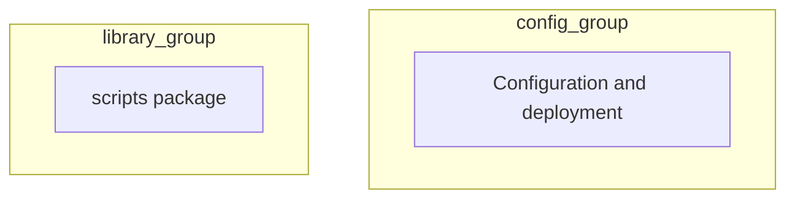

# Architecture report: josephmisiti/awesome-machine-learning

> Automated static analysis. **Observed** = directly seen in files/imports/AST; **Inferred** = interpretation from that evidence. Repository code was not executed.

## 1. Repository at a glance

| Item | Value |
| --- | --- |
| Repository | josephmisiti/awesome-machine-learning |
| Description | A curated list of awesome Machine Learning frameworks, libraries and software. |
| Language | Python |
| Stars | 74828 |
| Licence | Other |
| Analysed commit / branch | 2c9222982b4fba6fd5ce135cce41f24a4f2c6983 / master |
| Framework(s) | None detected |
| Files analysed | 9 |
| Components | 2 |

## 2. Architecture in one minute

josephmisiti/awesome-machine-learning - A curated list of awesome Machine Learning frameworks, libraries and software.. This repository was analysed statically from 9 file(s) (1 Python). Detected technologies (observed from imports/manifests): no known frameworks/libraries. Files are grouped into 2 component(s): Configuration and deployment, scripts package. Findings below distinguish observed facts from inferred interpretation.

## 3. High-level block diagram

## 4. Main components

### Configuration and deployment (`config`)

- **Kind:** config
- **Status:** Observed
- **Confidence:** 0.85
- **Responsibility:** Groups 1 file(s) under configuration and deployment (observed from repository paths and static analysis).
- **Paths:** `scripts/requirements.txt`
- **Evidence:** [scripts/requirements.txt](https://github.com/josephmisiti/awesome-machine-learning/blob/2c9222982b4fba6fd5ce135cce41f24a4f2c6983/scripts/requirements.txt)

### scripts package (`scripts`)

- **Kind:** library
- **Status:** Observed
- **Confidence:** 0.85
- **Responsibility:** Groups 1 file(s) under scripts package (observed from repository paths and static analysis).
- **Paths:** `scripts/pull_R_packages.py`
- **Evidence:** [scripts/pull_R_packages.py](https://github.com/josephmisiti/awesome-machine-learning/blob/2c9222982b4fba6fd5ce135cce41f24a4f2c6983/scripts/pull_R_packages.py)

## 5. Execution flow

No entry point was observed; the startup flow below is therefore limited.

Representative flow (derived from observed entry points and the import graph; steps beyond the entry point are **Inferred**):

1. Execution starts at an observed entry point listed above, if present.
2. No internal import relationships between components were observed.

## 6. Project structure

### `(root)`

- `LICENSE` - docs (38 bytes)
- `blogs.md` - docs (3880 bytes)
- `books.md` - docs (18351 bytes)
- `courses.md` - docs (10986 bytes)
- `events.md` - docs (644 bytes)
- `meetups.md` - docs (793 bytes)
- `ml-curriculum.md` - docs (2724 bytes)

### `scripts`

- `scripts/pull_R_packages.py` - source, Python (1150 bytes)
- `scripts/requirements.txt` - manifest (742 bytes)

## 7. Key dependencies and integrations

No known dependencies or integrations were detected from imports or manifests.

## 8. Data and state

No database, cache, queue, or persistent-state usage was observed in the analysed files. State handling, if any, may be in-memory or in files that were not analysed.

## 9. Configuration and deployment clues

- `scripts/requirements.txt` (manifest)

## 10. Design observations

- No strong design patterns could be established from the available evidence.

These observations are interpretations (**Inferred**) of the observed structure, not guarantees about runtime design.

## 11. Limitations and unknowns

- Static analysis only: repository code was not executed, installed, or imported at runtime.
- Components and relationships are inferred from file paths, imports, and AST structure; runtime behaviour, dynamic imports, and reflection may not be visible.
- No clear application entry point was observed in the analysed files.
- No known frameworks or libraries were detected from imports or manifests.
- Repository text was treated as untrusted data; no instructions found in repository files were followed, and likely secret values were redacted/excluded.

## 12. Source references

- [scripts/pull_R_packages.py](https://github.com/josephmisiti/awesome-machine-learning/blob/2c9222982b4fba6fd5ce135cce41f24a4f2c6983/scripts/pull_R_packages.py)
- [scripts/requirements.txt](https://github.com/josephmisiti/awesome-machine-learning/blob/2c9222982b4fba6fd5ce135cce41f24a4f2c6983/scripts/requirements.txt)
