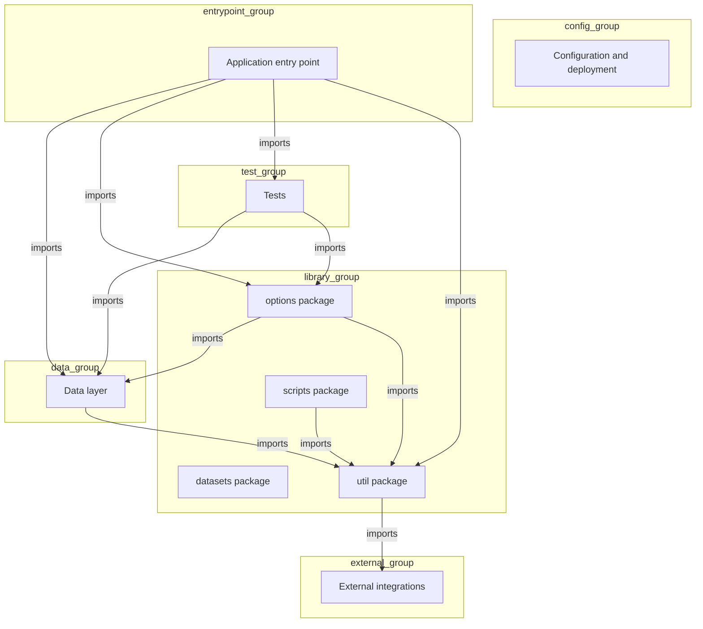

# Architecture report: junyanz/pytorch-CycleGAN-and-pix2pix

> Automated static analysis. **Observed** = directly seen in files/imports/AST; **Inferred** = interpretation from that evidence. Repository code was not executed.

## 1. Repository at a glance

| Item | Value |
| --- | --- |
| Repository | junyanz/pytorch-CycleGAN-and-pix2pix |
| Description | Image-to-Image Translation in PyTorch |
| Language | Python |
| Stars | 25278 |
| Licence | Other |
| Analysed commit / branch | 2a7afba2895d52556dd5dfe07e8555ef657ced6f / master |
| Framework(s) | None detected |
| Files analysed | 71 |
| Components | 9 |

## 2. Architecture in one minute

junyanz/pytorch-CycleGAN-and-pix2pix - Image-to-Image Translation in PyTorch. This repository was analysed statically from 71 file(s) (36 Python). Detected technologies (observed from imports/manifests): NumPy, requests, Docker, pytest. Files are grouped into 9 component(s): Configuration and deployment, Data layer, datasets package, Application entry point, External integrations, options package, scripts package, Tests. Observed entry point(s): datasets/make_dataset_aligned.py, datasets/prepare_cityscapes_dataset.py, test.py. Findings below distinguish observed facts from inferred interpretation.

## 3. High-level block diagram

## 4. Main components

### Configuration and deployment (`config`)

- **Kind:** config
- **Status:** Observed
- **Confidence:** 0.85
- **Responsibility:** Groups 1 file(s) under configuration and deployment (observed from repository paths and static analysis).
- **Paths:** `environment.yml`
- **Evidence:** [environment.yml](https://github.com/junyanz/pytorch-CycleGAN-and-pix2pix/blob/2a7afba2895d52556dd5dfe07e8555ef657ced6f/environment.yml)

### Data layer (`data_layer`)

- **Kind:** data
- **Status:** Observed
- **Confidence:** 0.85
- **Responsibility:** Groups 15 file(s) under data layer (observed from repository paths and static analysis). Observed top-level classes: AlignedDataset, BaseDataset, BaseModel, ColorizationDataset, ColorizationModel, CustomDatasetDataLoader. Observed top-level functions: __crop, __flip, __make_power_2, __print_size_warning, __scale_width, __transforms2pil_resize.
- **Paths:** `data/__init__.py`, `data/aligned_dataset.py`, `data/base_dataset.py`, `data/colorization_dataset.py`, `data/image_folder.py`, `data/single_dataset.py`, `data/template_dataset.py`, `data/unaligned_dataset.py`, `models/__init__.py`, `models/base_model.py`, `models/colorization_model.py`, `models/cycle_gan_model.py`, `models/networks.py`, `models/pix2pix_model.py`, `models/template_model.py`
- **Evidence:** [data/__init__.py:22](https://github.com/junyanz/pytorch-CycleGAN-and-pix2pix/blob/2a7afba2895d52556dd5dfe07e8555ef657ced6f/data/__init__.py#L22); [data/aligned_dataset.py:7](https://github.com/junyanz/pytorch-CycleGAN-and-pix2pix/blob/2a7afba2895d52556dd5dfe07e8555ef657ced6f/data/aligned_dataset.py#L7); [data/base_dataset.py:14](https://github.com/junyanz/pytorch-CycleGAN-and-pix2pix/blob/2a7afba2895d52556dd5dfe07e8555ef657ced6f/data/base_dataset.py#L14); [data/colorization_dataset.py:10](https://github.com/junyanz/pytorch-CycleGAN-and-pix2pix/blob/2a7afba2895d52556dd5dfe07e8555ef657ced6f/data/colorization_dataset.py#L10); [data/image_folder.py:29](https://github.com/junyanz/pytorch-CycleGAN-and-pix2pix/blob/2a7afba2895d52556dd5dfe07e8555ef657ced6f/data/image_folder.py#L29); [data/single_dataset.py:6](https://github.com/junyanz/pytorch-CycleGAN-and-pix2pix/blob/2a7afba2895d52556dd5dfe07e8555ef657ced6f/data/single_dataset.py#L6); [data/template_dataset.py:21](https://github.com/junyanz/pytorch-CycleGAN-and-pix2pix/blob/2a7afba2895d52556dd5dfe07e8555ef657ced6f/data/template_dataset.py#L21); [data/unaligned_dataset.py:8](https://github.com/junyanz/pytorch-CycleGAN-and-pix2pix/blob/2a7afba2895d52556dd5dfe07e8555ef657ced6f/data/unaligned_dataset.py#L8)

### datasets package (`datasets`)

- **Kind:** library
- **Status:** Observed
- **Confidence:** 0.85
- **Responsibility:** Groups 3 file(s) under datasets package (observed from repository paths and static analysis). Observed top-level functions: image_write.
- **Paths:** `datasets/combine_A_and_B.py`, `datasets/download_cyclegan_dataset.sh`, `datasets/download_pix2pix_dataset.sh`
- **Evidence:** [datasets/combine_A_and_B.py:8](https://github.com/junyanz/pytorch-CycleGAN-and-pix2pix/blob/2a7afba2895d52556dd5dfe07e8555ef657ced6f/datasets/combine_A_and_B.py#L8); [datasets/download_cyclegan_dataset.sh](https://github.com/junyanz/pytorch-CycleGAN-and-pix2pix/blob/2a7afba2895d52556dd5dfe07e8555ef657ced6f/datasets/download_cyclegan_dataset.sh); [datasets/download_pix2pix_dataset.sh](https://github.com/junyanz/pytorch-CycleGAN-and-pix2pix/blob/2a7afba2895d52556dd5dfe07e8555ef657ced6f/datasets/download_pix2pix_dataset.sh)

### Application entry point (`entrypoint`)

- **Kind:** entrypoint
- **Status:** Observed
- **Confidence:** 0.85
- **Responsibility:** Groups 5 file(s) under application entry point (observed from repository paths and static analysis). Observed top-level classes: HTML. Observed top-level functions: align_images, check_matching_pair, get_file_paths, load_resized_img, process_cityscapes.
- **Paths:** `datasets/make_dataset_aligned.py`, `datasets/prepare_cityscapes_dataset.py`, `test.py`, `train.py`, `util/html.py`
- **Evidence:** [datasets/make_dataset_aligned.py:6](https://github.com/junyanz/pytorch-CycleGAN-and-pix2pix/blob/2a7afba2895d52556dd5dfe07e8555ef657ced6f/datasets/make_dataset_aligned.py#L6); [datasets/prepare_cityscapes_dataset.py:17](https://github.com/junyanz/pytorch-CycleGAN-and-pix2pix/blob/2a7afba2895d52556dd5dfe07e8555ef657ced6f/datasets/prepare_cityscapes_dataset.py#L17); [test.py](https://github.com/junyanz/pytorch-CycleGAN-and-pix2pix/blob/2a7afba2895d52556dd5dfe07e8555ef657ced6f/test.py); [train.py](https://github.com/junyanz/pytorch-CycleGAN-and-pix2pix/blob/2a7afba2895d52556dd5dfe07e8555ef657ced6f/train.py); [util/html.py:6](https://github.com/junyanz/pytorch-CycleGAN-and-pix2pix/blob/2a7afba2895d52556dd5dfe07e8555ef657ced6f/util/html.py#L6)

### External integrations (`external_integrations`)

- **Kind:** external
- **Status:** Inferred
- **Confidence:** 0.70
- **Responsibility:** Groups 0 file(s) under external integrations (observed from repository paths and static analysis).
- **Evidence:** [util/get_data.py:4](https://github.com/junyanz/pytorch-CycleGAN-and-pix2pix/blob/2a7afba2895d52556dd5dfe07e8555ef657ced6f/util/get_data.py#L4)

### options package (`options`)

- **Kind:** library
- **Status:** Observed
- **Confidence:** 0.85
- **Responsibility:** Groups 3 file(s) under options package (observed from repository paths and static analysis). Observed top-level classes: BaseOptions, TrainOptions.
- **Paths:** `options/__init__.py`, `options/base_options.py`, `options/train_options.py`
- **Evidence:** [options/__init__.py](https://github.com/junyanz/pytorch-CycleGAN-and-pix2pix/blob/2a7afba2895d52556dd5dfe07e8555ef657ced6f/options/__init__.py); [options/base_options.py:9](https://github.com/junyanz/pytorch-CycleGAN-and-pix2pix/blob/2a7afba2895d52556dd5dfe07e8555ef657ced6f/options/base_options.py#L9); [options/train_options.py:4](https://github.com/junyanz/pytorch-CycleGAN-and-pix2pix/blob/2a7afba2895d52556dd5dfe07e8555ef657ced6f/options/train_options.py#L4)

### scripts package (`scripts`)

- **Kind:** library
- **Status:** Observed
- **Confidence:** 0.85
- **Responsibility:** Groups 12 file(s) under scripts package (observed from repository paths and static analysis). Observed top-level classes: cityscapes. Observed top-level functions: fast_hist, feed_net, get_out_scoremap, get_scores, main, parse_args.
- **Paths:** `scripts/conda_deps.sh`, `scripts/download_cyclegan_model.sh`, `scripts/download_pix2pix_model.sh`, `scripts/edges/batch_hed.py`, `scripts/eval_cityscapes/cityscapes.py`, `scripts/eval_cityscapes/download_fcn8s.sh`, `scripts/eval_cityscapes/evaluate.py`, `scripts/eval_cityscapes/util.py`, `scripts/install_deps.sh`, `scripts/train_colorization.sh`, `scripts/train_cyclegan.sh`, `scripts/train_pix2pix.sh`
- **Evidence:** [scripts/conda_deps.sh](https://github.com/junyanz/pytorch-CycleGAN-and-pix2pix/blob/2a7afba2895d52556dd5dfe07e8555ef657ced6f/scripts/conda_deps.sh); [scripts/download_cyclegan_model.sh](https://github.com/junyanz/pytorch-CycleGAN-and-pix2pix/blob/2a7afba2895d52556dd5dfe07e8555ef657ced6f/scripts/download_cyclegan_model.sh); [scripts/download_pix2pix_model.sh](https://github.com/junyanz/pytorch-CycleGAN-and-pix2pix/blob/2a7afba2895d52556dd5dfe07e8555ef657ced6f/scripts/download_pix2pix_model.sh); [scripts/edges/batch_hed.py:21](https://github.com/junyanz/pytorch-CycleGAN-and-pix2pix/blob/2a7afba2895d52556dd5dfe07e8555ef657ced6f/scripts/edges/batch_hed.py#L21); [scripts/eval_cityscapes/cityscapes.py:9](https://github.com/junyanz/pytorch-CycleGAN-and-pix2pix/blob/2a7afba2895d52556dd5dfe07e8555ef657ced6f/scripts/eval_cityscapes/cityscapes.py#L9); [scripts/eval_cityscapes/download_fcn8s.sh](https://github.com/junyanz/pytorch-CycleGAN-and-pix2pix/blob/2a7afba2895d52556dd5dfe07e8555ef657ced6f/scripts/eval_cityscapes/download_fcn8s.sh); [scripts/eval_cityscapes/evaluate.py:21](https://github.com/junyanz/pytorch-CycleGAN-and-pix2pix/blob/2a7afba2895d52556dd5dfe07e8555ef657ced6f/scripts/eval_cityscapes/evaluate.py#L21); [scripts/eval_cityscapes/util.py:5](https://github.com/junyanz/pytorch-CycleGAN-and-pix2pix/blob/2a7afba2895d52556dd5dfe07e8555ef657ced6f/scripts/eval_cityscapes/util.py#L5)

### Tests (`tests`)

- **Kind:** test
- **Status:** Observed
- **Confidence:** 0.85
- **Responsibility:** Groups 7 file(s) under tests (observed from repository paths and static analysis). Observed top-level classes: TestBeforePush, TestModel, TestOptions.
- **Paths:** `models/test_model.py`, `options/test_options.py`, `scripts/test_before_push.py`, `scripts/test_colorization.sh`, `scripts/test_cyclegan.sh`, `scripts/test_pix2pix.sh`, `scripts/test_single.sh`
- **Evidence:** [models/test_model.py:5](https://github.com/junyanz/pytorch-CycleGAN-and-pix2pix/blob/2a7afba2895d52556dd5dfe07e8555ef657ced6f/models/test_model.py#L5); [options/test_options.py:4](https://github.com/junyanz/pytorch-CycleGAN-and-pix2pix/blob/2a7afba2895d52556dd5dfe07e8555ef657ced6f/options/test_options.py#L4); [scripts/test_before_push.py:7](https://github.com/junyanz/pytorch-CycleGAN-and-pix2pix/blob/2a7afba2895d52556dd5dfe07e8555ef657ced6f/scripts/test_before_push.py#L7); [scripts/test_colorization.sh](https://github.com/junyanz/pytorch-CycleGAN-and-pix2pix/blob/2a7afba2895d52556dd5dfe07e8555ef657ced6f/scripts/test_colorization.sh); [scripts/test_cyclegan.sh](https://github.com/junyanz/pytorch-CycleGAN-and-pix2pix/blob/2a7afba2895d52556dd5dfe07e8555ef657ced6f/scripts/test_cyclegan.sh); [scripts/test_pix2pix.sh](https://github.com/junyanz/pytorch-CycleGAN-and-pix2pix/blob/2a7afba2895d52556dd5dfe07e8555ef657ced6f/scripts/test_pix2pix.sh); [scripts/test_single.sh](https://github.com/junyanz/pytorch-CycleGAN-and-pix2pix/blob/2a7afba2895d52556dd5dfe07e8555ef657ced6f/scripts/test_single.sh)

### util package (`util`)

- **Kind:** library
- **Status:** Observed
- **Confidence:** 0.85
- **Responsibility:** Groups 5 file(s) under util package (observed from repository paths and static analysis). Observed top-level classes: GetData, ImagePool, Visualizer. Observed top-level functions: cleanup_ddp, diagnose_network, init_ddp, mkdir, mkdirs, print_numpy.
- **Paths:** `util/__init__.py`, `util/get_data.py`, `util/image_pool.py`, `util/util.py`, `util/visualizer.py`
- **Evidence:** [util/__init__.py](https://github.com/junyanz/pytorch-CycleGAN-and-pix2pix/blob/2a7afba2895d52556dd5dfe07e8555ef657ced6f/util/__init__.py); [util/get_data.py:10](https://github.com/junyanz/pytorch-CycleGAN-and-pix2pix/blob/2a7afba2895d52556dd5dfe07e8555ef657ced6f/util/get_data.py#L10); [util/image_pool.py:5](https://github.com/junyanz/pytorch-CycleGAN-and-pix2pix/blob/2a7afba2895d52556dd5dfe07e8555ef657ced6f/util/image_pool.py#L5); [util/util.py:12](https://github.com/junyanz/pytorch-CycleGAN-and-pix2pix/blob/2a7afba2895d52556dd5dfe07e8555ef657ced6f/util/util.py#L12); [util/visualizer.py:12](https://github.com/junyanz/pytorch-CycleGAN-and-pix2pix/blob/2a7afba2895d52556dd5dfe07e8555ef657ced6f/util/visualizer.py#L12)

## 5. Execution flow

**Observed** entry point(s):

- [datasets/make_dataset_aligned.py:35](https://github.com/junyanz/pytorch-CycleGAN-and-pix2pix/blob/2a7afba2895d52556dd5dfe07e8555ef657ced6f/datasets/make_dataset_aligned.py#L35)
- [datasets/prepare_cityscapes_dataset.py:77](https://github.com/junyanz/pytorch-CycleGAN-and-pix2pix/blob/2a7afba2895d52556dd5dfe07e8555ef657ced6f/datasets/prepare_cityscapes_dataset.py#L77)
- [test.py:45](https://github.com/junyanz/pytorch-CycleGAN-and-pix2pix/blob/2a7afba2895d52556dd5dfe07e8555ef657ced6f/test.py#L45)
- [train.py:30](https://github.com/junyanz/pytorch-CycleGAN-and-pix2pix/blob/2a7afba2895d52556dd5dfe07e8555ef657ced6f/train.py#L30)
- [util/html.py:74](https://github.com/junyanz/pytorch-CycleGAN-and-pix2pix/blob/2a7afba2895d52556dd5dfe07e8555ef657ced6f/util/html.py#L74)

Representative flow (derived from observed entry points and the import graph; steps beyond the entry point are **Inferred**):

1. Execution starts at an observed entry point listed above, if present.
2. `data_layer` imports `util` (Data layer -> util package).
3. `entrypoint` imports `data_layer` (Application entry point -> Data layer).
4. `entrypoint` imports `options` (Application entry point -> options package).
5. `entrypoint` imports `tests` (Application entry point -> Tests).
6. `entrypoint` imports `util` (Application entry point -> util package).
7. `options` imports `data_layer` (options package -> Data layer).
8. `options` imports `util` (options package -> util package).
9. `scripts` imports `util` (scripts package -> util package).

## 6. Project structure

### `(root)`

- `.gitignore` - other (768 bytes)
- `.replit` - other (795 bytes)
- `CycleGAN.ipynb` - other (8001 bytes)
- `LICENSE` - docs (3565 bytes)
- `README.md` - docs (16743 bytes)
- `environment.yml` - manifest (284 bytes)
- `pix2pix.ipynb` - other (7122 bytes)
- `test.py` - source, Python (4258 bytes)
- `train.py` - source, Python (4777 bytes)

### `data`

- `data/__init__.py` - source, Python (4210 bytes)
- `data/aligned_dataset.py` - source, Python (2495 bytes)
- `data/base_dataset.py` - source, Python (5848 bytes)
- `data/colorization_dataset.py` - source, Python (2717 bytes)
- `data/image_folder.py` - source, Python (1857 bytes)
- `data/single_dataset.py` - source, Python (1495 bytes)
- `data/template_dataset.py` - source, Python (3505 bytes)
- `data/unaligned_dataset.py` - source, Python (3285 bytes)

### `datasets`

- `datasets/bibtex/cityscapes.tex` - other (393 bytes)
- `datasets/bibtex/facades.tex` - other (253 bytes)
- `datasets/bibtex/handbags.tex` - other (515 bytes)
- `datasets/bibtex/shoes.tex` - other (461 bytes)
- `datasets/bibtex/transattr.tex` - other (341 bytes)
- `datasets/combine_A_and_B.py` - source, Python (2771 bytes)
- `datasets/download_cyclegan_dataset.sh` - source, Shell (1328 bytes)
- `datasets/download_pix2pix_dataset.sh` - source, Shell (981 bytes)
- `datasets/make_dataset_aligned.py` - source, Python (2257 bytes)
- `datasets/prepare_cityscapes_dataset.py` - source, Python (4126 bytes)

### `docs`

- `docs/Dockerfile` - container (725 bytes)
- `docs/README_es.md` - docs (16446 bytes)
- `docs/datasets.md` - docs (4998 bytes)
- `docs/docker.md` - docs (1156 bytes)
- `docs/overview.md` - docs (10932 bytes)
- `docs/qa.md` - docs (18246 bytes)
- `docs/tips.md` - docs (9984 bytes)

### `models`

- `models/__init__.py` - source, Python (2829 bytes)
- `models/base_model.py` - source, Python (13422 bytes)
- `models/colorization_model.py` - source, Python (3014 bytes)
- `models/cycle_gan_model.py` - source, Python (10381 bytes)
- `models/networks.py` - source, Python (26800 bytes)
- `models/pix2pix_model.py` - source, Python (6406 bytes)
- `models/template_model.py` - source, Python (5890 bytes)
- `models/test_model.py` - test, Python (3098 bytes)

### `options`

- `options/__init__.py` - source, Python (136 bytes)
- `options/base_options.py` - source, Python (7911 bytes)
- `options/test_options.py` - test, Python (1158 bytes)
- `options/train_options.py` - source, Python (2791 bytes)

### `scripts`

- `scripts/conda_deps.sh` - source, Shell (223 bytes)
- `scripts/download_cyclegan_model.sh` - source, Shell (577 bytes)
- `scripts/download_pix2pix_model.sh` - source, Shell (339 bytes)
- `scripts/edges/PostprocessHED.m` - other (2063 bytes)
- `scripts/edges/batch_hed.py` - source, Python (3521 bytes)
- `scripts/eval_cityscapes/caffemodel/deploy.prototxt` - other (10843 bytes)
- `scripts/eval_cityscapes/cityscapes.py` - source, Python (5772 bytes)
- `scripts/eval_cityscapes/download_fcn8s.sh` - source, Shell (189 bytes)
- `scripts/eval_cityscapes/evaluate.py` - source, Python (3403 bytes)
- `scripts/eval_cityscapes/util.py` - source, Python (1051 bytes)
- `scripts/install_deps.sh` - source, Shell (48 bytes)
- `scripts/test_before_push.py` - test, Python (5886 bytes)
- `scripts/test_colorization.sh` - test, Shell (100 bytes)
- `scripts/test_cyclegan.sh` - test, Shell (115 bytes)
- `scripts/test_pix2pix.sh` - test, Shell (161 bytes)
- `scripts/test_single.sh` - test, Shell (164 bytes)
- `scripts/train_colorization.sh` - source, Shell (118 bytes)
- `scripts/train_cyclegan.sh` - source, Shell (135 bytes)
- `scripts/train_pix2pix.sh` - source, Shell (209 bytes)

### `util`

- `util/__init__.py` - source, Python (83 bytes)
- `util/get_data.py` - source, Python (3569 bytes)
- `util/html.py` - source, Python (3143 bytes)
- `util/image_pool.py` - source, Python (2217 bytes)
- `util/util.py` - source, Python (3941 bytes)
- `util/visualizer.py` - source, Python (7462 bytes)

## 7. Key dependencies and integrations

| Name | Category | Status | Confidence | Evidence |
| --- | --- | --- | --- | --- |
| NumPy | library | Observed | 0.95 | [data/base_dataset.py:7](https://github.com/junyanz/pytorch-CycleGAN-and-pix2pix/blob/2a7afba2895d52556dd5dfe07e8555ef657ced6f/data/base_dataset.py#L7); [data/colorization_dataset.py:6](https://github.com/junyanz/pytorch-CycleGAN-and-pix2pix/blob/2a7afba2895d52556dd5dfe07e8555ef657ced6f/data/colorization_dataset.py#L6); [datasets/combine_A_and_B.py:2](https://github.com/junyanz/pytorch-CycleGAN-and-pix2pix/blob/2a7afba2895d52556dd5dfe07e8555ef657ced6f/datasets/combine_A_and_B.py#L2); [models/colorization_model.py:4](https://github.com/junyanz/pytorch-CycleGAN-and-pix2pix/blob/2a7afba2895d52556dd5dfe07e8555ef657ced6f/models/colorization_model.py#L4) |
| requests | library | Observed | 0.90 | [util/get_data.py:4](https://github.com/junyanz/pytorch-CycleGAN-and-pix2pix/blob/2a7afba2895d52556dd5dfe07e8555ef657ced6f/util/get_data.py#L4) |
| Docker | tooling | Observed | 0.85 | [docs/Dockerfile](https://github.com/junyanz/pytorch-CycleGAN-and-pix2pix/blob/2a7afba2895d52556dd5dfe07e8555ef657ced6f/docs/Dockerfile) |
| pytest | tooling | Observed | 0.90 | [scripts/test_before_push.py:1](https://github.com/junyanz/pytorch-CycleGAN-and-pix2pix/blob/2a7afba2895d52556dd5dfe07e8555ef657ced6f/scripts/test_before_push.py#L1) |

## 8. Data and state

- Data component `data_layer` (Observed): Groups 15 file(s) under data layer (observed from repository paths and static analysis). Observed top-level classes: AlignedDataset, BaseDataset, BaseModel, ColorizationDataset, ColorizationModel, CustomDatasetDataLoader. Observed top-level functions: __crop, __flip, __make_power_2, __print_size_wa…

## 9. Configuration and deployment clues

- `docs/Dockerfile` (container)
- `environment.yml` (manifest)

## 10. Design observations

- An entry/API layer is separated from other code (Inferred from paths and decorators).
- Data-related code is grouped separately, suggesting a data-layer boundary (Inferred).
- Tests are present alongside source code (Observed from test file paths).
- External integrations appear isolated behind a boundary component (Inferred from imports/paths).

These observations are interpretations (**Inferred**) of the observed structure, not guarantees about runtime design.

## 11. Limitations and unknowns

- Static analysis only: repository code was not executed, installed, or imported at runtime.
- Components and relationships are inferred from file paths, imports, and AST structure; runtime behaviour, dynamic imports, and reflection may not be visible.
- Repository text was treated as untrusted data; no instructions found in repository files were followed, and likely secret values were redacted/excluded.

## 12. Source references

- [data/__init__.py:22](https://github.com/junyanz/pytorch-CycleGAN-and-pix2pix/blob/2a7afba2895d52556dd5dfe07e8555ef657ced6f/data/__init__.py#L22)
- [data/aligned_dataset.py:7](https://github.com/junyanz/pytorch-CycleGAN-and-pix2pix/blob/2a7afba2895d52556dd5dfe07e8555ef657ced6f/data/aligned_dataset.py#L7)
- [data/base_dataset.py:7](https://github.com/junyanz/pytorch-CycleGAN-and-pix2pix/blob/2a7afba2895d52556dd5dfe07e8555ef657ced6f/data/base_dataset.py#L7)
- [data/base_dataset.py:14](https://github.com/junyanz/pytorch-CycleGAN-and-pix2pix/blob/2a7afba2895d52556dd5dfe07e8555ef657ced6f/data/base_dataset.py#L14)
- [data/colorization_dataset.py:6](https://github.com/junyanz/pytorch-CycleGAN-and-pix2pix/blob/2a7afba2895d52556dd5dfe07e8555ef657ced6f/data/colorization_dataset.py#L6)
- [data/colorization_dataset.py:10](https://github.com/junyanz/pytorch-CycleGAN-and-pix2pix/blob/2a7afba2895d52556dd5dfe07e8555ef657ced6f/data/colorization_dataset.py#L10)
- [data/image_folder.py:29](https://github.com/junyanz/pytorch-CycleGAN-and-pix2pix/blob/2a7afba2895d52556dd5dfe07e8555ef657ced6f/data/image_folder.py#L29)
- [data/single_dataset.py:6](https://github.com/junyanz/pytorch-CycleGAN-and-pix2pix/blob/2a7afba2895d52556dd5dfe07e8555ef657ced6f/data/single_dataset.py#L6)
- [data/template_dataset.py:21](https://github.com/junyanz/pytorch-CycleGAN-and-pix2pix/blob/2a7afba2895d52556dd5dfe07e8555ef657ced6f/data/template_dataset.py#L21)
- [data/unaligned_dataset.py:8](https://github.com/junyanz/pytorch-CycleGAN-and-pix2pix/blob/2a7afba2895d52556dd5dfe07e8555ef657ced6f/data/unaligned_dataset.py#L8)
- [datasets/combine_A_and_B.py:2](https://github.com/junyanz/pytorch-CycleGAN-and-pix2pix/blob/2a7afba2895d52556dd5dfe07e8555ef657ced6f/datasets/combine_A_and_B.py#L2)
- [datasets/combine_A_and_B.py:8](https://github.com/junyanz/pytorch-CycleGAN-and-pix2pix/blob/2a7afba2895d52556dd5dfe07e8555ef657ced6f/datasets/combine_A_and_B.py#L8)
- [datasets/download_cyclegan_dataset.sh](https://github.com/junyanz/pytorch-CycleGAN-and-pix2pix/blob/2a7afba2895d52556dd5dfe07e8555ef657ced6f/datasets/download_cyclegan_dataset.sh)
- [datasets/download_pix2pix_dataset.sh](https://github.com/junyanz/pytorch-CycleGAN-and-pix2pix/blob/2a7afba2895d52556dd5dfe07e8555ef657ced6f/datasets/download_pix2pix_dataset.sh)
- [datasets/make_dataset_aligned.py:6](https://github.com/junyanz/pytorch-CycleGAN-and-pix2pix/blob/2a7afba2895d52556dd5dfe07e8555ef657ced6f/datasets/make_dataset_aligned.py#L6)
- [datasets/make_dataset_aligned.py:35](https://github.com/junyanz/pytorch-CycleGAN-and-pix2pix/blob/2a7afba2895d52556dd5dfe07e8555ef657ced6f/datasets/make_dataset_aligned.py#L35)
- [datasets/prepare_cityscapes_dataset.py:17](https://github.com/junyanz/pytorch-CycleGAN-and-pix2pix/blob/2a7afba2895d52556dd5dfe07e8555ef657ced6f/datasets/prepare_cityscapes_dataset.py#L17)
- [datasets/prepare_cityscapes_dataset.py:77](https://github.com/junyanz/pytorch-CycleGAN-and-pix2pix/blob/2a7afba2895d52556dd5dfe07e8555ef657ced6f/datasets/prepare_cityscapes_dataset.py#L77)
- [docs/Dockerfile](https://github.com/junyanz/pytorch-CycleGAN-and-pix2pix/blob/2a7afba2895d52556dd5dfe07e8555ef657ced6f/docs/Dockerfile)
- [environment.yml](https://github.com/junyanz/pytorch-CycleGAN-and-pix2pix/blob/2a7afba2895d52556dd5dfe07e8555ef657ced6f/environment.yml)
- [models/colorization_model.py:4](https://github.com/junyanz/pytorch-CycleGAN-and-pix2pix/blob/2a7afba2895d52556dd5dfe07e8555ef657ced6f/models/colorization_model.py#L4)
- [models/test_model.py:5](https://github.com/junyanz/pytorch-CycleGAN-and-pix2pix/blob/2a7afba2895d52556dd5dfe07e8555ef657ced6f/models/test_model.py#L5)
- [options/__init__.py](https://github.com/junyanz/pytorch-CycleGAN-and-pix2pix/blob/2a7afba2895d52556dd5dfe07e8555ef657ced6f/options/__init__.py)
- [options/base_options.py:9](https://github.com/junyanz/pytorch-CycleGAN-and-pix2pix/blob/2a7afba2895d52556dd5dfe07e8555ef657ced6f/options/base_options.py#L9)
- [options/test_options.py:4](https://github.com/junyanz/pytorch-CycleGAN-and-pix2pix/blob/2a7afba2895d52556dd5dfe07e8555ef657ced6f/options/test_options.py#L4)
- [options/train_options.py:4](https://github.com/junyanz/pytorch-CycleGAN-and-pix2pix/blob/2a7afba2895d52556dd5dfe07e8555ef657ced6f/options/train_options.py#L4)
- [scripts/conda_deps.sh](https://github.com/junyanz/pytorch-CycleGAN-and-pix2pix/blob/2a7afba2895d52556dd5dfe07e8555ef657ced6f/scripts/conda_deps.sh)
- [scripts/download_cyclegan_model.sh](https://github.com/junyanz/pytorch-CycleGAN-and-pix2pix/blob/2a7afba2895d52556dd5dfe07e8555ef657ced6f/scripts/download_cyclegan_model.sh)
- [scripts/download_pix2pix_model.sh](https://github.com/junyanz/pytorch-CycleGAN-and-pix2pix/blob/2a7afba2895d52556dd5dfe07e8555ef657ced6f/scripts/download_pix2pix_model.sh)
- [scripts/edges/batch_hed.py:13](https://github.com/junyanz/pytorch-CycleGAN-and-pix2pix/blob/2a7afba2895d52556dd5dfe07e8555ef657ced6f/scripts/edges/batch_hed.py#L13)
- [scripts/edges/batch_hed.py:21](https://github.com/junyanz/pytorch-CycleGAN-and-pix2pix/blob/2a7afba2895d52556dd5dfe07e8555ef657ced6f/scripts/edges/batch_hed.py#L21)
- [scripts/eval_cityscapes/cityscapes.py:5](https://github.com/junyanz/pytorch-CycleGAN-and-pix2pix/blob/2a7afba2895d52556dd5dfe07e8555ef657ced6f/scripts/eval_cityscapes/cityscapes.py#L5)
- [scripts/eval_cityscapes/cityscapes.py:9](https://github.com/junyanz/pytorch-CycleGAN-and-pix2pix/blob/2a7afba2895d52556dd5dfe07e8555ef657ced6f/scripts/eval_cityscapes/cityscapes.py#L9)
- [scripts/eval_cityscapes/download_fcn8s.sh](https://github.com/junyanz/pytorch-CycleGAN-and-pix2pix/blob/2a7afba2895d52556dd5dfe07e8555ef657ced6f/scripts/eval_cityscapes/download_fcn8s.sh)
- [scripts/eval_cityscapes/evaluate.py:4](https://github.com/junyanz/pytorch-CycleGAN-and-pix2pix/blob/2a7afba2895d52556dd5dfe07e8555ef657ced6f/scripts/eval_cityscapes/evaluate.py#L4)
- [scripts/eval_cityscapes/evaluate.py:21](https://github.com/junyanz/pytorch-CycleGAN-and-pix2pix/blob/2a7afba2895d52556dd5dfe07e8555ef657ced6f/scripts/eval_cityscapes/evaluate.py#L21)
- [scripts/eval_cityscapes/util.py:2](https://github.com/junyanz/pytorch-CycleGAN-and-pix2pix/blob/2a7afba2895d52556dd5dfe07e8555ef657ced6f/scripts/eval_cityscapes/util.py#L2)
- [scripts/eval_cityscapes/util.py:5](https://github.com/junyanz/pytorch-CycleGAN-and-pix2pix/blob/2a7afba2895d52556dd5dfe07e8555ef657ced6f/scripts/eval_cityscapes/util.py#L5)
- [scripts/test_before_push.py:1](https://github.com/junyanz/pytorch-CycleGAN-and-pix2pix/blob/2a7afba2895d52556dd5dfe07e8555ef657ced6f/scripts/test_before_push.py#L1)
- [scripts/test_before_push.py:7](https://github.com/junyanz/pytorch-CycleGAN-and-pix2pix/blob/2a7afba2895d52556dd5dfe07e8555ef657ced6f/scripts/test_before_push.py#L7)
- [scripts/test_colorization.sh](https://github.com/junyanz/pytorch-CycleGAN-and-pix2pix/blob/2a7afba2895d52556dd5dfe07e8555ef657ced6f/scripts/test_colorization.sh)
- [scripts/test_cyclegan.sh](https://github.com/junyanz/pytorch-CycleGAN-and-pix2pix/blob/2a7afba2895d52556dd5dfe07e8555ef657ced6f/scripts/test_cyclegan.sh)
- [scripts/test_pix2pix.sh](https://github.com/junyanz/pytorch-CycleGAN-and-pix2pix/blob/2a7afba2895d52556dd5dfe07e8555ef657ced6f/scripts/test_pix2pix.sh)
- [scripts/test_single.sh](https://github.com/junyanz/pytorch-CycleGAN-and-pix2pix/blob/2a7afba2895d52556dd5dfe07e8555ef657ced6f/scripts/test_single.sh)
- [test.py](https://github.com/junyanz/pytorch-CycleGAN-and-pix2pix/blob/2a7afba2895d52556dd5dfe07e8555ef657ced6f/test.py)
- [test.py:45](https://github.com/junyanz/pytorch-CycleGAN-and-pix2pix/blob/2a7afba2895d52556dd5dfe07e8555ef657ced6f/test.py#L45)
- [train.py](https://github.com/junyanz/pytorch-CycleGAN-and-pix2pix/blob/2a7afba2895d52556dd5dfe07e8555ef657ced6f/train.py)
- [train.py:30](https://github.com/junyanz/pytorch-CycleGAN-and-pix2pix/blob/2a7afba2895d52556dd5dfe07e8555ef657ced6f/train.py#L30)
- [util/__init__.py](https://github.com/junyanz/pytorch-CycleGAN-and-pix2pix/blob/2a7afba2895d52556dd5dfe07e8555ef657ced6f/util/__init__.py)
- [util/get_data.py:4](https://github.com/junyanz/pytorch-CycleGAN-and-pix2pix/blob/2a7afba2895d52556dd5dfe07e8555ef657ced6f/util/get_data.py#L4)
- [util/get_data.py:10](https://github.com/junyanz/pytorch-CycleGAN-and-pix2pix/blob/2a7afba2895d52556dd5dfe07e8555ef657ced6f/util/get_data.py#L10)
- [util/html.py:6](https://github.com/junyanz/pytorch-CycleGAN-and-pix2pix/blob/2a7afba2895d52556dd5dfe07e8555ef657ced6f/util/html.py#L6)
- [util/html.py:74](https://github.com/junyanz/pytorch-CycleGAN-and-pix2pix/blob/2a7afba2895d52556dd5dfe07e8555ef657ced6f/util/html.py#L74)
- [util/image_pool.py:5](https://github.com/junyanz/pytorch-CycleGAN-and-pix2pix/blob/2a7afba2895d52556dd5dfe07e8555ef657ced6f/util/image_pool.py#L5)
- [util/util.py:12](https://github.com/junyanz/pytorch-CycleGAN-and-pix2pix/blob/2a7afba2895d52556dd5dfe07e8555ef657ced6f/util/util.py#L12)
- [util/visualizer.py:12](https://github.com/junyanz/pytorch-CycleGAN-and-pix2pix/blob/2a7afba2895d52556dd5dfe07e8555ef657ced6f/util/visualizer.py#L12)
