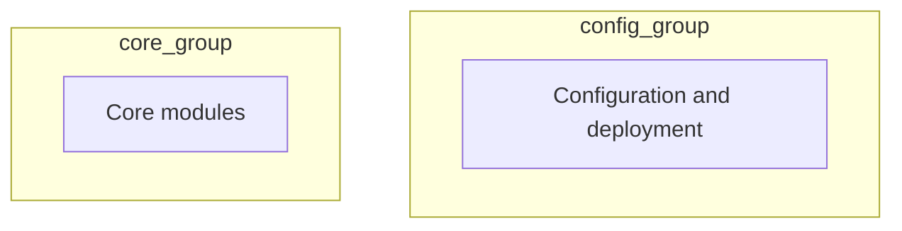

# Architecture report: jupyter/jupyter

> Automated static analysis. **Observed** = directly seen in files/imports/AST; **Inferred** = interpretation from that evidence. Repository code was not executed.

## 1. Repository at a glance

| Item | Value |
| --- | --- |
| Repository | jupyter/jupyter |
| Description | Jupyter metapackage for installation and documentation |
| Language | Python |
| Stars | 15348 |
| Licence | BSD-3-Clause |
| Analysed commit / branch | 6b5eb0f469c7bc3ea43d6d2a0ba1057853c9a3a5 / master |
| Framework(s) | None detected |
| Files analysed | 200 |
| Components | 2 |

## 2. Architecture in one minute

jupyter/jupyter - Jupyter metapackage for installation and documentation. This repository was analysed statically from 200 file(s) (4 Python). Detected technologies (observed from imports/manifests): GitHub Actions, setuptools. Files are grouped into 2 component(s): Configuration and deployment, Core modules. Findings below distinguish observed facts from inferred interpretation.

## 3. High-level block diagram

## 4. Main components

### Configuration and deployment (`config`)

- **Kind:** config
- **Status:** Observed
- **Confidence:** 0.85
- **Responsibility:** Groups 4 file(s) under configuration and deployment (observed from repository paths and static analysis).
- **Paths:** `MANIFEST.in`, `setup.cfg`, `setup.py`, `tbump.toml`
- **Evidence:** [MANIFEST.in](https://github.com/jupyter/jupyter/blob/6b5eb0f469c7bc3ea43d6d2a0ba1057853c9a3a5/MANIFEST.in); [setup.cfg](https://github.com/jupyter/jupyter/blob/6b5eb0f469c7bc3ea43d6d2a0ba1057853c9a3a5/setup.cfg); [setup.py](https://github.com/jupyter/jupyter/blob/6b5eb0f469c7bc3ea43d6d2a0ba1057853c9a3a5/setup.py); [tbump.toml](https://github.com/jupyter/jupyter/blob/6b5eb0f469c7bc3ea43d6d2a0ba1057853c9a3a5/tbump.toml)

### Core modules (`core`)

- **Kind:** core
- **Status:** Observed
- **Confidence:** 0.85
- **Responsibility:** Groups 1 file(s) under core modules (observed from repository paths and static analysis). Observed top-level functions: docs, docs_live.
- **Paths:** `noxfile.py`
- **Evidence:** [noxfile.py:8](https://github.com/jupyter/jupyter/blob/6b5eb0f469c7bc3ea43d6d2a0ba1057853c9a3a5/noxfile.py#L8)

## 5. Execution flow

No entry point was observed; the startup flow below is therefore limited.

Representative flow (derived from observed entry points and the import graph; steps beyond the entry point are **Inferred**):

1. Execution starts at an observed entry point listed above, if present.
2. No internal import relationships between components were observed.

## 6. Project structure

### `(root)`

- `.gitattributes` - other (444 bytes)
- `.gitignore` - other (711 bytes)
- `.readthedocs.yaml` - config (328 bytes)
- `.travis.yml` - ci, YAML (2195 bytes)
- `LICENSE` - docs (1527 bytes)
- `MANIFEST.in` - manifest (81 bytes)
- `README.es-ES.md` - docs (719 bytes)
- `README.fr-FR.md` - docs (702 bytes)
- `README.md` - docs (3347 bytes)
- `README.pt-BR.md` - docs (709 bytes)
- `SECURITY.md` - docs (60 bytes)
- `long_description.md` - docs (1010 bytes)
- `noxfile.py` - source, Python (664 bytes)
- `setup.cfg` - manifest (61 bytes)
- `setup.py` - manifest, Python (1801 bytes)
- `tbump.toml` - config (938 bytes)

### `.github`

- `.github/ISSUE_TEMPLATE/config.yml` - config (409 bytes)
- `.github/ISSUE_TEMPLATE/doc_suggestion.md` - docs (685 bytes)
- `.github/workflows/release.yaml` - ci, YAML (987 bytes)

### `docs`

- `docs/.tx/config` - docs (4001 bytes)
- `docs/Makefile` - docs (7454 bytes)
- `docs/doc-requirements.txt` - docs (120 bytes)
- `docs/environment.yml` - manifest (90 bytes)
- `docs/make.bat` - docs (7736 bytes)
- `docs/source/_static/_images/jupyter.svg` - docs (10070 bytes)
- `docs/source/_static/_images/logo-rectangle-dark.svg` - docs (5994 bytes)
- `docs/source/_static/custom.css` - docs (957 bytes)
- `docs/source/_static/jupyter.css` - docs (856 bytes)
- `docs/source/community/community-call-notes/2019-april.md` - docs (8652 bytes)
- `docs/source/community/community-call-notes/2019-august.md` - docs (3571 bytes)
- `docs/source/community/community-call-notes/2019-june.md` - docs (3805 bytes)
- `docs/source/community/community-call-notes/2019-march.md` - docs (8790 bytes)
- `docs/source/community/community-call-notes/2019-may.md` - docs (4814 bytes)
- `docs/source/community/community-call-notes/2019-september.md` - docs (3275 bytes)
- `docs/source/community/community-call-notes/2020-december.md` - docs (4655 bytes)
- `docs/source/community/community-call-notes/2020-november.md` - docs (2492 bytes)
- `docs/source/community/community-call-notes/2021-april.md` - docs (5365 bytes)
- `docs/source/community/community-call-notes/2021-august.md` - docs (3215 bytes)
- `docs/source/community/community-call-notes/2021-february.md` - docs (7937 bytes)
- `docs/source/community/community-call-notes/2021-january.md` - docs (8730 bytes)
- `docs/source/community/community-call-notes/2021-july.md` - docs (5084 bytes)
- `docs/source/community/community-call-notes/2021-june.md` - docs (4657 bytes)
- `docs/source/community/community-call-notes/2021-march.md` - docs (3655 bytes)
- `docs/source/community/community-call-notes/2021-may.md` - docs (4278 bytes)
- `docs/source/community/community-call-notes/2021-november.md` - docs (4900 bytes)
- `docs/source/community/community-call-notes/2021-october.md` - docs (4084 bytes)
- `docs/source/community/community-call-notes/2021-september.md` - docs (3406 bytes)
- `docs/source/community/community-call-notes/2022-april.md` - docs (5491 bytes)
- `docs/source/community/community-call-notes/2022-august.md` - docs (2995 bytes)
- `docs/source/community/community-call-notes/2022-february.md` - docs (4850 bytes)
- `docs/source/community/community-call-notes/2022-january.md` - docs (3346 bytes)
- `docs/source/community/community-call-notes/2022-july.md` - docs (3363 bytes)
- `docs/source/community/community-call-notes/2022-june.md` - docs (2491 bytes)
- `docs/source/community/community-call-notes/2022-march.md` - docs (1724 bytes)
- `docs/source/community/community-call-notes/2022-may.md` - docs (4120 bytes)
- `docs/source/community/community-call-notes/2022-november.md` - docs (2344 bytes)
- `docs/source/community/community-call-notes/2022-october.md` - docs (3150 bytes)
- `docs/source/community/community-call-notes/2022-september.md` - docs (2853 bytes)
- `docs/source/community/community-call-notes/2023-december.md` - docs (6635 bytes)
- `docs/source/community/community-call-notes/2023-february.md` - docs (5854 bytes)
- `docs/source/community/community-call-notes/2023-january.md` - docs (3469 bytes)
- `docs/source/community/community-call-notes/2024-november.md` - docs (3779 bytes)
- `docs/source/community/community-call-notes/2025-december.md` - docs (4588 bytes)
- `docs/source/community/community-call-notes/2025-february.md` - docs (5249 bytes)
- `docs/source/community/community-call-notes/2025-june.md` - docs (5280 bytes)
- `docs/source/community/community-call-notes/2025-september.md` - docs (7002 bytes)
- `docs/source/community/community-call-notes/2026-february.md` - docs (4234 bytes)
- `docs/source/community/community-call-notes/index.rst` - docs (1815 bytes)
- `docs/source/community/content-community.rst` - docs (8499 bytes)
- `docs/source/community/host-guide.md` - docs (12981 bytes)
- `docs/source/community/sample_scripts.md` - docs (7116 bytes)
- `docs/source/conf.py` - docs (7291 bytes)
- `docs/source/contributing/communication-contributions.rst` - docs (6870 bytes)
- `docs/source/contributing/content-contributor.rst` - docs (4060 bytes)
- `docs/source/contributing/dev-contributions/contrib_guide.md` - docs (11680 bytes)
- `docs/source/contributing/dev-contributions/index.rst` - docs (1107 bytes)
- `docs/source/contributing/dev-contributions/jupyter_enhancement_proposals.rst` - docs (1480 bytes)
- `docs/source/contributing/dev-contributions/releasing.rst` - docs (3415 bytes)
- `docs/source/contributing/docs-contributions/doc-future-index.rst` - docs (377 bytes)
- `docs/source/contributing/docs-contributions/doc-issues-hub.md` - docs (864 bytes)
- `docs/source/contributing/docs-contributions/doc-new-build.md` - docs (1721 bytes)
- `docs/source/contributing/docs-contributions/doc-new-repos.md` - docs (1813 bytes)
- `docs/source/contributing/docs-contributions/doc-new-translation.md` - docs (18174 bytes)
- `docs/source/contributing/docs-contributions/doc-tools.rst` - docs (1399 bytes)
- `docs/source/contributing/docs-contributions/doc-workflow.rst` - docs (1006 bytes)
- `docs/source/contributing/docs-contributions/getting-started.rst` - docs (3653 bytes)
- `docs/source/contributing/docs-contributions/index.rst` - docs (496 bytes)
- `docs/source/contributing/docs-contributions/repo-structure.md` - docs (1540 bytes)
- `docs/source/contributing/docs-contributions/static/translation-ci-cd.svg` - docs (69525 bytes)
- `docs/source/contributing/ipython-dev-guide/boot2docker.rst` - docs (3531 bytes)
- `docs/source/contributing/ipython-dev-guide/closing_prs.rst` - docs (2491 bytes)
- `docs/source/contributing/ipython-dev-guide/coding_style.rst` - docs (4359 bytes)
- `docs/source/contributing/ipython-dev-guide/documenting_ipython.rst` - docs (6240 bytes)
- `docs/source/contributing/ipython-dev-guide/github_workflow.rst` - docs (5940 bytes)
- `docs/source/contributing/ipython-dev-guide/index.rst` - docs (1103 bytes)
- `docs/source/contributing/ipython-dev-guide/js_events.rst` - docs (8270 bytes)
- `docs/source/contributing/ipython-dev-guide/lab_meetings.rst` - docs (1946 bytes)
- `docs/source/contributing/ipython-dev-guide/less.rst` - docs (780 bytes)
- `docs/source/contributing/ipython-dev-guide/pull_request.rst` - docs (2124 bytes)
- `docs/source/contributing/ipython-dev-guide/py3compat.rst` - docs (2652 bytes)
- `docs/source/contributing/ipython-dev-guide/releasing.rst` - docs (4097 bytes)
- `docs/source/contributing/ipython-dev-guide/rest_api.rst` - docs (18217 bytes)
- `docs/source/contributing/ipython-dev-guide/sphinx_directive.rst` - docs (10808 bytes)
- `docs/source/contributing/ipython-dev-guide/template.py` - docs (1523 bytes)
- `docs/source/contributing/ipython-dev-guide/testing.rst` - docs (17852 bytes)
- `docs/source/contributing/ipython-dev-guide/testing_kernels.rst` - docs (3618 bytes)
- `docs/source/contributing/start-contributing.rst` - docs (5201 bytes)
- `docs/source/glossary.rst` - docs (6980 bytes)
- `docs/source/index.md` - docs (8760 bytes)
- `docs/source/install.rst` - docs (2336 bytes)
- `docs/source/install/kernels.rst` - docs (1464 bytes)
- `docs/source/install/notebook-classic.rst` - docs (2804 bytes)
- `docs/source/locale/en/LC_MESSAGES/architecture.po` - docs (10197 bytes)
- `docs/source/locale/en/LC_MESSAGES/content-quickstart.po` - docs (855 bytes)
- `docs/source/locale/en/LC_MESSAGES/contents.po` - docs (4326 bytes)
- `docs/source/locale/en/LC_MESSAGES/contrib_docs.po` - docs (53105 bytes)
- `docs/source/locale/en/LC_MESSAGES/contributor.po` - docs (16920 bytes)
- `docs/source/locale/en/LC_MESSAGES/developer-docs.po` - docs (41405 bytes)
- `docs/source/locale/en/LC_MESSAGES/development_guide.po` - docs (134199 bytes)
- `docs/source/locale/en/LC_MESSAGES/glossary.po` - docs (3568 bytes)
- `docs/source/locale/en/LC_MESSAGES/index.po` - docs (19149 bytes)
- `docs/source/locale/en/LC_MESSAGES/install-kernel.po` - docs (3209 bytes)
- `docs/source/locale/en/LC_MESSAGES/install.po` - docs (14353 bytes)
- `docs/source/locale/en/LC_MESSAGES/ipython.po` - docs (3369 bytes)
- `docs/source/locale/en/LC_MESSAGES/migrating.po` - docs (17199 bytes)
- `docs/source/locale/en/LC_MESSAGES/projects.po` - docs (74600 bytes)
- `docs/source/locale/en/LC_MESSAGES/reference.po` - docs (10560 bytes)
- `docs/source/locale/en/LC_MESSAGES/releases.po` - docs (2773 bytes)
- `docs/source/locale/en/LC_MESSAGES/running.po` - docs (4514 bytes)
- `docs/source/locale/en/LC_MESSAGES/sphinx.po` - docs (6601 bytes)
- `docs/source/locale/en/LC_MESSAGES/tryjupyter.po` - docs (2672 bytes)
- `docs/source/locale/en/LC_MESSAGES/use-cases.po` - docs (14153 bytes)
- `docs/source/locale/en/LC_MESSAGES/use.po` - docs (48076 bytes)
- `docs/source/locale/es/LC_MESSAGES/architecture.po` - docs (14436 bytes)
- `docs/source/locale/es/LC_MESSAGES/community.po` - docs (21452 bytes)
- `docs/source/locale/es/LC_MESSAGES/content-quickstart.po` - docs (979 bytes)
- `docs/source/locale/es/LC_MESSAGES/contents.po` - docs (4565 bytes)
- `docs/source/locale/es/LC_MESSAGES/contrib_docs.po` - docs (20526 bytes)
- `docs/source/locale/es/LC_MESSAGES/contributor.po` - docs (14807 bytes)
- `docs/source/locale/es/LC_MESSAGES/developer-docs.po` - docs (35034 bytes)
- `docs/source/locale/es/LC_MESSAGES/development_guide.po` - docs (133461 bytes)
- `docs/source/locale/es/LC_MESSAGES/glossary.po` - docs (4860 bytes)
- `docs/source/locale/es/LC_MESSAGES/install-kernel.po` - docs (4690 bytes)
- `docs/source/locale/es/LC_MESSAGES/install.po` - docs (4248 bytes)
- `docs/source/locale/es/LC_MESSAGES/ipython.po` - docs (3897 bytes)
- `docs/source/locale/es/LC_MESSAGES/migrating.po` - docs (17199 bytes)
- `docs/source/locale/es/LC_MESSAGES/projects.po` - docs (40946 bytes)
- `docs/source/locale/es/LC_MESSAGES/reference.po` - docs (2447 bytes)
- `docs/source/locale/es/LC_MESSAGES/releases.po` - docs (1879 bytes)
- `docs/source/locale/es/LC_MESSAGES/running.po` - docs (4514 bytes)
- `docs/source/locale/es/LC_MESSAGES/sphinx.po` - docs (6601 bytes)
- `docs/source/locale/es/LC_MESSAGES/tryjupyter.po` - docs (1671 bytes)
- `docs/source/locale/es/LC_MESSAGES/use-cases.po` - docs (11936 bytes)
- `docs/source/locale/pt_BR/LC_MESSAGES/architecture.po` - docs (14515 bytes)
- `docs/source/locale/pt_BR/LC_MESSAGES/content-quickstart.po` - docs (990 bytes)
- `docs/source/locale/pt_BR/LC_MESSAGES/contents.po` - docs (4570 bytes)
- `docs/source/locale/pt_BR/LC_MESSAGES/contributor.po` - docs (24021 bytes)
- `docs/source/locale/pt_BR/LC_MESSAGES/glossary.po` - docs (4923 bytes)
- `docs/source/locale/pt_BR/LC_MESSAGES/releases.po` - docs (1883 bytes)
- `docs/source/locale/pt_BR/LC_MESSAGES/running.po` - docs (6975 bytes)
- `docs/source/locale/pt_BR/LC_MESSAGES/tryjupyter.po` - docs (2242 bytes)
- `docs/source/projects/architecture/content-architecture.rst` - docs (7893 bytes)
- `docs/source/projects/architecture/figs/ipy_kernel_and_terminal.svg` - docs (12607 bytes)
- `docs/source/projects/architecture/figs/nbconvert.svg` - docs (8221 bytes)
- `docs/source/projects/architecture/figs/notebook_components.svg` - docs (13189 bytes)
- `docs/source/projects/architecture/figs/other_kernels.svg` - docs (12601 bytes)
- `docs/source/projects/architecture/figs/repos_map.svg` - docs (104114 bytes)
- `docs/source/projects/content-projects.rst` - docs (880 bytes)
- `docs/source/projects/conversion.rst` - docs (899 bytes)
- `docs/source/projects/core.rst` - docs (741 bytes)
- `docs/source/projects/deployment.rst` - docs (1623 bytes)
- `docs/source/projects/doc-proj-categories.rst` - docs (2839 bytes)
- `docs/source/projects/education.rst` - docs (806 bytes)
- `docs/source/projects/execution.rst` - docs (428 bytes)
- `docs/source/projects/incubator.rst` - docs (550 bytes)
- `docs/source/projects/ipython_projects.rst` - docs (1405 bytes)
- `docs/source/projects/kernels.rst` - docs (2624 bytes)
- `docs/source/projects/user-interfaces.rst` - docs (2193 bytes)
- `docs/source/reference/content-reference.rst` - docs (150 bytes)
- `docs/source/reference/ipython.rst` - docs (1304 bytes)
- `docs/source/reference/mimetype.md` - docs (1594 bytes)
- `docs/source/releases.rst` - docs (852 bytes)
- `docs/source/running.rst` - docs (3974 bytes)
- `docs/source/start/index.md` - docs (1746 bytes)
- `docs/source/use/advanced/content-advanced.rst` - docs (81 bytes)
- `docs/source/use/advanced/migrating.rst` - docs (10355 bytes)
- `docs/source/use/config.rst` - docs (2270 bytes)
- `docs/source/use/jupyter-command.rst` - docs (1036 bytes)
- `docs/source/use/jupyter-directories.rst` - docs (6948 bytes)
- `docs/source/use/upgrade-notebook.rst` - docs (1091 bytes)
- `docs/source/use/use-cases/content-user.rst` - docs (553 bytes)
- `docs/source/use/use-cases/data_science.rst` - docs (1049 bytes)
- `docs/source/use/use-cases/education.rst` - docs (169 bytes)
- `docs/source/use/use-cases/enterprise.rst` - docs (1882 bytes)
- `docs/source/use/use-cases/narrative-hub.rst` - docs (1103 bytes)
- `docs/source/use/use-cases/narrative-notebook.rst` - docs (566 bytes)
- `docs/source/use/use-cases/narrative-other.rst` - docs (574 bytes)
- `docs/source/use/use-cases/science.rst` - docs (193 bytes)
- `docs/source/use/using.rst` - docs (4185 bytes)
- `docs/source/what_is_jupyter.md` - docs (18262 bytes)

## 7. Key dependencies and integrations

| Name | Category | Status | Confidence | Evidence |
| --- | --- | --- | --- | --- |
| GitHub Actions | ci | Observed | 0.85 | [.github/workflows/release.yaml](https://github.com/jupyter/jupyter/blob/6b5eb0f469c7bc3ea43d6d2a0ba1057853c9a3a5/.github/workflows/release.yaml) |
| setuptools | packaging | Observed | 0.90 | [setup.py:10](https://github.com/jupyter/jupyter/blob/6b5eb0f469c7bc3ea43d6d2a0ba1057853c9a3a5/setup.py#L10) |

## 8. Data and state

No database, cache, queue, or persistent-state usage was observed in the analysed files. State handling, if any, may be in-memory or in files that were not analysed.

## 9. Configuration and deployment clues

- `.github/ISSUE_TEMPLATE/config.yml` (config)
- `.github/workflows/release.yaml` (ci)
- `.readthedocs.yaml` (config)
- `.travis.yml` (ci)
- `MANIFEST.in` (manifest)
- `docs/environment.yml` (manifest)
- `setup.cfg` (manifest)
- `setup.py` (manifest)
- `tbump.toml` (config)

## 10. Design observations

- No strong design patterns could be established from the available evidence.

These observations are interpretations (**Inferred**) of the observed structure, not guarantees about runtime design.

## 11. Limitations and unknowns

- Static analysis only: repository code was not executed, installed, or imported at runtime.
- Components and relationships are inferred from file paths, imports, and AST structure; runtime behaviour, dynamic imports, and reflection may not be visible.
- No clear application entry point was observed in the analysed files.
- Repository text was treated as untrusted data; no instructions found in repository files were followed, and likely secret values were redacted/excluded.

## 12. Source references

- [.github/workflows/release.yaml](https://github.com/jupyter/jupyter/blob/6b5eb0f469c7bc3ea43d6d2a0ba1057853c9a3a5/.github/workflows/release.yaml)
- [MANIFEST.in](https://github.com/jupyter/jupyter/blob/6b5eb0f469c7bc3ea43d6d2a0ba1057853c9a3a5/MANIFEST.in)
- [noxfile.py:8](https://github.com/jupyter/jupyter/blob/6b5eb0f469c7bc3ea43d6d2a0ba1057853c9a3a5/noxfile.py#L8)
- [setup.cfg](https://github.com/jupyter/jupyter/blob/6b5eb0f469c7bc3ea43d6d2a0ba1057853c9a3a5/setup.cfg)
- [setup.py](https://github.com/jupyter/jupyter/blob/6b5eb0f469c7bc3ea43d6d2a0ba1057853c9a3a5/setup.py)
- [setup.py:10](https://github.com/jupyter/jupyter/blob/6b5eb0f469c7bc3ea43d6d2a0ba1057853c9a3a5/setup.py#L10)
- [tbump.toml](https://github.com/jupyter/jupyter/blob/6b5eb0f469c7bc3ea43d6d2a0ba1057853c9a3a5/tbump.toml)
