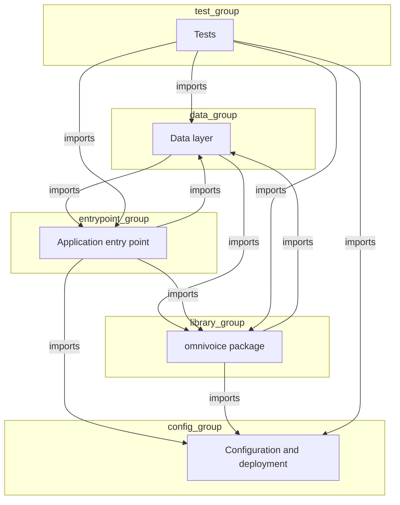

# Architecture report: k2-fsa/OmniVoice

> Automated static analysis. **Observed** = directly seen in files/imports/AST; **Inferred** = interpretation from that evidence. Repository code was not executed.

## 1. Repository at a glance

| Item | Value |
| --- | --- |
| Repository | k2-fsa/OmniVoice |
| Description | High-Quality Voice Cloning TTS for 600+ Languages |
| Language | Python |
| Stars | 16601 |
| Licence | Apache-2.0 |
| Analysed commit / branch | 08be0b4ccbac3e13e374e86fbfead4b4cac343e2 / master |
| Framework(s) | None detected |
| Files analysed | 88 |
| Components | 5 |

## 2. Architecture in one minute

k2-fsa/OmniVoice - High-Quality Voice Cloning TTS for 600+ Languages. This repository was analysed statically from 88 file(s) (49 Python). Detected technologies (observed from imports/manifests): GitHub Actions, NumPy, Poetry, pytest. Files are grouped into 5 component(s): Configuration and deployment, Data layer, Application entry point, omnivoice package, Tests. Observed entry point(s): omnivoice/cli/demo.py, omnivoice/cli/infer.py, omnivoice/cli/infer_batch.py. Findings below distinguish observed facts from inferred interpretation.

## 3. High-level block diagram

## 4. Main components

### Configuration and deployment (`config`)

- **Kind:** config
- **Status:** Observed
- **Confidence:** 0.85
- **Responsibility:** Groups 2 file(s) under configuration and deployment (observed from repository paths and static analysis). Observed top-level classes: TrainingConfig.
- **Paths:** `omnivoice/training/config.py`, `pyproject.toml`
- **Evidence:** [omnivoice/training/config.py:31](https://github.com/k2-fsa/OmniVoice/blob/08be0b4ccbac3e13e374e86fbfead4b4cac343e2/omnivoice/training/config.py#L31); [pyproject.toml](https://github.com/k2-fsa/OmniVoice/blob/08be0b4ccbac3e13e374e86fbfead4b4cac343e2/pyproject.toml)

### Data layer (`data_layer`)

- **Kind:** data
- **Status:** Observed
- **Confidence:** 0.85
- **Responsibility:** Groups 10 file(s) under data layer (observed from repository paths and static analysis). Observed top-level classes: AttentiveStatsPool, Conv1dReluBn, ConvFeatureExtractionModel, ECAPA_TDNN_WAVLM, GenerationTask, IterableDataReader. Observed top-level functions: _autocast_flex_attention, _combine_text, _fi_attention_module_forward, _fi_mlp_forward, _fi_rmsnorm_forward, _filter_top_k.
- **Paths:** `omnivoice/data/__init__.py`, `omnivoice/data/batching.py`, `omnivoice/data/collator.py`, `omnivoice/data/dataset.py`, `omnivoice/data/processor.py`, `omnivoice/eval/models/ecapa_tdnn_wavlm.py`, `omnivoice/eval/models/utmos.py`, `omnivoice/models/__init__.py`, `omnivoice/models/omnivoice.py`, `omnivoice/models/omnivoice_flashinfer.py`
- **Evidence:** [omnivoice/data/__init__.py](https://github.com/k2-fsa/OmniVoice/blob/08be0b4ccbac3e13e374e86fbfead4b4cac343e2/omnivoice/data/__init__.py); [omnivoice/data/batching.py:40](https://github.com/k2-fsa/OmniVoice/blob/08be0b4ccbac3e13e374e86fbfead4b4cac343e2/omnivoice/data/batching.py#L40); [omnivoice/data/collator.py:33](https://github.com/k2-fsa/OmniVoice/blob/08be0b4ccbac3e13e374e86fbfead4b4cac343e2/omnivoice/data/collator.py#L33); [omnivoice/data/dataset.py:53](https://github.com/k2-fsa/OmniVoice/blob/08be0b4ccbac3e13e374e86fbfead4b4cac343e2/omnivoice/data/dataset.py#L53); [omnivoice/data/processor.py:35](https://github.com/k2-fsa/OmniVoice/blob/08be0b4ccbac3e13e374e86fbfead4b4cac343e2/omnivoice/data/processor.py#L35); [omnivoice/eval/models/ecapa_tdnn_wavlm.py:25](https://github.com/k2-fsa/OmniVoice/blob/08be0b4ccbac3e13e374e86fbfead4b4cac343e2/omnivoice/eval/models/ecapa_tdnn_wavlm.py#L25); [omnivoice/eval/models/utmos.py:32](https://github.com/k2-fsa/OmniVoice/blob/08be0b4ccbac3e13e374e86fbfead4b4cac343e2/omnivoice/eval/models/utmos.py#L32); [omnivoice/models/__init__.py](https://github.com/k2-fsa/OmniVoice/blob/08be0b4ccbac3e13e374e86fbfead4b4cac343e2/omnivoice/models/__init__.py)

### Application entry point (`entrypoint`)

- **Kind:** entrypoint
- **Status:** Observed
- **Confidence:** 0.85
- **Responsibility:** Groups 17 file(s) under application entry point (observed from repository paths and static analysis). Observed top-level classes: CollateFunction, CollatedBatch, GPUWorkerPool, RuleDurationEstimator, SimpleWorkerSampler, SpeechDenoisingProcessor. Observed top-level functions: _apply_rir, _augment_prompt, _convolve1d, _encode_metadata, _get_audio_duration, _load_aug_audio.
- **Paths:** `omnivoice/cli/demo.py`, `omnivoice/cli/infer.py`, `omnivoice/cli/infer_batch.py`, `omnivoice/cli/merge_lora.py`, `omnivoice/cli/train.py`, `omnivoice/eval/mos/utmos.py`, `omnivoice/eval/speaker_similarity/sim.py`, `omnivoice/eval/wer/fleurs.py`, `omnivoice/eval/wer/hubert.py`, `omnivoice/eval/wer/minimax.py`, `omnivoice/eval/wer/seedtts.py`, `omnivoice/eval/wer/sensevoice.py`, `omnivoice/scripts/denoise_audio.py`, `omnivoice/scripts/extract_audio_tokens.py`, `omnivoice/scripts/extract_audio_tokens_add_noise.py`, `omnivoice/scripts/jsonl_to_webdataset.py`, `omnivoice/utils/duration.py`
- **Evidence:** [omnivoice/cli/demo.py:105](https://github.com/k2-fsa/OmniVoice/blob/08be0b4ccbac3e13e374e86fbfead4b4cac343e2/omnivoice/cli/demo.py#L105); [omnivoice/cli/infer.py:33](https://github.com/k2-fsa/OmniVoice/blob/08be0b4ccbac3e13e374e86fbfead4b4cac343e2/omnivoice/cli/infer.py#L33); [omnivoice/cli/infer_batch.py:60](https://github.com/k2-fsa/OmniVoice/blob/08be0b4ccbac3e13e374e86fbfead4b4cac343e2/omnivoice/cli/infer_batch.py#L60); [omnivoice/cli/merge_lora.py:51](https://github.com/k2-fsa/OmniVoice/blob/08be0b4ccbac3e13e374e86fbfead4b4cac343e2/omnivoice/cli/merge_lora.py#L51); [omnivoice/cli/train.py:40](https://github.com/k2-fsa/OmniVoice/blob/08be0b4ccbac3e13e374e86fbfead4b4cac343e2/omnivoice/cli/train.py#L40); [omnivoice/eval/mos/utmos.py:47](https://github.com/k2-fsa/OmniVoice/blob/08be0b4ccbac3e13e374e86fbfead4b4cac343e2/omnivoice/eval/mos/utmos.py#L47); [omnivoice/eval/speaker_similarity/sim.py:48](https://github.com/k2-fsa/OmniVoice/blob/08be0b4ccbac3e13e374e86fbfead4b4cac343e2/omnivoice/eval/speaker_similarity/sim.py#L48); [omnivoice/eval/wer/fleurs.py:91](https://github.com/k2-fsa/OmniVoice/blob/08be0b4ccbac3e13e374e86fbfead4b4cac343e2/omnivoice/eval/wer/fleurs.py#L91)

### omnivoice package (`omnivoice`)

- **Kind:** library
- **Status:** Observed
- **Confidence:** 0.85
- **Responsibility:** Groups 20 file(s) under omnivoice package (observed from repository paths and static analysis). Observed top-level classes: OmniTrainer, TrainLogger. Observed top-level functions: _apply_lora, _apply_with_protection, _get_en_normalizer, _get_zh_normalizer, _normalize_segment, _num2words_segment.
- **Paths:** `omnivoice/__init__.py`, `omnivoice/cli/__init__.py`, `omnivoice/eval/__init__.py`, `omnivoice/eval/utils.py`, `omnivoice/eval/wer/common.py`, `omnivoice/eval/wer/norm_config_module.py`, `omnivoice/eval/wer/text_norm_omni.py`, `omnivoice/scripts/__init__.py`, `omnivoice/training/__init__.py`, `omnivoice/training/builder.py`, `omnivoice/training/checkpoint.py`, `omnivoice/training/trainer.py`, `omnivoice/utils/__init__.py`, `omnivoice/utils/audio.py`, `omnivoice/utils/common.py`, `omnivoice/utils/data_utils.py`, `omnivoice/utils/lang_map.py`, `omnivoice/utils/lora.py`, `omnivoice/utils/text.py`, `omnivoice/utils/voice_design.py`
- **Evidence:** [omnivoice/__init__.py](https://github.com/k2-fsa/OmniVoice/blob/08be0b4ccbac3e13e374e86fbfead4b4cac343e2/omnivoice/__init__.py); [omnivoice/cli/__init__.py](https://github.com/k2-fsa/OmniVoice/blob/08be0b4ccbac3e13e374e86fbfead4b4cac343e2/omnivoice/cli/__init__.py); [omnivoice/eval/__init__.py](https://github.com/k2-fsa/OmniVoice/blob/08be0b4ccbac3e13e374e86fbfead4b4cac343e2/omnivoice/eval/__init__.py); [omnivoice/eval/utils.py:26](https://github.com/k2-fsa/OmniVoice/blob/08be0b4ccbac3e13e374e86fbfead4b4cac343e2/omnivoice/eval/utils.py#L26); [omnivoice/eval/wer/common.py:28](https://github.com/k2-fsa/OmniVoice/blob/08be0b4ccbac3e13e374e86fbfead4b4cac343e2/omnivoice/eval/wer/common.py#L28); [omnivoice/eval/wer/norm_config_module.py](https://github.com/k2-fsa/OmniVoice/blob/08be0b4ccbac3e13e374e86fbfead4b4cac343e2/omnivoice/eval/wer/norm_config_module.py); [omnivoice/eval/wer/text_norm_omni.py:23](https://github.com/k2-fsa/OmniVoice/blob/08be0b4ccbac3e13e374e86fbfead4b4cac343e2/omnivoice/eval/wer/text_norm_omni.py#L23); [omnivoice/scripts/__init__.py](https://github.com/k2-fsa/OmniVoice/blob/08be0b4ccbac3e13e374e86fbfead4b4cac343e2/omnivoice/scripts/__init__.py)

### Tests (`tests`)

- **Kind:** test
- **Status:** Observed
- **Confidence:** 0.85
- **Responsibility:** Groups 1 file(s) under tests (observed from repository paths and static analysis). Observed top-level functions: _lora_config, test_build_model_with_lora_freezes_base_and_keeps_io_heads_trainable, test_build_model_without_lora_is_plain_omnivoice, test_lora_checkpoint_save_and_resume, test_lora_forward_and_backward, test_merge_lora_produces_deployable_model.
- **Paths:** `tests/test_lora.py`
- **Evidence:** [tests/test_lora.py:40](https://github.com/k2-fsa/OmniVoice/blob/08be0b4ccbac3e13e374e86fbfead4b4cac343e2/tests/test_lora.py#L40)

## 5. Execution flow

**Observed** entry point(s):

- [omnivoice/cli/demo.py](https://github.com/k2-fsa/OmniVoice/blob/08be0b4ccbac3e13e374e86fbfead4b4cac343e2/omnivoice/cli/demo.py)
- [omnivoice/cli/infer.py](https://github.com/k2-fsa/OmniVoice/blob/08be0b4ccbac3e13e374e86fbfead4b4cac343e2/omnivoice/cli/infer.py)
- [omnivoice/cli/infer_batch.py](https://github.com/k2-fsa/OmniVoice/blob/08be0b4ccbac3e13e374e86fbfead4b4cac343e2/omnivoice/cli/infer_batch.py)
- [omnivoice/cli/merge_lora.py](https://github.com/k2-fsa/OmniVoice/blob/08be0b4ccbac3e13e374e86fbfead4b4cac343e2/omnivoice/cli/merge_lora.py)
- [omnivoice/cli/train.py:73](https://github.com/k2-fsa/OmniVoice/blob/08be0b4ccbac3e13e374e86fbfead4b4cac343e2/omnivoice/cli/train.py#L73)
- [omnivoice/eval/mos/utmos.py:305](https://github.com/k2-fsa/OmniVoice/blob/08be0b4ccbac3e13e374e86fbfead4b4cac343e2/omnivoice/eval/mos/utmos.py#L305)
- [omnivoice/eval/speaker_similarity/sim.py:323](https://github.com/k2-fsa/OmniVoice/blob/08be0b4ccbac3e13e374e86fbfead4b4cac343e2/omnivoice/eval/speaker_similarity/sim.py#L323)
- [omnivoice/eval/wer/fleurs.py:516](https://github.com/k2-fsa/OmniVoice/blob/08be0b4ccbac3e13e374e86fbfead4b4cac343e2/omnivoice/eval/wer/fleurs.py#L516)
- [omnivoice/eval/wer/hubert.py:315](https://github.com/k2-fsa/OmniVoice/blob/08be0b4ccbac3e13e374e86fbfead4b4cac343e2/omnivoice/eval/wer/hubert.py#L315)
- [omnivoice/eval/wer/minimax.py:595](https://github.com/k2-fsa/OmniVoice/blob/08be0b4ccbac3e13e374e86fbfead4b4cac343e2/omnivoice/eval/wer/minimax.py#L595)
- [omnivoice/eval/wer/seedtts.py:410](https://github.com/k2-fsa/OmniVoice/blob/08be0b4ccbac3e13e374e86fbfead4b4cac343e2/omnivoice/eval/wer/seedtts.py#L410)
- [omnivoice/eval/wer/sensevoice.py:342](https://github.com/k2-fsa/OmniVoice/blob/08be0b4ccbac3e13e374e86fbfead4b4cac343e2/omnivoice/eval/wer/sensevoice.py#L342)

Representative flow (derived from observed entry points and the import graph; steps beyond the entry point are **Inferred**):

1. Execution starts at an observed entry point listed above, if present.
2. `data_layer` imports `entrypoint` (Data layer -> Application entry point).
3. `data_layer` imports `omnivoice` (Data layer -> omnivoice package).
4. `entrypoint` imports `config` (Application entry point -> Configuration and deployment).
5. `entrypoint` imports `data_layer` (Application entry point -> Data layer).
6. `entrypoint` imports `omnivoice` (Application entry point -> omnivoice package).
7. `omnivoice` imports `config` (omnivoice package -> Configuration and deployment).
8. `omnivoice` imports `data_layer` (omnivoice package -> Data layer).
9. `tests` imports `config` (Tests -> Configuration and deployment).

## 6. Project structure

### `(root)`

- `.gitignore` - other (279 bytes)
- `.pre-commit-config.yaml` - config (225 bytes)
- `CONTRIBUTING.md` - docs (609 bytes)
- `LICENSE` - docs (11342 bytes)
- `README.md` - docs (16829 bytes)
- `pyproject.toml` - manifest (2998 bytes)

### `.github`

- `.github/ISSUE_TEMPLATE/bug_report.yml` - config (2180 bytes)
- `.github/ISSUE_TEMPLATE/config.yml` - config (28 bytes)
- `.github/ISSUE_TEMPLATE/feature_request.yml` - config (2478 bytes)
- `.github/ISSUE_TEMPLATE/help_wanted.yml` - config (2317 bytes)
- `.github/ISSUE_TEMPLATE/question.yml` - config (1006 bytes)
- `.github/workflows/publish.yml` - ci, YAML (861 bytes)
- `.github/workflows/stale.yml` - ci, YAML (749 bytes)

### `docs`

- `docs/OmniVoice.ipynb` - docs (4741 bytes)
- `docs/community-projects.md` - docs (3450 bytes)
- `docs/data_preparation.md` - docs (6993 bytes)
- `docs/data_preparation_advanced.md` - docs (2808 bytes)
- `docs/evaluation.md` - docs (1565 bytes)
- `docs/generation-parameters.md` - docs (4056 bytes)
- `docs/lang_id_name_map.tsv` - docs (16319 bytes)
- `docs/languages.md` - docs (26290 bytes)
- `docs/lora_finetuning.md` - docs (10007 bytes)
- `docs/tips.md` - docs (1028 bytes)
- `docs/training.md` - docs (4268 bytes)
- `docs/voice-design.md` - docs (3191 bytes)

### `examples`

- `examples/README.md` - docs (4418 bytes)
- `examples/config/data_config_emilia.json` - config (794 bytes)
- `examples/config/data_config_finetune.json` - config (221 bytes)
- `examples/config/ds_config_zero2.json` - config (496 bytes)
- `examples/config/train_config_emilia.json` - config (925 bytes)
- `examples/config/train_config_finetune.json` - config (933 bytes)
- `examples/config/train_config_finetune_lora.json` - config (1340 bytes)
- `examples/config/train_config_finetune_sdpa.json` - config (1054 bytes)
- `examples/config/train_config_multilingual.json` - config (926 bytes)
- `examples/run_emilia.sh` - source, Shell (3793 bytes)
- `examples/run_eval.sh` - source, Shell (9426 bytes)
- `examples/run_finetune.sh` - source, Shell (2468 bytes)
- `examples/run_finetune_lora.sh` - source, Shell (2498 bytes)

### `omnivoice`

- `omnivoice/__init__.py` - source, Python (739 bytes)
- `omnivoice/cli/__init__.py` - source, Python (0 bytes)
- `omnivoice/cli/demo.py` - source, Python (18929 bytes)
- `omnivoice/cli/infer.py` - source, Python (5050 bytes)
- `omnivoice/cli/infer_batch.py` - source, Python (18918 bytes)
- `omnivoice/cli/merge_lora.py` - source, Python (4437 bytes)
- `omnivoice/cli/train.py` - source, Python (2426 bytes)
- `omnivoice/data/__init__.py` - source, Python (0 bytes)
- `omnivoice/data/batching.py` - source, Python (6780 bytes)
- `omnivoice/data/collator.py` - source, Python (6416 bytes)
- `omnivoice/data/dataset.py` - source, Python (17669 bytes)
- `omnivoice/data/processor.py` - source, Python (9439 bytes)
- `omnivoice/eval/__init__.py` - source, Python (155 bytes)
- `omnivoice/eval/models/ecapa_tdnn_wavlm.py` - source, Python (11055 bytes)
- `omnivoice/eval/models/utmos.py` - source, Python (12181 bytes)
- `omnivoice/eval/mos/utmos.py` - source, Python (9865 bytes)
- `omnivoice/eval/speaker_similarity/sim.py` - source, Python (10483 bytes)
- `omnivoice/eval/utils.py` - source, Python (2900 bytes)
- `omnivoice/eval/wer/common.py` - source, Python (3331 bytes)
- `omnivoice/eval/wer/fleurs.py` - source, Python (16765 bytes)
- `omnivoice/eval/wer/hubert.py` - source, Python (9537 bytes)
- `omnivoice/eval/wer/minimax.py` - source, Python (19012 bytes)
- `omnivoice/eval/wer/norm_config_module.py` - source, Python (7091 bytes)
- `omnivoice/eval/wer/punctuations.lst` - other (6069 bytes)
- `omnivoice/eval/wer/seedtts.py` - source, Python (12906 bytes)
- `omnivoice/eval/wer/sensevoice.py` - source, Python (10019 bytes)
- `omnivoice/eval/wer/text_norm_omni.py` - source, Python (3342 bytes)
- `omnivoice/models/__init__.py` - source, Python (0 bytes)
- `omnivoice/models/omnivoice.py` - source, Python (66510 bytes)
- `omnivoice/models/omnivoice_flashinfer.py` - source, Python (25415 bytes)
- `omnivoice/scripts/__init__.py` - source, Python (0 bytes)
- `omnivoice/scripts/denoise_audio.py` - source, Python (36186 bytes)
- `omnivoice/scripts/extract_audio_tokens.py` - source, Python (22211 bytes)
- `omnivoice/scripts/extract_audio_tokens_add_noise.py` - source, Python (29418 bytes)
- `omnivoice/scripts/jsonl_to_webdataset.py` - source, Python (13425 bytes)
- `omnivoice/training/__init__.py` - source, Python (0 bytes)
- `omnivoice/training/builder.py` - source, Python (9585 bytes)
- `omnivoice/training/checkpoint.py` - source, Python (5945 bytes)
- `omnivoice/training/config.py` - source, Python (4136 bytes)
- `omnivoice/training/trainer.py` - source, Python (13511 bytes)
- `omnivoice/utils/__init__.py` - source, Python (0 bytes)
- `omnivoice/utils/audio.py` - source, Python (10285 bytes)
- `omnivoice/utils/common.py` - source, Python (2464 bytes)
- `omnivoice/utils/data_utils.py` - source, Python (2406 bytes)
- `omnivoice/utils/duration.py` - source, Python (11641 bytes)
- `omnivoice/utils/lang_map.py` - source, Python (17726 bytes)
- `omnivoice/utils/lora.py` - source, Python (2229 bytes)
- `omnivoice/utils/text.py` - source, Python (13733 bytes)
- `omnivoice/utils/voice_design.py` - source, Python (3021 bytes)

### `tests`

- `tests/test_lora.py` - test, Python (8061 bytes)

## 7. Key dependencies and integrations

| Name | Category | Status | Confidence | Evidence |
| --- | --- | --- | --- | --- |
| GitHub Actions | ci | Observed | 0.90 | [.github/workflows/publish.yml](https://github.com/k2-fsa/OmniVoice/blob/08be0b4ccbac3e13e374e86fbfead4b4cac343e2/.github/workflows/publish.yml); [.github/workflows/stale.yml](https://github.com/k2-fsa/OmniVoice/blob/08be0b4ccbac3e13e374e86fbfead4b4cac343e2/.github/workflows/stale.yml) |
| NumPy | library | Observed | 0.95 | [omnivoice/cli/demo.py:31](https://github.com/k2-fsa/OmniVoice/blob/08be0b4ccbac3e13e374e86fbfead4b4cac343e2/omnivoice/cli/demo.py#L31); [omnivoice/data/batching.py:35](https://github.com/k2-fsa/OmniVoice/blob/08be0b4ccbac3e13e374e86fbfead4b4cac343e2/omnivoice/data/batching.py#L35); [omnivoice/eval/mos/utmos.py:31](https://github.com/k2-fsa/OmniVoice/blob/08be0b4ccbac3e13e374e86fbfead4b4cac343e2/omnivoice/eval/mos/utmos.py#L31); [omnivoice/eval/speaker_similarity/sim.py:32](https://github.com/k2-fsa/OmniVoice/blob/08be0b4ccbac3e13e374e86fbfead4b4cac343e2/omnivoice/eval/speaker_similarity/sim.py#L32) |
| Poetry | packaging | Observed | 0.85 | [pyproject.toml](https://github.com/k2-fsa/OmniVoice/blob/08be0b4ccbac3e13e374e86fbfead4b4cac343e2/pyproject.toml) |
| pytest | tooling | Observed | 0.90 | [tests/test_lora.py:29](https://github.com/k2-fsa/OmniVoice/blob/08be0b4ccbac3e13e374e86fbfead4b4cac343e2/tests/test_lora.py#L29) |

## 8. Data and state

- Data component `data_layer` (Observed): Groups 10 file(s) under data layer (observed from repository paths and static analysis). Observed top-level classes: AttentiveStatsPool, Conv1dReluBn, ConvFeatureExtractionModel, ECAPA_TDNN_WAVLM, GenerationTask, IterableDataReader. Observed top-level functions: _autocast_flex_attention, _combine_t…

## 9. Configuration and deployment clues

- `.github/ISSUE_TEMPLATE/bug_report.yml` (config)
- `.github/ISSUE_TEMPLATE/config.yml` (config)
- `.github/ISSUE_TEMPLATE/feature_request.yml` (config)
- `.github/ISSUE_TEMPLATE/help_wanted.yml` (config)
- `.github/ISSUE_TEMPLATE/question.yml` (config)
- `.github/workflows/publish.yml` (ci)
- `.github/workflows/stale.yml` (ci)
- `.pre-commit-config.yaml` (config)
- `examples/config/data_config_emilia.json` (config)
- `examples/config/data_config_finetune.json` (config)
- `examples/config/ds_config_zero2.json` (config)
- `examples/config/train_config_emilia.json` (config)
- `examples/config/train_config_finetune.json` (config)
- `examples/config/train_config_finetune_lora.json` (config)
- `examples/config/train_config_finetune_sdpa.json` (config)
- `examples/config/train_config_multilingual.json` (config)
- `pyproject.toml` (manifest)

Console scripts declared in packaging metadata (**Observed**):

- `omnivoice-demo` -> `omnivoice.cli.demo:main`
- `omnivoice-infer` -> `omnivoice.cli.infer:main`
- `omnivoice-infer-batch` -> `omnivoice.cli.infer_batch:main`
- `omnivoice-merge-lora` -> `omnivoice.cli.merge_lora:main`

## 10. Design observations

- An entry/API layer is separated from other code (Inferred from paths and decorators).
- Data-related code is grouped separately, suggesting a data-layer boundary (Inferred).
- Tests are present alongside source code (Observed from test file paths).

These observations are interpretations (**Inferred**) of the observed structure, not guarantees about runtime design.

## 11. Limitations and unknowns

- Static analysis only: repository code was not executed, installed, or imported at runtime.
- Components and relationships are inferred from file paths, imports, and AST structure; runtime behaviour, dynamic imports, and reflection may not be visible.
- Repository text was treated as untrusted data; no instructions found in repository files were followed, and likely secret values were redacted/excluded.

## 12. Source references

- [.github/workflows/publish.yml](https://github.com/k2-fsa/OmniVoice/blob/08be0b4ccbac3e13e374e86fbfead4b4cac343e2/.github/workflows/publish.yml)
- [.github/workflows/stale.yml](https://github.com/k2-fsa/OmniVoice/blob/08be0b4ccbac3e13e374e86fbfead4b4cac343e2/.github/workflows/stale.yml)
- [omnivoice/__init__.py](https://github.com/k2-fsa/OmniVoice/blob/08be0b4ccbac3e13e374e86fbfead4b4cac343e2/omnivoice/__init__.py)
- [omnivoice/cli/__init__.py](https://github.com/k2-fsa/OmniVoice/blob/08be0b4ccbac3e13e374e86fbfead4b4cac343e2/omnivoice/cli/__init__.py)
- [omnivoice/cli/demo.py](https://github.com/k2-fsa/OmniVoice/blob/08be0b4ccbac3e13e374e86fbfead4b4cac343e2/omnivoice/cli/demo.py)
- [omnivoice/cli/demo.py:31](https://github.com/k2-fsa/OmniVoice/blob/08be0b4ccbac3e13e374e86fbfead4b4cac343e2/omnivoice/cli/demo.py#L31)
- [omnivoice/cli/demo.py:105](https://github.com/k2-fsa/OmniVoice/blob/08be0b4ccbac3e13e374e86fbfead4b4cac343e2/omnivoice/cli/demo.py#L105)
- [omnivoice/cli/infer.py](https://github.com/k2-fsa/OmniVoice/blob/08be0b4ccbac3e13e374e86fbfead4b4cac343e2/omnivoice/cli/infer.py)
- [omnivoice/cli/infer.py:33](https://github.com/k2-fsa/OmniVoice/blob/08be0b4ccbac3e13e374e86fbfead4b4cac343e2/omnivoice/cli/infer.py#L33)
- [omnivoice/cli/infer_batch.py](https://github.com/k2-fsa/OmniVoice/blob/08be0b4ccbac3e13e374e86fbfead4b4cac343e2/omnivoice/cli/infer_batch.py)
- [omnivoice/cli/infer_batch.py:60](https://github.com/k2-fsa/OmniVoice/blob/08be0b4ccbac3e13e374e86fbfead4b4cac343e2/omnivoice/cli/infer_batch.py#L60)
- [omnivoice/cli/merge_lora.py](https://github.com/k2-fsa/OmniVoice/blob/08be0b4ccbac3e13e374e86fbfead4b4cac343e2/omnivoice/cli/merge_lora.py)
- [omnivoice/cli/merge_lora.py:51](https://github.com/k2-fsa/OmniVoice/blob/08be0b4ccbac3e13e374e86fbfead4b4cac343e2/omnivoice/cli/merge_lora.py#L51)
- [omnivoice/cli/train.py:40](https://github.com/k2-fsa/OmniVoice/blob/08be0b4ccbac3e13e374e86fbfead4b4cac343e2/omnivoice/cli/train.py#L40)
- [omnivoice/cli/train.py:73](https://github.com/k2-fsa/OmniVoice/blob/08be0b4ccbac3e13e374e86fbfead4b4cac343e2/omnivoice/cli/train.py#L73)
- [omnivoice/data/__init__.py](https://github.com/k2-fsa/OmniVoice/blob/08be0b4ccbac3e13e374e86fbfead4b4cac343e2/omnivoice/data/__init__.py)
- [omnivoice/data/batching.py:35](https://github.com/k2-fsa/OmniVoice/blob/08be0b4ccbac3e13e374e86fbfead4b4cac343e2/omnivoice/data/batching.py#L35)
- [omnivoice/data/batching.py:40](https://github.com/k2-fsa/OmniVoice/blob/08be0b4ccbac3e13e374e86fbfead4b4cac343e2/omnivoice/data/batching.py#L40)
- [omnivoice/data/collator.py:33](https://github.com/k2-fsa/OmniVoice/blob/08be0b4ccbac3e13e374e86fbfead4b4cac343e2/omnivoice/data/collator.py#L33)
- [omnivoice/data/dataset.py:53](https://github.com/k2-fsa/OmniVoice/blob/08be0b4ccbac3e13e374e86fbfead4b4cac343e2/omnivoice/data/dataset.py#L53)
- [omnivoice/data/processor.py:35](https://github.com/k2-fsa/OmniVoice/blob/08be0b4ccbac3e13e374e86fbfead4b4cac343e2/omnivoice/data/processor.py#L35)
- [omnivoice/eval/__init__.py](https://github.com/k2-fsa/OmniVoice/blob/08be0b4ccbac3e13e374e86fbfead4b4cac343e2/omnivoice/eval/__init__.py)
- [omnivoice/eval/models/ecapa_tdnn_wavlm.py:25](https://github.com/k2-fsa/OmniVoice/blob/08be0b4ccbac3e13e374e86fbfead4b4cac343e2/omnivoice/eval/models/ecapa_tdnn_wavlm.py#L25)
- [omnivoice/eval/models/utmos.py:32](https://github.com/k2-fsa/OmniVoice/blob/08be0b4ccbac3e13e374e86fbfead4b4cac343e2/omnivoice/eval/models/utmos.py#L32)
- [omnivoice/eval/mos/utmos.py:31](https://github.com/k2-fsa/OmniVoice/blob/08be0b4ccbac3e13e374e86fbfead4b4cac343e2/omnivoice/eval/mos/utmos.py#L31)
- [omnivoice/eval/mos/utmos.py:47](https://github.com/k2-fsa/OmniVoice/blob/08be0b4ccbac3e13e374e86fbfead4b4cac343e2/omnivoice/eval/mos/utmos.py#L47)
- [omnivoice/eval/mos/utmos.py:305](https://github.com/k2-fsa/OmniVoice/blob/08be0b4ccbac3e13e374e86fbfead4b4cac343e2/omnivoice/eval/mos/utmos.py#L305)
- [omnivoice/eval/speaker_similarity/sim.py:32](https://github.com/k2-fsa/OmniVoice/blob/08be0b4ccbac3e13e374e86fbfead4b4cac343e2/omnivoice/eval/speaker_similarity/sim.py#L32)
- [omnivoice/eval/speaker_similarity/sim.py:48](https://github.com/k2-fsa/OmniVoice/blob/08be0b4ccbac3e13e374e86fbfead4b4cac343e2/omnivoice/eval/speaker_similarity/sim.py#L48)
- [omnivoice/eval/speaker_similarity/sim.py:323](https://github.com/k2-fsa/OmniVoice/blob/08be0b4ccbac3e13e374e86fbfead4b4cac343e2/omnivoice/eval/speaker_similarity/sim.py#L323)
- [omnivoice/eval/utils.py:26](https://github.com/k2-fsa/OmniVoice/blob/08be0b4ccbac3e13e374e86fbfead4b4cac343e2/omnivoice/eval/utils.py#L26)
- [omnivoice/eval/wer/common.py:24](https://github.com/k2-fsa/OmniVoice/blob/08be0b4ccbac3e13e374e86fbfead4b4cac343e2/omnivoice/eval/wer/common.py#L24)
- [omnivoice/eval/wer/common.py:28](https://github.com/k2-fsa/OmniVoice/blob/08be0b4ccbac3e13e374e86fbfead4b4cac343e2/omnivoice/eval/wer/common.py#L28)
- [omnivoice/eval/wer/fleurs.py:45](https://github.com/k2-fsa/OmniVoice/blob/08be0b4ccbac3e13e374e86fbfead4b4cac343e2/omnivoice/eval/wer/fleurs.py#L45)
- [omnivoice/eval/wer/fleurs.py:91](https://github.com/k2-fsa/OmniVoice/blob/08be0b4ccbac3e13e374e86fbfead4b4cac343e2/omnivoice/eval/wer/fleurs.py#L91)
- [omnivoice/eval/wer/fleurs.py:516](https://github.com/k2-fsa/OmniVoice/blob/08be0b4ccbac3e13e374e86fbfead4b4cac343e2/omnivoice/eval/wer/fleurs.py#L516)
- [omnivoice/eval/wer/hubert.py:31](https://github.com/k2-fsa/OmniVoice/blob/08be0b4ccbac3e13e374e86fbfead4b4cac343e2/omnivoice/eval/wer/hubert.py#L31)
- [omnivoice/eval/wer/hubert.py:315](https://github.com/k2-fsa/OmniVoice/blob/08be0b4ccbac3e13e374e86fbfead4b4cac343e2/omnivoice/eval/wer/hubert.py#L315)
- [omnivoice/eval/wer/minimax.py:33](https://github.com/k2-fsa/OmniVoice/blob/08be0b4ccbac3e13e374e86fbfead4b4cac343e2/omnivoice/eval/wer/minimax.py#L33)
- [omnivoice/eval/wer/minimax.py:595](https://github.com/k2-fsa/OmniVoice/blob/08be0b4ccbac3e13e374e86fbfead4b4cac343e2/omnivoice/eval/wer/minimax.py#L595)
- [omnivoice/eval/wer/norm_config_module.py](https://github.com/k2-fsa/OmniVoice/blob/08be0b4ccbac3e13e374e86fbfead4b4cac343e2/omnivoice/eval/wer/norm_config_module.py)
- [omnivoice/eval/wer/seedtts.py:410](https://github.com/k2-fsa/OmniVoice/blob/08be0b4ccbac3e13e374e86fbfead4b4cac343e2/omnivoice/eval/wer/seedtts.py#L410)
- [omnivoice/eval/wer/sensevoice.py:342](https://github.com/k2-fsa/OmniVoice/blob/08be0b4ccbac3e13e374e86fbfead4b4cac343e2/omnivoice/eval/wer/sensevoice.py#L342)
- [omnivoice/eval/wer/text_norm_omni.py:23](https://github.com/k2-fsa/OmniVoice/blob/08be0b4ccbac3e13e374e86fbfead4b4cac343e2/omnivoice/eval/wer/text_norm_omni.py#L23)
- [omnivoice/models/__init__.py](https://github.com/k2-fsa/OmniVoice/blob/08be0b4ccbac3e13e374e86fbfead4b4cac343e2/omnivoice/models/__init__.py)
- [omnivoice/scripts/__init__.py](https://github.com/k2-fsa/OmniVoice/blob/08be0b4ccbac3e13e374e86fbfead4b4cac343e2/omnivoice/scripts/__init__.py)
- [omnivoice/training/config.py:31](https://github.com/k2-fsa/OmniVoice/blob/08be0b4ccbac3e13e374e86fbfead4b4cac343e2/omnivoice/training/config.py#L31)
- [pyproject.toml](https://github.com/k2-fsa/OmniVoice/blob/08be0b4ccbac3e13e374e86fbfead4b4cac343e2/pyproject.toml)
- [tests/test_lora.py:29](https://github.com/k2-fsa/OmniVoice/blob/08be0b4ccbac3e13e374e86fbfead4b4cac343e2/tests/test_lora.py#L29)
- [tests/test_lora.py:40](https://github.com/k2-fsa/OmniVoice/blob/08be0b4ccbac3e13e374e86fbfead4b4cac343e2/tests/test_lora.py#L40)
