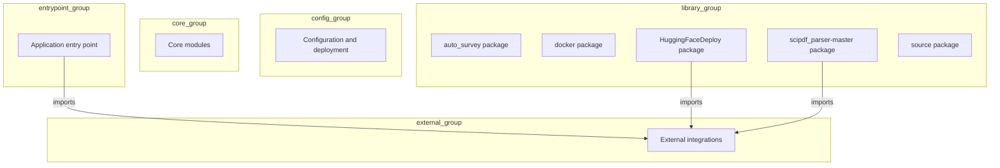

# Architecture report: kaixindelele/ChatPaper

> Automated static analysis. **Observed** = directly seen in files/imports/AST; **Inferred** = interpretation from that evidence. Repository code was not executed.

## 1. Repository at a glance

| Item | Value |
| --- | --- |
| Repository | kaixindelele/ChatPaper |
| Description | Use ChatGPT to summarize the arXiv papers. 全流程加速科研，利用chatgpt进行论文全文总结+专业翻译+润色+审稿+审稿回复 |
| Language | Python |
| Stars | 20018 |
| Licence | Other |
| Analysed commit / branch | f19b3a4510c24d49a14549a41de4ad4dd32dc6c1 / main |
| Framework(s) | Flask, Typer |
| Files analysed | 89 |
| Components | 9 |

## 2. Architecture in one minute

kaixindelele/ChatPaper - Use ChatGPT to summarize the arXiv papers. 全流程加速科研，利用chatgpt进行论文全文总结+专业翻译+润色+审稿+审稿回复. This repository was analysed statically from 89 file(s) (31 Python). Detected technologies (observed from imports/manifests): Flask, Typer, aiohttp, AWS (boto3), Click, NumPy. Files are grouped into 9 component(s): auto_survey package, Configuration and deployment, Core modules, docker package, Application entry point, External integrations, HuggingFaceDeploy package, scipdf_parser-master package. Observed entry point(s): ChatReviewerAndResponse/chat_response.py, ChatReviewerAndResponse/chat_reviewer.py, ChatReviewerAndResponse/get_paper.py. Findings below distinguish observed facts from inferred interpretation.

## 3. High-level block diagram

## 4. Main components

### auto_survey package (`auto_survey`)

- **Kind:** library
- **Status:** Observed
- **Confidence:** 0.85
- **Responsibility:** Groups 5 file(s) under auto_survey package (observed from repository paths and static analysis). Observed top-level classes: Knowledge. Observed top-level functions: copy_templates, hash_name, list_folders, make_archive, tiktoken_len, urlify.
- **Paths:** `auto_survey/utils/__init__.py`, `auto_survey/utils/embeddings.py`, `auto_survey/utils/file_operations.py`, `auto_survey/utils/knowledge.py`, `auto_survey/utils/prompts.py`
- **Evidence:** [auto_survey/utils/__init__.py](https://github.com/kaixindelele/ChatPaper/blob/f19b3a4510c24d49a14549a41de4ad4dd32dc6c1/auto_survey/utils/__init__.py); [auto_survey/utils/embeddings.py](https://github.com/kaixindelele/ChatPaper/blob/f19b3a4510c24d49a14549a41de4ad4dd32dc6c1/auto_survey/utils/embeddings.py); [auto_survey/utils/file_operations.py:7](https://github.com/kaixindelele/ChatPaper/blob/f19b3a4510c24d49a14549a41de4ad4dd32dc6c1/auto_survey/utils/file_operations.py#L7); [auto_survey/utils/knowledge.py:8](https://github.com/kaixindelele/ChatPaper/blob/f19b3a4510c24d49a14549a41de4ad4dd32dc6c1/auto_survey/utils/knowledge.py#L8); [auto_survey/utils/prompts.py](https://github.com/kaixindelele/ChatPaper/blob/f19b3a4510c24d49a14549a41de4ad4dd32dc6c1/auto_survey/utils/prompts.py)

### Configuration and deployment (`config`)

- **Kind:** config
- **Status:** Observed
- **Confidence:** 0.85
- **Responsibility:** Groups 12 file(s) under configuration and deployment (observed from repository paths and static analysis).
- **Paths:** `Dockerfile`, `HuggingFaceDeploy/Private/apikey.ini`, `HuggingFaceDeploy/Private/requirements.txt`, `HuggingFaceDeploy/Public/requirements.txt`, `apikey.ini`, `auto_survey/utils/knowledge_databases/ml_textbook_test/db_meta.json`, `docker/Dockerfile`, `docker/conda_env.yml`, `docker/docker-compose.yaml`, `requirements.txt`, `scipdf_parser-master/requirements.txt`, `scipdf_parser-master/setup.py`
- **Evidence:** [Dockerfile](https://github.com/kaixindelele/ChatPaper/blob/f19b3a4510c24d49a14549a41de4ad4dd32dc6c1/Dockerfile); [HuggingFaceDeploy/Private/apikey.ini](https://github.com/kaixindelele/ChatPaper/blob/f19b3a4510c24d49a14549a41de4ad4dd32dc6c1/HuggingFaceDeploy/Private/apikey.ini); [HuggingFaceDeploy/Private/requirements.txt](https://github.com/kaixindelele/ChatPaper/blob/f19b3a4510c24d49a14549a41de4ad4dd32dc6c1/HuggingFaceDeploy/Private/requirements.txt); [HuggingFaceDeploy/Public/requirements.txt](https://github.com/kaixindelele/ChatPaper/blob/f19b3a4510c24d49a14549a41de4ad4dd32dc6c1/HuggingFaceDeploy/Public/requirements.txt); [apikey.ini](https://github.com/kaixindelele/ChatPaper/blob/f19b3a4510c24d49a14549a41de4ad4dd32dc6c1/apikey.ini); [auto_survey/utils/knowledge_databases/ml_textbook_test/db_meta.json](https://github.com/kaixindelele/ChatPaper/blob/f19b3a4510c24d49a14549a41de4ad4dd32dc6c1/auto_survey/utils/knowledge_databases/ml_textbook_test/db_meta.json); [docker/Dockerfile](https://github.com/kaixindelele/ChatPaper/blob/f19b3a4510c24d49a14549a41de4ad4dd32dc6c1/docker/Dockerfile); [docker/conda_env.yml](https://github.com/kaixindelele/ChatPaper/blob/f19b3a4510c24d49a14549a41de4ad4dd32dc6c1/docker/conda_env.yml)

### Core modules (`core`)

- **Kind:** core
- **Status:** Observed
- **Confidence:** 0.85
- **Responsibility:** Groups 1 file(s) under core modules (observed from repository paths and static analysis).
- **Paths:** `start.sh`
- **Evidence:** [start.sh](https://github.com/kaixindelele/ChatPaper/blob/f19b3a4510c24d49a14549a41de4ad4dd32dc6c1/start.sh)

### docker package (`docker`)

- **Kind:** library
- **Status:** Observed
- **Confidence:** 0.85
- **Responsibility:** Groups 3 file(s) under docker package (observed from repository paths and static analysis).
- **Paths:** `docker/build.sh`, `docker/dev.sh`, `docker/tagpush.sh`
- **Evidence:** [docker/build.sh](https://github.com/kaixindelele/ChatPaper/blob/f19b3a4510c24d49a14549a41de4ad4dd32dc6c1/docker/build.sh); [docker/dev.sh](https://github.com/kaixindelele/ChatPaper/blob/f19b3a4510c24d49a14549a41de4ad4dd32dc6c1/docker/dev.sh); [docker/tagpush.sh](https://github.com/kaixindelele/ChatPaper/blob/f19b3a4510c24d49a14549a41de4ad4dd32dc6c1/docker/tagpush.sh)

### Application entry point (`entrypoint`)

- **Kind:** entrypoint
- **Status:** Observed
- **Confidence:** 0.85
- **Responsibility:** Groups 17 file(s) under application entry point (observed from repository paths and static analysis). Observed application object created via Flask. Observed routes: ROUTE /, ROUTE /index, ROUTE /arxiv, ROUTE /paper, ROUTE /response. Observed top-level classes: GPTModel, GPTModel_API2D_SUPPORT, GoogleScholarConfig, LazyloadTiktoken, Paper, Reader. Observed top-level functions: _collect_papers_ss, _generation_setup, api_key_check, arxiv, chat_arxiv_main, chat_check_domain.
- **Paths:** `ChatReviewerAndResponse/chat_response.py`, `ChatReviewerAndResponse/chat_reviewer.py`, `ChatReviewerAndResponse/get_paper.py`, `HuggingFaceDeploy/Private/app.py`, `HuggingFaceDeploy/Public/app.py`, `HuggingFaceDeploy/app.py`, `auto_survey/main.py`, `auto_survey/utils/figures.py`, `auto_survey/utils/gpt_interaction.py`, `auto_survey/utils/references.py`, `auto_survey/utils/storage.py`, `auto_survey/utils/tex_processing.py`, `chat_arxiv.py`, `chat_paper.py`, `chat_translate.py`, `others/chat_arxiv_maomao.py`, `others/google_scholar_spider.py`
- **Evidence:** [ChatReviewerAndResponse/chat_response.py:25](https://github.com/kaixindelele/ChatPaper/blob/f19b3a4510c24d49a14549a41de4ad4dd32dc6c1/ChatReviewerAndResponse/chat_response.py#L25); [ChatReviewerAndResponse/chat_reviewer.py:26](https://github.com/kaixindelele/ChatPaper/blob/f19b3a4510c24d49a14549a41de4ad4dd32dc6c1/ChatReviewerAndResponse/chat_reviewer.py#L26); [ChatReviewerAndResponse/get_paper.py:8](https://github.com/kaixindelele/ChatPaper/blob/f19b3a4510c24d49a14549a41de4ad4dd32dc6c1/ChatReviewerAndResponse/get_paper.py#L8); [HuggingFaceDeploy/Private/app.py:15](https://github.com/kaixindelele/ChatPaper/blob/f19b3a4510c24d49a14549a41de4ad4dd32dc6c1/HuggingFaceDeploy/Private/app.py#L15); [HuggingFaceDeploy/Public/app.py:21](https://github.com/kaixindelele/ChatPaper/blob/f19b3a4510c24d49a14549a41de4ad4dd32dc6c1/HuggingFaceDeploy/Public/app.py#L21); [HuggingFaceDeploy/app.py:15](https://github.com/kaixindelele/ChatPaper/blob/f19b3a4510c24d49a14549a41de4ad4dd32dc6c1/HuggingFaceDeploy/app.py#L15); [auto_survey/main.py:18](https://github.com/kaixindelele/ChatPaper/blob/f19b3a4510c24d49a14549a41de4ad4dd32dc6c1/auto_survey/main.py#L18); [auto_survey/utils/figures.py:4](https://github.com/kaixindelele/ChatPaper/blob/f19b3a4510c24d49a14549a41de4ad4dd32dc6c1/auto_survey/utils/figures.py#L4)

### External integrations (`external_integrations`)

- **Kind:** external
- **Status:** Inferred
- **Confidence:** 0.70
- **Responsibility:** Groups 0 file(s) under external integrations (observed from repository paths and static analysis).
- **Evidence:** [HuggingFaceDeploy/Private/app.py:7](https://github.com/kaixindelele/ChatPaper/blob/f19b3a4510c24d49a14549a41de4ad4dd32dc6c1/HuggingFaceDeploy/Private/app.py#L7); [HuggingFaceDeploy/Private/optimizeOpenAI.py:8](https://github.com/kaixindelele/ChatPaper/blob/f19b3a4510c24d49a14549a41de4ad4dd32dc6c1/HuggingFaceDeploy/Private/optimizeOpenAI.py#L8); [HuggingFaceDeploy/Public/app.py:7](https://github.com/kaixindelele/ChatPaper/blob/f19b3a4510c24d49a14549a41de4ad4dd32dc6c1/HuggingFaceDeploy/Public/app.py#L7); [HuggingFaceDeploy/Public/optimizeOpenAI.py:8](https://github.com/kaixindelele/ChatPaper/blob/f19b3a4510c24d49a14549a41de4ad4dd32dc6c1/HuggingFaceDeploy/Public/optimizeOpenAI.py#L8); [auto_survey/utils/gpt_interaction.py:6](https://github.com/kaixindelele/ChatPaper/blob/f19b3a4510c24d49a14549a41de4ad4dd32dc6c1/auto_survey/utils/gpt_interaction.py#L6); [auto_survey/utils/references.py:21](https://github.com/kaixindelele/ChatPaper/blob/f19b3a4510c24d49a14549a41de4ad4dd32dc6c1/auto_survey/utils/references.py#L21)

### HuggingFaceDeploy package (`huggingfacedeploy`)

- **Kind:** library
- **Status:** Observed
- **Confidence:** 0.85
- **Responsibility:** Groups 2 file(s) under huggingfacedeploy package (observed from repository paths and static analysis). Observed top-level classes: chatPaper. Observed top-level functions: main.
- **Paths:** `HuggingFaceDeploy/Private/optimizeOpenAI.py`, `HuggingFaceDeploy/Public/optimizeOpenAI.py`
- **Evidence:** [HuggingFaceDeploy/Private/optimizeOpenAI.py:16](https://github.com/kaixindelele/ChatPaper/blob/f19b3a4510c24d49a14549a41de4ad4dd32dc6c1/HuggingFaceDeploy/Private/optimizeOpenAI.py#L16); [HuggingFaceDeploy/Public/optimizeOpenAI.py:16](https://github.com/kaixindelele/ChatPaper/blob/f19b3a4510c24d49a14549a41de4ad4dd32dc6c1/HuggingFaceDeploy/Public/optimizeOpenAI.py#L16)

### scipdf_parser-master package (`scipdf_parser_master`)

- **Kind:** library
- **Status:** Observed
- **Confidence:** 0.85
- **Responsibility:** Groups 6 file(s) under scipdf_parser-master package (observed from repository paths and static analysis). Observed top-level functions: calculate_number_of_references, compute_journal_features, compute_readability_stats, compute_text_stats, convert_article_soup_to_dict, list_pdf_paths.
- **Paths:** `scipdf_parser-master/scipdf/__init__.py`, `scipdf_parser-master/scipdf/features/__init__.py`, `scipdf_parser-master/scipdf/features/text_utils.py`, `scipdf_parser-master/scipdf/pdf/__init__.py`, `scipdf_parser-master/scipdf/pdf/parse_pdf.py`, `scipdf_parser-master/serve_grobid.sh`
- **Evidence:** [scipdf_parser-master/scipdf/__init__.py](https://github.com/kaixindelele/ChatPaper/blob/f19b3a4510c24d49a14549a41de4ad4dd32dc6c1/scipdf_parser-master/scipdf/__init__.py); [scipdf_parser-master/scipdf/features/__init__.py](https://github.com/kaixindelele/ChatPaper/blob/f19b3a4510c24d49a14549a41de4ad4dd32dc6c1/scipdf_parser-master/scipdf/features/__init__.py); [scipdf_parser-master/scipdf/features/text_utils.py:40](https://github.com/kaixindelele/ChatPaper/blob/f19b3a4510c24d49a14549a41de4ad4dd32dc6c1/scipdf_parser-master/scipdf/features/text_utils.py#L40); [scipdf_parser-master/scipdf/pdf/__init__.py](https://github.com/kaixindelele/ChatPaper/blob/f19b3a4510c24d49a14549a41de4ad4dd32dc6c1/scipdf_parser-master/scipdf/pdf/__init__.py); [scipdf_parser-master/scipdf/pdf/parse_pdf.py:19](https://github.com/kaixindelele/ChatPaper/blob/f19b3a4510c24d49a14549a41de4ad4dd32dc6c1/scipdf_parser-master/scipdf/pdf/parse_pdf.py#L19); [scipdf_parser-master/serve_grobid.sh](https://github.com/kaixindelele/ChatPaper/blob/f19b3a4510c24d49a14549a41de4ad4dd32dc6c1/scipdf_parser-master/serve_grobid.sh)

### source package (`source`)

- **Kind:** library
- **Status:** Observed
- **Confidence:** 0.85
- **Responsibility:** Groups 1 file(s) under source package (observed from repository paths and static analysis).
- **Paths:** `source/conf.py`
- **Evidence:** [source/conf.py](https://github.com/kaixindelele/ChatPaper/blob/f19b3a4510c24d49a14549a41de4ad4dd32dc6c1/source/conf.py)

## 5. Execution flow

**Observed** entry point(s):

- [ChatReviewerAndResponse/chat_response.py:146](https://github.com/kaixindelele/ChatPaper/blob/f19b3a4510c24d49a14549a41de4ad4dd32dc6c1/ChatReviewerAndResponse/chat_response.py#L146)
- [ChatReviewerAndResponse/chat_reviewer.py:224](https://github.com/kaixindelele/ChatPaper/blob/f19b3a4510c24d49a14549a41de4ad4dd32dc6c1/ChatReviewerAndResponse/chat_reviewer.py#L224)
- [ChatReviewerAndResponse/get_paper.py:192](https://github.com/kaixindelele/ChatPaper/blob/f19b3a4510c24d49a14549a41de4ad4dd32dc6c1/ChatReviewerAndResponse/get_paper.py#L192)
- [HuggingFaceDeploy/app.py:15](https://github.com/kaixindelele/ChatPaper/blob/f19b3a4510c24d49a14549a41de4ad4dd32dc6c1/HuggingFaceDeploy/app.py#L15)
- [auto_survey/main.py:189](https://github.com/kaixindelele/ChatPaper/blob/f19b3a4510c24d49a14549a41de4ad4dd32dc6c1/auto_survey/main.py#L189)
- [auto_survey/utils/figures.py:37](https://github.com/kaixindelele/ChatPaper/blob/f19b3a4510c24d49a14549a41de4ad4dd32dc6c1/auto_survey/utils/figures.py#L37)
- [auto_survey/utils/gpt_interaction.py:120](https://github.com/kaixindelele/ChatPaper/blob/f19b3a4510c24d49a14549a41de4ad4dd32dc6c1/auto_survey/utils/gpt_interaction.py#L120)
- [auto_survey/utils/references.py:428](https://github.com/kaixindelele/ChatPaper/blob/f19b3a4510c24d49a14549a41de4ad4dd32dc6c1/auto_survey/utils/references.py#L428)
- [auto_survey/utils/storage.py:50](https://github.com/kaixindelele/ChatPaper/blob/f19b3a4510c24d49a14549a41de4ad4dd32dc6c1/auto_survey/utils/storage.py#L50)
- [auto_survey/utils/tex_processing.py:64](https://github.com/kaixindelele/ChatPaper/blob/f19b3a4510c24d49a14549a41de4ad4dd32dc6c1/auto_survey/utils/tex_processing.py#L64)
- [chat_arxiv.py:736](https://github.com/kaixindelele/ChatPaper/blob/f19b3a4510c24d49a14549a41de4ad4dd32dc6c1/chat_arxiv.py#L736)
- [chat_paper.py:802](https://github.com/kaixindelele/ChatPaper/blob/f19b3a4510c24d49a14549a41de4ad4dd32dc6c1/chat_paper.py#L802)

**Observed** routes (from decorators):

- `ROUTE /` -> `home` in `HuggingFaceDeploy/app.py:21`
- `ROUTE /index` -> `home` in `HuggingFaceDeploy/app.py:21`
- `ROUTE /arxiv` -> `arxiv` in `HuggingFaceDeploy/app.py:79`
- `ROUTE /paper` -> `paper` in `HuggingFaceDeploy/app.py:95`
- `ROUTE /response` -> `response` in `HuggingFaceDeploy/app.py:111`
- `ROUTE /reviewer` -> `reviewer` in `HuggingFaceDeploy/app.py:121`

Representative flow (derived from observed entry points and the import graph; steps beyond the entry point are **Inferred**):

1. Execution starts at an observed entry point listed above, if present.
2. `entrypoint` imports `external_integrations` (Application entry point -> External integrations).
3. `huggingfacedeploy` imports `external_integrations` (HuggingFaceDeploy package -> External integrations).
4. `scipdf_parser_master` imports `external_integrations` (scipdf_parser-master package -> External integrations).

## 6. Project structure

### `(root)`

- `.gitignore` - other (194 bytes)
- `.gitmodules` - other (110 bytes)
- `.readthedocs.yaml` - config (702 bytes)
- `Dockerfile` - container (1841 bytes)
- `LICENSE.md` - docs (389 bytes)
- `README.md` - docs (86834 bytes)
- `apikey.ini` - config (1005 bytes)
- `chat_arxiv.py` - source, Python (38674 bytes)
- `chat_paper.py` - source, Python (42806 bytes)
- `chat_translate.py` - source, Python (9933 bytes)
- `readme_en.md` - docs (8105 bytes)
- `requirements.txt` - manifest (279 bytes)
- `start.sh` - source, Shell (114 bytes)

### `ChatReviewerAndResponse`

- `ChatReviewerAndResponse/README.md` - docs (214 bytes)
- `ChatReviewerAndResponse/ReviewFormat.txt` - docs (1894 bytes)
- `ChatReviewerAndResponse/chat_response.py` - source, Python (5718 bytes)
- `ChatReviewerAndResponse/chat_reviewer.py` - source, Python (10512 bytes)
- `ChatReviewerAndResponse/get_paper.py` - source, Python (9534 bytes)
- `ChatReviewerAndResponse/review_comments.txt` - docs (6298 bytes)

### `HuggingFaceDeploy`

- `HuggingFaceDeploy/Private/README.md` - docs (652 bytes)
- `HuggingFaceDeploy/Private/apikey.ini` - config (209 bytes)
- `HuggingFaceDeploy/Private/app.py` - source, Python (32471 bytes)
- `HuggingFaceDeploy/Private/optimizeOpenAI.py` - source, Python (8913 bytes)
- `HuggingFaceDeploy/Private/requirements.txt` - manifest (131 bytes)
- `HuggingFaceDeploy/Public/app.py` - source, Python (39239 bytes)
- `HuggingFaceDeploy/Public/optimizeOpenAI.py` - source, Python (8917 bytes)
- `HuggingFaceDeploy/Public/requirements.txt` - manifest (131 bytes)
- `HuggingFaceDeploy/README.md` - docs (207 bytes)
- `HuggingFaceDeploy/app.py` - source, Python (6273 bytes)

### `auto_survey`

- `auto_survey/README.md` - docs (1076 bytes)
- `auto_survey/main.py` - source, Python (10016 bytes)
- `auto_survey/outputs/outputs_20230707_202302/generation.log` - other (21164 bytes)
- `auto_survey/outputs/outputs_20230707_202302/main.tex` - other (759 bytes)
- `auto_survey/outputs/outputs_20230707_202302/math_commands.tex` - other (12284 bytes)
- `auto_survey/outputs/outputs_20230707_202302/ref.bib` - other (37038 bytes)
- `auto_survey/outputs/outputs_20230707_202302/related works.tex` - other (4834 bytes)
- `auto_survey/outputs/outputs_20230707_202302/survey.md` - docs (8574 bytes)
- `auto_survey/outputs/outputs_20230707_202302/survey_chinese.md` - docs (4044 bytes)
- `auto_survey/outputs/outputs_20230707_202302/template.tex` - other (724 bytes)
- `auto_survey/utils/__init__.py` - source, Python (0 bytes)
- `auto_survey/utils/embeddings.py` - source, Python (707 bytes)
- `auto_survey/utils/figures.py` - source, Python (1496 bytes)
- `auto_survey/utils/file_operations.py` - source, Python (1907 bytes)
- `auto_survey/utils/gpt_interaction.py` - source, Python (4680 bytes)
- `auto_survey/utils/knowledge.py` - source, Python (1947 bytes)
- `auto_survey/utils/knowledge_databases/ml_textbook_test/db_meta.json` - config (0 bytes)
- `auto_survey/utils/knowledge_databases/ml_textbook_test/faiss_index/index.faiss` - other (0 bytes)
- `auto_survey/utils/latex_templates/Default/math_commands.tex` - other (12284 bytes)
- `auto_survey/utils/latex_templates/Default/related works.tex` - other (0 bytes)
- `auto_survey/utils/latex_templates/Default/survey.md` - docs (0 bytes)
- `auto_survey/utils/latex_templates/Default/survey_chinese.md` - docs (0 bytes)
- `auto_survey/utils/latex_templates/Default/template.tex` - other (724 bytes)
- `auto_survey/utils/prompts.py` - source, Python (1293 bytes)
- `auto_survey/utils/references.py` - source, Python (17991 bytes)
- `auto_survey/utils/storage.py` - source, Python (1759 bytes)
- `auto_survey/utils/tex_processing.py` - source, Python (1931 bytes)

### `docker`

- `docker/Dockerfile` - container (1167 bytes)
- `docker/Makefile` - other (638 bytes)
- `docker/README.md` - docs (198 bytes)
- `docker/build.sh` - source, Shell (74 bytes)
- `docker/conda_env.yml` - config (1256 bytes)
- `docker/dev.sh` - source, Shell (263 bytes)
- `docker/docker-compose.yaml` - container (543 bytes)
- `docker/make.bat` - other (769 bytes)
- `docker/tagpush.sh` - source, Shell (101 bytes)
- `docker/tsinghua.condarc` - other (707 bytes)

### `others`

- `others/ChatPaper.ipynb` - other (69731 bytes)
- `others/chat_arxiv_maomao.py` - source, Python (38652 bytes)
- `others/google_scholar_spider.py` - source, Python (11864 bytes)
- `others/machine_learning.csv` - data (10026 bytes)
- `others/project_analysis.md` - docs (13126 bytes)

### `scipdf_parser-master`

- `scipdf_parser-master/LICENSE.txt` - docs (1075 bytes)
- `scipdf_parser-master/README.md` - docs (2142 bytes)
- `scipdf_parser-master/requirements.txt` - manifest (1103 bytes)
- `scipdf_parser-master/scipdf/__init__.py` - source, Python (131 bytes)
- `scipdf_parser-master/scipdf/features/__init__.py` - source, Python (176 bytes)
- `scipdf_parser-master/scipdf/features/text_utils.py` - source, Python (7417 bytes)
- `scipdf_parser-master/scipdf/pdf/__init__.py` - source, Python (161 bytes)
- `scipdf_parser-master/scipdf/pdf/parse_pdf.py` - source, Python (15507 bytes)
- `scipdf_parser-master/serve_grobid.sh` - source, Shell (375 bytes)
- `scipdf_parser-master/setup.py` - manifest, Python (1133 bytes)

### `source`

- `source/conf.py` - source, Python (1503 bytes)
- `source/index.rst` - docs (2461 bytes)
- `source/troubleshooting/troubleshooting.md` - docs (704 bytes)
- `source/troubleshooting/troubleshooting_zh.md` - docs (1094 bytes)
- `source/tutorial/getting_started.md` - docs (640 bytes)
- `source/tutorial/getting_started_zh.md` - docs (704 bytes)
- `source/tutorial/reading_papers.md` - docs (11728 bytes)
- `source/tutorial/reading_papers_zh.md` - docs (10960 bytes)

## 7. Key dependencies and integrations

| Name | Category | Status | Confidence | Evidence |
| --- | --- | --- | --- | --- |
| Flask | framework | Observed | 0.90 | [HuggingFaceDeploy/app.py:7](https://github.com/kaixindelele/ChatPaper/blob/f19b3a4510c24d49a14549a41de4ad4dd32dc6c1/HuggingFaceDeploy/app.py#L7); [requirements.txt:12](https://github.com/kaixindelele/ChatPaper/blob/f19b3a4510c24d49a14549a41de4ad4dd32dc6c1/requirements.txt#L12) |
| Typer | framework | Observed | 0.85 | [scipdf_parser-master/requirements.txt:52](https://github.com/kaixindelele/ChatPaper/blob/f19b3a4510c24d49a14549a41de4ad4dd32dc6c1/scipdf_parser-master/requirements.txt#L52) |
| aiohttp | library | Observed | 0.85 | [scipdf_parser-master/requirements.txt:1](https://github.com/kaixindelele/ChatPaper/blob/f19b3a4510c24d49a14549a41de4ad4dd32dc6c1/scipdf_parser-master/requirements.txt#L1) |
| AWS (boto3) | library | Observed | 0.90 | [auto_survey/utils/storage.py:11](https://github.com/kaixindelele/ChatPaper/blob/f19b3a4510c24d49a14549a41de4ad4dd32dc6c1/auto_survey/utils/storage.py#L11) |
| Click | library | Observed | 0.85 | [scipdf_parser-master/requirements.txt:12](https://github.com/kaixindelele/ChatPaper/blob/f19b3a4510c24d49a14549a41de4ad4dd32dc6c1/scipdf_parser-master/requirements.txt#L12) |
| NumPy | library | Observed | 0.95 | [ChatReviewerAndResponse/chat_response.py:10](https://github.com/kaixindelele/ChatPaper/blob/f19b3a4510c24d49a14549a41de4ad4dd32dc6c1/ChatReviewerAndResponse/chat_response.py#L10); [ChatReviewerAndResponse/chat_reviewer.py:1](https://github.com/kaixindelele/ChatPaper/blob/f19b3a4510c24d49a14549a41de4ad4dd32dc6c1/ChatReviewerAndResponse/chat_reviewer.py#L1); [HuggingFaceDeploy/Private/app.py:1](https://github.com/kaixindelele/ChatPaper/blob/f19b3a4510c24d49a14549a41de4ad4dd32dc6c1/HuggingFaceDeploy/Private/app.py#L1); [HuggingFaceDeploy/Public/app.py:1](https://github.com/kaixindelele/ChatPaper/blob/f19b3a4510c24d49a14549a41de4ad4dd32dc6c1/HuggingFaceDeploy/Public/app.py#L1) |
| pandas | library | Observed | 0.95 | [others/google_scholar_spider.py:12](https://github.com/kaixindelele/ChatPaper/blob/f19b3a4510c24d49a14549a41de4ad4dd32dc6c1/others/google_scholar_spider.py#L12); [scipdf_parser-master/requirements.txt:28](https://github.com/kaixindelele/ChatPaper/blob/f19b3a4510c24d49a14549a41de4ad4dd32dc6c1/scipdf_parser-master/requirements.txt#L28); [scipdf_parser-master/scipdf/features/text_utils.py:2](https://github.com/kaixindelele/ChatPaper/blob/f19b3a4510c24d49a14549a41de4ad4dd32dc6c1/scipdf_parser-master/scipdf/features/text_utils.py#L2); [scipdf_parser-master/setup.py:18](https://github.com/kaixindelele/ChatPaper/blob/f19b3a4510c24d49a14549a41de4ad4dd32dc6c1/scipdf_parser-master/setup.py#L18) |
| Pydantic | library | Observed | 0.85 | [scipdf_parser-master/requirements.txt:32](https://github.com/kaixindelele/ChatPaper/blob/f19b3a4510c24d49a14549a41de4ad4dd32dc6c1/scipdf_parser-master/requirements.txt#L32) |
| requests | library | Observed | 0.95 | [HuggingFaceDeploy/Private/app.py:7](https://github.com/kaixindelele/ChatPaper/blob/f19b3a4510c24d49a14549a41de4ad4dd32dc6c1/HuggingFaceDeploy/Private/app.py#L7); [HuggingFaceDeploy/Private/optimizeOpenAI.py:8](https://github.com/kaixindelele/ChatPaper/blob/f19b3a4510c24d49a14549a41de4ad4dd32dc6c1/HuggingFaceDeploy/Private/optimizeOpenAI.py#L8); [HuggingFaceDeploy/Private/requirements.txt:3](https://github.com/kaixindelele/ChatPaper/blob/f19b3a4510c24d49a14549a41de4ad4dd32dc6c1/HuggingFaceDeploy/Private/requirements.txt#L3); [HuggingFaceDeploy/Public/app.py:7](https://github.com/kaixindelele/ChatPaper/blob/f19b3a4510c24d49a14549a41de4ad4dd32dc6c1/HuggingFaceDeploy/Public/app.py#L7) |
| setuptools | packaging | Observed | 0.90 | [scipdf_parser-master/setup.py:2](https://github.com/kaixindelele/ChatPaper/blob/f19b3a4510c24d49a14549a41de4ad4dd32dc6c1/scipdf_parser-master/setup.py#L2) |
| Docker | tooling | Observed | 0.90 | [Dockerfile](https://github.com/kaixindelele/ChatPaper/blob/f19b3a4510c24d49a14549a41de4ad4dd32dc6c1/Dockerfile); [docker/Dockerfile](https://github.com/kaixindelele/ChatPaper/blob/f19b3a4510c24d49a14549a41de4ad4dd32dc6c1/docker/Dockerfile) |
| Docker Compose | tooling | Observed | 0.85 | [docker/docker-compose.yaml](https://github.com/kaixindelele/ChatPaper/blob/f19b3a4510c24d49a14549a41de4ad4dd32dc6c1/docker/docker-compose.yaml) |

## 8. Data and state

No database, cache, queue, or persistent-state usage was observed in the analysed files. State handling, if any, may be in-memory or in files that were not analysed.

## 9. Configuration and deployment clues

- `.readthedocs.yaml` (config)
- `Dockerfile` (container)
- `HuggingFaceDeploy/Private/apikey.ini` (config)
- `HuggingFaceDeploy/Private/requirements.txt` (manifest)
- `HuggingFaceDeploy/Public/requirements.txt` (manifest)
- `apikey.ini` (config)
- `auto_survey/utils/knowledge_databases/ml_textbook_test/db_meta.json` (config)
- `docker/Dockerfile` (container)
- `docker/conda_env.yml` (config)
- `docker/docker-compose.yaml` (container)
- `requirements.txt` (manifest)
- `scipdf_parser-master/requirements.txt` (manifest)
- `scipdf_parser-master/setup.py` (manifest)

## 10. Design observations

- An entry/API layer is separated from other code (Inferred from paths and decorators).
- External integrations appear isolated behind a boundary component (Inferred from imports/paths).

These observations are interpretations (**Inferred**) of the observed structure, not guarantees about runtime design.

## 11. Limitations and unknowns

- Static analysis only: repository code was not executed, installed, or imported at runtime.
- Components and relationships are inferred from file paths, imports, and AST structure; runtime behaviour, dynamic imports, and reflection may not be visible.
- Repository text was treated as untrusted data; no instructions found in repository files were followed, and likely secret values were redacted/excluded.

## 12. Source references

- [ChatReviewerAndResponse/chat_response.py:10](https://github.com/kaixindelele/ChatPaper/blob/f19b3a4510c24d49a14549a41de4ad4dd32dc6c1/ChatReviewerAndResponse/chat_response.py#L10)
- [ChatReviewerAndResponse/chat_response.py:25](https://github.com/kaixindelele/ChatPaper/blob/f19b3a4510c24d49a14549a41de4ad4dd32dc6c1/ChatReviewerAndResponse/chat_response.py#L25)
- [ChatReviewerAndResponse/chat_response.py:146](https://github.com/kaixindelele/ChatPaper/blob/f19b3a4510c24d49a14549a41de4ad4dd32dc6c1/ChatReviewerAndResponse/chat_response.py#L146)
- [ChatReviewerAndResponse/chat_reviewer.py:1](https://github.com/kaixindelele/ChatPaper/blob/f19b3a4510c24d49a14549a41de4ad4dd32dc6c1/ChatReviewerAndResponse/chat_reviewer.py#L1)
- [ChatReviewerAndResponse/chat_reviewer.py:26](https://github.com/kaixindelele/ChatPaper/blob/f19b3a4510c24d49a14549a41de4ad4dd32dc6c1/ChatReviewerAndResponse/chat_reviewer.py#L26)
- [ChatReviewerAndResponse/chat_reviewer.py:224](https://github.com/kaixindelele/ChatPaper/blob/f19b3a4510c24d49a14549a41de4ad4dd32dc6c1/ChatReviewerAndResponse/chat_reviewer.py#L224)
- [ChatReviewerAndResponse/get_paper.py:8](https://github.com/kaixindelele/ChatPaper/blob/f19b3a4510c24d49a14549a41de4ad4dd32dc6c1/ChatReviewerAndResponse/get_paper.py#L8)
- [ChatReviewerAndResponse/get_paper.py:192](https://github.com/kaixindelele/ChatPaper/blob/f19b3a4510c24d49a14549a41de4ad4dd32dc6c1/ChatReviewerAndResponse/get_paper.py#L192)
- [Dockerfile](https://github.com/kaixindelele/ChatPaper/blob/f19b3a4510c24d49a14549a41de4ad4dd32dc6c1/Dockerfile)
- [HuggingFaceDeploy/Private/apikey.ini](https://github.com/kaixindelele/ChatPaper/blob/f19b3a4510c24d49a14549a41de4ad4dd32dc6c1/HuggingFaceDeploy/Private/apikey.ini)
- [HuggingFaceDeploy/Private/app.py:1](https://github.com/kaixindelele/ChatPaper/blob/f19b3a4510c24d49a14549a41de4ad4dd32dc6c1/HuggingFaceDeploy/Private/app.py#L1)
- [HuggingFaceDeploy/Private/app.py:7](https://github.com/kaixindelele/ChatPaper/blob/f19b3a4510c24d49a14549a41de4ad4dd32dc6c1/HuggingFaceDeploy/Private/app.py#L7)
- [HuggingFaceDeploy/Private/app.py:15](https://github.com/kaixindelele/ChatPaper/blob/f19b3a4510c24d49a14549a41de4ad4dd32dc6c1/HuggingFaceDeploy/Private/app.py#L15)
- [HuggingFaceDeploy/Private/optimizeOpenAI.py:8](https://github.com/kaixindelele/ChatPaper/blob/f19b3a4510c24d49a14549a41de4ad4dd32dc6c1/HuggingFaceDeploy/Private/optimizeOpenAI.py#L8)
- [HuggingFaceDeploy/Private/optimizeOpenAI.py:16](https://github.com/kaixindelele/ChatPaper/blob/f19b3a4510c24d49a14549a41de4ad4dd32dc6c1/HuggingFaceDeploy/Private/optimizeOpenAI.py#L16)
- [HuggingFaceDeploy/Private/requirements.txt](https://github.com/kaixindelele/ChatPaper/blob/f19b3a4510c24d49a14549a41de4ad4dd32dc6c1/HuggingFaceDeploy/Private/requirements.txt)
- [HuggingFaceDeploy/Private/requirements.txt:3](https://github.com/kaixindelele/ChatPaper/blob/f19b3a4510c24d49a14549a41de4ad4dd32dc6c1/HuggingFaceDeploy/Private/requirements.txt#L3)
- [HuggingFaceDeploy/Public/app.py:1](https://github.com/kaixindelele/ChatPaper/blob/f19b3a4510c24d49a14549a41de4ad4dd32dc6c1/HuggingFaceDeploy/Public/app.py#L1)
- [HuggingFaceDeploy/Public/app.py:7](https://github.com/kaixindelele/ChatPaper/blob/f19b3a4510c24d49a14549a41de4ad4dd32dc6c1/HuggingFaceDeploy/Public/app.py#L7)
- [HuggingFaceDeploy/Public/app.py:21](https://github.com/kaixindelele/ChatPaper/blob/f19b3a4510c24d49a14549a41de4ad4dd32dc6c1/HuggingFaceDeploy/Public/app.py#L21)
- [HuggingFaceDeploy/Public/optimizeOpenAI.py:8](https://github.com/kaixindelele/ChatPaper/blob/f19b3a4510c24d49a14549a41de4ad4dd32dc6c1/HuggingFaceDeploy/Public/optimizeOpenAI.py#L8)
- [HuggingFaceDeploy/Public/optimizeOpenAI.py:16](https://github.com/kaixindelele/ChatPaper/blob/f19b3a4510c24d49a14549a41de4ad4dd32dc6c1/HuggingFaceDeploy/Public/optimizeOpenAI.py#L16)
- [HuggingFaceDeploy/Public/requirements.txt](https://github.com/kaixindelele/ChatPaper/blob/f19b3a4510c24d49a14549a41de4ad4dd32dc6c1/HuggingFaceDeploy/Public/requirements.txt)
- [HuggingFaceDeploy/Public/requirements.txt:3](https://github.com/kaixindelele/ChatPaper/blob/f19b3a4510c24d49a14549a41de4ad4dd32dc6c1/HuggingFaceDeploy/Public/requirements.txt#L3)
- [HuggingFaceDeploy/app.py:7](https://github.com/kaixindelele/ChatPaper/blob/f19b3a4510c24d49a14549a41de4ad4dd32dc6c1/HuggingFaceDeploy/app.py#L7)
- [HuggingFaceDeploy/app.py:15](https://github.com/kaixindelele/ChatPaper/blob/f19b3a4510c24d49a14549a41de4ad4dd32dc6c1/HuggingFaceDeploy/app.py#L15)
- [apikey.ini](https://github.com/kaixindelele/ChatPaper/blob/f19b3a4510c24d49a14549a41de4ad4dd32dc6c1/apikey.ini)
- [auto_survey/main.py:18](https://github.com/kaixindelele/ChatPaper/blob/f19b3a4510c24d49a14549a41de4ad4dd32dc6c1/auto_survey/main.py#L18)
- [auto_survey/main.py:189](https://github.com/kaixindelele/ChatPaper/blob/f19b3a4510c24d49a14549a41de4ad4dd32dc6c1/auto_survey/main.py#L189)
- [auto_survey/utils/__init__.py](https://github.com/kaixindelele/ChatPaper/blob/f19b3a4510c24d49a14549a41de4ad4dd32dc6c1/auto_survey/utils/__init__.py)
- [auto_survey/utils/embeddings.py](https://github.com/kaixindelele/ChatPaper/blob/f19b3a4510c24d49a14549a41de4ad4dd32dc6c1/auto_survey/utils/embeddings.py)
- [auto_survey/utils/figures.py:1](https://github.com/kaixindelele/ChatPaper/blob/f19b3a4510c24d49a14549a41de4ad4dd32dc6c1/auto_survey/utils/figures.py#L1)
- [auto_survey/utils/figures.py:4](https://github.com/kaixindelele/ChatPaper/blob/f19b3a4510c24d49a14549a41de4ad4dd32dc6c1/auto_survey/utils/figures.py#L4)
- [auto_survey/utils/figures.py:37](https://github.com/kaixindelele/ChatPaper/blob/f19b3a4510c24d49a14549a41de4ad4dd32dc6c1/auto_survey/utils/figures.py#L37)
- [auto_survey/utils/file_operations.py:7](https://github.com/kaixindelele/ChatPaper/blob/f19b3a4510c24d49a14549a41de4ad4dd32dc6c1/auto_survey/utils/file_operations.py#L7)
- [auto_survey/utils/gpt_interaction.py:6](https://github.com/kaixindelele/ChatPaper/blob/f19b3a4510c24d49a14549a41de4ad4dd32dc6c1/auto_survey/utils/gpt_interaction.py#L6)
- [auto_survey/utils/gpt_interaction.py:120](https://github.com/kaixindelele/ChatPaper/blob/f19b3a4510c24d49a14549a41de4ad4dd32dc6c1/auto_survey/utils/gpt_interaction.py#L120)
- [auto_survey/utils/knowledge.py:8](https://github.com/kaixindelele/ChatPaper/blob/f19b3a4510c24d49a14549a41de4ad4dd32dc6c1/auto_survey/utils/knowledge.py#L8)
- [auto_survey/utils/knowledge_databases/ml_textbook_test/db_meta.json](https://github.com/kaixindelele/ChatPaper/blob/f19b3a4510c24d49a14549a41de4ad4dd32dc6c1/auto_survey/utils/knowledge_databases/ml_textbook_test/db_meta.json)
- [auto_survey/utils/prompts.py](https://github.com/kaixindelele/ChatPaper/blob/f19b3a4510c24d49a14549a41de4ad4dd32dc6c1/auto_survey/utils/prompts.py)
- [auto_survey/utils/references.py:21](https://github.com/kaixindelele/ChatPaper/blob/f19b3a4510c24d49a14549a41de4ad4dd32dc6c1/auto_survey/utils/references.py#L21)
- [auto_survey/utils/references.py:31](https://github.com/kaixindelele/ChatPaper/blob/f19b3a4510c24d49a14549a41de4ad4dd32dc6c1/auto_survey/utils/references.py#L31)
- [auto_survey/utils/references.py:32](https://github.com/kaixindelele/ChatPaper/blob/f19b3a4510c24d49a14549a41de4ad4dd32dc6c1/auto_survey/utils/references.py#L32)
- [auto_survey/utils/references.py:428](https://github.com/kaixindelele/ChatPaper/blob/f19b3a4510c24d49a14549a41de4ad4dd32dc6c1/auto_survey/utils/references.py#L428)
- [auto_survey/utils/storage.py:11](https://github.com/kaixindelele/ChatPaper/blob/f19b3a4510c24d49a14549a41de4ad4dd32dc6c1/auto_survey/utils/storage.py#L11)
- [auto_survey/utils/storage.py:50](https://github.com/kaixindelele/ChatPaper/blob/f19b3a4510c24d49a14549a41de4ad4dd32dc6c1/auto_survey/utils/storage.py#L50)
- [auto_survey/utils/tex_processing.py:64](https://github.com/kaixindelele/ChatPaper/blob/f19b3a4510c24d49a14549a41de4ad4dd32dc6c1/auto_survey/utils/tex_processing.py#L64)
- [chat_arxiv.py:13](https://github.com/kaixindelele/ChatPaper/blob/f19b3a4510c24d49a14549a41de4ad4dd32dc6c1/chat_arxiv.py#L13)
- [chat_arxiv.py:736](https://github.com/kaixindelele/ChatPaper/blob/f19b3a4510c24d49a14549a41de4ad4dd32dc6c1/chat_arxiv.py#L736)
- [chat_paper.py:802](https://github.com/kaixindelele/ChatPaper/blob/f19b3a4510c24d49a14549a41de4ad4dd32dc6c1/chat_paper.py#L802)
- [docker/Dockerfile](https://github.com/kaixindelele/ChatPaper/blob/f19b3a4510c24d49a14549a41de4ad4dd32dc6c1/docker/Dockerfile)
- [docker/build.sh](https://github.com/kaixindelele/ChatPaper/blob/f19b3a4510c24d49a14549a41de4ad4dd32dc6c1/docker/build.sh)
- [docker/conda_env.yml](https://github.com/kaixindelele/ChatPaper/blob/f19b3a4510c24d49a14549a41de4ad4dd32dc6c1/docker/conda_env.yml)
- [docker/dev.sh](https://github.com/kaixindelele/ChatPaper/blob/f19b3a4510c24d49a14549a41de4ad4dd32dc6c1/docker/dev.sh)
- [docker/docker-compose.yaml](https://github.com/kaixindelele/ChatPaper/blob/f19b3a4510c24d49a14549a41de4ad4dd32dc6c1/docker/docker-compose.yaml)
- [docker/tagpush.sh](https://github.com/kaixindelele/ChatPaper/blob/f19b3a4510c24d49a14549a41de4ad4dd32dc6c1/docker/tagpush.sh)
- [others/google_scholar_spider.py:12](https://github.com/kaixindelele/ChatPaper/blob/f19b3a4510c24d49a14549a41de4ad4dd32dc6c1/others/google_scholar_spider.py#L12)
- [requirements.txt:12](https://github.com/kaixindelele/ChatPaper/blob/f19b3a4510c24d49a14549a41de4ad4dd32dc6c1/requirements.txt#L12)
- [scipdf_parser-master/requirements.txt:1](https://github.com/kaixindelele/ChatPaper/blob/f19b3a4510c24d49a14549a41de4ad4dd32dc6c1/scipdf_parser-master/requirements.txt#L1)
- [scipdf_parser-master/requirements.txt:12](https://github.com/kaixindelele/ChatPaper/blob/f19b3a4510c24d49a14549a41de4ad4dd32dc6c1/scipdf_parser-master/requirements.txt#L12)
- [scipdf_parser-master/requirements.txt:28](https://github.com/kaixindelele/ChatPaper/blob/f19b3a4510c24d49a14549a41de4ad4dd32dc6c1/scipdf_parser-master/requirements.txt#L28)
- [scipdf_parser-master/requirements.txt:32](https://github.com/kaixindelele/ChatPaper/blob/f19b3a4510c24d49a14549a41de4ad4dd32dc6c1/scipdf_parser-master/requirements.txt#L32)
- [scipdf_parser-master/requirements.txt:52](https://github.com/kaixindelele/ChatPaper/blob/f19b3a4510c24d49a14549a41de4ad4dd32dc6c1/scipdf_parser-master/requirements.txt#L52)
- [scipdf_parser-master/scipdf/__init__.py](https://github.com/kaixindelele/ChatPaper/blob/f19b3a4510c24d49a14549a41de4ad4dd32dc6c1/scipdf_parser-master/scipdf/__init__.py)
- [scipdf_parser-master/scipdf/features/__init__.py](https://github.com/kaixindelele/ChatPaper/blob/f19b3a4510c24d49a14549a41de4ad4dd32dc6c1/scipdf_parser-master/scipdf/features/__init__.py)
- [scipdf_parser-master/scipdf/features/text_utils.py:2](https://github.com/kaixindelele/ChatPaper/blob/f19b3a4510c24d49a14549a41de4ad4dd32dc6c1/scipdf_parser-master/scipdf/features/text_utils.py#L2)
- [scipdf_parser-master/scipdf/features/text_utils.py:40](https://github.com/kaixindelele/ChatPaper/blob/f19b3a4510c24d49a14549a41de4ad4dd32dc6c1/scipdf_parser-master/scipdf/features/text_utils.py#L40)
- [scipdf_parser-master/scipdf/pdf/__init__.py](https://github.com/kaixindelele/ChatPaper/blob/f19b3a4510c24d49a14549a41de4ad4dd32dc6c1/scipdf_parser-master/scipdf/pdf/__init__.py)
- [scipdf_parser-master/scipdf/pdf/parse_pdf.py:19](https://github.com/kaixindelele/ChatPaper/blob/f19b3a4510c24d49a14549a41de4ad4dd32dc6c1/scipdf_parser-master/scipdf/pdf/parse_pdf.py#L19)
- [scipdf_parser-master/serve_grobid.sh](https://github.com/kaixindelele/ChatPaper/blob/f19b3a4510c24d49a14549a41de4ad4dd32dc6c1/scipdf_parser-master/serve_grobid.sh)
- [scipdf_parser-master/setup.py:2](https://github.com/kaixindelele/ChatPaper/blob/f19b3a4510c24d49a14549a41de4ad4dd32dc6c1/scipdf_parser-master/setup.py#L2)
- [scipdf_parser-master/setup.py:18](https://github.com/kaixindelele/ChatPaper/blob/f19b3a4510c24d49a14549a41de4ad4dd32dc6c1/scipdf_parser-master/setup.py#L18)
- [source/conf.py](https://github.com/kaixindelele/ChatPaper/blob/f19b3a4510c24d49a14549a41de4ad4dd32dc6c1/source/conf.py)
- [start.sh](https://github.com/kaixindelele/ChatPaper/blob/f19b3a4510c24d49a14549a41de4ad4dd32dc6c1/start.sh)
