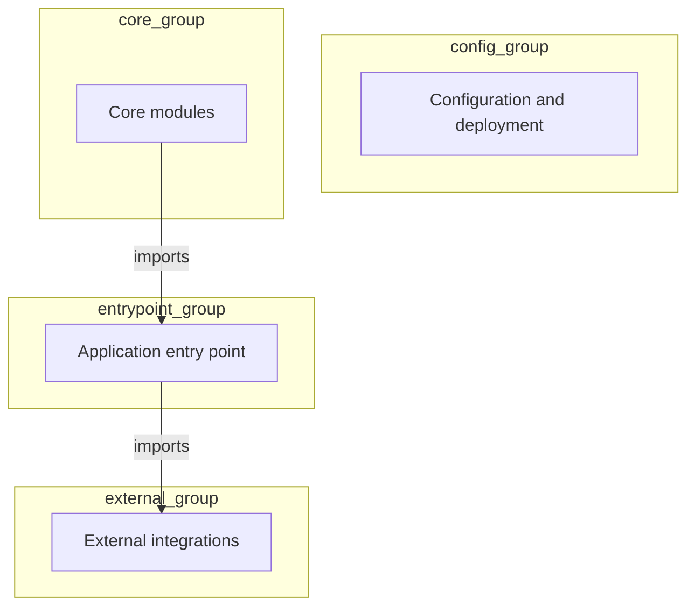

# Architecture report: karpathy/autoresearch

> Automated static analysis. **Observed** = directly seen in files/imports/AST; **Inferred** = interpretation from that evidence. Repository code was not executed.

## 1. Repository at a glance

| Item | Value |
| --- | --- |
| Repository | karpathy/autoresearch |
| Description | AI agents running research on single-GPU nanochat training automatically |
| Language | Python |
| Stars | 100043 |
| Licence | Not detected |
| Analysed commit / branch | 228791fb499afffb54b46200aca536f79142f117 / master |
| Framework(s) | None detected |
| Files analysed | 8 |
| Components | 4 |

## 2. Architecture in one minute

karpathy/autoresearch - AI agents running research on single-GPU nanochat training automatically. This repository was analysed statically from 8 file(s) (2 Python). Detected technologies (observed from imports/manifests): NumPy, pandas, requests, Poetry. Files are grouped into 4 component(s): Configuration and deployment, Core modules, Application entry point, External integrations. Observed entry point(s): prepare.py. Findings below distinguish observed facts from inferred interpretation.

## 3. High-level block diagram

## 4. Main components

### Configuration and deployment (`config`)

- **Kind:** config
- **Status:** Observed
- **Confidence:** 0.85
- **Responsibility:** Groups 1 file(s) under configuration and deployment (observed from repository paths and static analysis).
- **Paths:** `pyproject.toml`
- **Evidence:** [pyproject.toml](https://github.com/karpathy/autoresearch/blob/228791fb499afffb54b46200aca536f79142f117/pyproject.toml)

### Core modules (`core`)

- **Kind:** core
- **Status:** Observed
- **Confidence:** 0.85
- **Responsibility:** Groups 1 file(s) under core modules (observed from repository paths and static analysis). Observed top-level classes: Block, CausalSelfAttention, GPT, GPTConfig, MLP, MuonAdamW. Observed top-level functions: adamw_step_fused, apply_rotary_emb, build_model_config, get_lr_multiplier, get_muon_momentum, get_weight_decay.
- **Paths:** `train.py`
- **Evidence:** [train.py:33](https://github.com/karpathy/autoresearch/blob/228791fb499afffb54b46200aca536f79142f117/train.py#L33)

### Application entry point (`entrypoint`)

- **Kind:** entrypoint
- **Status:** Observed
- **Confidence:** 0.85
- **Responsibility:** Groups 1 file(s) under application entry point (observed from repository paths and static analysis). Observed top-level classes: Tokenizer. Observed top-level functions: _document_batches, download_data, download_single_shard, evaluate_bpb, get_token_bytes, list_parquet_files.
- **Paths:** `prepare.py`
- **Evidence:** [prepare.py:57](https://github.com/karpathy/autoresearch/blob/228791fb499afffb54b46200aca536f79142f117/prepare.py#L57)

### External integrations (`external_integrations`)

- **Kind:** external
- **Status:** Inferred
- **Confidence:** 0.70
- **Responsibility:** Groups 0 file(s) under external integrations (observed from repository paths and static analysis).
- **Evidence:** [prepare.py:20](https://github.com/karpathy/autoresearch/blob/228791fb499afffb54b46200aca536f79142f117/prepare.py#L20)

## 5. Execution flow

**Observed** entry point(s):

- [prepare.py:371](https://github.com/karpathy/autoresearch/blob/228791fb499afffb54b46200aca536f79142f117/prepare.py#L371)

Representative flow (derived from observed entry points and the import graph; steps beyond the entry point are **Inferred**):

1. Execution starts at an observed entry point listed above, if present.
2. `core` imports `entrypoint` (Core modules -> Application entry point).
3. `entrypoint` imports `external_integrations` (Application entry point -> External integrations).

## 6. Project structure

### `(root)`

- `.gitignore` - other (279 bytes)
- `.python-version` - other (5 bytes)
- `README.md` - docs (8039 bytes)
- `analysis.ipynb` - other (8208 bytes)
- `prepare.py` - source, Python (15043 bytes)
- `program.md` - docs (7039 bytes)
- `pyproject.toml` - manifest (543 bytes)
- `train.py` - source, Python (26230 bytes)

## 7. Key dependencies and integrations

| Name | Category | Status | Confidence | Evidence |
| --- | --- | --- | --- | --- |
| NumPy | library | Observed | 0.85 | [pyproject.toml:10](https://github.com/karpathy/autoresearch/blob/228791fb499afffb54b46200aca536f79142f117/pyproject.toml#L10) |
| pandas | library | Observed | 0.85 | [pyproject.toml:11](https://github.com/karpathy/autoresearch/blob/228791fb499afffb54b46200aca536f79142f117/pyproject.toml#L11) |
| requests | library | Observed | 0.90 | [prepare.py:20](https://github.com/karpathy/autoresearch/blob/228791fb499afffb54b46200aca536f79142f117/prepare.py#L20); [pyproject.toml:13](https://github.com/karpathy/autoresearch/blob/228791fb499afffb54b46200aca536f79142f117/pyproject.toml#L13) |
| Poetry | packaging | Observed | 0.85 | [pyproject.toml](https://github.com/karpathy/autoresearch/blob/228791fb499afffb54b46200aca536f79142f117/pyproject.toml) |

## 8. Data and state

No database, cache, queue, or persistent-state usage was observed in the analysed files. State handling, if any, may be in-memory or in files that were not analysed.

## 9. Configuration and deployment clues

- `pyproject.toml` (manifest)

## 10. Design observations

- An entry/API layer is separated from other code (Inferred from paths and decorators).
- External integrations appear isolated behind a boundary component (Inferred from imports/paths).

These observations are interpretations (**Inferred**) of the observed structure, not guarantees about runtime design.

## 11. Limitations and unknowns

- Static analysis only: repository code was not executed, installed, or imported at runtime.
- Components and relationships are inferred from file paths, imports, and AST structure; runtime behaviour, dynamic imports, and reflection may not be visible.
- Repository text was treated as untrusted data; no instructions found in repository files were followed, and likely secret values were redacted/excluded.

## 12. Source references

- [prepare.py:20](https://github.com/karpathy/autoresearch/blob/228791fb499afffb54b46200aca536f79142f117/prepare.py#L20)
- [prepare.py:57](https://github.com/karpathy/autoresearch/blob/228791fb499afffb54b46200aca536f79142f117/prepare.py#L57)
- [prepare.py:371](https://github.com/karpathy/autoresearch/blob/228791fb499afffb54b46200aca536f79142f117/prepare.py#L371)
- [pyproject.toml](https://github.com/karpathy/autoresearch/blob/228791fb499afffb54b46200aca536f79142f117/pyproject.toml)
- [pyproject.toml:10](https://github.com/karpathy/autoresearch/blob/228791fb499afffb54b46200aca536f79142f117/pyproject.toml#L10)
- [pyproject.toml:11](https://github.com/karpathy/autoresearch/blob/228791fb499afffb54b46200aca536f79142f117/pyproject.toml#L11)
- [pyproject.toml:13](https://github.com/karpathy/autoresearch/blob/228791fb499afffb54b46200aca536f79142f117/pyproject.toml#L13)
- [train.py:33](https://github.com/karpathy/autoresearch/blob/228791fb499afffb54b46200aca536f79142f117/train.py#L33)
