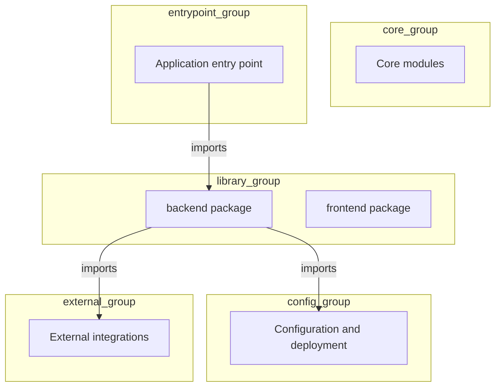

# Architecture report: karpathy/llm-council

> Automated static analysis. **Observed** = directly seen in files/imports/AST; **Inferred** = interpretation from that evidence. Repository code was not executed.

## 1. Repository at a glance

| Item | Value |
| --- | --- |
| Repository | karpathy/llm-council |
| Description | LLM Council works together to answer your hardest questions |
| Language | Python |
| Stars | 26518 |
| Licence | Not detected |
| Analysed commit / branch | 92e1fccb1bdcf1bab7221aa9ed90f9dc72529131 / master |
| Framework(s) | FastAPI, React |
| Files analysed | 36 |
| Components | 6 |

## 2. Architecture in one minute

karpathy/llm-council - LLM Council works together to answer your hardest questions. This repository was analysed statically from 36 file(s) (7 Python). Detected technologies (observed from imports/manifests): FastAPI, React, httpx, Pydantic, Uvicorn, Poetry. Files are grouped into 6 component(s): backend package, Configuration and deployment, Core modules, Application entry point, External integrations, frontend package. Observed entry point(s): backend/main.py, main.py. Findings below distinguish observed facts from inferred interpretation.

## 3. High-level block diagram

## 4. Main components

### backend package (`backend`)

- **Kind:** library
- **Status:** Observed
- **Confidence:** 0.85
- **Responsibility:** Groups 4 file(s) under backend package (observed from repository paths and static analysis). Observed top-level functions: add_assistant_message, add_user_message, calculate_aggregate_rankings, create_conversation, ensure_data_dir, generate_conversation_title.
- **Paths:** `backend/__init__.py`, `backend/council.py`, `backend/openrouter.py`, `backend/storage.py`
- **Evidence:** [backend/__init__.py](https://github.com/karpathy/llm-council/blob/92e1fccb1bdcf1bab7221aa9ed90f9dc72529131/backend/__init__.py); [backend/council.py:8](https://github.com/karpathy/llm-council/blob/92e1fccb1bdcf1bab7221aa9ed90f9dc72529131/backend/council.py#L8); [backend/openrouter.py:8](https://github.com/karpathy/llm-council/blob/92e1fccb1bdcf1bab7221aa9ed90f9dc72529131/backend/openrouter.py#L8); [backend/storage.py:11](https://github.com/karpathy/llm-council/blob/92e1fccb1bdcf1bab7221aa9ed90f9dc72529131/backend/storage.py#L11)

### Configuration and deployment (`config`)

- **Kind:** config
- **Status:** Observed
- **Confidence:** 0.85
- **Responsibility:** Groups 3 file(s) under configuration and deployment (observed from repository paths and static analysis).
- **Paths:** `backend/config.py`, `frontend/package.json`, `pyproject.toml`
- **Evidence:** [backend/config.py](https://github.com/karpathy/llm-council/blob/92e1fccb1bdcf1bab7221aa9ed90f9dc72529131/backend/config.py); [frontend/package.json](https://github.com/karpathy/llm-council/blob/92e1fccb1bdcf1bab7221aa9ed90f9dc72529131/frontend/package.json); [pyproject.toml](https://github.com/karpathy/llm-council/blob/92e1fccb1bdcf1bab7221aa9ed90f9dc72529131/pyproject.toml)

### Core modules (`core`)

- **Kind:** core
- **Status:** Observed
- **Confidence:** 0.85
- **Responsibility:** Groups 1 file(s) under core modules (observed from repository paths and static analysis).
- **Paths:** `start.sh`
- **Evidence:** [start.sh](https://github.com/karpathy/llm-council/blob/92e1fccb1bdcf1bab7221aa9ed90f9dc72529131/start.sh)

### Application entry point (`entrypoint`)

- **Kind:** entrypoint
- **Status:** Observed
- **Confidence:** 0.85
- **Responsibility:** Groups 2 file(s) under application entry point (observed from repository paths and static analysis). Observed application object created via FastAPI. Observed routes: GET /, GET /api/conversations, POST /api/conversations, GET /api/conversations/{conversation_id}, POST /api/conversations/{conversation_id}/message. Observed top-level classes: Conversation, ConversationMetadata, CreateConversationRequest, SendMessageRequest. Observed top-level functions: create_conversation, get_conversation, list_conversations, main, root, send_message.
- **Paths:** `backend/main.py`, `main.py`
- **Evidence:** [backend/main.py:15](https://github.com/karpathy/llm-council/blob/92e1fccb1bdcf1bab7221aa9ed90f9dc72529131/backend/main.py#L15); [main.py:1](https://github.com/karpathy/llm-council/blob/92e1fccb1bdcf1bab7221aa9ed90f9dc72529131/main.py#L1)

### External integrations (`external_integrations`)

- **Kind:** external
- **Status:** Inferred
- **Confidence:** 0.70
- **Responsibility:** Groups 0 file(s) under external integrations (observed from repository paths and static analysis).
- **Evidence:** [backend/openrouter.py:3](https://github.com/karpathy/llm-council/blob/92e1fccb1bdcf1bab7221aa9ed90f9dc72529131/backend/openrouter.py#L3)

### frontend package (`frontend`)

- **Kind:** library
- **Status:** Observed
- **Confidence:** 0.85
- **Responsibility:** Groups 10 file(s) under frontend package (observed from repository paths and static analysis).
- **Paths:** `frontend/eslint.config.js`, `frontend/src/App.jsx`, `frontend/src/api.js`, `frontend/src/components/ChatInterface.jsx`, `frontend/src/components/Sidebar.jsx`, `frontend/src/components/Stage1.jsx`, `frontend/src/components/Stage2.jsx`, `frontend/src/components/Stage3.jsx`, `frontend/src/main.jsx`, `frontend/vite.config.js`
- **Evidence:** [frontend/eslint.config.js](https://github.com/karpathy/llm-council/blob/92e1fccb1bdcf1bab7221aa9ed90f9dc72529131/frontend/eslint.config.js); [frontend/src/App.jsx](https://github.com/karpathy/llm-council/blob/92e1fccb1bdcf1bab7221aa9ed90f9dc72529131/frontend/src/App.jsx); [frontend/src/api.js](https://github.com/karpathy/llm-council/blob/92e1fccb1bdcf1bab7221aa9ed90f9dc72529131/frontend/src/api.js); [frontend/src/components/ChatInterface.jsx](https://github.com/karpathy/llm-council/blob/92e1fccb1bdcf1bab7221aa9ed90f9dc72529131/frontend/src/components/ChatInterface.jsx); [frontend/src/components/Sidebar.jsx](https://github.com/karpathy/llm-council/blob/92e1fccb1bdcf1bab7221aa9ed90f9dc72529131/frontend/src/components/Sidebar.jsx); [frontend/src/components/Stage1.jsx](https://github.com/karpathy/llm-council/blob/92e1fccb1bdcf1bab7221aa9ed90f9dc72529131/frontend/src/components/Stage1.jsx); [frontend/src/components/Stage2.jsx](https://github.com/karpathy/llm-council/blob/92e1fccb1bdcf1bab7221aa9ed90f9dc72529131/frontend/src/components/Stage2.jsx); [frontend/src/components/Stage3.jsx](https://github.com/karpathy/llm-council/blob/92e1fccb1bdcf1bab7221aa9ed90f9dc72529131/frontend/src/components/Stage3.jsx)

## 5. Execution flow

**Observed** entry point(s):

- [backend/main.py:15](https://github.com/karpathy/llm-council/blob/92e1fccb1bdcf1bab7221aa9ed90f9dc72529131/backend/main.py#L15)
- [frontend/src/App.jsx](https://github.com/karpathy/llm-council/blob/92e1fccb1bdcf1bab7221aa9ed90f9dc72529131/frontend/src/App.jsx)
- [frontend/src/main.jsx](https://github.com/karpathy/llm-council/blob/92e1fccb1bdcf1bab7221aa9ed90f9dc72529131/frontend/src/main.jsx)
- [main.py:5](https://github.com/karpathy/llm-council/blob/92e1fccb1bdcf1bab7221aa9ed90f9dc72529131/main.py#L5)

**Observed** routes (from decorators):

- `GET /` -> `root` in `backend/main.py:54`
- `GET /api/conversations` -> `list_conversations` in `backend/main.py:60`
- `POST /api/conversations` -> `create_conversation` in `backend/main.py:66`
- `GET /api/conversations/{conversation_id}` -> `get_conversation` in `backend/main.py:74`
- `POST /api/conversations/{conversation_id}/message` -> `send_message` in `backend/main.py:83`
- `POST /api/conversations/{conversation_id}/message/stream` -> `send_message_stream` in `backend/main.py:127`

Representative flow (derived from observed entry points and the import graph; steps beyond the entry point are **Inferred**):

1. Execution starts at an observed entry point listed above, if present.
2. `backend` imports `config` (backend package -> Configuration and deployment).
3. `backend` imports `external_integrations` (backend package -> External integrations).
4. `entrypoint` imports `backend` (Application entry point -> backend package).

## 6. Project structure

### `(root)`

- `.gitignore` - other (219 bytes)
- `.python-version` - other (5 bytes)
- `CLAUDE.md` - docs (7110 bytes)
- `README.md` - docs (3135 bytes)
- `main.py` - source, Python (89 bytes)
- `pyproject.toml` - manifest (278 bytes)
- `start.sh` - source, Shell (625 bytes)

### `backend`

- `backend/__init__.py` - source, Python (35 bytes)
- `backend/config.py` - source, Python (628 bytes)
- `backend/council.py` - source, Python (10528 bytes)
- `backend/main.py` - source, Python (6836 bytes)
- `backend/openrouter.py` - source, Python (2183 bytes)
- `backend/storage.py` - source, Python (4430 bytes)

### `frontend`

- `frontend/.gitignore` - other (253 bytes)
- `frontend/README.md` - docs (1157 bytes)
- `frontend/eslint.config.js` - source, JavaScript (758 bytes)
- `frontend/index.html` - other (357 bytes)
- `frontend/package.json` - manifest (637 bytes)
- `frontend/public/vite.svg` - other (1497 bytes)
- `frontend/src/App.css` - other (320 bytes)
- `frontend/src/App.jsx` - source, JavaScript (6044 bytes)
- `frontend/src/api.js` - source, JavaScript (2860 bytes)
- `frontend/src/assets/react.svg` - other (4126 bytes)
- `frontend/src/components/ChatInterface.css` - other (2607 bytes)
- `frontend/src/components/ChatInterface.jsx` - source, JavaScript (4457 bytes)
- `frontend/src/components/Sidebar.css` - other (1196 bytes)
- `frontend/src/components/Sidebar.jsx` - source, JavaScript (1215 bytes)
- `frontend/src/components/Stage1.css` - other (964 bytes)
- `frontend/src/components/Stage1.jsx` - source, JavaScript (1008 bytes)
- `frontend/src/components/Stage2.css` - other (2240 bytes)
- `frontend/src/components/Stage2.jsx` - source, JavaScript (3341 bytes)
- `frontend/src/components/Stage3.css` - other (370 bytes)
- `frontend/src/components/Stage3.jsx` - source, JavaScript (621 bytes)
- `frontend/src/index.css` - other (1649 bytes)
- `frontend/src/main.jsx` - source, JavaScript (229 bytes)
- `frontend/vite.config.js` - source, JavaScript (161 bytes)

## 7. Key dependencies and integrations

| Name | Category | Status | Confidence | Evidence |
| --- | --- | --- | --- | --- |
| FastAPI | framework | Observed | 0.95 | [backend/main.py:3](https://github.com/karpathy/llm-council/blob/92e1fccb1bdcf1bab7221aa9ed90f9dc72529131/backend/main.py#L3); [backend/main.py:4](https://github.com/karpathy/llm-council/blob/92e1fccb1bdcf1bab7221aa9ed90f9dc72529131/backend/main.py#L4); [backend/main.py:5](https://github.com/karpathy/llm-council/blob/92e1fccb1bdcf1bab7221aa9ed90f9dc72529131/backend/main.py#L5); [pyproject.toml:8](https://github.com/karpathy/llm-council/blob/92e1fccb1bdcf1bab7221aa9ed90f9dc72529131/pyproject.toml#L8) |
| React | framework | Observed | 0.90 | [frontend/package.json:13](https://github.com/karpathy/llm-council/blob/92e1fccb1bdcf1bab7221aa9ed90f9dc72529131/frontend/package.json#L13); [frontend/package.json:14](https://github.com/karpathy/llm-council/blob/92e1fccb1bdcf1bab7221aa9ed90f9dc72529131/frontend/package.json#L14) |
| httpx | library | Observed | 0.90 | [backend/openrouter.py:3](https://github.com/karpathy/llm-council/blob/92e1fccb1bdcf1bab7221aa9ed90f9dc72529131/backend/openrouter.py#L3); [pyproject.toml:11](https://github.com/karpathy/llm-council/blob/92e1fccb1bdcf1bab7221aa9ed90f9dc72529131/pyproject.toml#L11) |
| Pydantic | library | Observed | 0.90 | [backend/main.py:6](https://github.com/karpathy/llm-council/blob/92e1fccb1bdcf1bab7221aa9ed90f9dc72529131/backend/main.py#L6); [pyproject.toml:12](https://github.com/karpathy/llm-council/blob/92e1fccb1bdcf1bab7221aa9ed90f9dc72529131/pyproject.toml#L12) |
| Uvicorn | library | Observed | 0.90 | [backend/main.py:198](https://github.com/karpathy/llm-council/blob/92e1fccb1bdcf1bab7221aa9ed90f9dc72529131/backend/main.py#L198); [pyproject.toml:9](https://github.com/karpathy/llm-council/blob/92e1fccb1bdcf1bab7221aa9ed90f9dc72529131/pyproject.toml#L9) |
| Poetry | packaging | Observed | 0.85 | [pyproject.toml](https://github.com/karpathy/llm-council/blob/92e1fccb1bdcf1bab7221aa9ed90f9dc72529131/pyproject.toml) |
| Vite | tooling | Observed | 0.85 | [frontend/package.json:7](https://github.com/karpathy/llm-council/blob/92e1fccb1bdcf1bab7221aa9ed90f9dc72529131/frontend/package.json#L7) |

## 8. Data and state

No database, cache, queue, or persistent-state usage was observed in the analysed files. State handling, if any, may be in-memory or in files that were not analysed.

## 9. Configuration and deployment clues

- `frontend/package.json` (manifest)
- `pyproject.toml` (manifest)

## 10. Design observations

- An entry/API layer is separated from other code (Inferred from paths and decorators).
- External integrations appear isolated behind a boundary component (Inferred from imports/paths).

These observations are interpretations (**Inferred**) of the observed structure, not guarantees about runtime design.

## 11. Limitations and unknowns

- Static analysis only: repository code was not executed, installed, or imported at runtime.
- Components and relationships are inferred from file paths, imports, and AST structure; runtime behaviour, dynamic imports, and reflection may not be visible.
- 2 file(s) were skipped during inventory (2 x lockfile excluded).
- Repository text was treated as untrusted data; no instructions found in repository files were followed, and likely secret values were redacted/excluded.

## 12. Source references

- [backend/__init__.py](https://github.com/karpathy/llm-council/blob/92e1fccb1bdcf1bab7221aa9ed90f9dc72529131/backend/__init__.py)
- [backend/config.py](https://github.com/karpathy/llm-council/blob/92e1fccb1bdcf1bab7221aa9ed90f9dc72529131/backend/config.py)
- [backend/council.py:8](https://github.com/karpathy/llm-council/blob/92e1fccb1bdcf1bab7221aa9ed90f9dc72529131/backend/council.py#L8)
- [backend/main.py:3](https://github.com/karpathy/llm-council/blob/92e1fccb1bdcf1bab7221aa9ed90f9dc72529131/backend/main.py#L3)
- [backend/main.py:4](https://github.com/karpathy/llm-council/blob/92e1fccb1bdcf1bab7221aa9ed90f9dc72529131/backend/main.py#L4)
- [backend/main.py:5](https://github.com/karpathy/llm-council/blob/92e1fccb1bdcf1bab7221aa9ed90f9dc72529131/backend/main.py#L5)
- [backend/main.py:6](https://github.com/karpathy/llm-council/blob/92e1fccb1bdcf1bab7221aa9ed90f9dc72529131/backend/main.py#L6)
- [backend/main.py:15](https://github.com/karpathy/llm-council/blob/92e1fccb1bdcf1bab7221aa9ed90f9dc72529131/backend/main.py#L15)
- [backend/main.py:198](https://github.com/karpathy/llm-council/blob/92e1fccb1bdcf1bab7221aa9ed90f9dc72529131/backend/main.py#L198)
- [backend/openrouter.py:3](https://github.com/karpathy/llm-council/blob/92e1fccb1bdcf1bab7221aa9ed90f9dc72529131/backend/openrouter.py#L3)
- [backend/openrouter.py:8](https://github.com/karpathy/llm-council/blob/92e1fccb1bdcf1bab7221aa9ed90f9dc72529131/backend/openrouter.py#L8)
- [backend/storage.py:11](https://github.com/karpathy/llm-council/blob/92e1fccb1bdcf1bab7221aa9ed90f9dc72529131/backend/storage.py#L11)
- [frontend/eslint.config.js](https://github.com/karpathy/llm-council/blob/92e1fccb1bdcf1bab7221aa9ed90f9dc72529131/frontend/eslint.config.js)
- [frontend/package.json](https://github.com/karpathy/llm-council/blob/92e1fccb1bdcf1bab7221aa9ed90f9dc72529131/frontend/package.json)
- [frontend/package.json:7](https://github.com/karpathy/llm-council/blob/92e1fccb1bdcf1bab7221aa9ed90f9dc72529131/frontend/package.json#L7)
- [frontend/package.json:13](https://github.com/karpathy/llm-council/blob/92e1fccb1bdcf1bab7221aa9ed90f9dc72529131/frontend/package.json#L13)
- [frontend/package.json:14](https://github.com/karpathy/llm-council/blob/92e1fccb1bdcf1bab7221aa9ed90f9dc72529131/frontend/package.json#L14)
- [frontend/src/App.jsx](https://github.com/karpathy/llm-council/blob/92e1fccb1bdcf1bab7221aa9ed90f9dc72529131/frontend/src/App.jsx)
- [frontend/src/api.js](https://github.com/karpathy/llm-council/blob/92e1fccb1bdcf1bab7221aa9ed90f9dc72529131/frontend/src/api.js)
- [frontend/src/components/ChatInterface.jsx](https://github.com/karpathy/llm-council/blob/92e1fccb1bdcf1bab7221aa9ed90f9dc72529131/frontend/src/components/ChatInterface.jsx)
- [frontend/src/components/Sidebar.jsx](https://github.com/karpathy/llm-council/blob/92e1fccb1bdcf1bab7221aa9ed90f9dc72529131/frontend/src/components/Sidebar.jsx)
- [frontend/src/components/Stage1.jsx](https://github.com/karpathy/llm-council/blob/92e1fccb1bdcf1bab7221aa9ed90f9dc72529131/frontend/src/components/Stage1.jsx)
- [frontend/src/components/Stage2.jsx](https://github.com/karpathy/llm-council/blob/92e1fccb1bdcf1bab7221aa9ed90f9dc72529131/frontend/src/components/Stage2.jsx)
- [frontend/src/components/Stage3.jsx](https://github.com/karpathy/llm-council/blob/92e1fccb1bdcf1bab7221aa9ed90f9dc72529131/frontend/src/components/Stage3.jsx)
- [frontend/src/main.jsx](https://github.com/karpathy/llm-council/blob/92e1fccb1bdcf1bab7221aa9ed90f9dc72529131/frontend/src/main.jsx)
- [main.py:1](https://github.com/karpathy/llm-council/blob/92e1fccb1bdcf1bab7221aa9ed90f9dc72529131/main.py#L1)
- [main.py:5](https://github.com/karpathy/llm-council/blob/92e1fccb1bdcf1bab7221aa9ed90f9dc72529131/main.py#L5)
- [pyproject.toml](https://github.com/karpathy/llm-council/blob/92e1fccb1bdcf1bab7221aa9ed90f9dc72529131/pyproject.toml)
- [pyproject.toml:8](https://github.com/karpathy/llm-council/blob/92e1fccb1bdcf1bab7221aa9ed90f9dc72529131/pyproject.toml#L8)
- [pyproject.toml:9](https://github.com/karpathy/llm-council/blob/92e1fccb1bdcf1bab7221aa9ed90f9dc72529131/pyproject.toml#L9)
- [pyproject.toml:11](https://github.com/karpathy/llm-council/blob/92e1fccb1bdcf1bab7221aa9ed90f9dc72529131/pyproject.toml#L11)
- [pyproject.toml:12](https://github.com/karpathy/llm-council/blob/92e1fccb1bdcf1bab7221aa9ed90f9dc72529131/pyproject.toml#L12)
- [start.sh](https://github.com/karpathy/llm-council/blob/92e1fccb1bdcf1bab7221aa9ed90f9dc72529131/start.sh)
