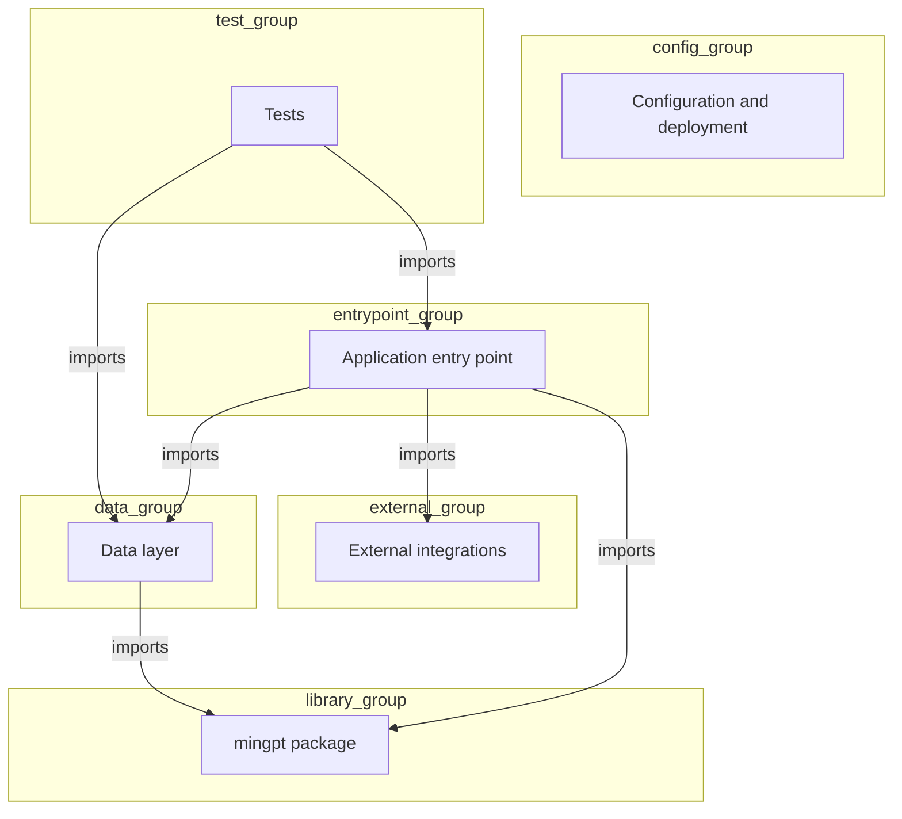

# Architecture report: karpathy/minGPT

> Automated static analysis. **Observed** = directly seen in files/imports/AST; **Inferred** = interpretation from that evidence. Repository code was not executed.

## 1. Repository at a glance

| Item | Value |
| --- | --- |
| Repository | karpathy/minGPT |
| Description | A minimal PyTorch re-implementation of the OpenAI GPT (Generative Pretrained Transformer) training |
| Language | Python |
| Stars | 25024 |
| Licence | MIT |
| Analysed commit / branch | 37baab71b9abea1b76ab957409a1cc2fbfba8a26 / master |
| Framework(s) | None detected |
| Files analysed | 17 |
| Components | 6 |

## 2. Architecture in one minute

karpathy/minGPT - A minimal PyTorch re-implementation of the OpenAI GPT (Generative Pretrained Transformer) training. This repository was analysed statically from 17 file(s) (9 Python). Detected technologies (observed from imports/manifests): NumPy, requests, setuptools, unittest. Files are grouped into 6 component(s): Configuration and deployment, Data layer, Application entry point, External integrations, mingpt package, Tests. Observed entry point(s): mingpt/bpe.py, projects/adder/adder.py, projects/chargpt/chargpt.py. Findings below distinguish observed facts from inferred interpretation.

## 3. High-level block diagram

## 4. Main components

### Configuration and deployment (`config`)

- **Kind:** config
- **Status:** Observed
- **Confidence:** 0.85
- **Responsibility:** Groups 1 file(s) under configuration and deployment (observed from repository paths and static analysis).
- **Paths:** `setup.py`
- **Evidence:** [setup.py](https://github.com/karpathy/minGPT/blob/37baab71b9abea1b76ab957409a1cc2fbfba8a26/setup.py)

### Data layer (`data_layer`)

- **Kind:** data
- **Status:** Observed
- **Confidence:** 0.85
- **Responsibility:** Groups 1 file(s) under data layer (observed from repository paths and static analysis). Observed top-level classes: Block, CausalSelfAttention, GPT, NewGELU.
- **Paths:** `mingpt/model.py`
- **Evidence:** [mingpt/model.py:21](https://github.com/karpathy/minGPT/blob/37baab71b9abea1b76ab957409a1cc2fbfba8a26/mingpt/model.py#L21)

### Application entry point (`entrypoint`)

- **Kind:** entrypoint
- **Status:** Observed
- **Confidence:** 0.85
- **Responsibility:** Groups 3 file(s) under application entry point (observed from repository paths and static analysis). Observed top-level classes: AdditionDataset, BPETokenizer, CharDataset, Encoder. Observed top-level functions: bytes_to_unicode, get_config, get_encoder, get_file, get_pairs.
- **Paths:** `mingpt/bpe.py`, `projects/adder/adder.py`, `projects/chargpt/chargpt.py`
- **Evidence:** [mingpt/bpe.py:20](https://github.com/karpathy/minGPT/blob/37baab71b9abea1b76ab957409a1cc2fbfba8a26/mingpt/bpe.py#L20); [projects/adder/adder.py:19](https://github.com/karpathy/minGPT/blob/37baab71b9abea1b76ab957409a1cc2fbfba8a26/projects/adder/adder.py#L19); [projects/chargpt/chargpt.py:18](https://github.com/karpathy/minGPT/blob/37baab71b9abea1b76ab957409a1cc2fbfba8a26/projects/chargpt/chargpt.py#L18)

### External integrations (`external_integrations`)

- **Kind:** external
- **Status:** Inferred
- **Confidence:** 0.70
- **Responsibility:** Groups 0 file(s) under external integrations (observed from repository paths and static analysis).
- **Evidence:** [mingpt/bpe.py:14](https://github.com/karpathy/minGPT/blob/37baab71b9abea1b76ab957409a1cc2fbfba8a26/mingpt/bpe.py#L14)

### mingpt package (`mingpt`)

- **Kind:** library
- **Status:** Observed
- **Confidence:** 0.85
- **Responsibility:** Groups 3 file(s) under mingpt package (observed from repository paths and static analysis). Observed top-level classes: CfgNode, Trainer. Observed top-level functions: set_seed, setup_logging.
- **Paths:** `mingpt/__init__.py`, `mingpt/trainer.py`, `mingpt/utils.py`
- **Evidence:** [mingpt/__init__.py](https://github.com/karpathy/minGPT/blob/37baab71b9abea1b76ab957409a1cc2fbfba8a26/mingpt/__init__.py); [mingpt/trainer.py:13](https://github.com/karpathy/minGPT/blob/37baab71b9abea1b76ab957409a1cc2fbfba8a26/mingpt/trainer.py#L13); [mingpt/utils.py:13](https://github.com/karpathy/minGPT/blob/37baab71b9abea1b76ab957409a1cc2fbfba8a26/mingpt/utils.py#L13)

### Tests (`tests`)

- **Kind:** test
- **Status:** Observed
- **Confidence:** 0.85
- **Responsibility:** Groups 1 file(s) under tests (observed from repository paths and static analysis). Observed top-level classes: TestHuggingFaceImport.
- **Paths:** `tests/test_huggingface_import.py`
- **Evidence:** [tests/test_huggingface_import.py:12](https://github.com/karpathy/minGPT/blob/37baab71b9abea1b76ab957409a1cc2fbfba8a26/tests/test_huggingface_import.py#L12)

## 5. Execution flow

**Observed** entry point(s):

- [mingpt/bpe.py:282](https://github.com/karpathy/minGPT/blob/37baab71b9abea1b76ab957409a1cc2fbfba8a26/mingpt/bpe.py#L282)
- [projects/adder/adder.py:123](https://github.com/karpathy/minGPT/blob/37baab71b9abea1b76ab957409a1cc2fbfba8a26/projects/adder/adder.py#L123)
- [projects/chargpt/chargpt.py:86](https://github.com/karpathy/minGPT/blob/37baab71b9abea1b76ab957409a1cc2fbfba8a26/projects/chargpt/chargpt.py#L86)

Representative flow (derived from observed entry points and the import graph; steps beyond the entry point are **Inferred**):

1. Execution starts at an observed entry point listed above, if present.
2. `data_layer` imports `mingpt` (Data layer -> mingpt package).
3. `entrypoint` imports `data_layer` (Application entry point -> Data layer).
4. `entrypoint` imports `external_integrations` (Application entry point -> External integrations).
5. `entrypoint` imports `mingpt` (Application entry point -> mingpt package).
6. `tests` imports `data_layer` (Tests -> Data layer).
7. `tests` imports `entrypoint` (Tests -> Application entry point).

## 6. Project structure

### `(root)`

- `.gitignore` - other (54 bytes)
- `LICENSE` - docs (1081 bytes)
- `README.md` - docs (9869 bytes)
- `demo.ipynb` - other (11266 bytes)
- `generate.ipynb` - other (6366 bytes)
- `setup.py` - manifest, Python (267 bytes)

### `mingpt`

- `mingpt/__init__.py` - source, Python (0 bytes)
- `mingpt/bpe.py` - source, Python (15888 bytes)
- `mingpt/model.py` - source, Python (14686 bytes)
- `mingpt/trainer.py` - source, Python (3466 bytes)
- `mingpt/utils.py` - source, Python (3596 bytes)

### `projects`

- `projects/adder/adder.py` - source, Python (8287 bytes)
- `projects/adder/readme.md` - docs (53 bytes)
- `projects/chargpt/chargpt.py` - source, Python (4079 bytes)
- `projects/chargpt/readme.md` - docs (687 bytes)
- `projects/readme.md` - docs (92 bytes)

### `tests`

- `tests/test_huggingface_import.py` - test, Python (2057 bytes)

## 7. Key dependencies and integrations

| Name | Category | Status | Confidence | Evidence |
| --- | --- | --- | --- | --- |
| NumPy | library | Observed | 0.90 | [mingpt/utils.py:8](https://github.com/karpathy/minGPT/blob/37baab71b9abea1b76ab957409a1cc2fbfba8a26/mingpt/utils.py#L8) |
| requests | library | Observed | 0.90 | [mingpt/bpe.py:14](https://github.com/karpathy/minGPT/blob/37baab71b9abea1b76ab957409a1cc2fbfba8a26/mingpt/bpe.py#L14) |
| setuptools | packaging | Observed | 0.90 | [setup.py:1](https://github.com/karpathy/minGPT/blob/37baab71b9abea1b76ab957409a1cc2fbfba8a26/setup.py#L1) |
| unittest | tooling | Observed | 0.90 | [tests/test_huggingface_import.py:5](https://github.com/karpathy/minGPT/blob/37baab71b9abea1b76ab957409a1cc2fbfba8a26/tests/test_huggingface_import.py#L5) |

## 8. Data and state

- Data component `data_layer` (Observed): Groups 1 file(s) under data layer (observed from repository paths and static analysis). Observed top-level classes: Block, CausalSelfAttention, GPT, NewGELU.

## 9. Configuration and deployment clues

- `setup.py` (manifest)

## 10. Design observations

- An entry/API layer is separated from other code (Inferred from paths and decorators).
- Data-related code is grouped separately, suggesting a data-layer boundary (Inferred).
- Tests are present alongside source code (Observed from test file paths).
- External integrations appear isolated behind a boundary component (Inferred from imports/paths).

These observations are interpretations (**Inferred**) of the observed structure, not guarantees about runtime design.

## 11. Limitations and unknowns

- Static analysis only: repository code was not executed, installed, or imported at runtime.
- Components and relationships are inferred from file paths, imports, and AST structure; runtime behaviour, dynamic imports, and reflection may not be visible.
- Repository text was treated as untrusted data; no instructions found in repository files were followed, and likely secret values were redacted/excluded.

## 12. Source references

- [mingpt/__init__.py](https://github.com/karpathy/minGPT/blob/37baab71b9abea1b76ab957409a1cc2fbfba8a26/mingpt/__init__.py)
- [mingpt/bpe.py:14](https://github.com/karpathy/minGPT/blob/37baab71b9abea1b76ab957409a1cc2fbfba8a26/mingpt/bpe.py#L14)
- [mingpt/bpe.py:20](https://github.com/karpathy/minGPT/blob/37baab71b9abea1b76ab957409a1cc2fbfba8a26/mingpt/bpe.py#L20)
- [mingpt/bpe.py:282](https://github.com/karpathy/minGPT/blob/37baab71b9abea1b76ab957409a1cc2fbfba8a26/mingpt/bpe.py#L282)
- [mingpt/model.py:21](https://github.com/karpathy/minGPT/blob/37baab71b9abea1b76ab957409a1cc2fbfba8a26/mingpt/model.py#L21)
- [mingpt/trainer.py:13](https://github.com/karpathy/minGPT/blob/37baab71b9abea1b76ab957409a1cc2fbfba8a26/mingpt/trainer.py#L13)
- [mingpt/utils.py:8](https://github.com/karpathy/minGPT/blob/37baab71b9abea1b76ab957409a1cc2fbfba8a26/mingpt/utils.py#L8)
- [mingpt/utils.py:13](https://github.com/karpathy/minGPT/blob/37baab71b9abea1b76ab957409a1cc2fbfba8a26/mingpt/utils.py#L13)
- [projects/adder/adder.py:19](https://github.com/karpathy/minGPT/blob/37baab71b9abea1b76ab957409a1cc2fbfba8a26/projects/adder/adder.py#L19)
- [projects/adder/adder.py:123](https://github.com/karpathy/minGPT/blob/37baab71b9abea1b76ab957409a1cc2fbfba8a26/projects/adder/adder.py#L123)
- [projects/chargpt/chargpt.py:18](https://github.com/karpathy/minGPT/blob/37baab71b9abea1b76ab957409a1cc2fbfba8a26/projects/chargpt/chargpt.py#L18)
- [projects/chargpt/chargpt.py:86](https://github.com/karpathy/minGPT/blob/37baab71b9abea1b76ab957409a1cc2fbfba8a26/projects/chargpt/chargpt.py#L86)
- [setup.py](https://github.com/karpathy/minGPT/blob/37baab71b9abea1b76ab957409a1cc2fbfba8a26/setup.py)
- [setup.py:1](https://github.com/karpathy/minGPT/blob/37baab71b9abea1b76ab957409a1cc2fbfba8a26/setup.py#L1)
- [tests/test_huggingface_import.py:5](https://github.com/karpathy/minGPT/blob/37baab71b9abea1b76ab957409a1cc2fbfba8a26/tests/test_huggingface_import.py#L5)
- [tests/test_huggingface_import.py:12](https://github.com/karpathy/minGPT/blob/37baab71b9abea1b76ab957409a1cc2fbfba8a26/tests/test_huggingface_import.py#L12)
