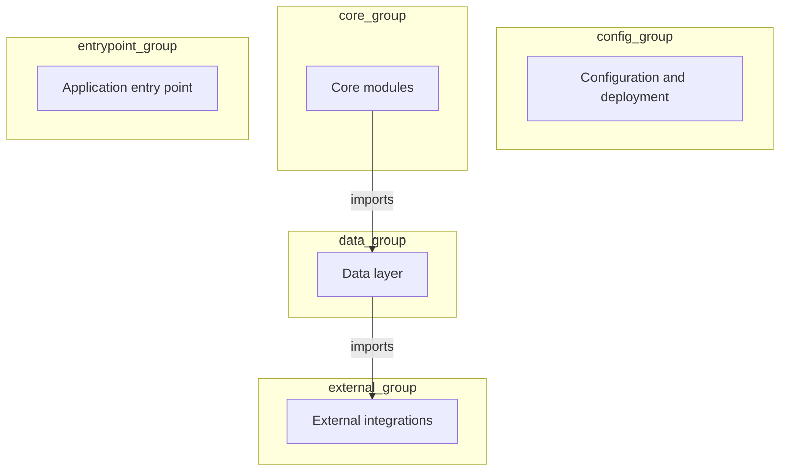

# Architecture report: karpathy/nanoGPT

> Automated static analysis. **Observed** = directly seen in files/imports/AST; **Inferred** = interpretation from that evidence. Repository code was not executed.

## 1. Repository at a glance

| Item | Value |
| --- | --- |
| Repository | karpathy/nanoGPT |
| Description | The simplest, fastest repository for training/finetuning medium-sized GPTs. |
| Language | Python |
| Stars | 64748 |
| Licence | MIT |
| Analysed commit / branch | 3adf61e154c3fe3fca428ad6bc3818b27a3b8291 / master |
| Framework(s) | None detected |
| Files analysed | 23 |
| Components | 5 |

## 2. Architecture in one minute

karpathy/nanoGPT - The simplest, fastest repository for training/finetuning medium-sized GPTs.. This repository was analysed statically from 23 file(s) (15 Python). Detected technologies (observed from imports/manifests): NumPy, requests. Files are grouped into 5 component(s): Configuration and deployment, Core modules, Data layer, Application entry point, External integrations. Observed entry point(s): data/openwebtext/prepare.py. Findings below distinguish observed facts from inferred interpretation.

## 3. High-level block diagram

## 4. Main components

### Configuration and deployment (`config`)

- **Kind:** config
- **Status:** Observed
- **Confidence:** 0.85
- **Responsibility:** Groups 7 file(s) under configuration and deployment (observed from repository paths and static analysis).
- **Paths:** `config/eval_gpt2.py`, `config/eval_gpt2_large.py`, `config/eval_gpt2_medium.py`, `config/eval_gpt2_xl.py`, `config/finetune_shakespeare.py`, `config/train_gpt2.py`, `config/train_shakespeare_char.py`
- **Evidence:** [config/eval_gpt2.py](https://github.com/karpathy/nanoGPT/blob/3adf61e154c3fe3fca428ad6bc3818b27a3b8291/config/eval_gpt2.py); [config/eval_gpt2_large.py](https://github.com/karpathy/nanoGPT/blob/3adf61e154c3fe3fca428ad6bc3818b27a3b8291/config/eval_gpt2_large.py); [config/eval_gpt2_medium.py](https://github.com/karpathy/nanoGPT/blob/3adf61e154c3fe3fca428ad6bc3818b27a3b8291/config/eval_gpt2_medium.py); [config/eval_gpt2_xl.py](https://github.com/karpathy/nanoGPT/blob/3adf61e154c3fe3fca428ad6bc3818b27a3b8291/config/eval_gpt2_xl.py); [config/finetune_shakespeare.py](https://github.com/karpathy/nanoGPT/blob/3adf61e154c3fe3fca428ad6bc3818b27a3b8291/config/finetune_shakespeare.py); [config/train_gpt2.py](https://github.com/karpathy/nanoGPT/blob/3adf61e154c3fe3fca428ad6bc3818b27a3b8291/config/train_gpt2.py); [config/train_shakespeare_char.py](https://github.com/karpathy/nanoGPT/blob/3adf61e154c3fe3fca428ad6bc3818b27a3b8291/config/train_shakespeare_char.py)

### Core modules (`core`)

- **Kind:** core
- **Status:** Observed
- **Confidence:** 0.85
- **Responsibility:** Groups 4 file(s) under core modules (observed from repository paths and static analysis). Observed top-level functions: estimate_loss, get_batch, get_lr.
- **Paths:** `bench.py`, `configurator.py`, `sample.py`, `train.py`
- **Evidence:** [bench.py](https://github.com/karpathy/nanoGPT/blob/3adf61e154c3fe3fca428ad6bc3818b27a3b8291/bench.py); [configurator.py](https://github.com/karpathy/nanoGPT/blob/3adf61e154c3fe3fca428ad6bc3818b27a3b8291/configurator.py); [sample.py](https://github.com/karpathy/nanoGPT/blob/3adf61e154c3fe3fca428ad6bc3818b27a3b8291/sample.py); [train.py:116](https://github.com/karpathy/nanoGPT/blob/3adf61e154c3fe3fca428ad6bc3818b27a3b8291/train.py#L116)

### Data layer (`data_layer`)

- **Kind:** data
- **Status:** Observed
- **Confidence:** 0.85
- **Responsibility:** Groups 3 file(s) under data layer (observed from repository paths and static analysis). Observed top-level classes: Block, CausalSelfAttention, GPT, GPTConfig, LayerNorm, MLP. Observed top-level functions: decode, encode.
- **Paths:** `data/shakespeare/prepare.py`, `data/shakespeare_char/prepare.py`, `model.py`
- **Evidence:** [data/shakespeare/prepare.py](https://github.com/karpathy/nanoGPT/blob/3adf61e154c3fe3fca428ad6bc3818b27a3b8291/data/shakespeare/prepare.py); [data/shakespeare_char/prepare.py:32](https://github.com/karpathy/nanoGPT/blob/3adf61e154c3fe3fca428ad6bc3818b27a3b8291/data/shakespeare_char/prepare.py#L32); [model.py:18](https://github.com/karpathy/nanoGPT/blob/3adf61e154c3fe3fca428ad6bc3818b27a3b8291/model.py#L18)

### Application entry point (`entrypoint`)

- **Kind:** entrypoint
- **Status:** Observed
- **Confidence:** 0.85
- **Responsibility:** Groups 1 file(s) under application entry point (observed from repository paths and static analysis).
- **Paths:** `data/openwebtext/prepare.py`
- **Evidence:** [data/openwebtext/prepare.py](https://github.com/karpathy/nanoGPT/blob/3adf61e154c3fe3fca428ad6bc3818b27a3b8291/data/openwebtext/prepare.py)

### External integrations (`external_integrations`)

- **Kind:** external
- **Status:** Inferred
- **Confidence:** 0.70
- **Responsibility:** Groups 0 file(s) under external integrations (observed from repository paths and static analysis).
- **Evidence:** [data/shakespeare/prepare.py:2](https://github.com/karpathy/nanoGPT/blob/3adf61e154c3fe3fca428ad6bc3818b27a3b8291/data/shakespeare/prepare.py#L2); [data/shakespeare_char/prepare.py:9](https://github.com/karpathy/nanoGPT/blob/3adf61e154c3fe3fca428ad6bc3818b27a3b8291/data/shakespeare_char/prepare.py#L9)

## 5. Execution flow

**Observed** entry point(s):

- [data/openwebtext/prepare.py:21](https://github.com/karpathy/nanoGPT/blob/3adf61e154c3fe3fca428ad6bc3818b27a3b8291/data/openwebtext/prepare.py#L21)

Representative flow (derived from observed entry points and the import graph; steps beyond the entry point are **Inferred**):

1. Execution starts at an observed entry point listed above, if present.
2. `core` imports `data_layer` (Core modules -> Data layer).
3. `data_layer` imports `external_integrations` (Data layer -> External integrations).

## 6. Project structure

### `(root)`

- `.gitattributes` - other (214 bytes)
- `.gitignore` - other (100 bytes)
- `LICENSE` - docs (1072 bytes)
- `README.md` - docs (13850 bytes)
- `bench.py` - source, Python (4815 bytes)
- `configurator.py` - source, Python (1758 bytes)
- `model.py` - source, Python (16345 bytes)
- `sample.py` - source, Python (3942 bytes)
- `train.py` - source, Python (14857 bytes)
- `transformer_sizing.ipynb` - other (14579 bytes)

### `config`

- `config/eval_gpt2.py` - source, Python (208 bytes)
- `config/eval_gpt2_large.py` - source, Python (215 bytes)
- `config/eval_gpt2_medium.py` - source, Python (216 bytes)
- `config/eval_gpt2_xl.py` - source, Python (213 bytes)
- `config/finetune_shakespeare.py` - source, Python (645 bytes)
- `config/train_gpt2.py` - source, Python (681 bytes)
- `config/train_shakespeare_char.py` - source, Python (1132 bytes)

### `data`

- `data/openwebtext/prepare.py` - source, Python (3167 bytes)
- `data/openwebtext/readme.md` - docs (489 bytes)
- `data/shakespeare/prepare.py` - source, Python (1132 bytes)
- `data/shakespeare/readme.md` - docs (161 bytes)
- `data/shakespeare_char/prepare.py` - source, Python (2344 bytes)
- `data/shakespeare_char/readme.md` - docs (209 bytes)

## 7. Key dependencies and integrations

| Name | Category | Status | Confidence | Evidence |
| --- | --- | --- | --- | --- |
| NumPy | library | Observed | 0.95 | [bench.py:6](https://github.com/karpathy/nanoGPT/blob/3adf61e154c3fe3fca428ad6bc3818b27a3b8291/bench.py#L6); [data/openwebtext/prepare.py:6](https://github.com/karpathy/nanoGPT/blob/3adf61e154c3fe3fca428ad6bc3818b27a3b8291/data/openwebtext/prepare.py#L6); [data/shakespeare/prepare.py:4](https://github.com/karpathy/nanoGPT/blob/3adf61e154c3fe3fca428ad6bc3818b27a3b8291/data/shakespeare/prepare.py#L4); [data/shakespeare_char/prepare.py:10](https://github.com/karpathy/nanoGPT/blob/3adf61e154c3fe3fca428ad6bc3818b27a3b8291/data/shakespeare_char/prepare.py#L10) |
| requests | library | Observed | 0.95 | [data/shakespeare/prepare.py:2](https://github.com/karpathy/nanoGPT/blob/3adf61e154c3fe3fca428ad6bc3818b27a3b8291/data/shakespeare/prepare.py#L2); [data/shakespeare_char/prepare.py:9](https://github.com/karpathy/nanoGPT/blob/3adf61e154c3fe3fca428ad6bc3818b27a3b8291/data/shakespeare_char/prepare.py#L9) |

## 8. Data and state

- Data component `data_layer` (Observed): Groups 3 file(s) under data layer (observed from repository paths and static analysis). Observed top-level classes: Block, CausalSelfAttention, GPT, GPTConfig, LayerNorm, MLP. Observed top-level functions: decode, encode.

## 9. Configuration and deployment clues

No configuration, manifest, CI, or container files were observed.

## 10. Design observations

- An entry/API layer is separated from other code (Inferred from paths and decorators).
- Data-related code is grouped separately, suggesting a data-layer boundary (Inferred).
- External integrations appear isolated behind a boundary component (Inferred from imports/paths).

These observations are interpretations (**Inferred**) of the observed structure, not guarantees about runtime design.

## 11. Limitations and unknowns

- Static analysis only: repository code was not executed, installed, or imported at runtime.
- Components and relationships are inferred from file paths, imports, and AST structure; runtime behaviour, dynamic imports, and reflection may not be visible.
- Repository text was treated as untrusted data; no instructions found in repository files were followed, and likely secret values were redacted/excluded.

## 12. Source references

- [bench.py](https://github.com/karpathy/nanoGPT/blob/3adf61e154c3fe3fca428ad6bc3818b27a3b8291/bench.py)
- [bench.py:6](https://github.com/karpathy/nanoGPT/blob/3adf61e154c3fe3fca428ad6bc3818b27a3b8291/bench.py#L6)
- [config/eval_gpt2.py](https://github.com/karpathy/nanoGPT/blob/3adf61e154c3fe3fca428ad6bc3818b27a3b8291/config/eval_gpt2.py)
- [config/eval_gpt2_large.py](https://github.com/karpathy/nanoGPT/blob/3adf61e154c3fe3fca428ad6bc3818b27a3b8291/config/eval_gpt2_large.py)
- [config/eval_gpt2_medium.py](https://github.com/karpathy/nanoGPT/blob/3adf61e154c3fe3fca428ad6bc3818b27a3b8291/config/eval_gpt2_medium.py)
- [config/eval_gpt2_xl.py](https://github.com/karpathy/nanoGPT/blob/3adf61e154c3fe3fca428ad6bc3818b27a3b8291/config/eval_gpt2_xl.py)
- [config/finetune_shakespeare.py](https://github.com/karpathy/nanoGPT/blob/3adf61e154c3fe3fca428ad6bc3818b27a3b8291/config/finetune_shakespeare.py)
- [config/train_gpt2.py](https://github.com/karpathy/nanoGPT/blob/3adf61e154c3fe3fca428ad6bc3818b27a3b8291/config/train_gpt2.py)
- [config/train_shakespeare_char.py](https://github.com/karpathy/nanoGPT/blob/3adf61e154c3fe3fca428ad6bc3818b27a3b8291/config/train_shakespeare_char.py)
- [configurator.py](https://github.com/karpathy/nanoGPT/blob/3adf61e154c3fe3fca428ad6bc3818b27a3b8291/configurator.py)
- [data/openwebtext/prepare.py](https://github.com/karpathy/nanoGPT/blob/3adf61e154c3fe3fca428ad6bc3818b27a3b8291/data/openwebtext/prepare.py)
- [data/openwebtext/prepare.py:6](https://github.com/karpathy/nanoGPT/blob/3adf61e154c3fe3fca428ad6bc3818b27a3b8291/data/openwebtext/prepare.py#L6)
- [data/openwebtext/prepare.py:21](https://github.com/karpathy/nanoGPT/blob/3adf61e154c3fe3fca428ad6bc3818b27a3b8291/data/openwebtext/prepare.py#L21)
- [data/shakespeare/prepare.py](https://github.com/karpathy/nanoGPT/blob/3adf61e154c3fe3fca428ad6bc3818b27a3b8291/data/shakespeare/prepare.py)
- [data/shakespeare/prepare.py:2](https://github.com/karpathy/nanoGPT/blob/3adf61e154c3fe3fca428ad6bc3818b27a3b8291/data/shakespeare/prepare.py#L2)
- [data/shakespeare/prepare.py:4](https://github.com/karpathy/nanoGPT/blob/3adf61e154c3fe3fca428ad6bc3818b27a3b8291/data/shakespeare/prepare.py#L4)
- [data/shakespeare_char/prepare.py:9](https://github.com/karpathy/nanoGPT/blob/3adf61e154c3fe3fca428ad6bc3818b27a3b8291/data/shakespeare_char/prepare.py#L9)
- [data/shakespeare_char/prepare.py:10](https://github.com/karpathy/nanoGPT/blob/3adf61e154c3fe3fca428ad6bc3818b27a3b8291/data/shakespeare_char/prepare.py#L10)
- [data/shakespeare_char/prepare.py:32](https://github.com/karpathy/nanoGPT/blob/3adf61e154c3fe3fca428ad6bc3818b27a3b8291/data/shakespeare_char/prepare.py#L32)
- [model.py:18](https://github.com/karpathy/nanoGPT/blob/3adf61e154c3fe3fca428ad6bc3818b27a3b8291/model.py#L18)
- [sample.py](https://github.com/karpathy/nanoGPT/blob/3adf61e154c3fe3fca428ad6bc3818b27a3b8291/sample.py)
- [train.py:25](https://github.com/karpathy/nanoGPT/blob/3adf61e154c3fe3fca428ad6bc3818b27a3b8291/train.py#L25)
- [train.py:116](https://github.com/karpathy/nanoGPT/blob/3adf61e154c3fe3fca428ad6bc3818b27a3b8291/train.py#L116)
