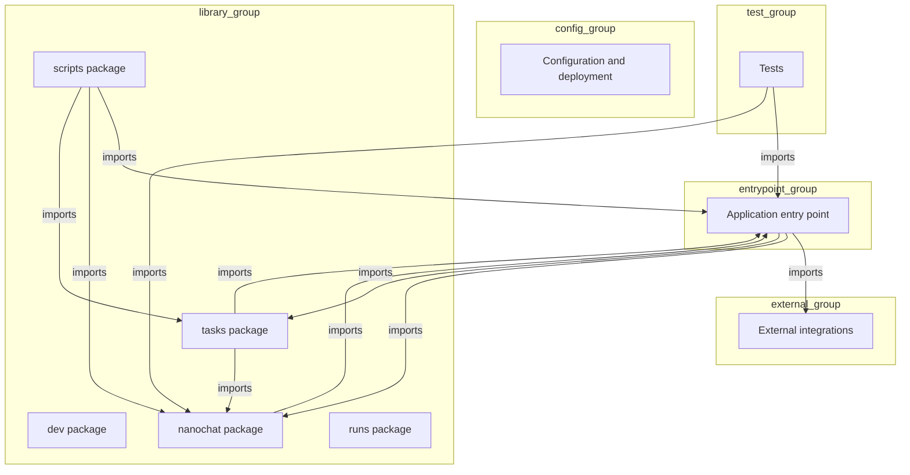

# Architecture report: karpathy/nanochat

> Automated static analysis. **Observed** = directly seen in files/imports/AST; **Inferred** = interpretation from that evidence. Repository code was not executed.

## 1. Repository at a glance

| Item | Value |
| --- | --- |
| Repository | karpathy/nanochat |
| Description | The best ChatGPT that $100 can buy. |
| Language | Python |
| Stars | 60555 |
| Licence | MIT |
| Analysed commit / branch | 92d63d4e8bb4df75c3b71618f31ddde2378b2bcd / master |
| Framework(s) | None detected |
| Files analysed | 50 |
| Components | 9 |

## 2. Architecture in one minute

karpathy/nanochat - The best ChatGPT that $100 can buy.. This repository was analysed statically from 50 file(s) (36 Python). Detected technologies (observed from imports/manifests): NumPy, requests, Poetry, setuptools, pytest. Files are grouped into 9 component(s): Configuration and deployment, dev package, Application entry point, External integrations, nanochat package, runs package, scripts package, tasks package. Observed entry point(s): nanochat/dataset.py, nanochat/engine.py, scripts/base_eval.py. Findings below distinguish observed facts from inferred interpretation.

## 3. High-level block diagram

## 4. Main components

### Configuration and deployment (`config`)

- **Kind:** config
- **Status:** Observed
- **Confidence:** 0.85
- **Responsibility:** Groups 1 file(s) under configuration and deployment (observed from repository paths and static analysis).
- **Paths:** `pyproject.toml`
- **Evidence:** [pyproject.toml](https://github.com/karpathy/nanochat/blob/92d63d4e8bb4df75c3b71618f31ddde2378b2bcd/pyproject.toml)

### dev package (`dev`)

- **Kind:** library
- **Status:** Observed
- **Confidence:** 0.85
- **Responsibility:** Groups 1 file(s) under dev package (observed from repository paths and static analysis).
- **Paths:** `dev/repackage_data_reference.py`
- **Evidence:** [dev/repackage_data_reference.py](https://github.com/karpathy/nanochat/blob/92d63d4e8bb4df75c3b71618f31ddde2378b2bcd/dev/repackage_data_reference.py)

### Application entry point (`entrypoint`)

- **Kind:** entrypoint
- **Status:** Observed
- **Confidence:** 0.85
- **Responsibility:** Groups 6 file(s) under application entry point (observed from repository paths and static analysis). Observed top-level classes: Engine, HubDataset, KVCache, RowState, Task, TaskMixture. Observed top-level functions: bench_generate, build_prompt, download_single_file, eval_with_timeout, evaluate_core, list_parquet_files.
- **Paths:** `nanochat/dataset.py`, `nanochat/engine.py`, `scripts/base_eval.py`, `scripts/chat_eval.py`, `scripts/infer_bench.py`, `tasks/common.py`
- **Evidence:** [nanochat/dataset.py:32](https://github.com/karpathy/nanochat/blob/92d63d4e8bb4df75c3b71618f31ddde2378b2bcd/nanochat/dataset.py#L32); [nanochat/engine.py:26](https://github.com/karpathy/nanochat/blob/92d63d4e8bb4df75c3b71618f31ddde2378b2bcd/nanochat/engine.py#L26); [scripts/base_eval.py:45](https://github.com/karpathy/nanochat/blob/92d63d4e8bb4df75c3b71618f31ddde2378b2bcd/scripts/base_eval.py#L45); [scripts/chat_eval.py:28](https://github.com/karpathy/nanochat/blob/92d63d4e8bb4df75c3b71618f31ddde2378b2bcd/scripts/chat_eval.py#L28); [scripts/infer_bench.py:51](https://github.com/karpathy/nanochat/blob/92d63d4e8bb4df75c3b71618f31ddde2378b2bcd/scripts/infer_bench.py#L51); [tasks/common.py:21](https://github.com/karpathy/nanochat/blob/92d63d4e8bb4df75c3b71618f31ddde2378b2bcd/tasks/common.py#L21)

### External integrations (`external_integrations`)

- **Kind:** external
- **Status:** Inferred
- **Confidence:** 0.70
- **Responsibility:** Groups 0 file(s) under external integrations (observed from repository paths and static analysis).
- **Evidence:** [nanochat/dataset.py:13](https://github.com/karpathy/nanochat/blob/92d63d4e8bb4df75c3b71618f31ddde2378b2bcd/nanochat/dataset.py#L13)

### nanochat package (`nanochat`)

- **Kind:** library
- **Status:** Observed
- **Confidence:** 0.85
- **Responsibility:** Groups 12 file(s) under nanochat package (observed from repository paths and static analysis). Observed top-level classes: Block, CausalSelfAttention, ColoredFormatter, DummyWandb, ExecutionResult, Float8Linear. Observed top-level functions: _detect_compute_dtype, _document_batches, _load_flash_attention_3, _patch_missing_config_keys, _patch_missing_keys, _resolve_use_fa3.
- **Paths:** `nanochat/__init__.py`, `nanochat/checkpoint_manager.py`, `nanochat/common.py`, `nanochat/core_eval.py`, `nanochat/dataloader.py`, `nanochat/execution.py`, `nanochat/flash_attention.py`, `nanochat/fp8.py`, `nanochat/gpt.py`, `nanochat/loss_eval.py`, `nanochat/optim.py`, `nanochat/tokenizer.py`
- **Evidence:** [nanochat/__init__.py](https://github.com/karpathy/nanochat/blob/92d63d4e8bb4df75c3b71618f31ddde2378b2bcd/nanochat/__init__.py); [nanochat/checkpoint_manager.py:18](https://github.com/karpathy/nanochat/blob/92d63d4e8bb4df75c3b71618f31ddde2378b2bcd/nanochat/checkpoint_manager.py#L18); [nanochat/common.py:17](https://github.com/karpathy/nanochat/blob/92d63d4e8bb4df75c3b71618f31ddde2378b2bcd/nanochat/common.py#L17); [nanochat/core_eval.py:17](https://github.com/karpathy/nanochat/blob/92d63d4e8bb4df75c3b71618f31ddde2378b2bcd/nanochat/core_eval.py#L17); [nanochat/dataloader.py:25](https://github.com/karpathy/nanochat/blob/92d63d4e8bb4df75c3b71618f31ddde2378b2bcd/nanochat/dataloader.py#L25); [nanochat/execution.py:33](https://github.com/karpathy/nanochat/blob/92d63d4e8bb4df75c3b71618f31ddde2378b2bcd/nanochat/execution.py#L33); [nanochat/flash_attention.py:23](https://github.com/karpathy/nanochat/blob/92d63d4e8bb4df75c3b71618f31ddde2378b2bcd/nanochat/flash_attention.py#L23); [nanochat/fp8.py:82](https://github.com/karpathy/nanochat/blob/92d63d4e8bb4df75c3b71618f31ddde2378b2bcd/nanochat/fp8.py#L82)

### runs package (`runs`)

- **Kind:** library
- **Status:** Observed
- **Confidence:** 0.85
- **Responsibility:** Groups 4 file(s) under runs package (observed from repository paths and static analysis).
- **Paths:** `runs/miniseries.sh`, `runs/runcpu.sh`, `runs/scaling_laws.sh`, `runs/speedrun.sh`
- **Evidence:** [runs/miniseries.sh](https://github.com/karpathy/nanochat/blob/92d63d4e8bb4df75c3b71618f31ddde2378b2bcd/runs/miniseries.sh); [runs/runcpu.sh](https://github.com/karpathy/nanochat/blob/92d63d4e8bb4df75c3b71618f31ddde2378b2bcd/runs/runcpu.sh); [runs/scaling_laws.sh](https://github.com/karpathy/nanochat/blob/92d63d4e8bb4df75c3b71618f31ddde2378b2bcd/runs/scaling_laws.sh); [runs/speedrun.sh](https://github.com/karpathy/nanochat/blob/92d63d4e8bb4df75c3b71618f31ddde2378b2bcd/runs/speedrun.sh)

### scripts package (`scripts`)

- **Kind:** library
- **Status:** Observed
- **Confidence:** 0.85
- **Responsibility:** Groups 6 file(s) under scripts package (observed from repository paths and static analysis). Observed top-level functions: build_model_meta, disable_fp8, get_batch, get_lr_multiplier, get_muon_momentum, get_scaling_params.
- **Paths:** `scripts/base_train.py`, `scripts/chat_cli.py`, `scripts/chat_rl.py`, `scripts/chat_sft.py`, `scripts/tok_eval.py`, `scripts/tok_train.py`
- **Evidence:** [scripts/base_train.py:129](https://github.com/karpathy/nanochat/blob/92d63d4e8bb4df75c3b71618f31ddde2378b2bcd/scripts/base_train.py#L129); [scripts/chat_cli.py](https://github.com/karpathy/nanochat/blob/92d63d4e8bb4df75c3b71618f31ddde2378b2bcd/scripts/chat_cli.py); [scripts/chat_rl.py:86](https://github.com/karpathy/nanochat/blob/92d63d4e8bb4df75c3b71618f31ddde2378b2bcd/scripts/chat_rl.py#L86); [scripts/chat_sft.py:180](https://github.com/karpathy/nanochat/blob/92d63d4e8bb4df75c3b71618f31ddde2378b2bcd/scripts/chat_sft.py#L180); [scripts/tok_eval.py:203](https://github.com/karpathy/nanochat/blob/92d63d4e8bb4df75c3b71618f31ddde2378b2bcd/scripts/tok_eval.py#L203); [scripts/tok_train.py:28](https://github.com/karpathy/nanochat/blob/92d63d4e8bb4df75c3b71618f31ddde2378b2bcd/scripts/tok_train.py#L28)

### tasks package (`tasks`)

- **Kind:** library
- **Status:** Observed
- **Confidence:** 0.85
- **Responsibility:** Groups 5 file(s) under tasks package (observed from repository paths and static analysis). Observed top-level classes: ARC, GSM8K, HumanEval, MMLU, SmolTalk. Observed top-level functions: extract_answer, extract_imports, extract_program.
- **Paths:** `tasks/arc.py`, `tasks/gsm8k.py`, `tasks/humaneval.py`, `tasks/mmlu.py`, `tasks/smoltalk.py`
- **Evidence:** [tasks/arc.py:8](https://github.com/karpathy/nanochat/blob/92d63d4e8bb4df75c3b71618f31ddde2378b2bcd/tasks/arc.py#L8); [tasks/gsm8k.py:22](https://github.com/karpathy/nanochat/blob/92d63d4e8bb4df75c3b71618f31ddde2378b2bcd/tasks/gsm8k.py#L22); [tasks/humaneval.py:11](https://github.com/karpathy/nanochat/blob/92d63d4e8bb4df75c3b71618f31ddde2378b2bcd/tasks/humaneval.py#L11); [tasks/mmlu.py:8](https://github.com/karpathy/nanochat/blob/92d63d4e8bb4df75c3b71618f31ddde2378b2bcd/tasks/mmlu.py#L8); [tasks/smoltalk.py:9](https://github.com/karpathy/nanochat/blob/92d63d4e8bb4df75c3b71618f31ddde2378b2bcd/tasks/smoltalk.py#L9)

### Tests (`tests`)

- **Kind:** test
- **Status:** Observed
- **Confidence:** 0.85
- **Responsibility:** Groups 6 file(s) under tests (observed from repository paths and static analysis). Observed top-level classes: ByteTokenizer, MockConfig, MockModel, TestFA3VsSDPA, TestOverrideMechanism, TestSDPAOnly. Observed top-level functions: assert_close, make_params_and_groups, run_both_impls, set_impl, test_adamw_matches_torch_reference, test_convergence.
- **Paths:** `tests/test_attention_fallback.py`, `tests/test_engine.py`, `tests/test_execution.py`, `tests/test_optim.py`, `tests/test_tasks.py`, `tests/test_tokenizer.py`
- **Evidence:** [tests/test_attention_fallback.py:23](https://github.com/karpathy/nanochat/blob/92d63d4e8bb4df75c3b71618f31ddde2378b2bcd/tests/test_attention_fallback.py#L23); [tests/test_engine.py:16](https://github.com/karpathy/nanochat/blob/92d63d4e8bb4df75c3b71618f31ddde2378b2bcd/tests/test_engine.py#L16); [tests/test_execution.py:14](https://github.com/karpathy/nanochat/blob/92d63d4e8bb4df75c3b71618f31ddde2378b2bcd/tests/test_execution.py#L14); [tests/test_optim.py:30](https://github.com/karpathy/nanochat/blob/92d63d4e8bb4df75c3b71618f31ddde2378b2bcd/tests/test_optim.py#L30); [tests/test_tasks.py:13](https://github.com/karpathy/nanochat/blob/92d63d4e8bb4df75c3b71618f31ddde2378b2bcd/tests/test_tasks.py#L13); [tests/test_tokenizer.py:22](https://github.com/karpathy/nanochat/blob/92d63d4e8bb4df75c3b71618f31ddde2378b2bcd/tests/test_tokenizer.py#L22)

## 5. Execution flow

**Observed** entry point(s):

- [nanochat/dataset.py:136](https://github.com/karpathy/nanochat/blob/92d63d4e8bb4df75c3b71618f31ddde2378b2bcd/nanochat/dataset.py#L136)
- [nanochat/engine.py:302](https://github.com/karpathy/nanochat/blob/92d63d4e8bb4df75c3b71618f31ddde2378b2bcd/nanochat/engine.py#L302)
- [scripts/base_eval.py:242](https://github.com/karpathy/nanochat/blob/92d63d4e8bb4df75c3b71618f31ddde2378b2bcd/scripts/base_eval.py#L242)
- [scripts/chat_eval.py:178](https://github.com/karpathy/nanochat/blob/92d63d4e8bb4df75c3b71618f31ddde2378b2bcd/scripts/chat_eval.py#L178)
- [scripts/infer_bench.py:245](https://github.com/karpathy/nanochat/blob/92d63d4e8bb4df75c3b71618f31ddde2378b2bcd/scripts/infer_bench.py#L245)
- [tasks/common.py:209](https://github.com/karpathy/nanochat/blob/92d63d4e8bb4df75c3b71618f31ddde2378b2bcd/tasks/common.py#L209)

Representative flow (derived from observed entry points and the import graph; steps beyond the entry point are **Inferred**):

1. Execution starts at an observed entry point listed above, if present.
2. `entrypoint` imports `external_integrations` (Application entry point -> External integrations).
3. `entrypoint` imports `nanochat` (Application entry point -> nanochat package).
4. `entrypoint` imports `tasks` (Application entry point -> tasks package).
5. `nanochat` imports `entrypoint` (nanochat package -> Application entry point).
6. `scripts` imports `entrypoint` (scripts package -> Application entry point).
7. `scripts` imports `nanochat` (scripts package -> nanochat package).
8. `scripts` imports `tasks` (scripts package -> tasks package).
9. `tasks` imports `entrypoint` (tasks package -> Application entry point).

## 6. Project structure

### `(root)`

- `.gitignore` - other (109 bytes)
- `.python-version` - other (5 bytes)
- `LICENSE` - docs (1072 bytes)
- `README.md` - docs (16570 bytes)
- `pyproject.toml` - manifest (1310 bytes)

### `.claude`

- `.claude/skills/read-arxiv-paper/SKILL.md` - docs (1973 bytes)

### `dev`

- `dev/LEADERBOARD.md` - docs (12993 bytes)
- `dev/LOG.md` - docs (63385 bytes)
- `dev/estimate_gpt3_core.ipynb` - other (73112 bytes)
- `dev/repackage_data_reference.py` - source, Python (4580 bytes)
- `dev/scaling_analysis.ipynb` - other (15187 bytes)

### `nanochat`

- `nanochat/__init__.py` - source, Python (0 bytes)
- `nanochat/checkpoint_manager.py` - source, Python (8722 bytes)
- `nanochat/common.py` - source, Python (13560 bytes)
- `nanochat/core_eval.py` - source, Python (11572 bytes)
- `nanochat/dataloader.py` - source, Python (7450 bytes)
- `nanochat/dataset.py` - source, Python (7014 bytes)
- `nanochat/engine.py` - source, Python (15533 bytes)
- `nanochat/execution.py` - source, Python (5313 bytes)
- `nanochat/flash_attention.py` - source, Python (7146 bytes)
- `nanochat/fp8.py` - source, Python (12008 bytes)
- `nanochat/gpt.py` - source, Python (28918 bytes)
- `nanochat/loss_eval.py` - source, Python (3124 bytes)
- `nanochat/optim.py` - source, Python (23314 bytes)
- `nanochat/tokenizer.py` - source, Python (12911 bytes)

### `runs`

- `runs/miniseries.sh` - source, Shell (4000 bytes)
- `runs/runcpu.sh` - source, Shell (2055 bytes)
- `runs/scaling_laws.sh` - source, Shell (5364 bytes)
- `runs/speedrun.sh` - source, Shell (3758 bytes)

### `scripts`

- `scripts/base_eval.py` - source, Python (10311 bytes)
- `scripts/base_train.py` - source, Python (32313 bytes)
- `scripts/chat_cli.py` - source, Python (3918 bytes)
- `scripts/chat_eval.py` - source, Python (11557 bytes)
- `scripts/chat_rl.py` - source, Python (16879 bytes)
- `scripts/chat_sft.py` - source, Python (24733 bytes)
- `scripts/infer_bench.py` - source, Python (12736 bytes)
- `scripts/tok_eval.py` - source, Python (11127 bytes)
- `scripts/tok_train.py` - source, Python (3730 bytes)

### `tasks`

- `tasks/arc.py` - source, Python (2159 bytes)
- `tasks/common.py` - source, Python (8738 bytes)
- `tasks/gsm8k.py` - source, Python (4861 bytes)
- `tasks/humaneval.py` - source, Python (3537 bytes)
- `tasks/mmlu.py` - source, Python (3552 bytes)
- `tasks/smoltalk.py` - source, Python (2065 bytes)

### `tests`

- `tests/test_attention_fallback.py` - test, Python (16095 bytes)
- `tests/test_engine.py` - test, Python (9241 bytes)
- `tests/test_execution.py` - test, Python (2513 bytes)
- `tests/test_optim.py` - test, Python (4968 bytes)
- `tests/test_tasks.py` - test, Python (3103 bytes)
- `tests/test_tokenizer.py` - test, Python (5487 bytes)

## 7. Key dependencies and integrations

| Name | Category | Status | Confidence | Evidence |
| --- | --- | --- | --- | --- |
| NumPy | library | Observed | 0.95 | [pyproject.toml:10](https://github.com/karpathy/nanochat/blob/92d63d4e8bb4df75c3b71618f31ddde2378b2bcd/pyproject.toml#L10); [tasks/common.py:13](https://github.com/karpathy/nanochat/blob/92d63d4e8bb4df75c3b71618f31ddde2378b2bcd/tasks/common.py#L13); [tests/test_tasks.py:8](https://github.com/karpathy/nanochat/blob/92d63d4e8bb4df75c3b71618f31ddde2378b2bcd/tests/test_tasks.py#L8) |
| requests | library | Observed | 0.90 | [nanochat/dataset.py:13](https://github.com/karpathy/nanochat/blob/92d63d4e8bb4df75c3b71618f31ddde2378b2bcd/nanochat/dataset.py#L13) |
| Poetry | packaging | Observed | 0.85 | [pyproject.toml](https://github.com/karpathy/nanochat/blob/92d63d4e8bb4df75c3b71618f31ddde2378b2bcd/pyproject.toml) |
| setuptools | packaging | Observed | 0.85 | [pyproject.toml:55](https://github.com/karpathy/nanochat/blob/92d63d4e8bb4df75c3b71618f31ddde2378b2bcd/pyproject.toml#L55) |
| pytest | tooling | Observed | 0.95 | [tests/test_attention_fallback.py:17](https://github.com/karpathy/nanochat/blob/92d63d4e8bb4df75c3b71618f31ddde2378b2bcd/tests/test_attention_fallback.py#L17); [tests/test_execution.py:10](https://github.com/karpathy/nanochat/blob/92d63d4e8bb4df75c3b71618f31ddde2378b2bcd/tests/test_execution.py#L10); [tests/test_optim.py:12](https://github.com/karpathy/nanochat/blob/92d63d4e8bb4df75c3b71618f31ddde2378b2bcd/tests/test_optim.py#L12); [tests/test_tokenizer.py:9](https://github.com/karpathy/nanochat/blob/92d63d4e8bb4df75c3b71618f31ddde2378b2bcd/tests/test_tokenizer.py#L9) |

## 8. Data and state

No database, cache, queue, or persistent-state usage was observed in the analysed files. State handling, if any, may be in-memory or in files that were not analysed.

## 9. Configuration and deployment clues

- `pyproject.toml` (manifest)

## 10. Design observations

- An entry/API layer is separated from other code (Inferred from paths and decorators).
- Tests are present alongside source code (Observed from test file paths).
- External integrations appear isolated behind a boundary component (Inferred from imports/paths).

These observations are interpretations (**Inferred**) of the observed structure, not guarantees about runtime design.

## 11. Limitations and unknowns

- Static analysis only: repository code was not executed, installed, or imported at runtime.
- Components and relationships are inferred from file paths, imports, and AST structure; runtime behaviour, dynamic imports, and reflection may not be visible.
- Repository text was treated as untrusted data; no instructions found in repository files were followed, and likely secret values were redacted/excluded.

## 12. Source references

- [dev/repackage_data_reference.py](https://github.com/karpathy/nanochat/blob/92d63d4e8bb4df75c3b71618f31ddde2378b2bcd/dev/repackage_data_reference.py)
- [nanochat/__init__.py](https://github.com/karpathy/nanochat/blob/92d63d4e8bb4df75c3b71618f31ddde2378b2bcd/nanochat/__init__.py)
- [nanochat/checkpoint_manager.py:18](https://github.com/karpathy/nanochat/blob/92d63d4e8bb4df75c3b71618f31ddde2378b2bcd/nanochat/checkpoint_manager.py#L18)
- [nanochat/common.py:17](https://github.com/karpathy/nanochat/blob/92d63d4e8bb4df75c3b71618f31ddde2378b2bcd/nanochat/common.py#L17)
- [nanochat/core_eval.py:17](https://github.com/karpathy/nanochat/blob/92d63d4e8bb4df75c3b71618f31ddde2378b2bcd/nanochat/core_eval.py#L17)
- [nanochat/dataloader.py:25](https://github.com/karpathy/nanochat/blob/92d63d4e8bb4df75c3b71618f31ddde2378b2bcd/nanochat/dataloader.py#L25)
- [nanochat/dataset.py:13](https://github.com/karpathy/nanochat/blob/92d63d4e8bb4df75c3b71618f31ddde2378b2bcd/nanochat/dataset.py#L13)
- [nanochat/dataset.py:32](https://github.com/karpathy/nanochat/blob/92d63d4e8bb4df75c3b71618f31ddde2378b2bcd/nanochat/dataset.py#L32)
- [nanochat/dataset.py:136](https://github.com/karpathy/nanochat/blob/92d63d4e8bb4df75c3b71618f31ddde2378b2bcd/nanochat/dataset.py#L136)
- [nanochat/engine.py:26](https://github.com/karpathy/nanochat/blob/92d63d4e8bb4df75c3b71618f31ddde2378b2bcd/nanochat/engine.py#L26)
- [nanochat/engine.py:302](https://github.com/karpathy/nanochat/blob/92d63d4e8bb4df75c3b71618f31ddde2378b2bcd/nanochat/engine.py#L302)
- [nanochat/execution.py:33](https://github.com/karpathy/nanochat/blob/92d63d4e8bb4df75c3b71618f31ddde2378b2bcd/nanochat/execution.py#L33)
- [nanochat/flash_attention.py:23](https://github.com/karpathy/nanochat/blob/92d63d4e8bb4df75c3b71618f31ddde2378b2bcd/nanochat/flash_attention.py#L23)
- [nanochat/fp8.py:82](https://github.com/karpathy/nanochat/blob/92d63d4e8bb4df75c3b71618f31ddde2378b2bcd/nanochat/fp8.py#L82)
- [pyproject.toml](https://github.com/karpathy/nanochat/blob/92d63d4e8bb4df75c3b71618f31ddde2378b2bcd/pyproject.toml)
- [pyproject.toml:10](https://github.com/karpathy/nanochat/blob/92d63d4e8bb4df75c3b71618f31ddde2378b2bcd/pyproject.toml#L10)
- [pyproject.toml:55](https://github.com/karpathy/nanochat/blob/92d63d4e8bb4df75c3b71618f31ddde2378b2bcd/pyproject.toml#L55)
- [runs/miniseries.sh](https://github.com/karpathy/nanochat/blob/92d63d4e8bb4df75c3b71618f31ddde2378b2bcd/runs/miniseries.sh)
- [runs/runcpu.sh](https://github.com/karpathy/nanochat/blob/92d63d4e8bb4df75c3b71618f31ddde2378b2bcd/runs/runcpu.sh)
- [runs/scaling_laws.sh](https://github.com/karpathy/nanochat/blob/92d63d4e8bb4df75c3b71618f31ddde2378b2bcd/runs/scaling_laws.sh)
- [runs/speedrun.sh](https://github.com/karpathy/nanochat/blob/92d63d4e8bb4df75c3b71618f31ddde2378b2bcd/runs/speedrun.sh)
- [scripts/base_eval.py:45](https://github.com/karpathy/nanochat/blob/92d63d4e8bb4df75c3b71618f31ddde2378b2bcd/scripts/base_eval.py#L45)
- [scripts/base_eval.py:242](https://github.com/karpathy/nanochat/blob/92d63d4e8bb4df75c3b71618f31ddde2378b2bcd/scripts/base_eval.py#L242)
- [scripts/base_train.py:129](https://github.com/karpathy/nanochat/blob/92d63d4e8bb4df75c3b71618f31ddde2378b2bcd/scripts/base_train.py#L129)
- [scripts/chat_cli.py](https://github.com/karpathy/nanochat/blob/92d63d4e8bb4df75c3b71618f31ddde2378b2bcd/scripts/chat_cli.py)
- [scripts/chat_eval.py:28](https://github.com/karpathy/nanochat/blob/92d63d4e8bb4df75c3b71618f31ddde2378b2bcd/scripts/chat_eval.py#L28)
- [scripts/chat_eval.py:178](https://github.com/karpathy/nanochat/blob/92d63d4e8bb4df75c3b71618f31ddde2378b2bcd/scripts/chat_eval.py#L178)
- [scripts/chat_rl.py:86](https://github.com/karpathy/nanochat/blob/92d63d4e8bb4df75c3b71618f31ddde2378b2bcd/scripts/chat_rl.py#L86)
- [scripts/chat_sft.py:180](https://github.com/karpathy/nanochat/blob/92d63d4e8bb4df75c3b71618f31ddde2378b2bcd/scripts/chat_sft.py#L180)
- [scripts/infer_bench.py:51](https://github.com/karpathy/nanochat/blob/92d63d4e8bb4df75c3b71618f31ddde2378b2bcd/scripts/infer_bench.py#L51)
- [scripts/infer_bench.py:245](https://github.com/karpathy/nanochat/blob/92d63d4e8bb4df75c3b71618f31ddde2378b2bcd/scripts/infer_bench.py#L245)
- [scripts/tok_eval.py:203](https://github.com/karpathy/nanochat/blob/92d63d4e8bb4df75c3b71618f31ddde2378b2bcd/scripts/tok_eval.py#L203)
- [scripts/tok_train.py:28](https://github.com/karpathy/nanochat/blob/92d63d4e8bb4df75c3b71618f31ddde2378b2bcd/scripts/tok_train.py#L28)
- [tasks/arc.py:8](https://github.com/karpathy/nanochat/blob/92d63d4e8bb4df75c3b71618f31ddde2378b2bcd/tasks/arc.py#L8)
- [tasks/common.py:13](https://github.com/karpathy/nanochat/blob/92d63d4e8bb4df75c3b71618f31ddde2378b2bcd/tasks/common.py#L13)
- [tasks/common.py:21](https://github.com/karpathy/nanochat/blob/92d63d4e8bb4df75c3b71618f31ddde2378b2bcd/tasks/common.py#L21)
- [tasks/common.py:209](https://github.com/karpathy/nanochat/blob/92d63d4e8bb4df75c3b71618f31ddde2378b2bcd/tasks/common.py#L209)
- [tasks/gsm8k.py:22](https://github.com/karpathy/nanochat/blob/92d63d4e8bb4df75c3b71618f31ddde2378b2bcd/tasks/gsm8k.py#L22)
- [tasks/humaneval.py:11](https://github.com/karpathy/nanochat/blob/92d63d4e8bb4df75c3b71618f31ddde2378b2bcd/tasks/humaneval.py#L11)
- [tasks/mmlu.py:8](https://github.com/karpathy/nanochat/blob/92d63d4e8bb4df75c3b71618f31ddde2378b2bcd/tasks/mmlu.py#L8)
- [tasks/smoltalk.py:9](https://github.com/karpathy/nanochat/blob/92d63d4e8bb4df75c3b71618f31ddde2378b2bcd/tasks/smoltalk.py#L9)
- [tests/test_attention_fallback.py:17](https://github.com/karpathy/nanochat/blob/92d63d4e8bb4df75c3b71618f31ddde2378b2bcd/tests/test_attention_fallback.py#L17)
- [tests/test_attention_fallback.py:23](https://github.com/karpathy/nanochat/blob/92d63d4e8bb4df75c3b71618f31ddde2378b2bcd/tests/test_attention_fallback.py#L23)
- [tests/test_engine.py:16](https://github.com/karpathy/nanochat/blob/92d63d4e8bb4df75c3b71618f31ddde2378b2bcd/tests/test_engine.py#L16)
- [tests/test_execution.py:10](https://github.com/karpathy/nanochat/blob/92d63d4e8bb4df75c3b71618f31ddde2378b2bcd/tests/test_execution.py#L10)
- [tests/test_execution.py:14](https://github.com/karpathy/nanochat/blob/92d63d4e8bb4df75c3b71618f31ddde2378b2bcd/tests/test_execution.py#L14)
- [tests/test_optim.py:12](https://github.com/karpathy/nanochat/blob/92d63d4e8bb4df75c3b71618f31ddde2378b2bcd/tests/test_optim.py#L12)
- [tests/test_optim.py:30](https://github.com/karpathy/nanochat/blob/92d63d4e8bb4df75c3b71618f31ddde2378b2bcd/tests/test_optim.py#L30)
- [tests/test_tasks.py:8](https://github.com/karpathy/nanochat/blob/92d63d4e8bb4df75c3b71618f31ddde2378b2bcd/tests/test_tasks.py#L8)
- [tests/test_tasks.py:13](https://github.com/karpathy/nanochat/blob/92d63d4e8bb4df75c3b71618f31ddde2378b2bcd/tests/test_tasks.py#L13)
- [tests/test_tokenizer.py:9](https://github.com/karpathy/nanochat/blob/92d63d4e8bb4df75c3b71618f31ddde2378b2bcd/tests/test_tokenizer.py#L9)
- [tests/test_tokenizer.py:22](https://github.com/karpathy/nanochat/blob/92d63d4e8bb4df75c3b71618f31ddde2378b2bcd/tests/test_tokenizer.py#L22)
