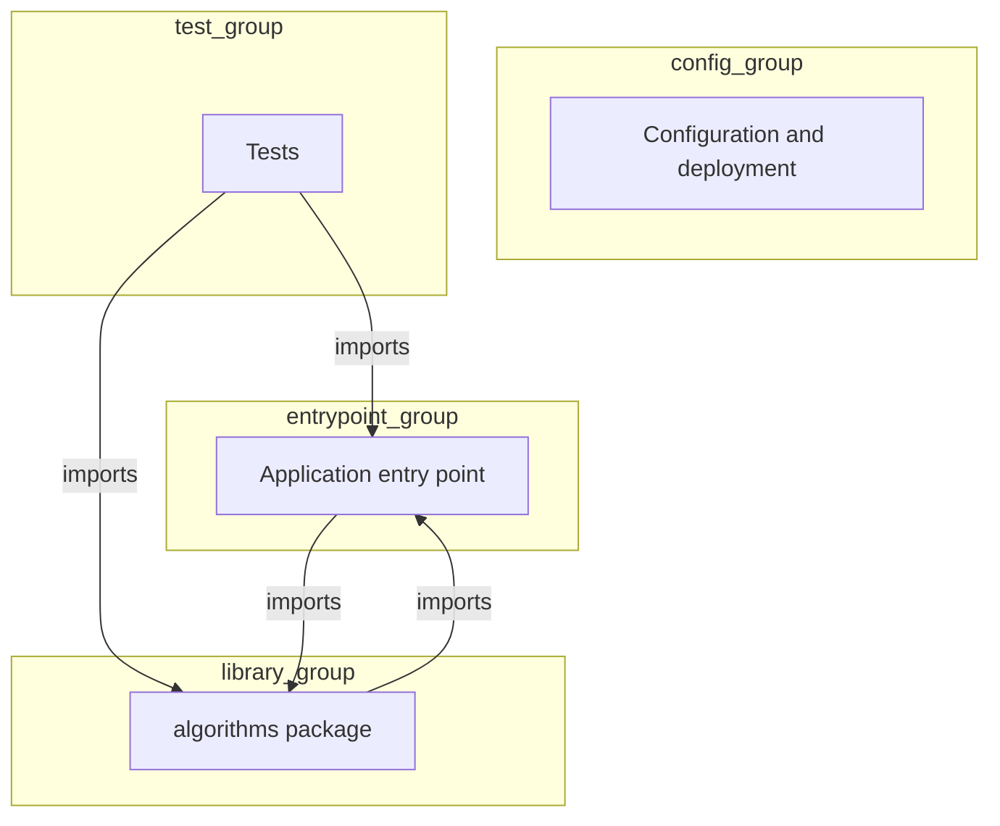

# Architecture report: keon/algorithms

> Automated static analysis. **Observed** = directly seen in files/imports/AST; **Inferred** = interpretation from that evidence. Repository code was not executed.

## 1. Repository at a glance

| Item | Value |
| --- | --- |
| Repository | keon/algorithms |
| Description | Minimal examples of data structures and algorithms in Python |
| Language | Python |
| Stars | 25597 |
| Licence | MIT |
| Analysed commit / branch | bd1d152f9ec7331c69be662831610b003b10fc7a / main |
| Framework(s) | None detected |
| Files analysed | 444 |
| Components | 4 |

## 2. Architecture in one minute

keon/algorithms - Minimal examples of data structures and algorithms in Python. This repository was analysed statically from 444 file(s) (433 Python). Detected technologies (observed from imports/manifests): GitHub Actions, Poetry, setuptools, pytest, unittest. Files are grouped into 4 component(s): algorithms package, Configuration and deployment, Application entry point, Tests. Observed entry point(s): algorithms/data_structures/red_black_tree.py, algorithms/searching/generalized_binary_search.py, algorithms/searching/interpolation_search.py. Findings below distinguish observed facts from inferred interpretation.

## 3. High-level block diagram

## 4. Main components

### algorithms package (`algorithms`)

- **Kind:** library
- **Status:** Observed
- **Confidence:** 0.85
- **Responsibility:** Groups 395 file(s) under algorithms package (observed from repository paths and static analysis). Observed top-level classes: AbstractHeap, AbstractQueue, AbstractStack, ArrayQueue, ArrayStack, AvlTree. Observed top-level functions: _add_edge, _add_pair_v1, _add_pair_v2, _array_is_matrix, _augment, _backtrack.
- **Paths:** `algorithms/__init__.py`, `algorithms/array/__init__.py`, `algorithms/array/delete_nth.py`, `algorithms/array/flatten.py`, `algorithms/array/garage.py`, `algorithms/array/josephus.py`, `algorithms/array/limit.py`, `algorithms/array/longest_non_repeat.py`, `algorithms/array/max_ones_index.py`, `algorithms/array/merge_intervals.py`, `algorithms/array/missing_ranges.py`, `algorithms/array/move_zeros.py`, `algorithms/array/n_sum.py`, `algorithms/array/plus_one.py`, `algorithms/array/remove_duplicates.py`, `algorithms/array/rotate.py`, `algorithms/array/summarize_ranges.py`, `algorithms/array/three_sum.py`, `algorithms/array/top_1.py`, `algorithms/array/trimmean.py`, `algorithms/array/two_sum.py`, `algorithms/backtracking/__init__.py`, `algorithms/backtracking/add_operators.py`, `algorithms/backtracking/anagram.py`, `algorithms/backtracking/array_sum_combinations.py`, `algorithms/backtracking/combination_sum.py`, `algorithms/backtracking/factor_combinations.py`, `algorithms/backtracking/find_words.py`, `algorithms/backtracking/generate_abbreviations.py`, `algorithms/backtracking/generate_parenthesis.py`, `algorithms/backtracking/letter_combination.py`, `algorithms/backtracking/minimax.py`, `algorithms/backtracking/palindrome_partitioning.py`, `algorithms/backtracking/pattern_match.py`, `algorithms/backtracking/permute.py`, `algorithms/backtracking/permute_unique.py`, `algorithms/backtracking/subsets.py`, `algorithms/backtracking/subsets_unique.py`, `algorithms/bit_manipulation/__init__.py`, `algorithms/bit_manipulation/add_bitwise_operator.py`, `algorithms/bit_manipulation/binary_gap.py`, `algorithms/bit_manipulation/bit_operation.py`, `algorithms/bit_manipulation/bytes_int_conversion.py`, `algorithms/bit_manipulation/count_flips_to_convert.py`, `algorithms/bit_manipulation/count_ones.py`, `algorithms/bit_manipulation/find_difference.py`, `algorithms/bit_manipulation/find_missing_number.py`, `algorithms/bit_manipulation/flip_bit_longest_sequence.py`, `algorithms/bit_manipulation/gray_code.py`, `algorithms/bit_manipulation/has_alternative_bit.py`, `algorithms/bit_manipulation/insert_bit.py`, `algorithms/bit_manipulation/power_of_two.py`, `algorithms/bit_manipulation/remove_bit.py`, `algorithms/bit_manipulation/reverse_bits.py`, `algorithms/bit_manipulation/single_number.py`, `algorithms/bit_manipulation/single_number2.py`, `algorithms/bit_manipulation/single_number3.py`, `algorithms/bit_manipulation/subsets.py`, `algorithms/bit_manipulation/swap_pair.py`, `algorithms/common/__init__.py`, `algorithms/common/graph.py`, `algorithms/common/list_node.py`, `algorithms/common/tree_node.py`, `algorithms/compression/__init__.py`, `algorithms/compression/elias.py`, `algorithms/compression/huffman_coding.py`, `algorithms/compression/lzw_compression.py`, `algorithms/compression/rle_compression.py`, `algorithms/data_structures/__init__.py`, `algorithms/data_structures/avl_tree.py`, `algorithms/data_structures/b_tree.py`, `algorithms/data_structures/bst.py`, `algorithms/data_structures/fenwick_tree.py`, `algorithms/data_structures/graph.py`, `algorithms/data_structures/hash_table.py`, `algorithms/data_structures/heap.py`, `algorithms/data_structures/iterative_segment_tree.py`, `algorithms/data_structures/kd_tree.py`, `algorithms/data_structures/linked_list.py`, `algorithms/data_structures/priority_queue.py`, `algorithms/data_structures/queue.py`, `algorithms/data_structures/segment_tree.py`, `algorithms/data_structures/separate_chaining_hash_table.py`, `algorithms/data_structures/sqrt_decomposition.py`, `algorithms/data_structures/stack.py`, `algorithms/data_structures/trie.py`, `algorithms/data_structures/union_find.py`, `algorithms/data_structures/veb_tree.py`, `algorithms/dynamic_programming/__init__.py`, `algorithms/dynamic_programming/bitmask.py`, `algorithms/dynamic_programming/buy_sell_stock.py`, `algorithms/dynamic_programming/climbing_stairs.py`, `algorithms/dynamic_programming/coin_change.py`, `algorithms/dynamic_programming/combination_sum.py`, `algorithms/dynamic_programming/count_paths_dp.py`, `algorithms/dynamic_programming/edit_distance.py`, `algorithms/dynamic_programming/egg_drop.py`, `algorithms/dynamic_programming/fib.py`, `algorithms/dynamic_programming/hosoya_triangle.py`, `algorithms/dynamic_programming/house_robber.py`, `algorithms/dynamic_programming/int_divide.py`, `algorithms/dynamic_programming/job_scheduling.py`, `algorithms/dynamic_programming/k_factor.py`, `algorithms/dynamic_programming/knapsack.py`, `algorithms/dynamic_programming/longest_common_subsequence.py`, `algorithms/dynamic_programming/longest_increasing.py`, `algorithms/dynamic_programming/matrix_chain_order.py`, `algorithms/dynamic_programming/max_product_subarray.py`, `algorithms/dynamic_programming/max_subarray.py`, `algorithms/dynamic_programming/min_cost_path.py`, `algorithms/dynamic_programming/num_decodings.py`, `algorithms/dynamic_programming/planting_trees.py`, `algorithms/dynamic_programming/regex_matching.py`, `algorithms/dynamic_programming/rod_cut.py`, `algorithms/dynamic_programming/word_break.py`, `algorithms/graph/__init__.py`, `algorithms/graph/a_star.py`, `algorithms/graph/all_factors.py`, `algorithms/graph/all_pairs_shortest_path.py`, `algorithms/graph/bellman_ford.py`, `algorithms/graph/blossom.py`, `algorithms/graph/check_bipartite.py`, `algorithms/graph/check_digraph_strongly_connected.py`, `algorithms/graph/clone_graph.py`, `algorithms/graph/count_connected_number_of_component.py`, `algorithms/graph/count_islands_bfs.py`, `algorithms/graph/count_islands_dfs.py`, `algorithms/graph/count_islands_unionfind.py`, `algorithms/graph/cycle_detection.py`, `algorithms/graph/dijkstra.py`, `algorithms/graph/dijkstra_heapq.py`, `algorithms/graph/find_all_cliques.py`, `algorithms/graph/find_path.py`, `algorithms/graph/graph.py`, `algorithms/graph/kahns_algorithm.py`, `algorithms/graph/markov_chain.py`, `algorithms/graph/maximum_flow.py`, `algorithms/graph/maximum_flow_bfs.py`, `algorithms/graph/maximum_flow_dfs.py`, `algorithms/graph/maze_search_bfs.py`, `algorithms/graph/maze_search_dfs.py`, `algorithms/graph/minimum_spanning_tree.py`, `algorithms/graph/pacific_atlantic.py`, `algorithms/graph/path_between_two_vertices_in_digraph.py`, `algorithms/graph/prims_minimum_spanning.py`, `algorithms/graph/satisfiability.py`, `algorithms/graph/shortest_distance_from_all_buildings.py`, `algorithms/graph/strongly_connected_components_kosaraju.py`, `algorithms/graph/sudoku_solver.py`, `algorithms/graph/tarjan.py`, `algorithms/graph/topological_sort_bfs.py`, `algorithms/graph/topological_sort_dfs.py`, `algorithms/graph/transitive_closure_dfs.py`, `algorithms/graph/traversal.py`, `algorithms/graph/walls_and_gates.py`, `algorithms/graph/word_ladder.py`, `algorithms/greedy/__init__.py`, `algorithms/greedy/gale_shapley.py`, `algorithms/greedy/max_contiguous_subsequence_sum.py`, `algorithms/heap/__init__.py`, `algorithms/heap/k_closest_points.py`, `algorithms/heap/merge_sorted_k_lists.py`, `algorithms/heap/skyline.py`, `algorithms/heap/sliding_window_max.py`, `algorithms/linked_list/__init__.py`, `algorithms/linked_list/add_two_numbers.py`, `algorithms/linked_list/copy_random_pointer.py`, `algorithms/linked_list/delete_node.py`, `algorithms/linked_list/first_cyclic_node.py`, `algorithms/linked_list/intersection.py`, `algorithms/linked_list/is_cyclic.py`, `algorithms/linked_list/is_palindrome.py`, `algorithms/linked_list/is_sorted.py`, `algorithms/linked_list/kth_to_last.py`, `algorithms/linked_list/merge_two_list.py`, `algorithms/linked_list/partition.py`, `algorithms/linked_list/remove_duplicates.py`, `algorithms/linked_list/remove_range.py`, `algorithms/linked_list/reverse.py`, `algorithms/linked_list/rotate_list.py`, `algorithms/linked_list/swap_in_pairs.py`, `algorithms/map/__init__.py`, `algorithms/map/is_anagram.py`, `algorithms/map/is_isomorphic.py`, `algorithms/map/longest_common_substring.py`, `algorithms/map/longest_palindromic_subsequence.py`, `algorithms/map/randomized_set.py`, `algorithms/map/valid_sudoku.py`, `algorithms/map/word_pattern.py`, `algorithms/math/__init__.py`, `algorithms/math/base_conversion.py`, `algorithms/math/chebyshev_distance.py`, `algorithms/math/chinese_remainder_theorem.py`, `algorithms/math/combination.py`, `algorithms/math/cosine_similarity.py`, `algorithms/math/decimal_to_binary_ip.py`, `algorithms/math/diffie_hellman_key_exchange.py`, `algorithms/math/distance_between_two_points.py`, `algorithms/math/euler_totient.py`, `algorithms/math/extended_gcd.py`, `algorithms/math/factorial.py`, `algorithms/math/fft.py`, `algorithms/math/find_order_simple.py`, `algorithms/math/find_primitive_root_simple.py`, `algorithms/math/gcd.py`, `algorithms/math/generate_strobogrammtic.py`, `algorithms/math/geometric_mean.py`, `algorithms/math/goldbach.py`, `algorithms/math/hailstone.py`, `algorithms/math/is_strobogrammatic.py`, `algorithms/math/krishnamurthy_number.py`, `algorithms/math/linear_regression.py`, `algorithms/math/magic_number.py`, `algorithms/math/manhattan_distance.py`, `algorithms/math/modular_exponential.py`, `algorithms/math/modular_inverse.py`, `algorithms/math/next_bigger.py`, `algorithms/math/next_perfect_square.py`, `algorithms/math/nth_digit.py`, `algorithms/math/num_digits.py`, `algorithms/math/num_perfect_squares.py`, `algorithms/math/polynomial.py`, `algorithms/math/polynomial_division.py`, `algorithms/math/power.py`, `algorithms/math/prime_check.py`, `algorithms/math/primes_sieve_of_eratosthenes.py`, `algorithms/math/pythagoras.py`, `algorithms/math/rabin_miller.py`, `algorithms/math/recursive_binomial_coefficient.py`, `algorithms/math/rsa.py`, `algorithms/math/sqrt_precision_factor.py`, `algorithms/math/summing_digits.py`, `algorithms/math/surface_area_of_torus.py`, `algorithms/math/symmetry_group_cycle_index.py`, `algorithms/matrix/__init__.py`, `algorithms/matrix/bomb_enemy.py`, `algorithms/matrix/cholesky_matrix_decomposition.py`, `algorithms/matrix/copy_transform.py`, `algorithms/matrix/count_paths.py`, `algorithms/matrix/crout_matrix_decomposition.py`, `algorithms/matrix/matrix_exponentiation.py`, `algorithms/matrix/matrix_inversion.py`, `algorithms/matrix/multiply.py`, `algorithms/matrix/rotate_image.py`, `algorithms/matrix/search_in_sorted_matrix.py`, `algorithms/matrix/sort_matrix_diagonally.py`, `algorithms/matrix/sparse_dot_vector.py`, `algorithms/matrix/sparse_mul.py`, `algorithms/matrix/spiral_traversal.py`, `algorithms/matrix/sudoku_validator.py`, `algorithms/matrix/sum_sub_squares.py`, `algorithms/queue/__init__.py`, `algorithms/queue/max_sliding_window.py`, `algorithms/queue/moving_average.py`, `algorithms/queue/reconstruct_queue.py`, `algorithms/queue/zigzagiterator.py`, `algorithms/searching/__init__.py`, `algorithms/searching/binary_search.py`, `algorithms/searching/exponential_search.py`, `algorithms/searching/find_min_rotate.py`, `algorithms/searching/first_occurrence.py`, `algorithms/searching/jump_search.py`, `algorithms/searching/last_occurrence.py`, `algorithms/searching/linear_search.py`, `algorithms/searching/next_greatest_letter.py`, `algorithms/searching/search_insert.py`, `algorithms/searching/search_range.py`, `algorithms/searching/search_rotate.py`, `algorithms/searching/sentinel_search.py`, `algorithms/searching/ternary_search.py`, `algorithms/searching/two_sum.py`, `algorithms/set/__init__.py`, `algorithms/set/find_keyboard_row.py`, `algorithms/set/randomized_set.py`, `algorithms/set/set_covering.py`, `algorithms/sorting/__init__.py`, `algorithms/sorting/bead_sort.py`, `algorithms/sorting/bitonic_sort.py`, `algorithms/sorting/bogo_sort.py`, `algorithms/sorting/bubble_sort.py`, `algorithms/sorting/bucket_sort.py`, `algorithms/sorting/cocktail_shaker_sort.py`, `algorithms/sorting/comb_sort.py`, `algorithms/sorting/counting_sort.py`, `algorithms/sorting/cycle_sort.py`, `algorithms/sorting/exchange_sort.py`, `algorithms/sorting/gnome_sort.py`, `algorithms/sorting/heap_sort.py`, `algorithms/sorting/insertion_sort.py`, `algorithms/sorting/meeting_rooms.py`, `algorithms/sorting/merge_sort.py`, `algorithms/sorting/pancake_sort.py`, `algorithms/sorting/pigeonhole_sort.py`, `algorithms/sorting/quick_sort.py`, `algorithms/sorting/radix_sort.py`, `algorithms/sorting/selection_sort.py`, `algorithms/sorting/shell_sort.py`, `algorithms/sorting/sort_colors.py`, `algorithms/sorting/stooge_sort.py`, `algorithms/sorting/wiggle_sort.py`, `algorithms/stack/__init__.py`, `algorithms/stack/is_consecutive.py`, `algorithms/stack/is_sorted.py`, `algorithms/stack/longest_abs_path.py`, `algorithms/stack/ordered_stack.py`, `algorithms/stack/remove_min.py`, `algorithms/stack/simplify_path.py`, `algorithms/stack/stutter.py`, `algorithms/stack/switch_pairs.py`, `algorithms/stack/valid_parenthesis.py`, `algorithms/streaming/__init__.py`, `algorithms/streaming/misra_gries.py`, `algorithms/streaming/one_sparse_recovery.py`, `algorithms/string/__init__.py`, `algorithms/string/add_binary.py`, `algorithms/string/alphabet_board_path.py`, `algorithms/string/atbash_cipher.py`, `algorithms/string/breaking_bad.py`, `algorithms/string/caesar_cipher.py`, `algorithms/string/check_pangram.py`, `algorithms/string/contain_string.py`, `algorithms/string/count_binary_substring.py`, `algorithms/string/decode_string.py`, `algorithms/string/delete_reoccurring.py`, `algorithms/string/domain_extractor.py`, `algorithms/string/encode_decode.py`, `algorithms/string/first_unique_char.py`, `algorithms/string/fizzbuzz.py`, `algorithms/string/group_anagrams.py`, `algorithms/string/int_to_roman.py`, `algorithms/string/is_palindrome.py`, `algorithms/string/is_rotated.py`, `algorithms/string/judge_circle.py`, `algorithms/string/knuth_morris_pratt.py`, `algorithms/string/license_number.py`, `algorithms/string/longest_common_prefix.py`, `algorithms/string/longest_palindromic_substring.py`, `algorithms/string/make_sentence.py`, `algorithms/string/manacher.py`, `algorithms/string/merge_string_checker.py`, `algorithms/string/min_distance.py`, `algorithms/string/multiply_strings.py`, `algorithms/string/one_edit_distance.py`, `algorithms/string/panagram.py`, `algorithms/string/rabin_karp.py`, `algorithms/string/repeat_string.py`, `algorithms/string/repeat_substring.py`, `algorithms/string/reverse_string.py`, `algorithms/string/reverse_vowel.py`, `algorithms/string/reverse_words.py`, `algorithms/string/roman_to_int.py`, `algorithms/string/rotate.py`, `algorithms/string/strip_url_params.py`, `algorithms/string/strong_password.py`, `algorithms/string/swap_characters.py`, `algorithms/string/text_justification.py`, `algorithms/string/unique_morse.py`, `algorithms/string/validate_coordinates.py`, `algorithms/string/word_squares.py`, `algorithms/string/z_algorithm.py`, `algorithms/tree/__init__.py`, `algorithms/tree/bin_tree_to_list.py`, `algorithms/tree/binary_tree_paths.py`, `algorithms/tree/binary_tree_views.py`, `algorithms/tree/bst_array_to_bst.py`, `algorithms/tree/bst_closest_value.py`, `algorithms/tree/bst_delete_node.py`, `algorithms/tree/bst_is_bst.py`, `algorithms/tree/bst_iterator.py`, `algorithms/tree/bst_lowest_common_ancestor.py`, `algorithms/tree/bst_predecessor.py`, `algorithms/tree/bst_serialize_deserialize.py`, `algorithms/tree/bst_successor.py`, `algorithms/tree/bst_unique_bst.py`, `algorithms/tree/construct_tree_postorder_preorder.py`, `algorithms/tree/deepest_left.py`, `algorithms/tree/invert_tree.py`, `algorithms/tree/is_balanced.py`, `algorithms/tree/is_subtree.py`, `algorithms/tree/is_symmetric.py`, `algorithms/tree/longest_consecutive.py`, `algorithms/tree/lowest_common_ancestor.py`, `algorithms/tree/max_height.py`, `algorithms/tree/max_path_sum.py`, `algorithms/tree/min_height.py`, `algorithms/tree/path_sum.py`, `algorithms/tree/path_sum2.py`, `algorithms/tree/pretty_print.py`, `algorithms/tree/same_tree.py`, `algorithms/tree/traversal_level_order.py`, `algorithms/tree/traversal_postorder.py`, `algorithms/tree/traversal_preorder.py`, `algorithms/tree/traversal_zigzag.py`, `algorithms/tree/tree.py`, `algorithms/tree/trie_add_and_search.py`
- **Evidence:** [algorithms/__init__.py](https://github.com/keon/algorithms/blob/bd1d152f9ec7331c69be662831610b003b10fc7a/algorithms/__init__.py); [algorithms/array/__init__.py](https://github.com/keon/algorithms/blob/bd1d152f9ec7331c69be662831610b003b10fc7a/algorithms/array/__init__.py); [algorithms/array/delete_nth.py:23](https://github.com/keon/algorithms/blob/bd1d152f9ec7331c69be662831610b003b10fc7a/algorithms/array/delete_nth.py#L23); [algorithms/array/flatten.py:20](https://github.com/keon/algorithms/blob/bd1d152f9ec7331c69be662831610b003b10fc7a/algorithms/array/flatten.py#L20); [algorithms/array/garage.py:18](https://github.com/keon/algorithms/blob/bd1d152f9ec7331c69be662831610b003b10fc7a/algorithms/array/garage.py#L18); [algorithms/array/josephus.py:20](https://github.com/keon/algorithms/blob/bd1d152f9ec7331c69be662831610b003b10fc7a/algorithms/array/josephus.py#L20); [algorithms/array/limit.py:17](https://github.com/keon/algorithms/blob/bd1d152f9ec7331c69be662831610b003b10fc7a/algorithms/array/limit.py#L17); [algorithms/array/longest_non_repeat.py:17](https://github.com/keon/algorithms/blob/bd1d152f9ec7331c69be662831610b003b10fc7a/algorithms/array/longest_non_repeat.py#L17)

### Configuration and deployment (`config`)

- **Kind:** config
- **Status:** Observed
- **Confidence:** 0.85
- **Responsibility:** Groups 2 file(s) under configuration and deployment (observed from repository paths and static analysis).
- **Paths:** `MANIFEST.in`, `pyproject.toml`
- **Evidence:** [MANIFEST.in](https://github.com/keon/algorithms/blob/bd1d152f9ec7331c69be662831610b003b10fc7a/MANIFEST.in); [pyproject.toml](https://github.com/keon/algorithms/blob/bd1d152f9ec7331c69be662831610b003b10fc7a/pyproject.toml)

### Application entry point (`entrypoint`)

- **Kind:** entrypoint
- **Status:** Observed
- **Confidence:** 0.85
- **Responsibility:** Groups 10 file(s) under application entry point (observed from repository paths and static analysis). Observed top-level classes: Node, RBNode, RBTree, Solution, TestSuite. Observed top-level functions: binary_search_first_true, count_left_node, depth_sum, height, inorder, inorder_rec.
- **Paths:** `algorithms/data_structures/red_black_tree.py`, `algorithms/searching/generalized_binary_search.py`, `algorithms/searching/interpolation_search.py`, `algorithms/tree/bst_count_left_node.py`, `algorithms/tree/bst_depth_sum.py`, `algorithms/tree/bst_height.py`, `algorithms/tree/bst_kth_smallest.py`, `algorithms/tree/bst_num_empty.py`, `algorithms/tree/bst_validate_bst.py`, `algorithms/tree/traversal_inorder.py`
- **Evidence:** [algorithms/data_structures/red_black_tree.py:6](https://github.com/keon/algorithms/blob/bd1d152f9ec7331c69be662831610b003b10fc7a/algorithms/data_structures/red_black_tree.py#L6); [algorithms/searching/generalized_binary_search.py:21](https://github.com/keon/algorithms/blob/bd1d152f9ec7331c69be662831610b003b10fc7a/algorithms/searching/generalized_binary_search.py#L21); [algorithms/searching/interpolation_search.py:17](https://github.com/keon/algorithms/blob/bd1d152f9ec7331c69be662831610b003b10fc7a/algorithms/searching/interpolation_search.py#L17); [algorithms/tree/bst_count_left_node.py:23](https://github.com/keon/algorithms/blob/bd1d152f9ec7331c69be662831610b003b10fc7a/algorithms/tree/bst_count_left_node.py#L23); [algorithms/tree/bst_depth_sum.py:24](https://github.com/keon/algorithms/blob/bd1d152f9ec7331c69be662831610b003b10fc7a/algorithms/tree/bst_depth_sum.py#L24); [algorithms/tree/bst_height.py:24](https://github.com/keon/algorithms/blob/bd1d152f9ec7331c69be662831610b003b10fc7a/algorithms/tree/bst_height.py#L24); [algorithms/tree/bst_kth_smallest.py:1](https://github.com/keon/algorithms/blob/bd1d152f9ec7331c69be662831610b003b10fc7a/algorithms/tree/bst_kth_smallest.py#L1); [algorithms/tree/bst_num_empty.py:27](https://github.com/keon/algorithms/blob/bd1d152f9ec7331c69be662831610b003b10fc7a/algorithms/tree/bst_num_empty.py#L27)

### Tests (`tests`)

- **Kind:** test
- **Status:** Observed
- **Confidence:** 0.85
- **Responsibility:** Groups 28 file(s) under tests (observed from repository paths and static analysis). Observed top-level classes: Node, PrimsMinimumSpanning, TestAddBinary, TestAddOperator, TestAllFactors, TestAllPairsShortestPath. Observed top-level functions: convert, create_tree, gcd, is_sorted, test_bst_delete_recurses_to_non_root_node, test_extended_gcd_satisfies_bezout_identity.
- **Paths:** `tests/test_array.py`, `tests/test_audit_regressions.py`, `tests/test_backtracking.py`, `tests/test_bit_manipulation.py`, `tests/test_community_algorithms.py`, `tests/test_compression.py`, `tests/test_data_structures.py`, `tests/test_dynamic_programming.py`, `tests/test_graph.py`, `tests/test_greedy.py`, `tests/test_heap.py`, `tests/test_issue_fixes.py`, `tests/test_iterative_segment_tree.py`, `tests/test_linked_list.py`, `tests/test_map.py`, `tests/test_math.py`, `tests/test_matrix.py`, `tests/test_monomial.py`, `tests/test_polynomial.py`, `tests/test_queue.py`, `tests/test_searching.py`, `tests/test_set.py`, `tests/test_sorting.py`, `tests/test_stack.py`, `tests/test_streaming.py`, `tests/test_string.py`, `tests/test_tree.py`, `tests/test_veb_tree.py`
- **Evidence:** [tests/test_array.py:36](https://github.com/keon/algorithms/blob/bd1d152f9ec7331c69be662831610b003b10fc7a/tests/test_array.py#L36); [tests/test_audit_regressions.py:30](https://github.com/keon/algorithms/blob/bd1d152f9ec7331c69be662831610b003b10fc7a/tests/test_audit_regressions.py#L30); [tests/test_backtracking.py:28](https://github.com/keon/algorithms/blob/bd1d152f9ec7331c69be662831610b003b10fc7a/tests/test_backtracking.py#L28); [tests/test_bit_manipulation.py:37](https://github.com/keon/algorithms/blob/bd1d152f9ec7331c69be662831610b003b10fc7a/tests/test_bit_manipulation.py#L37); [tests/test_community_algorithms.py:32](https://github.com/keon/algorithms/blob/bd1d152f9ec7331c69be662831610b003b10fc7a/tests/test_community_algorithms.py#L32); [tests/test_compression.py:9](https://github.com/keon/algorithms/blob/bd1d152f9ec7331c69be662831610b003b10fc7a/tests/test_compression.py#L9); [tests/test_data_structures.py:16](https://github.com/keon/algorithms/blob/bd1d152f9ec7331c69be662831610b003b10fc7a/tests/test_data_structures.py#L16); [tests/test_dynamic_programming.py:30](https://github.com/keon/algorithms/blob/bd1d152f9ec7331c69be662831610b003b10fc7a/tests/test_dynamic_programming.py#L30)

## 5. Execution flow

**Observed** entry point(s):

- [algorithms/data_structures/red_black_tree.py:287](https://github.com/keon/algorithms/blob/bd1d152f9ec7331c69be662831610b003b10fc7a/algorithms/data_structures/red_black_tree.py#L287)
- [algorithms/searching/generalized_binary_search.py:62](https://github.com/keon/algorithms/blob/bd1d152f9ec7331c69be662831610b003b10fc7a/algorithms/searching/generalized_binary_search.py#L62)
- [algorithms/searching/interpolation_search.py:54](https://github.com/keon/algorithms/blob/bd1d152f9ec7331c69be662831610b003b10fc7a/algorithms/searching/interpolation_search.py#L54)
- [algorithms/tree/bst_count_left_node.py:65](https://github.com/keon/algorithms/blob/bd1d152f9ec7331c69be662831610b003b10fc7a/algorithms/tree/bst_count_left_node.py#L65)
- [algorithms/tree/bst_depth_sum.py:75](https://github.com/keon/algorithms/blob/bd1d152f9ec7331c69be662831610b003b10fc7a/algorithms/tree/bst_depth_sum.py#L75)
- [algorithms/tree/bst_height.py:64](https://github.com/keon/algorithms/blob/bd1d152f9ec7331c69be662831610b003b10fc7a/algorithms/tree/bst_height.py#L64)
- [algorithms/tree/bst_kth_smallest.py:42](https://github.com/keon/algorithms/blob/bd1d152f9ec7331c69be662831610b003b10fc7a/algorithms/tree/bst_kth_smallest.py#L42)
- [algorithms/tree/bst_num_empty.py:71](https://github.com/keon/algorithms/blob/bd1d152f9ec7331c69be662831610b003b10fc7a/algorithms/tree/bst_num_empty.py#L71)
- [algorithms/tree/bst_validate_bst.py:71](https://github.com/keon/algorithms/blob/bd1d152f9ec7331c69be662831610b003b10fc7a/algorithms/tree/bst_validate_bst.py#L71)
- [algorithms/tree/traversal_inorder.py:41](https://github.com/keon/algorithms/blob/bd1d152f9ec7331c69be662831610b003b10fc7a/algorithms/tree/traversal_inorder.py#L41)

Representative flow (derived from observed entry points and the import graph; steps beyond the entry point are **Inferred**):

1. Execution starts at an observed entry point listed above, if present.
2. `algorithms` imports `entrypoint` (algorithms package -> Application entry point).
3. `entrypoint` imports `algorithms` (Application entry point -> algorithms package).
4. `tests` imports `algorithms` (Tests -> algorithms package).
5. `tests` imports `entrypoint` (Tests -> Application entry point).

## 6. Project structure

### `(root)`

- `.gitignore` - other (310 bytes)
- `CODE_OF_CONDUCT.md` - docs (3213 bytes)
- `CONTRIBUTING.md` - docs (2818 bytes)
- `LICENSE` - docs (1061 bytes)
- `MANIFEST.in` - manifest (55 bytes)
- `README.md` - docs (45346 bytes)
- `pyproject.toml` - manifest (1435 bytes)

### `.github`

- `.github/workflows/publish.yml` - ci, YAML (1118 bytes)
- `.github/workflows/python-app.yml` - ci, YAML (932 bytes)

### `algorithms`

- `algorithms/__init__.py` - source, Python (470 bytes)
- `algorithms/array/__init__.py` - source, Python (1513 bytes)
- `algorithms/array/delete_nth.py` - source, Python (1612 bytes)
- `algorithms/array/flatten.py` - source, Python (1717 bytes)
- `algorithms/array/garage.py` - source, Python (1696 bytes)
- `algorithms/array/josephus.py` - source, Python (1062 bytes)
- `algorithms/array/limit.py` - source, Python (1049 bytes)
- `algorithms/array/longest_non_repeat.py` - source, Python (4208 bytes)
- `algorithms/array/max_ones_index.py` - source, Python (1202 bytes)
- `algorithms/array/merge_intervals.py` - source, Python (3356 bytes)
- `algorithms/array/missing_ranges.py` - source, Python (1104 bytes)
- `algorithms/array/move_zeros.py` - source, Python (954 bytes)
- `algorithms/array/n_sum.py` - source, Python (3948 bytes)
- `algorithms/array/plus_one.py` - source, Python (2200 bytes)
- `algorithms/array/remove_duplicates.py` - source, Python (1210 bytes)
- `algorithms/array/rotate.py` - source, Python (2294 bytes)
- `algorithms/array/summarize_ranges.py` - source, Python (1073 bytes)
- `algorithms/array/three_sum.py` - source, Python (1413 bytes)
- `algorithms/array/top_1.py` - source, Python (959 bytes)
- `algorithms/array/trimmean.py` - source, Python (1140 bytes)
- `algorithms/array/two_sum.py` - source, Python (843 bytes)
- `algorithms/backtracking/__init__.py` - source, Python (1440 bytes)
- `algorithms/backtracking/add_operators.py` - source, Python (2239 bytes)
- `algorithms/backtracking/anagram.py` - source, Python (1054 bytes)
- `algorithms/backtracking/array_sum_combinations.py` - source, Python (3484 bytes)
- `algorithms/backtracking/combination_sum.py` - source, Python (1368 bytes)
- `algorithms/backtracking/factor_combinations.py` - source, Python (2017 bytes)
- `algorithms/backtracking/find_words.py` - source, Python (2529 bytes)
- `algorithms/backtracking/generate_abbreviations.py` - source, Python (1362 bytes)
- `algorithms/backtracking/generate_parenthesis.py` - source, Python (2242 bytes)
- `algorithms/backtracking/letter_combination.py` - source, Python (1252 bytes)
- `algorithms/backtracking/minimax.py` - source, Python (1605 bytes)
- `algorithms/backtracking/palindrome_partitioning.py` - source, Python (1797 bytes)
- `algorithms/backtracking/pattern_match.py` - source, Python (1766 bytes)
- `algorithms/backtracking/permute.py` - source, Python (2214 bytes)
- `algorithms/backtracking/permute_unique.py` - source, Python (1127 bytes)
- `algorithms/backtracking/subsets.py` - source, Python (1771 bytes)
- `algorithms/backtracking/subsets_unique.py` - source, Python (1272 bytes)
- `algorithms/bit_manipulation/__init__.py` - source, Python (1845 bytes)
- `algorithms/bit_manipulation/add_bitwise_operator.py` - source, Python (966 bytes)
- `algorithms/bit_manipulation/binary_gap.py` - source, Python (1079 bytes)
- `algorithms/bit_manipulation/bit_operation.py` - source, Python (2425 bytes)
- `algorithms/bit_manipulation/bytes_int_conversion.py` - source, Python (2239 bytes)
- `algorithms/bit_manipulation/count_flips_to_convert.py` - source, Python (938 bytes)
- `algorithms/bit_manipulation/count_ones.py` - source, Python (1238 bytes)
- `algorithms/bit_manipulation/find_difference.py` - source, Python (962 bytes)
- `algorithms/bit_manipulation/find_missing_number.py` - source, Python (1558 bytes)
- `algorithms/bit_manipulation/flip_bit_longest_sequence.py` - source, Python (1284 bytes)
- `algorithms/bit_manipulation/gray_code.py` - source, Python (804 bytes)
- `algorithms/bit_manipulation/has_alternative_bit.py` - source, Python (1644 bytes)
- `algorithms/bit_manipulation/insert_bit.py` - source, Python (1851 bytes)
- `algorithms/bit_manipulation/power_of_two.py` - source, Python (764 bytes)
- `algorithms/bit_manipulation/remove_bit.py` - source, Python (957 bytes)
- `algorithms/bit_manipulation/reverse_bits.py` - source, Python (710 bytes)
- `algorithms/bit_manipulation/single_number.py` - source, Python (887 bytes)
- `algorithms/bit_manipulation/single_number2.py` - source, Python (1074 bytes)
- `algorithms/bit_manipulation/single_number3.py` - source, Python (1167 bytes)
- `algorithms/bit_manipulation/subsets.py` - source, Python (1120 bytes)
- `algorithms/bit_manipulation/swap_pair.py` - source, Python (898 bytes)
- `algorithms/common/__init__.py` - source, Python (445 bytes)
- `algorithms/common/graph.py` - source, Python (3080 bytes)
- `algorithms/common/list_node.py` - source, Python (737 bytes)
- `algorithms/common/tree_node.py` - source, Python (779 bytes)
- `algorithms/compression/__init__.py` - source, Python (336 bytes)
- `algorithms/compression/elias.py` - source, Python (2527 bytes)
- `algorithms/compression/huffman_coding.py` - source, Python (14211 bytes)
- `algorithms/compression/lzw_compression.py` - source, Python (3237 bytes)
- `algorithms/compression/rle_compression.py` - source, Python (1525 bytes)
- `algorithms/data_structures/__init__.py` - source, Python (2434 bytes)
- `algorithms/data_structures/avl_tree.py` - source, Python (3452 bytes)
- `algorithms/data_structures/b_tree.py` - source, Python (12271 bytes)
- `algorithms/data_structures/bst.py` - source, Python (3521 bytes)
- `algorithms/data_structures/fenwick_tree.py` - source, Python (2684 bytes)
- `algorithms/data_structures/graph.py` - source, Python (3762 bytes)
- `algorithms/data_structures/hash_table.py` - source, Python (4922 bytes)
- `algorithms/data_structures/heap.py` - source, Python (4142 bytes)
- `algorithms/data_structures/iterative_segment_tree.py` - source, Python (1742 bytes)
- `algorithms/data_structures/kd_tree.py` - source, Python (2380 bytes)
- `algorithms/data_structures/linked_list.py` - source, Python (1070 bytes)
- `algorithms/data_structures/priority_queue.py` - source, Python (3010 bytes)
- `algorithms/data_structures/queue.py` - source, Python (5073 bytes)
- `algorithms/data_structures/red_black_tree.py` - source, Python (11261 bytes)
- `algorithms/data_structures/segment_tree.py` - source, Python (1616 bytes)
- `algorithms/data_structures/separate_chaining_hash_table.py` - source, Python (3646 bytes)
- `algorithms/data_structures/sqrt_decomposition.py` - source, Python (3602 bytes)
- `algorithms/data_structures/stack.py` - source, Python (4642 bytes)
- `algorithms/data_structures/trie.py` - source, Python (981 bytes)
- `algorithms/data_structures/union_find.py` - source, Python (2287 bytes)
- `algorithms/data_structures/veb_tree.py` - source, Python (7424 bytes)
- `algorithms/dynamic_programming/__init__.py` - source, Python (2953 bytes)
- `algorithms/dynamic_programming/bitmask.py` - source, Python (1181 bytes)
- `algorithms/dynamic_programming/buy_sell_stock.py` - source, Python (1585 bytes)
- `algorithms/dynamic_programming/climbing_stairs.py` - source, Python (1334 bytes)
- `algorithms/dynamic_programming/coin_change.py` - source, Python (902 bytes)
- `algorithms/dynamic_programming/combination_sum.py` - source, Python (2094 bytes)
- `algorithms/dynamic_programming/count_paths_dp.py` - source, Python (1085 bytes)
- `algorithms/dynamic_programming/edit_distance.py` - source, Python (1311 bytes)
- `algorithms/dynamic_programming/egg_drop.py` - source, Python (1237 bytes)
- `algorithms/dynamic_programming/fib.py` - source, Python (1861 bytes)
- `algorithms/dynamic_programming/hosoya_triangle.py` - source, Python (1455 bytes)
- `algorithms/dynamic_programming/house_robber.py` - source, Python (740 bytes)
- `algorithms/dynamic_programming/int_divide.py` - source, Python (1032 bytes)
- `algorithms/dynamic_programming/job_scheduling.py` - source, Python (1866 bytes)
- `algorithms/dynamic_programming/k_factor.py` - source, Python (2503 bytes)
- `algorithms/dynamic_programming/knapsack.py` - source, Python (1264 bytes)
- `algorithms/dynamic_programming/longest_common_subsequence.py` - source, Python (1019 bytes)
- `algorithms/dynamic_programming/longest_increasing.py` - source, Python (4156 bytes)
- `algorithms/dynamic_programming/matrix_chain_order.py` - source, Python (1492 bytes)
- `algorithms/dynamic_programming/max_product_subarray.py` - source, Python (2108 bytes)
- `algorithms/dynamic_programming/max_subarray.py` - source, Python (789 bytes)
- `algorithms/dynamic_programming/min_cost_path.py` - source, Python (1046 bytes)
- `algorithms/dynamic_programming/num_decodings.py` - source, Python (1899 bytes)
- `algorithms/dynamic_programming/planting_trees.py` - source, Python (1819 bytes)
- `algorithms/dynamic_programming/regex_matching.py` - source, Python (1395 bytes)
- `algorithms/dynamic_programming/rod_cut.py` - source, Python (926 bytes)
- `algorithms/dynamic_programming/word_break.py` - source, Python (1019 bytes)
- `algorithms/graph/__init__.py` - source, Python (4131 bytes)
- `algorithms/graph/a_star.py` - source, Python (1677 bytes)
- `algorithms/graph/all_factors.py` - source, Python (2308 bytes)
- `algorithms/graph/all_pairs_shortest_path.py` - source, Python (1262 bytes)
- `algorithms/graph/bellman_ford.py` - source, Python (4202 bytes)
- `algorithms/graph/blossom.py` - source, Python (2471 bytes)
- `algorithms/graph/check_bipartite.py` - source, Python (1332 bytes)
- `algorithms/graph/check_digraph_strongly_connected.py` - source, Python (2453 bytes)
- `algorithms/graph/clone_graph.py` - source, Python (3745 bytes)
- `algorithms/graph/count_connected_number_of_component.py` - source, Python (1363 bytes)
- `algorithms/graph/count_islands_bfs.py` - source, Python (1652 bytes)
- `algorithms/graph/count_islands_dfs.py` - source, Python (1277 bytes)
- `algorithms/graph/count_islands_unionfind.py` - source, Python (1422 bytes)
- `algorithms/graph/cycle_detection.py` - source, Python (1829 bytes)
- `algorithms/graph/dijkstra.py` - source, Python (2483 bytes)
- `algorithms/graph/dijkstra_heapq.py` - source, Python (2689 bytes)
- `algorithms/graph/find_all_cliques.py` - source, Python (1668 bytes)
- `algorithms/graph/find_path.py` - source, Python (3120 bytes)
- `algorithms/graph/graph.py` - source, Python (333 bytes)
- `algorithms/graph/kahns_algorithm.py` - source, Python (1572 bytes)
- `algorithms/graph/markov_chain.py` - source, Python (1854 bytes)
- `algorithms/graph/maximum_flow.py` - source, Python (6420 bytes)
- `algorithms/graph/maximum_flow_bfs.py` - source, Python (1745 bytes)
- `algorithms/graph/maximum_flow_dfs.py` - source, Python (1756 bytes)
- `algorithms/graph/maze_search_bfs.py` - source, Python (1700 bytes)
- `algorithms/graph/maze_search_dfs.py` - source, Python (1726 bytes)
- `algorithms/graph/minimum_spanning_tree.py` - source, Python (2655 bytes)
- `algorithms/graph/pacific_atlantic.py` - source, Python (2030 bytes)
- `algorithms/graph/path_between_two_vertices_in_digraph.py` - source, Python (2166 bytes)
- `algorithms/graph/prims_minimum_spanning.py` - source, Python (1216 bytes)
- `algorithms/graph/satisfiability.py` - source, Python (4748 bytes)
- `algorithms/graph/shortest_distance_from_all_buildings.py` - source, Python (2263 bytes)
- `algorithms/graph/strongly_connected_components_kosaraju.py` - source, Python (2006 bytes)
- `algorithms/graph/sudoku_solver.py` - source, Python (4173 bytes)
- `algorithms/graph/tarjan.py` - source, Python (2014 bytes)
- `algorithms/graph/topological_sort_bfs.py` - source, Python (1637 bytes)
- `algorithms/graph/topological_sort_dfs.py` - source, Python (3114 bytes)
- `algorithms/graph/transitive_closure_dfs.py` - source, Python (1907 bytes)
- `algorithms/graph/traversal.py` - source, Python (2271 bytes)
- `algorithms/graph/walls_and_gates.py` - source, Python (1303 bytes)
- `algorithms/graph/word_ladder.py` - source, Python (2242 bytes)
- `algorithms/greedy/__init__.py` - source, Python (187 bytes)
- `algorithms/greedy/gale_shapley.py` - source, Python (1758 bytes)
- `algorithms/greedy/max_contiguous_subsequence_sum.py` - source, Python (1183 bytes)
- `algorithms/heap/__init__.py` - source, Python (485 bytes)
- `algorithms/heap/k_closest_points.py` - source, Python (1491 bytes)
- `algorithms/heap/merge_sorted_k_lists.py` - source, Python (1512 bytes)
- `algorithms/heap/skyline.py` - source, Python (1347 bytes)
- `algorithms/heap/sliding_window_max.py` - source, Python (1088 bytes)
- `algorithms/linked_list/__init__.py` - source, Python (2156 bytes)
- `algorithms/linked_list/add_two_numbers.py` - source, Python (2616 bytes)
- `algorithms/linked_list/copy_random_pointer.py` - source, Python (2347 bytes)
- `algorithms/linked_list/delete_node.py` - source, Python (1140 bytes)
- `algorithms/linked_list/first_cyclic_node.py` - source, Python (1197 bytes)
- `algorithms/linked_list/intersection.py` - source, Python (1728 bytes)
- `algorithms/linked_list/is_cyclic.py` - source, Python (1081 bytes)
- `algorithms/linked_list/is_palindrome.py` - source, Python (3060 bytes)
- `algorithms/linked_list/is_sorted.py` - source, Python (819 bytes)
- `algorithms/linked_list/kth_to_last.py` - source, Python (2746 bytes)
- `algorithms/linked_list/merge_two_list.py` - source, Python (1872 bytes)
- `algorithms/linked_list/partition.py` - source, Python (1476 bytes)
- `algorithms/linked_list/remove_duplicates.py` - source, Python (1904 bytes)
- `algorithms/linked_list/remove_range.py` - source, Python (1200 bytes)
- `algorithms/linked_list/reverse.py` - source, Python (1336 bytes)
- `algorithms/linked_list/rotate_list.py` - source, Python (986 bytes)
- `algorithms/linked_list/swap_in_pairs.py` - source, Python (1141 bytes)
- `algorithms/map/__init__.py` - source, Python (862 bytes)
- `algorithms/map/is_anagram.py` - source, Python (847 bytes)
- `algorithms/map/is_isomorphic.py` - source, Python (1115 bytes)
- `algorithms/map/longest_common_substring.py` - source, Python (1313 bytes)
- `algorithms/map/longest_palindromic_subsequence.py` - source, Python (1459 bytes)
- `algorithms/map/randomized_set.py` - source, Python (1903 bytes)
- `algorithms/map/valid_sudoku.py` - source, Python (942 bytes)
- `algorithms/map/word_pattern.py` - source, Python (1245 bytes)
- `algorithms/math/__init__.py` - source, Python (4477 bytes)
- `algorithms/math/base_conversion.py` - source, Python (1800 bytes)
- `algorithms/math/chebyshev_distance.py` - source, Python (831 bytes)
- `algorithms/math/chinese_remainder_theorem.py` - source, Python (2111 bytes)
- `algorithms/math/combination.py` - source, Python (1367 bytes)
- `algorithms/math/cosine_similarity.py` - source, Python (1629 bytes)
- `algorithms/math/decimal_to_binary_ip.py` - source, Python (1409 bytes)
- `algorithms/math/diffie_hellman_key_exchange.py` - source, Python (5172 bytes)
- `algorithms/math/distance_between_two_points.py` - source, Python (955 bytes)
- `algorithms/math/euler_totient.py` - source, Python (837 bytes)
- `algorithms/math/extended_gcd.py` - source, Python (1052 bytes)
- `algorithms/math/factorial.py` - source, Python (1889 bytes)
- `algorithms/math/fft.py` - source, Python (1015 bytes)
- `algorithms/math/find_order_simple.py` - source, Python (882 bytes)
- `algorithms/math/find_primitive_root_simple.py` - source, Python (1873 bytes)
- `algorithms/math/gcd.py` - source, Python (2350 bytes)
- `algorithms/math/generate_strobogrammtic.py` - source, Python (2812 bytes)
- `algorithms/math/geometric_mean.py` - source, Python (2293 bytes)
- `algorithms/math/goldbach.py` - source, Python (2322 bytes)
- `algorithms/math/hailstone.py` - source, Python (864 bytes)
- `algorithms/math/is_strobogrammatic.py` - source, Python (1416 bytes)
- `algorithms/math/krishnamurthy_number.py` - source, Python (1165 bytes)
- `algorithms/math/linear_regression.py` - source, Python (1786 bytes)
- `algorithms/math/magic_number.py` - source, Python (829 bytes)
- `algorithms/math/manhattan_distance.py` - source, Python (612 bytes)
- `algorithms/math/modular_exponential.py` - source, Python (1025 bytes)
- `algorithms/math/modular_inverse.py` - source, Python (1360 bytes)
- `algorithms/math/next_bigger.py` - source, Python (1203 bytes)
- `algorithms/math/next_perfect_square.py` - source, Python (1139 bytes)
- `algorithms/math/nth_digit.py` - source, Python (875 bytes)
- `algorithms/math/num_digits.py` - source, Python (693 bytes)
- `algorithms/math/num_perfect_squares.py` - source, Python (1132 bytes)
- `algorithms/math/polynomial.py` - source, Python (23526 bytes)
- `algorithms/math/polynomial_division.py` - source, Python (1424 bytes)
- `algorithms/math/power.py` - source, Python (1495 bytes)
- `algorithms/math/prime_check.py` - source, Python (805 bytes)
- `algorithms/math/primes_sieve_of_eratosthenes.py` - source, Python (1125 bytes)
- `algorithms/math/pythagoras.py` - source, Python (1436 bytes)
- `algorithms/math/rabin_miller.py` - source, Python (1902 bytes)
- `algorithms/math/recursive_binomial_coefficient.py` - source, Python (1019 bytes)
- `algorithms/math/rsa.py` - source, Python (3296 bytes)
- `algorithms/math/sqrt_precision_factor.py` - source, Python (848 bytes)
- `algorithms/math/summing_digits.py` - source, Python (1228 bytes)
- `algorithms/math/surface_area_of_torus.py` - source, Python (940 bytes)
- `algorithms/math/symmetry_group_cycle_index.py` - source, Python (3924 bytes)
- `algorithms/matrix/__init__.py` - source, Python (819 bytes)
- `algorithms/matrix/bomb_enemy.py` - source, Python (2387 bytes)
- `algorithms/matrix/cholesky_matrix_decomposition.py` - source, Python (1496 bytes)
- `algorithms/matrix/copy_transform.py` - source, Python (2956 bytes)
- `algorithms/matrix/count_paths.py` - source, Python (1075 bytes)
- `algorithms/matrix/crout_matrix_decomposition.py` - source, Python (1563 bytes)
- `algorithms/matrix/matrix_exponentiation.py` - source, Python (2079 bytes)
- `algorithms/matrix/matrix_inversion.py` - source, Python (4577 bytes)
- `algorithms/matrix/multiply.py` - source, Python (1406 bytes)
- `algorithms/matrix/rotate_image.py` - source, Python (836 bytes)
- `algorithms/matrix/search_in_sorted_matrix.py` - source, Python (1171 bytes)
- `algorithms/matrix/sort_matrix_diagonally.py` - source, Python (1842 bytes)
- `algorithms/matrix/sparse_dot_vector.py` - source, Python (1652 bytes)
- `algorithms/matrix/sparse_mul.py` - source, Python (1496 bytes)
- `algorithms/matrix/spiral_traversal.py` - source, Python (1463 bytes)
- `algorithms/matrix/sudoku_validator.py` - source, Python (4268 bytes)
- `algorithms/matrix/sum_sub_squares.py` - source, Python (1202 bytes)
- `algorithms/py.typed` - other (0 bytes)
- `algorithms/queue/__init__.py` - source, Python (709 bytes)
- `algorithms/queue/max_sliding_window.py` - source, Python (1329 bytes)
- `algorithms/queue/moving_average.py` - source, Python (1118 bytes)
- `algorithms/queue/reconstruct_queue.py` - source, Python (940 bytes)
- `algorithms/queue/zigzagiterator.py` - source, Python (1362 bytes)
- `algorithms/searching/__init__.py` - source, Python (1824 bytes)
- `algorithms/searching/binary_search.py` - source, Python (1925 bytes)
- `algorithms/searching/exponential_search.py` - source, Python (955 bytes)
- `algorithms/searching/find_min_rotate.py` - source, Python (1710 bytes)
- `algorithms/searching/first_occurrence.py` - source, Python (1067 bytes)
- `algorithms/searching/generalized_binary_search.py` - source, Python (1820 bytes)
- `algorithms/searching/interpolation_search.py` - source, Python (1430 bytes)
- `algorithms/searching/jump_search.py` - source, Python (1284 bytes)
- `algorithms/searching/last_occurrence.py` - source, Python (1127 bytes)
- `algorithms/searching/linear_search.py` - source, Python (836 bytes)
- `algorithms/searching/next_greatest_letter.py` - source, Python (2682 bytes)
- `algorithms/searching/search_insert.py` - source, Python (1196 bytes)
- `algorithms/searching/search_range.py` - source, Python (1283 bytes)
- `algorithms/searching/search_rotate.py` - source, Python (2488 bytes)
- `algorithms/searching/sentinel_search.py` - source, Python (801 bytes)
- `algorithms/searching/ternary_search.py` - source, Python (1461 bytes)
- `algorithms/searching/two_sum.py` - source, Python (2972 bytes)
- `algorithms/set/__init__.py` - source, Python (263 bytes)
- `algorithms/set/find_keyboard_row.py` - source, Python (1017 bytes)
- `algorithms/set/randomized_set.py` - source, Python (1544 bytes)
- `algorithms/set/set_covering.py` - source, Python (3568 bytes)
- `algorithms/sorting/__init__.py` - source, Python (1913 bytes)
- `algorithms/sorting/bead_sort.py` - source, Python (1532 bytes)
- `algorithms/sorting/bitonic_sort.py` - source, Python (1788 bytes)
- `algorithms/sorting/bogo_sort.py` - source, Python (900 bytes)
- `algorithms/sorting/bubble_sort.py` - source, Python (895 bytes)
- `algorithms/sorting/bucket_sort.py` - source, Python (1358 bytes)
- `algorithms/sorting/cocktail_shaker_sort.py` - source, Python (1146 bytes)
- `algorithms/sorting/comb_sort.py` - source, Python (1101 bytes)
- `algorithms/sorting/counting_sort.py` - source, Python (1249 bytes)
- `algorithms/sorting/cycle_sort.py` - source, Python (1563 bytes)
- `algorithms/sorting/exchange_sort.py` - source, Python (817 bytes)
- `algorithms/sorting/gnome_sort.py` - source, Python (930 bytes)
- `algorithms/sorting/heap_sort.py` - source, Python (2571 bytes)
- `algorithms/sorting/insertion_sort.py` - source, Python (858 bytes)
- `algorithms/sorting/meeting_rooms.py` - source, Python (1050 bytes)
- `algorithms/sorting/merge_sort.py` - source, Python (1713 bytes)
- `algorithms/sorting/pancake_sort.py` - source, Python (1016 bytes)
- `algorithms/sorting/pigeonhole_sort.py` - source, Python (1005 bytes)
- `algorithms/sorting/quick_sort.py` - source, Python (1424 bytes)
- `algorithms/sorting/radix_sort.py` - source, Python (1184 bytes)
- `algorithms/sorting/selection_sort.py` - source, Python (854 bytes)
- `algorithms/sorting/shell_sort.py` - source, Python (1132 bytes)
- `algorithms/sorting/sort_colors.py` - source, Python (972 bytes)
- `algorithms/sorting/stooge_sort.py` - source, Python (1196 bytes)
- `algorithms/sorting/wiggle_sort.py` - source, Python (753 bytes)
- `algorithms/stack/__init__.py` - source, Python (997 bytes)
- `algorithms/stack/is_consecutive.py` - source, Python (2225 bytes)
- `algorithms/stack/is_sorted.py` - source, Python (1266 bytes)
- `algorithms/stack/longest_abs_path.py` - source, Python (1279 bytes)
- `algorithms/stack/ordered_stack.py` - source, Python (2329 bytes)
- `algorithms/stack/remove_min.py` - source, Python (1025 bytes)
- `algorithms/stack/simplify_path.py` - source, Python (902 bytes)
- `algorithms/stack/stutter.py` - source, Python (1646 bytes)
- `algorithms/stack/switch_pairs.py` - source, Python (2044 bytes)
- `algorithms/stack/valid_parenthesis.py` - source, Python (901 bytes)
- `algorithms/streaming/__init__.py` - source, Python (135 bytes)
- `algorithms/streaming/misra_gries.py` - source, Python (1837 bytes)
- `algorithms/streaming/one_sparse_recovery.py` - source, Python (2324 bytes)
- `algorithms/string/__init__.py` - source, Python (5090 bytes)
- `algorithms/string/add_binary.py` - source, Python (1092 bytes)
- `algorithms/string/alphabet_board_path.py` - source, Python (1103 bytes)
- `algorithms/string/atbash_cipher.py` - source, Python (1021 bytes)
- `algorithms/string/breaking_bad.py` - source, Python (3815 bytes)
- `algorithms/string/caesar_cipher.py` - source, Python (1015 bytes)
- `algorithms/string/check_pangram.py` - source, Python (777 bytes)
- `algorithms/string/contain_string.py` - source, Python (1001 bytes)
- `algorithms/string/count_binary_substring.py` - source, Python (1028 bytes)
- `algorithms/string/decode_string.py` - source, Python (1226 bytes)
- `algorithms/string/delete_reoccurring.py` - source, Python (923 bytes)
- `algorithms/string/domain_extractor.py` - source, Python (1198 bytes)
- `algorithms/string/encode_decode.py` - source, Python (1390 bytes)
- `algorithms/string/first_unique_char.py` - source, Python (1054 bytes)
- `algorithms/string/fizzbuzz.py` - source, Python (2042 bytes)
- `algorithms/string/group_anagrams.py` - source, Python (1207 bytes)
- `algorithms/string/int_to_roman.py` - source, Python (1023 bytes)
- `algorithms/string/is_palindrome.py` - source, Python (4563 bytes)
- `algorithms/string/is_rotated.py` - source, Python (1542 bytes)
- `algorithms/string/judge_circle.py` - source, Python (932 bytes)
- `algorithms/string/knuth_morris_pratt.py` - source, Python (1790 bytes)
- `algorithms/string/license_number.py` - source, Python (1124 bytes)
- `algorithms/string/longest_common_prefix.py` - source, Python (3196 bytes)
- `algorithms/string/longest_palindromic_substring.py` - source, Python (1914 bytes)
- `algorithms/string/make_sentence.py` - source, Python (1279 bytes)
- `algorithms/string/manacher.py` - source, Python (1033 bytes)
- `algorithms/string/merge_string_checker.py` - source, Python (2139 bytes)
- `algorithms/string/min_distance.py` - source, Python (2554 bytes)
- `algorithms/string/multiply_strings.py` - source, Python (1190 bytes)
- `algorithms/string/one_edit_distance.py` - source, Python (2105 bytes)
- `algorithms/string/panagram.py` - source, Python (842 bytes)
- `algorithms/string/rabin_karp.py` - source, Python (2510 bytes)
- `algorithms/string/repeat_string.py` - source, Python (1101 bytes)
- `algorithms/string/repeat_substring.py` - source, Python (742 bytes)
- `algorithms/string/reverse_string.py` - source, Python (1966 bytes)
- `algorithms/string/reverse_vowel.py` - source, Python (1084 bytes)
- `algorithms/string/reverse_words.py` - source, Python (1167 bytes)
- `algorithms/string/roman_to_int.py` - source, Python (1219 bytes)
- `algorithms/string/rotate.py` - source, Python (1311 bytes)
- `algorithms/string/strip_url_params.py` - source, Python (5146 bytes)
- `algorithms/string/strong_password.py` - source, Python (1216 bytes)
- `algorithms/string/swap_characters.py` - source, Python (580 bytes)
- `algorithms/string/text_justification.py` - source, Python (2666 bytes)
- `algorithms/string/unique_morse.py` - source, Python (1827 bytes)
- `algorithms/string/validate_coordinates.py` - source, Python (2195 bytes)
- `algorithms/string/word_squares.py` - source, Python (1492 bytes)
- `algorithms/string/z_algorithm.py` - source, Python (1172 bytes)
- `algorithms/tree/__init__.py` - source, Python (2243 bytes)
- `algorithms/tree/bin_tree_to_list.py` - source, Python (1568 bytes)
- `algorithms/tree/binary_tree_paths.py` - source, Python (1328 bytes)
- `algorithms/tree/binary_tree_views.py` - source, Python (4711 bytes)
- `algorithms/tree/bst_array_to_bst.py` - source, Python (379 bytes)
- `algorithms/tree/bst_closest_value.py` - source, Python (741 bytes)
- `algorithms/tree/bst_count_left_node.py` - source, Python (1491 bytes)
- `algorithms/tree/bst_delete_node.py` - source, Python (1734 bytes)
- `algorithms/tree/bst_depth_sum.py` - source, Python (1682 bytes)
- `algorithms/tree/bst_height.py` - source, Python (1455 bytes)
- `algorithms/tree/bst_is_bst.py` - source, Python (859 bytes)
- `algorithms/tree/bst_iterator.py` - source, Python (454 bytes)
- `algorithms/tree/bst_kth_smallest.py` - source, Python (1152 bytes)
- `algorithms/tree/bst_lowest_common_ancestor.py` - source, Python (1033 bytes)
- `algorithms/tree/bst_num_empty.py` - source, Python (1818 bytes)
- `algorithms/tree/bst_predecessor.py` - source, Python (206 bytes)
- `algorithms/tree/bst_serialize_deserialize.py` - source, Python (631 bytes)
- `algorithms/tree/bst_successor.py` - source, Python (204 bytes)
- `algorithms/tree/bst_unique_bst.py` - source, Python (971 bytes)
- `algorithms/tree/bst_validate_bst.py` - source, Python (2777 bytes)
- `algorithms/tree/construct_tree_postorder_preorder.py` - source, Python (2974 bytes)
- `algorithms/tree/deepest_left.py` - source, Python (1336 bytes)
- `algorithms/tree/invert_tree.py` - source, Python (717 bytes)
- `algorithms/tree/is_balanced.py` - source, Python (1149 bytes)
- `algorithms/tree/is_subtree.py` - source, Python (1673 bytes)
- `algorithms/tree/is_symmetric.py` - source, Python (2058 bytes)
- `algorithms/tree/longest_consecutive.py` - source, Python (1491 bytes)
- `algorithms/tree/lowest_common_ancestor.py` - source, Python (1111 bytes)
- `algorithms/tree/max_height.py` - source, Python (1132 bytes)
- `algorithms/tree/max_path_sum.py` - source, Python (1467 bytes)
- `algorithms/tree/min_height.py` - source, Python (1728 bytes)
- `algorithms/tree/path_sum.py` - source, Python (2644 bytes)
- `algorithms/tree/path_sum2.py` - source, Python (3387 bytes)
- `algorithms/tree/pretty_print.py` - source, Python (1089 bytes)
- `algorithms/tree/same_tree.py` - source, Python (1099 bytes)
- `algorithms/tree/traversal_inorder.py` - source, Python (1113 bytes)
- `algorithms/tree/traversal_level_order.py` - source, Python (719 bytes)
- `algorithms/tree/traversal_postorder.py` - source, Python (815 bytes)
- `algorithms/tree/traversal_preorder.py` - source, Python (807 bytes)
- `algorithms/tree/traversal_zigzag.py` - source, Python (819 bytes)
- `algorithms/tree/tree.py` - source, Python (235 bytes)
- `algorithms/tree/trie_add_and_search.py` - source, Python (2272 bytes)

### `docs`

- `docs/index.html` - docs (49420 bytes)

### `tests`

- `tests/test_array.py` - test, Python (17433 bytes)
- `tests/test_audit_regressions.py` - test, Python (3495 bytes)
- `tests/test_backtracking.py` - test, Python (14108 bytes)
- `tests/test_bit_manipulation.py` - test, Python (9326 bytes)
- `tests/test_community_algorithms.py` - test, Python (10689 bytes)
- `tests/test_compression.py` - test, Python (3549 bytes)
- `tests/test_data_structures.py` - test, Python (8130 bytes)
- `tests/test_dynamic_programming.py` - test, Python (8051 bytes)
- `tests/test_graph.py` - test, Python (18347 bytes)
- `tests/test_greedy.py` - test, Python (639 bytes)
- `tests/test_heap.py` - test, Python (2149 bytes)
- `tests/test_issue_fixes.py` - test, Python (7142 bytes)
- `tests/test_iterative_segment_tree.py` - test, Python (4431 bytes)
- `tests/test_linked_list.py` - test, Python (7187 bytes)
- `tests/test_map.py` - test, Python (5942 bytes)
- `tests/test_math.py` - test, Python (19974 bytes)
- `tests/test_matrix.py` - test, Python (13111 bytes)
- `tests/test_monomial.py` - test, Python (8473 bytes)
- `tests/test_polynomial.py` - test, Python (6598 bytes)
- `tests/test_queue.py` - test, Python (3127 bytes)
- `tests/test_searching.py` - test, Python (6522 bytes)
- `tests/test_set.py` - test, Python (270 bytes)
- `tests/test_sorting.py` - test, Python (3004 bytes)
- `tests/test_stack.py` - test, Python (4954 bytes)
- `tests/test_streaming.py` - test, Python (1835 bytes)
- `tests/test_string.py` - test, Python (22479 bytes)
- `tests/test_tree.py` - test, Python (5091 bytes)
- `tests/test_veb_tree.py` - test, Python (1258 bytes)

## 7. Key dependencies and integrations

| Name | Category | Status | Confidence | Evidence |
| --- | --- | --- | --- | --- |
| GitHub Actions | ci | Observed | 0.90 | [.github/workflows/publish.yml](https://github.com/keon/algorithms/blob/bd1d152f9ec7331c69be662831610b003b10fc7a/.github/workflows/publish.yml); [.github/workflows/python-app.yml](https://github.com/keon/algorithms/blob/bd1d152f9ec7331c69be662831610b003b10fc7a/.github/workflows/python-app.yml) |
| Poetry | packaging | Observed | 0.85 | [pyproject.toml](https://github.com/keon/algorithms/blob/bd1d152f9ec7331c69be662831610b003b10fc7a/pyproject.toml) |
| setuptools | packaging | Observed | 0.85 | [pyproject.toml:2](https://github.com/keon/algorithms/blob/bd1d152f9ec7331c69be662831610b003b10fc7a/pyproject.toml#L2) |
| pytest | tooling | Observed | 0.95 | [.github/workflows/python-app.yml:34](https://github.com/keon/algorithms/blob/bd1d152f9ec7331c69be662831610b003b10fc7a/.github/workflows/python-app.yml#L34); [pyproject.toml:31](https://github.com/keon/algorithms/blob/bd1d152f9ec7331c69be662831610b003b10fc7a/pyproject.toml#L31); [tests/test_audit_regressions.py:8](https://github.com/keon/algorithms/blob/bd1d152f9ec7331c69be662831610b003b10fc7a/tests/test_audit_regressions.py#L8); [tests/test_math.py:3](https://github.com/keon/algorithms/blob/bd1d152f9ec7331c69be662831610b003b10fc7a/tests/test_math.py#L3) |
| unittest | tooling | Observed | 0.95 | [algorithms/tree/bst_count_left_node.py:18](https://github.com/keon/algorithms/blob/bd1d152f9ec7331c69be662831610b003b10fc7a/algorithms/tree/bst_count_left_node.py#L18); [algorithms/tree/bst_depth_sum.py:19](https://github.com/keon/algorithms/blob/bd1d152f9ec7331c69be662831610b003b10fc7a/algorithms/tree/bst_depth_sum.py#L19); [algorithms/tree/bst_height.py:19](https://github.com/keon/algorithms/blob/bd1d152f9ec7331c69be662831610b003b10fc7a/algorithms/tree/bst_height.py#L19); [algorithms/tree/bst_num_empty.py:22](https://github.com/keon/algorithms/blob/bd1d152f9ec7331c69be662831610b003b10fc7a/algorithms/tree/bst_num_empty.py#L22) |

## 8. Data and state

No database, cache, queue, or persistent-state usage was observed in the analysed files. State handling, if any, may be in-memory or in files that were not analysed.

## 9. Configuration and deployment clues

- `.github/workflows/publish.yml` (ci)
- `.github/workflows/python-app.yml` (ci)
- `MANIFEST.in` (manifest)
- `pyproject.toml` (manifest)

## 10. Design observations

- An entry/API layer is separated from other code (Inferred from paths and decorators).
- Tests are present alongside source code (Observed from test file paths).

These observations are interpretations (**Inferred**) of the observed structure, not guarantees about runtime design.

## 11. Limitations and unknowns

- Static analysis only: repository code was not executed, installed, or imported at runtime.
- Components and relationships are inferred from file paths, imports, and AST structure; runtime behaviour, dynamic imports, and reflection may not be visible.
- Repository text was treated as untrusted data; no instructions found in repository files were followed, and likely secret values were redacted/excluded.

## 12. Source references

- [.github/workflows/publish.yml](https://github.com/keon/algorithms/blob/bd1d152f9ec7331c69be662831610b003b10fc7a/.github/workflows/publish.yml)
- [.github/workflows/python-app.yml](https://github.com/keon/algorithms/blob/bd1d152f9ec7331c69be662831610b003b10fc7a/.github/workflows/python-app.yml)
- [.github/workflows/python-app.yml:34](https://github.com/keon/algorithms/blob/bd1d152f9ec7331c69be662831610b003b10fc7a/.github/workflows/python-app.yml#L34)
- [MANIFEST.in](https://github.com/keon/algorithms/blob/bd1d152f9ec7331c69be662831610b003b10fc7a/MANIFEST.in)
- [algorithms/__init__.py](https://github.com/keon/algorithms/blob/bd1d152f9ec7331c69be662831610b003b10fc7a/algorithms/__init__.py)
- [algorithms/array/__init__.py](https://github.com/keon/algorithms/blob/bd1d152f9ec7331c69be662831610b003b10fc7a/algorithms/array/__init__.py)
- [algorithms/array/delete_nth.py:23](https://github.com/keon/algorithms/blob/bd1d152f9ec7331c69be662831610b003b10fc7a/algorithms/array/delete_nth.py#L23)
- [algorithms/array/flatten.py:20](https://github.com/keon/algorithms/blob/bd1d152f9ec7331c69be662831610b003b10fc7a/algorithms/array/flatten.py#L20)
- [algorithms/array/garage.py:18](https://github.com/keon/algorithms/blob/bd1d152f9ec7331c69be662831610b003b10fc7a/algorithms/array/garage.py#L18)
- [algorithms/array/josephus.py:20](https://github.com/keon/algorithms/blob/bd1d152f9ec7331c69be662831610b003b10fc7a/algorithms/array/josephus.py#L20)
- [algorithms/array/limit.py:17](https://github.com/keon/algorithms/blob/bd1d152f9ec7331c69be662831610b003b10fc7a/algorithms/array/limit.py#L17)
- [algorithms/array/longest_non_repeat.py:17](https://github.com/keon/algorithms/blob/bd1d152f9ec7331c69be662831610b003b10fc7a/algorithms/array/longest_non_repeat.py#L17)
- [algorithms/data_structures/red_black_tree.py:6](https://github.com/keon/algorithms/blob/bd1d152f9ec7331c69be662831610b003b10fc7a/algorithms/data_structures/red_black_tree.py#L6)
- [algorithms/data_structures/red_black_tree.py:287](https://github.com/keon/algorithms/blob/bd1d152f9ec7331c69be662831610b003b10fc7a/algorithms/data_structures/red_black_tree.py#L287)
- [algorithms/searching/generalized_binary_search.py:21](https://github.com/keon/algorithms/blob/bd1d152f9ec7331c69be662831610b003b10fc7a/algorithms/searching/generalized_binary_search.py#L21)
- [algorithms/searching/generalized_binary_search.py:62](https://github.com/keon/algorithms/blob/bd1d152f9ec7331c69be662831610b003b10fc7a/algorithms/searching/generalized_binary_search.py#L62)
- [algorithms/searching/interpolation_search.py:17](https://github.com/keon/algorithms/blob/bd1d152f9ec7331c69be662831610b003b10fc7a/algorithms/searching/interpolation_search.py#L17)
- [algorithms/searching/interpolation_search.py:54](https://github.com/keon/algorithms/blob/bd1d152f9ec7331c69be662831610b003b10fc7a/algorithms/searching/interpolation_search.py#L54)
- [algorithms/tree/bst_count_left_node.py:18](https://github.com/keon/algorithms/blob/bd1d152f9ec7331c69be662831610b003b10fc7a/algorithms/tree/bst_count_left_node.py#L18)
- [algorithms/tree/bst_count_left_node.py:23](https://github.com/keon/algorithms/blob/bd1d152f9ec7331c69be662831610b003b10fc7a/algorithms/tree/bst_count_left_node.py#L23)
- [algorithms/tree/bst_count_left_node.py:65](https://github.com/keon/algorithms/blob/bd1d152f9ec7331c69be662831610b003b10fc7a/algorithms/tree/bst_count_left_node.py#L65)
- [algorithms/tree/bst_depth_sum.py:19](https://github.com/keon/algorithms/blob/bd1d152f9ec7331c69be662831610b003b10fc7a/algorithms/tree/bst_depth_sum.py#L19)
- [algorithms/tree/bst_depth_sum.py:24](https://github.com/keon/algorithms/blob/bd1d152f9ec7331c69be662831610b003b10fc7a/algorithms/tree/bst_depth_sum.py#L24)
- [algorithms/tree/bst_depth_sum.py:75](https://github.com/keon/algorithms/blob/bd1d152f9ec7331c69be662831610b003b10fc7a/algorithms/tree/bst_depth_sum.py#L75)
- [algorithms/tree/bst_height.py:19](https://github.com/keon/algorithms/blob/bd1d152f9ec7331c69be662831610b003b10fc7a/algorithms/tree/bst_height.py#L19)
- [algorithms/tree/bst_height.py:24](https://github.com/keon/algorithms/blob/bd1d152f9ec7331c69be662831610b003b10fc7a/algorithms/tree/bst_height.py#L24)
- [algorithms/tree/bst_height.py:64](https://github.com/keon/algorithms/blob/bd1d152f9ec7331c69be662831610b003b10fc7a/algorithms/tree/bst_height.py#L64)
- [algorithms/tree/bst_kth_smallest.py:1](https://github.com/keon/algorithms/blob/bd1d152f9ec7331c69be662831610b003b10fc7a/algorithms/tree/bst_kth_smallest.py#L1)
- [algorithms/tree/bst_kth_smallest.py:42](https://github.com/keon/algorithms/blob/bd1d152f9ec7331c69be662831610b003b10fc7a/algorithms/tree/bst_kth_smallest.py#L42)
- [algorithms/tree/bst_num_empty.py:22](https://github.com/keon/algorithms/blob/bd1d152f9ec7331c69be662831610b003b10fc7a/algorithms/tree/bst_num_empty.py#L22)
- [algorithms/tree/bst_num_empty.py:27](https://github.com/keon/algorithms/blob/bd1d152f9ec7331c69be662831610b003b10fc7a/algorithms/tree/bst_num_empty.py#L27)
- [algorithms/tree/bst_num_empty.py:71](https://github.com/keon/algorithms/blob/bd1d152f9ec7331c69be662831610b003b10fc7a/algorithms/tree/bst_num_empty.py#L71)
- [algorithms/tree/bst_validate_bst.py:71](https://github.com/keon/algorithms/blob/bd1d152f9ec7331c69be662831610b003b10fc7a/algorithms/tree/bst_validate_bst.py#L71)
- [algorithms/tree/traversal_inorder.py:41](https://github.com/keon/algorithms/blob/bd1d152f9ec7331c69be662831610b003b10fc7a/algorithms/tree/traversal_inorder.py#L41)
- [pyproject.toml](https://github.com/keon/algorithms/blob/bd1d152f9ec7331c69be662831610b003b10fc7a/pyproject.toml)
- [pyproject.toml:2](https://github.com/keon/algorithms/blob/bd1d152f9ec7331c69be662831610b003b10fc7a/pyproject.toml#L2)
- [pyproject.toml:31](https://github.com/keon/algorithms/blob/bd1d152f9ec7331c69be662831610b003b10fc7a/pyproject.toml#L31)
- [tests/test_array.py:1](https://github.com/keon/algorithms/blob/bd1d152f9ec7331c69be662831610b003b10fc7a/tests/test_array.py#L1)
- [tests/test_array.py:36](https://github.com/keon/algorithms/blob/bd1d152f9ec7331c69be662831610b003b10fc7a/tests/test_array.py#L36)
- [tests/test_audit_regressions.py:8](https://github.com/keon/algorithms/blob/bd1d152f9ec7331c69be662831610b003b10fc7a/tests/test_audit_regressions.py#L8)
- [tests/test_audit_regressions.py:30](https://github.com/keon/algorithms/blob/bd1d152f9ec7331c69be662831610b003b10fc7a/tests/test_audit_regressions.py#L30)
- [tests/test_backtracking.py:1](https://github.com/keon/algorithms/blob/bd1d152f9ec7331c69be662831610b003b10fc7a/tests/test_backtracking.py#L1)
- [tests/test_backtracking.py:28](https://github.com/keon/algorithms/blob/bd1d152f9ec7331c69be662831610b003b10fc7a/tests/test_backtracking.py#L28)
- [tests/test_bit_manipulation.py:2](https://github.com/keon/algorithms/blob/bd1d152f9ec7331c69be662831610b003b10fc7a/tests/test_bit_manipulation.py#L2)
- [tests/test_bit_manipulation.py:37](https://github.com/keon/algorithms/blob/bd1d152f9ec7331c69be662831610b003b10fc7a/tests/test_bit_manipulation.py#L37)
- [tests/test_community_algorithms.py:9](https://github.com/keon/algorithms/blob/bd1d152f9ec7331c69be662831610b003b10fc7a/tests/test_community_algorithms.py#L9)
- [tests/test_community_algorithms.py:32](https://github.com/keon/algorithms/blob/bd1d152f9ec7331c69be662831610b003b10fc7a/tests/test_community_algorithms.py#L32)
- [tests/test_compression.py:9](https://github.com/keon/algorithms/blob/bd1d152f9ec7331c69be662831610b003b10fc7a/tests/test_compression.py#L9)
- [tests/test_data_structures.py:16](https://github.com/keon/algorithms/blob/bd1d152f9ec7331c69be662831610b003b10fc7a/tests/test_data_structures.py#L16)
- [tests/test_dynamic_programming.py:30](https://github.com/keon/algorithms/blob/bd1d152f9ec7331c69be662831610b003b10fc7a/tests/test_dynamic_programming.py#L30)
- [tests/test_math.py:3](https://github.com/keon/algorithms/blob/bd1d152f9ec7331c69be662831610b003b10fc7a/tests/test_math.py#L3)
