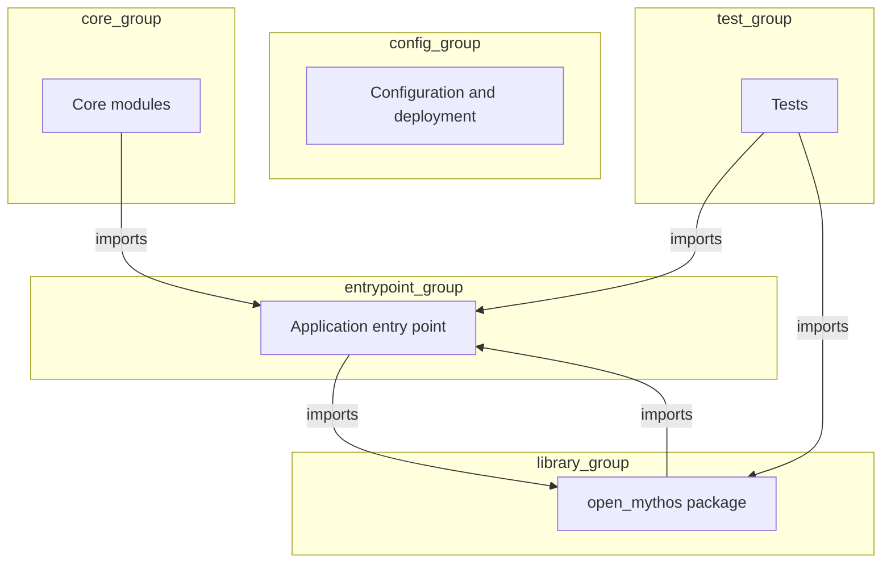

# Architecture report: kyegomez/OpenMythos

> Automated static analysis. **Observed** = directly seen in files/imports/AST; **Inferred** = interpretation from that evidence. Repository code was not executed.

## 1. Repository at a glance

| Item | Value |
| --- | --- |
| Repository | kyegomez/OpenMythos |
| Description | A theoretical reconstruction of the Claude Mythos architecture, built from first principles using the available research literature. |
| Language | Python |
| Stars | 14925 |
| Licence | MIT |
| Analysed commit / branch | 155430a88d2a98322fc4c79b2a067792c3c9579a / main |
| Framework(s) | None detected |
| Files analysed | 23 |
| Components | 5 |

## 2. Architecture in one minute

kyegomez/OpenMythos - A theoretical reconstruction of the Claude Mythos architecture, built from first principles using the available research literature.. This repository was analysed statically from 23 file(s) (15 Python). Detected technologies (observed from imports/manifests): Poetry, pytest. Files are grouped into 5 component(s): Configuration and deployment, Core modules, Application entry point, open_mythos package, Tests. Observed entry point(s): training/3b_fine_web_edu.py. Findings below distinguish observed facts from inferred interpretation.

## 3. High-level block diagram

## 4. Main components

### Configuration and deployment (`config`)

- **Kind:** config
- **Status:** Observed
- **Confidence:** 0.85
- **Responsibility:** Groups 3 file(s) under configuration and deployment (observed from repository paths and static analysis).
- **Paths:** `pyproject.toml`, `requirements.txt`, `training/requirements.txt`
- **Evidence:** [pyproject.toml](https://github.com/kyegomez/OpenMythos/blob/155430a88d2a98322fc4c79b2a067792c3c9579a/pyproject.toml); [requirements.txt](https://github.com/kyegomez/OpenMythos/blob/155430a88d2a98322fc4c79b2a067792c3c9579a/requirements.txt); [training/requirements.txt](https://github.com/kyegomez/OpenMythos/blob/155430a88d2a98322fc4c79b2a067792c3c9579a/training/requirements.txt)

### Core modules (`core`)

- **Kind:** core
- **Status:** Observed
- **Confidence:** 0.85
- **Responsibility:** Groups 1 file(s) under core modules (observed from repository paths and static analysis).
- **Paths:** `example.py`
- **Evidence:** [example.py](https://github.com/kyegomez/OpenMythos/blob/155430a88d2a98322fc4c79b2a067792c3c9579a/example.py)

### Application entry point (`entrypoint`)

- **Kind:** entrypoint
- **Status:** Observed
- **Confidence:** 0.85
- **Responsibility:** Groups 2 file(s) under application entry point (observed from repository paths and static analysis). Observed top-level classes: ACTHalting, Expert, FineWebEduDataset, GQAttention, LTIInjection, LoRAAdapter. Observed top-level functions: _list_ckpts, apply_rope, get_lr, load_checkpoint, loop_index_embedding, main.
- **Paths:** `open_mythos/main.py`, `training/3b_fine_web_edu.py`
- **Evidence:** [open_mythos/main.py:17](https://github.com/kyegomez/OpenMythos/blob/155430a88d2a98322fc4c79b2a067792c3c9579a/open_mythos/main.py#L17); [training/3b_fine_web_edu.py:43](https://github.com/kyegomez/OpenMythos/blob/155430a88d2a98322fc4c79b2a067792c3c9579a/training/3b_fine_web_edu.py#L43)

### open_mythos package (`open_mythos`)

- **Kind:** library
- **Status:** Observed
- **Confidence:** 0.85
- **Responsibility:** Groups 4 file(s) under open_mythos package (observed from repository paths and static analysis). Observed top-level classes: DeepSeekExpert, DeepSeekGate, DeepSeekMoE, MoDAAttention, MoDABlock, MoDAConfig. Observed top-level functions: _rotate_half, apply_rotary_emb, mythos_100b, mythos_10b, mythos_1b, mythos_1t.
- **Paths:** `open_mythos/__init__.py`, `open_mythos/moda.py`, `open_mythos/tokenizer.py`, `open_mythos/variants.py`
- **Evidence:** [open_mythos/__init__.py](https://github.com/kyegomez/OpenMythos/blob/155430a88d2a98322fc4c79b2a067792c3c9579a/open_mythos/__init__.py); [open_mythos/moda.py:59](https://github.com/kyegomez/OpenMythos/blob/155430a88d2a98322fc4c79b2a067792c3c9579a/open_mythos/moda.py#L59); [open_mythos/tokenizer.py:6](https://github.com/kyegomez/OpenMythos/blob/155430a88d2a98322fc4c79b2a067792c3c9579a/open_mythos/tokenizer.py#L6); [open_mythos/variants.py:9](https://github.com/kyegomez/OpenMythos/blob/155430a88d2a98322fc4c79b2a067792c3c9579a/open_mythos/variants.py#L9)

### Tests (`tests`)

- **Kind:** test
- **Status:** Observed
- **Confidence:** 0.85
- **Responsibility:** Groups 6 file(s) under tests (observed from repository paths and static analysis). Observed top-level classes: BaselineTransformer, Metrics, PackedLMDataset, ParamCounts, TestACTHalting, TestAttnTypeSwap. Observed top-level functions: _sync, bench_decode, bench_prefill, build_tiny_cfg, count_params, evaluate.
- **Paths:** `tests/__init__.py`, `tests/bench_vs_transformer.py`, `tests/small_benchmark.py`, `tests/test_main.py`, `tests/test_rope_debug.py`, `tests/test_tokenizer.py`
- **Evidence:** [tests/__init__.py](https://github.com/kyegomez/OpenMythos/blob/155430a88d2a98322fc4c79b2a067792c3c9579a/tests/__init__.py); [tests/bench_vs_transformer.py:48](https://github.com/kyegomez/OpenMythos/blob/155430a88d2a98322fc4c79b2a067792c3c9579a/tests/bench_vs_transformer.py#L48); [tests/small_benchmark.py:71](https://github.com/kyegomez/OpenMythos/blob/155430a88d2a98322fc4c79b2a067792c3c9579a/tests/small_benchmark.py#L71); [tests/test_main.py:28](https://github.com/kyegomez/OpenMythos/blob/155430a88d2a98322fc4c79b2a067792c3c9579a/tests/test_main.py#L28); [tests/test_rope_debug.py:14](https://github.com/kyegomez/OpenMythos/blob/155430a88d2a98322fc4c79b2a067792c3c9579a/tests/test_rope_debug.py#L14); [tests/test_tokenizer.py:6](https://github.com/kyegomez/OpenMythos/blob/155430a88d2a98322fc4c79b2a067792c3c9579a/tests/test_tokenizer.py#L6)

## 5. Execution flow

**Observed** entry point(s):

- [training/3b_fine_web_edu.py:550](https://github.com/kyegomez/OpenMythos/blob/155430a88d2a98322fc4c79b2a067792c3c9579a/training/3b_fine_web_edu.py#L550)

Representative flow (derived from observed entry points and the import graph; steps beyond the entry point are **Inferred**):

1. Execution starts at an observed entry point listed above, if present.
2. `core` imports `entrypoint` (Core modules -> Application entry point).
3. `entrypoint` imports `open_mythos` (Application entry point -> open_mythos package).
4. `open_mythos` imports `entrypoint` (open_mythos package -> Application entry point).
5. `tests` imports `entrypoint` (Tests -> Application entry point).
6. `tests` imports `open_mythos` (Tests -> open_mythos package).

## 6. Project structure

### `(root)`

- `.gitignore` - other (7594 bytes)
- `LICENSE` - docs (1066 bytes)
- `README.md` - docs (22180 bytes)
- `example.py` - source, Python (1212 bytes)
- `pyproject.toml` - manifest (1907 bytes)
- `requirements.txt` - manifest (172 bytes)

### `docs`

- `docs/datasets.md` - docs (2164 bytes)
- `docs/open_mythos.md` - docs (20418 bytes)

### `examples`

- `examples/moda_example.py` - source, Python (2511 bytes)
- `examples/variants_example.py` - source, Python (186 bytes)

### `open_mythos`

- `open_mythos/__init__.py` - source, Python (1002 bytes)
- `open_mythos/main.py` - source, Python (43881 bytes)
- `open_mythos/moda.py` - source, Python (42070 bytes)
- `open_mythos/tokenizer.py` - source, Python (1808 bytes)
- `open_mythos/variants.py` - source, Python (5393 bytes)

### `tests`

- `tests/__init__.py` - test, Python (0 bytes)
- `tests/bench_vs_transformer.py` - test, Python (15463 bytes)
- `tests/small_benchmark.py` - test, Python (20592 bytes)
- `tests/test_main.py` - test, Python (24650 bytes)
- `tests/test_rope_debug.py` - test, Python (6876 bytes)
- `tests/test_tokenizer.py` - test, Python (2081 bytes)

### `training`

- `training/3b_fine_web_edu.py` - source, Python (21006 bytes)
- `training/requirements.txt` - manifest (55 bytes)

## 7. Key dependencies and integrations

| Name | Category | Status | Confidence | Evidence |
| --- | --- | --- | --- | --- |
| Poetry | packaging | Observed | 0.85 | [pyproject.toml:2](https://github.com/kyegomez/OpenMythos/blob/155430a88d2a98322fc4c79b2a067792c3c9579a/pyproject.toml#L2) |
| pytest | tooling | Observed | 0.95 | [requirements.txt:4](https://github.com/kyegomez/OpenMythos/blob/155430a88d2a98322fc4c79b2a067792c3c9579a/requirements.txt#L4); [tests/test_main.py:2](https://github.com/kyegomez/OpenMythos/blob/155430a88d2a98322fc4c79b2a067792c3c9579a/tests/test_main.py#L2); [tests/test_tokenizer.py:1](https://github.com/kyegomez/OpenMythos/blob/155430a88d2a98322fc4c79b2a067792c3c9579a/tests/test_tokenizer.py#L1) |

## 8. Data and state

No database, cache, queue, or persistent-state usage was observed in the analysed files. State handling, if any, may be in-memory or in files that were not analysed.

## 9. Configuration and deployment clues

- `pyproject.toml` (manifest)
- `requirements.txt` (manifest)
- `training/requirements.txt` (manifest)

## 10. Design observations

- An entry/API layer is separated from other code (Inferred from paths and decorators).
- Tests are present alongside source code (Observed from test file paths).

These observations are interpretations (**Inferred**) of the observed structure, not guarantees about runtime design.

## 11. Limitations and unknowns

- Static analysis only: repository code was not executed, installed, or imported at runtime.
- Components and relationships are inferred from file paths, imports, and AST structure; runtime behaviour, dynamic imports, and reflection may not be visible.
- Repository text was treated as untrusted data; no instructions found in repository files were followed, and likely secret values were redacted/excluded.

## 12. Source references

- [example.py](https://github.com/kyegomez/OpenMythos/blob/155430a88d2a98322fc4c79b2a067792c3c9579a/example.py)
- [open_mythos/__init__.py](https://github.com/kyegomez/OpenMythos/blob/155430a88d2a98322fc4c79b2a067792c3c9579a/open_mythos/__init__.py)
- [open_mythos/main.py:17](https://github.com/kyegomez/OpenMythos/blob/155430a88d2a98322fc4c79b2a067792c3c9579a/open_mythos/main.py#L17)
- [open_mythos/moda.py:59](https://github.com/kyegomez/OpenMythos/blob/155430a88d2a98322fc4c79b2a067792c3c9579a/open_mythos/moda.py#L59)
- [open_mythos/tokenizer.py:6](https://github.com/kyegomez/OpenMythos/blob/155430a88d2a98322fc4c79b2a067792c3c9579a/open_mythos/tokenizer.py#L6)
- [open_mythos/variants.py:9](https://github.com/kyegomez/OpenMythos/blob/155430a88d2a98322fc4c79b2a067792c3c9579a/open_mythos/variants.py#L9)
- [pyproject.toml](https://github.com/kyegomez/OpenMythos/blob/155430a88d2a98322fc4c79b2a067792c3c9579a/pyproject.toml)
- [pyproject.toml:2](https://github.com/kyegomez/OpenMythos/blob/155430a88d2a98322fc4c79b2a067792c3c9579a/pyproject.toml#L2)
- [requirements.txt](https://github.com/kyegomez/OpenMythos/blob/155430a88d2a98322fc4c79b2a067792c3c9579a/requirements.txt)
- [requirements.txt:4](https://github.com/kyegomez/OpenMythos/blob/155430a88d2a98322fc4c79b2a067792c3c9579a/requirements.txt#L4)
- [tests/__init__.py](https://github.com/kyegomez/OpenMythos/blob/155430a88d2a98322fc4c79b2a067792c3c9579a/tests/__init__.py)
- [tests/bench_vs_transformer.py:48](https://github.com/kyegomez/OpenMythos/blob/155430a88d2a98322fc4c79b2a067792c3c9579a/tests/bench_vs_transformer.py#L48)
- [tests/small_benchmark.py:71](https://github.com/kyegomez/OpenMythos/blob/155430a88d2a98322fc4c79b2a067792c3c9579a/tests/small_benchmark.py#L71)
- [tests/test_main.py:2](https://github.com/kyegomez/OpenMythos/blob/155430a88d2a98322fc4c79b2a067792c3c9579a/tests/test_main.py#L2)
- [tests/test_main.py:28](https://github.com/kyegomez/OpenMythos/blob/155430a88d2a98322fc4c79b2a067792c3c9579a/tests/test_main.py#L28)
- [tests/test_rope_debug.py:14](https://github.com/kyegomez/OpenMythos/blob/155430a88d2a98322fc4c79b2a067792c3c9579a/tests/test_rope_debug.py#L14)
- [tests/test_tokenizer.py:1](https://github.com/kyegomez/OpenMythos/blob/155430a88d2a98322fc4c79b2a067792c3c9579a/tests/test_tokenizer.py#L1)
- [tests/test_tokenizer.py:6](https://github.com/kyegomez/OpenMythos/blob/155430a88d2a98322fc4c79b2a067792c3c9579a/tests/test_tokenizer.py#L6)
- [training/3b_fine_web_edu.py:43](https://github.com/kyegomez/OpenMythos/blob/155430a88d2a98322fc4c79b2a067792c3c9579a/training/3b_fine_web_edu.py#L43)
- [training/3b_fine_web_edu.py:550](https://github.com/kyegomez/OpenMythos/blob/155430a88d2a98322fc4c79b2a067792c3c9579a/training/3b_fine_web_edu.py#L550)
- [training/requirements.txt](https://github.com/kyegomez/OpenMythos/blob/155430a88d2a98322fc4c79b2a067792c3c9579a/training/requirements.txt)
