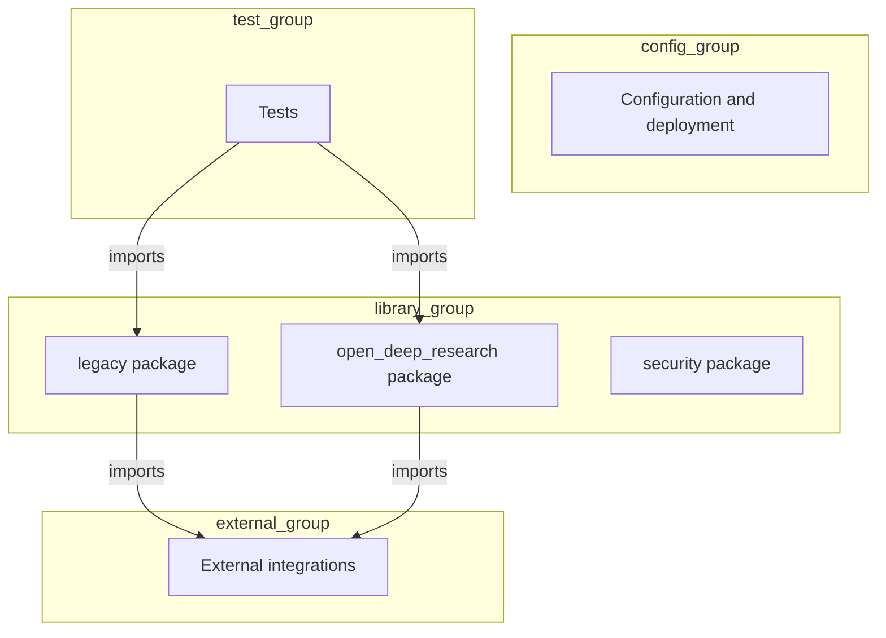

# Architecture report: langchain-ai/open_deep_research

> Automated static analysis. **Observed** = directly seen in files/imports/AST; **Inferred** = interpretation from that evidence. Repository code was not executed.

## 1. Repository at a glance

| Item | Value |
| --- | --- |
| Repository | langchain-ai/open_deep_research |
| Description | Not provided |
| Language | Python |
| Stars | 12677 |
| Licence | MIT |
| Analysed commit / branch | 1b7d2e80db9faa586165c60e09096dbbfd483a64 / main |
| Framework(s) | None detected |
| Files analysed | 41 |
| Components | 6 |

## 2. Architecture in one minute

langchain-ai/open_deep_research. This repository was analysed statically from 41 file(s) (22 Python). Detected technologies (observed from imports/manifests): GitHub Actions, aiohttp, httpx, pandas, Pydantic, requests. Files are grouped into 6 component(s): Configuration and deployment, External integrations, legacy package, open_deep_research package, security package, Tests. Findings below distinguish observed facts from inferred interpretation.

## 3. High-level block diagram

## 4. Main components

### Configuration and deployment (`config`)

- **Kind:** config
- **Status:** Observed
- **Confidence:** 0.85
- **Responsibility:** Groups 2 file(s) under configuration and deployment (observed from repository paths and static analysis).
- **Paths:** `langgraph.json`, `pyproject.toml`
- **Evidence:** [langgraph.json](https://github.com/langchain-ai/open_deep_research/blob/1b7d2e80db9faa586165c60e09096dbbfd483a64/langgraph.json); [pyproject.toml](https://github.com/langchain-ai/open_deep_research/blob/1b7d2e80db9faa586165c60e09096dbbfd483a64/pyproject.toml)

### External integrations (`external_integrations`)

- **Kind:** external
- **Status:** Inferred
- **Confidence:** 0.70
- **Responsibility:** Groups 0 file(s) under external integrations (observed from repository paths and static analysis).
- **Evidence:** [src/legacy/utils.py:5](https://github.com/langchain-ai/open_deep_research/blob/1b7d2e80db9faa586165c60e09096dbbfd483a64/src/legacy/utils.py#L5); [src/legacy/utils.py:9](https://github.com/langchain-ai/open_deep_research/blob/1b7d2e80db9faa586165c60e09096dbbfd483a64/src/legacy/utils.py#L9); [src/legacy/utils.py:10](https://github.com/langchain-ai/open_deep_research/blob/1b7d2e80db9faa586165c60e09096dbbfd483a64/src/legacy/utils.py#L10); [src/open_deep_research/utils.py:10](https://github.com/langchain-ai/open_deep_research/blob/1b7d2e80db9faa586165c60e09096dbbfd483a64/src/open_deep_research/utils.py#L10)

### legacy package (`legacy`)

- **Kind:** library
- **Status:** Observed
- **Confidence:** 0.85
- **Responsibility:** Groups 7 file(s) under legacy package (observed from repository paths and static analysis). Observed top-level classes: Conclusion, Configuration, Feedback, FinishReport, FinishResearch, Introduction. Observed top-level functions: _load_mcp_tools, arxiv_search_async, azureaisearch_search, azureaisearch_search_async, compile_final_report, deduplicate_and_format_sources.
- **Paths:** `src/legacy/__init__.py`, `src/legacy/configuration.py`, `src/legacy/graph.py`, `src/legacy/multi_agent.py`, `src/legacy/prompts.py`, `src/legacy/state.py`, `src/legacy/utils.py`
- **Evidence:** [src/legacy/__init__.py](https://github.com/langchain-ai/open_deep_research/blob/1b7d2e80db9faa586165c60e09096dbbfd483a64/src/legacy/__init__.py); [src/legacy/configuration.py:20](https://github.com/langchain-ai/open_deep_research/blob/1b7d2e80db9faa586165c60e09096dbbfd483a64/src/legacy/configuration.py#L20); [src/legacy/graph.py:43](https://github.com/langchain-ai/open_deep_research/blob/1b7d2e80db9faa586165c60e09096dbbfd483a64/src/legacy/graph.py#L43); [src/legacy/multi_agent.py:26](https://github.com/langchain-ai/open_deep_research/blob/1b7d2e80db9faa586165c60e09096dbbfd483a64/src/legacy/multi_agent.py#L26); [src/legacy/prompts.py](https://github.com/langchain-ai/open_deep_research/blob/1b7d2e80db9faa586165c60e09096dbbfd483a64/src/legacy/prompts.py); [src/legacy/state.py:5](https://github.com/langchain-ai/open_deep_research/blob/1b7d2e80db9faa586165c60e09096dbbfd483a64/src/legacy/state.py#L5); [src/legacy/utils.py:46](https://github.com/langchain-ai/open_deep_research/blob/1b7d2e80db9faa586165c60e09096dbbfd483a64/src/legacy/utils.py#L46)

### open_deep_research package (`open_deep_research`)

- **Kind:** library
- **Status:** Observed
- **Confidence:** 0.85
- **Responsibility:** Groups 5 file(s) under open_deep_research package (observed from repository paths and static analysis). Observed top-level classes: AgentInputState, AgentState, ClarifyWithUser, ConductResearch, Configuration, MCPConfig. Observed top-level functions: _check_anthropic_token_limit, _check_gemini_token_limit, _check_openai_token_limit, anthropic_websearch_called, clarify_with_user, compress_research.
- **Paths:** `src/open_deep_research/configuration.py`, `src/open_deep_research/deep_researcher.py`, `src/open_deep_research/prompts.py`, `src/open_deep_research/state.py`, `src/open_deep_research/utils.py`
- **Evidence:** [src/open_deep_research/configuration.py:11](https://github.com/langchain-ai/open_deep_research/blob/1b7d2e80db9faa586165c60e09096dbbfd483a64/src/open_deep_research/configuration.py#L11); [src/open_deep_research/deep_researcher.py:60](https://github.com/langchain-ai/open_deep_research/blob/1b7d2e80db9faa586165c60e09096dbbfd483a64/src/open_deep_research/deep_researcher.py#L60); [src/open_deep_research/prompts.py](https://github.com/langchain-ai/open_deep_research/blob/1b7d2e80db9faa586165c60e09096dbbfd483a64/src/open_deep_research/prompts.py); [src/open_deep_research/state.py:15](https://github.com/langchain-ai/open_deep_research/blob/1b7d2e80db9faa586165c60e09096dbbfd483a64/src/open_deep_research/state.py#L15); [src/open_deep_research/utils.py:44](https://github.com/langchain-ai/open_deep_research/blob/1b7d2e80db9faa586165c60e09096dbbfd483a64/src/open_deep_research/utils.py#L44)

### security package (`security`)

- **Kind:** library
- **Status:** Observed
- **Confidence:** 0.85
- **Responsibility:** Groups 1 file(s) under security package (observed from repository paths and static analysis). Observed top-level functions: authorize_store, get_current_user, on_assistants_create, on_assistants_read, on_thread_create, on_thread_read.
- **Paths:** `src/security/auth.py`
- **Evidence:** [src/security/auth.py:22](https://github.com/langchain-ai/open_deep_research/blob/1b7d2e80db9faa586165c60e09096dbbfd483a64/src/security/auth.py#L22)

### Tests (`tests`)

- **Kind:** test
- **Status:** Observed
- **Confidence:** 0.85
- **Responsibility:** Groups 9 file(s) under tests (observed from repository paths and static analysis). Observed top-level classes: CompletenessScore, CorrectnessScore, CriteriaGrade, GroundednessClaim, GroundednessScore, HeadToHeadRanking. Observed top-level functions: _format_input_query, add_model_configs, eval_completeness, eval_correctness, eval_groundedness, eval_model.
- **Paths:** `src/legacy/tests/conftest.py`, `src/legacy/tests/run_test.py`, `src/legacy/tests/test_report_quality.py`, `tests/evaluators.py`, `tests/extract_langsmith_data.py`, `tests/pairwise_evaluation.py`, `tests/prompts.py`, `tests/run_evaluate.py`, `tests/supervisor_parallel_evaluation.py`
- **Evidence:** [src/legacy/tests/conftest.py:7](https://github.com/langchain-ai/open_deep_research/blob/1b7d2e80db9faa586165c60e09096dbbfd483a64/src/legacy/tests/conftest.py#L7); [src/legacy/tests/run_test.py:21](https://github.com/langchain-ai/open_deep_research/blob/1b7d2e80db9faa586165c60e09096dbbfd483a64/src/legacy/tests/run_test.py#L21); [src/legacy/tests/test_report_quality.py:26](https://github.com/langchain-ai/open_deep_research/blob/1b7d2e80db9faa586165c60e09096dbbfd483a64/src/legacy/tests/test_report_quality.py#L26); [tests/evaluators.py:12](https://github.com/langchain-ai/open_deep_research/blob/1b7d2e80db9faa586165c60e09096dbbfd483a64/tests/evaluators.py#L12); [tests/extract_langsmith_data.py:13](https://github.com/langchain-ai/open_deep_research/blob/1b7d2e80db9faa586165c60e09096dbbfd483a64/tests/extract_langsmith_data.py#L13); [tests/pairwise_evaluation.py:30](https://github.com/langchain-ai/open_deep_research/blob/1b7d2e80db9faa586165c60e09096dbbfd483a64/tests/pairwise_evaluation.py#L30); [tests/prompts.py](https://github.com/langchain-ai/open_deep_research/blob/1b7d2e80db9faa586165c60e09096dbbfd483a64/tests/prompts.py); [tests/run_evaluate.py:32](https://github.com/langchain-ai/open_deep_research/blob/1b7d2e80db9faa586165c60e09096dbbfd483a64/tests/run_evaluate.py#L32)

## 5. Execution flow

No entry point was observed; the startup flow below is therefore limited.

Representative flow (derived from observed entry points and the import graph; steps beyond the entry point are **Inferred**):

1. Execution starts at an observed entry point listed above, if present.
2. `legacy` imports `external_integrations` (legacy package -> External integrations).
3. `open_deep_research` imports `external_integrations` (open_deep_research package -> External integrations).
4. `tests` imports `legacy` (Tests -> legacy package).
5. `tests` imports `open_deep_research` (Tests -> open_deep_research package).

## 6. Project structure

### `(root)`

- `.env.example` - config (365 bytes)
- `.gitignore` - other (616 bytes)
- `CLAUDE.md` - docs (2942 bytes)
- `LICENSE` - docs (1065 bytes)
- `README.md` - docs (10265 bytes)
- `langgraph.json` - config (295 bytes)
- `pyproject.toml` - manifest (2020 bytes)

### `.github`

- `.github/dependabot.yml` - config (633 bytes)
- `.github/workflows/claude-code-review.yml` - ci, YAML (3021 bytes)
- `.github/workflows/claude.yml` - ci, YAML (2301 bytes)

### `examples`

- `examples/arxiv.md` - docs (11569 bytes)
- `examples/inference-market-gpt45.md` - docs (11896 bytes)
- `examples/inference-market.md` - docs (10011 bytes)
- `examples/pubmed.md` - docs (13646 bytes)

### `src`

- `src/legacy/CLAUDE.md` - docs (4545 bytes)
- `src/legacy/__init__.py` - source, Python (72 bytes)
- `src/legacy/configuration.py` - source, Python (4100 bytes)
- `src/legacy/files/vibe_code.md` - docs (13852 bytes)
- `src/legacy/graph.ipynb` - other (19717 bytes)
- `src/legacy/graph.py` - source, Python (21121 bytes)
- `src/legacy/legacy.md` - docs (20694 bytes)
- `src/legacy/multi_agent.ipynb` - other (109174 bytes)
- `src/legacy/multi_agent.py` - source, Python (19435 bytes)
- `src/legacy/prompts.py` - source, Python (20695 bytes)
- `src/legacy/state.py` - source, Python (3011 bytes)
- `src/legacy/tests/conftest.py` - test, Python (1035 bytes)
- `src/legacy/tests/run_test.py` - test, Python (6984 bytes)
- `src/legacy/tests/test_report_quality.py` - test, Python (12804 bytes)
- `src/legacy/utils.py` - source, Python (69610 bytes)
- `src/open_deep_research/configuration.py` - source, Python (8234 bytes)
- `src/open_deep_research/deep_researcher.py` - source, Python (30117 bytes)
- `src/open_deep_research/prompts.py` - source, Python (21213 bytes)
- `src/open_deep_research/state.py` - source, Python (3273 bytes)
- `src/open_deep_research/utils.py` - source, Python (33199 bytes)
- `src/security/auth.py` - source, Python (4949 bytes)

### `tests`

- `tests/evaluators.py` - test, Python (9689 bytes)
- `tests/extract_langsmith_data.py` - test, Python (2975 bytes)
- `tests/pairwise_evaluation.py` - test, Python (6491 bytes)
- `tests/prompts.py` - test, Python (9340 bytes)
- `tests/run_evaluate.py` - test, Python (4048 bytes)
- `tests/supervisor_parallel_evaluation.py` - test, Python (2273 bytes)

## 7. Key dependencies and integrations

| Name | Category | Status | Confidence | Evidence |
| --- | --- | --- | --- | --- |
| GitHub Actions | ci | Observed | 0.90 | [.github/workflows/claude-code-review.yml](https://github.com/langchain-ai/open_deep_research/blob/1b7d2e80db9faa586165c60e09096dbbfd483a64/.github/workflows/claude-code-review.yml); [.github/workflows/claude.yml](https://github.com/langchain-ai/open_deep_research/blob/1b7d2e80db9faa586165c60e09096dbbfd483a64/.github/workflows/claude.yml) |
| aiohttp | library | Observed | 0.95 | [src/legacy/utils.py:9](https://github.com/langchain-ai/open_deep_research/blob/1b7d2e80db9faa586165c60e09096dbbfd483a64/src/legacy/utils.py#L9); [src/open_deep_research/utils.py:10](https://github.com/langchain-ai/open_deep_research/blob/1b7d2e80db9faa586165c60e09096dbbfd483a64/src/open_deep_research/utils.py#L10) |
| httpx | library | Observed | 0.90 | [pyproject.toml:32](https://github.com/langchain-ai/open_deep_research/blob/1b7d2e80db9faa586165c60e09096dbbfd483a64/pyproject.toml#L32); [src/legacy/utils.py:10](https://github.com/langchain-ai/open_deep_research/blob/1b7d2e80db9faa586165c60e09096dbbfd483a64/src/legacy/utils.py#L10) |
| pandas | library | Observed | 0.85 | [pyproject.toml:46](https://github.com/langchain-ai/open_deep_research/blob/1b7d2e80db9faa586165c60e09096dbbfd483a64/pyproject.toml#L46) |
| Pydantic | library | Observed | 0.95 | [src/legacy/multi_agent.py:2](https://github.com/langchain-ai/open_deep_research/blob/1b7d2e80db9faa586165c60e09096dbbfd483a64/src/legacy/multi_agent.py#L2); [src/legacy/state.py:2](https://github.com/langchain-ai/open_deep_research/blob/1b7d2e80db9faa586165c60e09096dbbfd483a64/src/legacy/state.py#L2); [src/legacy/tests/test_report_quality.py:7](https://github.com/langchain-ai/open_deep_research/blob/1b7d2e80db9faa586165c60e09096dbbfd483a64/src/legacy/tests/test_report_quality.py#L7); [src/legacy/utils.py:25](https://github.com/langchain-ai/open_deep_research/blob/1b7d2e80db9faa586165c60e09096dbbfd483a64/src/legacy/utils.py#L25) |
| requests | library | Observed | 0.90 | [pyproject.toml:28](https://github.com/langchain-ai/open_deep_research/blob/1b7d2e80db9faa586165c60e09096dbbfd483a64/pyproject.toml#L28); [src/legacy/utils.py:5](https://github.com/langchain-ai/open_deep_research/blob/1b7d2e80db9faa586165c60e09096dbbfd483a64/src/legacy/utils.py#L5) |
| Poetry | packaging | Observed | 0.85 | [pyproject.toml](https://github.com/langchain-ai/open_deep_research/blob/1b7d2e80db9faa586165c60e09096dbbfd483a64/pyproject.toml) |
| setuptools | packaging | Observed | 0.85 | [pyproject.toml:53](https://github.com/langchain-ai/open_deep_research/blob/1b7d2e80db9faa586165c60e09096dbbfd483a64/pyproject.toml#L53) |
| pytest | tooling | Observed | 0.95 | [pyproject.toml:31](https://github.com/langchain-ai/open_deep_research/blob/1b7d2e80db9faa586165c60e09096dbbfd483a64/pyproject.toml#L31); [src/legacy/tests/conftest.py:5](https://github.com/langchain-ai/open_deep_research/blob/1b7d2e80db9faa586165c60e09096dbbfd483a64/src/legacy/tests/conftest.py#L5); [src/legacy/tests/test_report_quality.py:5](https://github.com/langchain-ai/open_deep_research/blob/1b7d2e80db9faa586165c60e09096dbbfd483a64/src/legacy/tests/test_report_quality.py#L5) |

## 8. Data and state

No database, cache, queue, or persistent-state usage was observed in the analysed files. State handling, if any, may be in-memory or in files that were not analysed.

## 9. Configuration and deployment clues

- `.env.example` (config)
- `.github/dependabot.yml` (config)
- `.github/workflows/claude-code-review.yml` (ci)
- `.github/workflows/claude.yml` (ci)
- `langgraph.json` (config)
- `pyproject.toml` (manifest)

Environment variable *names* seen in example env files (values never recorded):

- `.env.example`: `ANTHROPIC_API_KEY`, `GET_API_KEYS_FROM_CONFIG`, `GOOGLE_API_KEY`, `LANGSMITH_API_KEY`, `LANGSMITH_PROJECT`, `LANGSMITH_TRACING`, `OPENAI_API_KEY`, `SUPABASE_KEY`, `SUPABASE_URL`, `TAVILY_API_KEY`

## 10. Design observations

- Tests are present alongside source code (Observed from test file paths).
- External integrations appear isolated behind a boundary component (Inferred from imports/paths).

These observations are interpretations (**Inferred**) of the observed structure, not guarantees about runtime design.

## 11. Limitations and unknowns

- Static analysis only: repository code was not executed, installed, or imported at runtime.
- Components and relationships are inferred from file paths, imports, and AST structure; runtime behaviour, dynamic imports, and reflection may not be visible.
- No clear application entry point was observed in the analysed files.
- Repository text was treated as untrusted data; no instructions found in repository files were followed, and likely secret values were redacted/excluded.
- The GitHub repository was marked archived at selection time.

## 12. Source references

- [.github/workflows/claude-code-review.yml](https://github.com/langchain-ai/open_deep_research/blob/1b7d2e80db9faa586165c60e09096dbbfd483a64/.github/workflows/claude-code-review.yml)
- [.github/workflows/claude.yml](https://github.com/langchain-ai/open_deep_research/blob/1b7d2e80db9faa586165c60e09096dbbfd483a64/.github/workflows/claude.yml)
- [langgraph.json](https://github.com/langchain-ai/open_deep_research/blob/1b7d2e80db9faa586165c60e09096dbbfd483a64/langgraph.json)
- [pyproject.toml](https://github.com/langchain-ai/open_deep_research/blob/1b7d2e80db9faa586165c60e09096dbbfd483a64/pyproject.toml)
- [pyproject.toml:28](https://github.com/langchain-ai/open_deep_research/blob/1b7d2e80db9faa586165c60e09096dbbfd483a64/pyproject.toml#L28)
- [pyproject.toml:31](https://github.com/langchain-ai/open_deep_research/blob/1b7d2e80db9faa586165c60e09096dbbfd483a64/pyproject.toml#L31)
- [pyproject.toml:32](https://github.com/langchain-ai/open_deep_research/blob/1b7d2e80db9faa586165c60e09096dbbfd483a64/pyproject.toml#L32)
- [pyproject.toml:46](https://github.com/langchain-ai/open_deep_research/blob/1b7d2e80db9faa586165c60e09096dbbfd483a64/pyproject.toml#L46)
- [pyproject.toml:53](https://github.com/langchain-ai/open_deep_research/blob/1b7d2e80db9faa586165c60e09096dbbfd483a64/pyproject.toml#L53)
- [src/legacy/__init__.py](https://github.com/langchain-ai/open_deep_research/blob/1b7d2e80db9faa586165c60e09096dbbfd483a64/src/legacy/__init__.py)
- [src/legacy/configuration.py:20](https://github.com/langchain-ai/open_deep_research/blob/1b7d2e80db9faa586165c60e09096dbbfd483a64/src/legacy/configuration.py#L20)
- [src/legacy/graph.py:43](https://github.com/langchain-ai/open_deep_research/blob/1b7d2e80db9faa586165c60e09096dbbfd483a64/src/legacy/graph.py#L43)
- [src/legacy/multi_agent.py:2](https://github.com/langchain-ai/open_deep_research/blob/1b7d2e80db9faa586165c60e09096dbbfd483a64/src/legacy/multi_agent.py#L2)
- [src/legacy/multi_agent.py:26](https://github.com/langchain-ai/open_deep_research/blob/1b7d2e80db9faa586165c60e09096dbbfd483a64/src/legacy/multi_agent.py#L26)
- [src/legacy/prompts.py](https://github.com/langchain-ai/open_deep_research/blob/1b7d2e80db9faa586165c60e09096dbbfd483a64/src/legacy/prompts.py)
- [src/legacy/state.py:2](https://github.com/langchain-ai/open_deep_research/blob/1b7d2e80db9faa586165c60e09096dbbfd483a64/src/legacy/state.py#L2)
- [src/legacy/state.py:5](https://github.com/langchain-ai/open_deep_research/blob/1b7d2e80db9faa586165c60e09096dbbfd483a64/src/legacy/state.py#L5)
- [src/legacy/tests/conftest.py:5](https://github.com/langchain-ai/open_deep_research/blob/1b7d2e80db9faa586165c60e09096dbbfd483a64/src/legacy/tests/conftest.py#L5)
- [src/legacy/tests/conftest.py:7](https://github.com/langchain-ai/open_deep_research/blob/1b7d2e80db9faa586165c60e09096dbbfd483a64/src/legacy/tests/conftest.py#L7)
- [src/legacy/tests/run_test.py:21](https://github.com/langchain-ai/open_deep_research/blob/1b7d2e80db9faa586165c60e09096dbbfd483a64/src/legacy/tests/run_test.py#L21)
- [src/legacy/tests/test_report_quality.py:5](https://github.com/langchain-ai/open_deep_research/blob/1b7d2e80db9faa586165c60e09096dbbfd483a64/src/legacy/tests/test_report_quality.py#L5)
- [src/legacy/tests/test_report_quality.py:7](https://github.com/langchain-ai/open_deep_research/blob/1b7d2e80db9faa586165c60e09096dbbfd483a64/src/legacy/tests/test_report_quality.py#L7)
- [src/legacy/tests/test_report_quality.py:26](https://github.com/langchain-ai/open_deep_research/blob/1b7d2e80db9faa586165c60e09096dbbfd483a64/src/legacy/tests/test_report_quality.py#L26)
- [src/legacy/utils.py:5](https://github.com/langchain-ai/open_deep_research/blob/1b7d2e80db9faa586165c60e09096dbbfd483a64/src/legacy/utils.py#L5)
- [src/legacy/utils.py:9](https://github.com/langchain-ai/open_deep_research/blob/1b7d2e80db9faa586165c60e09096dbbfd483a64/src/legacy/utils.py#L9)
- [src/legacy/utils.py:10](https://github.com/langchain-ai/open_deep_research/blob/1b7d2e80db9faa586165c60e09096dbbfd483a64/src/legacy/utils.py#L10)
- [src/legacy/utils.py:25](https://github.com/langchain-ai/open_deep_research/blob/1b7d2e80db9faa586165c60e09096dbbfd483a64/src/legacy/utils.py#L25)
- [src/legacy/utils.py:46](https://github.com/langchain-ai/open_deep_research/blob/1b7d2e80db9faa586165c60e09096dbbfd483a64/src/legacy/utils.py#L46)
- [src/open_deep_research/configuration.py:8](https://github.com/langchain-ai/open_deep_research/blob/1b7d2e80db9faa586165c60e09096dbbfd483a64/src/open_deep_research/configuration.py#L8)
- [src/open_deep_research/configuration.py:11](https://github.com/langchain-ai/open_deep_research/blob/1b7d2e80db9faa586165c60e09096dbbfd483a64/src/open_deep_research/configuration.py#L11)
- [src/open_deep_research/deep_researcher.py:60](https://github.com/langchain-ai/open_deep_research/blob/1b7d2e80db9faa586165c60e09096dbbfd483a64/src/open_deep_research/deep_researcher.py#L60)
- [src/open_deep_research/prompts.py](https://github.com/langchain-ai/open_deep_research/blob/1b7d2e80db9faa586165c60e09096dbbfd483a64/src/open_deep_research/prompts.py)
- [src/open_deep_research/state.py:8](https://github.com/langchain-ai/open_deep_research/blob/1b7d2e80db9faa586165c60e09096dbbfd483a64/src/open_deep_research/state.py#L8)
- [src/open_deep_research/state.py:15](https://github.com/langchain-ai/open_deep_research/blob/1b7d2e80db9faa586165c60e09096dbbfd483a64/src/open_deep_research/state.py#L15)
- [src/open_deep_research/utils.py:10](https://github.com/langchain-ai/open_deep_research/blob/1b7d2e80db9faa586165c60e09096dbbfd483a64/src/open_deep_research/utils.py#L10)
- [src/open_deep_research/utils.py:44](https://github.com/langchain-ai/open_deep_research/blob/1b7d2e80db9faa586165c60e09096dbbfd483a64/src/open_deep_research/utils.py#L44)
- [src/security/auth.py:22](https://github.com/langchain-ai/open_deep_research/blob/1b7d2e80db9faa586165c60e09096dbbfd483a64/src/security/auth.py#L22)
- [tests/evaluators.py:2](https://github.com/langchain-ai/open_deep_research/blob/1b7d2e80db9faa586165c60e09096dbbfd483a64/tests/evaluators.py#L2)
- [tests/evaluators.py:12](https://github.com/langchain-ai/open_deep_research/blob/1b7d2e80db9faa586165c60e09096dbbfd483a64/tests/evaluators.py#L12)
- [tests/extract_langsmith_data.py:13](https://github.com/langchain-ai/open_deep_research/blob/1b7d2e80db9faa586165c60e09096dbbfd483a64/tests/extract_langsmith_data.py#L13)
- [tests/pairwise_evaluation.py:3](https://github.com/langchain-ai/open_deep_research/blob/1b7d2e80db9faa586165c60e09096dbbfd483a64/tests/pairwise_evaluation.py#L3)
- [tests/pairwise_evaluation.py:30](https://github.com/langchain-ai/open_deep_research/blob/1b7d2e80db9faa586165c60e09096dbbfd483a64/tests/pairwise_evaluation.py#L30)
- [tests/prompts.py](https://github.com/langchain-ai/open_deep_research/blob/1b7d2e80db9faa586165c60e09096dbbfd483a64/tests/prompts.py)
- [tests/run_evaluate.py:32](https://github.com/langchain-ai/open_deep_research/blob/1b7d2e80db9faa586165c60e09096dbbfd483a64/tests/run_evaluate.py#L32)
