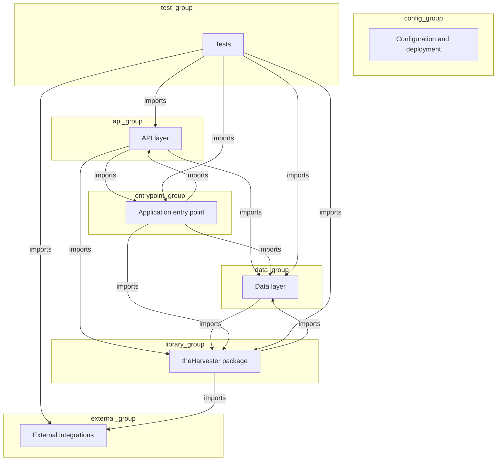

# Architecture report: laramies/theHarvester

> Automated static analysis. **Observed** = directly seen in files/imports/AST; **Inferred** = interpretation from that evidence. Repository code was not executed.

## 1. Repository at a glance

| Item | Value |
| --- | --- |
| Repository | laramies/theHarvester |
| Description | E-mails, subdomains and names Harvester - OSINT  |
| Language | Python |
| Stars | 18324 |
| Licence | GPL-2.0 |
| Analysed commit / branch | b9b00561a66b4a2c829c606403a4765f3fff1ae9 / master |
| Framework(s) | FastAPI, Starlette |
| Files analysed | 330 |
| Components | 7 |

## 2. Architecture in one minute

laramies/theHarvester - E-mails, subdomains and names Harvester - OSINT . This repository was analysed statically from 330 file(s) (246 Python). Detected technologies (observed from imports/manifests): GitHub Actions, SQLite, FastAPI, Starlette, aiohttp, httpx. Files are grouped into 7 component(s): API layer, Configuration and deployment, Data layer, Application entry point, External integrations, Tests, theHarvester package. Observed entry point(s): theHarvester/harvestview.py, theHarvester/lib/api/api.py, theHarvester/lib/api/run_worker.py. Findings below distinguish observed facts from inferred interpretation.

## 3. High-level block diagram

## 4. Main components

### API layer (`api_layer`)

- **Kind:** api
- **Status:** Observed
- **Confidence:** 0.85
- **Responsibility:** Groups 16 file(s) under api layer (observed from repository paths and static analysis). Observed routes: GET /, GET /schedules, GET /runs, GET /sources, POST /runs. Observed top-level classes: ActionResponse, ApiRuntime, AsnAttributionObservationResponse, AsnAttributionSubjectResponse, BgpRouteObservationResponse, DatabaseImportResponse. Observed top-level functions: _canonicalize_schedule, _completed_result, _configured_api_key, _database_for, _docker_gateway, _enabled_from_environment.
- **Paths:** `theHarvester/lib/api/__init__.py`, `theHarvester/lib/api/auth.py`, `theHarvester/lib/api/harvestview.py`, `theHarvester/lib/api/run_artifacts.py`, `theHarvester/lib/api/run_evidence.py`, `theHarvester/lib/api/run_models.py`, `theHarvester/lib/api/run_projection.py`, `theHarvester/lib/api/run_store.py`, `theHarvester/lib/api/runs.py`, `theHarvester/lib/api/runtime.py`, `theHarvester/lib/api/schedule_models.py`, `theHarvester/lib/api/schedule_service.py`, `theHarvester/lib/api/schedule_store.py`, `theHarvester/lib/api/schedules.py`, `theHarvester/lib/api/static/harvestview/app.js`, `theHarvester/lib/api/static/harvestview/schedules.js`
- **Evidence:** [theHarvester/lib/api/__init__.py](https://github.com/laramies/theHarvester/blob/b9b00561a66b4a2c829c606403a4765f3fff1ae9/theHarvester/lib/api/__init__.py); [theHarvester/lib/api/auth.py:15](https://github.com/laramies/theHarvester/blob/b9b00561a66b4a2c829c606403a4765f3fff1ae9/theHarvester/lib/api/auth.py#L15); [theHarvester/lib/api/harvestview.py:18](https://github.com/laramies/theHarvester/blob/b9b00561a66b4a2c829c606403a4765f3fff1ae9/theHarvester/lib/api/harvestview.py#L18); [theHarvester/lib/api/run_artifacts.py:17](https://github.com/laramies/theHarvester/blob/b9b00561a66b4a2c829c606403a4765f3fff1ae9/theHarvester/lib/api/run_artifacts.py#L17); [theHarvester/lib/api/run_evidence.py:23](https://github.com/laramies/theHarvester/blob/b9b00561a66b4a2c829c606403a4765f3fff1ae9/theHarvester/lib/api/run_evidence.py#L23); [theHarvester/lib/api/run_models.py:45](https://github.com/laramies/theHarvester/blob/b9b00561a66b4a2c829c606403a4765f3fff1ae9/theHarvester/lib/api/run_models.py#L45); [theHarvester/lib/api/run_projection.py:15](https://github.com/laramies/theHarvester/blob/b9b00561a66b4a2c829c606403a4765f3fff1ae9/theHarvester/lib/api/run_projection.py#L15); [theHarvester/lib/api/run_store.py:49](https://github.com/laramies/theHarvester/blob/b9b00561a66b4a2c829c606403a4765f3fff1ae9/theHarvester/lib/api/run_store.py#L49)

### Configuration and deployment (`config`)

- **Kind:** config
- **Status:** Observed
- **Confidence:** 0.85
- **Responsibility:** Groups 5 file(s) under configuration and deployment (observed from repository paths and static analysis).
- **Paths:** `Dockerfile`, `docker-compose.yml`, `pyproject.toml`, `theHarvester/data/api-keys.yaml`, `theHarvester/data/proxies.yaml`
- **Evidence:** [Dockerfile](https://github.com/laramies/theHarvester/blob/b9b00561a66b4a2c829c606403a4765f3fff1ae9/Dockerfile); [docker-compose.yml](https://github.com/laramies/theHarvester/blob/b9b00561a66b4a2c829c606403a4765f3fff1ae9/docker-compose.yml); [pyproject.toml](https://github.com/laramies/theHarvester/blob/b9b00561a66b4a2c829c606403a4765f3fff1ae9/pyproject.toml); [theHarvester/data/api-keys.yaml](https://github.com/laramies/theHarvester/blob/b9b00561a66b4a2c829c606403a4765f3fff1ae9/theHarvester/data/api-keys.yaml); [theHarvester/data/proxies.yaml](https://github.com/laramies/theHarvester/blob/b9b00561a66b4a2c829c606403a4765f3fff1ae9/theHarvester/data/proxies.yaml)

### Data layer (`data_layer`)

- **Kind:** data
- **Status:** Observed
- **Confidence:** 0.85
- **Responsibility:** Groups 1 file(s) under data layer (observed from repository paths and static analysis). Observed top-level classes: DuplicateRunError, ResultStore, ResultStoreError, ResultStoreUnavailableError, RunLifecycleStore, _ArtifactRow. Observed top-level functions: _begin_sqlite_transaction, _canonicalize_result_kinds, _configure_sqlite_connection, _database_for, _finalize_portable_database, _row_count.
- **Paths:** `theHarvester/lib/database.py`
- **Evidence:** [theHarvester/lib/database.py:106](https://github.com/laramies/theHarvester/blob/b9b00561a66b4a2c829c606403a4765f3fff1ae9/theHarvester/lib/database.py#L106)

### Application entry point (`entrypoint`)

- **Kind:** entrypoint
- **Status:** Observed
- **Confidence:** 0.85
- **Responsibility:** Groups 4 file(s) under application entry point (observed from repository paths and static analysis). Observed application object created via FastAPI. Observed top-level classes: RunWorker, RunWorkerService, _WorkerSession. Observed top-level functions: _child_execute, _enabled_from_environment, _log_task_failure, _normalize_hosts_for_storage, _normalize_ip_addresses, _process_output.
- **Paths:** `theHarvester/__main__.py`, `theHarvester/harvestview.py`, `theHarvester/lib/api/api.py`, `theHarvester/lib/api/run_worker.py`
- **Evidence:** [theHarvester/__main__.py:91](https://github.com/laramies/theHarvester/blob/b9b00561a66b4a2c829c606403a4765f3fff1ae9/theHarvester/__main__.py#L91); [theHarvester/harvestview.py:7](https://github.com/laramies/theHarvester/blob/b9b00561a66b4a2c829c606403a4765f3fff1ae9/theHarvester/harvestview.py#L7); [theHarvester/lib/api/api.py:50](https://github.com/laramies/theHarvester/blob/b9b00561a66b4a2c829c606403a4765f3fff1ae9/theHarvester/lib/api/api.py#L50); [theHarvester/lib/api/run_worker.py:26](https://github.com/laramies/theHarvester/blob/b9b00561a66b4a2c829c606403a4765f3fff1ae9/theHarvester/lib/api/run_worker.py#L26)

### External integrations (`external_integrations`)

- **Kind:** external
- **Status:** Inferred
- **Confidence:** 0.70
- **Responsibility:** Groups 0 file(s) under external integrations (observed from repository paths and static analysis).
- **Evidence:** [tests/conftest.py:5](https://github.com/laramies/theHarvester/blob/b9b00561a66b4a2c829c606403a4765f3fff1ae9/tests/conftest.py#L5); [tests/discovery/test_api_endpoints.py:8](https://github.com/laramies/theHarvester/blob/b9b00561a66b4a2c829c606403a4765f3fff1ae9/tests/discovery/test_api_endpoints.py#L8); [tests/discovery/test_certspotter.py:6](https://github.com/laramies/theHarvester/blob/b9b00561a66b4a2c829c606403a4765f3fff1ae9/tests/discovery/test_certspotter.py#L6); [tests/discovery/test_commoncrawl.py:7](https://github.com/laramies/theHarvester/blob/b9b00561a66b4a2c829c606403a4765f3fff1ae9/tests/discovery/test_commoncrawl.py#L7); [tests/discovery/test_darkeye.py:8](https://github.com/laramies/theHarvester/blob/b9b00561a66b4a2c829c606403a4765f3fff1ae9/tests/discovery/test_darkeye.py#L8); [tests/discovery/test_githubcode.py:3](https://github.com/laramies/theHarvester/blob/b9b00561a66b4a2c829c606403a4765f3fff1ae9/tests/discovery/test_githubcode.py#L3)

### Tests (`tests`)

- **Kind:** test
- **Status:** Observed
- **Confidence:** 0.85
- **Responsibility:** Groups 121 file(s) under tests (observed from repository paths and static analysis). Observed top-level classes: BlockingResolver, BrowserFailures, BrowserState, CnameHeavyResolver, ConfigurationEnvironment, DummyContent. Observed top-level functions: _asn_attribution_jsonl_result, _capture_loop_factory, _completed_run, _configured_api_key_sources, _confirmed_vhost, _create_comparison_database.
- **Paths:** `tests/__init__.py`, `tests/conftest.py`, `tests/discovery/__init__.py`, `tests/discovery/test_api_endpoints.py`, `tests/discovery/test_apisguru.py`, `tests/discovery/test_arquivo.py`, `tests/discovery/test_baidusearch.py`, `tests/discovery/test_bevigil.py`, `tests/discovery/test_brave.py`, `tests/discovery/test_bufferoverun.py`, `tests/discovery/test_builtwith.py`, `tests/discovery/test_censys.py`, `tests/discovery/test_certspotter.py`, `tests/discovery/test_commoncrawl.py`, `tests/discovery/test_criminalip.py`, `tests/discovery/test_crtname.py`, `tests/discovery/test_crtsh.py`, `tests/discovery/test_darkeye.py`, `tests/discovery/test_dnsdb.py`, `tests/discovery/test_dnsdumpster.py`, `tests/discovery/test_duckduckgo.py`, `tests/discovery/test_dymosearch.py`, `tests/discovery/test_fofa.py`, `tests/discovery/test_fullhuntsearch.py`, `tests/discovery/test_githubcode.py`, `tests/discovery/test_githubcode_additions.py`, `tests/discovery/test_githubcode_contract.py`, `tests/discovery/test_githubcode_logging.py`, `tests/discovery/test_gitlabsearch.py`, `tests/discovery/test_hackertarget_apikey.py`, `tests/discovery/test_haveibeenpwned.py`, `tests/discovery/test_hibpverified.py`, `tests/discovery/test_hudsonrock.py`, `tests/discovery/test_hunterhow.py`, `tests/discovery/test_huntersearch.py`, `tests/discovery/test_intelxsearch.py`, `tests/discovery/test_jsmon.py`, `tests/discovery/test_leakix.py`, `tests/discovery/test_leaklookup.py`, `tests/discovery/test_mojeek.py`, `tests/discovery/test_netlas.py`, `tests/discovery/test_onyphe.py`, `tests/discovery/test_otilabs.py`, `tests/discovery/test_otx.py`, `tests/discovery/test_outcrawl.py`, `tests/discovery/test_pentesttools.py`, `tests/discovery/test_post_provider_outcomes.py`, `tests/discovery/test_profundis.py`, `tests/discovery/test_projectdiscovery.py`, `tests/discovery/test_provider_failure_outcomes.py`, `tests/discovery/test_provider_session_lifecycle.py`, `tests/discovery/test_rapiddns.py`, `tests/discovery/test_robtex.py`, `tests/discovery/test_rocketreach.py`, `tests/discovery/test_scanmalware.py`, `tests/discovery/test_search_dehashed.py`, `tests/discovery/test_securityscorecard.py`, `tests/discovery/test_securitytrails.py`, `tests/discovery/test_serply.py`, `tests/discovery/test_sherlockeye.py`, `tests/discovery/test_shodan_engine.py`, `tests/discovery/test_shodanct.py`, `tests/discovery/test_sourcegraph.py`, `tests/discovery/test_subdomainapi.py`, `tests/discovery/test_subdomaincenter.py`, `tests/discovery/test_subdomainfinderc99.py`, `tests/discovery/test_takeover.py`, `tests/discovery/test_thc.py`, `tests/discovery/test_tombasearch.py`, `tests/discovery/test_urlscan.py`, `tests/discovery/test_virustotal.py`, `tests/discovery/test_waybackarchive.py`, `tests/discovery/test_whoisxml.py`, `tests/discovery/test_windvane.py`, `tests/discovery/test_yahoosearch.py`, `tests/discovery/test_zoomeyesearch.py`, `tests/e2e/conftest.py`, `tests/e2e/test_harvestview.py`, `tests/fixtures/takeover_can_i_take_over_xyz_5bd4e128.fixture`, `tests/lib/test_active_evidence.py`, `tests/lib/test_api_v1.py`, `tests/lib/test_completed_persistence.py`, `tests/lib/test_completed_result.py`, `tests/lib/test_configuration_contract.py`, `tests/lib/test_core.py`, `tests/lib/test_dns_consensus.py`, `tests/lib/test_enumeration.py`, `tests/lib/test_harvestview_ui.py`, `tests/lib/test_hostchecker.py`, `tests/lib/test_hostnames.py`, `tests/lib/test_output.py`, `tests/lib/test_recursive_dns.py`, `tests/lib/test_routeviews.py`, `tests/lib/test_run_backend.py`, `tests/lib/test_runtime_services.py`, `tests/lib/test_schedules.py`, `tests/lib/test_source_catalog.py`, `tests/lib/test_source_runner.py`, `tests/lib/test_target_identity.py`, `tests/lib/test_virtual_host.py`, `tests/runtime_helpers.py`, `tests/screenshot_helpers.py`, `tests/test_agent_guidance.py`, `tests/test_all_source_orchestration.py`, `tests/test_bootstrap.py`, `tests/test_docker.py`, `tests/test_harness.py`, `tests/test_harvestview_launcher.py`, `tests/test_harvestview_log_level.py`, `tests/test_logging.py`, `tests/test_main.py`, `tests/test_myparser.py`, `tests/test_no_hosts.py`, `tests/test_provider_contract_coverage.py`, `tests/test_readme.py`, `tests/test_release_artifacts.py`, `tests/test_runtime_dependencies.py`, `tests/test_saved_run_report_cli.py`, `tests/test_screenshot.py`, `tests/test_security.py`, `tests/test_workflow_contract.py`
- **Evidence:** [tests/__init__.py](https://github.com/laramies/theHarvester/blob/b9b00561a66b4a2c829c606403a4765f3fff1ae9/tests/__init__.py); [tests/conftest.py:29](https://github.com/laramies/theHarvester/blob/b9b00561a66b4a2c829c606403a4765f3fff1ae9/tests/conftest.py#L29); [tests/discovery/__init__.py](https://github.com/laramies/theHarvester/blob/b9b00561a66b4a2c829c606403a4765f3fff1ae9/tests/discovery/__init__.py); [tests/discovery/test_api_endpoints.py:15](https://github.com/laramies/theHarvester/blob/b9b00561a66b4a2c829c606403a4765f3fff1ae9/tests/discovery/test_api_endpoints.py#L15); [tests/discovery/test_apisguru.py:11](https://github.com/laramies/theHarvester/blob/b9b00561a66b4a2c829c606403a4765f3fff1ae9/tests/discovery/test_apisguru.py#L11); [tests/discovery/test_arquivo.py:14](https://github.com/laramies/theHarvester/blob/b9b00561a66b4a2c829c606403a4765f3fff1ae9/tests/discovery/test_arquivo.py#L14); [tests/discovery/test_baidusearch.py:10](https://github.com/laramies/theHarvester/blob/b9b00561a66b4a2c829c606403a4765f3fff1ae9/tests/discovery/test_baidusearch.py#L10); [tests/discovery/test_bevigil.py:15](https://github.com/laramies/theHarvester/blob/b9b00561a66b4a2c829c606403a4765f3fff1ae9/tests/discovery/test_bevigil.py#L15)

### theHarvester package (`theharvester`)

- **Kind:** library
- **Status:** Observed
- **Confidence:** 0.85
- **Responsibility:** Groups 107 file(s) under theharvester package (observed from repository paths and static analysis). Observed top-level classes: ActionExecution, ActionObservation, ActiveEvidence, ActivityClass, Addressability, AioDNSResolverVantage. Observed top-level functions: _authority, _bounded_response_chunks, _candidate_hostname, _candidate_shape, _candidates_for_budget, _canonical_asns.
- **Paths:** `theHarvester/__init__.py`, `theHarvester/discovery/__init__.py`, `theHarvester/discovery/api_endpoints.py`, `theHarvester/discovery/apisguru.py`, `theHarvester/discovery/arquivo.py`, `theHarvester/discovery/baidusearch.py`, `theHarvester/discovery/bevigil.py`, `theHarvester/discovery/bravesearch.py`, `theHarvester/discovery/bufferoverun.py`, `theHarvester/discovery/builtwith.py`, `theHarvester/discovery/censysearch.py`, `theHarvester/discovery/certspottersearch.py`, `theHarvester/discovery/commoncrawl.py`, `theHarvester/discovery/constants.py`, `theHarvester/discovery/criminalip.py`, `theHarvester/discovery/crtname.py`, `theHarvester/discovery/crtsh.py`, `theHarvester/discovery/darkeye.py`, `theHarvester/discovery/dnsdb.py`, `theHarvester/discovery/dnssearch.py`, `theHarvester/discovery/duckduckgosearch.py`, `theHarvester/discovery/dymosearch.py`, `theHarvester/discovery/fofa.py`, `theHarvester/discovery/fullhuntsearch.py`, `theHarvester/discovery/githubcode.py`, `theHarvester/discovery/gitlabsearch.py`, `theHarvester/discovery/hackertarget.py`, `theHarvester/discovery/haveibeenpwned.py`, `theHarvester/discovery/hibpverified.py`, `theHarvester/discovery/hudsonrocksearch.py`, `theHarvester/discovery/huntersearch.py`, `theHarvester/discovery/intelxsearch.py`, `theHarvester/discovery/jsmon.py`, `theHarvester/discovery/leakix.py`, `theHarvester/discovery/leaklookup.py`, `theHarvester/discovery/mojeek.py`, `theHarvester/discovery/netlas.py`, `theHarvester/discovery/onyphe.py`, `theHarvester/discovery/otilabs.py`, `theHarvester/discovery/otxsearch.py`, `theHarvester/discovery/outcrawlsearch.py`, `theHarvester/discovery/pentesttools.py`, `theHarvester/discovery/profundis.py`, `theHarvester/discovery/projectdiscovery.py`, `theHarvester/discovery/provider_response.py`, `theHarvester/discovery/rapiddns.py`, `theHarvester/discovery/robtex.py`, `theHarvester/discovery/rocketreach.py`, `theHarvester/discovery/scanmalware.py`, `theHarvester/discovery/search_dehashed.py`, `theHarvester/discovery/search_dnsdumpster.py`, `theHarvester/discovery/searchhunterhow.py`, `theHarvester/discovery/securityscorecard.py`, `theHarvester/discovery/securitytrailssearch.py`, `theHarvester/discovery/serplysearch.py`, `theHarvester/discovery/sherlockeye.py`, `theHarvester/discovery/shodan_internetdb.py`, `theHarvester/discovery/shodanct.py`, `theHarvester/discovery/shodansearch.py`, `theHarvester/discovery/sourcegraph.py`, `theHarvester/discovery/subdomainapi.py`, `theHarvester/discovery/subdomaincenter.py`, `theHarvester/discovery/subdomainfinderc99.py`, `theHarvester/discovery/takeover.py`, `theHarvester/discovery/thc.py`, `theHarvester/discovery/tombasearch.py`, `theHarvester/discovery/urlscan.py`, `theHarvester/discovery/virustotal.py`, `theHarvester/discovery/waybackarchive.py`, `theHarvester/discovery/whoisxml.py`, `theHarvester/discovery/windvane.py`, `theHarvester/discovery/yahoosearch.py`, `theHarvester/discovery/zoomeyesearch.py`, `theHarvester/lib/__init__.py`, `theHarvester/lib/active_evidence.py`, `theHarvester/lib/asn_attribution.py`, `theHarvester/lib/cancellation.py`, `theHarvester/lib/completed_result.py`, `theHarvester/lib/configuration.py`, `theHarvester/lib/core.py`, `theHarvester/lib/dns_consensus.py`, `theHarvester/lib/enumeration.py`, `theHarvester/lib/evidence_types.py`, `theHarvester/lib/hostchecker.py`, `theHarvester/lib/hostname_comparison.py`, `theHarvester/lib/hostnames.py`, `theHarvester/lib/network_evidence.py`, `theHarvester/lib/output.py`, `theHarvester/lib/recursive_dns.py`, `theHarvester/lib/resolver_selection.py`, `theHarvester/lib/result_values.py`, `theHarvester/lib/routeviews.py`, `theHarvester/lib/shodan_evidence.py`, `theHarvester/lib/source_catalog.py`, `theHarvester/lib/source_execution.py`, `theHarvester/lib/source_runner.py`, `theHarvester/lib/takeover_evidence.py`, `theHarvester/lib/takeover_rules.py`, `theHarvester/lib/target_identity.py`, `theHarvester/lib/virtual_host.py`, `theHarvester/parsers/__init__.py`, `theHarvester/parsers/intelxparser.py`, `theHarvester/parsers/myparser.py`, `theHarvester/saved_run_report.py`, `theHarvester/screenshot/__init__.py`, `theHarvester/screenshot/screenshot.py`, `theHarvester/theHarvester.py`
- **Evidence:** [theHarvester/__init__.py](https://github.com/laramies/theHarvester/blob/b9b00561a66b4a2c829c606403a4765f3fff1ae9/theHarvester/__init__.py); [theHarvester/discovery/__init__.py](https://github.com/laramies/theHarvester/blob/b9b00561a66b4a2c829c606403a4765f3fff1ae9/theHarvester/discovery/__init__.py); [theHarvester/discovery/api_endpoints.py:35](https://github.com/laramies/theHarvester/blob/b9b00561a66b4a2c829c606403a4765f3fff1ae9/theHarvester/discovery/api_endpoints.py#L35); [theHarvester/discovery/apisguru.py:13](https://github.com/laramies/theHarvester/blob/b9b00561a66b4a2c829c606403a4765f3fff1ae9/theHarvester/discovery/apisguru.py#L13); [theHarvester/discovery/arquivo.py:13](https://github.com/laramies/theHarvester/blob/b9b00561a66b4a2c829c606403a4765f3fff1ae9/theHarvester/discovery/arquivo.py#L13); [theHarvester/discovery/baidusearch.py:23](https://github.com/laramies/theHarvester/blob/b9b00561a66b4a2c829c606403a4765f3fff1ae9/theHarvester/discovery/baidusearch.py#L23); [theHarvester/discovery/bevigil.py:13](https://github.com/laramies/theHarvester/blob/b9b00561a66b4a2c829c606403a4765f3fff1ae9/theHarvester/discovery/bevigil.py#L13); [theHarvester/discovery/bravesearch.py:16](https://github.com/laramies/theHarvester/blob/b9b00561a66b4a2c829c606403a4765f3fff1ae9/theHarvester/discovery/bravesearch.py#L16)

## 5. Execution flow

**Observed** entry point(s):

- [theHarvester/harvestview.py](https://github.com/laramies/theHarvester/blob/b9b00561a66b4a2c829c606403a4765f3fff1ae9/theHarvester/harvestview.py)
- [theHarvester/lib/api/api.py:50](https://github.com/laramies/theHarvester/blob/b9b00561a66b4a2c829c606403a4765f3fff1ae9/theHarvester/lib/api/api.py#L50)
- [theHarvester/lib/api/run_worker.py:508](https://github.com/laramies/theHarvester/blob/b9b00561a66b4a2c829c606403a4765f3fff1ae9/theHarvester/lib/api/run_worker.py#L508)
- [theHarvester/saved_run_report.py](https://github.com/laramies/theHarvester/blob/b9b00561a66b4a2c829c606403a4765f3fff1ae9/theHarvester/saved_run_report.py)
- [theHarvester/theHarvester.py](https://github.com/laramies/theHarvester/blob/b9b00561a66b4a2c829c606403a4765f3fff1ae9/theHarvester/theHarvester.py)

**Observed** routes (from decorators):

- `GET /` -> `harvestview_app` in `theHarvester/lib/api/harvestview.py:69`
- `GET /schedules` -> `harvestview_schedules` in `theHarvester/lib/api/harvestview.py:75`
- `GET /runs` -> `list_runs` in `theHarvester/lib/api/runs.py:85`
- `GET /sources` -> `list_sources` in `theHarvester/lib/api/runs.py:94`
- `POST /runs` -> `create_run` in `theHarvester/lib/api/runs.py:138`
- `POST /runs/import` -> `import_run` in `theHarvester/lib/api/runs.py:173`
- `POST /runs/import-database` -> `import_database` in `theHarvester/lib/api/runs.py:198`
- `GET /runs/export-database` -> `export_database` in `theHarvester/lib/api/runs.py:241`
- `GET /runs/{run_id}` -> `get_run` in `theHarvester/lib/api/runs.py:260`
- `POST /runs/{run_id}/cancel` -> `cancel_run` in `theHarvester/lib/api/runs.py:268`
- `GET /runs/{run_id}/export` -> `export_run` in `theHarvester/lib/api/runs.py:279`
- `GET /runs/{run_id}/screenshots/{name}` -> `get_screenshot` in `theHarvester/lib/api/runs.py:301`
- `GET ` -> `list_schedules` in `theHarvester/lib/api/schedules.py:35`
- `GET /health` -> `schedule_health` in `theHarvester/lib/api/schedules.py:47`
- `POST ` -> `create_schedule` in `theHarvester/lib/api/schedules.py:60`
- `GET /{schedule_id}` -> `get_schedule` in `theHarvester/lib/api/schedules.py:74`
- `PUT /{schedule_id}` -> `replace_schedule` in `theHarvester/lib/api/schedules.py:88`
- `DELETE /{schedule_id}` -> `delete_schedule` in `theHarvester/lib/api/schedules.py:105`
- `POST /{schedule_id}/pause` -> `pause_schedule` in `theHarvester/lib/api/schedules.py:121`
- `POST /{schedule_id}/resume` -> `resume_schedule` in `theHarvester/lib/api/schedules.py:137`
- `POST /{schedule_id}/run-now` -> `run_schedule_now` in `theHarvester/lib/api/schedules.py:153`
- `GET /{schedule_id}/dispatches` -> `list_schedule_dispatches` in `theHarvester/lib/api/schedules.py:178`

Representative flow (derived from observed entry points and the import graph; steps beyond the entry point are **Inferred**):

1. Execution starts at an observed entry point listed above, if present.
2. `api_layer` imports `data_layer` (API layer -> Data layer).
3. `api_layer` imports `entrypoint` (API layer -> Application entry point).
4. `api_layer` imports `theharvester` (API layer -> theHarvester package).
5. `data_layer` imports `theharvester` (Data layer -> theHarvester package).
6. `entrypoint` imports `api_layer` (Application entry point -> API layer).
7. `entrypoint` imports `data_layer` (Application entry point -> Data layer).
8. `entrypoint` imports `theharvester` (Application entry point -> theHarvester package).
9. `tests` imports `api_layer` (Tests -> API layer).

## 6. Project structure

### `(root)`

- `.dockerignore` - container (370 bytes)
- `.git-blame-ignore-revs` - other (76 bytes)
- `.gitattributes` - other (682 bytes)
- `.gitignore` - other (1493 bytes)
- `.python-version` - other (5 bytes)
- `AGENTS.md` - docs (4159 bytes)
- `CHANGELOG.md` - docs (32083 bytes)
- `CODING_STANDARDS.md` - docs (8426 bytes)
- `CONTRIBUTING.md` - docs (7377 bytes)
- `DESIGN.md` - docs (4176 bytes)
- `Dockerfile` - container (2230 bytes)
- `GLOSSARY.md` - docs (17169 bytes)
- `LICENSE` - docs (17337 bytes)
- `PRODUCT.md` - docs (1604 bytes)
- `README.md` - docs (26684 bytes)
- `SECURITY.md` - docs (1953 bytes)
- `docker-compose.yml` - container (923 bytes)
- `pyproject.toml` - manifest (3448 bytes)

### `.github`

- `.github/FUNDING.yml` - config (574 bytes)
- `.github/ISSUE_TEMPLATE/bug_report.yml` - config (3166 bytes)
- `.github/ISSUE_TEMPLATE/config.yml` - config (247 bytes)
- `.github/ISSUE_TEMPLATE/feature_request.yml` - config (1994 bytes)
- `.github/dependabot.yml` - config (822 bytes)
- `.github/workflows/codeql-analysis.yml` - ci, YAML (2237 bytes)
- `.github/workflows/dependency-review.yml` - ci, YAML (1052 bytes)
- `.github/workflows/docker-build-push.yml` - ci, YAML (1668 bytes)
- `.github/workflows/dockerci.yml` - ci, YAML (653 bytes)
- `.github/workflows/harvestview-container.yml` - ci, YAML (4656 bytes)
- `.github/workflows/harvestview-e2e.yml` - ci, YAML (1844 bytes)
- `.github/workflows/provider-smoke.yml` - ci, YAML (5443 bytes)
- `.github/workflows/scorecards.yml` - ci, YAML (3232 bytes)
- `.github/workflows/theHarvester.yml` - ci, YAML (1680 bytes)
- `.github/zizmor.yml` - config (197 bytes)

### `README`

- `README/LICENSES` - other (640 bytes)

### `bin`

- `bin/harvestview` - other (104 bytes)
- `bin/theHarvester` - other (360 bytes)

### `docs`

- `docs/adr/0003-run-worker-lifecycle.md` - docs (2941 bytes)
- `docs/adr/0004-keep-network-evidence-typed-and-external.md` - docs (2422 bytes)
- `docs/adr/0005-persist-asn-organization-attribution-as-sourced-evidence.md` - docs (1376 bytes)
- `docs/adr/0006-schedule-finite-runs-through-a-private-control-plane.md` - docs (916 bytes)
- `docs/adr/0007-keep-operator-hostname-as-exact-scope.md` - docs (1537 bytes)
- `docs/adr/0008-fail-closed-when-explicit-proxy-mode-is-unavailable.md` - docs (1461 bytes)
- `docs/adr/0009-scope-proxy-mode-to-http-transport.md` - docs (602 bytes)
- `docs/adr/0010-own-api-background-state-in-the-app-lifespan.md` - docs (3044 bytes)
- `docs/agents/domain.md` - docs (967 bytes)
- `docs/agents/issue-tracker.md` - docs (4880 bytes)
- `docs/agents/triage-labels.md` - docs (1090 bytes)
- `docs/architecture.md` - docs (6919 bytes)
- `docs/coding-standards-research.md` - docs (10909 bytes)
- `docs/context-glossary-research.md` - docs (4396 bytes)
- `docs/images/harvestview-architecture.html` - docs (9201 bytes)
- `docs/images/harvestview-architecture.svg` - docs (8789 bytes)
- `docs/images/run-evidence-architecture.html` - docs (7677 bytes)
- `docs/images/run-evidence-architecture.svg` - docs (7261 bytes)
- `docs/images/vhost-classifier.svg` - docs (9175 bytes)
- `docs/images/vhost-sweep-overview.svg` - docs (6495 bytes)
- `docs/wiki/Configuration-and-API-Keys.md` - docs (7286 bytes)
- `docs/wiki/Contributing-and-Security.md` - docs (835 bytes)
- `docs/wiki/Home.md` - docs (2094 bytes)
- `docs/wiki/How-to-add-a-new-module.md` - docs (6342 bytes)
- `docs/wiki/Installation.md` - docs (4542 bytes)
- `docs/wiki/Moving-from-4.11-to-5.0.md` - docs (15829 bytes)
- `docs/wiki/Operator-Workflows.md` - docs (7154 bytes)
- `docs/wiki/Quick-Start.md` - docs (2171 bytes)
- `docs/wiki/Responsible-Use-and-Scope.md` - docs (4383 bytes)
- `docs/wiki/Rest-API.md` - docs (17190 bytes)
- `docs/wiki/Results-and-Local-Data.md` - docs (22598 bytes)
- `docs/wiki/Roadmap.md` - docs (584 bytes)
- `docs/wiki/Troubleshooting.md` - docs (4501 bytes)
- `docs/wiki/Virtual-Host-Discovery.md` - docs (15167 bytes)
- `docs/wiki/_Footer.md` - docs (569 bytes)
- `docs/wiki/_Sidebar.md` - docs (784 bytes)

### `tests`

- `tests/__init__.py` - test, Python (0 bytes)
- `tests/conftest.py` - test, Python (6740 bytes)
- `tests/discovery/__init__.py` - test, Python (0 bytes)
- `tests/discovery/test_api_endpoints.py` - test, Python (46408 bytes)
- `tests/discovery/test_apisguru.py` - test, Python (33661 bytes)
- `tests/discovery/test_arquivo.py` - test, Python (6812 bytes)
- `tests/discovery/test_baidusearch.py` - test, Python (16117 bytes)
- `tests/discovery/test_bevigil.py` - test, Python (6998 bytes)
- `tests/discovery/test_brave.py` - test, Python (18560 bytes)
- `tests/discovery/test_bufferoverun.py` - test, Python (5228 bytes)
- `tests/discovery/test_builtwith.py` - test, Python (12914 bytes)
- `tests/discovery/test_censys.py` - test, Python (13141 bytes)
- `tests/discovery/test_certspotter.py` - test, Python (15853 bytes)
- `tests/discovery/test_commoncrawl.py` - test, Python (33254 bytes)
- `tests/discovery/test_criminalip.py` - test, Python (11009 bytes)
- `tests/discovery/test_crtname.py` - test, Python (10798 bytes)
- `tests/discovery/test_crtsh.py` - test, Python (6727 bytes)
- `tests/discovery/test_darkeye.py` - test, Python (31120 bytes)
- `tests/discovery/test_dnsdb.py` - test, Python (9044 bytes)
- `tests/discovery/test_dnsdumpster.py` - test, Python (5629 bytes)
- `tests/discovery/test_duckduckgo.py` - test, Python (5711 bytes)
- `tests/discovery/test_dymosearch.py` - test, Python (3859 bytes)
- `tests/discovery/test_fofa.py` - test, Python (7966 bytes)
- `tests/discovery/test_fullhuntsearch.py` - test, Python (12488 bytes)
- `tests/discovery/test_githubcode.py` - test, Python (3464 bytes)
- `tests/discovery/test_githubcode_additions.py` - test, Python (3001 bytes)
- `tests/discovery/test_githubcode_contract.py` - test, Python (14842 bytes)
- `tests/discovery/test_githubcode_logging.py` - test, Python (690 bytes)
- `tests/discovery/test_gitlabsearch.py` - test, Python (13252 bytes)
- `tests/discovery/test_hackertarget_apikey.py` - test, Python (11591 bytes)
- `tests/discovery/test_haveibeenpwned.py` - test, Python (7832 bytes)
- `tests/discovery/test_hibpverified.py` - test, Python (7283 bytes)
- `tests/discovery/test_hudsonrock.py` - test, Python (12664 bytes)
- `tests/discovery/test_hunterhow.py` - test, Python (8191 bytes)
- `tests/discovery/test_huntersearch.py` - test, Python (12890 bytes)
- `tests/discovery/test_intelxsearch.py` - test, Python (8669 bytes)
- `tests/discovery/test_jsmon.py` - test, Python (8332 bytes)
- `tests/discovery/test_leakix.py` - test, Python (5020 bytes)
- `tests/discovery/test_leaklookup.py` - test, Python (7867 bytes)
- `tests/discovery/test_mojeek.py` - test, Python (29077 bytes)
- `tests/discovery/test_netlas.py` - test, Python (8345 bytes)
- `tests/discovery/test_onyphe.py` - test, Python (10575 bytes)
- `tests/discovery/test_otilabs.py` - test, Python (7154 bytes)
- `tests/discovery/test_otx.py` - test, Python (8888 bytes)
- `tests/discovery/test_outcrawl.py` - test, Python (19174 bytes)
- `tests/discovery/test_pentesttools.py` - test, Python (10719 bytes)
- `tests/discovery/test_post_provider_outcomes.py` - test, Python (5504 bytes)
- `tests/discovery/test_profundis.py` - test, Python (9461 bytes)
- `tests/discovery/test_projectdiscovery.py` - test, Python (8175 bytes)
- `tests/discovery/test_provider_failure_outcomes.py` - test, Python (8053 bytes)
- `tests/discovery/test_provider_session_lifecycle.py` - test, Python (17898 bytes)
- `tests/discovery/test_rapiddns.py` - test, Python (14543 bytes)
- `tests/discovery/test_robtex.py` - test, Python (5735 bytes)
- `tests/discovery/test_rocketreach.py` - test, Python (7662 bytes)
- `tests/discovery/test_scanmalware.py` - test, Python (21645 bytes)
- `tests/discovery/test_search_dehashed.py` - test, Python (6262 bytes)
- `tests/discovery/test_securityscorecard.py` - test, Python (9539 bytes)
- `tests/discovery/test_securitytrails.py` - test, Python (5008 bytes)
- `tests/discovery/test_serply.py` - test, Python (19381 bytes)
- `tests/discovery/test_sherlockeye.py` - test, Python (9708 bytes)
- `tests/discovery/test_shodan_engine.py` - test, Python (36975 bytes)
- `tests/discovery/test_shodanct.py` - test, Python (3424 bytes)
- `tests/discovery/test_sourcegraph.py` - test, Python (15314 bytes)
- `tests/discovery/test_subdomainapi.py` - test, Python (4170 bytes)
- `tests/discovery/test_subdomaincenter.py` - test, Python (3990 bytes)
- `tests/discovery/test_subdomainfinderc99.py` - test, Python (5892 bytes)
- `tests/discovery/test_takeover.py` - test, Python (41261 bytes)
- `tests/discovery/test_thc.py` - test, Python (18005 bytes)
- `tests/discovery/test_tombasearch.py` - test, Python (15133 bytes)
- `tests/discovery/test_urlscan.py` - test, Python (17520 bytes)
- `tests/discovery/test_virustotal.py` - test, Python (8787 bytes)
- `tests/discovery/test_waybackarchive.py` - test, Python (13944 bytes)
- `tests/discovery/test_whoisxml.py` - test, Python (8326 bytes)
- `tests/discovery/test_windvane.py` - test, Python (7132 bytes)
- `tests/discovery/test_yahoosearch.py` - test, Python (5036 bytes)
- `tests/discovery/test_zoomeyesearch.py` - test, Python (11510 bytes)
- `tests/e2e/conftest.py` - test, Python (6483 bytes)
- `tests/e2e/test_harvestview.py` - test, Python (95676 bytes)
- `tests/fixtures/takeover_can_i_take_over_xyz_5bd4e128.fixture` - test (4076 bytes)
- `tests/lib/test_active_evidence.py` - test, Python (4107 bytes)
- `tests/lib/test_api_v1.py` - test, Python (81294 bytes)
- `tests/lib/test_completed_persistence.py` - test, Python (68888 bytes)
- `tests/lib/test_completed_result.py` - test, Python (50889 bytes)
- `tests/lib/test_configuration_contract.py` - test, Python (6540 bytes)
- `tests/lib/test_core.py` - test, Python (56974 bytes)
- `tests/lib/test_dns_consensus.py` - test, Python (12458 bytes)
- `tests/lib/test_enumeration.py` - test, Python (3789 bytes)
- `tests/lib/test_harvestview_ui.py` - test, Python (12740 bytes)
- `tests/lib/test_hostchecker.py` - test, Python (28304 bytes)
- `tests/lib/test_hostnames.py` - test, Python (1259 bytes)
- `tests/lib/test_output.py` - test, Python (531 bytes)
- `tests/lib/test_recursive_dns.py` - test, Python (11787 bytes)
- `tests/lib/test_routeviews.py` - test, Python (24896 bytes)
- `tests/lib/test_run_backend.py` - test, Python (62970 bytes)
- `tests/lib/test_runtime_services.py` - test, Python (7999 bytes)
- `tests/lib/test_schedules.py` - test, Python (45549 bytes)
- `tests/lib/test_source_catalog.py` - test, Python (4868 bytes)
- `tests/lib/test_source_runner.py` - test, Python (47570 bytes)
- `tests/lib/test_target_identity.py` - test, Python (1401 bytes)
- `tests/lib/test_virtual_host.py` - test, Python (44859 bytes)
- `tests/runtime_helpers.py` - test, Python (1408 bytes)
- `tests/screenshot_helpers.py` - test, Python (1459 bytes)
- `tests/test_agent_guidance.py` - test, Python (395 bytes)
- `tests/test_all_source_orchestration.py` - test, Python (12270 bytes)
- `tests/test_bootstrap.py` - test, Python (4720 bytes)
- `tests/test_docker.py` - test, Python (3082 bytes)
- `tests/test_harness.py` - test, Python (2345 bytes)
- `tests/test_harvestview_launcher.py` - test, Python (783 bytes)
- `tests/test_harvestview_log_level.py` - test, Python (1538 bytes)
- `tests/test_logging.py` - test, Python (6062 bytes)
- `tests/test_main.py` - test, Python (183741 bytes)
- `tests/test_myparser.py` - test, Python (1863 bytes)
- `tests/test_no_hosts.py` - test, Python (4871 bytes)
- `tests/test_provider_contract_coverage.py` - test, Python (1360 bytes)
- `tests/test_readme.py` - test, Python (21428 bytes)
- `tests/test_release_artifacts.py` - test, Python (1729 bytes)
- `tests/test_runtime_dependencies.py` - test, Python (3000 bytes)
- `tests/test_saved_run_report_cli.py` - test, Python (37244 bytes)
- `tests/test_screenshot.py` - test, Python (22771 bytes)
- `tests/test_security.py` - test, Python (14655 bytes)
- `tests/test_workflow_contract.py` - test, Python (5188 bytes)

### `theHarvester`

- `theHarvester/__init__.py` - source, Python (22 bytes)
- `theHarvester/__main__.py` - source, Python (100926 bytes)
- `theHarvester/data/api-keys.yaml` - config (1053 bytes)
- `theHarvester/data/proxies.yaml` - config (42 bytes)
- `theHarvester/data/wordlists/api_endpoints.txt` - docs (21190 bytes)
- `theHarvester/data/wordlists/dns-names.txt` - docs (33565 bytes)
- `theHarvester/discovery/__init__.py` - source, Python (0 bytes)
- `theHarvester/discovery/api_endpoints.py` - source, Python (41166 bytes)
- `theHarvester/discovery/apisguru.py` - source, Python (14551 bytes)
- `theHarvester/discovery/arquivo.py` - source, Python (4306 bytes)
- `theHarvester/discovery/baidusearch.py` - source, Python (8585 bytes)
- `theHarvester/discovery/bevigil.py` - source, Python (4031 bytes)
- `theHarvester/discovery/bravesearch.py` - source, Python (8456 bytes)
- `theHarvester/discovery/bufferoverun.py` - source, Python (3021 bytes)
- `theHarvester/discovery/builtwith.py` - source, Python (8257 bytes)
- `theHarvester/discovery/censysearch.py` - source, Python (6127 bytes)
- `theHarvester/discovery/certspottersearch.py` - source, Python (6988 bytes)
- `theHarvester/discovery/commoncrawl.py` - source, Python (12361 bytes)
- `theHarvester/discovery/constants.py` - source, Python (607 bytes)
- `theHarvester/discovery/criminalip.py` - source, Python (15091 bytes)
- `theHarvester/discovery/crtname.py` - source, Python (3742 bytes)
- `theHarvester/discovery/crtsh.py` - source, Python (2926 bytes)
- `theHarvester/discovery/darkeye.py` - source, Python (12946 bytes)
- `theHarvester/discovery/dnsdb.py` - source, Python (5271 bytes)
- `theHarvester/discovery/dnssearch.py` - source, Python (10594 bytes)
- `theHarvester/discovery/duckduckgosearch.py` - source, Python (4315 bytes)
- `theHarvester/discovery/dymosearch.py` - source, Python (4026 bytes)
- `theHarvester/discovery/fofa.py` - source, Python (6394 bytes)
- `theHarvester/discovery/fullhuntsearch.py` - source, Python (12391 bytes)
- `theHarvester/discovery/githubcode.py` - source, Python (11640 bytes)
- `theHarvester/discovery/gitlabsearch.py` - source, Python (12823 bytes)
- `theHarvester/discovery/hackertarget.py` - source, Python (6101 bytes)
- `theHarvester/discovery/haveibeenpwned.py` - source, Python (3564 bytes)
- `theHarvester/discovery/hibpverified.py` - source, Python (3621 bytes)
- `theHarvester/discovery/hudsonrocksearch.py` - source, Python (18635 bytes)
- `theHarvester/discovery/huntersearch.py` - source, Python (6970 bytes)
- `theHarvester/discovery/intelxsearch.py` - source, Python (8634 bytes)
- `theHarvester/discovery/jsmon.py` - source, Python (4702 bytes)
- `theHarvester/discovery/leakix.py` - source, Python (4440 bytes)
- `theHarvester/discovery/leaklookup.py` - source, Python (4076 bytes)
- `theHarvester/discovery/mojeek.py` - source, Python (10492 bytes)
- `theHarvester/discovery/netlas.py` - source, Python (5057 bytes)
- `theHarvester/discovery/onyphe.py` - source, Python (10931 bytes)
- `theHarvester/discovery/otilabs.py` - source, Python (4401 bytes)
- `theHarvester/discovery/otxsearch.py` - source, Python (4165 bytes)
- `theHarvester/discovery/outcrawlsearch.py` - source, Python (6986 bytes)
- `theHarvester/discovery/pentesttools.py` - source, Python (5928 bytes)
- `theHarvester/discovery/profundis.py` - source, Python (4624 bytes)
- `theHarvester/discovery/projectdiscovery.py` - source, Python (4826 bytes)
- `theHarvester/discovery/provider_response.py` - source, Python (687 bytes)
- `theHarvester/discovery/rapiddns.py` - source, Python (4240 bytes)
- `theHarvester/discovery/robtex.py` - source, Python (3922 bytes)
- `theHarvester/discovery/rocketreach.py` - source, Python (6016 bytes)
- `theHarvester/discovery/scanmalware.py` - source, Python (9041 bytes)
- `theHarvester/discovery/search_dehashed.py` - source, Python (5927 bytes)
- `theHarvester/discovery/search_dnsdumpster.py` - source, Python (4029 bytes)
- `theHarvester/discovery/searchhunterhow.py` - source, Python (5148 bytes)
- `theHarvester/discovery/securityscorecard.py` - source, Python (6758 bytes)
- `theHarvester/discovery/securitytrailssearch.py` - source, Python (4538 bytes)
- `theHarvester/discovery/serplysearch.py` - source, Python (7212 bytes)
- `theHarvester/discovery/sherlockeye.py` - source, Python (6393 bytes)
- `theHarvester/discovery/shodan_internetdb.py` - source, Python (4387 bytes)
- `theHarvester/discovery/shodanct.py` - source, Python (2407 bytes)
- `theHarvester/discovery/shodansearch.py` - source, Python (24418 bytes)
- `theHarvester/discovery/sourcegraph.py` - source, Python (8388 bytes)
- `theHarvester/discovery/subdomainapi.py` - source, Python (2965 bytes)
- `theHarvester/discovery/subdomaincenter.py` - source, Python (2347 bytes)
- `theHarvester/discovery/subdomainfinderc99.py` - source, Python (3532 bytes)
- `theHarvester/discovery/takeover.py` - source, Python (27353 bytes)
- `theHarvester/discovery/thc.py` - source, Python (4653 bytes)
- `theHarvester/discovery/tombasearch.py` - source, Python (7006 bytes)
- `theHarvester/discovery/urlscan.py` - source, Python (8887 bytes)
- `theHarvester/discovery/virustotal.py` - source, Python (5752 bytes)
- `theHarvester/discovery/waybackarchive.py` - source, Python (7276 bytes)
- `theHarvester/discovery/whoisxml.py` - source, Python (3996 bytes)
- `theHarvester/discovery/windvane.py` - source, Python (10943 bytes)
- `theHarvester/discovery/yahoosearch.py` - source, Python (4638 bytes)
- `theHarvester/discovery/zoomeyesearch.py` - source, Python (9072 bytes)
- `theHarvester/harvestview.py` - source, Python (1159 bytes)
- `theHarvester/lib/__init__.py` - source, Python (26 bytes)
- `theHarvester/lib/active_evidence.py` - source, Python (6225 bytes)
- `theHarvester/lib/api/__init__.py` - source, Python (0 bytes)
- `theHarvester/lib/api/api.py` - source, Python (2180 bytes)
- `theHarvester/lib/api/auth.py` - source, Python (2300 bytes)
- `theHarvester/lib/api/harvestview.py` - source, Python (3118 bytes)
- `theHarvester/lib/api/run_artifacts.py` - source, Python (2342 bytes)
- `theHarvester/lib/api/run_evidence.py` - source, Python (14345 bytes)
- `theHarvester/lib/api/run_models.py` - source, Python (25797 bytes)
- `theHarvester/lib/api/run_projection.py` - source, Python (4114 bytes)
- `theHarvester/lib/api/run_store.py` - source, Python (26630 bytes)
- `theHarvester/lib/api/run_worker.py` - source, Python (20486 bytes)
- `theHarvester/lib/api/runs.py` - source, Python (12602 bytes)
- `theHarvester/lib/api/runtime.py` - source, Python (1379 bytes)
- `theHarvester/lib/api/schedule_models.py` - source, Python (11356 bytes)
- `theHarvester/lib/api/schedule_service.py` - source, Python (13892 bytes)
- `theHarvester/lib/api/schedule_store.py` - source, Python (25334 bytes)
- `theHarvester/lib/api/schedules.py` - source, Python (7065 bytes)
- `theHarvester/lib/api/static/.gitkeep` - other (0 bytes)
- `theHarvester/lib/api/static/harvestview/app.css` - other (45884 bytes)
- `theHarvester/lib/api/static/harvestview/app.js` - source, JavaScript (80732 bytes)
- `theHarvester/lib/api/static/harvestview/index.html` - other (30537 bytes)
- `theHarvester/lib/api/static/harvestview/schedules.css` - other (7430 bytes)
- `theHarvester/lib/api/static/harvestview/schedules.html` - other (11483 bytes)
- `theHarvester/lib/api/static/harvestview/schedules.js` - source, JavaScript (30866 bytes)
- `theHarvester/lib/asn_attribution.py` - source, Python (6593 bytes)
- `theHarvester/lib/cancellation.py` - source, Python (932 bytes)
- `theHarvester/lib/completed_result.py` - source, Python (30516 bytes)
- `theHarvester/lib/configuration.py` - source, Python (1046 bytes)
- `theHarvester/lib/core.py` - source, Python (45115 bytes)
- `theHarvester/lib/database.py` - source, Python (62884 bytes)
- `theHarvester/lib/dns_consensus.py` - source, Python (12668 bytes)
- `theHarvester/lib/enumeration.py` - source, Python (4707 bytes)
- `theHarvester/lib/evidence_types.py` - source, Python (951 bytes)
- `theHarvester/lib/hostchecker.py` - source, Python (9678 bytes)
- `theHarvester/lib/hostname_comparison.py` - source, Python (6920 bytes)
- `theHarvester/lib/hostnames.py` - source, Python (1360 bytes)
- `theHarvester/lib/network_evidence.py` - source, Python (17882 bytes)
- `theHarvester/lib/output.py` - source, Python (2498 bytes)
- `theHarvester/lib/recursive_dns.py` - source, Python (9321 bytes)
- `theHarvester/lib/resolver_selection.py` - source, Python (889 bytes)
- `theHarvester/lib/result_values.py` - source, Python (2218 bytes)
- `theHarvester/lib/routeviews.py` - source, Python (21440 bytes)
- `theHarvester/lib/shodan_evidence.py` - source, Python (9464 bytes)
- `theHarvester/lib/source_catalog.py` - source, Python (9593 bytes)
- `theHarvester/lib/source_execution.py` - source, Python (716 bytes)
- `theHarvester/lib/source_runner.py` - source, Python (22576 bytes)
- `theHarvester/lib/takeover_evidence.py` - source, Python (21454 bytes)
- `theHarvester/lib/takeover_rules.py` - source, Python (8552 bytes)
- `theHarvester/lib/target_identity.py` - source, Python (1579 bytes)
- `theHarvester/lib/virtual_host.py` - source, Python (53655 bytes)
- `theHarvester/parsers/__init__.py` - source, Python (0 bytes)
- `theHarvester/parsers/intelxparser.py` - source, Python (1242 bytes)
- `theHarvester/parsers/myparser.py` - source, Python (1872 bytes)
- `theHarvester/saved_run_report.py` - source, Python (16054 bytes)
- `theHarvester/screenshot/__init__.py` - source, Python (0 bytes)
- `theHarvester/screenshot/screenshot.py` - source, Python (11569 bytes)
- `theHarvester/theHarvester.py` - source, Python (923 bytes)

## 7. Key dependencies and integrations

| Name | Category | Status | Confidence | Evidence |
| --- | --- | --- | --- | --- |
| GitHub Actions | ci | Observed | 0.90 | [.github/workflows/codeql-analysis.yml](https://github.com/laramies/theHarvester/blob/b9b00561a66b4a2c829c606403a4765f3fff1ae9/.github/workflows/codeql-analysis.yml); [.github/workflows/dependency-review.yml](https://github.com/laramies/theHarvester/blob/b9b00561a66b4a2c829c606403a4765f3fff1ae9/.github/workflows/dependency-review.yml); [.github/workflows/docker-build-push.yml](https://github.com/laramies/theHarvester/blob/b9b00561a66b4a2c829c606403a4765f3fff1ae9/.github/workflows/docker-build-push.yml); [.github/workflows/dockerci.yml](https://github.com/laramies/theHarvester/blob/b9b00561a66b4a2c829c606403a4765f3fff1ae9/.github/workflows/dockerci.yml) |
| SQLite | database | Observed | 0.95 | [pyproject.toml:23](https://github.com/laramies/theHarvester/blob/b9b00561a66b4a2c829c606403a4765f3fff1ae9/pyproject.toml#L23); [tests/e2e/test_harvestview.py:4](https://github.com/laramies/theHarvester/blob/b9b00561a66b4a2c829c606403a4765f3fff1ae9/tests/e2e/test_harvestview.py#L4); [tests/lib/test_api_v1.py:5](https://github.com/laramies/theHarvester/blob/b9b00561a66b4a2c829c606403a4765f3fff1ae9/tests/lib/test_api_v1.py#L5); [tests/lib/test_completed_persistence.py:3](https://github.com/laramies/theHarvester/blob/b9b00561a66b4a2c829c606403a4765f3fff1ae9/tests/lib/test_completed_persistence.py#L3) |
| FastAPI | framework | Observed | 0.95 | [pyproject.toml:26](https://github.com/laramies/theHarvester/blob/b9b00561a66b4a2c829c606403a4765f3fff1ae9/pyproject.toml#L26); [tests/lib/test_api_v1.py:8](https://github.com/laramies/theHarvester/blob/b9b00561a66b4a2c829c606403a4765f3fff1ae9/tests/lib/test_api_v1.py#L8); [tests/lib/test_api_v1.py:1404](https://github.com/laramies/theHarvester/blob/b9b00561a66b4a2c829c606403a4765f3fff1ae9/tests/lib/test_api_v1.py#L1404); [tests/lib/test_api_v1.py:1931](https://github.com/laramies/theHarvester/blob/b9b00561a66b4a2c829c606403a4765f3fff1ae9/tests/lib/test_api_v1.py#L1931) |
| Starlette | framework | Observed | 0.95 | [theHarvester/lib/api/api.py:9](https://github.com/laramies/theHarvester/blob/b9b00561a66b4a2c829c606403a4765f3fff1ae9/theHarvester/lib/api/api.py#L9); [theHarvester/lib/api/runs.py:12](https://github.com/laramies/theHarvester/blob/b9b00561a66b4a2c829c606403a4765f3fff1ae9/theHarvester/lib/api/runs.py#L12) |
| aiohttp | library | Observed | 0.95 | [pyproject.toml:21](https://github.com/laramies/theHarvester/blob/b9b00561a66b4a2c829c606403a4765f3fff1ae9/pyproject.toml#L21); [tests/discovery/test_api_endpoints.py:8](https://github.com/laramies/theHarvester/blob/b9b00561a66b4a2c829c606403a4765f3fff1ae9/tests/discovery/test_api_endpoints.py#L8); [tests/discovery/test_commoncrawl.py:7](https://github.com/laramies/theHarvester/blob/b9b00561a66b4a2c829c606403a4765f3fff1ae9/tests/discovery/test_commoncrawl.py#L7); [tests/discovery/test_darkeye.py:8](https://github.com/laramies/theHarvester/blob/b9b00561a66b4a2c829c606403a4765f3fff1ae9/tests/discovery/test_darkeye.py#L8) |
| httpx | library | Observed | 0.95 | [tests/discovery/test_certspotter.py:6](https://github.com/laramies/theHarvester/blob/b9b00561a66b4a2c829c606403a4765f3fff1ae9/tests/discovery/test_certspotter.py#L6); [tests/discovery/test_githubcode.py:3](https://github.com/laramies/theHarvester/blob/b9b00561a66b4a2c829c606403a4765f3fff1ae9/tests/discovery/test_githubcode.py#L3); [tests/discovery/test_otx.py:6](https://github.com/laramies/theHarvester/blob/b9b00561a66b4a2c829c606403a4765f3fff1ae9/tests/discovery/test_otx.py#L6); [tests/discovery/test_thc.py:18](https://github.com/laramies/theHarvester/blob/b9b00561a66b4a2c829c606403a4765f3fff1ae9/tests/discovery/test_thc.py#L18) |
| Pydantic | library | Observed | 0.95 | [tests/lib/test_api_v1.py:543](https://github.com/laramies/theHarvester/blob/b9b00561a66b4a2c829c606403a4765f3fff1ae9/tests/lib/test_api_v1.py#L543); [tests/lib/test_api_v1.py:556](https://github.com/laramies/theHarvester/blob/b9b00561a66b4a2c829c606403a4765f3fff1ae9/tests/lib/test_api_v1.py#L556); [tests/lib/test_api_v1.py:570](https://github.com/laramies/theHarvester/blob/b9b00561a66b4a2c829c606403a4765f3fff1ae9/tests/lib/test_api_v1.py#L570); [tests/lib/test_api_v1.py:580](https://github.com/laramies/theHarvester/blob/b9b00561a66b4a2c829c606403a4765f3fff1ae9/tests/lib/test_api_v1.py#L580) |
| SQLAlchemy | library | Observed | 0.95 | [pyproject.toml:31](https://github.com/laramies/theHarvester/blob/b9b00561a66b4a2c829c606403a4765f3fff1ae9/pyproject.toml#L31); [tests/lib/test_run_backend.py:589](https://github.com/laramies/theHarvester/blob/b9b00561a66b4a2c829c606403a4765f3fff1ae9/tests/lib/test_run_backend.py#L589); [theHarvester/lib/api/schedule_store.py:12](https://github.com/laramies/theHarvester/blob/b9b00561a66b4a2c829c606403a4765f3fff1ae9/theHarvester/lib/api/schedule_store.py#L12); [theHarvester/lib/api/schedule_store.py:28](https://github.com/laramies/theHarvester/blob/b9b00561a66b4a2c829c606403a4765f3fff1ae9/theHarvester/lib/api/schedule_store.py#L28) |
| Uvicorn | library | Observed | 0.95 | [pyproject.toml:32](https://github.com/laramies/theHarvester/blob/b9b00561a66b4a2c829c606403a4765f3fff1ae9/pyproject.toml#L32); [theHarvester/harvestview.py:3](https://github.com/laramies/theHarvester/blob/b9b00561a66b4a2c829c606403a4765f3fff1ae9/theHarvester/harvestview.py#L3); [theHarvester/harvestview.py:4](https://github.com/laramies/theHarvester/blob/b9b00561a66b4a2c829c606403a4765f3fff1ae9/theHarvester/harvestview.py#L4) |
| Poetry | packaging | Observed | 0.85 | [pyproject.toml](https://github.com/laramies/theHarvester/blob/b9b00561a66b4a2c829c606403a4765f3fff1ae9/pyproject.toml) |
| Docker | tooling | Observed | 0.90 | [.github/workflows/docker-build-push.yml:1](https://github.com/laramies/theHarvester/blob/b9b00561a66b4a2c829c606403a4765f3fff1ae9/.github/workflows/docker-build-push.yml#L1); [.github/workflows/dockerci.yml:1](https://github.com/laramies/theHarvester/blob/b9b00561a66b4a2c829c606403a4765f3fff1ae9/.github/workflows/dockerci.yml#L1); [.github/workflows/harvestview-container.yml:8](https://github.com/laramies/theHarvester/blob/b9b00561a66b4a2c829c606403a4765f3fff1ae9/.github/workflows/harvestview-container.yml#L8); [Dockerfile](https://github.com/laramies/theHarvester/blob/b9b00561a66b4a2c829c606403a4765f3fff1ae9/Dockerfile) |
| Docker Compose | tooling | Observed | 0.85 | [docker-compose.yml](https://github.com/laramies/theHarvester/blob/b9b00561a66b4a2c829c606403a4765f3fff1ae9/docker-compose.yml) |
| pytest | tooling | Observed | 0.95 | [.github/workflows/harvestview-e2e.yml:51](https://github.com/laramies/theHarvester/blob/b9b00561a66b4a2c829c606403a4765f3fff1ae9/.github/workflows/harvestview-e2e.yml#L51); [.github/workflows/provider-smoke.yml:104](https://github.com/laramies/theHarvester/blob/b9b00561a66b4a2c829c606403a4765f3fff1ae9/.github/workflows/provider-smoke.yml#L104); [.github/workflows/theHarvester.yml:59](https://github.com/laramies/theHarvester/blob/b9b00561a66b4a2c829c606403a4765f3fff1ae9/.github/workflows/theHarvester.yml#L59); [tests/conftest.py:8](https://github.com/laramies/theHarvester/blob/b9b00561a66b4a2c829c606403a4765f3fff1ae9/tests/conftest.py#L8) |
| unittest | tooling | Observed | 0.95 | [tests/discovery/test_githubcode.py:1](https://github.com/laramies/theHarvester/blob/b9b00561a66b4a2c829c606403a4765f3fff1ae9/tests/discovery/test_githubcode.py#L1); [tests/discovery/test_githubcode_additions.py:1](https://github.com/laramies/theHarvester/blob/b9b00561a66b4a2c829c606403a4765f3fff1ae9/tests/discovery/test_githubcode_additions.py#L1); [tests/discovery/test_githubcode_logging.py:2](https://github.com/laramies/theHarvester/blob/b9b00561a66b4a2c829c606403a4765f3fff1ae9/tests/discovery/test_githubcode_logging.py#L2); [tests/discovery/test_hudsonrock.py:8](https://github.com/laramies/theHarvester/blob/b9b00561a66b4a2c829c606403a4765f3fff1ae9/tests/discovery/test_hudsonrock.py#L8) |

## 8. Data and state

- **SQLite** (Observed, confidence 0.95) - evidence: [pyproject.toml:23](https://github.com/laramies/theHarvester/blob/b9b00561a66b4a2c829c606403a4765f3fff1ae9/pyproject.toml#L23); [tests/e2e/test_harvestview.py:4](https://github.com/laramies/theHarvester/blob/b9b00561a66b4a2c829c606403a4765f3fff1ae9/tests/e2e/test_harvestview.py#L4); [tests/lib/test_api_v1.py:5](https://github.com/laramies/theHarvester/blob/b9b00561a66b4a2c829c606403a4765f3fff1ae9/tests/lib/test_api_v1.py#L5); [tests/lib/test_completed_persistence.py:3](https://github.com/laramies/theHarvester/blob/b9b00561a66b4a2c829c606403a4765f3fff1ae9/tests/lib/test_completed_persistence.py#L3)
- Data component `data_layer` (Observed): Groups 1 file(s) under data layer (observed from repository paths and static analysis). Observed top-level classes: DuplicateRunError, ResultStore, ResultStoreError, ResultStoreUnavailableError, RunLifecycleStore, _ArtifactRow. Observed top-level functions: _begin_sqlite_transaction, _canonicalize_…

## 9. Configuration and deployment clues

- `.dockerignore` (container)
- `.github/FUNDING.yml` (config)
- `.github/ISSUE_TEMPLATE/bug_report.yml` (config)
- `.github/ISSUE_TEMPLATE/config.yml` (config)
- `.github/ISSUE_TEMPLATE/feature_request.yml` (config)
- `.github/dependabot.yml` (config)
- `.github/workflows/codeql-analysis.yml` (ci)
- `.github/workflows/dependency-review.yml` (ci)
- `.github/workflows/docker-build-push.yml` (ci)
- `.github/workflows/dockerci.yml` (ci)
- `.github/workflows/harvestview-container.yml` (ci)
- `.github/workflows/harvestview-e2e.yml` (ci)
- `.github/workflows/provider-smoke.yml` (ci)
- `.github/workflows/scorecards.yml` (ci)
- `.github/workflows/theHarvester.yml` (ci)
- `.github/zizmor.yml` (config)
- `Dockerfile` (container)
- `docker-compose.yml` (container)
- `pyproject.toml` (manifest)
- `theHarvester/data/api-keys.yaml` (config)
- `theHarvester/data/proxies.yaml` (config)

Console scripts declared in packaging metadata (**Observed**):

- `harvest-report` -> `theHarvester.saved_run_report:main`
- `harvestview` -> `theHarvester.harvestview:main`
- `theHarvester` -> `theHarvester.theHarvester:main`

## 10. Design observations

- An entry/API layer is separated from other code (Inferred from paths and decorators).
- Data-related code is grouped separately, suggesting a data-layer boundary (Inferred).
- Tests are present alongside source code (Observed from test file paths).
- External integrations appear isolated behind a boundary component (Inferred from imports/paths).

These observations are interpretations (**Inferred**) of the observed structure, not guarantees about runtime design.

## 11. Limitations and unknowns

- Static analysis only: repository code was not executed, installed, or imported at runtime.
- Components and relationships are inferred from file paths, imports, and AST structure; runtime behaviour, dynamic imports, and reflection may not be visible.
- Repository text was treated as untrusted data; no instructions found in repository files were followed, and likely secret values were redacted/excluded.

## 12. Source references

- [.github/workflows/codeql-analysis.yml](https://github.com/laramies/theHarvester/blob/b9b00561a66b4a2c829c606403a4765f3fff1ae9/.github/workflows/codeql-analysis.yml)
- [.github/workflows/dependency-review.yml](https://github.com/laramies/theHarvester/blob/b9b00561a66b4a2c829c606403a4765f3fff1ae9/.github/workflows/dependency-review.yml)
- [.github/workflows/docker-build-push.yml](https://github.com/laramies/theHarvester/blob/b9b00561a66b4a2c829c606403a4765f3fff1ae9/.github/workflows/docker-build-push.yml)
- [.github/workflows/docker-build-push.yml:1](https://github.com/laramies/theHarvester/blob/b9b00561a66b4a2c829c606403a4765f3fff1ae9/.github/workflows/docker-build-push.yml#L1)
- [.github/workflows/dockerci.yml](https://github.com/laramies/theHarvester/blob/b9b00561a66b4a2c829c606403a4765f3fff1ae9/.github/workflows/dockerci.yml)
- [.github/workflows/dockerci.yml:1](https://github.com/laramies/theHarvester/blob/b9b00561a66b4a2c829c606403a4765f3fff1ae9/.github/workflows/dockerci.yml#L1)
- [.github/workflows/harvestview-container.yml](https://github.com/laramies/theHarvester/blob/b9b00561a66b4a2c829c606403a4765f3fff1ae9/.github/workflows/harvestview-container.yml)
- [.github/workflows/harvestview-container.yml:8](https://github.com/laramies/theHarvester/blob/b9b00561a66b4a2c829c606403a4765f3fff1ae9/.github/workflows/harvestview-container.yml#L8)
- [.github/workflows/harvestview-e2e.yml](https://github.com/laramies/theHarvester/blob/b9b00561a66b4a2c829c606403a4765f3fff1ae9/.github/workflows/harvestview-e2e.yml)
- [.github/workflows/harvestview-e2e.yml:51](https://github.com/laramies/theHarvester/blob/b9b00561a66b4a2c829c606403a4765f3fff1ae9/.github/workflows/harvestview-e2e.yml#L51)
- [.github/workflows/provider-smoke.yml](https://github.com/laramies/theHarvester/blob/b9b00561a66b4a2c829c606403a4765f3fff1ae9/.github/workflows/provider-smoke.yml)
- [.github/workflows/provider-smoke.yml:104](https://github.com/laramies/theHarvester/blob/b9b00561a66b4a2c829c606403a4765f3fff1ae9/.github/workflows/provider-smoke.yml#L104)
- [.github/workflows/scorecards.yml](https://github.com/laramies/theHarvester/blob/b9b00561a66b4a2c829c606403a4765f3fff1ae9/.github/workflows/scorecards.yml)
- [.github/workflows/theHarvester.yml:59](https://github.com/laramies/theHarvester/blob/b9b00561a66b4a2c829c606403a4765f3fff1ae9/.github/workflows/theHarvester.yml#L59)
- [Dockerfile](https://github.com/laramies/theHarvester/blob/b9b00561a66b4a2c829c606403a4765f3fff1ae9/Dockerfile)
- [docker-compose.yml](https://github.com/laramies/theHarvester/blob/b9b00561a66b4a2c829c606403a4765f3fff1ae9/docker-compose.yml)
- [pyproject.toml](https://github.com/laramies/theHarvester/blob/b9b00561a66b4a2c829c606403a4765f3fff1ae9/pyproject.toml)
- [pyproject.toml:21](https://github.com/laramies/theHarvester/blob/b9b00561a66b4a2c829c606403a4765f3fff1ae9/pyproject.toml#L21)
- [pyproject.toml:23](https://github.com/laramies/theHarvester/blob/b9b00561a66b4a2c829c606403a4765f3fff1ae9/pyproject.toml#L23)
- [pyproject.toml:26](https://github.com/laramies/theHarvester/blob/b9b00561a66b4a2c829c606403a4765f3fff1ae9/pyproject.toml#L26)
- [pyproject.toml:31](https://github.com/laramies/theHarvester/blob/b9b00561a66b4a2c829c606403a4765f3fff1ae9/pyproject.toml#L31)
- [pyproject.toml:32](https://github.com/laramies/theHarvester/blob/b9b00561a66b4a2c829c606403a4765f3fff1ae9/pyproject.toml#L32)
- [tests/__init__.py](https://github.com/laramies/theHarvester/blob/b9b00561a66b4a2c829c606403a4765f3fff1ae9/tests/__init__.py)
- [tests/conftest.py:5](https://github.com/laramies/theHarvester/blob/b9b00561a66b4a2c829c606403a4765f3fff1ae9/tests/conftest.py#L5)
- [tests/conftest.py:8](https://github.com/laramies/theHarvester/blob/b9b00561a66b4a2c829c606403a4765f3fff1ae9/tests/conftest.py#L8)
- [tests/conftest.py:29](https://github.com/laramies/theHarvester/blob/b9b00561a66b4a2c829c606403a4765f3fff1ae9/tests/conftest.py#L29)
- [tests/discovery/__init__.py](https://github.com/laramies/theHarvester/blob/b9b00561a66b4a2c829c606403a4765f3fff1ae9/tests/discovery/__init__.py)
- [tests/discovery/test_api_endpoints.py:8](https://github.com/laramies/theHarvester/blob/b9b00561a66b4a2c829c606403a4765f3fff1ae9/tests/discovery/test_api_endpoints.py#L8)
- [tests/discovery/test_api_endpoints.py:9](https://github.com/laramies/theHarvester/blob/b9b00561a66b4a2c829c606403a4765f3fff1ae9/tests/discovery/test_api_endpoints.py#L9)
- [tests/discovery/test_api_endpoints.py:15](https://github.com/laramies/theHarvester/blob/b9b00561a66b4a2c829c606403a4765f3fff1ae9/tests/discovery/test_api_endpoints.py#L15)
- [tests/discovery/test_apisguru.py:4](https://github.com/laramies/theHarvester/blob/b9b00561a66b4a2c829c606403a4765f3fff1ae9/tests/discovery/test_apisguru.py#L4)
- [tests/discovery/test_apisguru.py:11](https://github.com/laramies/theHarvester/blob/b9b00561a66b4a2c829c606403a4765f3fff1ae9/tests/discovery/test_apisguru.py#L11)
- [tests/discovery/test_arquivo.py:6](https://github.com/laramies/theHarvester/blob/b9b00561a66b4a2c829c606403a4765f3fff1ae9/tests/discovery/test_arquivo.py#L6)
- [tests/discovery/test_arquivo.py:14](https://github.com/laramies/theHarvester/blob/b9b00561a66b4a2c829c606403a4765f3fff1ae9/tests/discovery/test_arquivo.py#L14)
- [tests/discovery/test_baidusearch.py:4](https://github.com/laramies/theHarvester/blob/b9b00561a66b4a2c829c606403a4765f3fff1ae9/tests/discovery/test_baidusearch.py#L4)
- [tests/discovery/test_baidusearch.py:10](https://github.com/laramies/theHarvester/blob/b9b00561a66b4a2c829c606403a4765f3fff1ae9/tests/discovery/test_baidusearch.py#L10)
- [tests/discovery/test_bevigil.py:15](https://github.com/laramies/theHarvester/blob/b9b00561a66b4a2c829c606403a4765f3fff1ae9/tests/discovery/test_bevigil.py#L15)
- [tests/discovery/test_certspotter.py:6](https://github.com/laramies/theHarvester/blob/b9b00561a66b4a2c829c606403a4765f3fff1ae9/tests/discovery/test_certspotter.py#L6)
- [tests/discovery/test_commoncrawl.py:7](https://github.com/laramies/theHarvester/blob/b9b00561a66b4a2c829c606403a4765f3fff1ae9/tests/discovery/test_commoncrawl.py#L7)
- [tests/discovery/test_darkeye.py:8](https://github.com/laramies/theHarvester/blob/b9b00561a66b4a2c829c606403a4765f3fff1ae9/tests/discovery/test_darkeye.py#L8)
- [tests/discovery/test_githubcode.py:1](https://github.com/laramies/theHarvester/blob/b9b00561a66b4a2c829c606403a4765f3fff1ae9/tests/discovery/test_githubcode.py#L1)
- [tests/discovery/test_githubcode.py:3](https://github.com/laramies/theHarvester/blob/b9b00561a66b4a2c829c606403a4765f3fff1ae9/tests/discovery/test_githubcode.py#L3)
- [tests/discovery/test_githubcode_additions.py:1](https://github.com/laramies/theHarvester/blob/b9b00561a66b4a2c829c606403a4765f3fff1ae9/tests/discovery/test_githubcode_additions.py#L1)
- [tests/discovery/test_githubcode_logging.py:2](https://github.com/laramies/theHarvester/blob/b9b00561a66b4a2c829c606403a4765f3fff1ae9/tests/discovery/test_githubcode_logging.py#L2)
- [tests/discovery/test_hudsonrock.py:8](https://github.com/laramies/theHarvester/blob/b9b00561a66b4a2c829c606403a4765f3fff1ae9/tests/discovery/test_hudsonrock.py#L8)
- [tests/discovery/test_jsmon.py:5](https://github.com/laramies/theHarvester/blob/b9b00561a66b4a2c829c606403a4765f3fff1ae9/tests/discovery/test_jsmon.py#L5)
- [tests/discovery/test_leakix.py:2](https://github.com/laramies/theHarvester/blob/b9b00561a66b4a2c829c606403a4765f3fff1ae9/tests/discovery/test_leakix.py#L2)
- [tests/discovery/test_mojeek.py:6](https://github.com/laramies/theHarvester/blob/b9b00561a66b4a2c829c606403a4765f3fff1ae9/tests/discovery/test_mojeek.py#L6)
- [tests/discovery/test_otx.py:6](https://github.com/laramies/theHarvester/blob/b9b00561a66b4a2c829c606403a4765f3fff1ae9/tests/discovery/test_otx.py#L6)
- [tests/discovery/test_post_provider_outcomes.py:4](https://github.com/laramies/theHarvester/blob/b9b00561a66b4a2c829c606403a4765f3fff1ae9/tests/discovery/test_post_provider_outcomes.py#L4)
- [tests/discovery/test_profundis.py:7](https://github.com/laramies/theHarvester/blob/b9b00561a66b4a2c829c606403a4765f3fff1ae9/tests/discovery/test_profundis.py#L7)
- [tests/discovery/test_provider_failure_outcomes.py:3](https://github.com/laramies/theHarvester/blob/b9b00561a66b4a2c829c606403a4765f3fff1ae9/tests/discovery/test_provider_failure_outcomes.py#L3)
- [tests/discovery/test_provider_session_lifecycle.py:5](https://github.com/laramies/theHarvester/blob/b9b00561a66b4a2c829c606403a4765f3fff1ae9/tests/discovery/test_provider_session_lifecycle.py#L5)
- [tests/discovery/test_search_dehashed.py:2](https://github.com/laramies/theHarvester/blob/b9b00561a66b4a2c829c606403a4765f3fff1ae9/tests/discovery/test_search_dehashed.py#L2)
- [tests/discovery/test_thc.py:18](https://github.com/laramies/theHarvester/blob/b9b00561a66b4a2c829c606403a4765f3fff1ae9/tests/discovery/test_thc.py#L18)
- [tests/e2e/conftest.py:13](https://github.com/laramies/theHarvester/blob/b9b00561a66b4a2c829c606403a4765f3fff1ae9/tests/e2e/conftest.py#L13)
- [tests/e2e/test_harvestview.py:4](https://github.com/laramies/theHarvester/blob/b9b00561a66b4a2c829c606403a4765f3fff1ae9/tests/e2e/test_harvestview.py#L4)
- [tests/lib/test_api_v1.py:5](https://github.com/laramies/theHarvester/blob/b9b00561a66b4a2c829c606403a4765f3fff1ae9/tests/lib/test_api_v1.py#L5)
- [tests/lib/test_api_v1.py:8](https://github.com/laramies/theHarvester/blob/b9b00561a66b4a2c829c606403a4765f3fff1ae9/tests/lib/test_api_v1.py#L8)
- [tests/lib/test_api_v1.py:543](https://github.com/laramies/theHarvester/blob/b9b00561a66b4a2c829c606403a4765f3fff1ae9/tests/lib/test_api_v1.py#L543)
- [tests/lib/test_api_v1.py:556](https://github.com/laramies/theHarvester/blob/b9b00561a66b4a2c829c606403a4765f3fff1ae9/tests/lib/test_api_v1.py#L556)
- [tests/lib/test_api_v1.py:570](https://github.com/laramies/theHarvester/blob/b9b00561a66b4a2c829c606403a4765f3fff1ae9/tests/lib/test_api_v1.py#L570)
- [tests/lib/test_api_v1.py:580](https://github.com/laramies/theHarvester/blob/b9b00561a66b4a2c829c606403a4765f3fff1ae9/tests/lib/test_api_v1.py#L580)
- [tests/lib/test_api_v1.py:609](https://github.com/laramies/theHarvester/blob/b9b00561a66b4a2c829c606403a4765f3fff1ae9/tests/lib/test_api_v1.py#L609)
- [tests/lib/test_api_v1.py:1404](https://github.com/laramies/theHarvester/blob/b9b00561a66b4a2c829c606403a4765f3fff1ae9/tests/lib/test_api_v1.py#L1404)
- [tests/lib/test_api_v1.py:1931](https://github.com/laramies/theHarvester/blob/b9b00561a66b4a2c829c606403a4765f3fff1ae9/tests/lib/test_api_v1.py#L1931)
- [tests/lib/test_completed_persistence.py:3](https://github.com/laramies/theHarvester/blob/b9b00561a66b4a2c829c606403a4765f3fff1ae9/tests/lib/test_completed_persistence.py#L3)
- [tests/lib/test_harvestview_ui.py:5](https://github.com/laramies/theHarvester/blob/b9b00561a66b4a2c829c606403a4765f3fff1ae9/tests/lib/test_harvestview_ui.py#L5)
- [tests/lib/test_run_backend.py:7](https://github.com/laramies/theHarvester/blob/b9b00561a66b4a2c829c606403a4765f3fff1ae9/tests/lib/test_run_backend.py#L7)
- [tests/lib/test_run_backend.py:15](https://github.com/laramies/theHarvester/blob/b9b00561a66b4a2c829c606403a4765f3fff1ae9/tests/lib/test_run_backend.py#L15)
- [tests/lib/test_run_backend.py:589](https://github.com/laramies/theHarvester/blob/b9b00561a66b4a2c829c606403a4765f3fff1ae9/tests/lib/test_run_backend.py#L589)
- [tests/lib/test_run_backend.py:764](https://github.com/laramies/theHarvester/blob/b9b00561a66b4a2c829c606403a4765f3fff1ae9/tests/lib/test_run_backend.py#L764)
- [tests/lib/test_run_backend.py:795](https://github.com/laramies/theHarvester/blob/b9b00561a66b4a2c829c606403a4765f3fff1ae9/tests/lib/test_run_backend.py#L795)
- [tests/lib/test_run_backend.py:1086](https://github.com/laramies/theHarvester/blob/b9b00561a66b4a2c829c606403a4765f3fff1ae9/tests/lib/test_run_backend.py#L1086)
- [tests/lib/test_run_backend.py:1104](https://github.com/laramies/theHarvester/blob/b9b00561a66b4a2c829c606403a4765f3fff1ae9/tests/lib/test_run_backend.py#L1104)
- [tests/lib/test_run_backend.py:1141](https://github.com/laramies/theHarvester/blob/b9b00561a66b4a2c829c606403a4765f3fff1ae9/tests/lib/test_run_backend.py#L1141)
- [tests/test_harness.py:7](https://github.com/laramies/theHarvester/blob/b9b00561a66b4a2c829c606403a4765f3fff1ae9/tests/test_harness.py#L7)
- [tests/test_saved_run_report_cli.py:3](https://github.com/laramies/theHarvester/blob/b9b00561a66b4a2c829c606403a4765f3fff1ae9/tests/test_saved_run_report_cli.py#L3)
- [theHarvester/__init__.py](https://github.com/laramies/theHarvester/blob/b9b00561a66b4a2c829c606403a4765f3fff1ae9/theHarvester/__init__.py)
- [theHarvester/__main__.py:91](https://github.com/laramies/theHarvester/blob/b9b00561a66b4a2c829c606403a4765f3fff1ae9/theHarvester/__main__.py#L91)
- [theHarvester/data/api-keys.yaml](https://github.com/laramies/theHarvester/blob/b9b00561a66b4a2c829c606403a4765f3fff1ae9/theHarvester/data/api-keys.yaml)
- [theHarvester/data/proxies.yaml](https://github.com/laramies/theHarvester/blob/b9b00561a66b4a2c829c606403a4765f3fff1ae9/theHarvester/data/proxies.yaml)
- [theHarvester/discovery/__init__.py](https://github.com/laramies/theHarvester/blob/b9b00561a66b4a2c829c606403a4765f3fff1ae9/theHarvester/discovery/__init__.py)
- [theHarvester/discovery/api_endpoints.py:35](https://github.com/laramies/theHarvester/blob/b9b00561a66b4a2c829c606403a4765f3fff1ae9/theHarvester/discovery/api_endpoints.py#L35)
- [theHarvester/discovery/apisguru.py:13](https://github.com/laramies/theHarvester/blob/b9b00561a66b4a2c829c606403a4765f3fff1ae9/theHarvester/discovery/apisguru.py#L13)
- [theHarvester/discovery/arquivo.py:13](https://github.com/laramies/theHarvester/blob/b9b00561a66b4a2c829c606403a4765f3fff1ae9/theHarvester/discovery/arquivo.py#L13)
- [theHarvester/discovery/baidusearch.py:23](https://github.com/laramies/theHarvester/blob/b9b00561a66b4a2c829c606403a4765f3fff1ae9/theHarvester/discovery/baidusearch.py#L23)
- [theHarvester/discovery/bevigil.py:13](https://github.com/laramies/theHarvester/blob/b9b00561a66b4a2c829c606403a4765f3fff1ae9/theHarvester/discovery/bevigil.py#L13)
- [theHarvester/discovery/bravesearch.py:16](https://github.com/laramies/theHarvester/blob/b9b00561a66b4a2c829c606403a4765f3fff1ae9/theHarvester/discovery/bravesearch.py#L16)
- [theHarvester/harvestview.py](https://github.com/laramies/theHarvester/blob/b9b00561a66b4a2c829c606403a4765f3fff1ae9/theHarvester/harvestview.py)
- [theHarvester/harvestview.py:3](https://github.com/laramies/theHarvester/blob/b9b00561a66b4a2c829c606403a4765f3fff1ae9/theHarvester/harvestview.py#L3)
- [theHarvester/harvestview.py:4](https://github.com/laramies/theHarvester/blob/b9b00561a66b4a2c829c606403a4765f3fff1ae9/theHarvester/harvestview.py#L4)
- [theHarvester/harvestview.py:7](https://github.com/laramies/theHarvester/blob/b9b00561a66b4a2c829c606403a4765f3fff1ae9/theHarvester/harvestview.py#L7)
- [theHarvester/lib/api/__init__.py](https://github.com/laramies/theHarvester/blob/b9b00561a66b4a2c829c606403a4765f3fff1ae9/theHarvester/lib/api/__init__.py)
- [theHarvester/lib/api/api.py:9](https://github.com/laramies/theHarvester/blob/b9b00561a66b4a2c829c606403a4765f3fff1ae9/theHarvester/lib/api/api.py#L9)
- [theHarvester/lib/api/api.py:50](https://github.com/laramies/theHarvester/blob/b9b00561a66b4a2c829c606403a4765f3fff1ae9/theHarvester/lib/api/api.py#L50)
- [theHarvester/lib/api/auth.py:15](https://github.com/laramies/theHarvester/blob/b9b00561a66b4a2c829c606403a4765f3fff1ae9/theHarvester/lib/api/auth.py#L15)
- [theHarvester/lib/api/harvestview.py:18](https://github.com/laramies/theHarvester/blob/b9b00561a66b4a2c829c606403a4765f3fff1ae9/theHarvester/lib/api/harvestview.py#L18)
- [theHarvester/lib/api/run_artifacts.py:17](https://github.com/laramies/theHarvester/blob/b9b00561a66b4a2c829c606403a4765f3fff1ae9/theHarvester/lib/api/run_artifacts.py#L17)
- [theHarvester/lib/api/run_evidence.py:23](https://github.com/laramies/theHarvester/blob/b9b00561a66b4a2c829c606403a4765f3fff1ae9/theHarvester/lib/api/run_evidence.py#L23)
- [theHarvester/lib/api/run_models.py:45](https://github.com/laramies/theHarvester/blob/b9b00561a66b4a2c829c606403a4765f3fff1ae9/theHarvester/lib/api/run_models.py#L45)
- [theHarvester/lib/api/run_projection.py:15](https://github.com/laramies/theHarvester/blob/b9b00561a66b4a2c829c606403a4765f3fff1ae9/theHarvester/lib/api/run_projection.py#L15)
- [theHarvester/lib/api/run_store.py:49](https://github.com/laramies/theHarvester/blob/b9b00561a66b4a2c829c606403a4765f3fff1ae9/theHarvester/lib/api/run_store.py#L49)
- [theHarvester/lib/api/run_worker.py:26](https://github.com/laramies/theHarvester/blob/b9b00561a66b4a2c829c606403a4765f3fff1ae9/theHarvester/lib/api/run_worker.py#L26)
- [theHarvester/lib/api/run_worker.py:508](https://github.com/laramies/theHarvester/blob/b9b00561a66b4a2c829c606403a4765f3fff1ae9/theHarvester/lib/api/run_worker.py#L508)
- [theHarvester/lib/api/runs.py:12](https://github.com/laramies/theHarvester/blob/b9b00561a66b4a2c829c606403a4765f3fff1ae9/theHarvester/lib/api/runs.py#L12)
- [theHarvester/lib/api/schedule_store.py:12](https://github.com/laramies/theHarvester/blob/b9b00561a66b4a2c829c606403a4765f3fff1ae9/theHarvester/lib/api/schedule_store.py#L12)
- [theHarvester/lib/api/schedule_store.py:28](https://github.com/laramies/theHarvester/blob/b9b00561a66b4a2c829c606403a4765f3fff1ae9/theHarvester/lib/api/schedule_store.py#L28)
- [theHarvester/lib/api/schedule_store.py:29](https://github.com/laramies/theHarvester/blob/b9b00561a66b4a2c829c606403a4765f3fff1ae9/theHarvester/lib/api/schedule_store.py#L29)
- [theHarvester/lib/api/schedule_store.py:30](https://github.com/laramies/theHarvester/blob/b9b00561a66b4a2c829c606403a4765f3fff1ae9/theHarvester/lib/api/schedule_store.py#L30)
- [theHarvester/lib/api/schedule_store.py:31](https://github.com/laramies/theHarvester/blob/b9b00561a66b4a2c829c606403a4765f3fff1ae9/theHarvester/lib/api/schedule_store.py#L31)
- [theHarvester/lib/database.py:5](https://github.com/laramies/theHarvester/blob/b9b00561a66b4a2c829c606403a4765f3fff1ae9/theHarvester/lib/database.py#L5)
- [theHarvester/lib/database.py:13](https://github.com/laramies/theHarvester/blob/b9b00561a66b4a2c829c606403a4765f3fff1ae9/theHarvester/lib/database.py#L13)
- [theHarvester/lib/database.py:106](https://github.com/laramies/theHarvester/blob/b9b00561a66b4a2c829c606403a4765f3fff1ae9/theHarvester/lib/database.py#L106)
- [theHarvester/saved_run_report.py](https://github.com/laramies/theHarvester/blob/b9b00561a66b4a2c829c606403a4765f3fff1ae9/theHarvester/saved_run_report.py)
- [theHarvester/theHarvester.py](https://github.com/laramies/theHarvester/blob/b9b00561a66b4a2c829c606403a4765f3fff1ae9/theHarvester/theHarvester.py)
