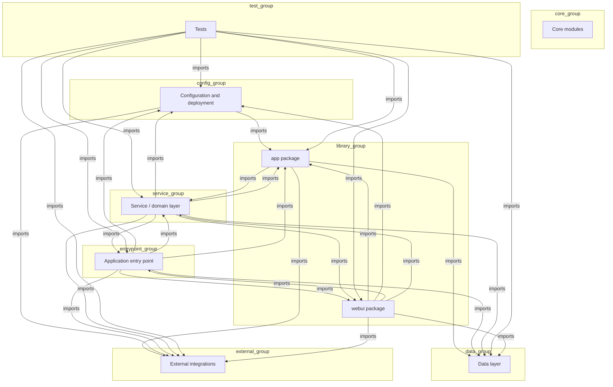

# Architecture report: linyqh/NarratoAI

> Automated static analysis. **Observed** = directly seen in files/imports/AST; **Inferred** = interpretation from that evidence. Repository code was not executed.

## 1. Repository at a glance

| Item | Value |
| --- | --- |
| Repository | linyqh/NarratoAI |
| Description | 利用 AI 大模型，一键解说并剪辑视频 |
| Language | Python |
| Stars | 11825 |
| Licence | MIT |
| Analysed commit / branch | 29a11b6cdf61b69ba90321fc5babc160e0ca2657 / main |
| Framework(s) | None detected |
| Files analysed | 178 |
| Components | 9 |

## 2. Architecture in one minute

linyqh/NarratoAI - 利用 AI 大模型，一键解说并剪辑视频. This repository was analysed statically from 178 file(s) (150 Python). Detected technologies (observed from imports/manifests): GitHub Actions, Redis, NumPy, pandas, Pydantic, requests. Files are grouped into 9 component(s): app package, Configuration and deployment, Core modules, Data layer, Application entry point, External integrations, Service / domain layer, Tests. Observed entry point(s): app/config/audio_config.py, app/services/SDE/short_drama_explanation.py, app/services/audio_merger.py. Findings below distinguish observed facts from inferred interpretation.

## 3. High-level block diagram

## 4. Main components

### app package (`app`)

- **Kind:** library
- **Status:** Observed
- **Confidence:** 0.85
- **Responsibility:** Groups 8 file(s) under app package (observed from repository paths and static analysis). Observed top-level classes: BaseGenerator, DeepSeekGenerator, FFmpegEngine, GeminiGenerator, GeminiOpenAIGenerator, MoonshotGenerator. Observed top-level functions: _auto_reset_on_import, _candidate_paths, _detect_hardware_encoding, _detect_linux_acceleration, _detect_macos_acceleration, _detect_windows_acceleration.
- **Paths:** `app/__init__.py`, `app/utils/check_script.py`, `app/utils/ffmpeg_detector.py`, `app/utils/ffmpeg_utils.py`, `app/utils/openai_base_url_security.py`, `app/utils/qwenvl_analyzer.py`, `app/utils/script_generator.py`, `app/utils/utils.py`
- **Evidence:** [app/__init__.py](https://github.com/linyqh/NarratoAI/blob/29a11b6cdf61b69ba90321fc5babc160e0ca2657/app/__init__.py); [app/utils/check_script.py:5](https://github.com/linyqh/NarratoAI/blob/29a11b6cdf61b69ba90321fc5babc160e0ca2657/app/utils/check_script.py#L5); [app/utils/ffmpeg_detector.py:36](https://github.com/linyqh/NarratoAI/blob/29a11b6cdf61b69ba90321fc5babc160e0ca2657/app/utils/ffmpeg_detector.py#L36); [app/utils/ffmpeg_utils.py:64](https://github.com/linyqh/NarratoAI/blob/29a11b6cdf61b69ba90321fc5babc160e0ca2657/app/utils/ffmpeg_utils.py#L64); [app/utils/openai_base_url_security.py:38](https://github.com/linyqh/NarratoAI/blob/29a11b6cdf61b69ba90321fc5babc160e0ca2657/app/utils/openai_base_url_security.py#L38); [app/utils/qwenvl_analyzer.py:16](https://github.com/linyqh/NarratoAI/blob/29a11b6cdf61b69ba90321fc5babc160e0ca2657/app/utils/qwenvl_analyzer.py#L16); [app/utils/script_generator.py:13](https://github.com/linyqh/NarratoAI/blob/29a11b6cdf61b69ba90321fc5babc160e0ca2657/app/utils/script_generator.py#L13); [app/utils/utils.py:22](https://github.com/linyqh/NarratoAI/blob/29a11b6cdf61b69ba90321fc5babc160e0ca2657/app/utils/utils.py#L22)

### Configuration and deployment (`config`)

- **Kind:** config
- **Status:** Observed
- **Confidence:** 0.85
- **Responsibility:** Groups 12 file(s) under configuration and deployment (observed from repository paths and static analysis). Observed top-level classes: FFmpegConfigManager, FFmpegProfile, WebUIConfig. Observed top-level functions: __init_logger, _is_legacy_indextts2_config, apply_ffmpeg_path, build_default_app_config, build_default_config, get_config.
- **Paths:** `Dockerfile`, `app/config/__init__.py`, `app/config/config.py`, `app/config/defaults.py`, `app/config/ffmpeg_config.py`, `config.example.toml`, `docker-compose.yml`, `pyproject.toml`, `requirements.txt`, `webui/config/settings.py`, `webui/i18n/en.json`, `webui/i18n/zh.json`
- **Evidence:** [Dockerfile](https://github.com/linyqh/NarratoAI/blob/29a11b6cdf61b69ba90321fc5babc160e0ca2657/Dockerfile); [app/config/__init__.py:10](https://github.com/linyqh/NarratoAI/blob/29a11b6cdf61b69ba90321fc5babc160e0ca2657/app/config/__init__.py#L10); [app/config/config.py:42](https://github.com/linyqh/NarratoAI/blob/29a11b6cdf61b69ba90321fc5babc160e0ca2657/app/config/config.py#L42); [app/config/defaults.py:47](https://github.com/linyqh/NarratoAI/blob/29a11b6cdf61b69ba90321fc5babc160e0ca2657/app/config/defaults.py#L47); [app/config/ffmpeg_config.py:14](https://github.com/linyqh/NarratoAI/blob/29a11b6cdf61b69ba90321fc5babc160e0ca2657/app/config/ffmpeg_config.py#L14); [config.example.toml](https://github.com/linyqh/NarratoAI/blob/29a11b6cdf61b69ba90321fc5babc160e0ca2657/config.example.toml); [docker-compose.yml](https://github.com/linyqh/NarratoAI/blob/29a11b6cdf61b69ba90321fc5babc160e0ca2657/docker-compose.yml); [pyproject.toml](https://github.com/linyqh/NarratoAI/blob/29a11b6cdf61b69ba90321fc5babc160e0ca2657/pyproject.toml)

### Core modules (`core`)

- **Kind:** core
- **Status:** Observed
- **Confidence:** 0.85
- **Responsibility:** Groups 2 file(s) under core modules (observed from repository paths and static analysis).
- **Paths:** `docker-deploy.sh`, `docker-entrypoint.sh`
- **Evidence:** [docker-deploy.sh](https://github.com/linyqh/NarratoAI/blob/29a11b6cdf61b69ba90321fc5babc160e0ca2657/docker-deploy.sh); [docker-entrypoint.sh](https://github.com/linyqh/NarratoAI/blob/29a11b6cdf61b69ba90321fc5babc160e0ca2657/docker-entrypoint.sh)

### Data layer (`data_layer`)

- **Kind:** data
- **Status:** Observed
- **Confidence:** 0.85
- **Responsibility:** Groups 4 file(s) under data layer (observed from repository paths and static analysis). Observed top-level classes: AudioVolumeDefaults, FileNotFoundException, HttpException, MaterialInfo, SubtitlePosition, VideoAspect.
- **Paths:** `app/models/__init__.py`, `app/models/const.py`, `app/models/exception.py`, `app/models/schema.py`
- **Evidence:** [app/models/__init__.py](https://github.com/linyqh/NarratoAI/blob/29a11b6cdf61b69ba90321fc5babc160e0ca2657/app/models/__init__.py); [app/models/const.py](https://github.com/linyqh/NarratoAI/blob/29a11b6cdf61b69ba90321fc5babc160e0ca2657/app/models/const.py); [app/models/exception.py:7](https://github.com/linyqh/NarratoAI/blob/29a11b6cdf61b69ba90321fc5babc160e0ca2657/app/models/exception.py#L7); [app/models/schema.py:16](https://github.com/linyqh/NarratoAI/blob/29a11b6cdf61b69ba90321fc5babc160e0ca2657/app/models/schema.py#L16)

### Application entry point (`entrypoint`)

- **Kind:** entrypoint
- **Status:** Observed
- **Confidence:** 0.85
- **Responsibility:** Groups 16 file(s) under application entry point (observed from repository paths and static analysis). Observed top-level classes: AudioConfig, AudioNormalizer, SubtitleAnalyzer, VideoAspect, VideoProcessor. Observed top-level functions: _append_fast_seek_input, _apply_sonilo_sfx, _build_concat_video_copy_cmd, _build_concat_video_reencode_cmd, _build_drawtext_filters, _build_ffmpeg_command_with_audio_control.
- **Paths:** `app/config/audio_config.py`, `app/services/SDE/short_drama_explanation.py`, `app/services/audio_merger.py`, `app/services/audio_normalizer.py`, `app/services/clip_video.py`, `app/services/generate_narration_script.py`, `app/services/generate_video.py`, `app/services/llm.py`, `app/services/merger_video.py`, `app/services/subtitle.py`, `app/services/subtitle_merger.py`, `app/services/task.py`, `app/services/update_script.py`, `app/utils/video_processor.py`, `webui.py`, `webui/components/ffmpeg_diagnostics.py`
- **Evidence:** [app/config/audio_config.py:16](https://github.com/linyqh/NarratoAI/blob/29a11b6cdf61b69ba90321fc5babc160e0ca2657/app/config/audio_config.py#L16); [app/services/SDE/short_drama_explanation.py:23](https://github.com/linyqh/NarratoAI/blob/29a11b6cdf61b69ba90321fc5babc160e0ca2657/app/services/SDE/short_drama_explanation.py#L23); [app/services/audio_merger.py:12](https://github.com/linyqh/NarratoAI/blob/29a11b6cdf61b69ba90321fc5babc160e0ca2657/app/services/audio_merger.py#L12); [app/services/audio_normalizer.py:22](https://github.com/linyqh/NarratoAI/blob/29a11b6cdf61b69ba90321fc5babc160e0ca2657/app/services/audio_normalizer.py#L22); [app/services/clip_video.py:21](https://github.com/linyqh/NarratoAI/blob/29a11b6cdf61b69ba90321fc5babc160e0ca2657/app/services/clip_video.py#L21); [app/services/generate_narration_script.py:25](https://github.com/linyqh/NarratoAI/blob/29a11b6cdf61b69ba90321fc5babc160e0ca2657/app/services/generate_narration_script.py#L25); [app/services/generate_video.py:60](https://github.com/linyqh/NarratoAI/blob/29a11b6cdf61b69ba90321fc5babc160e0ca2657/app/services/generate_video.py#L60); [app/services/llm.py:115](https://github.com/linyqh/NarratoAI/blob/29a11b6cdf61b69ba90321fc5babc160e0ca2657/app/services/llm.py#L115)

### External integrations (`external_integrations`)

- **Kind:** external
- **Status:** Inferred
- **Confidence:** 0.70
- **Responsibility:** Groups 0 file(s) under external integrations (observed from repository paths and static analysis).
- **Evidence:** [app/config/config.py:2](https://github.com/linyqh/NarratoAI/blob/29a11b6cdf61b69ba90321fc5babc160e0ca2657/app/config/config.py#L2); [app/services/SDE/short_drama_explanation.py:13](https://github.com/linyqh/NarratoAI/blob/29a11b6cdf61b69ba90321fc5babc160e0ca2657/app/services/SDE/short_drama_explanation.py#L13); [app/services/SDP/utils/utils.py:3](https://github.com/linyqh/NarratoAI/blob/29a11b6cdf61b69ba90321fc5babc160e0ca2657/app/services/SDP/utils/utils.py#L3); [app/services/fun_asr_subtitle.py:16](https://github.com/linyqh/NarratoAI/blob/29a11b6cdf61b69ba90321fc5babc160e0ca2657/app/services/fun_asr_subtitle.py#L16); [app/services/llm.py:281](https://github.com/linyqh/NarratoAI/blob/29a11b6cdf61b69ba90321fc5babc160e0ca2657/app/services/llm.py#L281); [app/services/llm.py:298](https://github.com/linyqh/NarratoAI/blob/29a11b6cdf61b69ba90321fc5babc160e0ca2657/app/services/llm.py#L298)

### Service / domain layer (`service_layer`)

- **Kind:** service
- **Status:** Observed
- **Confidence:** 0.85
- **Responsibility:** Groups 66 file(s) under service / domain layer (observed from repository paths and static analysis). Observed top-level classes: APICallError, AuthenticationError, BaseLLMProvider, BasePrompt, BaseState, Commentary. Observed top-level functions: _absolute_local_download_url, _add_subtitle_track_from_srt, _auth_headers, _blocks_from_local_timestamp, _blocks_from_openai_segments, _blocks_from_sentence.
- **Paths:** `app/services/SDP/generate_script_short.py`, `app/services/SDP/utils/short_schema.py`, `app/services/SDP/utils/step1_subtitle_analyzer_openai.py`, `app/services/SDP/utils/step5_merge_script.py`, `app/services/SDP/utils/utils.py`, `app/services/__init__.py`, `app/services/documentary/__init__.py`, `app/services/documentary/frame_analysis_models.py`, `app/services/documentary/frame_analysis_service.py`, `app/services/fun_asr_subtitle.py`, `app/services/jianying_draft_builder.py`, `app/services/jianying_task.py`, `app/services/llm/__init__.py`, `app/services/llm/base.py`, `app/services/llm/config_validator.py`, `app/services/llm/exceptions.py`, `app/services/llm/manager.py`, `app/services/llm/migration_adapter.py`, `app/services/llm/openai_compatible_provider.py`, `app/services/llm/providers/__init__.py`, `app/services/llm/twelvelabs_provider.py`, `app/services/llm/unified_service.py`, `app/services/llm/validators.py`, `app/services/material.py`, `app/services/prompts/__init__.py`, `app/services/prompts/base.py`, `app/services/prompts/documentary/__init__.py`, `app/services/prompts/documentary/frame_analysis.py`, `app/services/prompts/documentary/narration_generation.py`, `app/services/prompts/exceptions.py`, `app/services/prompts/film_tv_narration/__init__.py`, `app/services/prompts/film_tv_narration/narration_copy.py`, `app/services/prompts/film_tv_narration/plot_analysis.py`, `app/services/prompts/film_tv_narration/script_generation.py`, `app/services/prompts/film_tv_narration/script_matching.py`, `app/services/prompts/film_tv_narration/script_repair.py`, `app/services/prompts/film_tv_narration/segment_planning.py`, `app/services/prompts/manager.py`, `app/services/prompts/registry.py`, `app/services/prompts/short_drama_editing/__init__.py`, `app/services/prompts/short_drama_editing/plot_extraction.py`, `app/services/prompts/short_drama_editing/script_generation.py`, `app/services/prompts/short_drama_editing/subtitle_analysis.py`, `app/services/prompts/short_drama_narration/__init__.py`, `app/services/prompts/short_drama_narration/narration_copy.py`, `app/services/prompts/short_drama_narration/plot_analysis.py`, `app/services/prompts/short_drama_narration/script_generation.py`, `app/services/prompts/short_drama_narration/script_matching.py`, `app/services/prompts/short_drama_narration/script_repair.py`, `app/services/prompts/short_drama_narration/segment_planning.py`, `app/services/prompts/template.py`, `app/services/prompts/validators.py`, `app/services/script_service.py`, `app/services/script_subtitle.py`, `app/services/short_drama_narration_validation.py`, `app/services/sonilo.py`, `app/services/state.py`, `app/services/subtitle_corrector.py`, `app/services/subtitle_text.py`, `app/services/subtitle_translator.py`, `app/services/tavily_search.py`, `app/services/upload_validation.py`, `app/services/video.py`, `app/services/video_service.py`, `app/services/voice.py`, `app/services/youtube_service.py`
- **Evidence:** [app/services/SDP/generate_script_short.py:14](https://github.com/linyqh/NarratoAI/blob/29a11b6cdf61b69ba90321fc5babc160e0ca2657/app/services/SDP/generate_script_short.py#L14); [app/services/SDP/utils/short_schema.py:9](https://github.com/linyqh/NarratoAI/blob/29a11b6cdf61b69ba90321fc5babc160e0ca2657/app/services/SDP/utils/short_schema.py#L9); [app/services/SDP/utils/step1_subtitle_analyzer_openai.py:22](https://github.com/linyqh/NarratoAI/blob/29a11b6cdf61b69ba90321fc5babc160e0ca2657/app/services/SDP/utils/step1_subtitle_analyzer_openai.py#L22); [app/services/SDP/utils/step5_merge_script.py:9](https://github.com/linyqh/NarratoAI/blob/29a11b6cdf61b69ba90321fc5babc160e0ca2657/app/services/SDP/utils/step5_merge_script.py#L9); [app/services/SDP/utils/utils.py:9](https://github.com/linyqh/NarratoAI/blob/29a11b6cdf61b69ba90321fc5babc160e0ca2657/app/services/SDP/utils/utils.py#L9); [app/services/__init__.py](https://github.com/linyqh/NarratoAI/blob/29a11b6cdf61b69ba90321fc5babc160e0ca2657/app/services/__init__.py); [app/services/documentary/__init__.py](https://github.com/linyqh/NarratoAI/blob/29a11b6cdf61b69ba90321fc5babc160e0ca2657/app/services/documentary/__init__.py); [app/services/documentary/frame_analysis_models.py:5](https://github.com/linyqh/NarratoAI/blob/29a11b6cdf61b69ba90321fc5babc160e0ca2657/app/services/documentary/frame_analysis_models.py#L5)

### Tests (`tests`)

- **Kind:** test
- **Status:** Observed
- **Confidence:** 0.85
- **Responsibility:** Groups 35 file(s) under tests (observed from repository paths and static analysis). Observed top-level classes: ApplySfxTests, ApplySoniloSfxTaskTests, AudioSettingsSourcePillsTests, ConfigBootstrapDefaultsTests, ConsumeNdjsonStreamTests, DocumentaryAnalysisConfigTests. Observed top-level functions: _attribute_name, _make_provider, _ndjson_lines, _reset_manager_state, _response, _session_state_key.
- **Paths:** `app/config/test_config_bootstrap_unittest.py`, `app/services/llm/test_llm_service.py`, `app/services/llm/test_openai_compat_unittest.py`, `app/services/llm/test_openai_compatible_integration.py`, `app/services/llm/test_subtitle_adapter_pipeline_unittest.py`, `app/services/llm/test_twelvelabs_provider_unittest.py`, `app/services/test_doubaotts_tts_unittest.py`, `app/services/test_fun_asr_subtitle_unittest.py`, `app/services/test_indextts2_tts_unittest.py`, `app/services/test_indextts_macos_tts_unittest.py`, `app/services/test_jianying_task_unittest.py`, `app/services/test_merger_video_concat_unittest.py`, `app/services/test_multi_video_script_sources_unittest.py`, `app/services/test_script_subtitle_unittest.py`, `app/services/test_short_drama_narration_validation_unittest.py`, `app/services/test_subtitle_corrector_unittest.py`, `app/services/test_subtitle_translator_unittest.py`, `app/services/test_task_subtitle_resolution_unittest.py`, `app/services/test_voxcpm2_tts_unittest.py`, `app/services/test_voxcpm_tts_unittest.py`, `app/utils/test_ffmpeg_detector_unittest.py`, `conftest.py`, `tests/test_documentary_frame_analysis_service.py`, `tests/test_generate_narration_script_documentary_unittest.py`, `tests/test_generate_script_docu_unittest.py`, `tests/test_script_service_documentary_unittest.py`, `tests/test_sonilo_bgm_unittest.py`, `tests/test_sonilo_sfx_unittest.py`, `tests/test_streamlit_widget_session_state.py`, `tests/test_video_processor_documentary_unittest.py`, `webui/components/test_audio_settings_unittest.py`, `webui/components/test_subtitle_settings_unittest.py`, `webui/components/test_system_settings_unittest.py`, `webui/tools/test_generate_script_short_unittest.py`, `webui/tools/test_generate_short_summary_unittest.py`
- **Evidence:** [app/config/test_config_bootstrap_unittest.py:19](https://github.com/linyqh/NarratoAI/blob/29a11b6cdf61b69ba90321fc5babc160e0ca2657/app/config/test_config_bootstrap_unittest.py#L19); [app/services/llm/test_llm_service.py:25](https://github.com/linyqh/NarratoAI/blob/29a11b6cdf61b69ba90321fc5babc160e0ca2657/app/services/llm/test_llm_service.py#L25); [app/services/llm/test_openai_compat_unittest.py:22](https://github.com/linyqh/NarratoAI/blob/29a11b6cdf61b69ba90321fc5babc160e0ca2657/app/services/llm/test_openai_compat_unittest.py#L22); [app/services/llm/test_openai_compatible_integration.py:13](https://github.com/linyqh/NarratoAI/blob/29a11b6cdf61b69ba90321fc5babc160e0ca2657/app/services/llm/test_openai_compatible_integration.py#L13); [app/services/llm/test_subtitle_adapter_pipeline_unittest.py:10](https://github.com/linyqh/NarratoAI/blob/29a11b6cdf61b69ba90321fc5babc160e0ca2657/app/services/llm/test_subtitle_adapter_pipeline_unittest.py#L10); [app/services/llm/test_twelvelabs_provider_unittest.py:21](https://github.com/linyqh/NarratoAI/blob/29a11b6cdf61b69ba90321fc5babc160e0ca2657/app/services/llm/test_twelvelabs_provider_unittest.py#L21); [app/services/test_doubaotts_tts_unittest.py:10](https://github.com/linyqh/NarratoAI/blob/29a11b6cdf61b69ba90321fc5babc160e0ca2657/app/services/test_doubaotts_tts_unittest.py#L10); [app/services/test_fun_asr_subtitle_unittest.py:14](https://github.com/linyqh/NarratoAI/blob/29a11b6cdf61b69ba90321fc5babc160e0ca2657/app/services/test_fun_asr_subtitle_unittest.py#L14)

### webui package (`webui`)

- **Kind:** library
- **Status:** Observed
- **Confidence:** 0.85
- **Responsibility:** Groups 16 file(s) under webui package (observed from repository paths and static analysis). Observed top-level classes: VisionAnalyzer. Observed top-level functions: _build_combined_subtitle_content, _build_plot_analysis_input, _build_subtitle_mask_preview_options, _build_tavily_context, _clear_streamlit_caches, _draw_subtitle_mask_preview.
- **Paths:** `webui/__init__.py`, `webui/components/__init__.py`, `webui/components/audio_settings.py`, `webui/components/basic_settings.py`, `webui/components/script_settings.py`, `webui/components/subtitle_settings.py`, `webui/components/system_settings.py`, `webui/components/video_settings.py`, `webui/i18n/__init__.py`, `webui/tools/base.py`, `webui/tools/generate_script_docu.py`, `webui/tools/generate_script_short.py`, `webui/tools/generate_short_summary.py`, `webui/utils/cache.py`, `webui/utils/file_utils.py`, `webui/utils/vision_analyzer.py`
- **Evidence:** [webui/__init__.py](https://github.com/linyqh/NarratoAI/blob/29a11b6cdf61b69ba90321fc5babc160e0ca2657/webui/__init__.py); [webui/components/__init__.py](https://github.com/linyqh/NarratoAI/blob/29a11b6cdf61b69ba90321fc5babc160e0ca2657/webui/components/__init__.py); [webui/components/audio_settings.py:54](https://github.com/linyqh/NarratoAI/blob/29a11b6cdf61b69ba90321fc5babc160e0ca2657/webui/components/audio_settings.py#L54); [webui/components/basic_settings.py:36](https://github.com/linyqh/NarratoAI/blob/29a11b6cdf61b69ba90321fc5babc160e0ca2657/webui/components/basic_settings.py#L36); [webui/components/script_settings.py:143](https://github.com/linyqh/NarratoAI/blob/29a11b6cdf61b69ba90321fc5babc160e0ca2657/webui/components/script_settings.py#L143); [webui/components/subtitle_settings.py:58](https://github.com/linyqh/NarratoAI/blob/29a11b6cdf61b69ba90321fc5babc160e0ca2657/webui/components/subtitle_settings.py#L58); [webui/components/system_settings.py:20](https://github.com/linyqh/NarratoAI/blob/29a11b6cdf61b69ba90321fc5babc160e0ca2657/webui/components/system_settings.py#L20); [webui/components/video_settings.py:5](https://github.com/linyqh/NarratoAI/blob/29a11b6cdf61b69ba90321fc5babc160e0ca2657/webui/components/video_settings.py#L5)

## 5. Execution flow

**Observed** entry point(s):

- [app/config/audio_config.py:208](https://github.com/linyqh/NarratoAI/blob/29a11b6cdf61b69ba90321fc5babc160e0ca2657/app/config/audio_config.py#L208)
- [app/services/SDE/short_drama_explanation.py:1066](https://github.com/linyqh/NarratoAI/blob/29a11b6cdf61b69ba90321fc5babc160e0ca2657/app/services/SDE/short_drama_explanation.py#L1066)
- [app/services/audio_merger.py:137](https://github.com/linyqh/NarratoAI/blob/29a11b6cdf61b69ba90321fc5babc160e0ca2657/app/services/audio_merger.py#L137)
- [app/services/audio_normalizer.py:305](https://github.com/linyqh/NarratoAI/blob/29a11b6cdf61b69ba90321fc5babc160e0ca2657/app/services/audio_normalizer.py#L305)
- [app/services/clip_video.py:1180](https://github.com/linyqh/NarratoAI/blob/29a11b6cdf61b69ba90321fc5babc160e0ca2657/app/services/clip_video.py#L1180)
- [app/services/generate_narration_script.py:231](https://github.com/linyqh/NarratoAI/blob/29a11b6cdf61b69ba90321fc5babc160e0ca2657/app/services/generate_narration_script.py#L231)
- [app/services/generate_video.py:1824](https://github.com/linyqh/NarratoAI/blob/29a11b6cdf61b69ba90321fc5babc160e0ca2657/app/services/generate_video.py#L1824)
- [app/services/llm.py:790](https://github.com/linyqh/NarratoAI/blob/29a11b6cdf61b69ba90321fc5babc160e0ca2657/app/services/llm.py#L790)
- [app/services/merger_video.py:830](https://github.com/linyqh/NarratoAI/blob/29a11b6cdf61b69ba90321fc5babc160e0ca2657/app/services/merger_video.py#L830)
- [app/services/subtitle.py:434](https://github.com/linyqh/NarratoAI/blob/29a11b6cdf61b69ba90321fc5babc160e0ca2657/app/services/subtitle.py#L434)
- [app/services/subtitle_merger.py:188](https://github.com/linyqh/NarratoAI/blob/29a11b6cdf61b69ba90321fc5babc160e0ca2657/app/services/subtitle_merger.py#L188)
- [app/services/task.py:1040](https://github.com/linyqh/NarratoAI/blob/29a11b6cdf61b69ba90321fc5babc160e0ca2657/app/services/task.py#L1040)

Representative flow (derived from observed entry points and the import graph; steps beyond the entry point are **Inferred**):

1. Execution starts at an observed entry point listed above, if present.
2. `app` imports `data_layer` (app package -> Data layer).
3. `app` imports `external_integrations` (app package -> External integrations).
4. `app` imports `service_layer` (app package -> Service / domain layer).
5. `config` imports `app` (Configuration and deployment -> app package).
6. `config` imports `external_integrations` (Configuration and deployment -> External integrations).
7. `entrypoint` imports `app` (Application entry point -> app package).
8. `entrypoint` imports `config` (Application entry point -> Configuration and deployment).
9. `entrypoint` imports `data_layer` (Application entry point -> Data layer).

## 6. Project structure

### `(root)`

- `.dockerignore` - container (1002 bytes)
- `.gitignore` - other (1319 bytes)
- `.python-version` - other (5 bytes)
- `Dockerfile` - container (2654 bytes)
- `LICENSE` - docs (1062 bytes)
- `Makefile` - other (1520 bytes)
- `README-en.md` - docs (7732 bytes)
- `README.md` - docs (10555 bytes)
- `config.example.toml` - config (13787 bytes)
- `conftest.py` - test, Python (400 bytes)
- `docker-compose.yml` - container (610 bytes)
- `docker-deploy.sh` - source, Shell (3850 bytes)
- `docker-entrypoint.sh` - source, Shell (4372 bytes)
- `project_version` - other (5 bytes)
- `pyproject.toml` - manifest (990 bytes)
- `requirements.txt` - manifest (884 bytes)
- `webui.py` - source, Python (28302 bytes)

### `.github`

- `.github/pull_request_template.md` - docs (1078 bytes)
- `.github/release-drafter.yml` - config (741 bytes)
- `.github/workflows/auto-release-generator.yml` - ci, YAML (6113 bytes)
- `.github/workflows/codeReview.yml` - ci, YAML (569 bytes)
- `.github/workflows/discord-release-notification.yml` - ci, YAML (9350 bytes)

### `app`

- `app/__init__.py` - source, Python (0 bytes)
- `app/config/__init__.py` - source, Python (2155 bytes)
- `app/config/audio_config.py` - source, Python (6762 bytes)
- `app/config/config.py` - source, Python (9066 bytes)
- `app/config/defaults.py` - source, Python (3855 bytes)
- `app/config/ffmpeg_config.py` - source, Python (9542 bytes)
- `app/config/test_config_bootstrap_unittest.py` - test, Python (6768 bytes)
- `app/models/__init__.py` - source, Python (0 bytes)
- `app/models/const.py` - source, Python (356 bytes)
- `app/models/exception.py` - source, Python (766 bytes)
- `app/models/schema.py` - source, Python (8569 bytes)
- `app/services/SDE/short_drama_explanation.py` - source, Python (41479 bytes)
- `app/services/SDP/generate_script_short.py` - source, Python (5756 bytes)
- `app/services/SDP/utils/short_schema.py` - source, Python (917 bytes)
- `app/services/SDP/utils/step1_subtitle_analyzer_openai.py` - source, Python (15188 bytes)
- `app/services/SDP/utils/step5_merge_script.py` - source, Python (1639 bytes)
- `app/services/SDP/utils/utils.py` - source, Python (3667 bytes)
- `app/services/__init__.py` - source, Python (0 bytes)
- `app/services/audio_merger.py` - source, Python (7634 bytes)
- `app/services/audio_normalizer.py` - source, Python (10812 bytes)
- `app/services/clip_video.py` - source, Python (44294 bytes)
- `app/services/documentary/__init__.py` - source, Python (328 bytes)
- `app/services/documentary/frame_analysis_models.py` - source, Python (991 bytes)
- `app/services/documentary/frame_analysis_service.py` - source, Python (30649 bytes)
- `app/services/fun_asr_subtitle.py` - source, Python (35311 bytes)
- `app/services/generate_narration_script.py` - source, Python (9850 bytes)
- `app/services/generate_video.py` - source, Python (66748 bytes)
- `app/services/jianying_draft_builder.py` - source, Python (56450 bytes)
- `app/services/jianying_task.py` - source, Python (16612 bytes)
- `app/services/llm.py` - source, Python (38306 bytes)
- `app/services/llm/__init__.py` - source, Python (1242 bytes)
- `app/services/llm/base.py` - source, Python (7298 bytes)
- `app/services/llm/config_validator.py` - source, Python (11503 bytes)
- `app/services/llm/exceptions.py` - source, Python (3566 bytes)
- `app/services/llm/manager.py` - source, Python (9529 bytes)
- `app/services/llm/migration_adapter.py` - source, Python (19837 bytes)
- `app/services/llm/openai_compatible_provider.py` - source, Python (18033 bytes)
- `app/services/llm/providers/__init__.py` - source, Python (1704 bytes)
- `app/services/llm/test_llm_service.py` - test, Python (7648 bytes)
- `app/services/llm/test_openai_compat_unittest.py` - test, Python (12845 bytes)
- `app/services/llm/test_openai_compatible_integration.py` - test, Python (1069 bytes)
- `app/services/llm/test_subtitle_adapter_pipeline_unittest.py` - test, Python (10695 bytes)
- `app/services/llm/test_twelvelabs_provider_unittest.py` - test, Python (4322 bytes)
- `app/services/llm/twelvelabs_provider.py` - source, Python (10711 bytes)
- `app/services/llm/unified_service.py` - source, Python (10923 bytes)
- `app/services/llm/validators.py` - source, Python (8374 bytes)
- `app/services/material.py` - source, Python (20272 bytes)
- `app/services/merger_video.py` - source, Python (33152 bytes)
- `app/services/prompts/__init__.py` - source, Python (1559 bytes)
- `app/services/prompts/base.py` - source, Python (6145 bytes)
- `app/services/prompts/documentary/__init__.py` - source, Python (834 bytes)
- `app/services/prompts/documentary/frame_analysis.py` - source, Python (2265 bytes)
- `app/services/prompts/documentary/narration_generation.py` - source, Python (4476 bytes)
- `app/services/prompts/exceptions.py` - source, Python (2270 bytes)
- `app/services/prompts/film_tv_narration/__init__.py` - source, Python (1512 bytes)
- `app/services/prompts/film_tv_narration/narration_copy.py` - source, Python (3979 bytes)
- `app/services/prompts/film_tv_narration/plot_analysis.py` - source, Python (5687 bytes)
- `app/services/prompts/film_tv_narration/script_generation.py` - source, Python (8051 bytes)
- `app/services/prompts/film_tv_narration/script_matching.py` - source, Python (5932 bytes)
- `app/services/prompts/film_tv_narration/script_repair.py` - source, Python (4227 bytes)
- `app/services/prompts/film_tv_narration/segment_planning.py` - source, Python (5294 bytes)
- `app/services/prompts/manager.py` - source, Python (9824 bytes)
- `app/services/prompts/registry.py` - source, Python (8284 bytes)
- `app/services/prompts/short_drama_editing/__init__.py` - source, Python (1087 bytes)
- `app/services/prompts/short_drama_editing/plot_extraction.py` - source, Python (4763 bytes)
- `app/services/prompts/short_drama_editing/script_generation.py` - source, Python (4050 bytes)
- `app/services/prompts/short_drama_editing/subtitle_analysis.py` - source, Python (4271 bytes)
- `app/services/prompts/short_drama_narration/__init__.py` - source, Python (1792 bytes)
- `app/services/prompts/short_drama_narration/narration_copy.py` - source, Python (4033 bytes)
- `app/services/prompts/short_drama_narration/plot_analysis.py` - source, Python (5552 bytes)
- `app/services/prompts/short_drama_narration/script_generation.py` - source, Python (7821 bytes)
- `app/services/prompts/short_drama_narration/script_matching.py` - source, Python (5319 bytes)
- `app/services/prompts/short_drama_narration/script_repair.py` - source, Python (3654 bytes)
- `app/services/prompts/short_drama_narration/segment_planning.py` - source, Python (4953 bytes)
- `app/services/prompts/template.py` - source, Python (5759 bytes)
- `app/services/prompts/validators.py` - source, Python (9312 bytes)
- `app/services/script_service.py` - source, Python (1582 bytes)
- `app/services/script_subtitle.py` - source, Python (13310 bytes)
- `app/services/short_drama_narration_validation.py` - source, Python (16261 bytes)
- `app/services/sonilo.py` - source, Python (23694 bytes)
- `app/services/state.py` - source, Python (3138 bytes)
- `app/services/subtitle.py` - source, Python (15671 bytes)
- `app/services/subtitle_corrector.py` - source, Python (8314 bytes)
- `app/services/subtitle_merger.py` - source, Python (10209 bytes)
- `app/services/subtitle_text.py` - source, Python (3539 bytes)
- `app/services/subtitle_translator.py` - source, Python (13316 bytes)
- `app/services/task.py` - source, Python (42080 bytes)
- `app/services/tavily_search.py` - source, Python (4128 bytes)
- `app/services/test_doubaotts_tts_unittest.py` - test, Python (4119 bytes)
- `app/services/test_fun_asr_subtitle_unittest.py` - test, Python (26854 bytes)
- `app/services/test_indextts2_tts_unittest.py` - test, Python (7822 bytes)
- `app/services/test_indextts_macos_tts_unittest.py` - test, Python (3624 bytes)
- `app/services/test_jianying_task_unittest.py` - test, Python (19448 bytes)
- `app/services/test_merger_video_concat_unittest.py` - test, Python (4478 bytes)
- `app/services/test_multi_video_script_sources_unittest.py` - test, Python (3564 bytes)
- `app/services/test_script_subtitle_unittest.py` - test, Python (6922 bytes)
- `app/services/test_short_drama_narration_validation_unittest.py` - test, Python (9749 bytes)
- `app/services/test_subtitle_corrector_unittest.py` - test, Python (4086 bytes)
- `app/services/test_subtitle_translator_unittest.py` - test, Python (5803 bytes)
- `app/services/test_task_subtitle_resolution_unittest.py` - test, Python (1617 bytes)
- `app/services/test_voxcpm2_tts_unittest.py` - test, Python (3738 bytes)
- `app/services/test_voxcpm_tts_unittest.py` - test, Python (3524 bytes)
- `app/services/update_script.py` - source, Python (12760 bytes)
- `app/services/upload_validation.py` - source, Python (3271 bytes)
- `app/services/video.py` - source, Python (14138 bytes)
- `app/services/video_service.py` - source, Python (1803 bytes)
- `app/services/voice.py` - source, Python (91542 bytes)
- `app/services/youtube_service.py` - source, Python (5545 bytes)
- `app/utils/check_script.py` - source, Python (5331 bytes)
- `app/utils/ffmpeg_detector.py` - source, Python (15310 bytes)
- `app/utils/ffmpeg_utils.py` - source, Python (41231 bytes)
- `app/utils/openai_base_url_security.py` - source, Python (3135 bytes)
- `app/utils/qwenvl_analyzer.py` - source, Python (9998 bytes)
- `app/utils/script_generator.py` - source, Python (25429 bytes)
- `app/utils/test_ffmpeg_detector_unittest.py` - test, Python (3109 bytes)
- `app/utils/utils.py` - source, Python (20304 bytes)
- `app/utils/video_processor.py` - source, Python (27415 bytes)

### `resource`

- `resource/fonts/fonts_in_here.txt` - docs (21 bytes)
- `resource/public/index.html` - other (860 bytes)
- `resource/scripts/script_in_here.txt` - docs (0 bytes)
- `resource/songs/song_in_here.txt` - docs (0 bytes)
- `resource/srt/srt_in_here.txt` - docs (0 bytes)
- `resource/videos/video_in_here.txt` - docs (0 bytes)

### `tests`

- `tests/test_documentary_frame_analysis_service.py` - test, Python (10849 bytes)
- `tests/test_generate_narration_script_documentary_unittest.py` - test, Python (2264 bytes)
- `tests/test_generate_script_docu_unittest.py` - test, Python (679 bytes)
- `tests/test_script_service_documentary_unittest.py` - test, Python (13649 bytes)
- `tests/test_sonilo_bgm_unittest.py` - test, Python (6892 bytes)
- `tests/test_sonilo_sfx_unittest.py` - test, Python (15494 bytes)
- `tests/test_streamlit_widget_session_state.py` - test, Python (2509 bytes)
- `tests/test_video_processor_documentary_unittest.py` - test, Python (4324 bytes)

### `webui`

- `webui/__init__.py` - source, Python (380 bytes)
- `webui/components/__init__.py` - source, Python (396 bytes)
- `webui/components/audio_settings.py` - source, Python (91151 bytes)
- `webui/components/basic_settings.py` - source, Python (40674 bytes)
- `webui/components/ffmpeg_diagnostics.py` - source, Python (10111 bytes)
- `webui/components/script_settings.py` - source, Python (81673 bytes)
- `webui/components/subtitle_settings.py` - source, Python (33680 bytes)
- `webui/components/system_settings.py` - source, Python (9658 bytes)
- `webui/components/test_audio_settings_unittest.py` - test, Python (2152 bytes)
- `webui/components/test_subtitle_settings_unittest.py` - test, Python (1031 bytes)
- `webui/components/test_system_settings_unittest.py` - test, Python (1535 bytes)
- `webui/components/video_settings.py` - source, Python (2120 bytes)
- `webui/config/settings.py` - source, Python (5393 bytes)
- `webui/i18n/__init__.py` - source, Python (30 bytes)
- `webui/i18n/en.json` - config (61236 bytes)
- `webui/i18n/zh.json` - config (57329 bytes)
- `webui/tools/base.py` - source, Python (5559 bytes)
- `webui/tools/generate_script_docu.py` - source, Python (4747 bytes)
- `webui/tools/generate_script_short.py` - source, Python (8671 bytes)
- `webui/tools/generate_short_summary.py` - source, Python (28438 bytes)
- `webui/tools/test_generate_script_short_unittest.py` - test, Python (1184 bytes)
- `webui/tools/test_generate_short_summary_unittest.py` - test, Python (1140 bytes)
- `webui/utils/cache.py` - source, Python (1265 bytes)
- `webui/utils/file_utils.py` - source, Python (7660 bytes)
- `webui/utils/vision_analyzer.py` - source, Python (2928 bytes)

## 7. Key dependencies and integrations

| Name | Category | Status | Confidence | Evidence |
| --- | --- | --- | --- | --- |
| GitHub Actions | ci | Observed | 0.90 | [.github/workflows/auto-release-generator.yml](https://github.com/linyqh/NarratoAI/blob/29a11b6cdf61b69ba90321fc5babc160e0ca2657/.github/workflows/auto-release-generator.yml); [.github/workflows/codeReview.yml](https://github.com/linyqh/NarratoAI/blob/29a11b6cdf61b69ba90321fc5babc160e0ca2657/.github/workflows/codeReview.yml); [.github/workflows/discord-release-notification.yml](https://github.com/linyqh/NarratoAI/blob/29a11b6cdf61b69ba90321fc5babc160e0ca2657/.github/workflows/discord-release-notification.yml) |
| Redis | database | Observed | 0.90 | [app/services/state.py:51](https://github.com/linyqh/NarratoAI/blob/29a11b6cdf61b69ba90321fc5babc160e0ca2657/app/services/state.py#L51) |
| NumPy | library | Observed | 0.95 | [app/services/audio_normalizer.py:19](https://github.com/linyqh/NarratoAI/blob/29a11b6cdf61b69ba90321fc5babc160e0ca2657/app/services/audio_normalizer.py#L19); [app/services/generate_video.py:20](https://github.com/linyqh/NarratoAI/blob/29a11b6cdf61b69ba90321fc5babc160e0ca2657/app/services/generate_video.py#L20); [webui/components/subtitle_settings.py:206](https://github.com/linyqh/NarratoAI/blob/29a11b6cdf61b69ba90321fc5babc160e0ca2657/webui/components/subtitle_settings.py#L206) |
| pandas | library | Observed | 0.90 | [webui/components/script_settings.py:7](https://github.com/linyqh/NarratoAI/blob/29a11b6cdf61b69ba90321fc5babc160e0ca2657/webui/components/script_settings.py#L7) |
| Pydantic | library | Observed | 0.95 | [app/models/schema.py:5](https://github.com/linyqh/NarratoAI/blob/29a11b6cdf61b69ba90321fc5babc160e0ca2657/app/models/schema.py#L5); [app/models/schema.py:6](https://github.com/linyqh/NarratoAI/blob/29a11b6cdf61b69ba90321fc5babc160e0ca2657/app/models/schema.py#L6) |
| requests | library | Observed | 0.95 | [app/services/SDE/short_drama_explanation.py:13](https://github.com/linyqh/NarratoAI/blob/29a11b6cdf61b69ba90321fc5babc160e0ca2657/app/services/SDE/short_drama_explanation.py#L13); [app/services/SDP/utils/utils.py:3](https://github.com/linyqh/NarratoAI/blob/29a11b6cdf61b69ba90321fc5babc160e0ca2657/app/services/SDP/utils/utils.py#L3); [app/services/fun_asr_subtitle.py:16](https://github.com/linyqh/NarratoAI/blob/29a11b6cdf61b69ba90321fc5babc160e0ca2657/app/services/fun_asr_subtitle.py#L16); [app/services/llm.py:281](https://github.com/linyqh/NarratoAI/blob/29a11b6cdf61b69ba90321fc5babc160e0ca2657/app/services/llm.py#L281) |
| Poetry | packaging | Observed | 0.85 | [pyproject.toml](https://github.com/linyqh/NarratoAI/blob/29a11b6cdf61b69ba90321fc5babc160e0ca2657/pyproject.toml) |
| Docker | tooling | Observed | 0.85 | [Dockerfile](https://github.com/linyqh/NarratoAI/blob/29a11b6cdf61b69ba90321fc5babc160e0ca2657/Dockerfile) |
| Docker Compose | tooling | Observed | 0.85 | [docker-compose.yml](https://github.com/linyqh/NarratoAI/blob/29a11b6cdf61b69ba90321fc5babc160e0ca2657/docker-compose.yml) |
| pytest | tooling | Observed | 0.90 | [tests/test_streamlit_widget_session_state.py:6](https://github.com/linyqh/NarratoAI/blob/29a11b6cdf61b69ba90321fc5babc160e0ca2657/tests/test_streamlit_widget_session_state.py#L6) |
| unittest | tooling | Observed | 0.95 | [app/config/test_config_bootstrap_unittest.py:2](https://github.com/linyqh/NarratoAI/blob/29a11b6cdf61b69ba90321fc5babc160e0ca2657/app/config/test_config_bootstrap_unittest.py#L2); [app/config/test_config_bootstrap_unittest.py:4](https://github.com/linyqh/NarratoAI/blob/29a11b6cdf61b69ba90321fc5babc160e0ca2657/app/config/test_config_bootstrap_unittest.py#L4); [app/services/llm/test_openai_compat_unittest.py:4](https://github.com/linyqh/NarratoAI/blob/29a11b6cdf61b69ba90321fc5babc160e0ca2657/app/services/llm/test_openai_compat_unittest.py#L4); [app/services/llm/test_openai_compat_unittest.py:5](https://github.com/linyqh/NarratoAI/blob/29a11b6cdf61b69ba90321fc5babc160e0ca2657/app/services/llm/test_openai_compat_unittest.py#L5) |

## 8. Data and state

- **Redis** (Observed, confidence 0.90) - evidence: [app/services/state.py:51](https://github.com/linyqh/NarratoAI/blob/29a11b6cdf61b69ba90321fc5babc160e0ca2657/app/services/state.py#L51)
- Data component `data_layer` (Observed): Groups 4 file(s) under data layer (observed from repository paths and static analysis). Observed top-level classes: AudioVolumeDefaults, FileNotFoundException, HttpException, MaterialInfo, SubtitlePosition, VideoAspect.

## 9. Configuration and deployment clues

- `.dockerignore` (container)
- `.github/release-drafter.yml` (config)
- `.github/workflows/auto-release-generator.yml` (ci)
- `.github/workflows/codeReview.yml` (ci)
- `.github/workflows/discord-release-notification.yml` (ci)
- `Dockerfile` (container)
- `config.example.toml` (config)
- `docker-compose.yml` (container)
- `pyproject.toml` (manifest)
- `requirements.txt` (manifest)
- `webui/i18n/en.json` (config)
- `webui/i18n/zh.json` (config)

## 10. Design observations

- An entry/API layer is separated from other code (Inferred from paths and decorators).
- Data-related code is grouped separately, suggesting a data-layer boundary (Inferred).
- Service/domain code is distinct from entry and data code, suggesting layered separation (Inferred).
- Tests are present alongside source code (Observed from test file paths).
- External integrations appear isolated behind a boundary component (Inferred from imports/paths).

These observations are interpretations (**Inferred**) of the observed structure, not guarantees about runtime design.

## 11. Limitations and unknowns

- Static analysis only: repository code was not executed, installed, or imported at runtime.
- Components and relationships are inferred from file paths, imports, and AST structure; runtime behaviour, dynamic imports, and reflection may not be visible.
- Repository text was treated as untrusted data; no instructions found in repository files were followed, and likely secret values were redacted/excluded.

## 12. Source references

- [.github/workflows/auto-release-generator.yml](https://github.com/linyqh/NarratoAI/blob/29a11b6cdf61b69ba90321fc5babc160e0ca2657/.github/workflows/auto-release-generator.yml)
- [.github/workflows/codeReview.yml](https://github.com/linyqh/NarratoAI/blob/29a11b6cdf61b69ba90321fc5babc160e0ca2657/.github/workflows/codeReview.yml)
- [.github/workflows/discord-release-notification.yml](https://github.com/linyqh/NarratoAI/blob/29a11b6cdf61b69ba90321fc5babc160e0ca2657/.github/workflows/discord-release-notification.yml)
- [Dockerfile](https://github.com/linyqh/NarratoAI/blob/29a11b6cdf61b69ba90321fc5babc160e0ca2657/Dockerfile)
- [app/__init__.py](https://github.com/linyqh/NarratoAI/blob/29a11b6cdf61b69ba90321fc5babc160e0ca2657/app/__init__.py)
- [app/config/__init__.py:10](https://github.com/linyqh/NarratoAI/blob/29a11b6cdf61b69ba90321fc5babc160e0ca2657/app/config/__init__.py#L10)
- [app/config/audio_config.py:16](https://github.com/linyqh/NarratoAI/blob/29a11b6cdf61b69ba90321fc5babc160e0ca2657/app/config/audio_config.py#L16)
- [app/config/audio_config.py:208](https://github.com/linyqh/NarratoAI/blob/29a11b6cdf61b69ba90321fc5babc160e0ca2657/app/config/audio_config.py#L208)
- [app/config/config.py:2](https://github.com/linyqh/NarratoAI/blob/29a11b6cdf61b69ba90321fc5babc160e0ca2657/app/config/config.py#L2)
- [app/config/config.py:42](https://github.com/linyqh/NarratoAI/blob/29a11b6cdf61b69ba90321fc5babc160e0ca2657/app/config/config.py#L42)
- [app/config/defaults.py:47](https://github.com/linyqh/NarratoAI/blob/29a11b6cdf61b69ba90321fc5babc160e0ca2657/app/config/defaults.py#L47)
- [app/config/ffmpeg_config.py:14](https://github.com/linyqh/NarratoAI/blob/29a11b6cdf61b69ba90321fc5babc160e0ca2657/app/config/ffmpeg_config.py#L14)
- [app/config/test_config_bootstrap_unittest.py:2](https://github.com/linyqh/NarratoAI/blob/29a11b6cdf61b69ba90321fc5babc160e0ca2657/app/config/test_config_bootstrap_unittest.py#L2)
- [app/config/test_config_bootstrap_unittest.py:4](https://github.com/linyqh/NarratoAI/blob/29a11b6cdf61b69ba90321fc5babc160e0ca2657/app/config/test_config_bootstrap_unittest.py#L4)
- [app/config/test_config_bootstrap_unittest.py:19](https://github.com/linyqh/NarratoAI/blob/29a11b6cdf61b69ba90321fc5babc160e0ca2657/app/config/test_config_bootstrap_unittest.py#L19)
- [app/models/__init__.py](https://github.com/linyqh/NarratoAI/blob/29a11b6cdf61b69ba90321fc5babc160e0ca2657/app/models/__init__.py)
- [app/models/const.py](https://github.com/linyqh/NarratoAI/blob/29a11b6cdf61b69ba90321fc5babc160e0ca2657/app/models/const.py)
- [app/models/exception.py:7](https://github.com/linyqh/NarratoAI/blob/29a11b6cdf61b69ba90321fc5babc160e0ca2657/app/models/exception.py#L7)
- [app/models/schema.py:5](https://github.com/linyqh/NarratoAI/blob/29a11b6cdf61b69ba90321fc5babc160e0ca2657/app/models/schema.py#L5)
- [app/models/schema.py:6](https://github.com/linyqh/NarratoAI/blob/29a11b6cdf61b69ba90321fc5babc160e0ca2657/app/models/schema.py#L6)
- [app/models/schema.py:16](https://github.com/linyqh/NarratoAI/blob/29a11b6cdf61b69ba90321fc5babc160e0ca2657/app/models/schema.py#L16)
- [app/services/SDE/short_drama_explanation.py:13](https://github.com/linyqh/NarratoAI/blob/29a11b6cdf61b69ba90321fc5babc160e0ca2657/app/services/SDE/short_drama_explanation.py#L13)
- [app/services/SDE/short_drama_explanation.py:23](https://github.com/linyqh/NarratoAI/blob/29a11b6cdf61b69ba90321fc5babc160e0ca2657/app/services/SDE/short_drama_explanation.py#L23)
- [app/services/SDE/short_drama_explanation.py:1066](https://github.com/linyqh/NarratoAI/blob/29a11b6cdf61b69ba90321fc5babc160e0ca2657/app/services/SDE/short_drama_explanation.py#L1066)
- [app/services/SDP/generate_script_short.py:14](https://github.com/linyqh/NarratoAI/blob/29a11b6cdf61b69ba90321fc5babc160e0ca2657/app/services/SDP/generate_script_short.py#L14)
- [app/services/SDP/utils/short_schema.py:9](https://github.com/linyqh/NarratoAI/blob/29a11b6cdf61b69ba90321fc5babc160e0ca2657/app/services/SDP/utils/short_schema.py#L9)
- [app/services/SDP/utils/step1_subtitle_analyzer_openai.py:22](https://github.com/linyqh/NarratoAI/blob/29a11b6cdf61b69ba90321fc5babc160e0ca2657/app/services/SDP/utils/step1_subtitle_analyzer_openai.py#L22)
- [app/services/SDP/utils/step5_merge_script.py:9](https://github.com/linyqh/NarratoAI/blob/29a11b6cdf61b69ba90321fc5babc160e0ca2657/app/services/SDP/utils/step5_merge_script.py#L9)
- [app/services/SDP/utils/utils.py:3](https://github.com/linyqh/NarratoAI/blob/29a11b6cdf61b69ba90321fc5babc160e0ca2657/app/services/SDP/utils/utils.py#L3)
- [app/services/SDP/utils/utils.py:9](https://github.com/linyqh/NarratoAI/blob/29a11b6cdf61b69ba90321fc5babc160e0ca2657/app/services/SDP/utils/utils.py#L9)
- [app/services/__init__.py](https://github.com/linyqh/NarratoAI/blob/29a11b6cdf61b69ba90321fc5babc160e0ca2657/app/services/__init__.py)
- [app/services/audio_merger.py:12](https://github.com/linyqh/NarratoAI/blob/29a11b6cdf61b69ba90321fc5babc160e0ca2657/app/services/audio_merger.py#L12)
- [app/services/audio_merger.py:137](https://github.com/linyqh/NarratoAI/blob/29a11b6cdf61b69ba90321fc5babc160e0ca2657/app/services/audio_merger.py#L137)
- [app/services/audio_normalizer.py:19](https://github.com/linyqh/NarratoAI/blob/29a11b6cdf61b69ba90321fc5babc160e0ca2657/app/services/audio_normalizer.py#L19)
- [app/services/audio_normalizer.py:22](https://github.com/linyqh/NarratoAI/blob/29a11b6cdf61b69ba90321fc5babc160e0ca2657/app/services/audio_normalizer.py#L22)
- [app/services/audio_normalizer.py:305](https://github.com/linyqh/NarratoAI/blob/29a11b6cdf61b69ba90321fc5babc160e0ca2657/app/services/audio_normalizer.py#L305)
- [app/services/clip_video.py:21](https://github.com/linyqh/NarratoAI/blob/29a11b6cdf61b69ba90321fc5babc160e0ca2657/app/services/clip_video.py#L21)
- [app/services/clip_video.py:1180](https://github.com/linyqh/NarratoAI/blob/29a11b6cdf61b69ba90321fc5babc160e0ca2657/app/services/clip_video.py#L1180)
- [app/services/documentary/__init__.py](https://github.com/linyqh/NarratoAI/blob/29a11b6cdf61b69ba90321fc5babc160e0ca2657/app/services/documentary/__init__.py)
- [app/services/documentary/frame_analysis_models.py:5](https://github.com/linyqh/NarratoAI/blob/29a11b6cdf61b69ba90321fc5babc160e0ca2657/app/services/documentary/frame_analysis_models.py#L5)
- [app/services/fun_asr_subtitle.py:16](https://github.com/linyqh/NarratoAI/blob/29a11b6cdf61b69ba90321fc5babc160e0ca2657/app/services/fun_asr_subtitle.py#L16)
- [app/services/generate_narration_script.py:25](https://github.com/linyqh/NarratoAI/blob/29a11b6cdf61b69ba90321fc5babc160e0ca2657/app/services/generate_narration_script.py#L25)
- [app/services/generate_narration_script.py:231](https://github.com/linyqh/NarratoAI/blob/29a11b6cdf61b69ba90321fc5babc160e0ca2657/app/services/generate_narration_script.py#L231)
- [app/services/generate_video.py:20](https://github.com/linyqh/NarratoAI/blob/29a11b6cdf61b69ba90321fc5babc160e0ca2657/app/services/generate_video.py#L20)
- [app/services/generate_video.py:60](https://github.com/linyqh/NarratoAI/blob/29a11b6cdf61b69ba90321fc5babc160e0ca2657/app/services/generate_video.py#L60)
- [app/services/generate_video.py:1824](https://github.com/linyqh/NarratoAI/blob/29a11b6cdf61b69ba90321fc5babc160e0ca2657/app/services/generate_video.py#L1824)
- [app/services/llm.py:115](https://github.com/linyqh/NarratoAI/blob/29a11b6cdf61b69ba90321fc5babc160e0ca2657/app/services/llm.py#L115)
- [app/services/llm.py:281](https://github.com/linyqh/NarratoAI/blob/29a11b6cdf61b69ba90321fc5babc160e0ca2657/app/services/llm.py#L281)
- [app/services/llm.py:298](https://github.com/linyqh/NarratoAI/blob/29a11b6cdf61b69ba90321fc5babc160e0ca2657/app/services/llm.py#L298)
- [app/services/llm.py:790](https://github.com/linyqh/NarratoAI/blob/29a11b6cdf61b69ba90321fc5babc160e0ca2657/app/services/llm.py#L790)
- [app/services/llm/test_llm_service.py:25](https://github.com/linyqh/NarratoAI/blob/29a11b6cdf61b69ba90321fc5babc160e0ca2657/app/services/llm/test_llm_service.py#L25)
- [app/services/llm/test_openai_compat_unittest.py:4](https://github.com/linyqh/NarratoAI/blob/29a11b6cdf61b69ba90321fc5babc160e0ca2657/app/services/llm/test_openai_compat_unittest.py#L4)
- [app/services/llm/test_openai_compat_unittest.py:5](https://github.com/linyqh/NarratoAI/blob/29a11b6cdf61b69ba90321fc5babc160e0ca2657/app/services/llm/test_openai_compat_unittest.py#L5)
- [app/services/llm/test_openai_compat_unittest.py:22](https://github.com/linyqh/NarratoAI/blob/29a11b6cdf61b69ba90321fc5babc160e0ca2657/app/services/llm/test_openai_compat_unittest.py#L22)
- [app/services/llm/test_openai_compatible_integration.py:13](https://github.com/linyqh/NarratoAI/blob/29a11b6cdf61b69ba90321fc5babc160e0ca2657/app/services/llm/test_openai_compatible_integration.py#L13)
- [app/services/llm/test_subtitle_adapter_pipeline_unittest.py:2](https://github.com/linyqh/NarratoAI/blob/29a11b6cdf61b69ba90321fc5babc160e0ca2657/app/services/llm/test_subtitle_adapter_pipeline_unittest.py#L2)
- [app/services/llm/test_subtitle_adapter_pipeline_unittest.py:3](https://github.com/linyqh/NarratoAI/blob/29a11b6cdf61b69ba90321fc5babc160e0ca2657/app/services/llm/test_subtitle_adapter_pipeline_unittest.py#L3)
- [app/services/llm/test_subtitle_adapter_pipeline_unittest.py:10](https://github.com/linyqh/NarratoAI/blob/29a11b6cdf61b69ba90321fc5babc160e0ca2657/app/services/llm/test_subtitle_adapter_pipeline_unittest.py#L10)
- [app/services/llm/test_twelvelabs_provider_unittest.py:10](https://github.com/linyqh/NarratoAI/blob/29a11b6cdf61b69ba90321fc5babc160e0ca2657/app/services/llm/test_twelvelabs_provider_unittest.py#L10)
- [app/services/llm/test_twelvelabs_provider_unittest.py:11](https://github.com/linyqh/NarratoAI/blob/29a11b6cdf61b69ba90321fc5babc160e0ca2657/app/services/llm/test_twelvelabs_provider_unittest.py#L11)
- [app/services/llm/test_twelvelabs_provider_unittest.py:21](https://github.com/linyqh/NarratoAI/blob/29a11b6cdf61b69ba90321fc5babc160e0ca2657/app/services/llm/test_twelvelabs_provider_unittest.py#L21)
- [app/services/material.py:9](https://github.com/linyqh/NarratoAI/blob/29a11b6cdf61b69ba90321fc5babc160e0ca2657/app/services/material.py#L9)
- [app/services/merger_video.py:830](https://github.com/linyqh/NarratoAI/blob/29a11b6cdf61b69ba90321fc5babc160e0ca2657/app/services/merger_video.py#L830)
- [app/services/sonilo.py:58](https://github.com/linyqh/NarratoAI/blob/29a11b6cdf61b69ba90321fc5babc160e0ca2657/app/services/sonilo.py#L58)
- [app/services/state.py:51](https://github.com/linyqh/NarratoAI/blob/29a11b6cdf61b69ba90321fc5babc160e0ca2657/app/services/state.py#L51)
- [app/services/subtitle.py:434](https://github.com/linyqh/NarratoAI/blob/29a11b6cdf61b69ba90321fc5babc160e0ca2657/app/services/subtitle.py#L434)
- [app/services/subtitle_merger.py:188](https://github.com/linyqh/NarratoAI/blob/29a11b6cdf61b69ba90321fc5babc160e0ca2657/app/services/subtitle_merger.py#L188)
- [app/services/task.py:1040](https://github.com/linyqh/NarratoAI/blob/29a11b6cdf61b69ba90321fc5babc160e0ca2657/app/services/task.py#L1040)
- [app/services/tavily_search.py:8](https://github.com/linyqh/NarratoAI/blob/29a11b6cdf61b69ba90321fc5babc160e0ca2657/app/services/tavily_search.py#L8)
- [app/services/test_doubaotts_tts_unittest.py:10](https://github.com/linyqh/NarratoAI/blob/29a11b6cdf61b69ba90321fc5babc160e0ca2657/app/services/test_doubaotts_tts_unittest.py#L10)
- [app/services/test_fun_asr_subtitle_unittest.py:14](https://github.com/linyqh/NarratoAI/blob/29a11b6cdf61b69ba90321fc5babc160e0ca2657/app/services/test_fun_asr_subtitle_unittest.py#L14)
- [app/utils/check_script.py:5](https://github.com/linyqh/NarratoAI/blob/29a11b6cdf61b69ba90321fc5babc160e0ca2657/app/utils/check_script.py#L5)
- [app/utils/ffmpeg_detector.py:36](https://github.com/linyqh/NarratoAI/blob/29a11b6cdf61b69ba90321fc5babc160e0ca2657/app/utils/ffmpeg_detector.py#L36)
- [app/utils/ffmpeg_utils.py:64](https://github.com/linyqh/NarratoAI/blob/29a11b6cdf61b69ba90321fc5babc160e0ca2657/app/utils/ffmpeg_utils.py#L64)
- [app/utils/openai_base_url_security.py:38](https://github.com/linyqh/NarratoAI/blob/29a11b6cdf61b69ba90321fc5babc160e0ca2657/app/utils/openai_base_url_security.py#L38)
- [app/utils/qwenvl_analyzer.py:16](https://github.com/linyqh/NarratoAI/blob/29a11b6cdf61b69ba90321fc5babc160e0ca2657/app/utils/qwenvl_analyzer.py#L16)
- [app/utils/script_generator.py:13](https://github.com/linyqh/NarratoAI/blob/29a11b6cdf61b69ba90321fc5babc160e0ca2657/app/utils/script_generator.py#L13)
- [app/utils/utils.py:22](https://github.com/linyqh/NarratoAI/blob/29a11b6cdf61b69ba90321fc5babc160e0ca2657/app/utils/utils.py#L22)
- [config.example.toml](https://github.com/linyqh/NarratoAI/blob/29a11b6cdf61b69ba90321fc5babc160e0ca2657/config.example.toml)
- [docker-compose.yml](https://github.com/linyqh/NarratoAI/blob/29a11b6cdf61b69ba90321fc5babc160e0ca2657/docker-compose.yml)
- [docker-deploy.sh](https://github.com/linyqh/NarratoAI/blob/29a11b6cdf61b69ba90321fc5babc160e0ca2657/docker-deploy.sh)
- [docker-entrypoint.sh](https://github.com/linyqh/NarratoAI/blob/29a11b6cdf61b69ba90321fc5babc160e0ca2657/docker-entrypoint.sh)
- [pyproject.toml](https://github.com/linyqh/NarratoAI/blob/29a11b6cdf61b69ba90321fc5babc160e0ca2657/pyproject.toml)
- [tests/test_streamlit_widget_session_state.py:6](https://github.com/linyqh/NarratoAI/blob/29a11b6cdf61b69ba90321fc5babc160e0ca2657/tests/test_streamlit_widget_session_state.py#L6)
- [webui/__init__.py](https://github.com/linyqh/NarratoAI/blob/29a11b6cdf61b69ba90321fc5babc160e0ca2657/webui/__init__.py)
- [webui/components/__init__.py](https://github.com/linyqh/NarratoAI/blob/29a11b6cdf61b69ba90321fc5babc160e0ca2657/webui/components/__init__.py)
- [webui/components/audio_settings.py:54](https://github.com/linyqh/NarratoAI/blob/29a11b6cdf61b69ba90321fc5babc160e0ca2657/webui/components/audio_settings.py#L54)
- [webui/components/basic_settings.py:36](https://github.com/linyqh/NarratoAI/blob/29a11b6cdf61b69ba90321fc5babc160e0ca2657/webui/components/basic_settings.py#L36)
- [webui/components/script_settings.py:7](https://github.com/linyqh/NarratoAI/blob/29a11b6cdf61b69ba90321fc5babc160e0ca2657/webui/components/script_settings.py#L7)
- [webui/components/script_settings.py:143](https://github.com/linyqh/NarratoAI/blob/29a11b6cdf61b69ba90321fc5babc160e0ca2657/webui/components/script_settings.py#L143)
- [webui/components/subtitle_settings.py:58](https://github.com/linyqh/NarratoAI/blob/29a11b6cdf61b69ba90321fc5babc160e0ca2657/webui/components/subtitle_settings.py#L58)
- [webui/components/subtitle_settings.py:206](https://github.com/linyqh/NarratoAI/blob/29a11b6cdf61b69ba90321fc5babc160e0ca2657/webui/components/subtitle_settings.py#L206)
- [webui/components/system_settings.py:20](https://github.com/linyqh/NarratoAI/blob/29a11b6cdf61b69ba90321fc5babc160e0ca2657/webui/components/system_settings.py#L20)
- [webui/components/video_settings.py:5](https://github.com/linyqh/NarratoAI/blob/29a11b6cdf61b69ba90321fc5babc160e0ca2657/webui/components/video_settings.py#L5)
