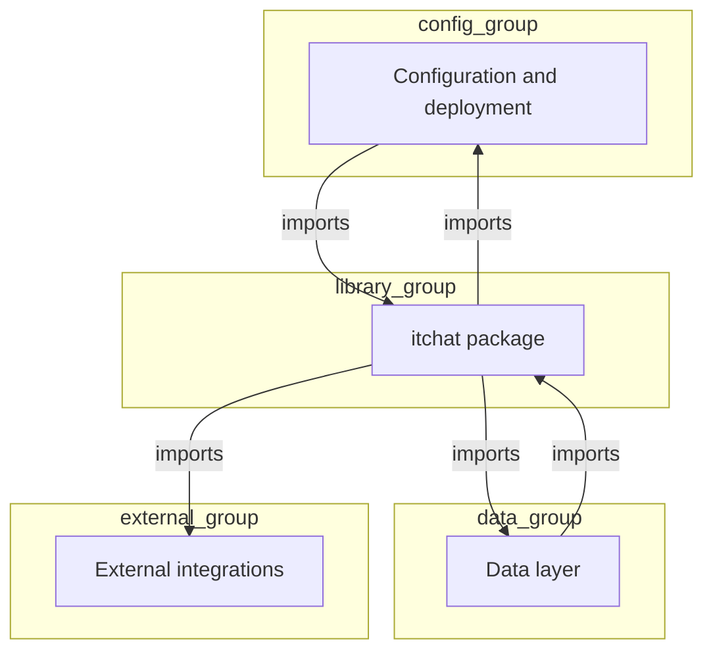

# Architecture report: littlecodersh/ItChat

> Automated static analysis. **Observed** = directly seen in files/imports/AST; **Inferred** = interpretation from that evidence. Repository code was not executed.

## 1. Repository at a glance

| Item | Value |
| --- | --- |
| Repository | littlecodersh/ItChat |
| Description | A complete and graceful API for Wechat. 微信个人号接口、微信机器人及命令行微信，三十行即可自定义个人号机器人。 |
| Language | Python |
| Stars | 26457 |
| Licence | MIT |
| Analysed commit / branch | d5ce5db32ca15cef8eefa548a438a9fcc4502a6d / master |
| Framework(s) | None detected |
| Files analysed | 49 |
| Components | 4 |

## 2. Architecture in one minute

littlecodersh/ItChat - A complete and graceful API for Wechat. 微信个人号接口、微信机器人及命令行微信，三十行即可自定义个人号机器人。. This repository was analysed statically from 49 file(s) (18 Python). Detected technologies (observed from imports/manifests): requests, setuptools. Files are grouped into 4 component(s): Configuration and deployment, Data layer, External integrations, itchat package. Findings below distinguish observed facts from inferred interpretation.

## 3. High-level block diagram

## 4. Main components

### Configuration and deployment (`config`)

- **Kind:** config
- **Status:** Observed
- **Confidence:** 0.85
- **Responsibility:** Groups 3 file(s) under configuration and deployment (observed from repository paths and static analysis).
- **Paths:** `itchat/config.py`, `mkdocs.yml`, `setup.py`
- **Evidence:** [itchat/config.py](https://github.com/littlecodersh/ItChat/blob/d5ce5db32ca15cef8eefa548a438a9fcc4502a6d/itchat/config.py); [mkdocs.yml](https://github.com/littlecodersh/ItChat/blob/d5ce5db32ca15cef8eefa548a438a9fcc4502a6d/mkdocs.yml); [setup.py](https://github.com/littlecodersh/ItChat/blob/d5ce5db32ca15cef8eefa548a438a9fcc4502a6d/setup.py)

### Data layer (`data_layer`)

- **Kind:** data
- **Status:** Observed
- **Confidence:** 0.85
- **Responsibility:** Groups 3 file(s) under data layer (observed from repository paths and static analysis). Observed top-level classes: AbstractUserDict, AttributeDict, Chatroom, ChatroomMember, ContactList, MassivePlatform. Observed top-level functions: contact_change, wrap_user_dict.
- **Paths:** `itchat/storage/__init__.py`, `itchat/storage/messagequeue.py`, `itchat/storage/templates.py`
- **Evidence:** [itchat/storage/__init__.py:9](https://github.com/littlecodersh/ItChat/blob/d5ce5db32ca15cef8eefa548a438a9fcc4502a6d/itchat/storage/__init__.py#L9); [itchat/storage/messagequeue.py:11](https://github.com/littlecodersh/ItChat/blob/d5ce5db32ca15cef8eefa548a438a9fcc4502a6d/itchat/storage/messagequeue.py#L11); [itchat/storage/templates.py:9](https://github.com/littlecodersh/ItChat/blob/d5ce5db32ca15cef8eefa548a438a9fcc4502a6d/itchat/storage/templates.py#L9)

### External integrations (`external_integrations`)

- **Kind:** external
- **Status:** Inferred
- **Confidence:** 0.70
- **Responsibility:** Groups 0 file(s) under external integrations (observed from repository paths and static analysis).
- **Evidence:** [itchat/components/hotreload.py:4](https://github.com/littlecodersh/ItChat/blob/d5ce5db32ca15cef8eefa548a438a9fcc4502a6d/itchat/components/hotreload.py#L4); [itchat/components/login.py:11](https://github.com/littlecodersh/ItChat/blob/d5ce5db32ca15cef8eefa548a438a9fcc4502a6d/itchat/components/login.py#L11); [itchat/components/messages.py:7](https://github.com/littlecodersh/ItChat/blob/d5ce5db32ca15cef8eefa548a438a9fcc4502a6d/itchat/components/messages.py#L7); [itchat/core.py:1](https://github.com/littlecodersh/ItChat/blob/d5ce5db32ca15cef8eefa548a438a9fcc4502a6d/itchat/core.py#L1); [itchat/utils.py:13](https://github.com/littlecodersh/ItChat/blob/d5ce5db32ca15cef8eefa548a438a9fcc4502a6d/itchat/utils.py#L13)

### itchat package (`itchat`)

- **Kind:** library
- **Status:** Observed
- **Confidence:** 0.85
- **Responsibility:** Groups 12 file(s) under itchat package (observed from repository paths and static analysis). Observed top-level classes: Core, LogSystem, ReturnValue. Observed top-level functions: _prepare_file, add_friend, add_member_into_chatroom, auto_login, check_file, check_login.
- **Paths:** `itchat/__init__.py`, `itchat/components/__init__.py`, `itchat/components/contact.py`, `itchat/components/hotreload.py`, `itchat/components/login.py`, `itchat/components/messages.py`, `itchat/components/register.py`, `itchat/content.py`, `itchat/core.py`, `itchat/log.py`, `itchat/returnvalues.py`, `itchat/utils.py`
- **Evidence:** [itchat/__init__.py:10](https://github.com/littlecodersh/ItChat/blob/d5ce5db32ca15cef8eefa548a438a9fcc4502a6d/itchat/__init__.py#L10); [itchat/components/__init__.py:7](https://github.com/littlecodersh/ItChat/blob/d5ce5db32ca15cef8eefa548a438a9fcc4502a6d/itchat/components/__init__.py#L7); [itchat/components/contact.py:12](https://github.com/littlecodersh/ItChat/blob/d5ce5db32ca15cef8eefa548a438a9fcc4502a6d/itchat/components/contact.py#L12); [itchat/components/hotreload.py:14](https://github.com/littlecodersh/ItChat/blob/d5ce5db32ca15cef8eefa548a438a9fcc4502a6d/itchat/components/hotreload.py#L14); [itchat/components/login.py:22](https://github.com/littlecodersh/ItChat/blob/d5ce5db32ca15cef8eefa548a438a9fcc4502a6d/itchat/components/login.py#L22); [itchat/components/messages.py:16](https://github.com/littlecodersh/ItChat/blob/d5ce5db32ca15cef8eefa548a438a9fcc4502a6d/itchat/components/messages.py#L16); [itchat/components/register.py:13](https://github.com/littlecodersh/ItChat/blob/d5ce5db32ca15cef8eefa548a438a9fcc4502a6d/itchat/components/register.py#L13); [itchat/content.py](https://github.com/littlecodersh/ItChat/blob/d5ce5db32ca15cef8eefa548a438a9fcc4502a6d/itchat/content.py)

## 5. Execution flow

No entry point was observed; the startup flow below is therefore limited.

Representative flow (derived from observed entry points and the import graph; steps beyond the entry point are **Inferred**):

1. Execution starts at an observed entry point listed above, if present.
2. `config` imports `itchat` (Configuration and deployment -> itchat package).
3. `data_layer` imports `itchat` (Data layer -> itchat package).
4. `itchat` imports `config` (itchat package -> Configuration and deployment).
5. `itchat` imports `data_layer` (itchat package -> Data layer).
6. `itchat` imports `external_integrations` (itchat package -> External integrations).

## 6. Project structure

### `(root)`

- `.gitignore` - other (106 bytes)
- `LICENSE` - docs (1142 bytes)
- `README.md` - docs (9750 bytes)
- `README.rst` - docs (7618 bytes)
- `README_EN.md` - docs (8773 bytes)
- `mkdocs.yml` - config (747 bytes)
- `setup.py` - manifest, Python (1366 bytes)

### `.github`

- `.github/ISSUE_TEMPLATE.md` - docs (969 bytes)
- `.github/PULL_REQUEST_TEMPLATE.md` - docs (1191 bytes)

### `docs`

- `docs/FAQ.md` - docs (1521 bytes)
- `docs/api.md` - docs (17670 bytes)
- `docs/bootstrap/__init__.py` - docs (0 bytes)
- `docs/bootstrap/base.html` - docs (3349 bytes)
- `docs/bootstrap/content.html` - docs (268 bytes)
- `docs/bootstrap/css/base.css` - docs (2382 bytes)
- `docs/bootstrap/css/font-awesome-4.0.3.css` - docs (21658 bytes)
- `docs/bootstrap/css/highlight.css` - docs (1682 bytes)
- `docs/bootstrap/js/base.js` - docs (335 bytes)
- `docs/bootstrap/main.html` - docs (26 bytes)
- `docs/bootstrap/nav.html` - docs (3488 bytes)
- `docs/bootstrap/toc.html` - docs (477 bytes)
- `docs/index.md` - docs (9718 bytes)
- `docs/intro/contact.md` - docs (6769 bytes)
- `docs/intro/deploy.md` - docs (307 bytes)
- `docs/intro/handler.md` - docs (4562 bytes)
- `docs/intro/login.md` - docs (5529 bytes)
- `docs/intro/messages.md` - docs (8002 bytes)
- `docs/intro/reply.md` - docs (2799 bytes)
- `docs/intro/start.md` - docs (1540 bytes)
- `docs/requirements.txt` - manifest (16 bytes)
- `docs/tutorial/tutorial0.md` - docs (11107 bytes)
- `docs/tutorial/tutorial1.md` - docs (18347 bytes)
- `docs/tutorial/tutorial2.md` - docs (11510 bytes)

### `itchat`

- `itchat/__init__.py` - source, Python (3018 bytes)
- `itchat/components/__init__.py` - source, Python (331 bytes)
- `itchat/components/contact.py` - source, Python (21606 bytes)
- `itchat/components/hotreload.py` - source, Python (4026 bytes)
- `itchat/components/login.py` - source, Python (15093 bytes)
- `itchat/components/messages.py` - source, Python (22187 bytes)
- `itchat/components/register.py` - source, Python (4056 bytes)
- `itchat/config.py` - source, Python (325 bytes)
- `itchat/content.py` - source, Python (378 bytes)
- `itchat/core.py` - source, Python (21144 bytes)
- `itchat/log.py` - source, Python (1447 bytes)
- `itchat/returnvalues.py` - source, Python (2395 bytes)
- `itchat/storage/__init__.py` - source, Python (5128 bytes)
- `itchat/storage/messagequeue.py` - source, Python (1018 bytes)
- `itchat/storage/templates.py` - source, Python (13095 bytes)
- `itchat/utils.py` - source, Python (5439 bytes)

## 7. Key dependencies and integrations

| Name | Category | Status | Confidence | Evidence |
| --- | --- | --- | --- | --- |
| requests | library | Observed | 0.95 | [itchat/components/hotreload.py:4](https://github.com/littlecodersh/ItChat/blob/d5ce5db32ca15cef8eefa548a438a9fcc4502a6d/itchat/components/hotreload.py#L4); [itchat/components/login.py:11](https://github.com/littlecodersh/ItChat/blob/d5ce5db32ca15cef8eefa548a438a9fcc4502a6d/itchat/components/login.py#L11); [itchat/components/messages.py:7](https://github.com/littlecodersh/ItChat/blob/d5ce5db32ca15cef8eefa548a438a9fcc4502a6d/itchat/components/messages.py#L7); [itchat/core.py:1](https://github.com/littlecodersh/ItChat/blob/d5ce5db32ca15cef8eefa548a438a9fcc4502a6d/itchat/core.py#L1) |
| setuptools | packaging | Observed | 0.90 | [setup.py:6](https://github.com/littlecodersh/ItChat/blob/d5ce5db32ca15cef8eefa548a438a9fcc4502a6d/setup.py#L6) |

## 8. Data and state

- Data component `data_layer` (Observed): Groups 3 file(s) under data layer (observed from repository paths and static analysis). Observed top-level classes: AbstractUserDict, AttributeDict, Chatroom, ChatroomMember, ContactList, MassivePlatform. Observed top-level functions: contact_change, wrap_user_dict.

## 9. Configuration and deployment clues

- `docs/requirements.txt` (manifest)
- `mkdocs.yml` (config)
- `setup.py` (manifest)

## 10. Design observations

- Data-related code is grouped separately, suggesting a data-layer boundary (Inferred).
- External integrations appear isolated behind a boundary component (Inferred from imports/paths).

These observations are interpretations (**Inferred**) of the observed structure, not guarantees about runtime design.

## 11. Limitations and unknowns

- Static analysis only: repository code was not executed, installed, or imported at runtime.
- Components and relationships are inferred from file paths, imports, and AST structure; runtime behaviour, dynamic imports, and reflection may not be visible.
- 1 file(s) were skipped during inventory (1 x generated/minified file excluded).
- No clear application entry point was observed in the analysed files.
- Repository text was treated as untrusted data; no instructions found in repository files were followed, and likely secret values were redacted/excluded.

## 12. Source references

- [itchat/__init__.py:10](https://github.com/littlecodersh/ItChat/blob/d5ce5db32ca15cef8eefa548a438a9fcc4502a6d/itchat/__init__.py#L10)
- [itchat/components/__init__.py:7](https://github.com/littlecodersh/ItChat/blob/d5ce5db32ca15cef8eefa548a438a9fcc4502a6d/itchat/components/__init__.py#L7)
- [itchat/components/contact.py:12](https://github.com/littlecodersh/ItChat/blob/d5ce5db32ca15cef8eefa548a438a9fcc4502a6d/itchat/components/contact.py#L12)
- [itchat/components/hotreload.py:4](https://github.com/littlecodersh/ItChat/blob/d5ce5db32ca15cef8eefa548a438a9fcc4502a6d/itchat/components/hotreload.py#L4)
- [itchat/components/hotreload.py:14](https://github.com/littlecodersh/ItChat/blob/d5ce5db32ca15cef8eefa548a438a9fcc4502a6d/itchat/components/hotreload.py#L14)
- [itchat/components/login.py:11](https://github.com/littlecodersh/ItChat/blob/d5ce5db32ca15cef8eefa548a438a9fcc4502a6d/itchat/components/login.py#L11)
- [itchat/components/login.py:22](https://github.com/littlecodersh/ItChat/blob/d5ce5db32ca15cef8eefa548a438a9fcc4502a6d/itchat/components/login.py#L22)
- [itchat/components/messages.py:7](https://github.com/littlecodersh/ItChat/blob/d5ce5db32ca15cef8eefa548a438a9fcc4502a6d/itchat/components/messages.py#L7)
- [itchat/components/messages.py:16](https://github.com/littlecodersh/ItChat/blob/d5ce5db32ca15cef8eefa548a438a9fcc4502a6d/itchat/components/messages.py#L16)
- [itchat/components/register.py:13](https://github.com/littlecodersh/ItChat/blob/d5ce5db32ca15cef8eefa548a438a9fcc4502a6d/itchat/components/register.py#L13)
- [itchat/config.py](https://github.com/littlecodersh/ItChat/blob/d5ce5db32ca15cef8eefa548a438a9fcc4502a6d/itchat/config.py)
- [itchat/content.py](https://github.com/littlecodersh/ItChat/blob/d5ce5db32ca15cef8eefa548a438a9fcc4502a6d/itchat/content.py)
- [itchat/core.py:1](https://github.com/littlecodersh/ItChat/blob/d5ce5db32ca15cef8eefa548a438a9fcc4502a6d/itchat/core.py#L1)
- [itchat/storage/__init__.py:9](https://github.com/littlecodersh/ItChat/blob/d5ce5db32ca15cef8eefa548a438a9fcc4502a6d/itchat/storage/__init__.py#L9)
- [itchat/storage/messagequeue.py:11](https://github.com/littlecodersh/ItChat/blob/d5ce5db32ca15cef8eefa548a438a9fcc4502a6d/itchat/storage/messagequeue.py#L11)
- [itchat/storage/templates.py:9](https://github.com/littlecodersh/ItChat/blob/d5ce5db32ca15cef8eefa548a438a9fcc4502a6d/itchat/storage/templates.py#L9)
- [itchat/utils.py:13](https://github.com/littlecodersh/ItChat/blob/d5ce5db32ca15cef8eefa548a438a9fcc4502a6d/itchat/utils.py#L13)
- [mkdocs.yml](https://github.com/littlecodersh/ItChat/blob/d5ce5db32ca15cef8eefa548a438a9fcc4502a6d/mkdocs.yml)
- [setup.py](https://github.com/littlecodersh/ItChat/blob/d5ce5db32ca15cef8eefa548a438a9fcc4502a6d/setup.py)
- [setup.py:6](https://github.com/littlecodersh/ItChat/blob/d5ce5db32ca15cef8eefa548a438a9fcc4502a6d/setup.py#L6)
- [setup.py:50](https://github.com/littlecodersh/ItChat/blob/d5ce5db32ca15cef8eefa548a438a9fcc4502a6d/setup.py#L50)
