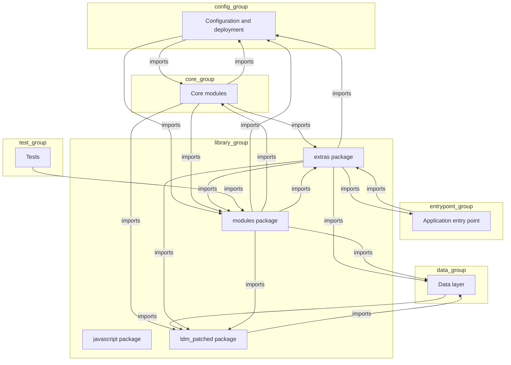

# Architecture report: lllyasviel/Fooocus

> Automated static analysis. **Observed** = directly seen in files/imports/AST; **Inferred** = interpretation from that evidence. Repository code was not executed.

## 1. Repository at a glance

| Item | Value |
| --- | --- |
| Repository | lllyasviel/Fooocus |
| Description | Focus on prompting and generating |
| Language | Python |
| Stars | 53929 |
| Licence | GPL-3.0 |
| Analysed commit / branch | ae05379cc97bc4361ec8b4ec90193dab21be763f / main |
| Framework(s) | None detected |
| Files analysed | 324 |
| Components | 9 |

## 2. Architecture in one minute

lllyasviel/Fooocus - Focus on prompting and generating. This repository was analysed statically from 324 file(s) (192 Python). Detected technologies (observed from imports/manifests): GitHub Actions, httpx, NumPy, Docker, Docker Compose, unittest. Files are grouped into 9 component(s): Configuration and deployment, Core modules, Data layer, Application entry point, extras package, javascript package, ldm_patched package, modules package. Observed entry point(s): extras/facexlib/detection/matlab_cp2tform.py, extras/facexlib/utils/face_utils.py. Findings below distinguish observed facts from inferred interpretation.

## 3. High-level block diagram

## 4. Main components

### Configuration and deployment (`config`)

- **Kind:** config
- **Status:** Observed
- **Confidence:** 0.85
- **Responsibility:** Groups 60 file(s) under configuration and deployment (observed from repository paths and static analysis). Observed top-level functions: add_ratio, download_sam_model, downloading_controlnet_canny, downloading_controlnet_cpds, downloading_inpaint_models, downloading_ip_adapters.
- **Paths:** `Dockerfile`, `auth-example.json`, `docker-compose.yml`, `environment.yaml`, `extras/BLIP/configs/bert_config.json`, `extras/BLIP/configs/caption_coco.yaml`, `extras/BLIP/configs/med_config.json`, `extras/BLIP/configs/nlvr.yaml`, `extras/BLIP/configs/nocaps.yaml`, `extras/BLIP/configs/pretrain.yaml`, `extras/BLIP/configs/retrieval_coco.yaml`, `extras/BLIP/configs/retrieval_flickr.yaml`, `extras/BLIP/configs/retrieval_msrvtt.yaml`, `extras/BLIP/configs/vqa.yaml`, `extras/BLIP/models/bert_tokenizer/config.json`, `extras/BLIP/models/bert_tokenizer/tokenizer_config.json`, `extras/GroundingDINO/config/GroundingDINO_SwinT_OGC.py`, `extras/safety_checker/configs/config.json`, `extras/safety_checker/configs/preprocessor_config.json`, `language/en.json`, `language/example.json`, `ldm_patched/modules/clip_config_bigg.json`, `ldm_patched/modules/clip_vision_config_g.json`, `ldm_patched/modules/clip_vision_config_h.json`, `ldm_patched/modules/clip_vision_config_vitl.json`, `ldm_patched/modules/sd1_clip_config.json`, `ldm_patched/modules/sd1_tokenizer/special_tokens_map.json`, `ldm_patched/modules/sd1_tokenizer/tokenizer_config.json`, `ldm_patched/modules/sd2_clip_config.json`, `models/configs/anything_v3.yaml`, `models/configs/v1-inference.yaml`, `models/configs/v1-inference_clip_skip_2.yaml`, `models/configs/v1-inference_clip_skip_2_fp16.yaml`, `models/configs/v1-inference_fp16.yaml`, `models/configs/v1-inpainting-inference.yaml`, `models/configs/v2-inference-v.yaml`, `models/configs/v2-inference-v_fp32.yaml`, `models/configs/v2-inference.yaml`, `models/configs/v2-inference_fp32.yaml`, `models/configs/v2-inpainting-inference.yaml`, `models/prompt_expansion/fooocus_expansion/config.json`, `models/prompt_expansion/fooocus_expansion/special_tokens_map.json`, `models/prompt_expansion/fooocus_expansion/tokenizer_config.json`, `modules/config.py`, `presets/anime.json`, `presets/default.json`, `presets/lcm.json`, `presets/lightning.json`, `presets/playground_v2.5.json`, `presets/pony_v6.json`, `presets/realistic.json`, `presets/sai.json`, `requirements_docker.txt`, `requirements_versions.txt`, `sdxl_styles/sdxl_styles_diva.json`, `sdxl_styles/sdxl_styles_fooocus.json`, `sdxl_styles/sdxl_styles_marc_k3nt3l.json`, `sdxl_styles/sdxl_styles_mre.json`, `sdxl_styles/sdxl_styles_sai.json`, `sdxl_styles/sdxl_styles_twri.json`
- **Evidence:** [Dockerfile](https://github.com/lllyasviel/Fooocus/blob/ae05379cc97bc4361ec8b4ec90193dab21be763f/Dockerfile); [auth-example.json](https://github.com/lllyasviel/Fooocus/blob/ae05379cc97bc4361ec8b4ec90193dab21be763f/auth-example.json); [docker-compose.yml](https://github.com/lllyasviel/Fooocus/blob/ae05379cc97bc4361ec8b4ec90193dab21be763f/docker-compose.yml); [environment.yaml](https://github.com/lllyasviel/Fooocus/blob/ae05379cc97bc4361ec8b4ec90193dab21be763f/environment.yaml); [extras/BLIP/configs/bert_config.json](https://github.com/lllyasviel/Fooocus/blob/ae05379cc97bc4361ec8b4ec90193dab21be763f/extras/BLIP/configs/bert_config.json); [extras/BLIP/configs/caption_coco.yaml](https://github.com/lllyasviel/Fooocus/blob/ae05379cc97bc4361ec8b4ec90193dab21be763f/extras/BLIP/configs/caption_coco.yaml); [extras/BLIP/configs/med_config.json](https://github.com/lllyasviel/Fooocus/blob/ae05379cc97bc4361ec8b4ec90193dab21be763f/extras/BLIP/configs/med_config.json); [extras/BLIP/configs/nlvr.yaml](https://github.com/lllyasviel/Fooocus/blob/ae05379cc97bc4361ec8b4ec90193dab21be763f/extras/BLIP/configs/nlvr.yaml)

### Core modules (`core`)

- **Kind:** core
- **Status:** Observed
- **Confidence:** 0.85
- **Responsibility:** Groups 12 file(s) under core modules (observed from repository paths and static analysis). Observed top-level functions: build_launcher, download_models, dump_default_english_config, generate_clicked, get_task, ini_args.
- **Paths:** `args_manager.py`, `build_launcher.py`, `entry_with_update.py`, `entrypoint.sh`, `experiments_expansion.py`, `experiments_face.py`, `experiments_interrogate.py`, `experiments_mask_generation.py`, `fooocus_version.py`, `launch.py`, `shared.py`, `webui.py`
- **Evidence:** [args_manager.py](https://github.com/lllyasviel/Fooocus/blob/ae05379cc97bc4361ec8b4ec90193dab21be763f/args_manager.py); [build_launcher.py:14](https://github.com/lllyasviel/Fooocus/blob/ae05379cc97bc4361ec8b4ec90193dab21be763f/build_launcher.py#L14); [entry_with_update.py](https://github.com/lllyasviel/Fooocus/blob/ae05379cc97bc4361ec8b4ec90193dab21be763f/entry_with_update.py); [entrypoint.sh](https://github.com/lllyasviel/Fooocus/blob/ae05379cc97bc4361ec8b4ec90193dab21be763f/entrypoint.sh); [experiments_expansion.py](https://github.com/lllyasviel/Fooocus/blob/ae05379cc97bc4361ec8b4ec90193dab21be763f/experiments_expansion.py); [experiments_face.py](https://github.com/lllyasviel/Fooocus/blob/ae05379cc97bc4361ec8b4ec90193dab21be763f/experiments_face.py); [experiments_interrogate.py](https://github.com/lllyasviel/Fooocus/blob/ae05379cc97bc4361ec8b4ec90193dab21be763f/experiments_interrogate.py); [experiments_mask_generation.py](https://github.com/lllyasviel/Fooocus/blob/ae05379cc97bc4361ec8b4ec90193dab21be763f/experiments_mask_generation.py)

### Data layer (`data_layer`)

- **Kind:** data
- **Status:** Observed
- **Confidence:** 0.85
- **Responsibility:** Groups 12 file(s) under data layer (observed from repository paths and static analysis). Observed top-level classes: AbstractAutoencoder, Attention, AttnBlock, AutoencoderKL, AutoencodingEngine, AutoencodingEngineLegacy. Observed top-level functions: Normalize, _load_weights, all_gather_with_grad, blip_decoder, blip_feature_extractor, blip_itm.
- **Paths:** `extras/BLIP/models/blip.py`, `extras/BLIP/models/blip_itm.py`, `extras/BLIP/models/blip_nlvr.py`, `extras/BLIP/models/blip_pretrain.py`, `extras/BLIP/models/blip_retrieval.py`, `extras/BLIP/models/blip_vqa.py`, `extras/BLIP/models/med.py`, `extras/BLIP/models/nlvr_encoder.py`, `extras/BLIP/models/vit.py`, `extras/safety_checker/models/safety_checker.py`, `ldm_patched/ldm/models/autoencoder.py`, `ldm_patched/ldm/modules/diffusionmodules/model.py`
- **Evidence:** [extras/BLIP/models/blip.py:23](https://github.com/lllyasviel/Fooocus/blob/ae05379cc97bc4361ec8b4ec90193dab21be763f/extras/BLIP/models/blip.py#L23); [extras/BLIP/models/blip_itm.py:10](https://github.com/lllyasviel/Fooocus/blob/ae05379cc97bc4361ec8b4ec90193dab21be763f/extras/BLIP/models/blip_itm.py#L10); [extras/BLIP/models/blip_nlvr.py:16](https://github.com/lllyasviel/Fooocus/blob/ae05379cc97bc4361ec8b4ec90193dab21be763f/extras/BLIP/models/blip_nlvr.py#L16); [extras/BLIP/models/blip_pretrain.py:19](https://github.com/lllyasviel/Fooocus/blob/ae05379cc97bc4361ec8b4ec90193dab21be763f/extras/BLIP/models/blip_pretrain.py#L19); [extras/BLIP/models/blip_retrieval.py:10](https://github.com/lllyasviel/Fooocus/blob/ae05379cc97bc4361ec8b4ec90193dab21be763f/extras/BLIP/models/blip_retrieval.py#L10); [extras/BLIP/models/blip_vqa.py:10](https://github.com/lllyasviel/Fooocus/blob/ae05379cc97bc4361ec8b4ec90193dab21be763f/extras/BLIP/models/blip_vqa.py#L10); [extras/BLIP/models/med.py:52](https://github.com/lllyasviel/Fooocus/blob/ae05379cc97bc4361ec8b4ec90193dab21be763f/extras/BLIP/models/med.py#L52); [extras/BLIP/models/nlvr_encoder.py:42](https://github.com/lllyasviel/Fooocus/blob/ae05379cc97bc4361ec8b4ec90193dab21be763f/extras/BLIP/models/nlvr_encoder.py#L42)

### Application entry point (`entrypoint`)

- **Kind:** entrypoint
- **Status:** Observed
- **Confidence:** 0.85
- **Responsibility:** Groups 2 file(s) under application entry point (observed from repository paths and static analysis). Observed top-level classes: MatlabCp2tormException. Observed top-level functions: align_crop_face_landmarks, compute_increased_bbox, cvt_tform_mat_for_cv2, findNonreflectiveSimilarity, findSimilarity, get_similarity_transform.
- **Paths:** `extras/facexlib/detection/matlab_cp2tform.py`, `extras/facexlib/utils/face_utils.py`
- **Evidence:** [extras/facexlib/detection/matlab_cp2tform.py:7](https://github.com/lllyasviel/Fooocus/blob/ae05379cc97bc4361ec8b4ec90193dab21be763f/extras/facexlib/detection/matlab_cp2tform.py#L7); [extras/facexlib/utils/face_utils.py:6](https://github.com/lllyasviel/Fooocus/blob/ae05379cc97bc4361ec8b4ec90193dab21be763f/extras/facexlib/utils/face_utils.py#L6)

### extras package (`extras`)

- **Kind:** library
- **Status:** Observed
- **Confidence:** 0.85
- **Responsibility:** Groups 24 file(s) under extras package (observed from repository paths and static analysis). Observed top-level classes: AttentionRefinementModule, BasicBlock, BboxHead, BiSeNet, BiSeNetOutput, Censor. Observed top-level functions: FeedForward, align_warp_face, batched_decode, batched_decode_landm, canny_pyramid, center_size.
- **Paths:** `extras/GroundingDINO/util/inference.py`, `extras/censor.py`, `extras/expansion.py`, `extras/face_crop.py`, `extras/facexlib/detection/__init__.py`, `extras/facexlib/detection/align_trans.py`, `extras/facexlib/detection/retinaface.py`, `extras/facexlib/detection/retinaface_net.py`, `extras/facexlib/detection/retinaface_utils.py`, `extras/facexlib/parsing/__init__.py`, `extras/facexlib/parsing/bisenet.py`, `extras/facexlib/parsing/parsenet.py`, `extras/facexlib/parsing/resnet.py`, `extras/facexlib/utils/__init__.py`, `extras/facexlib/utils/face_restoration_helper.py`, `extras/facexlib/utils/misc.py`, `extras/inpaint_mask.py`, `extras/interrogate.py`, `extras/ip_adapter.py`, `extras/preprocessors.py`, `extras/resampler.py`, `extras/sam/predictor.py`, `extras/vae_interpose.py`, `extras/wd14tagger.py`
- **Evidence:** [extras/GroundingDINO/util/inference.py:15](https://github.com/lllyasviel/Fooocus/blob/ae05379cc97bc4361ec8b4ec90193dab21be763f/extras/GroundingDINO/util/inference.py#L15); [extras/censor.py:17](https://github.com/lllyasviel/Fooocus/blob/ae05379cc97bc4361ec8b4ec90193dab21be763f/extras/censor.py#L17); [extras/expansion.py:24](https://github.com/lllyasviel/Fooocus/blob/ae05379cc97bc4361ec8b4ec90193dab21be763f/extras/expansion.py#L24); [extras/face_crop.py:9](https://github.com/lllyasviel/Fooocus/blob/ae05379cc97bc4361ec8b4ec90193dab21be763f/extras/face_crop.py#L9); [extras/facexlib/detection/__init__.py:8](https://github.com/lllyasviel/Fooocus/blob/ae05379cc97bc4361ec8b4ec90193dab21be763f/extras/facexlib/detection/__init__.py#L8); [extras/facexlib/detection/align_trans.py:13](https://github.com/lllyasviel/Fooocus/blob/ae05379cc97bc4361ec8b4ec90193dab21be763f/extras/facexlib/detection/align_trans.py#L13); [extras/facexlib/detection/retinaface.py:15](https://github.com/lllyasviel/Fooocus/blob/ae05379cc97bc4361ec8b4ec90193dab21be763f/extras/facexlib/detection/retinaface.py#L15); [extras/facexlib/detection/retinaface_net.py:6](https://github.com/lllyasviel/Fooocus/blob/ae05379cc97bc4361ec8b4ec90193dab21be763f/extras/facexlib/detection/retinaface_net.py#L6)

### javascript package (`javascript`)

- **Kind:** library
- **Status:** Observed
- **Confidence:** 0.85
- **Responsibility:** Groups 7 file(s) under javascript package (observed from repository paths and static analysis).
- **Paths:** `javascript/contextMenus.js`, `javascript/edit-attention.js`, `javascript/imageviewer.js`, `javascript/localization.js`, `javascript/script.js`, `javascript/viewer.js`, `javascript/zoom.js`
- **Evidence:** [javascript/contextMenus.js](https://github.com/lllyasviel/Fooocus/blob/ae05379cc97bc4361ec8b4ec90193dab21be763f/javascript/contextMenus.js); [javascript/edit-attention.js](https://github.com/lllyasviel/Fooocus/blob/ae05379cc97bc4361ec8b4ec90193dab21be763f/javascript/edit-attention.js); [javascript/imageviewer.js](https://github.com/lllyasviel/Fooocus/blob/ae05379cc97bc4361ec8b4ec90193dab21be763f/javascript/imageviewer.js); [javascript/localization.js](https://github.com/lllyasviel/Fooocus/blob/ae05379cc97bc4361ec8b4ec90193dab21be763f/javascript/localization.js); [javascript/script.js](https://github.com/lllyasviel/Fooocus/blob/ae05379cc97bc4361ec8b4ec90193dab21be763f/javascript/script.js); [javascript/viewer.js](https://github.com/lllyasviel/Fooocus/blob/ae05379cc97bc4361ec8b4ec90193dab21be763f/javascript/viewer.js); [javascript/zoom.js](https://github.com/lllyasviel/Fooocus/blob/ae05379cc97bc4361ec8b4ec90193dab21be763f/javascript/zoom.js)

### ldm_patched package (`ldm_patched`)

- **Kind:** library
- **Status:** Observed
- **Confidence:** 0.85
- **Responsibility:** Groups 109 file(s) under ldm_patched package (observed from repository paths and static analysis). Observed top-level classes: AE3DConv, AbstractDistribution, AbstractLowScaleModel, AdaConvGuidedFilter, AdaGuidedFilter, AdamWwithEMAandWings. Observed top-level functions: DDPMSampler_step, Decoder, Encoder, Fourier_filter, MBConv, Normalize.
- **Paths:** `ldm_patched/contrib/external.py`, `ldm_patched/contrib/external_align_your_steps.py`, `ldm_patched/contrib/external_canny.py`, `ldm_patched/contrib/external_clip_sdxl.py`, `ldm_patched/contrib/external_compositing.py`, `ldm_patched/contrib/external_custom_sampler.py`, `ldm_patched/contrib/external_freelunch.py`, `ldm_patched/contrib/external_hypernetwork.py`, `ldm_patched/contrib/external_hypertile.py`, `ldm_patched/contrib/external_images.py`, `ldm_patched/contrib/external_latent.py`, `ldm_patched/contrib/external_mask.py`, `ldm_patched/contrib/external_model_advanced.py`, `ldm_patched/contrib/external_model_downscale.py`, `ldm_patched/contrib/external_model_merging.py`, `ldm_patched/contrib/external_perpneg.py`, `ldm_patched/contrib/external_photomaker.py`, `ldm_patched/contrib/external_post_processing.py`, `ldm_patched/contrib/external_rebatch.py`, `ldm_patched/contrib/external_sag.py`, `ldm_patched/contrib/external_sdupscale.py`, `ldm_patched/contrib/external_stable3d.py`, `ldm_patched/contrib/external_tomesd.py`, `ldm_patched/contrib/external_upscale_model.py`, `ldm_patched/contrib/external_video_model.py`, `ldm_patched/controlnet/cldm.py`, `ldm_patched/k_diffusion/sampling.py`, `ldm_patched/k_diffusion/utils.py`, `ldm_patched/ldm/modules/attention.py`, `ldm_patched/ldm/modules/diffusionmodules/__init__.py`, `ldm_patched/ldm/modules/diffusionmodules/openaimodel.py`, `ldm_patched/ldm/modules/diffusionmodules/upscaling.py`, `ldm_patched/ldm/modules/diffusionmodules/util.py`, `ldm_patched/ldm/modules/distributions/__init__.py`, `ldm_patched/ldm/modules/distributions/distributions.py`, `ldm_patched/ldm/modules/ema.py`, `ldm_patched/ldm/modules/encoders/__init__.py`, `ldm_patched/ldm/modules/encoders/noise_aug_modules.py`, `ldm_patched/ldm/modules/sub_quadratic_attention.py`, `ldm_patched/ldm/modules/temporal_ae.py`, `ldm_patched/ldm/util.py`, `ldm_patched/modules/args_parser.py`, `ldm_patched/modules/checkpoint_pickle.py`, `ldm_patched/modules/clip_model.py`, `ldm_patched/modules/clip_vision.py`, `ldm_patched/modules/conds.py`, `ldm_patched/modules/controlnet.py`, `ldm_patched/modules/diffusers_convert.py`, `ldm_patched/modules/diffusers_load.py`, `ldm_patched/modules/gligen.py`, `ldm_patched/modules/latent_formats.py`, `ldm_patched/modules/lora.py`, `ldm_patched/modules/model_base.py`, `ldm_patched/modules/model_detection.py`, `ldm_patched/modules/model_management.py`, `ldm_patched/modules/model_patcher.py`, `ldm_patched/modules/model_sampling.py`, `ldm_patched/modules/ops.py`, `ldm_patched/modules/options.py`, `ldm_patched/modules/sample.py`, `ldm_patched/modules/samplers.py`, `ldm_patched/modules/sd.py`, `ldm_patched/modules/sd1_clip.py`, `ldm_patched/modules/sd2_clip.py`, `ldm_patched/modules/sdxl_clip.py`, `ldm_patched/modules/supported_models.py`, `ldm_patched/modules/supported_models_base.py`, `ldm_patched/modules/utils.py`, `ldm_patched/pfn/__init__.py`, `ldm_patched/pfn/architecture/DAT.py`, `ldm_patched/pfn/architecture/HAT.py`, `ldm_patched/pfn/architecture/LaMa.py`, `ldm_patched/pfn/architecture/OmniSR/ChannelAttention.py`, `ldm_patched/pfn/architecture/OmniSR/OSA.py`, `ldm_patched/pfn/architecture/OmniSR/OSAG.py`, `ldm_patched/pfn/architecture/OmniSR/OmniSR.py`, `ldm_patched/pfn/architecture/OmniSR/esa.py`, `ldm_patched/pfn/architecture/OmniSR/layernorm.py`, `ldm_patched/pfn/architecture/OmniSR/pixelshuffle.py`, `ldm_patched/pfn/architecture/RRDB.py`, `ldm_patched/pfn/architecture/SCUNet.py`, `ldm_patched/pfn/architecture/SPSR.py`, `ldm_patched/pfn/architecture/SRVGG.py`, `ldm_patched/pfn/architecture/SwiftSRGAN.py`, `ldm_patched/pfn/architecture/Swin2SR.py`, `ldm_patched/pfn/architecture/SwinIR.py`, `ldm_patched/pfn/architecture/__init__.py`, `ldm_patched/pfn/architecture/block.py`, `ldm_patched/pfn/architecture/face/arcface_arch.py`, `ldm_patched/pfn/architecture/face/codeformer.py`, `ldm_patched/pfn/architecture/face/fused_act.py`, `ldm_patched/pfn/architecture/face/gfpgan_bilinear_arch.py`, `ldm_patched/pfn/architecture/face/gfpganv1_arch.py`, `ldm_patched/pfn/architecture/face/gfpganv1_clean_arch.py`, `ldm_patched/pfn/architecture/face/restoreformer_arch.py`, `ldm_patched/pfn/architecture/face/stylegan2_arch.py`, `ldm_patched/pfn/architecture/face/stylegan2_bilinear_arch.py`, `ldm_patched/pfn/architecture/face/stylegan2_clean_arch.py`, `ldm_patched/pfn/architecture/face/upfirdn2d.py`, `ldm_patched/pfn/architecture/timm/drop.py`, `ldm_patched/pfn/architecture/timm/helpers.py`, `ldm_patched/pfn/architecture/timm/weight_init.py`, `ldm_patched/pfn/model_loading.py`, `ldm_patched/pfn/types.py`, `ldm_patched/t2ia/adapter.py`, `ldm_patched/taesd/taesd.py`, `ldm_patched/unipc/uni_pc.py`, `ldm_patched/utils/latent_visualization.py`, `ldm_patched/utils/path_utils.py`
- **Evidence:** [ldm_patched/contrib/external.py:39](https://github.com/lllyasviel/Fooocus/blob/ae05379cc97bc4361ec8b4ec90193dab21be763f/ldm_patched/contrib/external.py#L39); [ldm_patched/contrib/external_align_your_steps.py:7](https://github.com/lllyasviel/Fooocus/blob/ae05379cc97bc4361ec8b4ec90193dab21be763f/ldm_patched/contrib/external_align_your_steps.py#L7); [ldm_patched/contrib/external_canny.py:10](https://github.com/lllyasviel/Fooocus/blob/ae05379cc97bc4361ec8b4ec90193dab21be763f/ldm_patched/contrib/external_canny.py#L10); [ldm_patched/contrib/external_clip_sdxl.py:6](https://github.com/lllyasviel/Fooocus/blob/ae05379cc97bc4361ec8b4ec90193dab21be763f/ldm_patched/contrib/external_clip_sdxl.py#L6); [ldm_patched/contrib/external_compositing.py:8](https://github.com/lllyasviel/Fooocus/blob/ae05379cc97bc4361ec8b4ec90193dab21be763f/ldm_patched/contrib/external_compositing.py#L8); [ldm_patched/contrib/external_custom_sampler.py:11](https://github.com/lllyasviel/Fooocus/blob/ae05379cc97bc4361ec8b4ec90193dab21be763f/ldm_patched/contrib/external_custom_sampler.py#L11); [ldm_patched/contrib/external_freelunch.py:8](https://github.com/lllyasviel/Fooocus/blob/ae05379cc97bc4361ec8b4ec90193dab21be763f/ldm_patched/contrib/external_freelunch.py#L8); [ldm_patched/contrib/external_hypernetwork.py:7](https://github.com/lllyasviel/Fooocus/blob/ae05379cc97bc4361ec8b4ec90193dab21be763f/ldm_patched/contrib/external_hypernetwork.py#L7)

### modules package (`modules`)

- **Kind:** library
- **Status:** Observed
- **Confidence:** 0.85
- **Responsibility:** Groups 29 file(s) under modules package (observed from repository paths and static analysis). Observed top-level classes: A1111MetadataParser, AsyncTask, BilateralBlur, BrownianTreeNoiseSamplerPatched, EarlyReturnException, FooocusMetadataParser. Observed top-level functions: HWC3, _bilateral_blur, _compute_zero_padding, _unpack_2d_ks, adaptive_anisotropic_filter, addnet_hash_safetensors.
- **Paths:** `modules/__init__.py`, `modules/anisotropic.py`, `modules/async_worker.py`, `modules/auth.py`, `modules/constants.py`, `modules/core.py`, `modules/default_pipeline.py`, `modules/extra_utils.py`, `modules/flags.py`, `modules/gradio_hijack.py`, `modules/hash_cache.py`, `modules/html.py`, `modules/inpaint_worker.py`, `modules/launch_util.py`, `modules/localization.py`, `modules/lora.py`, `modules/meta_parser.py`, `modules/model_loader.py`, `modules/ops.py`, `modules/patch.py`, `modules/patch_clip.py`, `modules/patch_precision.py`, `modules/private_logger.py`, `modules/sample_hijack.py`, `modules/sdxl_styles.py`, `modules/style_sorter.py`, `modules/ui_gradio_extensions.py`, `modules/upscaler.py`, `modules/util.py`
- **Evidence:** [modules/__init__.py](https://github.com/lllyasviel/Fooocus/blob/ae05379cc97bc4361ec8b4ec90193dab21be763f/modules/__init__.py); [modules/anisotropic.py:10](https://github.com/lllyasviel/Fooocus/blob/ae05379cc97bc4361ec8b4ec90193dab21be763f/modules/anisotropic.py#L10); [modules/async_worker.py:10](https://github.com/lllyasviel/Fooocus/blob/ae05379cc97bc4361ec8b4ec90193dab21be763f/modules/async_worker.py#L10); [modules/auth.py:8](https://github.com/lllyasviel/Fooocus/blob/ae05379cc97bc4361ec8b4ec90193dab21be763f/modules/auth.py#L8); [modules/constants.py](https://github.com/lllyasviel/Fooocus/blob/ae05379cc97bc4361ec8b4ec90193dab21be763f/modules/constants.py); [modules/core.py:37](https://github.com/lllyasviel/Fooocus/blob/ae05379cc97bc4361ec8b4ec90193dab21be763f/modules/core.py#L37); [modules/default_pipeline.py:33](https://github.com/lllyasviel/Fooocus/blob/ae05379cc97bc4361ec8b4ec90193dab21be763f/modules/default_pipeline.py#L33); [modules/extra_utils.py:5](https://github.com/lllyasviel/Fooocus/blob/ae05379cc97bc4361ec8b4ec90193dab21be763f/modules/extra_utils.py#L5)

### Tests (`tests`)

- **Kind:** test
- **Status:** Observed
- **Confidence:** 0.85
- **Responsibility:** Groups 3 file(s) under tests (observed from repository paths and static analysis). Observed top-level classes: TestUtils.
- **Paths:** `tests/__init__.py`, `tests/test_extra_utils.py`, `tests/test_utils.py`
- **Evidence:** [tests/__init__.py](https://github.com/lllyasviel/Fooocus/blob/ae05379cc97bc4361ec8b4ec90193dab21be763f/tests/__init__.py); [tests/test_extra_utils.py:9](https://github.com/lllyasviel/Fooocus/blob/ae05379cc97bc4361ec8b4ec90193dab21be763f/tests/test_extra_utils.py#L9); [tests/test_utils.py:8](https://github.com/lllyasviel/Fooocus/blob/ae05379cc97bc4361ec8b4ec90193dab21be763f/tests/test_utils.py#L8)

## 5. Execution flow

**Observed** entry point(s):

- [extras/facexlib/detection/matlab_cp2tform.py:235](https://github.com/lllyasviel/Fooocus/blob/ae05379cc97bc4361ec8b4ec90193dab21be763f/extras/facexlib/detection/matlab_cp2tform.py#L235)
- [extras/facexlib/utils/face_utils.py:211](https://github.com/lllyasviel/Fooocus/blob/ae05379cc97bc4361ec8b4ec90193dab21be763f/extras/facexlib/utils/face_utils.py#L211)

Representative flow (derived from observed entry points and the import graph; steps beyond the entry point are **Inferred**):

1. Execution starts at an observed entry point listed above, if present.
2. `config` imports `core` (Configuration and deployment -> Core modules).
3. `config` imports `modules` (Configuration and deployment -> modules package).
4. `core` imports `config` (Core modules -> Configuration and deployment).
5. `core` imports `extras` (Core modules -> extras package).
6. `core` imports `ldm_patched` (Core modules -> ldm_patched package).
7. `core` imports `modules` (Core modules -> modules package).
8. `data_layer` imports `ldm_patched` (Data layer -> ldm_patched package).
9. `entrypoint` imports `extras` (Application entry point -> extras package).

## 6. Project structure

### `(root)`

- `.dockerignore` - container (700 bytes)
- `.gitattributes` - other (114 bytes)
- `.gitignore` - other (716 bytes)
- `Dockerfile` - container (1119 bytes)
- `LICENSE` - docs (35149 bytes)
- `args_manager.py` - source, Python (3117 bytes)
- `auth-example.json` - config (111 bytes)
- `build_launcher.py` - source, Python (838 bytes)
- `development.md` - docs (178 bytes)
- `docker-compose.yml` - container (1483 bytes)
- `docker.md` - docs (5949 bytes)
- `entry_with_update.py` - source, Python (1337 bytes)
- `entrypoint.sh` - source, Shell (632 bytes)
- `environment.yaml` - config (94 bytes)
- `experiments_expansion.py` - source, Python (160 bytes)
- `experiments_face.py` - source, Python (149 bytes)
- `experiments_interrogate.py` - source, Python (376 bytes)
- `experiments_mask_generation.py` - source, Python (637 bytes)
- `fooocus_colab.ipynb` - other (639 bytes)
- `fooocus_version.py` - source, Python (17 bytes)
- `launch.py` - source, Python (6428 bytes)
- `readme.md` - docs (33354 bytes)
- `requirements_docker.txt` - manifest (33 bytes)
- `requirements_versions.txt` - manifest (427 bytes)
- `shared.py` - source, Python (18 bytes)
- `troubleshoot.md` - docs (8887 bytes)
- `update_log.md` - docs (29499 bytes)
- `webui.py` - source, Python (81640 bytes)

### `.github`

- `.github/CODEOWNERS` - other (20 bytes)
- `.github/ISSUE_TEMPLATE/bug_report.yml` - config (3748 bytes)
- `.github/ISSUE_TEMPLATE/config.yml` - config (181 bytes)
- `.github/ISSUE_TEMPLATE/feature_request.yml` - config (1421 bytes)
- `.github/dependabot.yml` - config (118 bytes)
- `.github/workflows/build_container.yml` - ci, YAML (1190 bytes)

### `css`

- `css/style.css` - other (8224 bytes)

### `extras`

- `extras/BLIP/configs/bert_config.json` - config (485 bytes)
- `extras/BLIP/configs/caption_coco.yaml` - config (651 bytes)
- `extras/BLIP/configs/med_config.json` - config (485 bytes)
- `extras/BLIP/configs/nlvr.yaml` - config (441 bytes)
- `extras/BLIP/configs/nocaps.yaml` - config (352 bytes)
- `extras/BLIP/configs/pretrain.yaml` - config (479 bytes)
- `extras/BLIP/configs/retrieval_coco.yaml` - config (655 bytes)
- `extras/BLIP/configs/retrieval_flickr.yaml` - config (658 bytes)
- `extras/BLIP/configs/retrieval_msrvtt.yaml` - config (354 bytes)
- `extras/BLIP/configs/vqa.yaml` - config (639 bytes)
- `extras/BLIP/models/bert_tokenizer/config.json` - config (570 bytes)
- `extras/BLIP/models/bert_tokenizer/tokenizer_config.json` - config (28 bytes)
- `extras/BLIP/models/blip.py` - source, Python (11100 bytes)
- `extras/BLIP/models/blip_itm.py` - source, Python (3184 bytes)
- `extras/BLIP/models/blip_nlvr.py` - source, Python (4495 bytes)
- `extras/BLIP/models/blip_pretrain.py` - source, Python (16084 bytes)
- `extras/BLIP/models/blip_retrieval.py` - source, Python (13783 bytes)
- `extras/BLIP/models/blip_vqa.py` - source, Python (8993 bytes)
- `extras/BLIP/models/med.py` - source, Python (41786 bytes)
- `extras/BLIP/models/nlvr_encoder.py` - source, Python (36738 bytes)
- `extras/BLIP/models/vit.py` - source, Python (14204 bytes)
- `extras/GroundingDINO/config/GroundingDINO_SwinT_OGC.py` - source, Python (1005 bytes)
- `extras/GroundingDINO/util/inference.py` - source, Python (3594 bytes)
- `extras/censor.py` - source, Python (2535 bytes)
- `extras/expansion.py` - source, Python (4676 bytes)
- `extras/face_crop.py` - source, Python (1683 bytes)
- `extras/facexlib/detection/__init__.py` - source, Python (1346 bytes)
- `extras/facexlib/detection/align_trans.py` - source, Python (7941 bytes)
- `extras/facexlib/detection/matlab_cp2tform.py` - source, Python (8109 bytes)
- `extras/facexlib/detection/retinaface.py` - source, Python (13365 bytes)
- `extras/facexlib/detection/retinaface_net.py` - source, Python (6281 bytes)
- `extras/facexlib/detection/retinaface_utils.py` - source, Python (16452 bytes)
- `extras/facexlib/parsing/__init__.py` - source, Python (1042 bytes)
- `extras/facexlib/parsing/bisenet.py` - source, Python (5190 bytes)
- `extras/facexlib/parsing/parsenet.py` - source, Python (6477 bytes)
- `extras/facexlib/parsing/resnet.py` - source, Python (2357 bytes)
- `extras/facexlib/utils/__init__.py` - source, Python (330 bytes)
- `extras/facexlib/utils/face_restoration_helper.py` - source, Python (17303 bytes)
- `extras/facexlib/utils/face_utils.py` - source, Python (10213 bytes)
- `extras/facexlib/utils/misc.py` - source, Python (4081 bytes)
- `extras/inpaint_mask.py` - source, Python (4958 bytes)
- `extras/interrogate.py` - source, Python (2443 bytes)
- `extras/ip_adapter.py` - source, Python (10979 bytes)
- `extras/preprocessors.py` - source, Python (2678 bytes)
- `extras/resampler.py` - source, Python (3557 bytes)
- `extras/safety_checker/configs/config.json` - config (4549 bytes)
- `extras/safety_checker/configs/preprocessor_config.json` - config (342 bytes)
- `extras/safety_checker/models/safety_checker.py` - source, Python (5885 bytes)
- `extras/sam/predictor.py` - source, Python (12634 bytes)
- `extras/vae_interpose.py` - source, Python (3364 bytes)
- `extras/wd14tagger.py` - source, Python (3451 bytes)

### `javascript`

- `javascript/contextMenus.js` - source, JavaScript (5384 bytes)
- `javascript/edit-attention.js` - source, JavaScript (4707 bytes)
- `javascript/imageviewer.js` - source, JavaScript (8255 bytes)
- `javascript/localization.js` - source, JavaScript (4218 bytes)
- `javascript/script.js` - source, JavaScript (8358 bytes)
- `javascript/viewer.js` - source, JavaScript (2540 bytes)
- `javascript/zoom.js` - source, JavaScript (23630 bytes)

### `language`

- `language/en.json` - config (25106 bytes)
- `language/example.json` - config (120 bytes)

### `ldm_patched`

- `ldm_patched/contrib/external.py` - source, Python (75043 bytes)
- `ldm_patched/contrib/external_align_your_steps.py` - source, Python (2087 bytes)
- `ldm_patched/contrib/external_canny.py` - source, Python (11564 bytes)
- `ldm_patched/contrib/external_clip_sdxl.py` - source, Python (2763 bytes)
- `ldm_patched/contrib/external_compositing.py` - source, Python (8000 bytes)
- `ldm_patched/contrib/external_custom_sampler.py` - source, Python (12105 bytes)
- `ldm_patched/contrib/external_freelunch.py` - source, Python (4890 bytes)
- `ldm_patched/contrib/external_hypernetwork.py` - source, Python (4682 bytes)
- `ldm_patched/contrib/external_hypertile.py` - source, Python (3138 bytes)
- `ldm_patched/contrib/external_images.py` - source, Python (7066 bytes)
- `ldm_patched/contrib/external_latent.py` - source, Python (4749 bytes)
- `ldm_patched/contrib/external_mask.py` - source, Python (12401 bytes)
- `ldm_patched/contrib/external_model_advanced.py` - source, Python (7436 bytes)
- `ldm_patched/contrib/external_model_downscale.py` - source, Python (2623 bytes)
- `ldm_patched/contrib/external_model_merging.py` - source, Python (10691 bytes)
- `ldm_patched/contrib/external_perpneg.py` - source, Python (1945 bytes)
- `ldm_patched/contrib/external_photomaker.py` - source, Python (7750 bytes)
- `ldm_patched/contrib/external_post_processing.py` - source, Python (9751 bytes)
- `ldm_patched/contrib/external_rebatch.py` - source, Python (5282 bytes)
- `ldm_patched/contrib/external_sag.py` - source, Python (6055 bytes)
- `ldm_patched/contrib/external_sdupscale.py` - source, Python (1851 bytes)
- `ldm_patched/contrib/external_stable3d.py` - source, Python (5210 bytes)
- `ldm_patched/contrib/external_tomesd.py` - source, Python (6692 bytes)
- `ldm_patched/contrib/external_upscale_model.py` - source, Python (2485 bytes)
- `ldm_patched/contrib/external_video_model.py` - source, Python (5226 bytes)
- `ldm_patched/controlnet/cldm.py` - source, Python (13559 bytes)
- `ldm_patched/k_diffusion/sampling.py` - source, Python (40407 bytes)
- `ldm_patched/k_diffusion/utils.py` - source, Python (12718 bytes)
- `ldm_patched/ldm/models/autoencoder.py` - source, Python (7802 bytes)
- `ldm_patched/ldm/modules/attention.py` - source, Python (28133 bytes)
- `ldm_patched/ldm/modules/diffusionmodules/__init__.py` - source, Python (0 bytes)
- `ldm_patched/ldm/modules/diffusionmodules/model.py` - source, Python (24629 bytes)
- `ldm_patched/ldm/modules/diffusionmodules/openaimodel.py` - source, Python (35904 bytes)
- `ldm_patched/ldm/modules/diffusionmodules/upscaling.py` - source, Python (3686 bytes)
- `ldm_patched/ldm/modules/diffusionmodules/util.py` - source, Python (11802 bytes)
- `ldm_patched/ldm/modules/distributions/__init__.py` - source, Python (0 bytes)
- `ldm_patched/ldm/modules/distributions/distributions.py` - source, Python (2970 bytes)
- `ldm_patched/ldm/modules/ema.py` - source, Python (3110 bytes)
- `ldm_patched/ldm/modules/encoders/__init__.py` - source, Python (0 bytes)
- `ldm_patched/ldm/modules/encoders/noise_aug_modules.py` - source, Python (1567 bytes)
- `ldm_patched/ldm/modules/sub_quadratic_attention.py` - source, Python (9469 bytes)
- `ldm_patched/ldm/modules/temporal_ae.py` - source, Python (7959 bytes)
- `ldm_patched/ldm/util.py` - source, Python (7227 bytes)
- `ldm_patched/licenses-3rd/chainer` - other (1117 bytes)
- `ldm_patched/licenses-3rd/comfyui` - other (35148 bytes)
- `ldm_patched/licenses-3rd/diffusers` - other (11356 bytes)
- `ldm_patched/licenses-3rd/kdiffusion` - other (1060 bytes)
- `ldm_patched/licenses-3rd/ldm` - other (1101 bytes)
- `ldm_patched/licenses-3rd/taesd` - other (1072 bytes)
- `ldm_patched/licenses-3rd/transformers` - other (11417 bytes)
- `ldm_patched/modules/args_parser.py` - source, Python (5253 bytes)
- `ldm_patched/modules/checkpoint_pickle.py` - source, Python (286 bytes)
- `ldm_patched/modules/clip_config_bigg.json` - config (520 bytes)
- `ldm_patched/modules/clip_model.py` - source, Python (8920 bytes)
- `ldm_patched/modules/clip_vision.py` - source, Python (5241 bytes)
- `ldm_patched/modules/clip_vision_config_g.json` - config (419 bytes)
- `ldm_patched/modules/clip_vision_config_h.json` - config (419 bytes)
- `ldm_patched/modules/clip_vision_config_vitl.json` - config (424 bytes)
- `ldm_patched/modules/conds.py` - source, Python (2353 bytes)
- `ldm_patched/modules/controlnet.py` - source, Python (21905 bytes)
- `ldm_patched/modules/diffusers_convert.py` - source, Python (9852 bytes)
- `ldm_patched/modules/diffusers_load.py` - source, Python (1496 bytes)
- `ldm_patched/modules/gligen.py` - source, Python (11685 bytes)
- `ldm_patched/modules/latent_formats.py` - source, Python (3675 bytes)
- `ldm_patched/modules/lora.py` - source, Python (9109 bytes)
- `ldm_patched/modules/model_base.py` - source, Python (18585 bytes)
- `ldm_patched/modules/model_detection.py` - source, Python (17382 bytes)
- `ldm_patched/modules/model_management.py` - source, Python (25433 bytes)
- `ldm_patched/modules/model_patcher.py` - source, Python (16311 bytes)
- `ldm_patched/modules/model_sampling.py` - source, Python (8017 bytes)
- `ldm_patched/modules/ops.py` - source, Python (4116 bytes)
- `ldm_patched/modules/options.py` - source, Python (111 bytes)
- `ldm_patched/modules/sample.py` - source, Python (5785 bytes)
- `ldm_patched/modules/samplers.py` - source, Python (27868 bytes)
- `ldm_patched/modules/sd.py` - source, Python (25123 bytes)
- `ldm_patched/modules/sd1_clip.py` - source, Python (20413 bytes)
- `ldm_patched/modules/sd1_clip_config.json` - config (612 bytes)
- `ldm_patched/modules/sd1_tokenizer/special_tokens_map.json` - config (472 bytes)
- `ldm_patched/modules/sd1_tokenizer/tokenizer_config.json` - config (806 bytes)
- `ldm_patched/modules/sd2_clip.py` - source, Python (1300 bytes)
- `ldm_patched/modules/sd2_clip_config.json` - config (520 bytes)
- `ldm_patched/modules/sdxl_clip.py` - source, Python (2926 bytes)
- `ldm_patched/modules/supported_models.py` - source, Python (11558 bytes)
- `ldm_patched/modules/supported_models_base.py` - source, Python (2752 bytes)
- `ldm_patched/modules/utils.py` - source, Python (18699 bytes)
- `ldm_patched/pfn/__init__.py` - source, Python (0 bytes)
- `ldm_patched/pfn/architecture/DAT.py` - source, Python (40954 bytes)
- `ldm_patched/pfn/architecture/HAT.py` - source, Python (44835 bytes)
- `ldm_patched/pfn/architecture/LICENSE-DAT` - other (11357 bytes)
- `ldm_patched/pfn/architecture/LICENSE-ESRGAN` - other (11357 bytes)
- `ldm_patched/pfn/architecture/LICENSE-HAT` - other (1069 bytes)
- `ldm_patched/pfn/architecture/LICENSE-RealESRGAN` - other (1519 bytes)
- `ldm_patched/pfn/architecture/LICENSE-SCUNet` - other (11409 bytes)
- `ldm_patched/pfn/architecture/LICENSE-SPSR` - other (11350 bytes)
- `ldm_patched/pfn/architecture/LICENSE-SwiftSRGAN` - other (7048 bytes)
- `ldm_patched/pfn/architecture/LICENSE-Swin2SR` - other (11348 bytes)
- `ldm_patched/pfn/architecture/LICENSE-SwinIR` - other (11348 bytes)
- `ldm_patched/pfn/architecture/LICENSE-lama` - other (11348 bytes)
- `ldm_patched/pfn/architecture/LaMa.py` - source, Python (21411 bytes)
- `ldm_patched/pfn/architecture/OmniSR/ChannelAttention.py` - source, Python (3179 bytes)
- `ldm_patched/pfn/architecture/OmniSR/LICENSE` - docs (11357 bytes)
- `ldm_patched/pfn/architecture/OmniSR/OSA.py` - source, Python (15187 bytes)
- `ldm_patched/pfn/architecture/OmniSR/OSAG.py` - source, Python (1828 bytes)
- `ldm_patched/pfn/architecture/OmniSR/OmniSR.py` - source, Python (4570 bytes)
- `ldm_patched/pfn/architecture/OmniSR/esa.py` - source, Python (8420 bytes)
- `ldm_patched/pfn/architecture/OmniSR/layernorm.py` - source, Python (2300 bytes)
- `ldm_patched/pfn/architecture/OmniSR/pixelshuffle.py` - source, Python (904 bytes)
- `ldm_patched/pfn/architecture/RRDB.py` - source, Python (10570 bytes)
- `ldm_patched/pfn/architecture/SCUNet.py` - source, Python (14174 bytes)
- `ldm_patched/pfn/architecture/SPSR.py` - source, Python (10693 bytes)
- `ldm_patched/pfn/architecture/SRVGG.py` - source, Python (4046 bytes)
- `ldm_patched/pfn/architecture/SwiftSRGAN.py` - source, Python (4934 bytes)
- `ldm_patched/pfn/architecture/Swin2SR.py` - source, Python (51124 bytes)
- `ldm_patched/pfn/architecture/SwinIR.py` - source, Python (43712 bytes)
- `ldm_patched/pfn/architecture/__init__.py` - source, Python (0 bytes)
- `ldm_patched/pfn/architecture/block.py` - source, Python (14193 bytes)
- `ldm_patched/pfn/architecture/face/LICENSE-GFPGAN` - other (22989 bytes)
- `ldm_patched/pfn/architecture/face/LICENSE-RestoreFormer` - other (22989 bytes)
- `ldm_patched/pfn/architecture/face/LICENSE-codeformer` - other (1698 bytes)
- `ldm_patched/pfn/architecture/face/arcface_arch.py` - source, Python (8258 bytes)
- `ldm_patched/pfn/architecture/face/codeformer.py` - source, Python (26818 bytes)
- `ldm_patched/pfn/architecture/face/fused_act.py` - source, Python (2319 bytes)
- `ldm_patched/pfn/architecture/face/gfpgan_bilinear_arch.py` - source, Python (14517 bytes)
- `ldm_patched/pfn/architecture/face/gfpganv1_arch.py` - source, Python (19888 bytes)
- `ldm_patched/pfn/architecture/face/gfpganv1_clean_arch.py` - source, Python (14159 bytes)
- `ldm_patched/pfn/architecture/face/restoreformer_arch.py` - source, Python (24279 bytes)
- `ldm_patched/pfn/architecture/face/stylegan2_arch.py` - source, Python (28520 bytes)
- `ldm_patched/pfn/architecture/face/stylegan2_bilinear_arch.py` - source, Python (23283 bytes)
- `ldm_patched/pfn/architecture/face/stylegan2_clean_arch.py` - source, Python (16146 bytes)
- `ldm_patched/pfn/architecture/face/upfirdn2d.py` - source, Python (5619 bytes)
- `ldm_patched/pfn/architecture/timm/LICENSE` - docs (11342 bytes)
- `ldm_patched/pfn/architecture/timm/drop.py` - source, Python (7289 bytes)
- `ldm_patched/pfn/architecture/timm/helpers.py` - source, Python (776 bytes)
- `ldm_patched/pfn/architecture/timm/weight_init.py` - source, Python (4820 bytes)
- `ldm_patched/pfn/model_loading.py` - source, Python (3485 bytes)
- `ldm_patched/pfn/types.py` - source, Python (1713 bytes)
- `ldm_patched/t2ia/adapter.py` - source, Python (9885 bytes)
- `ldm_patched/taesd/taesd.py` - source, Python (2982 bytes)
- `ldm_patched/unipc/uni_pc.py` - source, Python (39039 bytes)
- `ldm_patched/utils/latent_visualization.py` - source, Python (3597 bytes)
- `ldm_patched/utils/path_utils.py` - source, Python (9500 bytes)

### `models`

- `models/checkpoints/put_checkpoints_here` - other (0 bytes)
- `models/clip/put_clip_or_text_encoder_models_here` - other (0 bytes)
- `models/clip_vision/put_clip_vision_models_here` - other (0 bytes)
- `models/configs/anything_v3.yaml` - config (1933 bytes)
- `models/configs/v1-inference.yaml` - config (1873 bytes)
- `models/configs/v1-inference_clip_skip_2.yaml` - config (1933 bytes)
- `models/configs/v1-inference_clip_skip_2_fp16.yaml` - config (1956 bytes)
- `models/configs/v1-inference_fp16.yaml` - config (1896 bytes)
- `models/configs/v1-inpainting-inference.yaml` - config (1992 bytes)
- `models/configs/v2-inference-v.yaml` - config (1815 bytes)
- `models/configs/v2-inference-v_fp32.yaml` - config (1816 bytes)
- `models/configs/v2-inference.yaml` - config (1789 bytes)
- `models/configs/v2-inference_fp32.yaml` - config (1790 bytes)
- `models/configs/v2-inpainting-inference.yaml` - config (4450 bytes)
- `models/controlnet/put_controlnets_and_t2i_here` - other (0 bytes)
- `models/diffusers/put_diffusers_models_here` - other (0 bytes)
- `models/embeddings/put_embeddings_or_textual_inversion_concepts_here` - other (0 bytes)
- `models/gligen/put_gligen_models_here` - other (0 bytes)
- `models/hypernetworks/put_hypernetworks_here` - other (0 bytes)
- `models/inpaint/put_inpaint_here` - other (0 bytes)
- `models/loras/put_loras_here` - other (0 bytes)
- `models/prompt_expansion/fooocus_expansion/config.json` - config (937 bytes)
- `models/prompt_expansion/fooocus_expansion/positive.txt` - docs (5655 bytes)
- `models/prompt_expansion/fooocus_expansion/special_tokens_map.json` - config (99 bytes)
- `models/prompt_expansion/fooocus_expansion/tokenizer_config.json` - config (255 bytes)
- `models/prompt_expansion/put_prompt_expansion_here` - other (0 bytes)
- `models/safety_checker/put_safety_checker_models_here` - other (0 bytes)
- `models/style_models/put_t2i_style_model_here` - other (0 bytes)
- `models/unet/put_unet_files_here` - other (0 bytes)
- `models/upscale_models/put_esrgan_and_other_upscale_models_here` - other (0 bytes)
- `models/vae/put_vae_here` - other (0 bytes)
- `models/vae_approx/put_taesd_encoder_pth_and_taesd_decoder_pth_here` - other (0 bytes)

### `modules`

- `modules/__init__.py` - source, Python (0 bytes)
- `modules/anisotropic.py` - source, Python (6418 bytes)
- `modules/async_worker.py` - source, Python (79214 bytes)
- `modules/auth.py` - source, Python (1246 bytes)
- `modules/config.py` - source, Python (36275 bytes)
- `modules/constants.py` - source, Python (97 bytes)
- `modules/core.py` - source, Python (13181 bytes)
- `modules/default_pipeline.py` - source, Python (16979 bytes)
- `modules/extra_utils.py` - source, Python (1361 bytes)
- `modules/flags.py` - source, Python (5623 bytes)
- `modules/gradio_hijack.py` - source, Python (21255 bytes)
- `modules/hash_cache.py` - source, Python (2998 bytes)
- `modules/html.py` - source, Python (332 bytes)
- `modules/inpaint_worker.py` - source, Python (6979 bytes)
- `modules/launch_util.py` - source, Python (3734 bytes)
- `modules/localization.py` - source, Python (2123 bytes)
- `modules/lora.py` - source, Python (5800 bytes)
- `modules/meta_parser.py` - source, Python (25686 bytes)
- `modules/model_loader.py` - source, Python (969 bytes)
- `modules/ops.py` - source, Python (483 bytes)
- `modules/patch.py` - source, Python (22484 bytes)
- `modules/patch_clip.py` - source, Python (7728 bytes)
- `modules/patch_precision.py` - source, Python (2319 bytes)
- `modules/private_logger.py` - source, Python (6532 bytes)
- `modules/sample_hijack.py` - source, Python (8353 bytes)
- `modules/sdxl_styles.py` - source, Python (2791 bytes)
- `modules/style_sorter.py` - source, Python (1855 bytes)
- `modules/ui_gradio_extensions.py` - source, Python (2673 bytes)
- `modules/upscaler.py` - source, Python (931 bytes)
- `modules/util.py` - source, Python (17971 bytes)

### `presets`

- `presets/.gitignore` - other (104 bytes)
- `presets/anime.json` - config (1523 bytes)
- `presets/default.json` - config (1734 bytes)
- `presets/lcm.json` - config (1526 bytes)
- `presets/lightning.json` - config (1488 bytes)
- `presets/playground_v2.5.json` - config (1268 bytes)
- `presets/pony_v6.json` - config (1396 bytes)
- `presets/realistic.json` - config (1616 bytes)
- `presets/sai.json` - config (1632 bytes)

### `sdxl_styles`

- `sdxl_styles/sdxl_styles_diva.json` - config (18395 bytes)
- `sdxl_styles/sdxl_styles_fooocus.json` - config (4569 bytes)
- `sdxl_styles/sdxl_styles_marc_k3nt3l.json` - config (22078 bytes)
- `sdxl_styles/sdxl_styles_mre.json` - config (6658 bytes)
- `sdxl_styles/sdxl_styles_sai.json` - config (4962 bytes)
- `sdxl_styles/sdxl_styles_twri.json` - config (24290 bytes)

### `tests`

- `tests/__init__.py` - test, Python (100 bytes)
- `tests/test_extra_utils.py` - test, Python (1908 bytes)
- `tests/test_utils.py` - test, Python (5650 bytes)

### `wildcards`

- `wildcards/.gitignore` - other (107 bytes)
- `wildcards/animal.txt` - docs (738 bytes)
- `wildcards/artist.txt` - docs (41560 bytes)
- `wildcards/color.txt` - docs (101 bytes)
- `wildcards/color_flower.txt` - docs (21 bytes)
- `wildcards/extended-color.txt` - docs (1456 bytes)
- `wildcards/flower.txt` - docs (3159 bytes)
- `wildcards/nationality.txt` - docs (1888 bytes)

## 7. Key dependencies and integrations

| Name | Category | Status | Confidence | Evidence |
| --- | --- | --- | --- | --- |
| GitHub Actions | ci | Observed | 0.85 | [.github/workflows/build_container.yml](https://github.com/lllyasviel/Fooocus/blob/ae05379cc97bc4361ec8b4ec90193dab21be763f/.github/workflows/build_container.yml) |
| httpx | library | Observed | 0.85 | [requirements_versions.txt:16](https://github.com/lllyasviel/Fooocus/blob/ae05379cc97bc4361ec8b4ec90193dab21be763f/requirements_versions.txt#L16) |
| NumPy | library | Observed | 0.95 | [experiments_mask_generation.py:3](https://github.com/lllyasviel/Fooocus/blob/ae05379cc97bc4361ec8b4ec90193dab21be763f/experiments_mask_generation.py#L3); [extras/BLIP/models/blip_nlvr.py:12](https://github.com/lllyasviel/Fooocus/blob/ae05379cc97bc4361ec8b4ec90193dab21be763f/extras/BLIP/models/blip_nlvr.py#L12); [extras/BLIP/models/blip_vqa.py:8](https://github.com/lllyasviel/Fooocus/blob/ae05379cc97bc4361ec8b4ec90193dab21be763f/extras/BLIP/models/blip_vqa.py#L8); [extras/BLIP/models/vit.py:208](https://github.com/lllyasviel/Fooocus/blob/ae05379cc97bc4361ec8b4ec90193dab21be763f/extras/BLIP/models/vit.py#L208) |
| Docker | tooling | Observed | 0.90 | [.github/workflows/build_container.yml:1](https://github.com/lllyasviel/Fooocus/blob/ae05379cc97bc4361ec8b4ec90193dab21be763f/.github/workflows/build_container.yml#L1); [Dockerfile](https://github.com/lllyasviel/Fooocus/blob/ae05379cc97bc4361ec8b4ec90193dab21be763f/Dockerfile) |
| Docker Compose | tooling | Observed | 0.85 | [docker-compose.yml](https://github.com/lllyasviel/Fooocus/blob/ae05379cc97bc4361ec8b4ec90193dab21be763f/docker-compose.yml) |
| unittest | tooling | Observed | 0.95 | [tests/test_extra_utils.py:3](https://github.com/lllyasviel/Fooocus/blob/ae05379cc97bc4361ec8b4ec90193dab21be763f/tests/test_extra_utils.py#L3); [tests/test_utils.py:2](https://github.com/lllyasviel/Fooocus/blob/ae05379cc97bc4361ec8b4ec90193dab21be763f/tests/test_utils.py#L2) |

## 8. Data and state

- Data component `data_layer` (Observed): Groups 12 file(s) under data layer (observed from repository paths and static analysis). Observed top-level classes: AbstractAutoencoder, Attention, AttnBlock, AutoencoderKL, AutoencodingEngine, AutoencodingEngineLegacy. Observed top-level functions: Normalize, _load_weights, all_gather_with_grad,…

## 9. Configuration and deployment clues

- `.dockerignore` (container)
- `.github/ISSUE_TEMPLATE/bug_report.yml` (config)
- `.github/ISSUE_TEMPLATE/config.yml` (config)
- `.github/ISSUE_TEMPLATE/feature_request.yml` (config)
- `.github/dependabot.yml` (config)
- `.github/workflows/build_container.yml` (ci)
- `Dockerfile` (container)
- `auth-example.json` (config)
- `docker-compose.yml` (container)
- `environment.yaml` (config)
- `extras/BLIP/configs/bert_config.json` (config)
- `extras/BLIP/configs/caption_coco.yaml` (config)
- `extras/BLIP/configs/med_config.json` (config)
- `extras/BLIP/configs/nlvr.yaml` (config)
- `extras/BLIP/configs/nocaps.yaml` (config)
- `extras/BLIP/configs/pretrain.yaml` (config)
- `extras/BLIP/configs/retrieval_coco.yaml` (config)
- `extras/BLIP/configs/retrieval_flickr.yaml` (config)
- `extras/BLIP/configs/retrieval_msrvtt.yaml` (config)
- `extras/BLIP/configs/vqa.yaml` (config)
- `extras/BLIP/models/bert_tokenizer/config.json` (config)
- `extras/BLIP/models/bert_tokenizer/tokenizer_config.json` (config)
- `extras/safety_checker/configs/config.json` (config)
- `extras/safety_checker/configs/preprocessor_config.json` (config)
- `language/en.json` (config)
- `language/example.json` (config)
- `ldm_patched/modules/clip_config_bigg.json` (config)
- `ldm_patched/modules/clip_vision_config_g.json` (config)
- `ldm_patched/modules/clip_vision_config_h.json` (config)
- `ldm_patched/modules/clip_vision_config_vitl.json` (config)
- `ldm_patched/modules/sd1_clip_config.json` (config)
- `ldm_patched/modules/sd1_tokenizer/special_tokens_map.json` (config)
- `ldm_patched/modules/sd1_tokenizer/tokenizer_config.json` (config)
- `ldm_patched/modules/sd2_clip_config.json` (config)
- `models/configs/anything_v3.yaml` (config)
- `models/configs/v1-inference.yaml` (config)
- `models/configs/v1-inference_clip_skip_2.yaml` (config)
- `models/configs/v1-inference_clip_skip_2_fp16.yaml` (config)
- `models/configs/v1-inference_fp16.yaml` (config)
- `models/configs/v1-inpainting-inference.yaml` (config)
- `models/configs/v2-inference-v.yaml` (config)
- `models/configs/v2-inference-v_fp32.yaml` (config)
- `models/configs/v2-inference.yaml` (config)
- `models/configs/v2-inference_fp32.yaml` (config)
- `models/configs/v2-inpainting-inference.yaml` (config)
- `models/prompt_expansion/fooocus_expansion/config.json` (config)
- `models/prompt_expansion/fooocus_expansion/special_tokens_map.json` (config)
- `models/prompt_expansion/fooocus_expansion/tokenizer_config.json` (config)
- `presets/anime.json` (config)
- `presets/default.json` (config)
- `presets/lcm.json` (config)
- `presets/lightning.json` (config)
- `presets/playground_v2.5.json` (config)
- `presets/pony_v6.json` (config)
- `presets/realistic.json` (config)
- `presets/sai.json` (config)
- `requirements_docker.txt` (manifest)
- `requirements_versions.txt` (manifest)
- `sdxl_styles/sdxl_styles_diva.json` (config)
- `sdxl_styles/sdxl_styles_fooocus.json` (config)
- `sdxl_styles/sdxl_styles_marc_k3nt3l.json` (config)
- `sdxl_styles/sdxl_styles_mre.json` (config)
- `sdxl_styles/sdxl_styles_sai.json` (config)
- `sdxl_styles/sdxl_styles_twri.json` (config)

## 10. Design observations

- An entry/API layer is separated from other code (Inferred from paths and decorators).
- Data-related code is grouped separately, suggesting a data-layer boundary (Inferred).
- Tests are present alongside source code (Observed from test file paths).

These observations are interpretations (**Inferred**) of the observed structure, not guarantees about runtime design.

## 11. Limitations and unknowns

- Static analysis only: repository code was not executed, installed, or imported at runtime.
- Components and relationships are inferred from file paths, imports, and AST structure; runtime behaviour, dynamic imports, and reflection may not be visible.
- Repository text was treated as untrusted data; no instructions found in repository files were followed, and likely secret values were redacted/excluded.

## 12. Source references

- [.github/workflows/build_container.yml](https://github.com/lllyasviel/Fooocus/blob/ae05379cc97bc4361ec8b4ec90193dab21be763f/.github/workflows/build_container.yml)
- [.github/workflows/build_container.yml:1](https://github.com/lllyasviel/Fooocus/blob/ae05379cc97bc4361ec8b4ec90193dab21be763f/.github/workflows/build_container.yml#L1)
- [Dockerfile](https://github.com/lllyasviel/Fooocus/blob/ae05379cc97bc4361ec8b4ec90193dab21be763f/Dockerfile)
- [args_manager.py](https://github.com/lllyasviel/Fooocus/blob/ae05379cc97bc4361ec8b4ec90193dab21be763f/args_manager.py)
- [auth-example.json](https://github.com/lllyasviel/Fooocus/blob/ae05379cc97bc4361ec8b4ec90193dab21be763f/auth-example.json)
- [build_launcher.py:14](https://github.com/lllyasviel/Fooocus/blob/ae05379cc97bc4361ec8b4ec90193dab21be763f/build_launcher.py#L14)
- [docker-compose.yml](https://github.com/lllyasviel/Fooocus/blob/ae05379cc97bc4361ec8b4ec90193dab21be763f/docker-compose.yml)
- [entry_with_update.py](https://github.com/lllyasviel/Fooocus/blob/ae05379cc97bc4361ec8b4ec90193dab21be763f/entry_with_update.py)
- [entrypoint.sh](https://github.com/lllyasviel/Fooocus/blob/ae05379cc97bc4361ec8b4ec90193dab21be763f/entrypoint.sh)
- [environment.yaml](https://github.com/lllyasviel/Fooocus/blob/ae05379cc97bc4361ec8b4ec90193dab21be763f/environment.yaml)
- [experiments_expansion.py](https://github.com/lllyasviel/Fooocus/blob/ae05379cc97bc4361ec8b4ec90193dab21be763f/experiments_expansion.py)
- [experiments_face.py](https://github.com/lllyasviel/Fooocus/blob/ae05379cc97bc4361ec8b4ec90193dab21be763f/experiments_face.py)
- [experiments_interrogate.py](https://github.com/lllyasviel/Fooocus/blob/ae05379cc97bc4361ec8b4ec90193dab21be763f/experiments_interrogate.py)
- [experiments_mask_generation.py](https://github.com/lllyasviel/Fooocus/blob/ae05379cc97bc4361ec8b4ec90193dab21be763f/experiments_mask_generation.py)
- [experiments_mask_generation.py:3](https://github.com/lllyasviel/Fooocus/blob/ae05379cc97bc4361ec8b4ec90193dab21be763f/experiments_mask_generation.py#L3)
- [extras/BLIP/configs/bert_config.json](https://github.com/lllyasviel/Fooocus/blob/ae05379cc97bc4361ec8b4ec90193dab21be763f/extras/BLIP/configs/bert_config.json)
- [extras/BLIP/configs/caption_coco.yaml](https://github.com/lllyasviel/Fooocus/blob/ae05379cc97bc4361ec8b4ec90193dab21be763f/extras/BLIP/configs/caption_coco.yaml)
- [extras/BLIP/configs/med_config.json](https://github.com/lllyasviel/Fooocus/blob/ae05379cc97bc4361ec8b4ec90193dab21be763f/extras/BLIP/configs/med_config.json)
- [extras/BLIP/configs/nlvr.yaml](https://github.com/lllyasviel/Fooocus/blob/ae05379cc97bc4361ec8b4ec90193dab21be763f/extras/BLIP/configs/nlvr.yaml)
- [extras/BLIP/models/blip.py:23](https://github.com/lllyasviel/Fooocus/blob/ae05379cc97bc4361ec8b4ec90193dab21be763f/extras/BLIP/models/blip.py#L23)
- [extras/BLIP/models/blip_itm.py:10](https://github.com/lllyasviel/Fooocus/blob/ae05379cc97bc4361ec8b4ec90193dab21be763f/extras/BLIP/models/blip_itm.py#L10)
- [extras/BLIP/models/blip_nlvr.py:12](https://github.com/lllyasviel/Fooocus/blob/ae05379cc97bc4361ec8b4ec90193dab21be763f/extras/BLIP/models/blip_nlvr.py#L12)
- [extras/BLIP/models/blip_nlvr.py:16](https://github.com/lllyasviel/Fooocus/blob/ae05379cc97bc4361ec8b4ec90193dab21be763f/extras/BLIP/models/blip_nlvr.py#L16)
- [extras/BLIP/models/blip_pretrain.py:19](https://github.com/lllyasviel/Fooocus/blob/ae05379cc97bc4361ec8b4ec90193dab21be763f/extras/BLIP/models/blip_pretrain.py#L19)
- [extras/BLIP/models/blip_retrieval.py:10](https://github.com/lllyasviel/Fooocus/blob/ae05379cc97bc4361ec8b4ec90193dab21be763f/extras/BLIP/models/blip_retrieval.py#L10)
- [extras/BLIP/models/blip_vqa.py:8](https://github.com/lllyasviel/Fooocus/blob/ae05379cc97bc4361ec8b4ec90193dab21be763f/extras/BLIP/models/blip_vqa.py#L8)
- [extras/BLIP/models/blip_vqa.py:10](https://github.com/lllyasviel/Fooocus/blob/ae05379cc97bc4361ec8b4ec90193dab21be763f/extras/BLIP/models/blip_vqa.py#L10)
- [extras/BLIP/models/med.py:52](https://github.com/lllyasviel/Fooocus/blob/ae05379cc97bc4361ec8b4ec90193dab21be763f/extras/BLIP/models/med.py#L52)
- [extras/BLIP/models/nlvr_encoder.py:42](https://github.com/lllyasviel/Fooocus/blob/ae05379cc97bc4361ec8b4ec90193dab21be763f/extras/BLIP/models/nlvr_encoder.py#L42)
- [extras/BLIP/models/vit.py:208](https://github.com/lllyasviel/Fooocus/blob/ae05379cc97bc4361ec8b4ec90193dab21be763f/extras/BLIP/models/vit.py#L208)
- [extras/GroundingDINO/util/inference.py:8](https://github.com/lllyasviel/Fooocus/blob/ae05379cc97bc4361ec8b4ec90193dab21be763f/extras/GroundingDINO/util/inference.py#L8)
- [extras/GroundingDINO/util/inference.py:15](https://github.com/lllyasviel/Fooocus/blob/ae05379cc97bc4361ec8b4ec90193dab21be763f/extras/GroundingDINO/util/inference.py#L15)
- [extras/censor.py:3](https://github.com/lllyasviel/Fooocus/blob/ae05379cc97bc4361ec8b4ec90193dab21be763f/extras/censor.py#L3)
- [extras/censor.py:17](https://github.com/lllyasviel/Fooocus/blob/ae05379cc97bc4361ec8b4ec90193dab21be763f/extras/censor.py#L17)
- [extras/expansion.py:24](https://github.com/lllyasviel/Fooocus/blob/ae05379cc97bc4361ec8b4ec90193dab21be763f/extras/expansion.py#L24)
- [extras/face_crop.py:2](https://github.com/lllyasviel/Fooocus/blob/ae05379cc97bc4361ec8b4ec90193dab21be763f/extras/face_crop.py#L2)
- [extras/face_crop.py:9](https://github.com/lllyasviel/Fooocus/blob/ae05379cc97bc4361ec8b4ec90193dab21be763f/extras/face_crop.py#L9)
- [extras/facexlib/detection/__init__.py:8](https://github.com/lllyasviel/Fooocus/blob/ae05379cc97bc4361ec8b4ec90193dab21be763f/extras/facexlib/detection/__init__.py#L8)
- [extras/facexlib/detection/align_trans.py:2](https://github.com/lllyasviel/Fooocus/blob/ae05379cc97bc4361ec8b4ec90193dab21be763f/extras/facexlib/detection/align_trans.py#L2)
- [extras/facexlib/detection/align_trans.py:13](https://github.com/lllyasviel/Fooocus/blob/ae05379cc97bc4361ec8b4ec90193dab21be763f/extras/facexlib/detection/align_trans.py#L13)
- [extras/facexlib/detection/matlab_cp2tform.py:7](https://github.com/lllyasviel/Fooocus/blob/ae05379cc97bc4361ec8b4ec90193dab21be763f/extras/facexlib/detection/matlab_cp2tform.py#L7)
- [extras/facexlib/detection/matlab_cp2tform.py:235](https://github.com/lllyasviel/Fooocus/blob/ae05379cc97bc4361ec8b4ec90193dab21be763f/extras/facexlib/detection/matlab_cp2tform.py#L235)
- [extras/facexlib/detection/retinaface.py:15](https://github.com/lllyasviel/Fooocus/blob/ae05379cc97bc4361ec8b4ec90193dab21be763f/extras/facexlib/detection/retinaface.py#L15)
- [extras/facexlib/detection/retinaface_net.py:6](https://github.com/lllyasviel/Fooocus/blob/ae05379cc97bc4361ec8b4ec90193dab21be763f/extras/facexlib/detection/retinaface_net.py#L6)
- [extras/facexlib/utils/face_utils.py:6](https://github.com/lllyasviel/Fooocus/blob/ae05379cc97bc4361ec8b4ec90193dab21be763f/extras/facexlib/utils/face_utils.py#L6)
- [extras/facexlib/utils/face_utils.py:211](https://github.com/lllyasviel/Fooocus/blob/ae05379cc97bc4361ec8b4ec90193dab21be763f/extras/facexlib/utils/face_utils.py#L211)
- [javascript/contextMenus.js](https://github.com/lllyasviel/Fooocus/blob/ae05379cc97bc4361ec8b4ec90193dab21be763f/javascript/contextMenus.js)
- [javascript/edit-attention.js](https://github.com/lllyasviel/Fooocus/blob/ae05379cc97bc4361ec8b4ec90193dab21be763f/javascript/edit-attention.js)
- [javascript/imageviewer.js](https://github.com/lllyasviel/Fooocus/blob/ae05379cc97bc4361ec8b4ec90193dab21be763f/javascript/imageviewer.js)
- [javascript/localization.js](https://github.com/lllyasviel/Fooocus/blob/ae05379cc97bc4361ec8b4ec90193dab21be763f/javascript/localization.js)
- [javascript/script.js](https://github.com/lllyasviel/Fooocus/blob/ae05379cc97bc4361ec8b4ec90193dab21be763f/javascript/script.js)
- [javascript/viewer.js](https://github.com/lllyasviel/Fooocus/blob/ae05379cc97bc4361ec8b4ec90193dab21be763f/javascript/viewer.js)
- [javascript/zoom.js](https://github.com/lllyasviel/Fooocus/blob/ae05379cc97bc4361ec8b4ec90193dab21be763f/javascript/zoom.js)
- [ldm_patched/contrib/external.py:39](https://github.com/lllyasviel/Fooocus/blob/ae05379cc97bc4361ec8b4ec90193dab21be763f/ldm_patched/contrib/external.py#L39)
- [ldm_patched/contrib/external_align_your_steps.py:7](https://github.com/lllyasviel/Fooocus/blob/ae05379cc97bc4361ec8b4ec90193dab21be763f/ldm_patched/contrib/external_align_your_steps.py#L7)
- [ldm_patched/contrib/external_canny.py:10](https://github.com/lllyasviel/Fooocus/blob/ae05379cc97bc4361ec8b4ec90193dab21be763f/ldm_patched/contrib/external_canny.py#L10)
- [ldm_patched/contrib/external_clip_sdxl.py:6](https://github.com/lllyasviel/Fooocus/blob/ae05379cc97bc4361ec8b4ec90193dab21be763f/ldm_patched/contrib/external_clip_sdxl.py#L6)
- [ldm_patched/contrib/external_compositing.py:8](https://github.com/lllyasviel/Fooocus/blob/ae05379cc97bc4361ec8b4ec90193dab21be763f/ldm_patched/contrib/external_compositing.py#L8)
- [ldm_patched/contrib/external_custom_sampler.py:11](https://github.com/lllyasviel/Fooocus/blob/ae05379cc97bc4361ec8b4ec90193dab21be763f/ldm_patched/contrib/external_custom_sampler.py#L11)
- [ldm_patched/contrib/external_freelunch.py:8](https://github.com/lllyasviel/Fooocus/blob/ae05379cc97bc4361ec8b4ec90193dab21be763f/ldm_patched/contrib/external_freelunch.py#L8)
- [ldm_patched/contrib/external_hypernetwork.py:7](https://github.com/lllyasviel/Fooocus/blob/ae05379cc97bc4361ec8b4ec90193dab21be763f/ldm_patched/contrib/external_hypernetwork.py#L7)
- [modules/__init__.py](https://github.com/lllyasviel/Fooocus/blob/ae05379cc97bc4361ec8b4ec90193dab21be763f/modules/__init__.py)
- [modules/anisotropic.py:10](https://github.com/lllyasviel/Fooocus/blob/ae05379cc97bc4361ec8b4ec90193dab21be763f/modules/anisotropic.py#L10)
- [modules/async_worker.py:10](https://github.com/lllyasviel/Fooocus/blob/ae05379cc97bc4361ec8b4ec90193dab21be763f/modules/async_worker.py#L10)
- [modules/auth.py:8](https://github.com/lllyasviel/Fooocus/blob/ae05379cc97bc4361ec8b4ec90193dab21be763f/modules/auth.py#L8)
- [modules/constants.py](https://github.com/lllyasviel/Fooocus/blob/ae05379cc97bc4361ec8b4ec90193dab21be763f/modules/constants.py)
- [modules/core.py:37](https://github.com/lllyasviel/Fooocus/blob/ae05379cc97bc4361ec8b4ec90193dab21be763f/modules/core.py#L37)
- [modules/default_pipeline.py:33](https://github.com/lllyasviel/Fooocus/blob/ae05379cc97bc4361ec8b4ec90193dab21be763f/modules/default_pipeline.py#L33)
- [modules/extra_utils.py:5](https://github.com/lllyasviel/Fooocus/blob/ae05379cc97bc4361ec8b4ec90193dab21be763f/modules/extra_utils.py#L5)
- [requirements_versions.txt:16](https://github.com/lllyasviel/Fooocus/blob/ae05379cc97bc4361ec8b4ec90193dab21be763f/requirements_versions.txt#L16)
- [tests/__init__.py](https://github.com/lllyasviel/Fooocus/blob/ae05379cc97bc4361ec8b4ec90193dab21be763f/tests/__init__.py)
- [tests/test_extra_utils.py:3](https://github.com/lllyasviel/Fooocus/blob/ae05379cc97bc4361ec8b4ec90193dab21be763f/tests/test_extra_utils.py#L3)
- [tests/test_extra_utils.py:9](https://github.com/lllyasviel/Fooocus/blob/ae05379cc97bc4361ec8b4ec90193dab21be763f/tests/test_extra_utils.py#L9)
- [tests/test_utils.py:2](https://github.com/lllyasviel/Fooocus/blob/ae05379cc97bc4361ec8b4ec90193dab21be763f/tests/test_utils.py#L2)
- [tests/test_utils.py:8](https://github.com/lllyasviel/Fooocus/blob/ae05379cc97bc4361ec8b4ec90193dab21be763f/tests/test_utils.py#L8)
