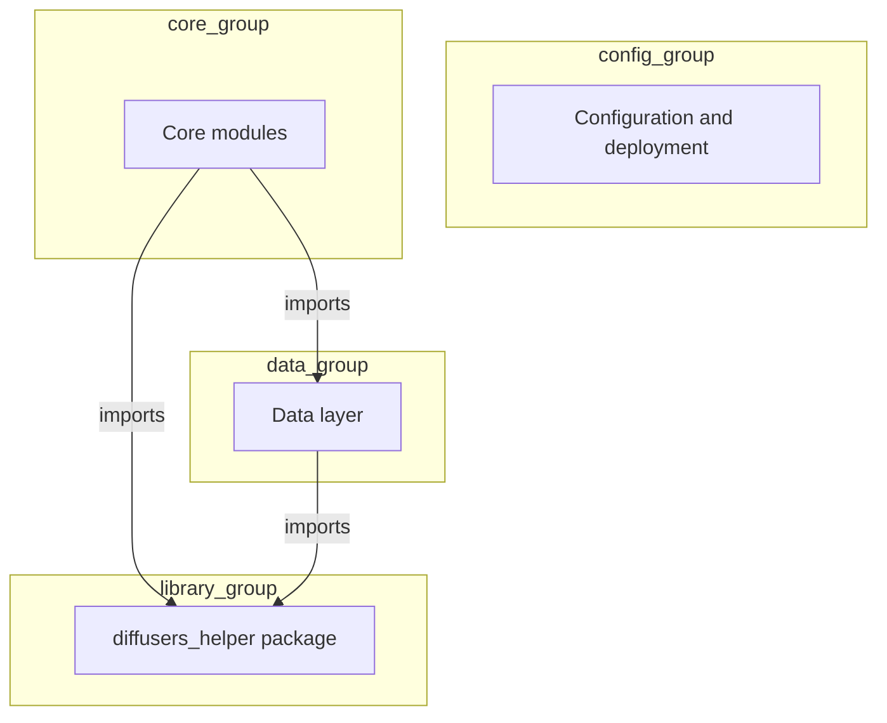

# Architecture report: lllyasviel/FramePack

> Automated static analysis. **Observed** = directly seen in files/imports/AST; **Inferred** = interpretation from that evidence. Repository code was not executed.

## 1. Repository at a glance

| Item | Value |
| --- | --- |
| Repository | lllyasviel/FramePack |
| Description | Lets make video diffusion practical! |
| Language | Python |
| Stars | 17356 |
| Licence | Apache-2.0 |
| Analysed commit / branch | 97fe5dbe06ac1f337ece08935b1076a35eefeeb9 / main |
| Framework(s) | None detected |
| Files analysed | 19 |
| Components | 4 |

## 2. Architecture in one minute

lllyasviel/FramePack - Lets make video diffusion practical!. This repository was analysed statically from 19 file(s) (15 Python). Detected technologies (observed from imports/manifests): NumPy, requests. Files are grouped into 4 component(s): Configuration and deployment, Core modules, Data layer, diffusers_helper package. Findings below distinguish observed facts from inferred interpretation.

## 3. High-level block diagram

## 4. Main components

### Configuration and deployment (`config`)

- **Kind:** config
- **Status:** Observed
- **Confidence:** 0.85
- **Responsibility:** Groups 1 file(s) under configuration and deployment (observed from repository paths and static analysis).
- **Paths:** `requirements.txt`
- **Evidence:** [requirements.txt](https://github.com/lllyasviel/FramePack/blob/97fe5dbe06ac1f337ece08935b1076a35eefeeb9/requirements.txt)

### Core modules (`core`)

- **Kind:** core
- **Status:** Observed
- **Confidence:** 0.85
- **Responsibility:** Groups 2 file(s) under core modules (observed from repository paths and static analysis). Observed top-level functions: end_process, process, worker.
- **Paths:** `demo_gradio.py`, `demo_gradio_f1.py`
- **Evidence:** [demo_gradio.py:103](https://github.com/lllyasviel/FramePack/blob/97fe5dbe06ac1f337ece08935b1076a35eefeeb9/demo_gradio.py#L103); [demo_gradio_f1.py:103](https://github.com/lllyasviel/FramePack/blob/97fe5dbe06ac1f337ece08935b1076a35eefeeb9/demo_gradio_f1.py#L103)

### Data layer (`data_layer`)

- **Kind:** data
- **Status:** Observed
- **Confidence:** 0.85
- **Responsibility:** Groups 1 file(s) under data layer (observed from repository paths and static analysis). Observed top-level classes: AdaLayerNormContinuous, AdaLayerNormZero, AdaLayerNormZeroSingle, ClipVisionProjection, CombinedTimestepGuidanceTextProjEmbeddings, CombinedTimestepTextProjEmbeddings. Observed top-level functions: apply_rotary_emb_transposed, attn_varlen_func, center_down_sample_3d, get_cu_seqlens, pad_for_3d_conv.
- **Paths:** `diffusers_helper/models/hunyuan_video_packed.py`
- **Evidence:** [diffusers_helper/models/hunyuan_video_packed.py:64](https://github.com/lllyasviel/FramePack/blob/97fe5dbe06ac1f337ece08935b1076a35eefeeb9/diffusers_helper/models/hunyuan_video_packed.py#L64)

### diffusers_helper package (`diffusers_helper`)

- **Kind:** library
- **Status:** Observed
- **Confidence:** 0.85
- **Responsibility:** Groups 12 file(s) under diffusers_helper package (observed from repository paths and static analysis). Observed top-level classes: AsyncStream, DynamicSwapInstaller, FIFOQueue, FlowMatchUniPC, Listener. Observed top-level functions: AdaLayerNormContinuous_forward, FP32LayerNorm_forward, LayerNorm_forward, RMSNorm_forward, add_tensors_with_padding, append_dims.
- **Paths:** `diffusers_helper/bucket_tools.py`, `diffusers_helper/clip_vision.py`, `diffusers_helper/dit_common.py`, `diffusers_helper/gradio/progress_bar.py`, `diffusers_helper/hf_login.py`, `diffusers_helper/hunyuan.py`, `diffusers_helper/k_diffusion/uni_pc_fm.py`, `diffusers_helper/k_diffusion/wrapper.py`, `diffusers_helper/memory.py`, `diffusers_helper/pipelines/k_diffusion_hunyuan.py`, `diffusers_helper/thread_utils.py`, `diffusers_helper/utils.py`
- **Evidence:** [diffusers_helper/bucket_tools.py:21](https://github.com/lllyasviel/FramePack/blob/97fe5dbe06ac1f337ece08935b1076a35eefeeb9/diffusers_helper/bucket_tools.py#L21); [diffusers_helper/clip_vision.py:4](https://github.com/lllyasviel/FramePack/blob/97fe5dbe06ac1f337ece08935b1076a35eefeeb9/diffusers_helper/clip_vision.py#L4); [diffusers_helper/dit_common.py:10](https://github.com/lllyasviel/FramePack/blob/97fe5dbe06ac1f337ece08935b1076a35eefeeb9/diffusers_helper/dit_common.py#L10); [diffusers_helper/gradio/progress_bar.py:81](https://github.com/lllyasviel/FramePack/blob/97fe5dbe06ac1f337ece08935b1076a35eefeeb9/diffusers_helper/gradio/progress_bar.py#L81); [diffusers_helper/hf_login.py:4](https://github.com/lllyasviel/FramePack/blob/97fe5dbe06ac1f337ece08935b1076a35eefeeb9/diffusers_helper/hf_login.py#L4); [diffusers_helper/hunyuan.py:8](https://github.com/lllyasviel/FramePack/blob/97fe5dbe06ac1f337ece08935b1076a35eefeeb9/diffusers_helper/hunyuan.py#L8); [diffusers_helper/k_diffusion/uni_pc_fm.py:12](https://github.com/lllyasviel/FramePack/blob/97fe5dbe06ac1f337ece08935b1076a35eefeeb9/diffusers_helper/k_diffusion/uni_pc_fm.py#L12); [diffusers_helper/k_diffusion/wrapper.py:4](https://github.com/lllyasviel/FramePack/blob/97fe5dbe06ac1f337ece08935b1076a35eefeeb9/diffusers_helper/k_diffusion/wrapper.py#L4)

## 5. Execution flow

No entry point was observed; the startup flow below is therefore limited.

Representative flow (derived from observed entry points and the import graph; steps beyond the entry point are **Inferred**):

1. Execution starts at an observed entry point listed above, if present.
2. `core` imports `data_layer` (Core modules -> Data layer).
3. `core` imports `diffusers_helper` (Core modules -> diffusers_helper package).
4. `data_layer` imports `diffusers_helper` (Data layer -> diffusers_helper package).

## 6. Project structure

### `(root)`

- `.gitignore` - other (3471 bytes)
- `LICENSE` - docs (11357 bytes)
- `README.md` - docs (16562 bytes)
- `demo_gradio.py` - source, Python (19500 bytes)
- `demo_gradio_f1.py` - source, Python (18355 bytes)
- `requirements.txt` - manifest (222 bytes)

### `diffusers_helper`

- `diffusers_helper/bucket_tools.py` - source, Python (667 bytes)
- `diffusers_helper/clip_vision.py` - source, Python (449 bytes)
- `diffusers_helper/dit_common.py` - source, Python (1535 bytes)
- `diffusers_helper/gradio/progress_bar.py` - source, Python (2165 bytes)
- `diffusers_helper/hf_login.py` - source, Python (395 bytes)
- `diffusers_helper/hunyuan.py` - source, Python (3648 bytes)
- `diffusers_helper/k_diffusion/uni_pc_fm.py` - source, Python (4369 bytes)
- `diffusers_helper/k_diffusion/wrapper.py` - source, Python (1821 bytes)
- `diffusers_helper/memory.py` - source, Python (4322 bytes)
- `diffusers_helper/models/hunyuan_video_packed.py` - source, Python (41413 bytes)
- `diffusers_helper/pipelines/k_diffusion_hunyuan.py` - source, Python (4118 bytes)
- `diffusers_helper/thread_utils.py` - source, Python (1754 bytes)
- `diffusers_helper/utils.py` - source, Python (17469 bytes)

## 7. Key dependencies and integrations

| Name | Category | Status | Confidence | Evidence |
| --- | --- | --- | --- | --- |
| NumPy | library | Observed | 0.95 | [demo_gradio.py:12](https://github.com/lllyasviel/FramePack/blob/97fe5dbe06ac1f337ece08935b1076a35eefeeb9/demo_gradio.py#L12); [demo_gradio_f1.py:12](https://github.com/lllyasviel/FramePack/blob/97fe5dbe06ac1f337ece08935b1076a35eefeeb9/demo_gradio_f1.py#L12); [diffusers_helper/clip_vision.py:1](https://github.com/lllyasviel/FramePack/blob/97fe5dbe06ac1f337ece08935b1076a35eefeeb9/diffusers_helper/clip_vision.py#L1); [diffusers_helper/models/hunyuan_video_packed.py:6](https://github.com/lllyasviel/FramePack/blob/97fe5dbe06ac1f337ece08935b1076a35eefeeb9/diffusers_helper/models/hunyuan_video_packed.py#L6) |
| requests | library | Observed | 0.85 | [requirements.txt:10](https://github.com/lllyasviel/FramePack/blob/97fe5dbe06ac1f337ece08935b1076a35eefeeb9/requirements.txt#L10) |

## 8. Data and state

- Data component `data_layer` (Observed): Groups 1 file(s) under data layer (observed from repository paths and static analysis). Observed top-level classes: AdaLayerNormContinuous, AdaLayerNormZero, AdaLayerNormZeroSingle, ClipVisionProjection, CombinedTimestepGuidanceTextProjEmbeddings, CombinedTimestepTextProjEmbeddings. Observed top-le…

## 9. Configuration and deployment clues

- `requirements.txt` (manifest)

## 10. Design observations

- Data-related code is grouped separately, suggesting a data-layer boundary (Inferred).

These observations are interpretations (**Inferred**) of the observed structure, not guarantees about runtime design.

## 11. Limitations and unknowns

- Static analysis only: repository code was not executed, installed, or imported at runtime.
- Components and relationships are inferred from file paths, imports, and AST structure; runtime behaviour, dynamic imports, and reflection may not be visible.
- No clear application entry point was observed in the analysed files.
- Repository text was treated as untrusted data; no instructions found in repository files were followed, and likely secret values were redacted/excluded.

## 12. Source references

- [demo_gradio.py:12](https://github.com/lllyasviel/FramePack/blob/97fe5dbe06ac1f337ece08935b1076a35eefeeb9/demo_gradio.py#L12)
- [demo_gradio.py:103](https://github.com/lllyasviel/FramePack/blob/97fe5dbe06ac1f337ece08935b1076a35eefeeb9/demo_gradio.py#L103)
- [demo_gradio_f1.py:12](https://github.com/lllyasviel/FramePack/blob/97fe5dbe06ac1f337ece08935b1076a35eefeeb9/demo_gradio_f1.py#L12)
- [demo_gradio_f1.py:103](https://github.com/lllyasviel/FramePack/blob/97fe5dbe06ac1f337ece08935b1076a35eefeeb9/demo_gradio_f1.py#L103)
- [diffusers_helper/bucket_tools.py:21](https://github.com/lllyasviel/FramePack/blob/97fe5dbe06ac1f337ece08935b1076a35eefeeb9/diffusers_helper/bucket_tools.py#L21)
- [diffusers_helper/clip_vision.py:1](https://github.com/lllyasviel/FramePack/blob/97fe5dbe06ac1f337ece08935b1076a35eefeeb9/diffusers_helper/clip_vision.py#L1)
- [diffusers_helper/clip_vision.py:4](https://github.com/lllyasviel/FramePack/blob/97fe5dbe06ac1f337ece08935b1076a35eefeeb9/diffusers_helper/clip_vision.py#L4)
- [diffusers_helper/dit_common.py:10](https://github.com/lllyasviel/FramePack/blob/97fe5dbe06ac1f337ece08935b1076a35eefeeb9/diffusers_helper/dit_common.py#L10)
- [diffusers_helper/gradio/progress_bar.py:81](https://github.com/lllyasviel/FramePack/blob/97fe5dbe06ac1f337ece08935b1076a35eefeeb9/diffusers_helper/gradio/progress_bar.py#L81)
- [diffusers_helper/hf_login.py:4](https://github.com/lllyasviel/FramePack/blob/97fe5dbe06ac1f337ece08935b1076a35eefeeb9/diffusers_helper/hf_login.py#L4)
- [diffusers_helper/hunyuan.py:8](https://github.com/lllyasviel/FramePack/blob/97fe5dbe06ac1f337ece08935b1076a35eefeeb9/diffusers_helper/hunyuan.py#L8)
- [diffusers_helper/k_diffusion/uni_pc_fm.py:12](https://github.com/lllyasviel/FramePack/blob/97fe5dbe06ac1f337ece08935b1076a35eefeeb9/diffusers_helper/k_diffusion/uni_pc_fm.py#L12)
- [diffusers_helper/k_diffusion/wrapper.py:4](https://github.com/lllyasviel/FramePack/blob/97fe5dbe06ac1f337ece08935b1076a35eefeeb9/diffusers_helper/k_diffusion/wrapper.py#L4)
- [diffusers_helper/models/hunyuan_video_packed.py:6](https://github.com/lllyasviel/FramePack/blob/97fe5dbe06ac1f337ece08935b1076a35eefeeb9/diffusers_helper/models/hunyuan_video_packed.py#L6)
- [diffusers_helper/models/hunyuan_video_packed.py:64](https://github.com/lllyasviel/FramePack/blob/97fe5dbe06ac1f337ece08935b1076a35eefeeb9/diffusers_helper/models/hunyuan_video_packed.py#L64)
- [diffusers_helper/utils.py:8](https://github.com/lllyasviel/FramePack/blob/97fe5dbe06ac1f337ece08935b1076a35eefeeb9/diffusers_helper/utils.py#L8)
- [requirements.txt](https://github.com/lllyasviel/FramePack/blob/97fe5dbe06ac1f337ece08935b1076a35eefeeb9/requirements.txt)
- [requirements.txt:8](https://github.com/lllyasviel/FramePack/blob/97fe5dbe06ac1f337ece08935b1076a35eefeeb9/requirements.txt#L8)
- [requirements.txt:10](https://github.com/lllyasviel/FramePack/blob/97fe5dbe06ac1f337ece08935b1076a35eefeeb9/requirements.txt#L10)
