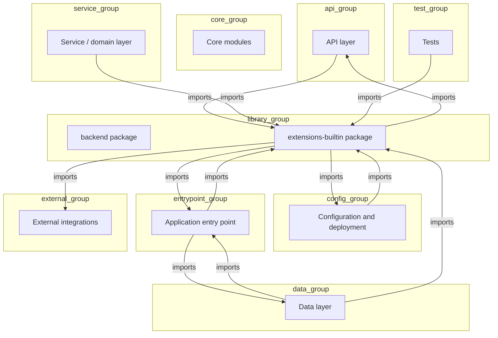

# Architecture report: lllyasviel/stable-diffusion-webui-forge

> Automated static analysis. **Observed** = directly seen in files/imports/AST; **Inferred** = interpretation from that evidence. Repository code was not executed.

## 1. Repository at a glance

| Item | Value |
| --- | --- |
| Repository | lllyasviel/stable-diffusion-webui-forge |
| Description | Not provided |
| Language | Python |
| Stars | 13126 |
| Licence | AGPL-3.0 |
| Analysed commit / branch | dfdcbab685e57677014f05a3309b48cc87383167 / main |
| Framework(s) | None detected |
| Files analysed | 800 |
| Components | 10 |

## 2. Architecture in one minute

lllyasviel/stable-diffusion-webui-forge. This repository was analysed statically from 800 file(s) (575 Python). Detected technologies (observed from imports/manifests): NumPy, requests, unittest. Files are grouped into 10 component(s): API layer, backend package, Configuration and deployment, Core modules, Data layer, Application entry point, extensions-builtin package, External integrations. Observed entry point(s): extensions-builtin/forge_legacy_preprocessors/annotator/leres/leres/network_auxi.py, extensions-builtin/forge_legacy_preprocessors/annotator/leres/pix2pix/util/html.py, extensions-builtin/forge_legacy_preprocessors/annotator/mmpkg/mmseg/utils/collect_env.py. Findings below distinguish observed facts from inferred interpretation.

## 3. High-level block diagram

## 4. Main components

### API layer (`api_layer`)

- **Kind:** api
- **Status:** Observed
- **Confidence:** 0.85
- **Responsibility:** Groups 5 file(s) under api layer (observed from repository paths and static analysis). Observed top-level classes: BaseFileHandler, JsonHandler, PickleHandler, YamlHandler. Observed top-level functions: set_default.
- **Paths:** `extensions-builtin/forge_legacy_preprocessors/annotator/mmpkg/mmcv/fileio/handlers/__init__.py`, `extensions-builtin/forge_legacy_preprocessors/annotator/mmpkg/mmcv/fileio/handlers/base.py`, `extensions-builtin/forge_legacy_preprocessors/annotator/mmpkg/mmcv/fileio/handlers/json_handler.py`, `extensions-builtin/forge_legacy_preprocessors/annotator/mmpkg/mmcv/fileio/handlers/pickle_handler.py`, `extensions-builtin/forge_legacy_preprocessors/annotator/mmpkg/mmcv/fileio/handlers/yaml_handler.py`
- **Evidence:** [extensions-builtin/forge_legacy_preprocessors/annotator/mmpkg/mmcv/fileio/handlers/__init__.py](https://github.com/lllyasviel/stable-diffusion-webui-forge/blob/dfdcbab685e57677014f05a3309b48cc87383167/extensions-builtin/forge_legacy_preprocessors/annotator/mmpkg/mmcv/fileio/handlers/__init__.py); [extensions-builtin/forge_legacy_preprocessors/annotator/mmpkg/mmcv/fileio/handlers/base.py:5](https://github.com/lllyasviel/stable-diffusion-webui-forge/blob/dfdcbab685e57677014f05a3309b48cc87383167/extensions-builtin/forge_legacy_preprocessors/annotator/mmpkg/mmcv/fileio/handlers/base.py#L5); [extensions-builtin/forge_legacy_preprocessors/annotator/mmpkg/mmcv/fileio/handlers/json_handler.py:9](https://github.com/lllyasviel/stable-diffusion-webui-forge/blob/dfdcbab685e57677014f05a3309b48cc87383167/extensions-builtin/forge_legacy_preprocessors/annotator/mmpkg/mmcv/fileio/handlers/json_handler.py#L9); [extensions-builtin/forge_legacy_preprocessors/annotator/mmpkg/mmcv/fileio/handlers/pickle_handler.py:7](https://github.com/lllyasviel/stable-diffusion-webui-forge/blob/dfdcbab685e57677014f05a3309b48cc87383167/extensions-builtin/forge_legacy_preprocessors/annotator/mmpkg/mmcv/fileio/handlers/pickle_handler.py#L7); [extensions-builtin/forge_legacy_preprocessors/annotator/mmpkg/mmcv/fileio/handlers/yaml_handler.py:12](https://github.com/lllyasviel/stable-diffusion-webui-forge/blob/dfdcbab685e57677014f05a3309b48cc87383167/extensions-builtin/forge_legacy_preprocessors/annotator/mmpkg/mmcv/fileio/handlers/yaml_handler.py#L12)

### backend package (`backend`)

- **Kind:** library
- **Status:** Observed
- **Confidence:** 0.85
- **Responsibility:** Groups 50 file(s) under backend package (observed from repository paths and static analysis). Observed top-level classes: AbstractPrediction, Adapter, Adapter_light, Approximator, AttentionProcessorForge, AttnBlock. Observed top-level functions: DDPMSampler_step, Normalize, SD3_clip_target, _get_attention_scores_no_kv_chunking, _query_chunk_attention, _summarize_chunk.
- **Paths:** `backend/args.py`, `backend/attention.py`, `backend/diffusion_engine/base.py`, `backend/diffusion_engine/chroma.py`, `backend/diffusion_engine/flux.py`, `backend/diffusion_engine/sd15.py`, `backend/diffusion_engine/sd20.py`, `backend/diffusion_engine/sd35.py`, `backend/diffusion_engine/sdxl.py`, `backend/loader.py`, `backend/memory_management.py`, `backend/misc/checkpoint_pickle.py`, `backend/misc/diffusers_state_dict.py`, `backend/misc/image_resize.py`, `backend/misc/sub_quadratic_attention.py`, `backend/misc/tomesd.py`, `backend/modules/k_diffusion_extra.py`, `backend/modules/k_model.py`, `backend/modules/k_prediction.py`, `backend/nn/base.py`, `backend/nn/chroma.py`, `backend/nn/clip.py`, `backend/nn/cnets/cldm.py`, `backend/nn/cnets/t2i_adapter.py`, `backend/nn/flux.py`, `backend/nn/mmditx.py`, `backend/nn/t5.py`, `backend/nn/unet.py`, `backend/nn/vae.py`, `backend/operations.py`, `backend/operations_bnb.py`, `backend/operations_gguf.py`, `backend/patcher/base.py`, `backend/patcher/clip.py`, `backend/patcher/clipvision.py`, `backend/patcher/controlnet.py`, `backend/patcher/lora.py`, `backend/patcher/unet.py`, `backend/patcher/vae.py`, `backend/sampling/condition.py`, `backend/sampling/sampling_function.py`, `backend/shared.py`, `backend/state_dict.py`, `backend/stream.py`, `backend/text_processing/classic_engine.py`, `backend/text_processing/emphasis.py`, `backend/text_processing/parsing.py`, `backend/text_processing/t5_engine.py`, `backend/text_processing/textual_inversion.py`, `backend/utils.py`
- **Evidence:** [backend/args.py](https://github.com/lllyasviel/stable-diffusion-webui-forge/blob/dfdcbab685e57677014f05a3309b48cc87383167/backend/args.py); [backend/attention.py:25](https://github.com/lllyasviel/stable-diffusion-webui-forge/blob/dfdcbab685e57677014f05a3309b48cc87383167/backend/attention.py#L25); [backend/diffusion_engine/base.py:7](https://github.com/lllyasviel/stable-diffusion-webui-forge/blob/dfdcbab685e57677014f05a3309b48cc87383167/backend/diffusion_engine/base.py#L7); [backend/diffusion_engine/chroma.py:13](https://github.com/lllyasviel/stable-diffusion-webui-forge/blob/dfdcbab685e57677014f05a3309b48cc87383167/backend/diffusion_engine/chroma.py#L13); [backend/diffusion_engine/flux.py:15](https://github.com/lllyasviel/stable-diffusion-webui-forge/blob/dfdcbab685e57677014f05a3309b48cc87383167/backend/diffusion_engine/flux.py#L15); [backend/diffusion_engine/sd15.py:16](https://github.com/lllyasviel/stable-diffusion-webui-forge/blob/dfdcbab685e57677014f05a3309b48cc87383167/backend/diffusion_engine/sd15.py#L16); [backend/diffusion_engine/sd20.py:16](https://github.com/lllyasviel/stable-diffusion-webui-forge/blob/dfdcbab685e57677014f05a3309b48cc87383167/backend/diffusion_engine/sd20.py#L16); [backend/diffusion_engine/sd35.py:18](https://github.com/lllyasviel/stable-diffusion-webui-forge/blob/dfdcbab685e57677014f05a3309b48cc87383167/backend/diffusion_engine/sd35.py#L18)

### Configuration and deployment (`config`)

- **Kind:** config
- **Status:** Observed
- **Confidence:** 0.85
- **Responsibility:** Groups 188 file(s) under configuration and deployment (observed from repository paths and static analysis). Observed top-level classes: CfgNode, Config, ConfigDict, ConverterV1, ConverterV2, DictAction. Observed top-level functions: _called_with_cfg, _cast_to_config, _get_args_from_config, _patch_import, _random_package_name, _rename.
- **Paths:** `_typos.toml`, `backend/huggingface/Chroma/model_index.json`, `backend/huggingface/Chroma/scheduler/scheduler_config.json`, `backend/huggingface/Chroma/text_encoder/config.json`, `backend/huggingface/Chroma/text_encoder/model.safetensors.index.json`, `backend/huggingface/Chroma/tokenizer/special_tokens_map.json`, `backend/huggingface/Chroma/tokenizer/tokenizer_config.json`, `backend/huggingface/Chroma/vae/config.json`, `backend/huggingface/Kwai-Kolors/Kolors/model_index.json`, `backend/huggingface/Kwai-Kolors/Kolors/scheduler/scheduler_config.json`, `backend/huggingface/Kwai-Kolors/Kolors/text_encoder/config.json`, `backend/huggingface/Kwai-Kolors/Kolors/text_encoder/pytorch_model.bin.index.json`, `backend/huggingface/Kwai-Kolors/Kolors/text_encoder/tokenizer_config.json`, `backend/huggingface/Kwai-Kolors/Kolors/tokenizer/tokenizer_config.json`, `backend/huggingface/Kwai-Kolors/Kolors/unet/config.json`, `backend/huggingface/Kwai-Kolors/Kolors/vae/config.json`, `backend/huggingface/Tencent-Hunyuan/HunyuanDiT-Diffusers/model_index.json`, `backend/huggingface/Tencent-Hunyuan/HunyuanDiT-Diffusers/scheduler/scheduler_config.json`, `backend/huggingface/Tencent-Hunyuan/HunyuanDiT-Diffusers/text_encoder/config.json`, `backend/huggingface/Tencent-Hunyuan/HunyuanDiT-Diffusers/text_encoder_2/config.json`, `backend/huggingface/Tencent-Hunyuan/HunyuanDiT-Diffusers/text_encoder_2/model.safetensors.index.json`, `backend/huggingface/Tencent-Hunyuan/HunyuanDiT-Diffusers/tokenizer/special_tokens_map.json`, `backend/huggingface/Tencent-Hunyuan/HunyuanDiT-Diffusers/tokenizer/tokenizer_config.json`, `backend/huggingface/Tencent-Hunyuan/HunyuanDiT-Diffusers/tokenizer_2/special_tokens_map.json`, `backend/huggingface/Tencent-Hunyuan/HunyuanDiT-Diffusers/tokenizer_2/tokenizer_config.json`, `backend/huggingface/Tencent-Hunyuan/HunyuanDiT-Diffusers/transformer/config.json`, `backend/huggingface/Tencent-Hunyuan/HunyuanDiT-Diffusers/vae/config.json`, `backend/huggingface/black-forest-labs/FLUX.1-dev/model_index.json`, `backend/huggingface/black-forest-labs/FLUX.1-dev/scheduler/scheduler_config.json`, `backend/huggingface/black-forest-labs/FLUX.1-dev/text_encoder/config.json`, `backend/huggingface/black-forest-labs/FLUX.1-dev/text_encoder_2/config.json`, `backend/huggingface/black-forest-labs/FLUX.1-dev/text_encoder_2/model.safetensors.index.json`, `backend/huggingface/black-forest-labs/FLUX.1-dev/tokenizer/special_tokens_map.json`, `backend/huggingface/black-forest-labs/FLUX.1-dev/tokenizer/tokenizer_config.json`, `backend/huggingface/black-forest-labs/FLUX.1-dev/tokenizer_2/special_tokens_map.json`, `backend/huggingface/black-forest-labs/FLUX.1-dev/tokenizer_2/tokenizer_config.json`, `backend/huggingface/black-forest-labs/FLUX.1-dev/transformer/config.json`, `backend/huggingface/black-forest-labs/FLUX.1-dev/transformer/diffusion_pytorch_model.safetensors.index.json`, `backend/huggingface/black-forest-labs/FLUX.1-dev/vae/config.json`, `backend/huggingface/black-forest-labs/FLUX.1-schnell/model_index.json`, `backend/huggingface/black-forest-labs/FLUX.1-schnell/scheduler/scheduler_config.json`, `backend/huggingface/black-forest-labs/FLUX.1-schnell/text_encoder/config.json`, `backend/huggingface/black-forest-labs/FLUX.1-schnell/text_encoder_2/config.json`, `backend/huggingface/black-forest-labs/FLUX.1-schnell/text_encoder_2/model.safetensors.index.json`, `backend/huggingface/black-forest-labs/FLUX.1-schnell/tokenizer/special_tokens_map.json`, `backend/huggingface/black-forest-labs/FLUX.1-schnell/tokenizer/tokenizer_config.json`, `backend/huggingface/black-forest-labs/FLUX.1-schnell/tokenizer_2/special_tokens_map.json`, `backend/huggingface/black-forest-labs/FLUX.1-schnell/tokenizer_2/tokenizer_config.json`, `backend/huggingface/black-forest-labs/FLUX.1-schnell/transformer/config.json`, `backend/huggingface/black-forest-labs/FLUX.1-schnell/transformer/diffusion_pytorch_model.safetensors.index.json`, `backend/huggingface/black-forest-labs/FLUX.1-schnell/vae/config.json`, `backend/huggingface/diffusers/stable-diffusion-xl-1.0-inpainting-0.1/model_index.json`, `backend/huggingface/diffusers/stable-diffusion-xl-1.0-inpainting-0.1/scheduler/scheduler_config.json`, `backend/huggingface/diffusers/stable-diffusion-xl-1.0-inpainting-0.1/text_encoder/config.json`, `backend/huggingface/diffusers/stable-diffusion-xl-1.0-inpainting-0.1/text_encoder_2/config.json`, `backend/huggingface/diffusers/stable-diffusion-xl-1.0-inpainting-0.1/tokenizer/special_tokens_map.json`, `backend/huggingface/diffusers/stable-diffusion-xl-1.0-inpainting-0.1/tokenizer/tokenizer_config.json`, `backend/huggingface/diffusers/stable-diffusion-xl-1.0-inpainting-0.1/tokenizer_2/special_tokens_map.json`, `backend/huggingface/diffusers/stable-diffusion-xl-1.0-inpainting-0.1/tokenizer_2/tokenizer_config.json`, `backend/huggingface/diffusers/stable-diffusion-xl-1.0-inpainting-0.1/unet/config.json`, `backend/huggingface/diffusers/stable-diffusion-xl-1.0-inpainting-0.1/vae/config.json`, `backend/huggingface/lllyasviel/control_v11p_sd15_canny/config.json`, `backend/huggingface/playgroundai/playground-v2.5-1024px-aesthetic/model_index.json`, `backend/huggingface/playgroundai/playground-v2.5-1024px-aesthetic/scheduler/scheduler_config.json`, `backend/huggingface/playgroundai/playground-v2.5-1024px-aesthetic/text_encoder/config.json`, `backend/huggingface/playgroundai/playground-v2.5-1024px-aesthetic/text_encoder_2/config.json`, `backend/huggingface/playgroundai/playground-v2.5-1024px-aesthetic/tokenizer/special_tokens_map.json`, `backend/huggingface/playgroundai/playground-v2.5-1024px-aesthetic/tokenizer/tokenizer_config.json`, `backend/huggingface/playgroundai/playground-v2.5-1024px-aesthetic/tokenizer_2/special_tokens_map.json`, `backend/huggingface/playgroundai/playground-v2.5-1024px-aesthetic/tokenizer_2/tokenizer_config.json`, `backend/huggingface/playgroundai/playground-v2.5-1024px-aesthetic/unet/config.json`, `backend/huggingface/playgroundai/playground-v2.5-1024px-aesthetic/vae/config.json`, `backend/huggingface/runwayml/stable-diffusion-inpainting/config.json`, `backend/huggingface/runwayml/stable-diffusion-inpainting/feature_extractor/preprocessor_config.json`, `backend/huggingface/runwayml/stable-diffusion-inpainting/model_index.json`, `backend/huggingface/runwayml/stable-diffusion-inpainting/safety_checker/config.json`, `backend/huggingface/runwayml/stable-diffusion-inpainting/scheduler/scheduler_config.json`, `backend/huggingface/runwayml/stable-diffusion-inpainting/text_encoder/config.json`, `backend/huggingface/runwayml/stable-diffusion-inpainting/tokenizer/special_tokens_map.json`, `backend/huggingface/runwayml/stable-diffusion-inpainting/tokenizer/tokenizer_config.json`, `backend/huggingface/runwayml/stable-diffusion-inpainting/unet/config.json`, `backend/huggingface/runwayml/stable-diffusion-inpainting/vae/config.json`, `backend/huggingface/runwayml/stable-diffusion-v1-5/feature_extractor/preprocessor_config.json`, `backend/huggingface/runwayml/stable-diffusion-v1-5/model_index.json`, `backend/huggingface/runwayml/stable-diffusion-v1-5/safety_checker/config.json`, `backend/huggingface/runwayml/stable-diffusion-v1-5/scheduler/scheduler_config.json`, `backend/huggingface/runwayml/stable-diffusion-v1-5/text_encoder/config.json`, `backend/huggingface/runwayml/stable-diffusion-v1-5/tokenizer/special_tokens_map.json`, `backend/huggingface/runwayml/stable-diffusion-v1-5/tokenizer/tokenizer_config.json`, `backend/huggingface/runwayml/stable-diffusion-v1-5/unet/config.json`, `backend/huggingface/runwayml/stable-diffusion-v1-5/vae/config.json`, `backend/huggingface/stabilityai/stable-cascade-prior/feature_extractor/preprocessor_config.json`, `backend/huggingface/stabilityai/stable-cascade-prior/image_encoder/config.json`, `backend/huggingface/stabilityai/stable-cascade-prior/model_index.json`, `backend/huggingface/stabilityai/stable-cascade-prior/prior/config.json`, `backend/huggingface/stabilityai/stable-cascade-prior/prior_lite/config.json`, `backend/huggingface/stabilityai/stable-cascade-prior/scheduler/scheduler_config.json`, `backend/huggingface/stabilityai/stable-cascade-prior/text_encoder/config.json`, `backend/huggingface/stabilityai/stable-cascade-prior/tokenizer/special_tokens_map.json`, `backend/huggingface/stabilityai/stable-cascade-prior/tokenizer/tokenizer_config.json`, `backend/huggingface/stabilityai/stable-cascade/decoder/config.json`, `backend/huggingface/stabilityai/stable-cascade/decoder_lite/config.json`, `backend/huggingface/stabilityai/stable-cascade/model_index.json`, `backend/huggingface/stabilityai/stable-cascade/scheduler/scheduler_config.json`, `backend/huggingface/stabilityai/stable-cascade/text_encoder/config.json`, `backend/huggingface/stabilityai/stable-cascade/tokenizer/special_tokens_map.json`, `backend/huggingface/stabilityai/stable-cascade/tokenizer/tokenizer_config.json`, `backend/huggingface/stabilityai/stable-cascade/vqgan/config.json`, `backend/huggingface/stabilityai/stable-diffusion-2-1/feature_extractor/preprocessor_config.json`, `backend/huggingface/stabilityai/stable-diffusion-2-1/model_index.json`, `backend/huggingface/stabilityai/stable-diffusion-2-1/scheduler/scheduler_config.json`, `backend/huggingface/stabilityai/stable-diffusion-2-1/text_encoder/config.json`, `backend/huggingface/stabilityai/stable-diffusion-2-1/tokenizer/special_tokens_map.json`, `backend/huggingface/stabilityai/stable-diffusion-2-1/tokenizer/tokenizer_config.json`, `backend/huggingface/stabilityai/stable-diffusion-2-1/unet/config.json`, `backend/huggingface/stabilityai/stable-diffusion-2-1/vae/config.json`, `backend/huggingface/stabilityai/stable-diffusion-2-inpainting/feature_extractor/preprocessor_config.json`, `backend/huggingface/stabilityai/stable-diffusion-2-inpainting/model_index.json`, `backend/huggingface/stabilityai/stable-diffusion-2-inpainting/scheduler/scheduler_config.json`, `backend/huggingface/stabilityai/stable-diffusion-2-inpainting/text_encoder/config.json`, `backend/huggingface/stabilityai/stable-diffusion-2-inpainting/tokenizer/special_tokens_map.json`, `backend/huggingface/stabilityai/stable-diffusion-2-inpainting/tokenizer/tokenizer_config.json`, `backend/huggingface/stabilityai/stable-diffusion-2-inpainting/unet/config.json`, `backend/huggingface/stabilityai/stable-diffusion-2-inpainting/vae/config.json`, `backend/huggingface/stabilityai/stable-diffusion-3-medium-diffusers/model_index.json`, `backend/huggingface/stabilityai/stable-diffusion-3-medium-diffusers/scheduler/scheduler_config.json`, `backend/huggingface/stabilityai/stable-diffusion-3-medium-diffusers/text_encoder/config.json`, `backend/huggingface/stabilityai/stable-diffusion-3-medium-diffusers/text_encoder_2/config.json`, `backend/huggingface/stabilityai/stable-diffusion-3-medium-diffusers/text_encoder_3/config.json`, `backend/huggingface/stabilityai/stable-diffusion-3-medium-diffusers/text_encoder_3/model.safetensors.index.fp16.json`, `backend/huggingface/stabilityai/stable-diffusion-3-medium-diffusers/text_encoder_3/model.safetensors.index.json`, `backend/huggingface/stabilityai/stable-diffusion-3-medium-diffusers/tokenizer/special_tokens_map.json`, `backend/huggingface/stabilityai/stable-diffusion-3-medium-diffusers/tokenizer/tokenizer_config.json`, `backend/huggingface/stabilityai/stable-diffusion-3-medium-diffusers/tokenizer_2/special_tokens_map.json`, `backend/huggingface/stabilityai/stable-diffusion-3-medium-diffusers/tokenizer_2/tokenizer_config.json`, `backend/huggingface/stabilityai/stable-diffusion-3-medium-diffusers/tokenizer_3/special_tokens_map.json`, `backend/huggingface/stabilityai/stable-diffusion-3-medium-diffusers/tokenizer_3/tokenizer_config.json`, `backend/huggingface/stabilityai/stable-diffusion-3-medium-diffusers/transformer/config.json`, `backend/huggingface/stabilityai/stable-diffusion-3-medium-diffusers/vae/config.json`, `backend/huggingface/stabilityai/stable-diffusion-x4-upscaler/low_res_scheduler/scheduler_config.json`, `backend/huggingface/stabilityai/stable-diffusion-x4-upscaler/model_index.json`, `backend/huggingface/stabilityai/stable-diffusion-x4-upscaler/scheduler/scheduler_config.json`, `backend/huggingface/stabilityai/stable-diffusion-x4-upscaler/text_encoder/config.json`, `backend/huggingface/stabilityai/stable-diffusion-x4-upscaler/tokenizer/special_tokens_map.json`, `backend/huggingface/stabilityai/stable-diffusion-x4-upscaler/tokenizer/tokenizer_config.json`, `backend/huggingface/stabilityai/stable-diffusion-x4-upscaler/unet/.ipynb_checkpoints/config-checkpoint.json`, `backend/huggingface/stabilityai/stable-diffusion-x4-upscaler/unet/config.json`, `backend/huggingface/stabilityai/stable-diffusion-x4-upscaler/vae/config.json`, `backend/huggingface/stabilityai/stable-diffusion-xl-base-1.0/model_index.json`, `backend/huggingface/stabilityai/stable-diffusion-xl-base-1.0/scheduler/scheduler_config.json`, `backend/huggingface/stabilityai/stable-diffusion-xl-base-1.0/text_encoder/config.json`, `backend/huggingface/stabilityai/stable-diffusion-xl-base-1.0/text_encoder_2/config.json`, `backend/huggingface/stabilityai/stable-diffusion-xl-base-1.0/tokenizer/special_tokens_map.json`, `backend/huggingface/stabilityai/stable-diffusion-xl-base-1.0/tokenizer/tokenizer_config.json`, `backend/huggingface/stabilityai/stable-diffusion-xl-base-1.0/tokenizer_2/special_tokens_map.json`, `backend/huggingface/stabilityai/stable-diffusion-xl-base-1.0/tokenizer_2/tokenizer_config.json`, `backend/huggingface/stabilityai/stable-diffusion-xl-base-1.0/unet/config.json`, `backend/huggingface/stabilityai/stable-diffusion-xl-base-1.0/vae/config.json`, `backend/huggingface/stabilityai/stable-diffusion-xl-base-1.0/vae_1_0/config.json`, `backend/huggingface/stabilityai/stable-diffusion-xl-base-1.0/vae_decoder/config.json`, `backend/huggingface/stabilityai/stable-diffusion-xl-base-1.0/vae_encoder/config.json`, `backend/huggingface/stabilityai/stable-diffusion-xl-refiner-1.0/model_index.json`, `backend/huggingface/stabilityai/stable-diffusion-xl-refiner-1.0/scheduler/scheduler_config.json`, `backend/huggingface/stabilityai/stable-diffusion-xl-refiner-1.0/text_encoder/config.json`, `backend/huggingface/stabilityai/stable-diffusion-xl-refiner-1.0/tokenizer/special_tokens_map.json`, `backend/huggingface/stabilityai/stable-diffusion-xl-refiner-1.0/tokenizer/tokenizer_config.json`, `backend/huggingface/stabilityai/stable-diffusion-xl-refiner-1.0/unet/config.json`, `backend/huggingface/stabilityai/stable-diffusion-xl-refiner-1.0/vae/config.json`, `backend/huggingface/stabilityai/stable-diffusion-xl-refiner-1.0/vae_1_0/config.json`, `environment-wsl2.yaml`, `extensions-builtin/forge_legacy_preprocessors/annotator/mmpkg/mmcv/model_zoo/deprecated.json`, `extensions-builtin/forge_legacy_preprocessors/annotator/mmpkg/mmcv/model_zoo/mmcls.json`, `extensions-builtin/forge_legacy_preprocessors/annotator/mmpkg/mmcv/model_zoo/open_mmlab.json`, `extensions-builtin/forge_legacy_preprocessors/annotator/mmpkg/mmcv/utils/config.py`, `extensions-builtin/forge_legacy_preprocessors/annotator/oneformer/configs/ade20k/Base-ADE20K-UnifiedSegmentation.yaml`, `extensions-builtin/forge_legacy_preprocessors/annotator/oneformer/configs/ade20k/oneformer_R50_bs16_160k.yaml`, `extensions-builtin/forge_legacy_preprocessors/annotator/oneformer/configs/ade20k/oneformer_swin_large_IN21k_384_bs16_160k.yaml`, `extensions-builtin/forge_legacy_preprocessors/annotator/oneformer/configs/coco/Base-COCO-UnifiedSegmentation.yaml`, `extensions-builtin/forge_legacy_preprocessors/annotator/oneformer/configs/coco/oneformer_R50_bs16_50ep.yaml`, `extensions-builtin/forge_legacy_preprocessors/annotator/oneformer/configs/coco/oneformer_swin_large_IN21k_384_bs16_100ep.yaml`, `extensions-builtin/forge_legacy_preprocessors/annotator/oneformer/detectron2/config/__init__.py`, `extensions-builtin/forge_legacy_preprocessors/annotator/oneformer/detectron2/config/compat.py`, `extensions-builtin/forge_legacy_preprocessors/annotator/oneformer/detectron2/config/config.py`, `extensions-builtin/forge_legacy_preprocessors/annotator/oneformer/detectron2/config/defaults.py`, `extensions-builtin/forge_legacy_preprocessors/annotator/oneformer/detectron2/config/instantiate.py`, `extensions-builtin/forge_legacy_preprocessors/annotator/oneformer/detectron2/config/lazy.py`, `extensions-builtin/forge_legacy_preprocessors/annotator/oneformer/detectron2/projects/deeplab/config.py`, `extensions-builtin/forge_legacy_preprocessors/annotator/oneformer/oneformer/config.py`
- **Evidence:** [_typos.toml](https://github.com/lllyasviel/stable-diffusion-webui-forge/blob/dfdcbab685e57677014f05a3309b48cc87383167/_typos.toml); [backend/huggingface/Chroma/model_index.json](https://github.com/lllyasviel/stable-diffusion-webui-forge/blob/dfdcbab685e57677014f05a3309b48cc87383167/backend/huggingface/Chroma/model_index.json); [backend/huggingface/Chroma/scheduler/scheduler_config.json](https://github.com/lllyasviel/stable-diffusion-webui-forge/blob/dfdcbab685e57677014f05a3309b48cc87383167/backend/huggingface/Chroma/scheduler/scheduler_config.json); [backend/huggingface/Chroma/text_encoder/config.json](https://github.com/lllyasviel/stable-diffusion-webui-forge/blob/dfdcbab685e57677014f05a3309b48cc87383167/backend/huggingface/Chroma/text_encoder/config.json); [backend/huggingface/Chroma/text_encoder/model.safetensors.index.json](https://github.com/lllyasviel/stable-diffusion-webui-forge/blob/dfdcbab685e57677014f05a3309b48cc87383167/backend/huggingface/Chroma/text_encoder/model.safetensors.index.json); [backend/huggingface/Chroma/tokenizer/special_tokens_map.json](https://github.com/lllyasviel/stable-diffusion-webui-forge/blob/dfdcbab685e57677014f05a3309b48cc87383167/backend/huggingface/Chroma/tokenizer/special_tokens_map.json); [backend/huggingface/Chroma/tokenizer/tokenizer_config.json](https://github.com/lllyasviel/stable-diffusion-webui-forge/blob/dfdcbab685e57677014f05a3309b48cc87383167/backend/huggingface/Chroma/tokenizer/tokenizer_config.json); [backend/huggingface/Chroma/vae/config.json](https://github.com/lllyasviel/stable-diffusion-webui-forge/blob/dfdcbab685e57677014f05a3309b48cc87383167/backend/huggingface/Chroma/vae/config.json)

### Core modules (`core`)

- **Kind:** core
- **Status:** Observed
- **Confidence:** 0.85
- **Responsibility:** Groups 1 file(s) under core modules (observed from repository paths and static analysis).
- **Paths:** `download_supported_configs.py`
- **Evidence:** [download_supported_configs.py](https://github.com/lllyasviel/stable-diffusion-webui-forge/blob/dfdcbab685e57677014f05a3309b48cc87383167/download_supported_configs.py)

### Data layer (`data_layer`)

- **Kind:** data
- **Status:** Observed
- **Confidence:** 0.85
- **Responsibility:** Groups 100 file(s) under data layer (observed from repository paths and static analysis). Observed top-level classes: ACM, AFNB, ANNHead, APCHead, APNB, ASPPHead. Observed top-level functions: HFlip_rotated_box, Resize_rotated_box, _apply_exif_orientation, _check_img_dtype, _expand_onehot_labels, _get_ade_instances_meta.
- **Paths:** `extensions-builtin/forge_legacy_preprocessors/annotator/leres/pix2pix/models/__init__.py`, `extensions-builtin/forge_legacy_preprocessors/annotator/leres/pix2pix/models/base_model.py`, `extensions-builtin/forge_legacy_preprocessors/annotator/leres/pix2pix/models/base_model_hg.py`, `extensions-builtin/forge_legacy_preprocessors/annotator/leres/pix2pix/models/networks.py`, `extensions-builtin/forge_legacy_preprocessors/annotator/leres/pix2pix/models/pix2pix4depth_model.py`, `extensions-builtin/forge_legacy_preprocessors/annotator/mlsd/models/mbv2_mlsd_large.py`, `extensions-builtin/forge_legacy_preprocessors/annotator/mlsd/models/mbv2_mlsd_tiny.py`, `extensions-builtin/forge_legacy_preprocessors/annotator/mmpkg/mmseg/models/__init__.py`, `extensions-builtin/forge_legacy_preprocessors/annotator/mmpkg/mmseg/models/backbones/__init__.py`, `extensions-builtin/forge_legacy_preprocessors/annotator/mmpkg/mmseg/models/backbones/cgnet.py`, `extensions-builtin/forge_legacy_preprocessors/annotator/mmpkg/mmseg/models/backbones/fast_scnn.py`, `extensions-builtin/forge_legacy_preprocessors/annotator/mmpkg/mmseg/models/backbones/hrnet.py`, `extensions-builtin/forge_legacy_preprocessors/annotator/mmpkg/mmseg/models/backbones/mobilenet_v2.py`, `extensions-builtin/forge_legacy_preprocessors/annotator/mmpkg/mmseg/models/backbones/mobilenet_v3.py`, `extensions-builtin/forge_legacy_preprocessors/annotator/mmpkg/mmseg/models/backbones/resnest.py`, `extensions-builtin/forge_legacy_preprocessors/annotator/mmpkg/mmseg/models/backbones/resnet.py`, `extensions-builtin/forge_legacy_preprocessors/annotator/mmpkg/mmseg/models/backbones/resnext.py`, `extensions-builtin/forge_legacy_preprocessors/annotator/mmpkg/mmseg/models/backbones/unet.py`, `extensions-builtin/forge_legacy_preprocessors/annotator/mmpkg/mmseg/models/backbones/vit.py`, `extensions-builtin/forge_legacy_preprocessors/annotator/mmpkg/mmseg/models/builder.py`, `extensions-builtin/forge_legacy_preprocessors/annotator/mmpkg/mmseg/models/decode_heads/__init__.py`, `extensions-builtin/forge_legacy_preprocessors/annotator/mmpkg/mmseg/models/decode_heads/ann_head.py`, `extensions-builtin/forge_legacy_preprocessors/annotator/mmpkg/mmseg/models/decode_heads/apc_head.py`, `extensions-builtin/forge_legacy_preprocessors/annotator/mmpkg/mmseg/models/decode_heads/aspp_head.py`, `extensions-builtin/forge_legacy_preprocessors/annotator/mmpkg/mmseg/models/decode_heads/cascade_decode_head.py`, `extensions-builtin/forge_legacy_preprocessors/annotator/mmpkg/mmseg/models/decode_heads/cc_head.py`, `extensions-builtin/forge_legacy_preprocessors/annotator/mmpkg/mmseg/models/decode_heads/da_head.py`, `extensions-builtin/forge_legacy_preprocessors/annotator/mmpkg/mmseg/models/decode_heads/decode_head.py`, `extensions-builtin/forge_legacy_preprocessors/annotator/mmpkg/mmseg/models/decode_heads/dm_head.py`, `extensions-builtin/forge_legacy_preprocessors/annotator/mmpkg/mmseg/models/decode_heads/dnl_head.py`, `extensions-builtin/forge_legacy_preprocessors/annotator/mmpkg/mmseg/models/decode_heads/ema_head.py`, `extensions-builtin/forge_legacy_preprocessors/annotator/mmpkg/mmseg/models/decode_heads/enc_head.py`, `extensions-builtin/forge_legacy_preprocessors/annotator/mmpkg/mmseg/models/decode_heads/fcn_head.py`, `extensions-builtin/forge_legacy_preprocessors/annotator/mmpkg/mmseg/models/decode_heads/fpn_head.py`, `extensions-builtin/forge_legacy_preprocessors/annotator/mmpkg/mmseg/models/decode_heads/gc_head.py`, `extensions-builtin/forge_legacy_preprocessors/annotator/mmpkg/mmseg/models/decode_heads/lraspp_head.py`, `extensions-builtin/forge_legacy_preprocessors/annotator/mmpkg/mmseg/models/decode_heads/nl_head.py`, `extensions-builtin/forge_legacy_preprocessors/annotator/mmpkg/mmseg/models/decode_heads/ocr_head.py`, `extensions-builtin/forge_legacy_preprocessors/annotator/mmpkg/mmseg/models/decode_heads/point_head.py`, `extensions-builtin/forge_legacy_preprocessors/annotator/mmpkg/mmseg/models/decode_heads/psa_head.py`, `extensions-builtin/forge_legacy_preprocessors/annotator/mmpkg/mmseg/models/decode_heads/psp_head.py`, `extensions-builtin/forge_legacy_preprocessors/annotator/mmpkg/mmseg/models/decode_heads/sep_aspp_head.py`, `extensions-builtin/forge_legacy_preprocessors/annotator/mmpkg/mmseg/models/decode_heads/sep_fcn_head.py`, `extensions-builtin/forge_legacy_preprocessors/annotator/mmpkg/mmseg/models/decode_heads/uper_head.py`, `extensions-builtin/forge_legacy_preprocessors/annotator/mmpkg/mmseg/models/losses/__init__.py`, `extensions-builtin/forge_legacy_preprocessors/annotator/mmpkg/mmseg/models/losses/accuracy.py`, `extensions-builtin/forge_legacy_preprocessors/annotator/mmpkg/mmseg/models/losses/cross_entropy_loss.py`, `extensions-builtin/forge_legacy_preprocessors/annotator/mmpkg/mmseg/models/losses/dice_loss.py`, `extensions-builtin/forge_legacy_preprocessors/annotator/mmpkg/mmseg/models/losses/lovasz_loss.py`, `extensions-builtin/forge_legacy_preprocessors/annotator/mmpkg/mmseg/models/losses/utils.py`, `extensions-builtin/forge_legacy_preprocessors/annotator/mmpkg/mmseg/models/necks/__init__.py`, `extensions-builtin/forge_legacy_preprocessors/annotator/mmpkg/mmseg/models/necks/fpn.py`, `extensions-builtin/forge_legacy_preprocessors/annotator/mmpkg/mmseg/models/necks/multilevel_neck.py`, `extensions-builtin/forge_legacy_preprocessors/annotator/mmpkg/mmseg/models/segmentors/__init__.py`, `extensions-builtin/forge_legacy_preprocessors/annotator/mmpkg/mmseg/models/segmentors/base.py`, `extensions-builtin/forge_legacy_preprocessors/annotator/mmpkg/mmseg/models/segmentors/cascade_encoder_decoder.py`, `extensions-builtin/forge_legacy_preprocessors/annotator/mmpkg/mmseg/models/segmentors/encoder_decoder.py`, `extensions-builtin/forge_legacy_preprocessors/annotator/mmpkg/mmseg/models/utils/__init__.py`, `extensions-builtin/forge_legacy_preprocessors/annotator/mmpkg/mmseg/models/utils/drop.py`, `extensions-builtin/forge_legacy_preprocessors/annotator/mmpkg/mmseg/models/utils/inverted_residual.py`, `extensions-builtin/forge_legacy_preprocessors/annotator/mmpkg/mmseg/models/utils/make_divisible.py`, `extensions-builtin/forge_legacy_preprocessors/annotator/mmpkg/mmseg/models/utils/res_layer.py`, `extensions-builtin/forge_legacy_preprocessors/annotator/mmpkg/mmseg/models/utils/se_layer.py`, `extensions-builtin/forge_legacy_preprocessors/annotator/mmpkg/mmseg/models/utils/self_attention_block.py`, `extensions-builtin/forge_legacy_preprocessors/annotator/mmpkg/mmseg/models/utils/up_conv_block.py`, `extensions-builtin/forge_legacy_preprocessors/annotator/mmpkg/mmseg/models/utils/weight_init.py`, `extensions-builtin/forge_legacy_preprocessors/annotator/oneformer/detectron2/data/__init__.py`, `extensions-builtin/forge_legacy_preprocessors/annotator/oneformer/detectron2/data/benchmark.py`, `extensions-builtin/forge_legacy_preprocessors/annotator/oneformer/detectron2/data/build.py`, `extensions-builtin/forge_legacy_preprocessors/annotator/oneformer/detectron2/data/catalog.py`, `extensions-builtin/forge_legacy_preprocessors/annotator/oneformer/detectron2/data/common.py`, `extensions-builtin/forge_legacy_preprocessors/annotator/oneformer/detectron2/data/dataset_mapper.py`, `extensions-builtin/forge_legacy_preprocessors/annotator/oneformer/detectron2/data/datasets/__init__.py`, `extensions-builtin/forge_legacy_preprocessors/annotator/oneformer/detectron2/data/datasets/builtin.py`, `extensions-builtin/forge_legacy_preprocessors/annotator/oneformer/detectron2/data/datasets/builtin_meta.py`, `extensions-builtin/forge_legacy_preprocessors/annotator/oneformer/detectron2/data/datasets/cityscapes_panoptic.py`, `extensions-builtin/forge_legacy_preprocessors/annotator/oneformer/detectron2/data/datasets/lvis_v1_category_image_count.py`, `extensions-builtin/forge_legacy_preprocessors/annotator/oneformer/detectron2/data/datasets/pascal_voc.py`, `extensions-builtin/forge_legacy_preprocessors/annotator/oneformer/detectron2/data/datasets/register_coco.py`, `extensions-builtin/forge_legacy_preprocessors/annotator/oneformer/detectron2/data/detection_utils.py`, `extensions-builtin/forge_legacy_preprocessors/annotator/oneformer/detectron2/data/samplers/__init__.py`, `extensions-builtin/forge_legacy_preprocessors/annotator/oneformer/detectron2/data/samplers/distributed_sampler.py`, `extensions-builtin/forge_legacy_preprocessors/annotator/oneformer/detectron2/data/samplers/grouped_batch_sampler.py`, `extensions-builtin/forge_legacy_preprocessors/annotator/oneformer/detectron2/data/transforms/__init__.py`, `extensions-builtin/forge_legacy_preprocessors/annotator/oneformer/detectron2/data/transforms/augmentation.py`, `extensions-builtin/forge_legacy_preprocessors/annotator/oneformer/detectron2/data/transforms/augmentation_impl.py`, `extensions-builtin/forge_legacy_preprocessors/annotator/oneformer/detectron2/data/transforms/transform.py`, `extensions-builtin/forge_legacy_preprocessors/annotator/oneformer/oneformer/data/__init__.py`, `extensions-builtin/forge_legacy_preprocessors/annotator/oneformer/oneformer/data/build.py`, `extensions-builtin/forge_legacy_preprocessors/annotator/oneformer/oneformer/data/dataset_mappers/__init__.py`, `extensions-builtin/forge_legacy_preprocessors/annotator/oneformer/oneformer/data/dataset_mappers/coco_unified_new_baseline_dataset_mapper.py`, `extensions-builtin/forge_legacy_preprocessors/annotator/oneformer/oneformer/data/dataset_mappers/dataset_mapper.py`, `extensions-builtin/forge_legacy_preprocessors/annotator/oneformer/oneformer/data/dataset_mappers/oneformer_unified_dataset_mapper.py`, `extensions-builtin/forge_legacy_preprocessors/annotator/oneformer/oneformer/data/datasets/__init__.py`, `extensions-builtin/forge_legacy_preprocessors/annotator/oneformer/oneformer/data/datasets/register_ade20k_instance.py`, `extensions-builtin/forge_legacy_preprocessors/annotator/oneformer/oneformer/data/datasets/register_ade20k_panoptic.py`, `extensions-builtin/forge_legacy_preprocessors/annotator/oneformer/oneformer/data/datasets/register_cityscapes_panoptic.py`, `extensions-builtin/forge_legacy_preprocessors/annotator/oneformer/oneformer/data/datasets/register_coco_panoptic2instance.py`, `extensions-builtin/forge_legacy_preprocessors/annotator/oneformer/oneformer/data/datasets/register_coco_panoptic_annos_semseg.py`, `extensions-builtin/forge_legacy_preprocessors/annotator/oneformer/oneformer/data/tokenizer.py`
- **Evidence:** [extensions-builtin/forge_legacy_preprocessors/annotator/leres/pix2pix/models/__init__.py:25](https://github.com/lllyasviel/stable-diffusion-webui-forge/blob/dfdcbab685e57677014f05a3309b48cc87383167/extensions-builtin/forge_legacy_preprocessors/annotator/leres/pix2pix/models/__init__.py#L25); [extensions-builtin/forge_legacy_preprocessors/annotator/leres/pix2pix/models/base_model.py:9](https://github.com/lllyasviel/stable-diffusion-webui-forge/blob/dfdcbab685e57677014f05a3309b48cc87383167/extensions-builtin/forge_legacy_preprocessors/annotator/leres/pix2pix/models/base_model.py#L9); [extensions-builtin/forge_legacy_preprocessors/annotator/leres/pix2pix/models/base_model_hg.py:4](https://github.com/lllyasviel/stable-diffusion-webui-forge/blob/dfdcbab685e57677014f05a3309b48cc87383167/extensions-builtin/forge_legacy_preprocessors/annotator/leres/pix2pix/models/base_model_hg.py#L4); [extensions-builtin/forge_legacy_preprocessors/annotator/leres/pix2pix/models/networks.py:13](https://github.com/lllyasviel/stable-diffusion-webui-forge/blob/dfdcbab685e57677014f05a3309b48cc87383167/extensions-builtin/forge_legacy_preprocessors/annotator/leres/pix2pix/models/networks.py#L13); [extensions-builtin/forge_legacy_preprocessors/annotator/leres/pix2pix/models/pix2pix4depth_model.py:6](https://github.com/lllyasviel/stable-diffusion-webui-forge/blob/dfdcbab685e57677014f05a3309b48cc87383167/extensions-builtin/forge_legacy_preprocessors/annotator/leres/pix2pix/models/pix2pix4depth_model.py#L6); [extensions-builtin/forge_legacy_preprocessors/annotator/mlsd/models/mbv2_mlsd_large.py:9](https://github.com/lllyasviel/stable-diffusion-webui-forge/blob/dfdcbab685e57677014f05a3309b48cc87383167/extensions-builtin/forge_legacy_preprocessors/annotator/mlsd/models/mbv2_mlsd_large.py#L9); [extensions-builtin/forge_legacy_preprocessors/annotator/mlsd/models/mbv2_mlsd_tiny.py:9](https://github.com/lllyasviel/stable-diffusion-webui-forge/blob/dfdcbab685e57677014f05a3309b48cc87383167/extensions-builtin/forge_legacy_preprocessors/annotator/mlsd/models/mbv2_mlsd_tiny.py#L9); [extensions-builtin/forge_legacy_preprocessors/annotator/mmpkg/mmseg/models/__init__.py](https://github.com/lllyasviel/stable-diffusion-webui-forge/blob/dfdcbab685e57677014f05a3309b48cc87383167/extensions-builtin/forge_legacy_preprocessors/annotator/mmpkg/mmseg/models/__init__.py)

### Application entry point (`entrypoint`)

- **Kind:** entrypoint
- **Status:** Observed
- **Confidence:** 0.85
- **Responsibility:** Groups 11 file(s) under application entry point (observed from repository paths and static analysis). Observed top-level classes: AO, ATA, COCOPanopticEvaluator, Decoder, DepthNet, FFM. Observed top-level functions: _cityscapes_files_to_dict, _get_cityscapes_files, _get_lvis_instances_meta_v0_5, _get_lvis_instances_meta_v1, _print_panoptic_results, _test_nccl_worker.
- **Paths:** `extensions-builtin/forge_legacy_preprocessors/annotator/leres/leres/network_auxi.py`, `extensions-builtin/forge_legacy_preprocessors/annotator/leres/pix2pix/util/html.py`, `extensions-builtin/forge_legacy_preprocessors/annotator/mmpkg/mmseg/utils/collect_env.py`, `extensions-builtin/forge_legacy_preprocessors/annotator/oneformer/detectron2/data/datasets/cityscapes.py`, `extensions-builtin/forge_legacy_preprocessors/annotator/oneformer/detectron2/data/datasets/coco.py`, `extensions-builtin/forge_legacy_preprocessors/annotator/oneformer/detectron2/data/datasets/coco_panoptic.py`, `extensions-builtin/forge_legacy_preprocessors/annotator/oneformer/detectron2/data/datasets/lvis.py`, `extensions-builtin/forge_legacy_preprocessors/annotator/oneformer/detectron2/evaluation/panoptic_evaluation.py`, `extensions-builtin/forge_legacy_preprocessors/annotator/oneformer/detectron2/utils/collect_env.py`, `extensions-builtin/forge_legacy_preprocessors/annotator/oneformer/detectron2/utils/colormap.py`, `extensions-builtin/forge_legacy_preprocessors/annotator/oneformer/oneformer/demo/colormap.py`
- **Evidence:** [extensions-builtin/forge_legacy_preprocessors/annotator/leres/leres/network_auxi.py:8](https://github.com/lllyasviel/stable-diffusion-webui-forge/blob/dfdcbab685e57677014f05a3309b48cc87383167/extensions-builtin/forge_legacy_preprocessors/annotator/leres/leres/network_auxi.py#L8); [extensions-builtin/forge_legacy_preprocessors/annotator/leres/pix2pix/util/html.py:6](https://github.com/lllyasviel/stable-diffusion-webui-forge/blob/dfdcbab685e57677014f05a3309b48cc87383167/extensions-builtin/forge_legacy_preprocessors/annotator/leres/pix2pix/util/html.py#L6); [extensions-builtin/forge_legacy_preprocessors/annotator/mmpkg/mmseg/utils/collect_env.py:7](https://github.com/lllyasviel/stable-diffusion-webui-forge/blob/dfdcbab685e57677014f05a3309b48cc87383167/extensions-builtin/forge_legacy_preprocessors/annotator/mmpkg/mmseg/utils/collect_env.py#L7); [extensions-builtin/forge_legacy_preprocessors/annotator/oneformer/detectron2/data/datasets/cityscapes.py:27](https://github.com/lllyasviel/stable-diffusion-webui-forge/blob/dfdcbab685e57677014f05a3309b48cc87383167/extensions-builtin/forge_legacy_preprocessors/annotator/oneformer/detectron2/data/datasets/cityscapes.py#L27); [extensions-builtin/forge_legacy_preprocessors/annotator/oneformer/detectron2/data/datasets/coco.py:30](https://github.com/lllyasviel/stable-diffusion-webui-forge/blob/dfdcbab685e57677014f05a3309b48cc87383167/extensions-builtin/forge_legacy_preprocessors/annotator/oneformer/detectron2/data/datasets/coco.py#L30); [extensions-builtin/forge_legacy_preprocessors/annotator/oneformer/detectron2/data/datasets/coco_panoptic.py:14](https://github.com/lllyasviel/stable-diffusion-webui-forge/blob/dfdcbab685e57677014f05a3309b48cc87383167/extensions-builtin/forge_legacy_preprocessors/annotator/oneformer/detectron2/data/datasets/coco_panoptic.py#L14); [extensions-builtin/forge_legacy_preprocessors/annotator/oneformer/detectron2/data/datasets/lvis.py:25](https://github.com/lllyasviel/stable-diffusion-webui-forge/blob/dfdcbab685e57677014f05a3309b48cc87383167/extensions-builtin/forge_legacy_preprocessors/annotator/oneformer/detectron2/data/datasets/lvis.py#L25); [extensions-builtin/forge_legacy_preprocessors/annotator/oneformer/detectron2/evaluation/panoptic_evaluation.py:24](https://github.com/lllyasviel/stable-diffusion-webui-forge/blob/dfdcbab685e57677014f05a3309b48cc87383167/extensions-builtin/forge_legacy_preprocessors/annotator/oneformer/detectron2/evaluation/panoptic_evaluation.py#L24)

### extensions-builtin package (`extensions_builtin`)

- **Kind:** library
- **Status:** Observed
- **Confidence:** 0.85
- **Responsibility:** Groups 393 file(s) under extensions-builtin package (observed from repository paths and static analysis). Observed top-level classes: ADE20KDataset, AMPTrainer, ASPP, AddReadout, AdjustGamma, AlexNet. Observed top-level functions: BilinearInterpolation, NEG_INF_DIAG, _add_instances_conversion_methods, _allreduce_coalesced, _any, _assert_strides_are_log2_contiguous.
- **Paths:** `extensions-builtin/ScuNET/preload.py`, `extensions-builtin/ScuNET/scripts/scunet_model.py`, `extensions-builtin/SwinIR/preload.py`, `extensions-builtin/SwinIR/scripts/swinir_model.py`, `extensions-builtin/extra-options-section/scripts/extra_options_section.py`, `extensions-builtin/forge_legacy_preprocessors/annotator/anime_face_segment/__init__.py`, `extensions-builtin/forge_legacy_preprocessors/annotator/annotator_path.py`, `extensions-builtin/forge_legacy_preprocessors/annotator/binary/__init__.py`, `extensions-builtin/forge_legacy_preprocessors/annotator/canny/__init__.py`, `extensions-builtin/forge_legacy_preprocessors/annotator/color/__init__.py`, `extensions-builtin/forge_legacy_preprocessors/annotator/densepose/__init__.py`, `extensions-builtin/forge_legacy_preprocessors/annotator/densepose/densepose.py`, `extensions-builtin/forge_legacy_preprocessors/annotator/depth_anything.py`, `extensions-builtin/forge_legacy_preprocessors/annotator/depth_anything_v2.py`, `extensions-builtin/forge_legacy_preprocessors/annotator/hed/__init__.py`, `extensions-builtin/forge_legacy_preprocessors/annotator/keypose/__init__.py`, `extensions-builtin/forge_legacy_preprocessors/annotator/keypose/faster_rcnn_r50_fpn_coco.py`, `extensions-builtin/forge_legacy_preprocessors/annotator/keypose/hrnet_w48_coco_256x192.py`, `extensions-builtin/forge_legacy_preprocessors/annotator/leres/__init__.py`, `extensions-builtin/forge_legacy_preprocessors/annotator/leres/leres/Resnet.py`, `extensions-builtin/forge_legacy_preprocessors/annotator/leres/leres/Resnext_torch.py`, `extensions-builtin/forge_legacy_preprocessors/annotator/leres/leres/depthmap.py`, `extensions-builtin/forge_legacy_preprocessors/annotator/leres/leres/multi_depth_model_woauxi.py`, `extensions-builtin/forge_legacy_preprocessors/annotator/leres/leres/net_tools.py`, `extensions-builtin/forge_legacy_preprocessors/annotator/leres/pix2pix/options/__init__.py`, `extensions-builtin/forge_legacy_preprocessors/annotator/leres/pix2pix/options/base_options.py`, `extensions-builtin/forge_legacy_preprocessors/annotator/leres/pix2pix/util/__init__.py`, `extensions-builtin/forge_legacy_preprocessors/annotator/leres/pix2pix/util/get_data.py`, `extensions-builtin/forge_legacy_preprocessors/annotator/leres/pix2pix/util/guidedfilter.py`, `extensions-builtin/forge_legacy_preprocessors/annotator/leres/pix2pix/util/image_pool.py`, `extensions-builtin/forge_legacy_preprocessors/annotator/leres/pix2pix/util/util.py`, `extensions-builtin/forge_legacy_preprocessors/annotator/leres/pix2pix/util/visualizer.py`, `extensions-builtin/forge_legacy_preprocessors/annotator/lineart/__init__.py`, `extensions-builtin/forge_legacy_preprocessors/annotator/lineart_anime/__init__.py`, `extensions-builtin/forge_legacy_preprocessors/annotator/manga_line/__init__.py`, `extensions-builtin/forge_legacy_preprocessors/annotator/mediapipe_face/__init__.py`, `extensions-builtin/forge_legacy_preprocessors/annotator/mediapipe_face/mediapipe_face_common.py`, `extensions-builtin/forge_legacy_preprocessors/annotator/midas/__init__.py`, `extensions-builtin/forge_legacy_preprocessors/annotator/midas/api.py`, `extensions-builtin/forge_legacy_preprocessors/annotator/midas/midas/__init__.py`, `extensions-builtin/forge_legacy_preprocessors/annotator/midas/midas/base_model.py`, `extensions-builtin/forge_legacy_preprocessors/annotator/midas/midas/blocks.py`, `extensions-builtin/forge_legacy_preprocessors/annotator/midas/midas/dpt_depth.py`, `extensions-builtin/forge_legacy_preprocessors/annotator/midas/midas/midas_net.py`, `extensions-builtin/forge_legacy_preprocessors/annotator/midas/midas/midas_net_custom.py`, `extensions-builtin/forge_legacy_preprocessors/annotator/midas/midas/transforms.py`, `extensions-builtin/forge_legacy_preprocessors/annotator/midas/midas/vit.py`, `extensions-builtin/forge_legacy_preprocessors/annotator/midas/utils.py`, `extensions-builtin/forge_legacy_preprocessors/annotator/mlsd/__init__.py`, `extensions-builtin/forge_legacy_preprocessors/annotator/mlsd/utils.py`, `extensions-builtin/forge_legacy_preprocessors/annotator/mmpkg/mmcv/__init__.py`, `extensions-builtin/forge_legacy_preprocessors/annotator/mmpkg/mmcv/arraymisc/__init__.py`, `extensions-builtin/forge_legacy_preprocessors/annotator/mmpkg/mmcv/arraymisc/quantization.py`, `extensions-builtin/forge_legacy_preprocessors/annotator/mmpkg/mmcv/cnn/__init__.py`, `extensions-builtin/forge_legacy_preprocessors/annotator/mmpkg/mmcv/cnn/alexnet.py`, `extensions-builtin/forge_legacy_preprocessors/annotator/mmpkg/mmcv/cnn/bricks/__init__.py`, `extensions-builtin/forge_legacy_preprocessors/annotator/mmpkg/mmcv/cnn/bricks/activation.py`, `extensions-builtin/forge_legacy_preprocessors/annotator/mmpkg/mmcv/cnn/bricks/context_block.py`, `extensions-builtin/forge_legacy_preprocessors/annotator/mmpkg/mmcv/cnn/bricks/conv.py`, `extensions-builtin/forge_legacy_preprocessors/annotator/mmpkg/mmcv/cnn/bricks/conv2d_adaptive_padding.py`, `extensions-builtin/forge_legacy_preprocessors/annotator/mmpkg/mmcv/cnn/bricks/conv_module.py`, `extensions-builtin/forge_legacy_preprocessors/annotator/mmpkg/mmcv/cnn/bricks/conv_ws.py`, `extensions-builtin/forge_legacy_preprocessors/annotator/mmpkg/mmcv/cnn/bricks/depthwise_separable_conv_module.py`, `extensions-builtin/forge_legacy_preprocessors/annotator/mmpkg/mmcv/cnn/bricks/drop.py`, `extensions-builtin/forge_legacy_preprocessors/annotator/mmpkg/mmcv/cnn/bricks/generalized_attention.py`, `extensions-builtin/forge_legacy_preprocessors/annotator/mmpkg/mmcv/cnn/bricks/hsigmoid.py`, `extensions-builtin/forge_legacy_preprocessors/annotator/mmpkg/mmcv/cnn/bricks/hswish.py`, `extensions-builtin/forge_legacy_preprocessors/annotator/mmpkg/mmcv/cnn/bricks/non_local.py`, `extensions-builtin/forge_legacy_preprocessors/annotator/mmpkg/mmcv/cnn/bricks/norm.py`, `extensions-builtin/forge_legacy_preprocessors/annotator/mmpkg/mmcv/cnn/bricks/padding.py`, `extensions-builtin/forge_legacy_preprocessors/annotator/mmpkg/mmcv/cnn/bricks/plugin.py`, `extensions-builtin/forge_legacy_preprocessors/annotator/mmpkg/mmcv/cnn/bricks/registry.py`, `extensions-builtin/forge_legacy_preprocessors/annotator/mmpkg/mmcv/cnn/bricks/scale.py`, `extensions-builtin/forge_legacy_preprocessors/annotator/mmpkg/mmcv/cnn/bricks/swish.py`, `extensions-builtin/forge_legacy_preprocessors/annotator/mmpkg/mmcv/cnn/bricks/transformer.py`, `extensions-builtin/forge_legacy_preprocessors/annotator/mmpkg/mmcv/cnn/bricks/upsample.py`, `extensions-builtin/forge_legacy_preprocessors/annotator/mmpkg/mmcv/cnn/bricks/wrappers.py`, `extensions-builtin/forge_legacy_preprocessors/annotator/mmpkg/mmcv/cnn/builder.py`, `extensions-builtin/forge_legacy_preprocessors/annotator/mmpkg/mmcv/cnn/resnet.py`, `extensions-builtin/forge_legacy_preprocessors/annotator/mmpkg/mmcv/cnn/utils/__init__.py`, `extensions-builtin/forge_legacy_preprocessors/annotator/mmpkg/mmcv/cnn/utils/flops_counter.py`, `extensions-builtin/forge_legacy_preprocessors/annotator/mmpkg/mmcv/cnn/utils/fuse_conv_bn.py`, `extensions-builtin/forge_legacy_preprocessors/annotator/mmpkg/mmcv/cnn/utils/sync_bn.py`, `extensions-builtin/forge_legacy_preprocessors/annotator/mmpkg/mmcv/cnn/utils/weight_init.py`, `extensions-builtin/forge_legacy_preprocessors/annotator/mmpkg/mmcv/cnn/vgg.py`, `extensions-builtin/forge_legacy_preprocessors/annotator/mmpkg/mmcv/engine/__init__.py`, `extensions-builtin/forge_legacy_preprocessors/annotator/mmpkg/mmcv/engine/test.py`, `extensions-builtin/forge_legacy_preprocessors/annotator/mmpkg/mmcv/fileio/__init__.py`, `extensions-builtin/forge_legacy_preprocessors/annotator/mmpkg/mmcv/fileio/io.py`, `extensions-builtin/forge_legacy_preprocessors/annotator/mmpkg/mmcv/fileio/parse.py`, `extensions-builtin/forge_legacy_preprocessors/annotator/mmpkg/mmcv/image/__init__.py`, `extensions-builtin/forge_legacy_preprocessors/annotator/mmpkg/mmcv/image/colorspace.py`, `extensions-builtin/forge_legacy_preprocessors/annotator/mmpkg/mmcv/image/geometric.py`, `extensions-builtin/forge_legacy_preprocessors/annotator/mmpkg/mmcv/image/io.py`, `extensions-builtin/forge_legacy_preprocessors/annotator/mmpkg/mmcv/image/misc.py`, `extensions-builtin/forge_legacy_preprocessors/annotator/mmpkg/mmcv/image/photometric.py`, `extensions-builtin/forge_legacy_preprocessors/annotator/mmpkg/mmcv/ops/__init__.py`, `extensions-builtin/forge_legacy_preprocessors/annotator/mmpkg/mmcv/ops/assign_score_withk.py`, `extensions-builtin/forge_legacy_preprocessors/annotator/mmpkg/mmcv/ops/ball_query.py`, `extensions-builtin/forge_legacy_preprocessors/annotator/mmpkg/mmcv/ops/bbox.py`, `extensions-builtin/forge_legacy_preprocessors/annotator/mmpkg/mmcv/ops/border_align.py`, `extensions-builtin/forge_legacy_preprocessors/annotator/mmpkg/mmcv/ops/box_iou_rotated.py`, `extensions-builtin/forge_legacy_preprocessors/annotator/mmpkg/mmcv/ops/carafe.py`, `extensions-builtin/forge_legacy_preprocessors/annotator/mmpkg/mmcv/ops/cc_attention.py`, `extensions-builtin/forge_legacy_preprocessors/annotator/mmpkg/mmcv/ops/contour_expand.py`, `extensions-builtin/forge_legacy_preprocessors/annotator/mmpkg/mmcv/ops/corner_pool.py`, `extensions-builtin/forge_legacy_preprocessors/annotator/mmpkg/mmcv/ops/correlation.py`, `extensions-builtin/forge_legacy_preprocessors/annotator/mmpkg/mmcv/ops/deform_conv.py`, `extensions-builtin/forge_legacy_preprocessors/annotator/mmpkg/mmcv/ops/deform_roi_pool.py`, `extensions-builtin/forge_legacy_preprocessors/annotator/mmpkg/mmcv/ops/deprecated_wrappers.py`, `extensions-builtin/forge_legacy_preprocessors/annotator/mmpkg/mmcv/ops/focal_loss.py`, `extensions-builtin/forge_legacy_preprocessors/annotator/mmpkg/mmcv/ops/furthest_point_sample.py`, `extensions-builtin/forge_legacy_preprocessors/annotator/mmpkg/mmcv/ops/fused_bias_leakyrelu.py`, `extensions-builtin/forge_legacy_preprocessors/annotator/mmpkg/mmcv/ops/gather_points.py`, `extensions-builtin/forge_legacy_preprocessors/annotator/mmpkg/mmcv/ops/group_points.py`, `extensions-builtin/forge_legacy_preprocessors/annotator/mmpkg/mmcv/ops/info.py`, `extensions-builtin/forge_legacy_preprocessors/annotator/mmpkg/mmcv/ops/iou3d.py`, `extensions-builtin/forge_legacy_preprocessors/annotator/mmpkg/mmcv/ops/knn.py`, `extensions-builtin/forge_legacy_preprocessors/annotator/mmpkg/mmcv/ops/masked_conv.py`, `extensions-builtin/forge_legacy_preprocessors/annotator/mmpkg/mmcv/ops/merge_cells.py`, `extensions-builtin/forge_legacy_preprocessors/annotator/mmpkg/mmcv/ops/modulated_deform_conv.py`, `extensions-builtin/forge_legacy_preprocessors/annotator/mmpkg/mmcv/ops/multi_scale_deform_attn.py`, `extensions-builtin/forge_legacy_preprocessors/annotator/mmpkg/mmcv/ops/nms.py`, `extensions-builtin/forge_legacy_preprocessors/annotator/mmpkg/mmcv/ops/pixel_group.py`, `extensions-builtin/forge_legacy_preprocessors/annotator/mmpkg/mmcv/ops/point_sample.py`, `extensions-builtin/forge_legacy_preprocessors/annotator/mmpkg/mmcv/ops/points_in_boxes.py`, `extensions-builtin/forge_legacy_preprocessors/annotator/mmpkg/mmcv/ops/points_sampler.py`, `extensions-builtin/forge_legacy_preprocessors/annotator/mmpkg/mmcv/ops/psa_mask.py`, `extensions-builtin/forge_legacy_preprocessors/annotator/mmpkg/mmcv/ops/roi_align.py`, `extensions-builtin/forge_legacy_preprocessors/annotator/mmpkg/mmcv/ops/roi_align_rotated.py`, `extensions-builtin/forge_legacy_preprocessors/annotator/mmpkg/mmcv/ops/roi_pool.py`, `extensions-builtin/forge_legacy_preprocessors/annotator/mmpkg/mmcv/ops/roiaware_pool3d.py`, `extensions-builtin/forge_legacy_preprocessors/annotator/mmpkg/mmcv/ops/roipoint_pool3d.py`, `extensions-builtin/forge_legacy_preprocessors/annotator/mmpkg/mmcv/ops/saconv.py`, `extensions-builtin/forge_legacy_preprocessors/annotator/mmpkg/mmcv/ops/scatter_points.py`, `extensions-builtin/forge_legacy_preprocessors/annotator/mmpkg/mmcv/ops/sync_bn.py`, `extensions-builtin/forge_legacy_preprocessors/annotator/mmpkg/mmcv/ops/three_interpolate.py`, `extensions-builtin/forge_legacy_preprocessors/annotator/mmpkg/mmcv/ops/three_nn.py`, `extensions-builtin/forge_legacy_preprocessors/annotator/mmpkg/mmcv/ops/tin_shift.py`, `extensions-builtin/forge_legacy_preprocessors/annotator/mmpkg/mmcv/ops/upfirdn2d.py`, `extensions-builtin/forge_legacy_preprocessors/annotator/mmpkg/mmcv/ops/voxelize.py`, `extensions-builtin/forge_legacy_preprocessors/annotator/mmpkg/mmcv/parallel/__init__.py`, `extensions-builtin/forge_legacy_preprocessors/annotator/mmpkg/mmcv/parallel/_functions.py`, `extensions-builtin/forge_legacy_preprocessors/annotator/mmpkg/mmcv/parallel/collate.py`, `extensions-builtin/forge_legacy_preprocessors/annotator/mmpkg/mmcv/parallel/data_container.py`, `extensions-builtin/forge_legacy_preprocessors/annotator/mmpkg/mmcv/parallel/data_parallel.py`, `extensions-builtin/forge_legacy_preprocessors/annotator/mmpkg/mmcv/parallel/distributed.py`, `extensions-builtin/forge_legacy_preprocessors/annotator/mmpkg/mmcv/parallel/distributed_deprecated.py`, `extensions-builtin/forge_legacy_preprocessors/annotator/mmpkg/mmcv/parallel/registry.py`, `extensions-builtin/forge_legacy_preprocessors/annotator/mmpkg/mmcv/parallel/scatter_gather.py`, `extensions-builtin/forge_legacy_preprocessors/annotator/mmpkg/mmcv/parallel/utils.py`, `extensions-builtin/forge_legacy_preprocessors/annotator/mmpkg/mmcv/runner/__init__.py`, `extensions-builtin/forge_legacy_preprocessors/annotator/mmpkg/mmcv/runner/base_module.py`, `extensions-builtin/forge_legacy_preprocessors/annotator/mmpkg/mmcv/runner/base_runner.py`, `extensions-builtin/forge_legacy_preprocessors/annotator/mmpkg/mmcv/runner/builder.py`, `extensions-builtin/forge_legacy_preprocessors/annotator/mmpkg/mmcv/runner/checkpoint.py`, `extensions-builtin/forge_legacy_preprocessors/annotator/mmpkg/mmcv/runner/default_constructor.py`, `extensions-builtin/forge_legacy_preprocessors/annotator/mmpkg/mmcv/runner/dist_utils.py`, `extensions-builtin/forge_legacy_preprocessors/annotator/mmpkg/mmcv/runner/epoch_based_runner.py`, `extensions-builtin/forge_legacy_preprocessors/annotator/mmpkg/mmcv/runner/fp16_utils.py`, `extensions-builtin/forge_legacy_preprocessors/annotator/mmpkg/mmcv/runner/hooks/__init__.py`, `extensions-builtin/forge_legacy_preprocessors/annotator/mmpkg/mmcv/runner/hooks/checkpoint.py`, `extensions-builtin/forge_legacy_preprocessors/annotator/mmpkg/mmcv/runner/hooks/closure.py`, `extensions-builtin/forge_legacy_preprocessors/annotator/mmpkg/mmcv/runner/hooks/ema.py`, `extensions-builtin/forge_legacy_preprocessors/annotator/mmpkg/mmcv/runner/hooks/evaluation.py`, `extensions-builtin/forge_legacy_preprocessors/annotator/mmpkg/mmcv/runner/hooks/hook.py`, `extensions-builtin/forge_legacy_preprocessors/annotator/mmpkg/mmcv/runner/hooks/iter_timer.py`, `extensions-builtin/forge_legacy_preprocessors/annotator/mmpkg/mmcv/runner/hooks/logger/__init__.py`, `extensions-builtin/forge_legacy_preprocessors/annotator/mmpkg/mmcv/runner/hooks/logger/base.py`, `extensions-builtin/forge_legacy_preprocessors/annotator/mmpkg/mmcv/runner/hooks/logger/dvclive.py`, `extensions-builtin/forge_legacy_preprocessors/annotator/mmpkg/mmcv/runner/hooks/logger/mlflow.py`, `extensions-builtin/forge_legacy_preprocessors/annotator/mmpkg/mmcv/runner/hooks/logger/neptune.py`, `extensions-builtin/forge_legacy_preprocessors/annotator/mmpkg/mmcv/runner/hooks/logger/pavi.py`, `extensions-builtin/forge_legacy_preprocessors/annotator/mmpkg/mmcv/runner/hooks/logger/tensorboard.py`, `extensions-builtin/forge_legacy_preprocessors/annotator/mmpkg/mmcv/runner/hooks/logger/text.py`, `extensions-builtin/forge_legacy_preprocessors/annotator/mmpkg/mmcv/runner/hooks/logger/wandb.py`, `extensions-builtin/forge_legacy_preprocessors/annotator/mmpkg/mmcv/runner/hooks/lr_updater.py`, `extensions-builtin/forge_legacy_preprocessors/annotator/mmpkg/mmcv/runner/hooks/memory.py`, `extensions-builtin/forge_legacy_preprocessors/annotator/mmpkg/mmcv/runner/hooks/momentum_updater.py`, `extensions-builtin/forge_legacy_preprocessors/annotator/mmpkg/mmcv/runner/hooks/optimizer.py`, `extensions-builtin/forge_legacy_preprocessors/annotator/mmpkg/mmcv/runner/hooks/profiler.py`, `extensions-builtin/forge_legacy_preprocessors/annotator/mmpkg/mmcv/runner/hooks/sampler_seed.py`, `extensions-builtin/forge_legacy_preprocessors/annotator/mmpkg/mmcv/runner/hooks/sync_buffer.py`, `extensions-builtin/forge_legacy_preprocessors/annotator/mmpkg/mmcv/runner/iter_based_runner.py`, `extensions-builtin/forge_legacy_preprocessors/annotator/mmpkg/mmcv/runner/log_buffer.py`, `extensions-builtin/forge_legacy_preprocessors/annotator/mmpkg/mmcv/runner/optimizer/__init__.py`, `extensions-builtin/forge_legacy_preprocessors/annotator/mmpkg/mmcv/runner/optimizer/builder.py`, `extensions-builtin/forge_legacy_preprocessors/annotator/mmpkg/mmcv/runner/optimizer/default_constructor.py`, `extensions-builtin/forge_legacy_preprocessors/annotator/mmpkg/mmcv/runner/priority.py`, `extensions-builtin/forge_legacy_preprocessors/annotator/mmpkg/mmcv/runner/utils.py`, `extensions-builtin/forge_legacy_preprocessors/annotator/mmpkg/mmcv/utils/__init__.py`, `extensions-builtin/forge_legacy_preprocessors/annotator/mmpkg/mmcv/utils/env.py`, `extensions-builtin/forge_legacy_preprocessors/annotator/mmpkg/mmcv/utils/ext_loader.py`, `extensions-builtin/forge_legacy_preprocessors/annotator/mmpkg/mmcv/utils/logging.py`, `extensions-builtin/forge_legacy_preprocessors/annotator/mmpkg/mmcv/utils/misc.py`, `extensions-builtin/forge_legacy_preprocessors/annotator/mmpkg/mmcv/utils/parrots_jit.py`, `extensions-builtin/forge_legacy_preprocessors/annotator/mmpkg/mmcv/utils/parrots_wrapper.py`, `extensions-builtin/forge_legacy_preprocessors/annotator/mmpkg/mmcv/utils/path.py`, `extensions-builtin/forge_legacy_preprocessors/annotator/mmpkg/mmcv/utils/progressbar.py`, `extensions-builtin/forge_legacy_preprocessors/annotator/mmpkg/mmcv/utils/registry.py`, `extensions-builtin/forge_legacy_preprocessors/annotator/mmpkg/mmcv/utils/testing.py`, `extensions-builtin/forge_legacy_preprocessors/annotator/mmpkg/mmcv/utils/timer.py`, `extensions-builtin/forge_legacy_preprocessors/annotator/mmpkg/mmcv/utils/trace.py`, `extensions-builtin/forge_legacy_preprocessors/annotator/mmpkg/mmcv/utils/version_utils.py`, `extensions-builtin/forge_legacy_preprocessors/annotator/mmpkg/mmcv/version.py`, `extensions-builtin/forge_legacy_preprocessors/annotator/mmpkg/mmcv/video/__init__.py`, `extensions-builtin/forge_legacy_preprocessors/annotator/mmpkg/mmcv/video/io.py`, `extensions-builtin/forge_legacy_preprocessors/annotator/mmpkg/mmcv/video/optflow.py`, `extensions-builtin/forge_legacy_preprocessors/annotator/mmpkg/mmcv/video/processing.py`, `extensions-builtin/forge_legacy_preprocessors/annotator/mmpkg/mmcv/visualization/__init__.py`, `extensions-builtin/forge_legacy_preprocessors/annotator/mmpkg/mmcv/visualization/color.py`, `extensions-builtin/forge_legacy_preprocessors/annotator/mmpkg/mmcv/visualization/image.py`, `extensions-builtin/forge_legacy_preprocessors/annotator/mmpkg/mmcv/visualization/optflow.py`, `extensions-builtin/forge_legacy_preprocessors/annotator/mmpkg/mmseg/apis/__init__.py`, `extensions-builtin/forge_legacy_preprocessors/annotator/mmpkg/mmseg/apis/inference.py`, `extensions-builtin/forge_legacy_preprocessors/annotator/mmpkg/mmseg/apis/test.py`, `extensions-builtin/forge_legacy_preprocessors/annotator/mmpkg/mmseg/apis/train.py`, `extensions-builtin/forge_legacy_preprocessors/annotator/mmpkg/mmseg/datasets/__init__.py`, `extensions-builtin/forge_legacy_preprocessors/annotator/mmpkg/mmseg/datasets/ade.py`, `extensions-builtin/forge_legacy_preprocessors/annotator/mmpkg/mmseg/datasets/builder.py`, `extensions-builtin/forge_legacy_preprocessors/annotator/mmpkg/mmseg/datasets/chase_db1.py`, `extensions-builtin/forge_legacy_preprocessors/annotator/mmpkg/mmseg/datasets/cityscapes.py`, `extensions-builtin/forge_legacy_preprocessors/annotator/mmpkg/mmseg/datasets/custom.py`, `extensions-builtin/forge_legacy_preprocessors/annotator/mmpkg/mmseg/datasets/dataset_wrappers.py`, `extensions-builtin/forge_legacy_preprocessors/annotator/mmpkg/mmseg/datasets/drive.py`, `extensions-builtin/forge_legacy_preprocessors/annotator/mmpkg/mmseg/datasets/hrf.py`, `extensions-builtin/forge_legacy_preprocessors/annotator/mmpkg/mmseg/datasets/pascal_context.py`, `extensions-builtin/forge_legacy_preprocessors/annotator/mmpkg/mmseg/datasets/pipelines/__init__.py`, `extensions-builtin/forge_legacy_preprocessors/annotator/mmpkg/mmseg/datasets/pipelines/compose.py`, `extensions-builtin/forge_legacy_preprocessors/annotator/mmpkg/mmseg/datasets/pipelines/formating.py`, `extensions-builtin/forge_legacy_preprocessors/annotator/mmpkg/mmseg/datasets/pipelines/loading.py`, `extensions-builtin/forge_legacy_preprocessors/annotator/mmpkg/mmseg/datasets/pipelines/transforms.py`, `extensions-builtin/forge_legacy_preprocessors/annotator/mmpkg/mmseg/datasets/stare.py`, `extensions-builtin/forge_legacy_preprocessors/annotator/mmpkg/mmseg/datasets/voc.py`, `extensions-builtin/forge_legacy_preprocessors/annotator/mmpkg/mmseg/ops/__init__.py`, `extensions-builtin/forge_legacy_preprocessors/annotator/mmpkg/mmseg/ops/encoding.py`, `extensions-builtin/forge_legacy_preprocessors/annotator/mmpkg/mmseg/ops/wrappers.py`, `extensions-builtin/forge_legacy_preprocessors/annotator/mmpkg/mmseg/utils/__init__.py`, `extensions-builtin/forge_legacy_preprocessors/annotator/mmpkg/mmseg/utils/logger.py`, `extensions-builtin/forge_legacy_preprocessors/annotator/oneformer/__init__.py`, `extensions-builtin/forge_legacy_preprocessors/annotator/oneformer/api.py`, `extensions-builtin/forge_legacy_preprocessors/annotator/oneformer/detectron2/__init__.py`, `extensions-builtin/forge_legacy_preprocessors/annotator/oneformer/detectron2/checkpoint/__init__.py`, `extensions-builtin/forge_legacy_preprocessors/annotator/oneformer/detectron2/checkpoint/c2_model_loading.py`, `extensions-builtin/forge_legacy_preprocessors/annotator/oneformer/detectron2/checkpoint/catalog.py`, `extensions-builtin/forge_legacy_preprocessors/annotator/oneformer/detectron2/checkpoint/detection_checkpoint.py`, `extensions-builtin/forge_legacy_preprocessors/annotator/oneformer/detectron2/engine/__init__.py`, `extensions-builtin/forge_legacy_preprocessors/annotator/oneformer/detectron2/engine/defaults.py`, `extensions-builtin/forge_legacy_preprocessors/annotator/oneformer/detectron2/engine/hooks.py`, `extensions-builtin/forge_legacy_preprocessors/annotator/oneformer/detectron2/engine/launch.py`, `extensions-builtin/forge_legacy_preprocessors/annotator/oneformer/detectron2/engine/train_loop.py`, `extensions-builtin/forge_legacy_preprocessors/annotator/oneformer/detectron2/evaluation/__init__.py`, `extensions-builtin/forge_legacy_preprocessors/annotator/oneformer/detectron2/evaluation/cityscapes_evaluation.py`, `extensions-builtin/forge_legacy_preprocessors/annotator/oneformer/detectron2/evaluation/coco_evaluation.py`, `extensions-builtin/forge_legacy_preprocessors/annotator/oneformer/detectron2/evaluation/evaluator.py`, `extensions-builtin/forge_legacy_preprocessors/annotator/oneformer/detectron2/evaluation/lvis_evaluation.py`, `extensions-builtin/forge_legacy_preprocessors/annotator/oneformer/detectron2/evaluation/pascal_voc_evaluation.py`, `extensions-builtin/forge_legacy_preprocessors/annotator/oneformer/detectron2/evaluation/rotated_coco_evaluation.py`, `extensions-builtin/forge_legacy_preprocessors/annotator/oneformer/detectron2/evaluation/sem_seg_evaluation.py`, `extensions-builtin/forge_legacy_preprocessors/annotator/oneformer/detectron2/evaluation/testing.py`, `extensions-builtin/forge_legacy_preprocessors/annotator/oneformer/detectron2/export/__init__.py`, `extensions-builtin/forge_legacy_preprocessors/annotator/oneformer/detectron2/export/api.py`, `extensions-builtin/forge_legacy_preprocessors/annotator/oneformer/detectron2/export/c10.py`, `extensions-builtin/forge_legacy_preprocessors/annotator/oneformer/detectron2/export/caffe2_export.py`, `extensions-builtin/forge_legacy_preprocessors/annotator/oneformer/detectron2/export/caffe2_inference.py`, `extensions-builtin/forge_legacy_preprocessors/annotator/oneformer/detectron2/export/caffe2_modeling.py`, `extensions-builtin/forge_legacy_preprocessors/annotator/oneformer/detectron2/export/caffe2_patch.py`, `extensions-builtin/forge_legacy_preprocessors/annotator/oneformer/detectron2/export/flatten.py`, `extensions-builtin/forge_legacy_preprocessors/annotator/oneformer/detectron2/export/shared.py`, `extensions-builtin/forge_legacy_preprocessors/annotator/oneformer/detectron2/export/torchscript.py`, `extensions-builtin/forge_legacy_preprocessors/annotator/oneformer/detectron2/export/torchscript_patch.py`, `extensions-builtin/forge_legacy_preprocessors/annotator/oneformer/detectron2/layers/__init__.py`, `extensions-builtin/forge_legacy_preprocessors/annotator/oneformer/detectron2/layers/aspp.py`, `extensions-builtin/forge_legacy_preprocessors/annotator/oneformer/detectron2/layers/batch_norm.py`, `extensions-builtin/forge_legacy_preprocessors/annotator/oneformer/detectron2/layers/blocks.py`, `extensions-builtin/forge_legacy_preprocessors/annotator/oneformer/detectron2/layers/csrc/ROIAlignRotated/ROIAlignRotated.h`, `extensions-builtin/forge_legacy_preprocessors/annotator/oneformer/detectron2/layers/csrc/ROIAlignRotated/ROIAlignRotated_cpu.cpp`, `extensions-builtin/forge_legacy_preprocessors/annotator/oneformer/detectron2/layers/csrc/box_iou_rotated/box_iou_rotated.h`, `extensions-builtin/forge_legacy_preprocessors/annotator/oneformer/detectron2/layers/csrc/box_iou_rotated/box_iou_rotated_cpu.cpp`, `extensions-builtin/forge_legacy_preprocessors/annotator/oneformer/detectron2/layers/csrc/box_iou_rotated/box_iou_rotated_utils.h`, `extensions-builtin/forge_legacy_preprocessors/annotator/oneformer/detectron2/layers/csrc/cocoeval/cocoeval.cpp`, `extensions-builtin/forge_legacy_preprocessors/annotator/oneformer/detectron2/layers/csrc/cocoeval/cocoeval.h`, `extensions-builtin/forge_legacy_preprocessors/annotator/oneformer/detectron2/layers/csrc/deformable/deform_conv.h`, `extensions-builtin/forge_legacy_preprocessors/annotator/oneformer/detectron2/layers/csrc/nms_rotated/nms_rotated.h`, `extensions-builtin/forge_legacy_preprocessors/annotator/oneformer/detectron2/layers/csrc/nms_rotated/nms_rotated_cpu.cpp`, `extensions-builtin/forge_legacy_preprocessors/annotator/oneformer/detectron2/layers/csrc/vision.cpp`, `extensions-builtin/forge_legacy_preprocessors/annotator/oneformer/detectron2/layers/deform_conv.py`, `extensions-builtin/forge_legacy_preprocessors/annotator/oneformer/detectron2/layers/losses.py`, `extensions-builtin/forge_legacy_preprocessors/annotator/oneformer/detectron2/layers/mask_ops.py`, `extensions-builtin/forge_legacy_preprocessors/annotator/oneformer/detectron2/layers/nms.py`, `extensions-builtin/forge_legacy_preprocessors/annotator/oneformer/detectron2/layers/roi_align.py`, `extensions-builtin/forge_legacy_preprocessors/annotator/oneformer/detectron2/layers/roi_align_rotated.py`, `extensions-builtin/forge_legacy_preprocessors/annotator/oneformer/detectron2/layers/rotated_boxes.py`, `extensions-builtin/forge_legacy_preprocessors/annotator/oneformer/detectron2/layers/shape_spec.py`, `extensions-builtin/forge_legacy_preprocessors/annotator/oneformer/detectron2/layers/wrappers.py`, `extensions-builtin/forge_legacy_preprocessors/annotator/oneformer/detectron2/model_zoo/__init__.py`, `extensions-builtin/forge_legacy_preprocessors/annotator/oneformer/detectron2/model_zoo/model_zoo.py`, `extensions-builtin/forge_legacy_preprocessors/annotator/oneformer/detectron2/modeling/__init__.py`, `extensions-builtin/forge_legacy_preprocessors/annotator/oneformer/detectron2/modeling/anchor_generator.py`, `extensions-builtin/forge_legacy_preprocessors/annotator/oneformer/detectron2/modeling/backbone/__init__.py`, `extensions-builtin/forge_legacy_preprocessors/annotator/oneformer/detectron2/modeling/backbone/backbone.py`, `extensions-builtin/forge_legacy_preprocessors/annotator/oneformer/detectron2/modeling/backbone/build.py`, `extensions-builtin/forge_legacy_preprocessors/annotator/oneformer/detectron2/modeling/backbone/fpn.py`, `extensions-builtin/forge_legacy_preprocessors/annotator/oneformer/detectron2/modeling/backbone/mvit.py`, `extensions-builtin/forge_legacy_preprocessors/annotator/oneformer/detectron2/modeling/backbone/regnet.py`, `extensions-builtin/forge_legacy_preprocessors/annotator/oneformer/detectron2/modeling/backbone/resnet.py`, `extensions-builtin/forge_legacy_preprocessors/annotator/oneformer/detectron2/modeling/backbone/swin.py`, `extensions-builtin/forge_legacy_preprocessors/annotator/oneformer/detectron2/modeling/backbone/utils.py`, `extensions-builtin/forge_legacy_preprocessors/annotator/oneformer/detectron2/modeling/backbone/vit.py`, `extensions-builtin/forge_legacy_preprocessors/annotator/oneformer/detectron2/modeling/box_regression.py`, `extensions-builtin/forge_legacy_preprocessors/annotator/oneformer/detectron2/modeling/matcher.py`, `extensions-builtin/forge_legacy_preprocessors/annotator/oneformer/detectron2/modeling/meta_arch/__init__.py`, `extensions-builtin/forge_legacy_preprocessors/annotator/oneformer/detectron2/modeling/meta_arch/build.py`, `extensions-builtin/forge_legacy_preprocessors/annotator/oneformer/detectron2/modeling/meta_arch/dense_detector.py`, `extensions-builtin/forge_legacy_preprocessors/annotator/oneformer/detectron2/modeling/meta_arch/fcos.py`, `extensions-builtin/forge_legacy_preprocessors/annotator/oneformer/detectron2/modeling/meta_arch/panoptic_fpn.py`, `extensions-builtin/forge_legacy_preprocessors/annotator/oneformer/detectron2/modeling/meta_arch/rcnn.py`, `extensions-builtin/forge_legacy_preprocessors/annotator/oneformer/detectron2/modeling/meta_arch/retinanet.py`, `extensions-builtin/forge_legacy_preprocessors/annotator/oneformer/detectron2/modeling/meta_arch/semantic_seg.py`, `extensions-builtin/forge_legacy_preprocessors/annotator/oneformer/detectron2/modeling/mmdet_wrapper.py`, `extensions-builtin/forge_legacy_preprocessors/annotator/oneformer/detectron2/modeling/poolers.py`, `extensions-builtin/forge_legacy_preprocessors/annotator/oneformer/detectron2/modeling/postprocessing.py`, `extensions-builtin/forge_legacy_preprocessors/annotator/oneformer/detectron2/modeling/proposal_generator/__init__.py`, `extensions-builtin/forge_legacy_preprocessors/annotator/oneformer/detectron2/modeling/proposal_generator/build.py`, `extensions-builtin/forge_legacy_preprocessors/annotator/oneformer/detectron2/modeling/proposal_generator/proposal_utils.py`, `extensions-builtin/forge_legacy_preprocessors/annotator/oneformer/detectron2/modeling/proposal_generator/rpn.py`, `extensions-builtin/forge_legacy_preprocessors/annotator/oneformer/detectron2/modeling/proposal_generator/rrpn.py`, `extensions-builtin/forge_legacy_preprocessors/annotator/oneformer/detectron2/modeling/roi_heads/__init__.py`, `extensions-builtin/forge_legacy_preprocessors/annotator/oneformer/detectron2/modeling/roi_heads/box_head.py`, `extensions-builtin/forge_legacy_preprocessors/annotator/oneformer/detectron2/modeling/roi_heads/cascade_rcnn.py`, `extensions-builtin/forge_legacy_preprocessors/annotator/oneformer/detectron2/modeling/roi_heads/fast_rcnn.py`, `extensions-builtin/forge_legacy_preprocessors/annotator/oneformer/detectron2/modeling/roi_heads/keypoint_head.py`, `extensions-builtin/forge_legacy_preprocessors/annotator/oneformer/detectron2/modeling/roi_heads/mask_head.py`, `extensions-builtin/forge_legacy_preprocessors/annotator/oneformer/detectron2/modeling/roi_heads/roi_heads.py`, `extensions-builtin/forge_legacy_preprocessors/annotator/oneformer/detectron2/modeling/roi_heads/rotated_fast_rcnn.py`, `extensions-builtin/forge_legacy_preprocessors/annotator/oneformer/detectron2/modeling/sampling.py`, `extensions-builtin/forge_legacy_preprocessors/annotator/oneformer/detectron2/projects/__init__.py`, `extensions-builtin/forge_legacy_preprocessors/annotator/oneformer/detectron2/projects/deeplab/__init__.py`, `extensions-builtin/forge_legacy_preprocessors/annotator/oneformer/detectron2/projects/deeplab/build_solver.py`, `extensions-builtin/forge_legacy_preprocessors/annotator/oneformer/detectron2/projects/deeplab/loss.py`, `extensions-builtin/forge_legacy_preprocessors/annotator/oneformer/detectron2/projects/deeplab/lr_scheduler.py`, `extensions-builtin/forge_legacy_preprocessors/annotator/oneformer/detectron2/projects/deeplab/resnet.py`, `extensions-builtin/forge_legacy_preprocessors/annotator/oneformer/detectron2/projects/deeplab/semantic_seg.py`, `extensions-builtin/forge_legacy_preprocessors/annotator/oneformer/detectron2/solver/__init__.py`, `extensions-builtin/forge_legacy_preprocessors/annotator/oneformer/detectron2/solver/build.py`, `extensions-builtin/forge_legacy_preprocessors/annotator/oneformer/detectron2/solver/lr_scheduler.py`, `extensions-builtin/forge_legacy_preprocessors/annotator/oneformer/detectron2/structures/__init__.py`, `extensions-builtin/forge_legacy_preprocessors/annotator/oneformer/detectron2/structures/boxes.py`, `extensions-builtin/forge_legacy_preprocessors/annotator/oneformer/detectron2/structures/image_list.py`, `extensions-builtin/forge_legacy_preprocessors/annotator/oneformer/detectron2/structures/instances.py`, `extensions-builtin/forge_legacy_preprocessors/annotator/oneformer/detectron2/structures/keypoints.py`, `extensions-builtin/forge_legacy_preprocessors/annotator/oneformer/detectron2/structures/masks.py`, `extensions-builtin/forge_legacy_preprocessors/annotator/oneformer/detectron2/structures/rotated_boxes.py`, `extensions-builtin/forge_legacy_preprocessors/annotator/oneformer/detectron2/tracking/__init__.py`, `extensions-builtin/forge_legacy_preprocessors/annotator/oneformer/detectron2/tracking/base_tracker.py`, `extensions-builtin/forge_legacy_preprocessors/annotator/oneformer/detectron2/tracking/bbox_iou_tracker.py`, `extensions-builtin/forge_legacy_preprocessors/annotator/oneformer/detectron2/tracking/hungarian_tracker.py`, `extensions-builtin/forge_legacy_preprocessors/annotator/oneformer/detectron2/tracking/iou_weighted_hungarian_bbox_iou_tracker.py`, `extensions-builtin/forge_legacy_preprocessors/annotator/oneformer/detectron2/tracking/utils.py`, `extensions-builtin/forge_legacy_preprocessors/annotator/oneformer/detectron2/tracking/vanilla_hungarian_bbox_iou_tracker.py`, `extensions-builtin/forge_legacy_preprocessors/annotator/oneformer/detectron2/utils/__init__.py`, `extensions-builtin/forge_legacy_preprocessors/annotator/oneformer/detectron2/utils/analysis.py`, `extensions-builtin/forge_legacy_preprocessors/annotator/oneformer/detectron2/utils/comm.py`, `extensions-builtin/forge_legacy_preprocessors/annotator/oneformer/detectron2/utils/develop.py`, `extensions-builtin/forge_legacy_preprocessors/annotator/oneformer/detectron2/utils/env.py`, `extensions-builtin/forge_legacy_preprocessors/annotator/oneformer/detectron2/utils/events.py`, `extensions-builtin/forge_legacy_preprocessors/annotator/oneformer/detectron2/utils/file_io.py`, `extensions-builtin/forge_legacy_preprocessors/annotator/oneformer/detectron2/utils/logger.py`, `extensions-builtin/forge_legacy_preprocessors/annotator/oneformer/detectron2/utils/memory.py`, `extensions-builtin/forge_legacy_preprocessors/annotator/oneformer/detectron2/utils/registry.py`, `extensions-builtin/forge_legacy_preprocessors/annotator/oneformer/detectron2/utils/serialize.py`, `extensions-builtin/forge_legacy_preprocessors/annotator/oneformer/detectron2/utils/testing.py`, `extensions-builtin/forge_legacy_preprocessors/annotator/oneformer/detectron2/utils/tracing.py`, `extensions-builtin/forge_legacy_preprocessors/annotator/oneformer/detectron2/utils/video_visualizer.py`, `extensions-builtin/forge_legacy_preprocessors/annotator/oneformer/detectron2/utils/visualizer.py`, `extensions-builtin/forge_legacy_preprocessors/annotator/oneformer/oneformer/__init__.py`, `extensions-builtin/forge_legacy_preprocessors/annotator/oneformer/oneformer/demo/defaults.py`, `extensions-builtin/forge_legacy_preprocessors/annotator/oneformer/oneformer/demo/predictor.py`, `extensions-builtin/forge_legacy_preprocessors/annotator/oneformer/oneformer/demo/visualizer.py`, `extensions-builtin/forge_legacy_preprocessors/annotator/oneformer/oneformer/evaluation/__init__.py`, `extensions-builtin/forge_legacy_preprocessors/annotator/oneformer/oneformer/evaluation/cityscapes_evaluation.py`, `extensions-builtin/forge_legacy_preprocessors/annotator/oneformer/oneformer/evaluation/coco_evaluator.py`, `extensions-builtin/forge_legacy_preprocessors/annotator/oneformer/oneformer/evaluation/detection_coco_evaluator.py`, `extensions-builtin/forge_legacy_preprocessors/annotator/oneformer/oneformer/evaluation/evaluator.py`, `extensions-builtin/forge_legacy_preprocessors/annotator/oneformer/oneformer/evaluation/instance_evaluation.py`, `extensions-builtin/forge_legacy_preprocessors/annotator/oneformer/oneformer/modeling/__init__.py`, `extensions-builtin/forge_legacy_preprocessors/annotator/oneformer/oneformer/modeling/backbone/__init__.py`, `extensions-builtin/forge_legacy_preprocessors/annotator/oneformer/oneformer/modeling/backbone/dinat.py`, `extensions-builtin/forge_legacy_preprocessors/annotator/oneformer/oneformer/modeling/backbone/swin.py`, `extensions-builtin/forge_legacy_preprocessors/annotator/oneformer/oneformer/modeling/matcher.py`, `extensions-builtin/forge_legacy_preprocessors/annotator/oneformer/oneformer/modeling/meta_arch/__init__.py`, `extensions-builtin/forge_legacy_preprocessors/annotator/oneformer/oneformer/modeling/meta_arch/oneformer_head.py`, `extensions-builtin/forge_legacy_preprocessors/annotator/oneformer/oneformer/modeling/pixel_decoder/__init__.py`
- **Evidence:** [extensions-builtin/ScuNET/preload.py:5](https://github.com/lllyasviel/stable-diffusion-webui-forge/blob/dfdcbab685e57677014f05a3309b48cc87383167/extensions-builtin/ScuNET/preload.py#L5); [extensions-builtin/ScuNET/scripts/scunet_model.py:9](https://github.com/lllyasviel/stable-diffusion-webui-forge/blob/dfdcbab685e57677014f05a3309b48cc87383167/extensions-builtin/ScuNET/scripts/scunet_model.py#L9); [extensions-builtin/SwinIR/preload.py:5](https://github.com/lllyasviel/stable-diffusion-webui-forge/blob/dfdcbab685e57677014f05a3309b48cc87383167/extensions-builtin/SwinIR/preload.py#L5); [extensions-builtin/SwinIR/scripts/swinir_model.py:16](https://github.com/lllyasviel/stable-diffusion-webui-forge/blob/dfdcbab685e57677014f05a3309b48cc87383167/extensions-builtin/SwinIR/scripts/swinir_model.py#L16); [extensions-builtin/extra-options-section/scripts/extra_options_section.py:8](https://github.com/lllyasviel/stable-diffusion-webui-forge/blob/dfdcbab685e57677014f05a3309b48cc87383167/extensions-builtin/extra-options-section/scripts/extra_options_section.py#L8); [extensions-builtin/forge_legacy_preprocessors/annotator/anime_face_segment/__init__.py:29](https://github.com/lllyasviel/stable-diffusion-webui-forge/blob/dfdcbab685e57677014f05a3309b48cc87383167/extensions-builtin/forge_legacy_preprocessors/annotator/anime_face_segment/__init__.py#L29); [extensions-builtin/forge_legacy_preprocessors/annotator/annotator_path.py](https://github.com/lllyasviel/stable-diffusion-webui-forge/blob/dfdcbab685e57677014f05a3309b48cc87383167/extensions-builtin/forge_legacy_preprocessors/annotator/annotator_path.py); [extensions-builtin/forge_legacy_preprocessors/annotator/binary/__init__.py:4](https://github.com/lllyasviel/stable-diffusion-webui-forge/blob/dfdcbab685e57677014f05a3309b48cc87383167/extensions-builtin/forge_legacy_preprocessors/annotator/binary/__init__.py#L4)

### External integrations (`external_integrations`)

- **Kind:** external
- **Status:** Observed
- **Confidence:** 0.85
- **Responsibility:** Groups 2 file(s) under external integrations (observed from repository paths and static analysis). Observed top-level classes: BaseStorageBackend, COCOeval_opt, CephBackend, FileClient, HTTPBackend, HardDiskBackend.
- **Paths:** `extensions-builtin/forge_legacy_preprocessors/annotator/mmpkg/mmcv/fileio/file_client.py`, `extensions-builtin/forge_legacy_preprocessors/annotator/oneformer/detectron2/evaluation/fast_eval_api.py`
- **Evidence:** [extensions-builtin/forge_legacy_preprocessors/annotator/mmpkg/mmcv/fileio/file_client.py:19](https://github.com/lllyasviel/stable-diffusion-webui-forge/blob/dfdcbab685e57677014f05a3309b48cc87383167/extensions-builtin/forge_legacy_preprocessors/annotator/mmpkg/mmcv/fileio/file_client.py#L19); [extensions-builtin/forge_legacy_preprocessors/annotator/oneformer/detectron2/evaluation/fast_eval_api.py:13](https://github.com/lllyasviel/stable-diffusion-webui-forge/blob/dfdcbab685e57677014f05a3309b48cc87383167/extensions-builtin/forge_legacy_preprocessors/annotator/oneformer/detectron2/evaluation/fast_eval_api.py#L13)

### Service / domain layer (`service_layer`)

- **Kind:** service
- **Status:** Observed
- **Confidence:** 0.85
- **Responsibility:** Groups 12 file(s) under service / domain layer (observed from repository paths and static analysis). Observed top-level classes: BasePixelSampler, DistEvalHook, EvalHook, OHEMPixelSampler. Observed top-level functions: add_prefix, ade_classes, ade_palette, build_pixel_sampler, cityscapes_classes, cityscapes_palette.
- **Paths:** `extensions-builtin/forge_legacy_preprocessors/annotator/mmpkg/mmseg/core/__init__.py`, `extensions-builtin/forge_legacy_preprocessors/annotator/mmpkg/mmseg/core/evaluation/__init__.py`, `extensions-builtin/forge_legacy_preprocessors/annotator/mmpkg/mmseg/core/evaluation/class_names.py`, `extensions-builtin/forge_legacy_preprocessors/annotator/mmpkg/mmseg/core/evaluation/eval_hooks.py`, `extensions-builtin/forge_legacy_preprocessors/annotator/mmpkg/mmseg/core/evaluation/metrics.py`, `extensions-builtin/forge_legacy_preprocessors/annotator/mmpkg/mmseg/core/seg/__init__.py`, `extensions-builtin/forge_legacy_preprocessors/annotator/mmpkg/mmseg/core/seg/builder.py`, `extensions-builtin/forge_legacy_preprocessors/annotator/mmpkg/mmseg/core/seg/sampler/__init__.py`, `extensions-builtin/forge_legacy_preprocessors/annotator/mmpkg/mmseg/core/seg/sampler/base_pixel_sampler.py`, `extensions-builtin/forge_legacy_preprocessors/annotator/mmpkg/mmseg/core/seg/sampler/ohem_pixel_sampler.py`, `extensions-builtin/forge_legacy_preprocessors/annotator/mmpkg/mmseg/core/utils/__init__.py`, `extensions-builtin/forge_legacy_preprocessors/annotator/mmpkg/mmseg/core/utils/misc.py`
- **Evidence:** [extensions-builtin/forge_legacy_preprocessors/annotator/mmpkg/mmseg/core/__init__.py](https://github.com/lllyasviel/stable-diffusion-webui-forge/blob/dfdcbab685e57677014f05a3309b48cc87383167/extensions-builtin/forge_legacy_preprocessors/annotator/mmpkg/mmseg/core/__init__.py); [extensions-builtin/forge_legacy_preprocessors/annotator/mmpkg/mmseg/core/evaluation/__init__.py](https://github.com/lllyasviel/stable-diffusion-webui-forge/blob/dfdcbab685e57677014f05a3309b48cc87383167/extensions-builtin/forge_legacy_preprocessors/annotator/mmpkg/mmseg/core/evaluation/__init__.py); [extensions-builtin/forge_legacy_preprocessors/annotator/mmpkg/mmseg/core/evaluation/class_names.py:4](https://github.com/lllyasviel/stable-diffusion-webui-forge/blob/dfdcbab685e57677014f05a3309b48cc87383167/extensions-builtin/forge_legacy_preprocessors/annotator/mmpkg/mmseg/core/evaluation/class_names.py#L4); [extensions-builtin/forge_legacy_preprocessors/annotator/mmpkg/mmseg/core/evaluation/eval_hooks.py:7](https://github.com/lllyasviel/stable-diffusion-webui-forge/blob/dfdcbab685e57677014f05a3309b48cc87383167/extensions-builtin/forge_legacy_preprocessors/annotator/mmpkg/mmseg/core/evaluation/eval_hooks.py#L7); [extensions-builtin/forge_legacy_preprocessors/annotator/mmpkg/mmseg/core/evaluation/metrics.py:8](https://github.com/lllyasviel/stable-diffusion-webui-forge/blob/dfdcbab685e57677014f05a3309b48cc87383167/extensions-builtin/forge_legacy_preprocessors/annotator/mmpkg/mmseg/core/evaluation/metrics.py#L8); [extensions-builtin/forge_legacy_preprocessors/annotator/mmpkg/mmseg/core/seg/__init__.py](https://github.com/lllyasviel/stable-diffusion-webui-forge/blob/dfdcbab685e57677014f05a3309b48cc87383167/extensions-builtin/forge_legacy_preprocessors/annotator/mmpkg/mmseg/core/seg/__init__.py); [extensions-builtin/forge_legacy_preprocessors/annotator/mmpkg/mmseg/core/seg/builder.py:6](https://github.com/lllyasviel/stable-diffusion-webui-forge/blob/dfdcbab685e57677014f05a3309b48cc87383167/extensions-builtin/forge_legacy_preprocessors/annotator/mmpkg/mmseg/core/seg/builder.py#L6); [extensions-builtin/forge_legacy_preprocessors/annotator/mmpkg/mmseg/core/seg/sampler/__init__.py](https://github.com/lllyasviel/stable-diffusion-webui-forge/blob/dfdcbab685e57677014f05a3309b48cc87383167/extensions-builtin/forge_legacy_preprocessors/annotator/mmpkg/mmseg/core/seg/sampler/__init__.py)

### Tests (`tests`)

- **Kind:** test
- **Status:** Observed
- **Confidence:** 0.85
- **Responsibility:** Groups 3 file(s) under tests (observed from repository paths and static analysis). Observed top-level classes: DatasetMapperTTA, GeneralizedRCNNWithTTA, MultiScaleFlipAug, TestOptions.
- **Paths:** `extensions-builtin/forge_legacy_preprocessors/annotator/leres/pix2pix/options/test_options.py`, `extensions-builtin/forge_legacy_preprocessors/annotator/mmpkg/mmseg/datasets/pipelines/test_time_aug.py`, `extensions-builtin/forge_legacy_preprocessors/annotator/oneformer/detectron2/modeling/test_time_augmentation.py`
- **Evidence:** [extensions-builtin/forge_legacy_preprocessors/annotator/leres/pix2pix/options/test_options.py:4](https://github.com/lllyasviel/stable-diffusion-webui-forge/blob/dfdcbab685e57677014f05a3309b48cc87383167/extensions-builtin/forge_legacy_preprocessors/annotator/leres/pix2pix/options/test_options.py#L4); [extensions-builtin/forge_legacy_preprocessors/annotator/mmpkg/mmseg/datasets/pipelines/test_time_aug.py:10](https://github.com/lllyasviel/stable-diffusion-webui-forge/blob/dfdcbab685e57677014f05a3309b48cc87383167/extensions-builtin/forge_legacy_preprocessors/annotator/mmpkg/mmseg/datasets/pipelines/test_time_aug.py#L10); [extensions-builtin/forge_legacy_preprocessors/annotator/oneformer/detectron2/modeling/test_time_augmentation.py:29](https://github.com/lllyasviel/stable-diffusion-webui-forge/blob/dfdcbab685e57677014f05a3309b48cc87383167/extensions-builtin/forge_legacy_preprocessors/annotator/oneformer/detectron2/modeling/test_time_augmentation.py#L29)

## 5. Execution flow

**Observed** entry point(s):

- [extensions-builtin/forge_legacy_preprocessors/annotator/leres/leres/network_auxi.py:411](https://github.com/lllyasviel/stable-diffusion-webui-forge/blob/dfdcbab685e57677014f05a3309b48cc87383167/extensions-builtin/forge_legacy_preprocessors/annotator/leres/leres/network_auxi.py#L411)
- [extensions-builtin/forge_legacy_preprocessors/annotator/leres/pix2pix/util/html.py:76](https://github.com/lllyasviel/stable-diffusion-webui-forge/blob/dfdcbab685e57677014f05a3309b48cc87383167/extensions-builtin/forge_legacy_preprocessors/annotator/leres/pix2pix/util/html.py#L76)
- [extensions-builtin/forge_legacy_preprocessors/annotator/mmpkg/mmseg/utils/collect_env.py:15](https://github.com/lllyasviel/stable-diffusion-webui-forge/blob/dfdcbab685e57677014f05a3309b48cc87383167/extensions-builtin/forge_legacy_preprocessors/annotator/mmpkg/mmseg/utils/collect_env.py#L15)
- [extensions-builtin/forge_legacy_preprocessors/annotator/oneformer/detectron2/data/datasets/cityscapes.py:281](https://github.com/lllyasviel/stable-diffusion-webui-forge/blob/dfdcbab685e57677014f05a3309b48cc87383167/extensions-builtin/forge_legacy_preprocessors/annotator/oneformer/detectron2/data/datasets/cityscapes.py#L281)
- [extensions-builtin/forge_legacy_preprocessors/annotator/oneformer/detectron2/data/datasets/coco.py:509](https://github.com/lllyasviel/stable-diffusion-webui-forge/blob/dfdcbab685e57677014f05a3309b48cc87383167/extensions-builtin/forge_legacy_preprocessors/annotator/oneformer/detectron2/data/datasets/coco.py#L509)
- [extensions-builtin/forge_legacy_preprocessors/annotator/oneformer/detectron2/data/datasets/coco_panoptic.py:193](https://github.com/lllyasviel/stable-diffusion-webui-forge/blob/dfdcbab685e57677014f05a3309b48cc87383167/extensions-builtin/forge_legacy_preprocessors/annotator/oneformer/detectron2/data/datasets/coco_panoptic.py#L193)
- [extensions-builtin/forge_legacy_preprocessors/annotator/oneformer/detectron2/data/datasets/lvis.py:213](https://github.com/lllyasviel/stable-diffusion-webui-forge/blob/dfdcbab685e57677014f05a3309b48cc87383167/extensions-builtin/forge_legacy_preprocessors/annotator/oneformer/detectron2/data/datasets/lvis.py#L213)
- [extensions-builtin/forge_legacy_preprocessors/annotator/oneformer/detectron2/evaluation/panoptic_evaluation.py:180](https://github.com/lllyasviel/stable-diffusion-webui-forge/blob/dfdcbab685e57677014f05a3309b48cc87383167/extensions-builtin/forge_legacy_preprocessors/annotator/oneformer/detectron2/evaluation/panoptic_evaluation.py#L180)
- [extensions-builtin/forge_legacy_preprocessors/annotator/oneformer/detectron2/utils/collect_env.py:225](https://github.com/lllyasviel/stable-diffusion-webui-forge/blob/dfdcbab685e57677014f05a3309b48cc87383167/extensions-builtin/forge_legacy_preprocessors/annotator/oneformer/detectron2/utils/collect_env.py#L225)
- [extensions-builtin/forge_legacy_preprocessors/annotator/oneformer/detectron2/utils/colormap.py:145](https://github.com/lllyasviel/stable-diffusion-webui-forge/blob/dfdcbab685e57677014f05a3309b48cc87383167/extensions-builtin/forge_legacy_preprocessors/annotator/oneformer/detectron2/utils/colormap.py#L145)
- [extensions-builtin/forge_legacy_preprocessors/annotator/oneformer/oneformer/demo/colormap.py:157](https://github.com/lllyasviel/stable-diffusion-webui-forge/blob/dfdcbab685e57677014f05a3309b48cc87383167/extensions-builtin/forge_legacy_preprocessors/annotator/oneformer/oneformer/demo/colormap.py#L157)

Representative flow (derived from observed entry points and the import graph; steps beyond the entry point are **Inferred**):

1. Execution starts at an observed entry point listed above, if present.
2. `api_layer` imports `extensions_builtin` (API layer -> extensions-builtin package).
3. `config` imports `extensions_builtin` (Configuration and deployment -> extensions-builtin package).
4. `data_layer` imports `entrypoint` (Data layer -> Application entry point).
5. `data_layer` imports `extensions_builtin` (Data layer -> extensions-builtin package).
6. `entrypoint` imports `data_layer` (Application entry point -> Data layer).
7. `entrypoint` imports `extensions_builtin` (Application entry point -> extensions-builtin package).
8. `extensions_builtin` imports `api_layer` (extensions-builtin package -> API layer).
9. `extensions_builtin` imports `config` (extensions-builtin package -> Configuration and deployment).

## 6. Project structure

### `(root)`

- `.eslintignore` - other (87 bytes)
- `.eslintrc.js` - source, JavaScript (3423 bytes)
- `.git-blame-ignore-revs` - other (55 bytes)
- `.gitignore` - other (734 bytes)
- `.pylintrc` - other (119 bytes)
- `CHANGELOG.md` - docs (97085 bytes)
- `CITATION.cff` - other (243 bytes)
- `CODEOWNERS` - other (21 bytes)
- `LICENSE.txt` - docs (36431 bytes)
- `NEWS.md` - docs (1099 bytes)
- `README.md` - docs (12192 bytes)
- `_typos.toml` - config (146 bytes)
- `download_supported_configs.py` - source, Python (1232 bytes)
- `environment-wsl2.yaml` - config (167 bytes)

### `backend`

- `backend/README.md` - docs (24 bytes)
- `backend/args.py` - source, Python (2932 bytes)
- `backend/attention.py` - source, Python (16839 bytes)
- `backend/diffusion_engine/base.py` - source, Python (2442 bytes)
- `backend/diffusion_engine/chroma.py` - source, Python (2726 bytes)
- `backend/diffusion_engine/flux.py` - source, Python (4407 bytes)
- `backend/diffusion_engine/sd15.py` - source, Python (3729 bytes)
- `backend/diffusion_engine/sd20.py` - source, Python (3731 bytes)
- `backend/diffusion_engine/sd35.py` - source, Python (5801 bytes)
- `backend/diffusion_engine/sdxl.py` - source, Python (10278 bytes)
- `backend/huggingface/Chroma/model_index.json` - config (407 bytes)
- `backend/huggingface/Chroma/scheduler/scheduler_config.json` - config (274 bytes)
- `backend/huggingface/Chroma/text_encoder/config.json` - config (509 bytes)
- `backend/huggingface/Chroma/text_encoder/model.safetensors.index.json` - config (19885 bytes)
- `backend/huggingface/Chroma/tokenizer/special_tokens_map.json` - config (2543 bytes)
- `backend/huggingface/Chroma/tokenizer/tokenizer_config.json` - config (20790 bytes)
- `backend/huggingface/Chroma/vae/config.json` - config (820 bytes)
- `backend/huggingface/Kwai-Kolors/Kolors/model_index.json` - config (427 bytes)
- `backend/huggingface/Kwai-Kolors/Kolors/scheduler/scheduler_config.json` - config (606 bytes)
- `backend/huggingface/Kwai-Kolors/Kolors/text_encoder/config.json` - config (1323 bytes)
- `backend/huggingface/Kwai-Kolors/Kolors/text_encoder/pytorch_model.bin.index.json` - config (20437 bytes)
- `backend/huggingface/Kwai-Kolors/Kolors/text_encoder/tokenizer_config.json` - config (249 bytes)
- `backend/huggingface/Kwai-Kolors/Kolors/tokenizer/tokenizer_config.json` - config (249 bytes)
- `backend/huggingface/Kwai-Kolors/Kolors/unet/config.json` - config (1785 bytes)
- `backend/huggingface/Kwai-Kolors/Kolors/vae/config.json` - config (611 bytes)
- `backend/huggingface/Tencent-Hunyuan/HunyuanDiT-Diffusers/model_index.json` - config (641 bytes)
- `backend/huggingface/Tencent-Hunyuan/HunyuanDiT-Diffusers/scheduler/scheduler_config.json` - config (571 bytes)
- `backend/huggingface/Tencent-Hunyuan/HunyuanDiT-Diffusers/text_encoder/config.json` - config (840 bytes)
- `backend/huggingface/Tencent-Hunyuan/HunyuanDiT-Diffusers/text_encoder_2/config.json` - config (776 bytes)
- `backend/huggingface/Tencent-Hunyuan/HunyuanDiT-Diffusers/text_encoder_2/model.safetensors.index.json` - config (19885 bytes)
- `backend/huggingface/Tencent-Hunyuan/HunyuanDiT-Diffusers/tokenizer/special_tokens_map.json` - config (695 bytes)
- `backend/huggingface/Tencent-Hunyuan/HunyuanDiT-Diffusers/tokenizer/tokenizer_config.json` - config (1241 bytes)
- `backend/huggingface/Tencent-Hunyuan/HunyuanDiT-Diffusers/tokenizer_2/special_tokens_map.json` - config (416 bytes)
- `backend/huggingface/Tencent-Hunyuan/HunyuanDiT-Diffusers/tokenizer_2/tokenizer_config.json` - config (861 bytes)
- `backend/huggingface/Tencent-Hunyuan/HunyuanDiT-Diffusers/transformer/config.json` - config (493 bytes)
- `backend/huggingface/Tencent-Hunyuan/HunyuanDiT-Diffusers/vae/config.json` - config (654 bytes)
- `backend/huggingface/black-forest-labs/FLUX.1-dev/model_index.json` - config (536 bytes)
- `backend/huggingface/black-forest-labs/FLUX.1-dev/scheduler/scheduler_config.json` - config (273 bytes)
- `backend/huggingface/black-forest-labs/FLUX.1-dev/text_encoder/config.json` - config (613 bytes)
- `backend/huggingface/black-forest-labs/FLUX.1-dev/text_encoder_2/config.json` - config (509 bytes)
- `backend/huggingface/black-forest-labs/FLUX.1-dev/text_encoder_2/model.safetensors.index.json` - config (19885 bytes)
- `backend/huggingface/black-forest-labs/FLUX.1-dev/tokenizer/special_tokens_map.json` - config (588 bytes)
- `backend/huggingface/black-forest-labs/FLUX.1-dev/tokenizer/tokenizer_config.json` - config (705 bytes)
- `backend/huggingface/black-forest-labs/FLUX.1-dev/tokenizer_2/special_tokens_map.json` - config (2543 bytes)
- `backend/huggingface/black-forest-labs/FLUX.1-dev/tokenizer_2/tokenizer_config.json` - config (20790 bytes)
- `backend/huggingface/black-forest-labs/FLUX.1-dev/transformer/config.json` - config (378 bytes)
- `backend/huggingface/black-forest-labs/FLUX.1-dev/transformer/diffusion_pytorch_model.safetensors.index.json` - config (121262 bytes)
- `backend/huggingface/black-forest-labs/FLUX.1-dev/vae/config.json` - config (820 bytes)
- `backend/huggingface/black-forest-labs/FLUX.1-schnell/model_index.json` - config (536 bytes)
- `backend/huggingface/black-forest-labs/FLUX.1-schnell/scheduler/scheduler_config.json` - config (274 bytes)
- `backend/huggingface/black-forest-labs/FLUX.1-schnell/text_encoder/config.json` - config (613 bytes)
- `backend/huggingface/black-forest-labs/FLUX.1-schnell/text_encoder_2/config.json` - config (509 bytes)
- `backend/huggingface/black-forest-labs/FLUX.1-schnell/text_encoder_2/model.safetensors.index.json` - config (19885 bytes)
- `backend/huggingface/black-forest-labs/FLUX.1-schnell/tokenizer/special_tokens_map.json` - config (588 bytes)
- `backend/huggingface/black-forest-labs/FLUX.1-schnell/tokenizer/tokenizer_config.json` - config (705 bytes)
- `backend/huggingface/black-forest-labs/FLUX.1-schnell/tokenizer_2/special_tokens_map.json` - config (2543 bytes)
- `backend/huggingface/black-forest-labs/FLUX.1-schnell/tokenizer_2/tokenizer_config.json` - config (20790 bytes)
- `backend/huggingface/black-forest-labs/FLUX.1-schnell/transformer/config.json` - config (321 bytes)
- `backend/huggingface/black-forest-labs/FLUX.1-schnell/transformer/diffusion_pytorch_model.safetensors.index.json` - config (120822 bytes)
- `backend/huggingface/black-forest-labs/FLUX.1-schnell/vae/config.json` - config (820 bytes)
- `backend/huggingface/diffusers/stable-diffusion-xl-1.0-inpainting-0.1/model_index.json` - config (690 bytes)
- `backend/huggingface/diffusers/stable-diffusion-xl-1.0-inpainting-0.1/scheduler/scheduler_config.json` - config (479 bytes)
- `backend/huggingface/diffusers/stable-diffusion-xl-1.0-inpainting-0.1/text_encoder/config.json` - config (746 bytes)
- `backend/huggingface/diffusers/stable-diffusion-xl-1.0-inpainting-0.1/text_encoder_2/config.json` - config (758 bytes)
- `backend/huggingface/diffusers/stable-diffusion-xl-1.0-inpainting-0.1/tokenizer/special_tokens_map.json` - config (472 bytes)
- `backend/huggingface/diffusers/stable-diffusion-xl-1.0-inpainting-0.1/tokenizer/tokenizer_config.json` - config (737 bytes)
- `backend/huggingface/diffusers/stable-diffusion-xl-1.0-inpainting-0.1/tokenizer_2/special_tokens_map.json` - config (460 bytes)
- `backend/huggingface/diffusers/stable-diffusion-xl-1.0-inpainting-0.1/tokenizer_2/tokenizer_config.json` - config (725 bytes)
- `backend/huggingface/diffusers/stable-diffusion-xl-1.0-inpainting-0.1/unet/config.json` - config (1932 bytes)
- `backend/huggingface/diffusers/stable-diffusion-xl-1.0-inpainting-0.1/vae/config.json` - config (659 bytes)
- `backend/huggingface/lllyasviel/control_v11p_sd15_canny/config.json` - config (996 bytes)
- `backend/huggingface/playgroundai/playground-v2.5-1024px-aesthetic/model_index.json` - config (684 bytes)
- `backend/huggingface/playgroundai/playground-v2.5-1024px-aesthetic/scheduler/scheduler_config.json` - config (497 bytes)
- `backend/huggingface/playgroundai/playground-v2.5-1024px-aesthetic/text_encoder/config.json` - config (560 bytes)
- `backend/huggingface/playgroundai/playground-v2.5-1024px-aesthetic/text_encoder_2/config.json` - config (570 bytes)
- `backend/huggingface/playgroundai/playground-v2.5-1024px-aesthetic/tokenizer/special_tokens_map.json` - config (586 bytes)
- `backend/huggingface/playgroundai/playground-v2.5-1024px-aesthetic/tokenizer/tokenizer_config.json` - config (704 bytes)
- `backend/huggingface/playgroundai/playground-v2.5-1024px-aesthetic/tokenizer_2/special_tokens_map.json` - config (460 bytes)
- `backend/huggingface/playgroundai/playground-v2.5-1024px-aesthetic/tokenizer_2/tokenizer_config.json` - config (855 bytes)
- `backend/huggingface/playgroundai/playground-v2.5-1024px-aesthetic/unet/config.json` - config (1778 bytes)
- `backend/huggingface/playgroundai/playground-v2.5-1024px-aesthetic/vae/config.json` - config (746 bytes)
- `backend/huggingface/runwayml/stable-diffusion-inpainting/config.json` - config (748 bytes)
- `backend/huggingface/runwayml/stable-diffusion-inpainting/feature_extractor/preprocessor_config.json` - config (342 bytes)
- `backend/huggingface/runwayml/stable-diffusion-inpainting/model_index.json` - config (548 bytes)
- `backend/huggingface/runwayml/stable-diffusion-inpainting/safety_checker/config.json` - config (4777 bytes)
- `backend/huggingface/runwayml/stable-diffusion-inpainting/scheduler/scheduler_config.json` - config (313 bytes)
- `backend/huggingface/runwayml/stable-diffusion-inpainting/text_encoder/config.json` - config (617 bytes)
- `backend/huggingface/runwayml/stable-diffusion-inpainting/tokenizer/special_tokens_map.json` - config (472 bytes)
- `backend/huggingface/runwayml/stable-diffusion-inpainting/tokenizer/tokenizer_config.json` - config (806 bytes)
- `backend/huggingface/runwayml/stable-diffusion-inpainting/unet/config.json` - config (748 bytes)
- `backend/huggingface/runwayml/stable-diffusion-inpainting/vae/config.json` - config (552 bytes)
- `backend/huggingface/runwayml/stable-diffusion-v1-5/feature_extractor/preprocessor_config.json` - config (342 bytes)
- `backend/huggingface/runwayml/stable-diffusion-v1-5/model_index.json` - config (541 bytes)
- `backend/huggingface/runwayml/stable-diffusion-v1-5/safety_checker/config.json` - config (4723 bytes)
- `backend/huggingface/runwayml/stable-diffusion-v1-5/scheduler/scheduler_config.json` - config (308 bytes)
- `backend/huggingface/runwayml/stable-diffusion-v1-5/text_encoder/config.json` - config (617 bytes)
- `backend/huggingface/runwayml/stable-diffusion-v1-5/tokenizer/special_tokens_map.json` - config (472 bytes)
- `backend/huggingface/runwayml/stable-diffusion-v1-5/tokenizer/tokenizer_config.json` - config (806 bytes)
- `backend/huggingface/runwayml/stable-diffusion-v1-5/unet/config.json` - config (743 bytes)
- `backend/huggingface/runwayml/stable-diffusion-v1-5/vae/config.json` - config (547 bytes)
- `backend/huggingface/stabilityai/stable-cascade-prior/feature_extractor/preprocessor_config.json` - config (466 bytes)
- `backend/huggingface/stabilityai/stable-cascade-prior/image_encoder/config.json` - config (575 bytes)
- `backend/huggingface/stabilityai/stable-cascade-prior/model_index.json` - config (551 bytes)
- `backend/huggingface/stabilityai/stable-cascade-prior/prior/config.json` - config (1102 bytes)
- `backend/huggingface/stabilityai/stable-cascade-prior/prior_lite/config.json` - config (1102 bytes)
- `backend/huggingface/stabilityai/stable-cascade-prior/scheduler/scheduler_config.json` - config (117 bytes)
- `backend/huggingface/stabilityai/stable-cascade-prior/text_encoder/config.json` - config (642 bytes)
- `backend/huggingface/stabilityai/stable-cascade-prior/tokenizer/special_tokens_map.json` - config (588 bytes)
- `backend/huggingface/stabilityai/stable-cascade-prior/tokenizer/tokenizer_config.json` - config (705 bytes)
- `backend/huggingface/stabilityai/stable-cascade/decoder/config.json` - config (1318 bytes)
- `backend/huggingface/stabilityai/stable-cascade/decoder_lite/config.json` - config (1318 bytes)
- `backend/huggingface/stabilityai/stable-cascade/model_index.json` - config (451 bytes)
- `backend/huggingface/stabilityai/stable-cascade/scheduler/scheduler_config.json` - config (117 bytes)
- `backend/huggingface/stabilityai/stable-cascade/text_encoder/config.json` - config (642 bytes)
- `backend/huggingface/stabilityai/stable-cascade/tokenizer/special_tokens_map.json` - config (588 bytes)
- `backend/huggingface/stabilityai/stable-cascade/tokenizer/tokenizer_config.json` - config (705 bytes)
- `backend/huggingface/stabilityai/stable-cascade/vqgan/config.json` - config (328 bytes)
- `backend/huggingface/stabilityai/stable-diffusion-2-1/feature_extractor/preprocessor_config.json` - config (342 bytes)
- `backend/huggingface/stabilityai/stable-diffusion-2-1/model_index.json` - config (537 bytes)
- `backend/huggingface/stabilityai/stable-diffusion-2-1/scheduler/scheduler_config.json` - config (345 bytes)
- `backend/huggingface/stabilityai/stable-diffusion-2-1/text_encoder/config.json` - config (633 bytes)
- `backend/huggingface/stabilityai/stable-diffusion-2-1/tokenizer/special_tokens_map.json` - config (460 bytes)
- `backend/huggingface/stabilityai/stable-diffusion-2-1/tokenizer/tokenizer_config.json` - config (824 bytes)
- `backend/huggingface/stabilityai/stable-diffusion-2-1/unet/config.json` - config (939 bytes)
- `backend/huggingface/stabilityai/stable-diffusion-2-1/vae/config.json` - config (611 bytes)
- `backend/huggingface/stabilityai/stable-diffusion-2-inpainting/feature_extractor/preprocessor_config.json` - config (342 bytes)
- `backend/huggingface/stabilityai/stable-diffusion-2-inpainting/model_index.json` - config (544 bytes)
- `backend/huggingface/stabilityai/stable-diffusion-2-inpainting/scheduler/scheduler_config.json` - config (308 bytes)
- `backend/huggingface/stabilityai/stable-diffusion-2-inpainting/text_encoder/config.json` - config (638 bytes)
- `backend/huggingface/stabilityai/stable-diffusion-2-inpainting/tokenizer/special_tokens_map.json` - config (460 bytes)
- `backend/huggingface/stabilityai/stable-diffusion-2-inpainting/tokenizer/tokenizer_config.json` - config (829 bytes)
- `backend/huggingface/stabilityai/stable-diffusion-2-inpainting/unet/config.json` - config (914 bytes)
- `backend/huggingface/stabilityai/stable-diffusion-2-inpainting/vae/config.json` - config (616 bytes)
- `backend/huggingface/stabilityai/stable-diffusion-3-medium-diffusers/model_index.json` - config (706 bytes)
- `backend/huggingface/stabilityai/stable-diffusion-3-medium-diffusers/scheduler/scheduler_config.json` - config (141 bytes)
- `backend/huggingface/stabilityai/stable-diffusion-3-medium-diffusers/text_encoder/config.json` - config (574 bytes)
- `backend/huggingface/stabilityai/stable-diffusion-3-medium-diffusers/text_encoder_2/config.json` - config (570 bytes)
- `backend/huggingface/stabilityai/stable-diffusion-3-medium-diffusers/text_encoder_3/config.json` - config (740 bytes)
- `backend/huggingface/stabilityai/stable-diffusion-3-medium-diffusers/text_encoder_3/model.safetensors.index.fp16.json` - config (20980 bytes)
- `backend/huggingface/stabilityai/stable-diffusion-3-medium-diffusers/text_encoder_3/model.safetensors.index.json` - config (19885 bytes)
- `backend/huggingface/stabilityai/stable-diffusion-3-medium-diffusers/tokenizer/special_tokens_map.json` - config (588 bytes)
- `backend/huggingface/stabilityai/stable-diffusion-3-medium-diffusers/tokenizer/tokenizer_config.json` - config (705 bytes)
- `backend/huggingface/stabilityai/stable-diffusion-3-medium-diffusers/tokenizer_2/special_tokens_map.json` - config (576 bytes)
- `backend/huggingface/stabilityai/stable-diffusion-3-medium-diffusers/tokenizer_2/tokenizer_config.json` - config (856 bytes)
- `backend/huggingface/stabilityai/stable-diffusion-3-medium-diffusers/tokenizer_3/special_tokens_map.json` - config (2543 bytes)
- `backend/huggingface/stabilityai/stable-diffusion-3-medium-diffusers/tokenizer_3/tokenizer_config.json` - config (20617 bytes)
- `backend/huggingface/stabilityai/stable-diffusion-3-medium-diffusers/transformer/config.json` - config (372 bytes)
- `backend/huggingface/stabilityai/stable-diffusion-3-medium-diffusers/vae/config.json` - config (739 bytes)
- `backend/huggingface/stabilityai/stable-diffusion-x4-upscaler/low_res_scheduler/scheduler_config.json` - config (300 bytes)
- `backend/huggingface/stabilityai/stable-diffusion-x4-upscaler/model_index.json` - config (485 bytes)
- `backend/huggingface/stabilityai/stable-diffusion-x4-upscaler/scheduler/scheduler_config.json` - config (348 bytes)
- `backend/huggingface/stabilityai/stable-diffusion-x4-upscaler/text_encoder/config.json` - config (634 bytes)
- `backend/huggingface/stabilityai/stable-diffusion-x4-upscaler/tokenizer/special_tokens_map.json` - config (460 bytes)
- `backend/huggingface/stabilityai/stable-diffusion-x4-upscaler/tokenizer/tokenizer_config.json` - config (825 bytes)
- `backend/huggingface/stabilityai/stable-diffusion-x4-upscaler/unet/.ipynb_checkpoints/config-checkpoint.json` - config (977 bytes)
- `backend/huggingface/stabilityai/stable-diffusion-x4-upscaler/unet/config.json` - config (982 bytes)
- `backend/huggingface/stabilityai/stable-diffusion-x4-upscaler/vae/config.json` - config (587 bytes)
- `backend/huggingface/stabilityai/stable-diffusion-xl-base-1.0/model_index.json` - config (609 bytes)
- `backend/huggingface/stabilityai/stable-diffusion-xl-base-1.0/scheduler/scheduler_config.json` - config (479 bytes)
- `backend/huggingface/stabilityai/stable-diffusion-xl-base-1.0/text_encoder/config.json` - config (565 bytes)
- `backend/huggingface/stabilityai/stable-diffusion-xl-base-1.0/text_encoder_2/config.json` - config (575 bytes)
- `backend/huggingface/stabilityai/stable-diffusion-xl-base-1.0/tokenizer/special_tokens_map.json` - config (472 bytes)
- `backend/huggingface/stabilityai/stable-diffusion-xl-base-1.0/tokenizer/tokenizer_config.json` - config (737 bytes)
- `backend/huggingface/stabilityai/stable-diffusion-xl-base-1.0/tokenizer_2/special_tokens_map.json` - config (460 bytes)
- `backend/huggingface/stabilityai/stable-diffusion-xl-base-1.0/tokenizer_2/tokenizer_config.json` - config (725 bytes)
- `backend/huggingface/stabilityai/stable-diffusion-xl-base-1.0/unet/config.json` - config (1680 bytes)
- `backend/huggingface/stabilityai/stable-diffusion-xl-base-1.0/vae/config.json` - config (642 bytes)
- `backend/huggingface/stabilityai/stable-diffusion-xl-base-1.0/vae_1_0/config.json` - config (607 bytes)
- `backend/huggingface/stabilityai/stable-diffusion-xl-base-1.0/vae_decoder/config.json` - config (607 bytes)
- `backend/huggingface/stabilityai/stable-diffusion-xl-base-1.0/vae_encoder/config.json` - config (607 bytes)
- `backend/huggingface/stabilityai/stable-diffusion-xl-refiner-1.0/model_index.json` - config (523 bytes)
- `backend/huggingface/stabilityai/stable-diffusion-xl-refiner-1.0/scheduler/scheduler_config.json` - config (479 bytes)
- `backend/huggingface/stabilityai/stable-diffusion-xl-refiner-1.0/text_encoder/config.json` - config (575 bytes)
- `backend/huggingface/stabilityai/stable-diffusion-xl-refiner-1.0/tokenizer/special_tokens_map.json` - config (460 bytes)
- `backend/huggingface/stabilityai/stable-diffusion-xl-refiner-1.0/tokenizer/tokenizer_config.json` - config (725 bytes)
- `backend/huggingface/stabilityai/stable-diffusion-xl-refiner-1.0/unet/config.json` - config (1709 bytes)
- `backend/huggingface/stabilityai/stable-diffusion-xl-refiner-1.0/vae/config.json` - config (642 bytes)
- `backend/huggingface/stabilityai/stable-diffusion-xl-refiner-1.0/vae_1_0/config.json` - config (607 bytes)
- `backend/loader.py` - source, Python (27499 bytes)
- `backend/memory_management.py` - source, Python (36370 bytes)
- `backend/misc/checkpoint_pickle.py` - source, Python (289 bytes)
- `backend/misc/diffusers_state_dict.py` - source, Python (5591 bytes)
- `backend/misc/image_resize.py` - source, Python (4563 bytes)
- `backend/misc/sub_quadratic_attention.py` - source, Python (9614 bytes)
- `backend/misc/tomesd.py` - source, Python (5978 bytes)
- `backend/modules/k_diffusion_extra.py` - source, Python (1690 bytes)
- `backend/modules/k_model.py` - source, Python (2205 bytes)
- `backend/modules/k_prediction.py` - source, Python (12288 bytes)
- `backend/nn/base.py` - source, Python (610 bytes)
- `backend/nn/chroma.py` - source, Python (14313 bytes)
- `backend/nn/clip.py` - source, Python (425 bytes)
- `backend/nn/cnets/cldm.py` - source, Python (10223 bytes)
- `backend/nn/cnets/t2i_adapter.py` - source, Python (9838 bytes)
- `backend/nn/flux.py` - source, Python (16520 bytes)
- `backend/nn/mmditx.py` - source, Python (33894 bytes)
- `backend/nn/t5.py` - source, Python (8395 bytes)
- `backend/nn/unet.py` - source, Python (32850 bytes)
- `backend/nn/vae.py` - source, Python (13115 bytes)
- `backend/operations.py` - source, Python (23118 bytes)
- `backend/operations_bnb.py` - source, Python (6261 bytes)
- `backend/operations_gguf.py` - source, Python (2165 bytes)
- `backend/patcher/base.py` - source, Python (10985 bytes)
- `backend/patcher/clip.py` - source, Python (972 bytes)
- `backend/patcher/clipvision.py` - source, Python (6372 bytes)
- `backend/patcher/controlnet.py` - source, Python (24259 bytes)
- `backend/patcher/lora.py` - source, Python (18369 bytes)
- `backend/patcher/unet.py` - source, Python (8107 bytes)
- `backend/patcher/vae.py` - source, Python (10355 bytes)
- `backend/sampling/condition.py` - source, Python (3738 bytes)
- `backend/sampling/sampling_function.py` - source, Python (15643 bytes)
- `backend/shared.py` - source, Python (215 bytes)
- `backend/state_dict.py` - source, Python (3535 bytes)
- `backend/stream.py` - source, Python (1792 bytes)
- `backend/text_processing/classic_engine.py` - source, Python (11521 bytes)
- `backend/text_processing/emphasis.py` - source, Python (1507 bytes)
- `backend/text_processing/parsing.py` - source, Python (2050 bytes)
- `backend/text_processing/t5_engine.py` - source, Python (4781 bytes)
- `backend/text_processing/textual_inversion.py` - source, Python (9119 bytes)
- `backend/utils.py` - source, Python (5251 bytes)

### `embeddings`

- `embeddings/Place Textual Inversion embeddings here.txt` - docs (0 bytes)

### `extensions-builtin`

- `extensions-builtin/ScuNET/preload.py` - source, Python (227 bytes)
- `extensions-builtin/ScuNET/scripts/scunet_model.py` - source, Python (3095 bytes)
- `extensions-builtin/SwinIR/preload.py` - source, Python (227 bytes)
- `extensions-builtin/SwinIR/scripts/swinir_model.py` - source, Python (3850 bytes)
- `extensions-builtin/extra-options-section/scripts/extra_options_section.py` - source, Python (4291 bytes)
- `extensions-builtin/forge_legacy_preprocessors/.gitignore` - other (3462 bytes)
- `extensions-builtin/forge_legacy_preprocessors/LICENSE` - docs (35149 bytes)
- `extensions-builtin/forge_legacy_preprocessors/annotator/anime_face_segment/LICENSE` - docs (1068 bytes)
- `extensions-builtin/forge_legacy_preprocessors/annotator/anime_face_segment/__init__.py` - source, Python (5847 bytes)
- `extensions-builtin/forge_legacy_preprocessors/annotator/annotator_path.py` - source, Python (303 bytes)
- `extensions-builtin/forge_legacy_preprocessors/annotator/binary/__init__.py` - source, Python (491 bytes)
- `extensions-builtin/forge_legacy_preprocessors/annotator/canny/__init__.py` - source, Python (123 bytes)
- `extensions-builtin/forge_legacy_preprocessors/annotator/color/__init__.py` - source, Python (646 bytes)
- `extensions-builtin/forge_legacy_preprocessors/annotator/densepose/__init__.py` - source, Python (2706 bytes)
- `extensions-builtin/forge_legacy_preprocessors/annotator/densepose/densepose.py` - source, Python (11925 bytes)
- `extensions-builtin/forge_legacy_preprocessors/annotator/depth_anything.py` - source, Python (2550 bytes)
- `extensions-builtin/forge_legacy_preprocessors/annotator/depth_anything_v2.py` - source, Python (2729 bytes)
- `extensions-builtin/forge_legacy_preprocessors/annotator/hed/__init__.py` - source, Python (4519 bytes)
- `extensions-builtin/forge_legacy_preprocessors/annotator/keypose/__init__.py` - source, Python (7774 bytes)
- `extensions-builtin/forge_legacy_preprocessors/annotator/keypose/faster_rcnn_r50_fpn_coco.py` - source, Python (5870 bytes)
- `extensions-builtin/forge_legacy_preprocessors/annotator/keypose/hrnet_w48_coco_256x192.py` - source, Python (5108 bytes)
- `extensions-builtin/forge_legacy_preprocessors/annotator/leres/__init__.py` - source, Python (4087 bytes)
- `extensions-builtin/forge_legacy_preprocessors/annotator/leres/leres/LICENSE` - docs (1132 bytes)
- `extensions-builtin/forge_legacy_preprocessors/annotator/leres/leres/Resnet.py` - source, Python (6241 bytes)
- `extensions-builtin/forge_legacy_preprocessors/annotator/leres/leres/Resnext_torch.py` - source, Python (8547 bytes)
- `extensions-builtin/forge_legacy_preprocessors/annotator/leres/leres/depthmap.py` - source, Python (22911 bytes)
- `extensions-builtin/forge_legacy_preprocessors/annotator/leres/leres/multi_depth_model_woauxi.py` - source, Python (1148 bytes)
- `extensions-builtin/forge_legacy_preprocessors/annotator/leres/leres/net_tools.py` - source, Python (2024 bytes)
- `extensions-builtin/forge_legacy_preprocessors/annotator/leres/leres/network_auxi.py` - source, Python (16887 bytes)
- `extensions-builtin/forge_legacy_preprocessors/annotator/leres/pix2pix/LICENSE` - docs (1223 bytes)
- `extensions-builtin/forge_legacy_preprocessors/annotator/leres/pix2pix/models/__init__.py` - source, Python (3090 bytes)
- `extensions-builtin/forge_legacy_preprocessors/annotator/leres/pix2pix/models/base_model.py` - source, Python (10712 bytes)
- `extensions-builtin/forge_legacy_preprocessors/annotator/leres/pix2pix/models/base_model_hg.py` - source, Python (1660 bytes)
- `extensions-builtin/forge_legacy_preprocessors/annotator/leres/pix2pix/models/networks.py` - source, Python (28960 bytes)
- `extensions-builtin/forge_legacy_preprocessors/annotator/leres/pix2pix/models/pix2pix4depth_model.py` - source, Python (7404 bytes)
- `extensions-builtin/forge_legacy_preprocessors/annotator/leres/pix2pix/options/__init__.py` - source, Python (136 bytes)
- `extensions-builtin/forge_legacy_preprocessors/annotator/leres/pix2pix/options/base_options.py` - source, Python (9364 bytes)
- `extensions-builtin/forge_legacy_preprocessors/annotator/leres/pix2pix/options/test_options.py` - test, Python (1062 bytes)
- `extensions-builtin/forge_legacy_preprocessors/annotator/leres/pix2pix/util/__init__.py` - source, Python (83 bytes)
- `extensions-builtin/forge_legacy_preprocessors/annotator/leres/pix2pix/util/get_data.py` - source, Python (3639 bytes)
- `extensions-builtin/forge_legacy_preprocessors/annotator/leres/pix2pix/util/guidedfilter.py` - source, Python (1532 bytes)
- `extensions-builtin/forge_legacy_preprocessors/annotator/leres/pix2pix/util/html.py` - source, Python (3223 bytes)
- `extensions-builtin/forge_legacy_preprocessors/annotator/leres/pix2pix/util/image_pool.py` - source, Python (2226 bytes)
- `extensions-builtin/forge_legacy_preprocessors/annotator/leres/pix2pix/util/util.py` - source, Python (3110 bytes)
- `extensions-builtin/forge_legacy_preprocessors/annotator/leres/pix2pix/util/visualizer.py` - source, Python (7532 bytes)
- `extensions-builtin/forge_legacy_preprocessors/annotator/lineart/LICENSE` - docs (1069 bytes)
- `extensions-builtin/forge_legacy_preprocessors/annotator/lineart/__init__.py` - source, Python (4286 bytes)
- `extensions-builtin/forge_legacy_preprocessors/annotator/lineart_anime/LICENSE` - docs (1069 bytes)
- `extensions-builtin/forge_legacy_preprocessors/annotator/lineart_anime/__init__.py` - source, Python (7194 bytes)
- `extensions-builtin/forge_legacy_preprocessors/annotator/manga_line/LICENSE` - docs (1068 bytes)
- `extensions-builtin/forge_legacy_preprocessors/annotator/manga_line/__init__.py` - source, Python (9240 bytes)
- `extensions-builtin/forge_legacy_preprocessors/annotator/mediapipe_face/__init__.py` - source, Python (204 bytes)
- `extensions-builtin/forge_legacy_preprocessors/annotator/mediapipe_face/mediapipe_face_common.py` - source, Python (6714 bytes)
- `extensions-builtin/forge_legacy_preprocessors/annotator/midas/LICENSE` - docs (1098 bytes)
- `extensions-builtin/forge_legacy_preprocessors/annotator/midas/__init__.py` - source, Python (1694 bytes)
- `extensions-builtin/forge_legacy_preprocessors/annotator/midas/api.py` - source, Python (5682 bytes)
- `extensions-builtin/forge_legacy_preprocessors/annotator/midas/midas/__init__.py` - source, Python (0 bytes)
- `extensions-builtin/forge_legacy_preprocessors/annotator/midas/midas/base_model.py` - source, Python (367 bytes)
- `extensions-builtin/forge_legacy_preprocessors/annotator/midas/midas/blocks.py` - source, Python (9242 bytes)
- `extensions-builtin/forge_legacy_preprocessors/annotator/midas/midas/dpt_depth.py` - source, Python (3154 bytes)
- `extensions-builtin/forge_legacy_preprocessors/annotator/midas/midas/midas_net.py` - source, Python (2709 bytes)
- `extensions-builtin/forge_legacy_preprocessors/annotator/midas/midas/midas_net_custom.py` - source, Python (5207 bytes)
- `extensions-builtin/forge_legacy_preprocessors/annotator/midas/midas/transforms.py` - source, Python (7869 bytes)
- `extensions-builtin/forge_legacy_preprocessors/annotator/midas/midas/vit.py` - source, Python (14625 bytes)
- `extensions-builtin/forge_legacy_preprocessors/annotator/midas/utils.py` - source, Python (4582 bytes)
- `extensions-builtin/forge_legacy_preprocessors/annotator/mlsd/LICENSE` - docs (11347 bytes)
- `extensions-builtin/forge_legacy_preprocessors/annotator/mlsd/__init__.py` - source, Python (1870 bytes)
- `extensions-builtin/forge_legacy_preprocessors/annotator/mlsd/models/mbv2_mlsd_large.py` - source, Python (9678 bytes)
- `extensions-builtin/forge_legacy_preprocessors/annotator/mlsd/models/mbv2_mlsd_tiny.py` - source, Python (9180 bytes)
- `extensions-builtin/forge_legacy_preprocessors/annotator/mlsd/utils.py` - source, Python (24145 bytes)
- `extensions-builtin/forge_legacy_preprocessors/annotator/mmpkg/mmcv/__init__.py` - source, Python (352 bytes)
- `extensions-builtin/forge_legacy_preprocessors/annotator/mmpkg/mmcv/arraymisc/__init__.py` - source, Python (133 bytes)
- `extensions-builtin/forge_legacy_preprocessors/annotator/mmpkg/mmcv/arraymisc/quantization.py` - source, Python (1824 bytes)
- `extensions-builtin/forge_legacy_preprocessors/annotator/mmpkg/mmcv/cnn/__init__.py` - source, Python (2438 bytes)
- `extensions-builtin/forge_legacy_preprocessors/annotator/mmpkg/mmcv/cnn/alexnet.py` - source, Python (1990 bytes)
- `extensions-builtin/forge_legacy_preprocessors/annotator/mmpkg/mmcv/cnn/bricks/__init__.py` - source, Python (1732 bytes)
- `extensions-builtin/forge_legacy_preprocessors/annotator/mmpkg/mmcv/cnn/bricks/activation.py` - source, Python (2504 bytes)
- `extensions-builtin/forge_legacy_preprocessors/annotator/mmpkg/mmcv/cnn/bricks/context_block.py` - source, Python (4681 bytes)
- `extensions-builtin/forge_legacy_preprocessors/annotator/mmpkg/mmcv/cnn/bricks/conv.py` - source, Python (1446 bytes)
- `extensions-builtin/forge_legacy_preprocessors/annotator/mmpkg/mmcv/cnn/bricks/conv2d_adaptive_padding.py` - source, Python (2514 bytes)
- `extensions-builtin/forge_legacy_preprocessors/annotator/mmpkg/mmcv/cnn/bricks/conv_module.py` - source, Python (8756 bytes)
- `extensions-builtin/forge_legacy_preprocessors/annotator/mmpkg/mmcv/cnn/bricks/conv_ws.py` - source, Python (5417 bytes)
- `extensions-builtin/forge_legacy_preprocessors/annotator/mmpkg/mmcv/cnn/bricks/depthwise_separable_conv_module.py` - source, Python (4142 bytes)
- `extensions-builtin/forge_legacy_preprocessors/annotator/mmpkg/mmcv/cnn/bricks/drop.py` - source, Python (2168 bytes)
- `extensions-builtin/forge_legacy_preprocessors/annotator/mmpkg/mmcv/cnn/bricks/generalized_attention.py` - source, Python (15999 bytes)
- `extensions-builtin/forge_legacy_preprocessors/annotator/mmpkg/mmcv/cnn/bricks/hsigmoid.py` - source, Python (1097 bytes)
- `extensions-builtin/forge_legacy_preprocessors/annotator/mmpkg/mmcv/cnn/bricks/hswish.py` - source, Python (651 bytes)
- `extensions-builtin/forge_legacy_preprocessors/annotator/mmpkg/mmcv/cnn/bricks/non_local.py` - source, Python (11012 bytes)
- `extensions-builtin/forge_legacy_preprocessors/annotator/mmpkg/mmcv/cnn/bricks/norm.py` - source, Python (5146 bytes)
- `extensions-builtin/forge_legacy_preprocessors/annotator/mmpkg/mmcv/cnn/bricks/padding.py` - source, Python (1127 bytes)
- `extensions-builtin/forge_legacy_preprocessors/annotator/mmpkg/mmcv/cnn/bricks/plugin.py` - source, Python (2487 bytes)
- `extensions-builtin/forge_legacy_preprocessors/annotator/mmpkg/mmcv/cnn/bricks/registry.py` - source, Python (654 bytes)
- `extensions-builtin/forge_legacy_preprocessors/annotator/mmpkg/mmcv/cnn/bricks/scale.py` - source, Python (577 bytes)
- `extensions-builtin/forge_legacy_preprocessors/annotator/mmpkg/mmcv/cnn/bricks/swish.py` - source, Python (485 bytes)
- `extensions-builtin/forge_legacy_preprocessors/annotator/mmpkg/mmcv/cnn/bricks/transformer.py` - source, Python (24611 bytes)
- `extensions-builtin/forge_legacy_preprocessors/annotator/mmpkg/mmcv/cnn/bricks/upsample.py` - source, Python (2880 bytes)
- `extensions-builtin/forge_legacy_preprocessors/annotator/mmpkg/mmcv/cnn/bricks/wrappers.py` - source, Python (6961 bytes)
- `extensions-builtin/forge_legacy_preprocessors/annotator/mmpkg/mmcv/cnn/builder.py` - source, Python (1089 bytes)
- `extensions-builtin/forge_legacy_preprocessors/annotator/mmpkg/mmcv/cnn/resnet.py` - source, Python (9955 bytes)
- `extensions-builtin/forge_legacy_preprocessors/annotator/mmpkg/mmcv/cnn/utils/__init__.py` - source, Python (1023 bytes)
- `extensions-builtin/forge_legacy_preprocessors/annotator/mmpkg/mmcv/cnn/utils/flops_counter.py` - source, Python (22100 bytes)
- `extensions-builtin/forge_legacy_preprocessors/annotator/mmpkg/mmcv/cnn/utils/fuse_conv_bn.py` - source, Python (1881 bytes)
- `extensions-builtin/forge_legacy_preprocessors/annotator/mmpkg/mmcv/cnn/utils/sync_bn.py` - source, Python (2323 bytes)
- `extensions-builtin/forge_legacy_preprocessors/annotator/mmpkg/mmcv/cnn/utils/weight_init.py` - source, Python (25998 bytes)
- `extensions-builtin/forge_legacy_preprocessors/annotator/mmpkg/mmcv/cnn/vgg.py` - source, Python (6053 bytes)
- `extensions-builtin/forge_legacy_preprocessors/annotator/mmpkg/mmcv/engine/__init__.py` - source, Python (266 bytes)
- `extensions-builtin/forge_legacy_preprocessors/annotator/mmpkg/mmcv/engine/test.py` - source, Python (7188 bytes)
- `extensions-builtin/forge_legacy_preprocessors/annotator/mmpkg/mmcv/fileio/__init__.py` - source, Python (478 bytes)
- `extensions-builtin/forge_legacy_preprocessors/annotator/mmpkg/mmcv/fileio/file_client.py` - source, Python (41921 bytes)
- `extensions-builtin/forge_legacy_preprocessors/annotator/mmpkg/mmcv/fileio/handlers/__init__.py` - source, Python (278 bytes)
- `extensions-builtin/forge_legacy_preprocessors/annotator/mmpkg/mmcv/fileio/handlers/base.py` - source, Python (993 bytes)
- `extensions-builtin/forge_legacy_preprocessors/annotator/mmpkg/mmcv/fileio/handlers/json_handler.py` - source, Python (1068 bytes)
- `extensions-builtin/forge_legacy_preprocessors/annotator/mmpkg/mmcv/fileio/handlers/pickle_handler.py` - source, Python (817 bytes)
- `extensions-builtin/forge_legacy_preprocessors/annotator/mmpkg/mmcv/fileio/handlers/yaml_handler.py` - source, Python (665 bytes)
- `extensions-builtin/forge_legacy_preprocessors/annotator/mmpkg/mmcv/fileio/io.py` - source, Python (5520 bytes)
- `extensions-builtin/forge_legacy_preprocessors/annotator/mmpkg/mmcv/fileio/parse.py` - source, Python (3458 bytes)
- `extensions-builtin/forge_legacy_preprocessors/annotator/mmpkg/mmcv/image/__init__.py` - source, Python (1725 bytes)
- `extensions-builtin/forge_legacy_preprocessors/annotator/mmpkg/mmcv/image/colorspace.py` - source, Python (9907 bytes)
- `extensions-builtin/forge_legacy_preprocessors/annotator/mmpkg/mmcv/image/geometric.py` - source, Python (25196 bytes)
- `extensions-builtin/forge_legacy_preprocessors/annotator/mmpkg/mmcv/image/io.py` - source, Python (9568 bytes)
- `extensions-builtin/forge_legacy_preprocessors/annotator/mmpkg/mmcv/image/misc.py` - source, Python (1406 bytes)
- `extensions-builtin/forge_legacy_preprocessors/annotator/mmpkg/mmcv/image/photometric.py` - source, Python (14999 bytes)
- `extensions-builtin/forge_legacy_preprocessors/annotator/mmpkg/mmcv/model_zoo/deprecated.json` - config (217 bytes)
- `extensions-builtin/forge_legacy_preprocessors/annotator/mmpkg/mmcv/model_zoo/mmcls.json` - config (3690 bytes)
- `extensions-builtin/forge_legacy_preprocessors/annotator/mmpkg/mmcv/model_zoo/open_mmlab.json` - config (5181 bytes)
- `extensions-builtin/forge_legacy_preprocessors/annotator/mmpkg/mmcv/ops/__init__.py` - source, Python (4506 bytes)
- `extensions-builtin/forge_legacy_preprocessors/annotator/mmpkg/mmcv/ops/assign_score_withk.py` - source, Python (4344 bytes)
- `extensions-builtin/forge_legacy_preprocessors/annotator/mmpkg/mmcv/ops/ball_query.py` - source, Python (1695 bytes)
- `extensions-builtin/forge_legacy_preprocessors/annotator/mmpkg/mmcv/ops/bbox.py` - source, Python (2508 bytes)
- `extensions-builtin/forge_legacy_preprocessors/annotator/mmpkg/mmcv/ops/border_align.py` - source, Python (3725 bytes)
- `extensions-builtin/forge_legacy_preprocessors/annotator/mmpkg/mmcv/ops/box_iou_rotated.py` - source, Python (1609 bytes)
- `extensions-builtin/forge_legacy_preprocessors/annotator/mmpkg/mmcv/ops/carafe.py` - source, Python (9873 bytes)
- `extensions-builtin/forge_legacy_preprocessors/annotator/mmpkg/mmcv/ops/cc_attention.py` - source, Python (3037 bytes)
- `extensions-builtin/forge_legacy_preprocessors/annotator/mmpkg/mmcv/ops/contour_expand.py` - source, Python (1795 bytes)
- `extensions-builtin/forge_legacy_preprocessors/annotator/mmpkg/mmcv/ops/corner_pool.py` - source, Python (4697 bytes)
- `extensions-builtin/forge_legacy_preprocessors/annotator/mmpkg/mmcv/ops/correlation.py` - source, Python (6697 bytes)
- `extensions-builtin/forge_legacy_preprocessors/annotator/mmpkg/mmcv/ops/deform_conv.py` - source, Python (15599 bytes)
- `extensions-builtin/forge_legacy_preprocessors/annotator/mmpkg/mmcv/ops/deform_roi_pool.py` - source, Python (7410 bytes)
- `extensions-builtin/forge_legacy_preprocessors/annotator/mmpkg/mmcv/ops/deprecated_wrappers.py` - source, Python (1467 bytes)
- `extensions-builtin/forge_legacy_preprocessors/annotator/mmpkg/mmcv/ops/focal_loss.py` - source, Python (6582 bytes)
- `extensions-builtin/forge_legacy_preprocessors/annotator/mmpkg/mmcv/ops/furthest_point_sample.py` - source, Python (2550 bytes)
- `extensions-builtin/forge_legacy_preprocessors/annotator/mmpkg/mmcv/ops/fused_bias_leakyrelu.py` - source, Python (10031 bytes)
- `extensions-builtin/forge_legacy_preprocessors/annotator/mmpkg/mmcv/ops/gather_points.py` - source, Python (1607 bytes)
- `extensions-builtin/forge_legacy_preprocessors/annotator/mmpkg/mmcv/ops/group_points.py` - source, Python (8135 bytes)
- `extensions-builtin/forge_legacy_preprocessors/annotator/mmpkg/mmcv/ops/info.py` - source, Python (887 bytes)
- `extensions-builtin/forge_legacy_preprocessors/annotator/mmpkg/mmcv/ops/iou3d.py` - source, Python (2988 bytes)
- `extensions-builtin/forge_legacy_preprocessors/annotator/mmpkg/mmcv/ops/knn.py` - source, Python (2599 bytes)
- `extensions-builtin/forge_legacy_preprocessors/annotator/mmpkg/mmcv/ops/masked_conv.py` - source, Python (3761 bytes)
- `extensions-builtin/forge_legacy_preprocessors/annotator/mmpkg/mmcv/ops/merge_cells.py` - source, Python (5403 bytes)
- `extensions-builtin/forge_legacy_preprocessors/annotator/mmpkg/mmcv/ops/modulated_deform_conv.py` - source, Python (10570 bytes)
- `extensions-builtin/forge_legacy_preprocessors/annotator/mmpkg/mmcv/ops/multi_scale_deform_attn.py` - source, Python (15159 bytes)
- `extensions-builtin/forge_legacy_preprocessors/annotator/mmpkg/mmcv/ops/nms.py` - source, Python (16233 bytes)
- `extensions-builtin/forge_legacy_preprocessors/annotator/mmpkg/mmcv/ops/pixel_group.py` - source, Python (3113 bytes)
- `extensions-builtin/forge_legacy_preprocessors/annotator/mmpkg/mmcv/ops/point_sample.py` - source, Python (12287 bytes)
- `extensions-builtin/forge_legacy_preprocessors/annotator/mmpkg/mmcv/ops/points_in_boxes.py` - source, Python (5241 bytes)
- `extensions-builtin/forge_legacy_preprocessors/annotator/mmpkg/mmcv/ops/points_sampler.py` - source, Python (6059 bytes)
- `extensions-builtin/forge_legacy_preprocessors/annotator/mmpkg/mmcv/ops/psa_mask.py` - source, Python (2773 bytes)
- `extensions-builtin/forge_legacy_preprocessors/annotator/mmpkg/mmcv/ops/roi_align.py` - source, Python (8519 bytes)
- `extensions-builtin/forge_legacy_preprocessors/annotator/mmpkg/mmcv/ops/roi_align_rotated.py` - source, Python (6434 bytes)
- `extensions-builtin/forge_legacy_preprocessors/annotator/mmpkg/mmcv/ops/roi_pool.py` - source, Python (2517 bytes)
- `extensions-builtin/forge_legacy_preprocessors/annotator/mmpkg/mmcv/ops/roiaware_pool3d.py` - source, Python (4252 bytes)
- `extensions-builtin/forge_legacy_preprocessors/annotator/mmpkg/mmcv/ops/roipoint_pool3d.py` - source, Python (2990 bytes)
- `extensions-builtin/forge_legacy_preprocessors/annotator/mmpkg/mmcv/ops/saconv.py` - source, Python (5792 bytes)
- `extensions-builtin/forge_legacy_preprocessors/annotator/mmpkg/mmcv/ops/scatter_points.py` - source, Python (5201 bytes)
- `extensions-builtin/forge_legacy_preprocessors/annotator/mmpkg/mmcv/ops/sync_bn.py` - source, Python (11263 bytes)
- `extensions-builtin/forge_legacy_preprocessors/annotator/mmpkg/mmcv/ops/three_interpolate.py` - source, Python (2147 bytes)
- `extensions-builtin/forge_legacy_preprocessors/annotator/mmpkg/mmcv/ops/three_nn.py` - source, Python (1515 bytes)
- `extensions-builtin/forge_legacy_preprocessors/annotator/mmpkg/mmcv/ops/tin_shift.py` - source, Python (2141 bytes)
- `extensions-builtin/forge_legacy_preprocessors/annotator/mmpkg/mmcv/ops/upfirdn2d.py` - source, Python (11800 bytes)
- `extensions-builtin/forge_legacy_preprocessors/annotator/mmpkg/mmcv/ops/voxelize.py` - source, Python (5286 bytes)
- `extensions-builtin/forge_legacy_preprocessors/annotator/mmpkg/mmcv/parallel/__init__.py` - source, Python (505 bytes)
- `extensions-builtin/forge_legacy_preprocessors/annotator/mmpkg/mmcv/parallel/_functions.py` - source, Python (2830 bytes)
- `extensions-builtin/forge_legacy_preprocessors/annotator/mmpkg/mmcv/parallel/collate.py` - source, Python (3665 bytes)
- `extensions-builtin/forge_legacy_preprocessors/annotator/mmpkg/mmcv/parallel/data_container.py` - source, Python (2365 bytes)
- `extensions-builtin/forge_legacy_preprocessors/annotator/mmpkg/mmcv/parallel/data_parallel.py` - source, Python (3912 bytes)
- `extensions-builtin/forge_legacy_preprocessors/annotator/mmpkg/mmcv/parallel/distributed.py` - source, Python (4849 bytes)
- `extensions-builtin/forge_legacy_preprocessors/annotator/mmpkg/mmcv/parallel/distributed_deprecated.py` - source, Python (2833 bytes)
- `extensions-builtin/forge_legacy_preprocessors/annotator/mmpkg/mmcv/parallel/registry.py` - source, Python (328 bytes)
- `extensions-builtin/forge_legacy_preprocessors/annotator/mmpkg/mmcv/parallel/scatter_gather.py` - source, Python (2307 bytes)
- `extensions-builtin/forge_legacy_preprocessors/annotator/mmpkg/mmcv/parallel/utils.py` - source, Python (708 bytes)
- `extensions-builtin/forge_legacy_preprocessors/annotator/mmpkg/mmcv/runner/__init__.py` - source, Python (2859 bytes)
- `extensions-builtin/forge_legacy_preprocessors/annotator/mmpkg/mmcv/runner/base_module.py` - source, Python (7494 bytes)
- `extensions-builtin/forge_legacy_preprocessors/annotator/mmpkg/mmcv/runner/base_runner.py` - source, Python (20842 bytes)
- `extensions-builtin/forge_legacy_preprocessors/annotator/mmpkg/mmcv/runner/builder.py` - source, Python (666 bytes)
- `extensions-builtin/forge_legacy_preprocessors/annotator/mmpkg/mmcv/runner/checkpoint.py` - source, Python (25132 bytes)
- `extensions-builtin/forge_legacy_preprocessors/annotator/mmpkg/mmcv/runner/default_constructor.py` - source, Python (1924 bytes)
- `extensions-builtin/forge_legacy_preprocessors/annotator/mmpkg/mmcv/runner/dist_utils.py` - source, Python (5395 bytes)
- `extensions-builtin/forge_legacy_preprocessors/annotator/mmpkg/mmcv/runner/epoch_based_runner.py` - source, Python (7561 bytes)
- `extensions-builtin/forge_legacy_preprocessors/annotator/mmpkg/mmcv/runner/fp16_utils.py` - source, Python (15780 bytes)
- `extensions-builtin/forge_legacy_preprocessors/annotator/mmpkg/mmcv/runner/hooks/__init__.py` - source, Python (1396 bytes)
- `extensions-builtin/forge_legacy_preprocessors/annotator/mmpkg/mmcv/runner/hooks/checkpoint.py` - source, Python (7313 bytes)
- `extensions-builtin/forge_legacy_preprocessors/annotator/mmpkg/mmcv/runner/hooks/closure.py` - source, Python (269 bytes)
- `extensions-builtin/forge_legacy_preprocessors/annotator/mmpkg/mmcv/runner/hooks/ema.py` - source, Python (3599 bytes)
- `extensions-builtin/forge_legacy_preprocessors/annotator/mmpkg/mmcv/runner/hooks/evaluation.py` - source, Python (22432 bytes)
- `extensions-builtin/forge_legacy_preprocessors/annotator/mmpkg/mmcv/runner/hooks/hook.py` - source, Python (2757 bytes)
- `extensions-builtin/forge_legacy_preprocessors/annotator/mmpkg/mmcv/runner/hooks/iter_timer.py` - source, Python (446 bytes)
- `extensions-builtin/forge_legacy_preprocessors/annotator/mmpkg/mmcv/runner/hooks/logger/__init__.py` - source, Python (522 bytes)
- `extensions-builtin/forge_legacy_preprocessors/annotator/mmpkg/mmcv/runner/hooks/logger/base.py` - source, Python (5451 bytes)
- `extensions-builtin/forge_legacy_preprocessors/annotator/mmpkg/mmcv/runner/hooks/logger/dvclive.py` - source, Python (1761 bytes)
- `extensions-builtin/forge_legacy_preprocessors/annotator/mmpkg/mmcv/runner/hooks/logger/mlflow.py` - source, Python (2838 bytes)
- `extensions-builtin/forge_legacy_preprocessors/annotator/mmpkg/mmcv/runner/hooks/logger/neptune.py` - source, Python (3077 bytes)
- `extensions-builtin/forge_legacy_preprocessors/annotator/mmpkg/mmcv/runner/hooks/logger/pavi.py` - source, Python (4374 bytes)
- `extensions-builtin/forge_legacy_preprocessors/annotator/mmpkg/mmcv/runner/hooks/logger/tensorboard.py` - source, Python (2073 bytes)
- `extensions-builtin/forge_legacy_preprocessors/annotator/mmpkg/mmcv/runner/hooks/logger/text.py` - source, Python (10672 bytes)
- `extensions-builtin/forge_legacy_preprocessors/annotator/mmpkg/mmcv/runner/hooks/logger/wandb.py` - source, Python (1694 bytes)
- `extensions-builtin/forge_legacy_preprocessors/annotator/mmpkg/mmcv/runner/hooks/lr_updater.py` - source, Python (26030 bytes)
- `extensions-builtin/forge_legacy_preprocessors/annotator/mmpkg/mmcv/runner/hooks/memory.py` - source, Python (657 bytes)
- `extensions-builtin/forge_legacy_preprocessors/annotator/mmpkg/mmcv/runner/hooks/momentum_updater.py` - source, Python (21292 bytes)
- `extensions-builtin/forge_legacy_preprocessors/annotator/mmpkg/mmcv/runner/hooks/optimizer.py` - source, Python (21650 bytes)
- `extensions-builtin/forge_legacy_preprocessors/annotator/mmpkg/mmcv/runner/hooks/profiler.py` - source, Python (8041 bytes)
- `extensions-builtin/forge_legacy_preprocessors/annotator/mmpkg/mmcv/runner/hooks/sampler_seed.py` - source, Python (847 bytes)
- `extensions-builtin/forge_legacy_preprocessors/annotator/mmpkg/mmcv/runner/hooks/sync_buffer.py` - source, Python (707 bytes)
- `extensions-builtin/forge_legacy_preprocessors/annotator/mmpkg/mmcv/runner/iter_based_runner.py` - source, Python (11058 bytes)
- `extensions-builtin/forge_legacy_preprocessors/annotator/mmpkg/mmcv/runner/log_buffer.py` - source, Python (1192 bytes)
- `extensions-builtin/forge_legacy_preprocessors/annotator/mmpkg/mmcv/runner/optimizer/__init__.py` - source, Python (370 bytes)
- `extensions-builtin/forge_legacy_preprocessors/annotator/mmpkg/mmcv/runner/optimizer/builder.py` - source, Python (1346 bytes)
- `extensions-builtin/forge_legacy_preprocessors/annotator/mmpkg/mmcv/runner/optimizer/default_constructor.py` - source, Python (11791 bytes)
- `extensions-builtin/forge_legacy_preprocessors/annotator/mmpkg/mmcv/runner/priority.py` - source, Python (1598 bytes)
- `extensions-builtin/forge_legacy_preprocessors/annotator/mmpkg/mmcv/runner/utils.py` - source, Python (2932 bytes)
- `extensions-builtin/forge_legacy_preprocessors/annotator/mmpkg/mmcv/utils/__init__.py` - source, Python (3915 bytes)
- `extensions-builtin/forge_legacy_preprocessors/annotator/mmpkg/mmcv/utils/config.py` - source, Python (26255 bytes)
- `extensions-builtin/forge_legacy_preprocessors/annotator/mmpkg/mmcv/utils/env.py` - source, Python (3355 bytes)
- `extensions-builtin/forge_legacy_preprocessors/annotator/mmpkg/mmcv/utils/ext_loader.py` - source, Python (2021 bytes)
- `extensions-builtin/forge_legacy_preprocessors/annotator/mmpkg/mmcv/utils/logging.py` - source, Python (3986 bytes)
- `extensions-builtin/forge_legacy_preprocessors/annotator/mmpkg/mmcv/utils/misc.py` - source, Python (11447 bytes)
- `extensions-builtin/forge_legacy_preprocessors/annotator/mmpkg/mmcv/utils/parrots_jit.py` - source, Python (899 bytes)
- `extensions-builtin/forge_legacy_preprocessors/annotator/mmpkg/mmcv/utils/parrots_wrapper.py` - source, Python (3536 bytes)
- `extensions-builtin/forge_legacy_preprocessors/annotator/mmpkg/mmcv/utils/path.py` - source, Python (3414 bytes)
- `extensions-builtin/forge_legacy_preprocessors/annotator/mmpkg/mmcv/utils/progressbar.py` - source, Python (7105 bytes)
- `extensions-builtin/forge_legacy_preprocessors/annotator/mmpkg/mmcv/utils/registry.py` - source, Python (11041 bytes)
- `extensions-builtin/forge_legacy_preprocessors/annotator/mmpkg/mmcv/utils/testing.py` - source, Python (4289 bytes)
- `extensions-builtin/forge_legacy_preprocessors/annotator/mmpkg/mmcv/utils/timer.py` - source, Python (2985 bytes)
- `extensions-builtin/forge_legacy_preprocessors/annotator/mmpkg/mmcv/utils/trace.py` - source, Python (791 bytes)
- `extensions-builtin/forge_legacy_preprocessors/annotator/mmpkg/mmcv/utils/version_utils.py` - source, Python (2673 bytes)
- `extensions-builtin/forge_legacy_preprocessors/annotator/mmpkg/mmcv/version.py` - source, Python (1177 bytes)
- `extensions-builtin/forge_legacy_preprocessors/annotator/mmpkg/mmcv/video/__init__.py` - source, Python (570 bytes)
- `extensions-builtin/forge_legacy_preprocessors/annotator/mmpkg/mmcv/video/io.py` - source, Python (10201 bytes)
- `extensions-builtin/forge_legacy_preprocessors/annotator/mmpkg/mmcv/video/optflow.py` - source, Python (9716 bytes)
- `extensions-builtin/forge_legacy_preprocessors/annotator/mmpkg/mmcv/video/processing.py` - source, Python (5287 bytes)
- `extensions-builtin/forge_legacy_preprocessors/annotator/mmpkg/mmcv/visualization/__init__.py` - source, Python (338 bytes)
- `extensions-builtin/forge_legacy_preprocessors/annotator/mmpkg/mmcv/visualization/color.py` - source, Python (1377 bytes)
- `extensions-builtin/forge_legacy_preprocessors/annotator/mmpkg/mmcv/visualization/image.py` - source, Python (5141 bytes)
- `extensions-builtin/forge_legacy_preprocessors/annotator/mmpkg/mmcv/visualization/optflow.py` - source, Python (3381 bytes)
- `extensions-builtin/forge_legacy_preprocessors/annotator/mmpkg/mmseg/apis/__init__.py` - source, Python (381 bytes)
- `extensions-builtin/forge_legacy_preprocessors/annotator/mmpkg/mmseg/apis/inference.py` - source, Python (4846 bytes)
- `extensions-builtin/forge_legacy_preprocessors/annotator/mmpkg/mmseg/apis/test.py` - source, Python (8276 bytes)
- `extensions-builtin/forge_legacy_preprocessors/annotator/mmpkg/mmseg/apis/train.py` - source, Python (4015 bytes)
- `extensions-builtin/forge_legacy_preprocessors/annotator/mmpkg/mmseg/core/__init__.py` - source, Python (126 bytes)
- `extensions-builtin/forge_legacy_preprocessors/annotator/mmpkg/mmseg/core/evaluation/__init__.py` - source, Python (301 bytes)
- `extensions-builtin/forge_legacy_preprocessors/annotator/mmpkg/mmseg/core/evaluation/class_names.py` - source, Python (7301 bytes)
- `extensions-builtin/forge_legacy_preprocessors/annotator/mmpkg/mmseg/core/evaluation/eval_hooks.py` - source, Python (3849 bytes)
- `extensions-builtin/forge_legacy_preprocessors/annotator/mmpkg/mmseg/core/evaluation/metrics.py` - source, Python (13081 bytes)
- `extensions-builtin/forge_legacy_preprocessors/annotator/mmpkg/mmseg/core/seg/__init__.py` - source, Python (172 bytes)
- `extensions-builtin/forge_legacy_preprocessors/annotator/mmpkg/mmseg/core/seg/builder.py` - source, Python (269 bytes)
- `extensions-builtin/forge_legacy_preprocessors/annotator/mmpkg/mmseg/core/seg/sampler/__init__.py` - source, Python (150 bytes)
- `extensions-builtin/forge_legacy_preprocessors/annotator/mmpkg/mmseg/core/seg/sampler/base_pixel_sampler.py` - source, Python (284 bytes)
- `extensions-builtin/forge_legacy_preprocessors/annotator/mmpkg/mmseg/core/seg/sampler/ohem_pixel_sampler.py` - source, Python (3155 bytes)
- `extensions-builtin/forge_legacy_preprocessors/annotator/mmpkg/mmseg/core/utils/__init__.py` - source, Python (55 bytes)
- `extensions-builtin/forge_legacy_preprocessors/annotator/mmpkg/mmseg/core/utils/misc.py` - source, Python (371 bytes)
- `extensions-builtin/forge_legacy_preprocessors/annotator/mmpkg/mmseg/datasets/__init__.py` - source, Python (798 bytes)
- `extensions-builtin/forge_legacy_preprocessors/annotator/mmpkg/mmseg/datasets/ade.py` - source, Python (5185 bytes)
- `extensions-builtin/forge_legacy_preprocessors/annotator/mmpkg/mmseg/datasets/builder.py` - source, Python (5935 bytes)
- `extensions-builtin/forge_legacy_preprocessors/annotator/mmpkg/mmseg/datasets/chase_db1.py` - source, Python (781 bytes)
- `extensions-builtin/forge_legacy_preprocessors/annotator/mmpkg/mmseg/datasets/cityscapes.py` - source, Python (8486 bytes)
- `extensions-builtin/forge_legacy_preprocessors/annotator/mmpkg/mmseg/datasets/custom.py` - source, Python (15024 bytes)
- `extensions-builtin/forge_legacy_preprocessors/annotator/mmpkg/mmseg/datasets/dataset_wrappers.py` - source, Python (1499 bytes)
- `extensions-builtin/forge_legacy_preprocessors/annotator/mmpkg/mmseg/datasets/drive.py` - source, Python (771 bytes)
- `extensions-builtin/forge_legacy_preprocessors/annotator/mmpkg/mmseg/datasets/hrf.py` - source, Python (747 bytes)
- `extensions-builtin/forge_legacy_preprocessors/annotator/mmpkg/mmseg/datasets/pascal_context.py` - source, Python (5202 bytes)
- `extensions-builtin/forge_legacy_preprocessors/annotator/mmpkg/mmseg/datasets/pipelines/__init__.py` - source, Python (813 bytes)
- `extensions-builtin/forge_legacy_preprocessors/annotator/mmpkg/mmseg/datasets/pipelines/compose.py` - source, Python (1480 bytes)
- `extensions-builtin/forge_legacy_preprocessors/annotator/mmpkg/mmseg/datasets/pipelines/formating.py` - source, Python (9268 bytes)
- `extensions-builtin/forge_legacy_preprocessors/annotator/mmpkg/mmseg/datasets/pipelines/loading.py` - source, Python (5897 bytes)
- `extensions-builtin/forge_legacy_preprocessors/annotator/mmpkg/mmseg/datasets/pipelines/test_time_aug.py` - test, Python (5197 bytes)
- `extensions-builtin/forge_legacy_preprocessors/annotator/mmpkg/mmseg/datasets/pipelines/transforms.py` - source, Python (30985 bytes)
- `extensions-builtin/forge_legacy_preprocessors/annotator/mmpkg/mmseg/datasets/stare.py` - source, Python (761 bytes)
- `extensions-builtin/forge_legacy_preprocessors/annotator/mmpkg/mmseg/datasets/voc.py` - source, Python (1130 bytes)
- `extensions-builtin/forge_legacy_preprocessors/annotator/mmpkg/mmseg/models/__init__.py` - source, Python (489 bytes)
- `extensions-builtin/forge_legacy_preprocessors/annotator/mmpkg/mmseg/models/backbones/__init__.py` - source, Python (486 bytes)
- `extensions-builtin/forge_legacy_preprocessors/annotator/mmpkg/mmseg/models/backbones/cgnet.py` - source, Python (13167 bytes)
- `extensions-builtin/forge_legacy_preprocessors/annotator/mmpkg/mmseg/models/backbones/fast_scnn.py` - source, Python (14424 bytes)
- `extensions-builtin/forge_legacy_preprocessors/annotator/mmpkg/mmseg/models/backbones/hrnet.py` - source, Python (21202 bytes)
- `extensions-builtin/forge_legacy_preprocessors/annotator/mmpkg/mmseg/models/backbones/mobilenet_v2.py` - source, Python (6973 bytes)
- `extensions-builtin/forge_legacy_preprocessors/annotator/mmpkg/mmseg/models/backbones/mobilenet_v3.py` - source, Python (10374 bytes)
- `extensions-builtin/forge_legacy_preprocessors/annotator/mmpkg/mmseg/models/backbones/resnest.py` - source, Python (10106 bytes)
- `extensions-builtin/forge_legacy_preprocessors/annotator/mmpkg/mmseg/models/backbones/resnet.py` - source, Python (24290 bytes)
- `extensions-builtin/forge_legacy_preprocessors/annotator/mmpkg/mmseg/models/backbones/resnext.py` - source, Python (5153 bytes)
- `extensions-builtin/forge_legacy_preprocessors/annotator/mmpkg/mmseg/models/backbones/unet.py` - source, Python (18253 bytes)
- `extensions-builtin/forge_legacy_preprocessors/annotator/mmpkg/mmseg/models/backbones/vit.py` - source, Python (18069 bytes)
- `extensions-builtin/forge_legacy_preprocessors/annotator/mmpkg/mmseg/models/builder.py` - source, Python (1197 bytes)
- `extensions-builtin/forge_legacy_preprocessors/annotator/mmpkg/mmseg/models/decode_heads/__init__.py` - source, Python (969 bytes)
- `extensions-builtin/forge_legacy_preprocessors/annotator/mmpkg/mmseg/models/decode_heads/ann_head.py` - source, Python (9190 bytes)
- `extensions-builtin/forge_legacy_preprocessors/annotator/mmpkg/mmseg/models/decode_heads/apc_head.py` - source, Python (5564 bytes)
- `extensions-builtin/forge_legacy_preprocessors/annotator/mmpkg/mmseg/models/decode_heads/aspp_head.py` - source, Python (3451 bytes)
- `extensions-builtin/forge_legacy_preprocessors/annotator/mmpkg/mmseg/models/decode_heads/cascade_decode_head.py` - source, Python (2351 bytes)
- `extensions-builtin/forge_legacy_preprocessors/annotator/mmpkg/mmseg/models/decode_heads/cc_head.py` - source, Python (1386 bytes)
- `extensions-builtin/forge_legacy_preprocessors/annotator/mmpkg/mmseg/models/decode_heads/da_head.py` - source, Python (5577 bytes)
- `extensions-builtin/forge_legacy_preprocessors/annotator/mmpkg/mmseg/models/decode_heads/decode_head.py` - source, Python (9224 bytes)
- `extensions-builtin/forge_legacy_preprocessors/annotator/mmpkg/mmseg/models/decode_heads/dm_head.py` - source, Python (5000 bytes)
- `extensions-builtin/forge_legacy_preprocessors/annotator/mmpkg/mmseg/models/decode_heads/dnl_head.py` - source, Python (4587 bytes)
- `extensions-builtin/forge_legacy_preprocessors/annotator/mmpkg/mmseg/models/decode_heads/ema_head.py` - source, Python (5792 bytes)
- `extensions-builtin/forge_legacy_preprocessors/annotator/mmpkg/mmseg/models/decode_heads/enc_head.py` - source, Python (6776 bytes)
- `extensions-builtin/forge_legacy_preprocessors/annotator/mmpkg/mmseg/models/decode_heads/fcn_head.py` - source, Python (2813 bytes)
- `extensions-builtin/forge_legacy_preprocessors/annotator/mmpkg/mmseg/models/decode_heads/fpn_head.py` - source, Python (2414 bytes)
- `extensions-builtin/forge_legacy_preprocessors/annotator/mmpkg/mmseg/models/decode_heads/gc_head.py` - source, Python (1607 bytes)
- `extensions-builtin/forge_legacy_preprocessors/annotator/mmpkg/mmseg/models/decode_heads/lraspp_head.py` - source, Python (3086 bytes)
- `extensions-builtin/forge_legacy_preprocessors/annotator/mmpkg/mmseg/models/decode_heads/nl_head.py` - source, Python (1573 bytes)
- `extensions-builtin/forge_legacy_preprocessors/annotator/mmpkg/mmseg/models/decode_heads/ocr_head.py` - source, Python (4311 bytes)
- `extensions-builtin/forge_legacy_preprocessors/annotator/mmpkg/mmseg/models/decode_heads/point_head.py` - source, Python (14860 bytes)
- `extensions-builtin/forge_legacy_preprocessors/annotator/mmpkg/mmseg/models/decode_heads/psa_head.py` - source, Python (7607 bytes)
- `extensions-builtin/forge_legacy_preprocessors/annotator/mmpkg/mmseg/models/decode_heads/psp_head.py` - source, Python (3344 bytes)
- `extensions-builtin/forge_legacy_preprocessors/annotator/mmpkg/mmseg/models/decode_heads/sep_aspp_head.py` - source, Python (3519 bytes)
- `extensions-builtin/forge_legacy_preprocessors/annotator/mmpkg/mmseg/models/decode_heads/sep_fcn_head.py` - source, Python (2020 bytes)
- `extensions-builtin/forge_legacy_preprocessors/annotator/mmpkg/mmseg/models/decode_heads/uper_head.py` - source, Python (4004 bytes)
- `extensions-builtin/forge_legacy_preprocessors/annotator/mmpkg/mmseg/models/losses/__init__.py` - source, Python (529 bytes)
- `extensions-builtin/forge_legacy_preprocessors/annotator/mmpkg/mmseg/models/losses/accuracy.py` - source, Python (2970 bytes)
- `extensions-builtin/forge_legacy_preprocessors/annotator/mmpkg/mmseg/models/losses/cross_entropy_loss.py` - source, Python (7437 bytes)
- `extensions-builtin/forge_legacy_preprocessors/annotator/mmpkg/mmseg/models/losses/dice_loss.py` - source, Python (4239 bytes)
- `extensions-builtin/forge_legacy_preprocessors/annotator/mmpkg/mmseg/models/losses/lovasz_loss.py` - source, Python (11415 bytes)
- `extensions-builtin/forge_legacy_preprocessors/annotator/mmpkg/mmseg/models/losses/utils.py` - source, Python (3714 bytes)
- `extensions-builtin/forge_legacy_preprocessors/annotator/mmpkg/mmseg/models/necks/__init__.py` - source, Python (102 bytes)
- `extensions-builtin/forge_legacy_preprocessors/annotator/mmpkg/mmseg/models/necks/fpn.py` - source, Python (9155 bytes)
- `extensions-builtin/forge_legacy_preprocessors/annotator/mmpkg/mmseg/models/necks/multilevel_neck.py` - source, Python (2450 bytes)
- `extensions-builtin/forge_legacy_preprocessors/annotator/mmpkg/mmseg/models/segmentors/__init__.py` - source, Python (207 bytes)
- `extensions-builtin/forge_legacy_preprocessors/annotator/mmpkg/mmseg/models/segmentors/base.py` - source, Python (10390 bytes)
- `extensions-builtin/forge_legacy_preprocessors/annotator/mmpkg/mmseg/models/segmentors/cascade_encoder_decoder.py` - source, Python (3700 bytes)
- `extensions-builtin/forge_legacy_preprocessors/annotator/mmpkg/mmseg/models/segmentors/encoder_decoder.py` - source, Python (11336 bytes)
- `extensions-builtin/forge_legacy_preprocessors/annotator/mmpkg/mmseg/models/utils/__init__.py` - source, Python (502 bytes)
- `extensions-builtin/forge_legacy_preprocessors/annotator/mmpkg/mmseg/models/utils/drop.py` - source, Python (1015 bytes)
- `extensions-builtin/forge_legacy_preprocessors/annotator/mmpkg/mmseg/models/utils/inverted_residual.py` - source, Python (7021 bytes)
- `extensions-builtin/forge_legacy_preprocessors/annotator/mmpkg/mmseg/models/utils/make_divisible.py` - source, Python (1231 bytes)
- `extensions-builtin/forge_legacy_preprocessors/annotator/mmpkg/mmseg/models/utils/res_layer.py` - source, Python (3331 bytes)
- `extensions-builtin/forge_legacy_preprocessors/annotator/mmpkg/mmseg/models/utils/se_layer.py` - source, Python (2143 bytes)
- `extensions-builtin/forge_legacy_preprocessors/annotator/mmpkg/mmseg/models/utils/self_attention_block.py` - source, Python (6141 bytes)
- `extensions-builtin/forge_legacy_preprocessors/annotator/mmpkg/mmseg/models/utils/up_conv_block.py` - source, Python (3984 bytes)
- `extensions-builtin/forge_legacy_preprocessors/annotator/mmpkg/mmseg/models/utils/weight_init.py` - source, Python (2327 bytes)
- `extensions-builtin/forge_legacy_preprocessors/annotator/mmpkg/mmseg/ops/__init__.py` - source, Python (116 bytes)
- `extensions-builtin/forge_legacy_preprocessors/annotator/mmpkg/mmseg/ops/encoding.py` - source, Python (2788 bytes)
- `extensions-builtin/forge_legacy_preprocessors/annotator/mmpkg/mmseg/ops/wrappers.py` - source, Python (1827 bytes)
- `extensions-builtin/forge_legacy_preprocessors/annotator/mmpkg/mmseg/utils/__init__.py` - source, Python (119 bytes)
- `extensions-builtin/forge_legacy_preprocessors/annotator/mmpkg/mmseg/utils/collect_env.py` - source, Python (493 bytes)
- `extensions-builtin/forge_legacy_preprocessors/annotator/mmpkg/mmseg/utils/logger.py` - source, Python (915 bytes)
- `extensions-builtin/forge_legacy_preprocessors/annotator/oneformer/LICENSE` - docs (1069 bytes)
- `extensions-builtin/forge_legacy_preprocessors/annotator/oneformer/__init__.py` - source, Python (1645 bytes)
- `extensions-builtin/forge_legacy_preprocessors/annotator/oneformer/api.py` - source, Python (1414 bytes)
- `extensions-builtin/forge_legacy_preprocessors/annotator/oneformer/configs/ade20k/Base-ADE20K-UnifiedSegmentation.yaml` - config (1679 bytes)
- `extensions-builtin/forge_legacy_preprocessors/annotator/oneformer/configs/ade20k/oneformer_R50_bs16_160k.yaml` - config (1548 bytes)
- `extensions-builtin/forge_legacy_preprocessors/annotator/oneformer/configs/ade20k/oneformer_swin_large_IN21k_384_bs16_160k.yaml` - config (1004 bytes)
- `extensions-builtin/forge_legacy_preprocessors/annotator/oneformer/configs/coco/Base-COCO-UnifiedSegmentation.yaml` - config (1348 bytes)
- `extensions-builtin/forge_legacy_preprocessors/annotator/oneformer/configs/coco/oneformer_R50_bs16_50ep.yaml` - config (1570 bytes)
- `extensions-builtin/forge_legacy_preprocessors/annotator/oneformer/configs/coco/oneformer_swin_large_IN21k_384_bs16_100ep.yaml` - config (564 bytes)
- `extensions-builtin/forge_legacy_preprocessors/annotator/oneformer/detectron2/__init__.py` - source, Python (258 bytes)
- `extensions-builtin/forge_legacy_preprocessors/annotator/oneformer/detectron2/checkpoint/__init__.py` - source, Python (347 bytes)
- `extensions-builtin/forge_legacy_preprocessors/annotator/oneformer/detectron2/checkpoint/c2_model_loading.py` - source, Python (17841 bytes)
- `extensions-builtin/forge_legacy_preprocessors/annotator/oneformer/detectron2/checkpoint/catalog.py` - source, Python (5705 bytes)
- `extensions-builtin/forge_legacy_preprocessors/annotator/oneformer/detectron2/checkpoint/detection_checkpoint.py` - source, Python (6352 bytes)
- `extensions-builtin/forge_legacy_preprocessors/annotator/oneformer/detectron2/config/__init__.py` - source, Python (619 bytes)
- `extensions-builtin/forge_legacy_preprocessors/annotator/oneformer/detectron2/config/compat.py` - source, Python (7890 bytes)
- `extensions-builtin/forge_legacy_preprocessors/annotator/oneformer/detectron2/config/config.py` - source, Python (9251 bytes)
- `extensions-builtin/forge_legacy_preprocessors/annotator/oneformer/detectron2/config/defaults.py` - source, Python (29723 bytes)
- `extensions-builtin/forge_legacy_preprocessors/annotator/oneformer/detectron2/config/instantiate.py` - source, Python (3035 bytes)
- `extensions-builtin/forge_legacy_preprocessors/annotator/oneformer/detectron2/config/lazy.py` - source, Python (16698 bytes)
- `extensions-builtin/forge_legacy_preprocessors/annotator/oneformer/detectron2/data/__init__.py` - source, Python (644 bytes)
- `extensions-builtin/forge_legacy_preprocessors/annotator/oneformer/detectron2/data/benchmark.py` - source, Python (7398 bytes)
- `extensions-builtin/forge_legacy_preprocessors/annotator/oneformer/detectron2/data/build.py` - source, Python (21351 bytes)
- `extensions-builtin/forge_legacy_preprocessors/annotator/oneformer/detectron2/data/catalog.py` - source, Python (7244 bytes)
- `extensions-builtin/forge_legacy_preprocessors/annotator/oneformer/detectron2/data/common.py` - source, Python (11179 bytes)
- `extensions-builtin/forge_legacy_preprocessors/annotator/oneformer/detectron2/data/dataset_mapper.py` - source, Python (8189 bytes)
- `extensions-builtin/forge_legacy_preprocessors/annotator/oneformer/detectron2/data/datasets/README.md` - docs (347 bytes)
- `extensions-builtin/forge_legacy_preprocessors/annotator/oneformer/detectron2/data/datasets/__init__.py` - source, Python (523 bytes)
- `extensions-builtin/forge_legacy_preprocessors/annotator/oneformer/detectron2/data/datasets/builtin.py` - source, Python (10194 bytes)
- `extensions-builtin/forge_legacy_preprocessors/annotator/oneformer/detectron2/data/datasets/builtin_meta.py` - source, Python (21841 bytes)
- `extensions-builtin/forge_legacy_preprocessors/annotator/oneformer/detectron2/data/datasets/cityscapes.py` - source, Python (13307 bytes)
- `extensions-builtin/forge_legacy_preprocessors/annotator/oneformer/detectron2/data/datasets/cityscapes_panoptic.py` - source, Python (7881 bytes)
- `extensions-builtin/forge_legacy_preprocessors/annotator/oneformer/detectron2/data/datasets/coco.py` - source, Python (23605 bytes)
- `extensions-builtin/forge_legacy_preprocessors/annotator/oneformer/detectron2/data/datasets/coco_panoptic.py` - source, Python (9077 bytes)
- `extensions-builtin/forge_legacy_preprocessors/annotator/oneformer/detectron2/data/datasets/lvis.py` - source, Python (9743 bytes)
- `extensions-builtin/forge_legacy_preprocessors/annotator/oneformer/detectron2/data/datasets/lvis_v1_category_image_count.py` - source, Python (39414 bytes)
- `extensions-builtin/forge_legacy_preprocessors/annotator/oneformer/detectron2/data/datasets/pascal_voc.py` - source, Python (3188 bytes)
- `extensions-builtin/forge_legacy_preprocessors/annotator/oneformer/detectron2/data/datasets/register_coco.py` - source, Python (169 bytes)
- `extensions-builtin/forge_legacy_preprocessors/annotator/oneformer/detectron2/data/detection_utils.py` - source, Python (23272 bytes)
- `extensions-builtin/forge_legacy_preprocessors/annotator/oneformer/detectron2/data/samplers/__init__.py` - source, Python (412 bytes)
- `extensions-builtin/forge_legacy_preprocessors/annotator/oneformer/detectron2/data/samplers/distributed_sampler.py` - source, Python (11809 bytes)
- `extensions-builtin/forge_legacy_preprocessors/annotator/oneformer/detectron2/data/samplers/grouped_batch_sampler.py` - source, Python (1944 bytes)
- `extensions-builtin/forge_legacy_preprocessors/annotator/oneformer/detectron2/data/transforms/__init__.py` - source, Python (486 bytes)
- `extensions-builtin/forge_legacy_preprocessors/annotator/oneformer/detectron2/data/transforms/augmentation.py` - source, Python (14116 bytes)
- `extensions-builtin/forge_legacy_preprocessors/annotator/oneformer/detectron2/data/transforms/augmentation_impl.py` - source, Python (27335 bytes)
- `extensions-builtin/forge_legacy_preprocessors/annotator/oneformer/detectron2/data/transforms/transform.py` - source, Python (12629 bytes)
- `extensions-builtin/forge_legacy_preprocessors/annotator/oneformer/detectron2/engine/__init__.py` - source, Python (340 bytes)
- `extensions-builtin/forge_legacy_preprocessors/annotator/oneformer/detectron2/engine/defaults.py` - source, Python (27122 bytes)
- `extensions-builtin/forge_legacy_preprocessors/annotator/oneformer/detectron2/engine/hooks.py` - source, Python (25625 bytes)
- `extensions-builtin/forge_legacy_preprocessors/annotator/oneformer/detectron2/engine/launch.py` - source, Python (3946 bytes)
- `extensions-builtin/forge_legacy_preprocessors/annotator/oneformer/detectron2/engine/train_loop.py` - source, Python (16024 bytes)
- `extensions-builtin/forge_legacy_preprocessors/annotator/oneformer/detectron2/evaluation/__init__.py` - source, Python (671 bytes)
- `extensions-builtin/forge_legacy_preprocessors/annotator/oneformer/detectron2/evaluation/cityscapes_evaluation.py` - source, Python (8429 bytes)
- `extensions-builtin/forge_legacy_preprocessors/annotator/oneformer/detectron2/evaluation/coco_evaluation.py` - source, Python (30651 bytes)
- `extensions-builtin/forge_legacy_preprocessors/annotator/oneformer/detectron2/evaluation/evaluator.py` - source, Python (8196 bytes)
- `extensions-builtin/forge_legacy_preprocessors/annotator/oneformer/detectron2/evaluation/fast_eval_api.py` - source, Python (5118 bytes)
- `extensions-builtin/forge_legacy_preprocessors/annotator/oneformer/detectron2/evaluation/lvis_evaluation.py` - source, Python (15106 bytes)
- `extensions-builtin/forge_legacy_preprocessors/annotator/oneformer/detectron2/evaluation/panoptic_evaluation.py` - source, Python (7580 bytes)
- `extensions-builtin/forge_legacy_preprocessors/annotator/oneformer/detectron2/evaluation/pascal_voc_evaluation.py` - source, Python (10916 bytes)
- `extensions-builtin/forge_legacy_preprocessors/annotator/oneformer/detectron2/evaluation/rotated_coco_evaluation.py` - source, Python (7668 bytes)
- `extensions-builtin/forge_legacy_preprocessors/annotator/oneformer/detectron2/evaluation/sem_seg_evaluation.py` - source, Python (11491 bytes)
- `extensions-builtin/forge_legacy_preprocessors/annotator/oneformer/detectron2/evaluation/testing.py` - source, Python (2614 bytes)
- `extensions-builtin/forge_legacy_preprocessors/annotator/oneformer/detectron2/export/README.md` - docs (622 bytes)
- `extensions-builtin/forge_legacy_preprocessors/annotator/oneformer/detectron2/export/__init__.py` - source, Python (673 bytes)
- `extensions-builtin/forge_legacy_preprocessors/annotator/oneformer/detectron2/export/api.py` - source, Python (9250 bytes)
- `extensions-builtin/forge_legacy_preprocessors/annotator/oneformer/detectron2/export/c10.py` - source, Python (22359 bytes)
- `extensions-builtin/forge_legacy_preprocessors/annotator/oneformer/detectron2/export/caffe2_export.py` - source, Python (7594 bytes)
- `extensions-builtin/forge_legacy_preprocessors/annotator/oneformer/detectron2/export/caffe2_inference.py` - source, Python (6674 bytes)
- `extensions-builtin/forge_legacy_preprocessors/annotator/oneformer/detectron2/export/caffe2_modeling.py` - source, Python (17114 bytes)
- `extensions-builtin/forge_legacy_preprocessors/annotator/oneformer/detectron2/export/caffe2_patch.py` - source, Python (5113 bytes)
- `extensions-builtin/forge_legacy_preprocessors/annotator/oneformer/detectron2/export/flatten.py` - source, Python (11847 bytes)
- `extensions-builtin/forge_legacy_preprocessors/annotator/oneformer/detectron2/export/shared.py` - source, Python (38328 bytes)
- `extensions-builtin/forge_legacy_preprocessors/annotator/oneformer/detectron2/export/torchscript.py` - source, Python (5028 bytes)
- `extensions-builtin/forge_legacy_preprocessors/annotator/oneformer/detectron2/export/torchscript_patch.py` - source, Python (11666 bytes)
- `extensions-builtin/forge_legacy_preprocessors/annotator/oneformer/detectron2/layers/__init__.py` - source, Python (874 bytes)
- `extensions-builtin/forge_legacy_preprocessors/annotator/oneformer/detectron2/layers/aspp.py` - source, Python (5764 bytes)
- `extensions-builtin/forge_legacy_preprocessors/annotator/oneformer/detectron2/layers/batch_norm.py` - source, Python (12151 bytes)
- `extensions-builtin/forge_legacy_preprocessors/annotator/oneformer/detectron2/layers/blocks.py` - source, Python (3024 bytes)
- `extensions-builtin/forge_legacy_preprocessors/annotator/oneformer/detectron2/layers/csrc/README.md` - docs (122 bytes)
- `extensions-builtin/forge_legacy_preprocessors/annotator/oneformer/detectron2/layers/csrc/ROIAlignRotated/ROIAlignRotated.h` - source, C/C++ (2870 bytes)
- `extensions-builtin/forge_legacy_preprocessors/annotator/oneformer/detectron2/layers/csrc/ROIAlignRotated/ROIAlignRotated_cpu.cpp` - source, C++ (16031 bytes)
- `extensions-builtin/forge_legacy_preprocessors/annotator/oneformer/detectron2/layers/csrc/ROIAlignRotated/ROIAlignRotated_cuda.cu` - other (13876 bytes)
- `extensions-builtin/forge_legacy_preprocessors/annotator/oneformer/detectron2/layers/csrc/box_iou_rotated/box_iou_rotated.h` - source, C/C++ (988 bytes)
- `extensions-builtin/forge_legacy_preprocessors/annotator/oneformer/detectron2/layers/csrc/box_iou_rotated/box_iou_rotated_cpu.cpp` - source, C++ (1090 bytes)
- `extensions-builtin/forge_legacy_preprocessors/annotator/oneformer/detectron2/layers/csrc/box_iou_rotated/box_iou_rotated_cuda.cu` - other (4454 bytes)
- `extensions-builtin/forge_legacy_preprocessors/annotator/oneformer/detectron2/layers/csrc/box_iou_rotated/box_iou_rotated_utils.h` - source, C/C++ (10844 bytes)
- `extensions-builtin/forge_legacy_preprocessors/annotator/oneformer/detectron2/layers/csrc/cocoeval/cocoeval.cpp` - source, C++ (20746 bytes)
- `extensions-builtin/forge_legacy_preprocessors/annotator/oneformer/detectron2/layers/csrc/cocoeval/cocoeval.h` - source, C/C++ (3515 bytes)
- `extensions-builtin/forge_legacy_preprocessors/annotator/oneformer/detectron2/layers/csrc/cuda_version.cu` - other (622 bytes)
- `extensions-builtin/forge_legacy_preprocessors/annotator/oneformer/detectron2/layers/csrc/deformable/deform_conv.h` - source, C/C++ (8384 bytes)
- `extensions-builtin/forge_legacy_preprocessors/annotator/oneformer/detectron2/layers/csrc/deformable/deform_conv_cuda.cu` - other (31785 bytes)
- `extensions-builtin/forge_legacy_preprocessors/annotator/oneformer/detectron2/layers/csrc/deformable/deform_conv_cuda_kernel.cu` - other (44279 bytes)
- `extensions-builtin/forge_legacy_preprocessors/annotator/oneformer/detectron2/layers/csrc/nms_rotated/nms_rotated.h` - source, C/C++ (1089 bytes)
- `extensions-builtin/forge_legacy_preprocessors/annotator/oneformer/detectron2/layers/csrc/nms_rotated/nms_rotated_cpu.cpp` - source, C++ (2307 bytes)
- `extensions-builtin/forge_legacy_preprocessors/annotator/oneformer/detectron2/layers/csrc/nms_rotated/nms_rotated_cuda.cu` - other (4859 bytes)
- `extensions-builtin/forge_legacy_preprocessors/annotator/oneformer/detectron2/layers/csrc/vision.cpp` - source, C++ (3167 bytes)
- `extensions-builtin/forge_legacy_preprocessors/annotator/oneformer/detectron2/layers/deform_conv.py` - source, Python (17018 bytes)
- `extensions-builtin/forge_legacy_preprocessors/annotator/oneformer/detectron2/layers/losses.py` - source, Python (4202 bytes)
- `extensions-builtin/forge_legacy_preprocessors/annotator/oneformer/detectron2/layers/mask_ops.py` - source, Python (10879 bytes)
- `extensions-builtin/forge_legacy_preprocessors/annotator/oneformer/detectron2/layers/nms.py` - source, Python (6611 bytes)
- `extensions-builtin/forge_legacy_preprocessors/annotator/oneformer/detectron2/layers/roi_align.py` - source, Python (3098 bytes)
- `extensions-builtin/forge_legacy_preprocessors/annotator/oneformer/detectron2/layers/roi_align_rotated.py` - source, Python (3752 bytes)
- `extensions-builtin/forge_legacy_preprocessors/annotator/oneformer/detectron2/layers/rotated_boxes.py` - source, Python (652 bytes)
- `extensions-builtin/forge_legacy_preprocessors/annotator/oneformer/detectron2/layers/shape_spec.py` - source, Python (537 bytes)
- `extensions-builtin/forge_legacy_preprocessors/annotator/oneformer/detectron2/layers/wrappers.py` - source, Python (5552 bytes)
- `extensions-builtin/forge_legacy_preprocessors/annotator/oneformer/detectron2/model_zoo/__init__.py` - source, Python (449 bytes)
- `extensions-builtin/forge_legacy_preprocessors/annotator/oneformer/detectron2/model_zoo/model_zoo.py` - source, Python (11343 bytes)
- `extensions-builtin/forge_legacy_preprocessors/annotator/oneformer/detectron2/modeling/__init__.py` - source, Python (1608 bytes)
- `extensions-builtin/forge_legacy_preprocessors/annotator/oneformer/detectron2/modeling/anchor_generator.py` - source, Python (15519 bytes)
- `extensions-builtin/forge_legacy_preprocessors/annotator/oneformer/detectron2/modeling/backbone/__init__.py` - source, Python (598 bytes)
- `extensions-builtin/forge_legacy_preprocessors/annotator/oneformer/detectron2/modeling/backbone/backbone.py` - source, Python (2532 bytes)
- `extensions-builtin/forge_legacy_preprocessors/annotator/oneformer/detectron2/modeling/backbone/build.py` - source, Python (1055 bytes)
- `extensions-builtin/forge_legacy_preprocessors/annotator/oneformer/detectron2/modeling/backbone/fpn.py` - source, Python (10380 bytes)
- `extensions-builtin/forge_legacy_preprocessors/annotator/oneformer/detectron2/modeling/backbone/mvit.py` - source, Python (16081 bytes)
- `extensions-builtin/forge_legacy_preprocessors/annotator/oneformer/detectron2/modeling/backbone/regnet.py` - source, Python (16676 bytes)
- `extensions-builtin/forge_legacy_preprocessors/annotator/oneformer/detectron2/modeling/backbone/resnet.py` - source, Python (23678 bytes)
- `extensions-builtin/forge_legacy_preprocessors/annotator/oneformer/detectron2/modeling/backbone/swin.py` - source, Python (25222 bytes)
- `extensions-builtin/forge_legacy_preprocessors/annotator/oneformer/detectron2/modeling/backbone/utils.py` - source, Python (6360 bytes)
- `extensions-builtin/forge_legacy_preprocessors/annotator/oneformer/detectron2/modeling/backbone/vit.py` - source, Python (19471 bytes)
- `extensions-builtin/forge_legacy_preprocessors/annotator/oneformer/detectron2/modeling/box_regression.py` - source, Python (15163 bytes)
- `extensions-builtin/forge_legacy_preprocessors/annotator/oneformer/detectron2/modeling/matcher.py` - source, Python (6284 bytes)
- `extensions-builtin/forge_legacy_preprocessors/annotator/oneformer/detectron2/modeling/meta_arch/__init__.py` - source, Python (508 bytes)
- `extensions-builtin/forge_legacy_preprocessors/annotator/oneformer/detectron2/modeling/meta_arch/build.py` - source, Python (809 bytes)
- `extensions-builtin/forge_legacy_preprocessors/annotator/oneformer/detectron2/modeling/meta_arch/dense_detector.py` - source, Python (11988 bytes)
- `extensions-builtin/forge_legacy_preprocessors/annotator/oneformer/detectron2/modeling/meta_arch/fcos.py` - source, Python (13273 bytes)
- `extensions-builtin/forge_legacy_preprocessors/annotator/oneformer/detectron2/modeling/meta_arch/panoptic_fpn.py` - source, Python (10447 bytes)
- `extensions-builtin/forge_legacy_preprocessors/annotator/oneformer/detectron2/modeling/meta_arch/rcnn.py` - source, Python (14036 bytes)
- `extensions-builtin/forge_legacy_preprocessors/annotator/oneformer/detectron2/modeling/meta_arch/retinanet.py` - source, Python (18346 bytes)
- `extensions-builtin/forge_legacy_preprocessors/annotator/oneformer/detectron2/modeling/meta_arch/semantic_seg.py` - source, Python (9986 bytes)
- `extensions-builtin/forge_legacy_preprocessors/annotator/oneformer/detectron2/modeling/mmdet_wrapper.py` - source, Python (10929 bytes)
- `extensions-builtin/forge_legacy_preprocessors/annotator/oneformer/detectron2/modeling/poolers.py` - source, Python (11569 bytes)
- `extensions-builtin/forge_legacy_preprocessors/annotator/oneformer/detectron2/modeling/postprocessing.py` - source, Python (4065 bytes)
- `extensions-builtin/forge_legacy_preprocessors/annotator/oneformer/detectron2/modeling/proposal_generator/__init__.py` - source, Python (231 bytes)
- `extensions-builtin/forge_legacy_preprocessors/annotator/oneformer/detectron2/modeling/proposal_generator/build.py` - source, Python (856 bytes)
- `extensions-builtin/forge_legacy_preprocessors/annotator/oneformer/detectron2/modeling/proposal_generator/proposal_utils.py` - source, Python (8168 bytes)
- `extensions-builtin/forge_legacy_preprocessors/annotator/oneformer/detectron2/modeling/proposal_generator/rpn.py` - source, Python (23934 bytes)
- `extensions-builtin/forge_legacy_preprocessors/annotator/oneformer/detectron2/modeling/proposal_generator/rrpn.py` - source, Python (8887 bytes)
- `extensions-builtin/forge_legacy_preprocessors/annotator/oneformer/detectron2/modeling/roi_heads/__init__.py` - source, Python (768 bytes)
- `extensions-builtin/forge_legacy_preprocessors/annotator/oneformer/detectron2/modeling/roi_heads/box_head.py` - source, Python (4137 bytes)
- `extensions-builtin/forge_legacy_preprocessors/annotator/oneformer/detectron2/modeling/roi_heads/cascade_rcnn.py` - source, Python (13070 bytes)
- `extensions-builtin/forge_legacy_preprocessors/annotator/oneformer/detectron2/modeling/roi_heads/fast_rcnn.py` - source, Python (25510 bytes)
- `extensions-builtin/forge_legacy_preprocessors/annotator/oneformer/detectron2/modeling/roi_heads/keypoint_head.py` - source, Python (11256 bytes)
- `extensions-builtin/forge_legacy_preprocessors/annotator/oneformer/detectron2/modeling/roi_heads/mask_head.py` - source, Python (12289 bytes)
- `extensions-builtin/forge_legacy_preprocessors/annotator/oneformer/detectron2/modeling/roi_heads/roi_heads.py` - source, Python (37801 bytes)
- `extensions-builtin/forge_legacy_preprocessors/annotator/oneformer/detectron2/modeling/roi_heads/rotated_fast_rcnn.py` - source, Python (11255 bytes)
- `extensions-builtin/forge_legacy_preprocessors/annotator/oneformer/detectron2/modeling/sampling.py` - source, Python (2354 bytes)
- `extensions-builtin/forge_legacy_preprocessors/annotator/oneformer/detectron2/modeling/test_time_augmentation.py` - test, Python (12496 bytes)
- `extensions-builtin/forge_legacy_preprocessors/annotator/oneformer/detectron2/projects/README.md` - docs (110 bytes)
- `extensions-builtin/forge_legacy_preprocessors/annotator/oneformer/detectron2/projects/__init__.py` - source, Python (1177 bytes)
- `extensions-builtin/forge_legacy_preprocessors/annotator/oneformer/detectron2/projects/deeplab/__init__.py` - source, Python (244 bytes)
- `extensions-builtin/forge_legacy_preprocessors/annotator/oneformer/detectron2/projects/deeplab/build_solver.py` - source, Python (953 bytes)
- `extensions-builtin/forge_legacy_preprocessors/annotator/oneformer/detectron2/projects/deeplab/config.py` - source, Python (1157 bytes)
- `extensions-builtin/forge_legacy_preprocessors/annotator/oneformer/detectron2/projects/deeplab/loss.py` - source, Python (1776 bytes)
- `extensions-builtin/forge_legacy_preprocessors/annotator/oneformer/detectron2/projects/deeplab/lr_scheduler.py` - source, Python (2405 bytes)
- `extensions-builtin/forge_legacy_preprocessors/annotator/oneformer/detectron2/projects/deeplab/resnet.py` - source, Python (5857 bytes)
- `extensions-builtin/forge_legacy_preprocessors/annotator/oneformer/detectron2/projects/deeplab/semantic_seg.py` - source, Python (14886 bytes)
- `extensions-builtin/forge_legacy_preprocessors/annotator/oneformer/detectron2/solver/__init__.py` - source, Python (336 bytes)
- `extensions-builtin/forge_legacy_preprocessors/annotator/oneformer/detectron2/solver/build.py` - source, Python (12200 bytes)
- `extensions-builtin/forge_legacy_preprocessors/annotator/oneformer/detectron2/solver/lr_scheduler.py` - source, Python (8906 bytes)
- `extensions-builtin/forge_legacy_preprocessors/annotator/oneformer/detectron2/structures/__init__.py` - source, Python (665 bytes)
- `extensions-builtin/forge_legacy_preprocessors/annotator/oneformer/detectron2/structures/boxes.py` - source, Python (14429 bytes)
- `extensions-builtin/forge_legacy_preprocessors/annotator/oneformer/detectron2/structures/image_list.py` - source, Python (5540 bytes)
- `extensions-builtin/forge_legacy_preprocessors/annotator/oneformer/detectron2/structures/instances.py` - source, Python (6613 bytes)
- `extensions-builtin/forge_legacy_preprocessors/annotator/oneformer/detectron2/structures/keypoints.py` - source, Python (9008 bytes)
- `extensions-builtin/forge_legacy_preprocessors/annotator/oneformer/detectron2/structures/masks.py` - source, Python (19873 bytes)
- `extensions-builtin/forge_legacy_preprocessors/annotator/oneformer/detectron2/structures/rotated_boxes.py` - source, Python (19044 bytes)
- `extensions-builtin/forge_legacy_preprocessors/annotator/oneformer/detectron2/tracking/__init__.py` - source, Python (580 bytes)
- `extensions-builtin/forge_legacy_preprocessors/annotator/oneformer/detectron2/tracking/base_tracker.py` - source, Python (2256 bytes)
- `extensions-builtin/forge_legacy_preprocessors/annotator/oneformer/detectron2/tracking/bbox_iou_tracker.py` - source, Python (11918 bytes)
- `extensions-builtin/forge_legacy_preprocessors/annotator/oneformer/detectron2/tracking/hungarian_tracker.py` - source, Python (7526 bytes)
- `extensions-builtin/forge_legacy_preprocessors/annotator/oneformer/detectron2/tracking/iou_weighted_hungarian_bbox_iou_tracker.py` - source, Python (4182 bytes)
- `extensions-builtin/forge_legacy_preprocessors/annotator/oneformer/detectron2/tracking/utils.py` - source, Python (1126 bytes)
- `extensions-builtin/forge_legacy_preprocessors/annotator/oneformer/detectron2/tracking/vanilla_hungarian_bbox_iou_tracker.py` - source, Python (5388 bytes)
- `extensions-builtin/forge_legacy_preprocessors/annotator/oneformer/detectron2/utils/README.md` - docs (175 bytes)
- `extensions-builtin/forge_legacy_preprocessors/annotator/oneformer/detectron2/utils/__init__.py` - source, Python (51 bytes)
- `extensions-builtin/forge_legacy_preprocessors/annotator/oneformer/detectron2/utils/analysis.py` - source, Python (6037 bytes)
- `extensions-builtin/forge_legacy_preprocessors/annotator/oneformer/detectron2/utils/collect_env.py` - source, Python (8585 bytes)
- `extensions-builtin/forge_legacy_preprocessors/annotator/oneformer/detectron2/utils/colormap.py` - source, Python (4096 bytes)
- `extensions-builtin/forge_legacy_preprocessors/annotator/oneformer/detectron2/utils/comm.py` - source, Python (7237 bytes)
- `extensions-builtin/forge_legacy_preprocessors/annotator/oneformer/detectron2/utils/develop.py` - source, Python (1852 bytes)
- `extensions-builtin/forge_legacy_preprocessors/annotator/oneformer/detectron2/utils/env.py` - source, Python (5644 bytes)
- `extensions-builtin/forge_legacy_preprocessors/annotator/oneformer/detectron2/utils/events.py` - source, Python (18977 bytes)
- `extensions-builtin/forge_legacy_preprocessors/annotator/oneformer/detectron2/utils/file_io.py` - source, Python (1237 bytes)
- `extensions-builtin/forge_legacy_preprocessors/annotator/oneformer/detectron2/utils/logger.py` - source, Python (7827 bytes)
- `extensions-builtin/forge_legacy_preprocessors/annotator/oneformer/detectron2/utils/memory.py` - source, Python (2583 bytes)
- `extensions-builtin/forge_legacy_preprocessors/annotator/oneformer/detectron2/utils/registry.py` - source, Python (1874 bytes)
- `extensions-builtin/forge_legacy_preprocessors/annotator/oneformer/detectron2/utils/serialize.py` - source, Python (1072 bytes)
- `extensions-builtin/forge_legacy_preprocessors/annotator/oneformer/detectron2/utils/testing.py` - source, Python (18683 bytes)
- `extensions-builtin/forge_legacy_preprocessors/annotator/oneformer/detectron2/utils/tracing.py` - source, Python (2543 bytes)
- `extensions-builtin/forge_legacy_preprocessors/annotator/oneformer/detectron2/utils/video_visualizer.py` - source, Python (11376 bytes)
- `extensions-builtin/forge_legacy_preprocessors/annotator/oneformer/detectron2/utils/visualizer.py` - source, Python (51257 bytes)
- `extensions-builtin/forge_legacy_preprocessors/annotator/oneformer/oneformer/__init__.py` - source, Python (202 bytes)
- `extensions-builtin/forge_legacy_preprocessors/annotator/oneformer/oneformer/config.py` - source, Python (8345 bytes)
- `extensions-builtin/forge_legacy_preprocessors/annotator/oneformer/oneformer/data/__init__.py` - source, Python (74 bytes)
- `extensions-builtin/forge_legacy_preprocessors/annotator/oneformer/oneformer/data/build.py` - source, Python (4395 bytes)
- `extensions-builtin/forge_legacy_preprocessors/annotator/oneformer/oneformer/data/dataset_mappers/__init__.py` - source, Python (1 bytes)
- `extensions-builtin/forge_legacy_preprocessors/annotator/oneformer/oneformer/data/dataset_mappers/coco_unified_new_baseline_dataset_mapper.py` - source, Python (13854 bytes)
- `extensions-builtin/forge_legacy_preprocessors/annotator/oneformer/oneformer/data/dataset_mappers/dataset_mapper.py` - source, Python (8947 bytes)
- `extensions-builtin/forge_legacy_preprocessors/annotator/oneformer/oneformer/data/dataset_mappers/oneformer_unified_dataset_mapper.py` - source, Python (15595 bytes)
- `extensions-builtin/forge_legacy_preprocessors/annotator/oneformer/oneformer/data/datasets/__init__.py` - source, Python (190 bytes)
- `extensions-builtin/forge_legacy_preprocessors/annotator/oneformer/oneformer/data/datasets/register_ade20k_instance.py` - source, Python (5079 bytes)
- `extensions-builtin/forge_legacy_preprocessors/annotator/oneformer/oneformer/data/datasets/register_ade20k_panoptic.py` - source, Python (20089 bytes)
- `extensions-builtin/forge_legacy_preprocessors/annotator/oneformer/oneformer/data/datasets/register_cityscapes_panoptic.py` - source, Python (8356 bytes)
- `extensions-builtin/forge_legacy_preprocessors/annotator/oneformer/oneformer/data/datasets/register_coco_panoptic2instance.py` - source, Python (1730 bytes)
- `extensions-builtin/forge_legacy_preprocessors/annotator/oneformer/oneformer/data/datasets/register_coco_panoptic_annos_semseg.py` - source, Python (15804 bytes)
- `extensions-builtin/forge_legacy_preprocessors/annotator/oneformer/oneformer/data/tokenizer.py` - source, Python (7125 bytes)
- `extensions-builtin/forge_legacy_preprocessors/annotator/oneformer/oneformer/demo/colormap.py` - source, Python (4523 bytes)
- `extensions-builtin/forge_legacy_preprocessors/annotator/oneformer/oneformer/demo/defaults.py` - source, Python (3128 bytes)
- `extensions-builtin/forge_legacy_preprocessors/annotator/oneformer/oneformer/demo/predictor.py` - source, Python (7297 bytes)
- `extensions-builtin/forge_legacy_preprocessors/annotator/oneformer/oneformer/demo/visualizer.py` - source, Python (56202 bytes)
- `extensions-builtin/forge_legacy_preprocessors/annotator/oneformer/oneformer/evaluation/__init__.py` - source, Python (132 bytes)
- `extensions-builtin/forge_legacy_preprocessors/annotator/oneformer/oneformer/evaluation/cityscapes_evaluation.py` - source, Python (8719 bytes)
- `extensions-builtin/forge_legacy_preprocessors/annotator/oneformer/oneformer/evaluation/coco_evaluator.py` - source, Python (24446 bytes)
- `extensions-builtin/forge_legacy_preprocessors/annotator/oneformer/oneformer/evaluation/detection_coco_evaluator.py` - source, Python (30821 bytes)
- `extensions-builtin/forge_legacy_preprocessors/annotator/oneformer/oneformer/evaluation/evaluator.py` - source, Python (8474 bytes)
- `extensions-builtin/forge_legacy_preprocessors/annotator/oneformer/oneformer/evaluation/instance_evaluation.py` - source, Python (5094 bytes)
- `extensions-builtin/forge_legacy_preprocessors/annotator/oneformer/oneformer/modeling/__init__.py` - source, Python (246 bytes)
- `extensions-builtin/forge_legacy_preprocessors/annotator/oneformer/oneformer/modeling/backbone/__init__.py` - source, Python (51 bytes)
- `extensions-builtin/forge_legacy_preprocessors/annotator/oneformer/oneformer/modeling/backbone/dinat.py` - source, Python (11107 bytes)
- `extensions-builtin/forge_legacy_preprocessors/annotator/oneformer/oneformer/modeling/backbone/swin.py` - source, Python (27510 bytes)
- `extensions-builtin/forge_legacy_preprocessors/annotator/oneformer/oneformer/modeling/matcher.py` - source, Python (8270 bytes)
- `extensions-builtin/forge_legacy_preprocessors/annotator/oneformer/oneformer/modeling/meta_arch/__init__.py` - source, Python (1 bytes)
- `extensions-builtin/forge_legacy_preprocessors/annotator/oneformer/oneformer/modeling/meta_arch/oneformer_head.py` - source, Python (6060 bytes)
- `extensions-builtin/forge_legacy_preprocessors/annotator/oneformer/oneformer/modeling/pixel_decoder/__init__.py` - source, Python (51 bytes)

## 7. Key dependencies and integrations

| Name | Category | Status | Confidence | Evidence |
| --- | --- | --- | --- | --- |
| NumPy | library | Observed | 0.95 | [backend/misc/image_resize.py:2](https://github.com/lllyasviel/stable-diffusion-webui-forge/blob/dfdcbab685e57677014f05a3309b48cc87383167/backend/misc/image_resize.py#L2); [backend/modules/k_prediction.py:3](https://github.com/lllyasviel/stable-diffusion-webui-forge/blob/dfdcbab685e57677014f05a3309b48cc87383167/backend/modules/k_prediction.py#L3); [backend/nn/mmditx.py:12](https://github.com/lllyasviel/stable-diffusion-webui-forge/blob/dfdcbab685e57677014f05a3309b48cc87383167/backend/nn/mmditx.py#L12); [backend/nn/vae.py:2](https://github.com/lllyasviel/stable-diffusion-webui-forge/blob/dfdcbab685e57677014f05a3309b48cc87383167/backend/nn/vae.py#L2) |
| requests | library | Observed | 0.90 | [extensions-builtin/forge_legacy_preprocessors/annotator/leres/pix2pix/util/get_data.py:4](https://github.com/lllyasviel/stable-diffusion-webui-forge/blob/dfdcbab685e57677014f05a3309b48cc87383167/extensions-builtin/forge_legacy_preprocessors/annotator/leres/pix2pix/util/get_data.py#L4) |
| unittest | tooling | Observed | 0.95 | [extensions-builtin/forge_legacy_preprocessors/annotator/mmpkg/mmcv/utils/testing.py:7](https://github.com/lllyasviel/stable-diffusion-webui-forge/blob/dfdcbab685e57677014f05a3309b48cc87383167/extensions-builtin/forge_legacy_preprocessors/annotator/mmpkg/mmcv/utils/testing.py#L7); [extensions-builtin/forge_legacy_preprocessors/annotator/oneformer/detectron2/export/caffe2_patch.py:4](https://github.com/lllyasviel/stable-diffusion-webui-forge/blob/dfdcbab685e57677014f05a3309b48cc87383167/extensions-builtin/forge_legacy_preprocessors/annotator/oneformer/detectron2/export/caffe2_patch.py#L4); [extensions-builtin/forge_legacy_preprocessors/annotator/oneformer/detectron2/export/shared.py:10](https://github.com/lllyasviel/stable-diffusion-webui-forge/blob/dfdcbab685e57677014f05a3309b48cc87383167/extensions-builtin/forge_legacy_preprocessors/annotator/oneformer/detectron2/export/shared.py#L10); [extensions-builtin/forge_legacy_preprocessors/annotator/oneformer/detectron2/export/torchscript_patch.py:8](https://github.com/lllyasviel/stable-diffusion-webui-forge/blob/dfdcbab685e57677014f05a3309b48cc87383167/extensions-builtin/forge_legacy_preprocessors/annotator/oneformer/detectron2/export/torchscript_patch.py#L8) |

## 8. Data and state

- Data component `data_layer` (Observed): Groups 100 file(s) under data layer (observed from repository paths and static analysis). Observed top-level classes: ACM, AFNB, ANNHead, APCHead, APNB, ASPPHead. Observed top-level functions: HFlip_rotated_box, Resize_rotated_box, _apply_exif_orientation, _check_img_dtype, _expand_onehot_labels, _…

## 9. Configuration and deployment clues

- `_typos.toml` (config)
- `backend/huggingface/Chroma/model_index.json` (config)
- `backend/huggingface/Chroma/scheduler/scheduler_config.json` (config)
- `backend/huggingface/Chroma/text_encoder/config.json` (config)
- `backend/huggingface/Chroma/text_encoder/model.safetensors.index.json` (config)
- `backend/huggingface/Chroma/tokenizer/special_tokens_map.json` (config)
- `backend/huggingface/Chroma/tokenizer/tokenizer_config.json` (config)
- `backend/huggingface/Chroma/vae/config.json` (config)
- `backend/huggingface/Kwai-Kolors/Kolors/model_index.json` (config)
- `backend/huggingface/Kwai-Kolors/Kolors/scheduler/scheduler_config.json` (config)
- `backend/huggingface/Kwai-Kolors/Kolors/text_encoder/config.json` (config)
- `backend/huggingface/Kwai-Kolors/Kolors/text_encoder/pytorch_model.bin.index.json` (config)
- `backend/huggingface/Kwai-Kolors/Kolors/text_encoder/tokenizer_config.json` (config)
- `backend/huggingface/Kwai-Kolors/Kolors/tokenizer/tokenizer_config.json` (config)
- `backend/huggingface/Kwai-Kolors/Kolors/unet/config.json` (config)
- `backend/huggingface/Kwai-Kolors/Kolors/vae/config.json` (config)
- `backend/huggingface/Tencent-Hunyuan/HunyuanDiT-Diffusers/model_index.json` (config)
- `backend/huggingface/Tencent-Hunyuan/HunyuanDiT-Diffusers/scheduler/scheduler_config.json` (config)
- `backend/huggingface/Tencent-Hunyuan/HunyuanDiT-Diffusers/text_encoder/config.json` (config)
- `backend/huggingface/Tencent-Hunyuan/HunyuanDiT-Diffusers/text_encoder_2/config.json` (config)
- `backend/huggingface/Tencent-Hunyuan/HunyuanDiT-Diffusers/text_encoder_2/model.safetensors.index.json` (config)
- `backend/huggingface/Tencent-Hunyuan/HunyuanDiT-Diffusers/tokenizer/special_tokens_map.json` (config)
- `backend/huggingface/Tencent-Hunyuan/HunyuanDiT-Diffusers/tokenizer/tokenizer_config.json` (config)
- `backend/huggingface/Tencent-Hunyuan/HunyuanDiT-Diffusers/tokenizer_2/special_tokens_map.json` (config)
- `backend/huggingface/Tencent-Hunyuan/HunyuanDiT-Diffusers/tokenizer_2/tokenizer_config.json` (config)
- `backend/huggingface/Tencent-Hunyuan/HunyuanDiT-Diffusers/transformer/config.json` (config)
- `backend/huggingface/Tencent-Hunyuan/HunyuanDiT-Diffusers/vae/config.json` (config)
- `backend/huggingface/black-forest-labs/FLUX.1-dev/model_index.json` (config)
- `backend/huggingface/black-forest-labs/FLUX.1-dev/scheduler/scheduler_config.json` (config)
- `backend/huggingface/black-forest-labs/FLUX.1-dev/text_encoder/config.json` (config)
- `backend/huggingface/black-forest-labs/FLUX.1-dev/text_encoder_2/config.json` (config)
- `backend/huggingface/black-forest-labs/FLUX.1-dev/text_encoder_2/model.safetensors.index.json` (config)
- `backend/huggingface/black-forest-labs/FLUX.1-dev/tokenizer/special_tokens_map.json` (config)
- `backend/huggingface/black-forest-labs/FLUX.1-dev/tokenizer/tokenizer_config.json` (config)
- `backend/huggingface/black-forest-labs/FLUX.1-dev/tokenizer_2/special_tokens_map.json` (config)
- `backend/huggingface/black-forest-labs/FLUX.1-dev/tokenizer_2/tokenizer_config.json` (config)
- `backend/huggingface/black-forest-labs/FLUX.1-dev/transformer/config.json` (config)
- `backend/huggingface/black-forest-labs/FLUX.1-dev/transformer/diffusion_pytorch_model.safetensors.index.json` (config)
- `backend/huggingface/black-forest-labs/FLUX.1-dev/vae/config.json` (config)
- `backend/huggingface/black-forest-labs/FLUX.1-schnell/model_index.json` (config)
- `backend/huggingface/black-forest-labs/FLUX.1-schnell/scheduler/scheduler_config.json` (config)
- `backend/huggingface/black-forest-labs/FLUX.1-schnell/text_encoder/config.json` (config)
- `backend/huggingface/black-forest-labs/FLUX.1-schnell/text_encoder_2/config.json` (config)
- `backend/huggingface/black-forest-labs/FLUX.1-schnell/text_encoder_2/model.safetensors.index.json` (config)
- `backend/huggingface/black-forest-labs/FLUX.1-schnell/tokenizer/special_tokens_map.json` (config)
- `backend/huggingface/black-forest-labs/FLUX.1-schnell/tokenizer/tokenizer_config.json` (config)
- `backend/huggingface/black-forest-labs/FLUX.1-schnell/tokenizer_2/special_tokens_map.json` (config)
- `backend/huggingface/black-forest-labs/FLUX.1-schnell/tokenizer_2/tokenizer_config.json` (config)
- `backend/huggingface/black-forest-labs/FLUX.1-schnell/transformer/config.json` (config)
- `backend/huggingface/black-forest-labs/FLUX.1-schnell/transformer/diffusion_pytorch_model.safetensors.index.json` (config)
- `backend/huggingface/black-forest-labs/FLUX.1-schnell/vae/config.json` (config)
- `backend/huggingface/diffusers/stable-diffusion-xl-1.0-inpainting-0.1/model_index.json` (config)
- `backend/huggingface/diffusers/stable-diffusion-xl-1.0-inpainting-0.1/scheduler/scheduler_config.json` (config)
- `backend/huggingface/diffusers/stable-diffusion-xl-1.0-inpainting-0.1/text_encoder/config.json` (config)
- `backend/huggingface/diffusers/stable-diffusion-xl-1.0-inpainting-0.1/text_encoder_2/config.json` (config)
- `backend/huggingface/diffusers/stable-diffusion-xl-1.0-inpainting-0.1/tokenizer/special_tokens_map.json` (config)
- `backend/huggingface/diffusers/stable-diffusion-xl-1.0-inpainting-0.1/tokenizer/tokenizer_config.json` (config)
- `backend/huggingface/diffusers/stable-diffusion-xl-1.0-inpainting-0.1/tokenizer_2/special_tokens_map.json` (config)
- `backend/huggingface/diffusers/stable-diffusion-xl-1.0-inpainting-0.1/tokenizer_2/tokenizer_config.json` (config)
- `backend/huggingface/diffusers/stable-diffusion-xl-1.0-inpainting-0.1/unet/config.json` (config)
- `backend/huggingface/diffusers/stable-diffusion-xl-1.0-inpainting-0.1/vae/config.json` (config)
- `backend/huggingface/lllyasviel/control_v11p_sd15_canny/config.json` (config)
- `backend/huggingface/playgroundai/playground-v2.5-1024px-aesthetic/model_index.json` (config)
- `backend/huggingface/playgroundai/playground-v2.5-1024px-aesthetic/scheduler/scheduler_config.json` (config)
- `backend/huggingface/playgroundai/playground-v2.5-1024px-aesthetic/text_encoder/config.json` (config)
- `backend/huggingface/playgroundai/playground-v2.5-1024px-aesthetic/text_encoder_2/config.json` (config)
- `backend/huggingface/playgroundai/playground-v2.5-1024px-aesthetic/tokenizer/special_tokens_map.json` (config)
- `backend/huggingface/playgroundai/playground-v2.5-1024px-aesthetic/tokenizer/tokenizer_config.json` (config)
- `backend/huggingface/playgroundai/playground-v2.5-1024px-aesthetic/tokenizer_2/special_tokens_map.json` (config)
- `backend/huggingface/playgroundai/playground-v2.5-1024px-aesthetic/tokenizer_2/tokenizer_config.json` (config)
- `backend/huggingface/playgroundai/playground-v2.5-1024px-aesthetic/unet/config.json` (config)
- `backend/huggingface/playgroundai/playground-v2.5-1024px-aesthetic/vae/config.json` (config)
- `backend/huggingface/runwayml/stable-diffusion-inpainting/config.json` (config)
- `backend/huggingface/runwayml/stable-diffusion-inpainting/feature_extractor/preprocessor_config.json` (config)
- `backend/huggingface/runwayml/stable-diffusion-inpainting/model_index.json` (config)
- `backend/huggingface/runwayml/stable-diffusion-inpainting/safety_checker/config.json` (config)
- `backend/huggingface/runwayml/stable-diffusion-inpainting/scheduler/scheduler_config.json` (config)
- `backend/huggingface/runwayml/stable-diffusion-inpainting/text_encoder/config.json` (config)
- `backend/huggingface/runwayml/stable-diffusion-inpainting/tokenizer/special_tokens_map.json` (config)
- `backend/huggingface/runwayml/stable-diffusion-inpainting/tokenizer/tokenizer_config.json` (config)
- `backend/huggingface/runwayml/stable-diffusion-inpainting/unet/config.json` (config)
- `backend/huggingface/runwayml/stable-diffusion-inpainting/vae/config.json` (config)
- `backend/huggingface/runwayml/stable-diffusion-v1-5/feature_extractor/preprocessor_config.json` (config)
- `backend/huggingface/runwayml/stable-diffusion-v1-5/model_index.json` (config)
- `backend/huggingface/runwayml/stable-diffusion-v1-5/safety_checker/config.json` (config)
- `backend/huggingface/runwayml/stable-diffusion-v1-5/scheduler/scheduler_config.json` (config)
- `backend/huggingface/runwayml/stable-diffusion-v1-5/text_encoder/config.json` (config)
- `backend/huggingface/runwayml/stable-diffusion-v1-5/tokenizer/special_tokens_map.json` (config)
- `backend/huggingface/runwayml/stable-diffusion-v1-5/tokenizer/tokenizer_config.json` (config)
- `backend/huggingface/runwayml/stable-diffusion-v1-5/unet/config.json` (config)
- `backend/huggingface/runwayml/stable-diffusion-v1-5/vae/config.json` (config)
- `backend/huggingface/stabilityai/stable-cascade-prior/feature_extractor/preprocessor_config.json` (config)
- `backend/huggingface/stabilityai/stable-cascade-prior/image_encoder/config.json` (config)
- `backend/huggingface/stabilityai/stable-cascade-prior/model_index.json` (config)
- `backend/huggingface/stabilityai/stable-cascade-prior/prior/config.json` (config)
- `backend/huggingface/stabilityai/stable-cascade-prior/prior_lite/config.json` (config)
- `backend/huggingface/stabilityai/stable-cascade-prior/scheduler/scheduler_config.json` (config)
- `backend/huggingface/stabilityai/stable-cascade-prior/text_encoder/config.json` (config)
- `backend/huggingface/stabilityai/stable-cascade-prior/tokenizer/special_tokens_map.json` (config)
- `backend/huggingface/stabilityai/stable-cascade-prior/tokenizer/tokenizer_config.json` (config)
- `backend/huggingface/stabilityai/stable-cascade/decoder/config.json` (config)
- `backend/huggingface/stabilityai/stable-cascade/decoder_lite/config.json` (config)
- `backend/huggingface/stabilityai/stable-cascade/model_index.json` (config)
- `backend/huggingface/stabilityai/stable-cascade/scheduler/scheduler_config.json` (config)
- `backend/huggingface/stabilityai/stable-cascade/text_encoder/config.json` (config)
- `backend/huggingface/stabilityai/stable-cascade/tokenizer/special_tokens_map.json` (config)
- `backend/huggingface/stabilityai/stable-cascade/tokenizer/tokenizer_config.json` (config)
- `backend/huggingface/stabilityai/stable-cascade/vqgan/config.json` (config)
- `backend/huggingface/stabilityai/stable-diffusion-2-1/feature_extractor/preprocessor_config.json` (config)
- `backend/huggingface/stabilityai/stable-diffusion-2-1/model_index.json` (config)
- `backend/huggingface/stabilityai/stable-diffusion-2-1/scheduler/scheduler_config.json` (config)
- `backend/huggingface/stabilityai/stable-diffusion-2-1/text_encoder/config.json` (config)
- `backend/huggingface/stabilityai/stable-diffusion-2-1/tokenizer/special_tokens_map.json` (config)
- `backend/huggingface/stabilityai/stable-diffusion-2-1/tokenizer/tokenizer_config.json` (config)
- `backend/huggingface/stabilityai/stable-diffusion-2-1/unet/config.json` (config)
- `backend/huggingface/stabilityai/stable-diffusion-2-1/vae/config.json` (config)
- `backend/huggingface/stabilityai/stable-diffusion-2-inpainting/feature_extractor/preprocessor_config.json` (config)
- `backend/huggingface/stabilityai/stable-diffusion-2-inpainting/model_index.json` (config)
- `backend/huggingface/stabilityai/stable-diffusion-2-inpainting/scheduler/scheduler_config.json` (config)
- `backend/huggingface/stabilityai/stable-diffusion-2-inpainting/text_encoder/config.json` (config)
- `backend/huggingface/stabilityai/stable-diffusion-2-inpainting/tokenizer/special_tokens_map.json` (config)
- `backend/huggingface/stabilityai/stable-diffusion-2-inpainting/tokenizer/tokenizer_config.json` (config)
- `backend/huggingface/stabilityai/stable-diffusion-2-inpainting/unet/config.json` (config)
- `backend/huggingface/stabilityai/stable-diffusion-2-inpainting/vae/config.json` (config)
- `backend/huggingface/stabilityai/stable-diffusion-3-medium-diffusers/model_index.json` (config)
- `backend/huggingface/stabilityai/stable-diffusion-3-medium-diffusers/scheduler/scheduler_config.json` (config)
- `backend/huggingface/stabilityai/stable-diffusion-3-medium-diffusers/text_encoder/config.json` (config)
- `backend/huggingface/stabilityai/stable-diffusion-3-medium-diffusers/text_encoder_2/config.json` (config)
- `backend/huggingface/stabilityai/stable-diffusion-3-medium-diffusers/text_encoder_3/config.json` (config)
- `backend/huggingface/stabilityai/stable-diffusion-3-medium-diffusers/text_encoder_3/model.safetensors.index.fp16.json` (config)
- `backend/huggingface/stabilityai/stable-diffusion-3-medium-diffusers/text_encoder_3/model.safetensors.index.json` (config)
- `backend/huggingface/stabilityai/stable-diffusion-3-medium-diffusers/tokenizer/special_tokens_map.json` (config)
- `backend/huggingface/stabilityai/stable-diffusion-3-medium-diffusers/tokenizer/tokenizer_config.json` (config)
- `backend/huggingface/stabilityai/stable-diffusion-3-medium-diffusers/tokenizer_2/special_tokens_map.json` (config)
- `backend/huggingface/stabilityai/stable-diffusion-3-medium-diffusers/tokenizer_2/tokenizer_config.json` (config)
- `backend/huggingface/stabilityai/stable-diffusion-3-medium-diffusers/tokenizer_3/special_tokens_map.json` (config)
- `backend/huggingface/stabilityai/stable-diffusion-3-medium-diffusers/tokenizer_3/tokenizer_config.json` (config)
- `backend/huggingface/stabilityai/stable-diffusion-3-medium-diffusers/transformer/config.json` (config)
- `backend/huggingface/stabilityai/stable-diffusion-3-medium-diffusers/vae/config.json` (config)
- `backend/huggingface/stabilityai/stable-diffusion-x4-upscaler/low_res_scheduler/scheduler_config.json` (config)
- `backend/huggingface/stabilityai/stable-diffusion-x4-upscaler/model_index.json` (config)
- `backend/huggingface/stabilityai/stable-diffusion-x4-upscaler/scheduler/scheduler_config.json` (config)
- `backend/huggingface/stabilityai/stable-diffusion-x4-upscaler/text_encoder/config.json` (config)
- `backend/huggingface/stabilityai/stable-diffusion-x4-upscaler/tokenizer/special_tokens_map.json` (config)
- `backend/huggingface/stabilityai/stable-diffusion-x4-upscaler/tokenizer/tokenizer_config.json` (config)
- `backend/huggingface/stabilityai/stable-diffusion-x4-upscaler/unet/.ipynb_checkpoints/config-checkpoint.json` (config)
- `backend/huggingface/stabilityai/stable-diffusion-x4-upscaler/unet/config.json` (config)
- `backend/huggingface/stabilityai/stable-diffusion-x4-upscaler/vae/config.json` (config)
- `backend/huggingface/stabilityai/stable-diffusion-xl-base-1.0/model_index.json` (config)
- `backend/huggingface/stabilityai/stable-diffusion-xl-base-1.0/scheduler/scheduler_config.json` (config)
- `backend/huggingface/stabilityai/stable-diffusion-xl-base-1.0/text_encoder/config.json` (config)
- `backend/huggingface/stabilityai/stable-diffusion-xl-base-1.0/text_encoder_2/config.json` (config)
- `backend/huggingface/stabilityai/stable-diffusion-xl-base-1.0/tokenizer/special_tokens_map.json` (config)
- `backend/huggingface/stabilityai/stable-diffusion-xl-base-1.0/tokenizer/tokenizer_config.json` (config)
- `backend/huggingface/stabilityai/stable-diffusion-xl-base-1.0/tokenizer_2/special_tokens_map.json` (config)
- `backend/huggingface/stabilityai/stable-diffusion-xl-base-1.0/tokenizer_2/tokenizer_config.json` (config)
- `backend/huggingface/stabilityai/stable-diffusion-xl-base-1.0/unet/config.json` (config)
- `backend/huggingface/stabilityai/stable-diffusion-xl-base-1.0/vae/config.json` (config)
- `backend/huggingface/stabilityai/stable-diffusion-xl-base-1.0/vae_1_0/config.json` (config)
- `backend/huggingface/stabilityai/stable-diffusion-xl-base-1.0/vae_decoder/config.json` (config)
- `backend/huggingface/stabilityai/stable-diffusion-xl-base-1.0/vae_encoder/config.json` (config)
- `backend/huggingface/stabilityai/stable-diffusion-xl-refiner-1.0/model_index.json` (config)
- `backend/huggingface/stabilityai/stable-diffusion-xl-refiner-1.0/scheduler/scheduler_config.json` (config)
- `backend/huggingface/stabilityai/stable-diffusion-xl-refiner-1.0/text_encoder/config.json` (config)
- `backend/huggingface/stabilityai/stable-diffusion-xl-refiner-1.0/tokenizer/special_tokens_map.json` (config)
- `backend/huggingface/stabilityai/stable-diffusion-xl-refiner-1.0/tokenizer/tokenizer_config.json` (config)
- `backend/huggingface/stabilityai/stable-diffusion-xl-refiner-1.0/unet/config.json` (config)
- `backend/huggingface/stabilityai/stable-diffusion-xl-refiner-1.0/vae/config.json` (config)
- `backend/huggingface/stabilityai/stable-diffusion-xl-refiner-1.0/vae_1_0/config.json` (config)
- `environment-wsl2.yaml` (config)
- `extensions-builtin/forge_legacy_preprocessors/annotator/mmpkg/mmcv/model_zoo/deprecated.json` (config)
- `extensions-builtin/forge_legacy_preprocessors/annotator/mmpkg/mmcv/model_zoo/mmcls.json` (config)
- `extensions-builtin/forge_legacy_preprocessors/annotator/mmpkg/mmcv/model_zoo/open_mmlab.json` (config)
- `extensions-builtin/forge_legacy_preprocessors/annotator/oneformer/configs/ade20k/Base-ADE20K-UnifiedSegmentation.yaml` (config)
- `extensions-builtin/forge_legacy_preprocessors/annotator/oneformer/configs/ade20k/oneformer_R50_bs16_160k.yaml` (config)
- `extensions-builtin/forge_legacy_preprocessors/annotator/oneformer/configs/ade20k/oneformer_swin_large_IN21k_384_bs16_160k.yaml` (config)
- `extensions-builtin/forge_legacy_preprocessors/annotator/oneformer/configs/coco/Base-COCO-UnifiedSegmentation.yaml` (config)
- `extensions-builtin/forge_legacy_preprocessors/annotator/oneformer/configs/coco/oneformer_R50_bs16_50ep.yaml` (config)
- `extensions-builtin/forge_legacy_preprocessors/annotator/oneformer/configs/coco/oneformer_swin_large_IN21k_384_bs16_100ep.yaml` (config)

## 10. Design observations

- An entry/API layer is separated from other code (Inferred from paths and decorators).
- Data-related code is grouped separately, suggesting a data-layer boundary (Inferred).
- Service/domain code is distinct from entry and data code, suggesting layered separation (Inferred).
- Tests are present alongside source code (Observed from test file paths).
- External integrations appear isolated behind a boundary component (Inferred from imports/paths).

These observations are interpretations (**Inferred**) of the observed structure, not guarantees about runtime design.

## 11. Limitations and unknowns

- Static analysis only: repository code was not executed, installed, or imported at runtime.
- Components and relationships are inferred from file paths, imports, and AST structure; runtime behaviour, dynamic imports, and reflection may not be visible.
- Repository text was treated as untrusted data; no instructions found in repository files were followed, and likely secret values were redacted/excluded.

## 12. Source references

- [_typos.toml](https://github.com/lllyasviel/stable-diffusion-webui-forge/blob/dfdcbab685e57677014f05a3309b48cc87383167/_typos.toml)
- [backend/args.py](https://github.com/lllyasviel/stable-diffusion-webui-forge/blob/dfdcbab685e57677014f05a3309b48cc87383167/backend/args.py)
- [backend/attention.py:25](https://github.com/lllyasviel/stable-diffusion-webui-forge/blob/dfdcbab685e57677014f05a3309b48cc87383167/backend/attention.py#L25)
- [backend/diffusion_engine/base.py:7](https://github.com/lllyasviel/stable-diffusion-webui-forge/blob/dfdcbab685e57677014f05a3309b48cc87383167/backend/diffusion_engine/base.py#L7)
- [backend/diffusion_engine/chroma.py:13](https://github.com/lllyasviel/stable-diffusion-webui-forge/blob/dfdcbab685e57677014f05a3309b48cc87383167/backend/diffusion_engine/chroma.py#L13)
- [backend/diffusion_engine/flux.py:15](https://github.com/lllyasviel/stable-diffusion-webui-forge/blob/dfdcbab685e57677014f05a3309b48cc87383167/backend/diffusion_engine/flux.py#L15)
- [backend/diffusion_engine/sd15.py:16](https://github.com/lllyasviel/stable-diffusion-webui-forge/blob/dfdcbab685e57677014f05a3309b48cc87383167/backend/diffusion_engine/sd15.py#L16)
- [backend/diffusion_engine/sd20.py:16](https://github.com/lllyasviel/stable-diffusion-webui-forge/blob/dfdcbab685e57677014f05a3309b48cc87383167/backend/diffusion_engine/sd20.py#L16)
- [backend/diffusion_engine/sd35.py:18](https://github.com/lllyasviel/stable-diffusion-webui-forge/blob/dfdcbab685e57677014f05a3309b48cc87383167/backend/diffusion_engine/sd35.py#L18)
- [backend/huggingface/Chroma/model_index.json](https://github.com/lllyasviel/stable-diffusion-webui-forge/blob/dfdcbab685e57677014f05a3309b48cc87383167/backend/huggingface/Chroma/model_index.json)
- [backend/huggingface/Chroma/scheduler/scheduler_config.json](https://github.com/lllyasviel/stable-diffusion-webui-forge/blob/dfdcbab685e57677014f05a3309b48cc87383167/backend/huggingface/Chroma/scheduler/scheduler_config.json)
- [backend/huggingface/Chroma/text_encoder/config.json](https://github.com/lllyasviel/stable-diffusion-webui-forge/blob/dfdcbab685e57677014f05a3309b48cc87383167/backend/huggingface/Chroma/text_encoder/config.json)
- [backend/huggingface/Chroma/text_encoder/model.safetensors.index.json](https://github.com/lllyasviel/stable-diffusion-webui-forge/blob/dfdcbab685e57677014f05a3309b48cc87383167/backend/huggingface/Chroma/text_encoder/model.safetensors.index.json)
- [backend/huggingface/Chroma/tokenizer/special_tokens_map.json](https://github.com/lllyasviel/stable-diffusion-webui-forge/blob/dfdcbab685e57677014f05a3309b48cc87383167/backend/huggingface/Chroma/tokenizer/special_tokens_map.json)
- [backend/huggingface/Chroma/tokenizer/tokenizer_config.json](https://github.com/lllyasviel/stable-diffusion-webui-forge/blob/dfdcbab685e57677014f05a3309b48cc87383167/backend/huggingface/Chroma/tokenizer/tokenizer_config.json)
- [backend/huggingface/Chroma/vae/config.json](https://github.com/lllyasviel/stable-diffusion-webui-forge/blob/dfdcbab685e57677014f05a3309b48cc87383167/backend/huggingface/Chroma/vae/config.json)
- [backend/misc/image_resize.py:2](https://github.com/lllyasviel/stable-diffusion-webui-forge/blob/dfdcbab685e57677014f05a3309b48cc87383167/backend/misc/image_resize.py#L2)
- [backend/modules/k_prediction.py:3](https://github.com/lllyasviel/stable-diffusion-webui-forge/blob/dfdcbab685e57677014f05a3309b48cc87383167/backend/modules/k_prediction.py#L3)
- [backend/nn/mmditx.py:12](https://github.com/lllyasviel/stable-diffusion-webui-forge/blob/dfdcbab685e57677014f05a3309b48cc87383167/backend/nn/mmditx.py#L12)
- [backend/nn/vae.py:2](https://github.com/lllyasviel/stable-diffusion-webui-forge/blob/dfdcbab685e57677014f05a3309b48cc87383167/backend/nn/vae.py#L2)
- [backend/text_processing/textual_inversion.py:6](https://github.com/lllyasviel/stable-diffusion-webui-forge/blob/dfdcbab685e57677014f05a3309b48cc87383167/backend/text_processing/textual_inversion.py#L6)
- [download_supported_configs.py](https://github.com/lllyasviel/stable-diffusion-webui-forge/blob/dfdcbab685e57677014f05a3309b48cc87383167/download_supported_configs.py)
- [extensions-builtin/ScuNET/preload.py:5](https://github.com/lllyasviel/stable-diffusion-webui-forge/blob/dfdcbab685e57677014f05a3309b48cc87383167/extensions-builtin/ScuNET/preload.py#L5)
- [extensions-builtin/ScuNET/scripts/scunet_model.py:9](https://github.com/lllyasviel/stable-diffusion-webui-forge/blob/dfdcbab685e57677014f05a3309b48cc87383167/extensions-builtin/ScuNET/scripts/scunet_model.py#L9)
- [extensions-builtin/SwinIR/preload.py:5](https://github.com/lllyasviel/stable-diffusion-webui-forge/blob/dfdcbab685e57677014f05a3309b48cc87383167/extensions-builtin/SwinIR/preload.py#L5)
- [extensions-builtin/SwinIR/scripts/swinir_model.py:16](https://github.com/lllyasviel/stable-diffusion-webui-forge/blob/dfdcbab685e57677014f05a3309b48cc87383167/extensions-builtin/SwinIR/scripts/swinir_model.py#L16)
- [extensions-builtin/extra-options-section/scripts/extra_options_section.py:8](https://github.com/lllyasviel/stable-diffusion-webui-forge/blob/dfdcbab685e57677014f05a3309b48cc87383167/extensions-builtin/extra-options-section/scripts/extra_options_section.py#L8)
- [extensions-builtin/forge_legacy_preprocessors/annotator/anime_face_segment/__init__.py:11](https://github.com/lllyasviel/stable-diffusion-webui-forge/blob/dfdcbab685e57677014f05a3309b48cc87383167/extensions-builtin/forge_legacy_preprocessors/annotator/anime_face_segment/__init__.py#L11)
- [extensions-builtin/forge_legacy_preprocessors/annotator/anime_face_segment/__init__.py:29](https://github.com/lllyasviel/stable-diffusion-webui-forge/blob/dfdcbab685e57677014f05a3309b48cc87383167/extensions-builtin/forge_legacy_preprocessors/annotator/anime_face_segment/__init__.py#L29)
- [extensions-builtin/forge_legacy_preprocessors/annotator/annotator_path.py](https://github.com/lllyasviel/stable-diffusion-webui-forge/blob/dfdcbab685e57677014f05a3309b48cc87383167/extensions-builtin/forge_legacy_preprocessors/annotator/annotator_path.py)
- [extensions-builtin/forge_legacy_preprocessors/annotator/binary/__init__.py:4](https://github.com/lllyasviel/stable-diffusion-webui-forge/blob/dfdcbab685e57677014f05a3309b48cc87383167/extensions-builtin/forge_legacy_preprocessors/annotator/binary/__init__.py#L4)
- [extensions-builtin/forge_legacy_preprocessors/annotator/densepose/__init__.py:3](https://github.com/lllyasviel/stable-diffusion-webui-forge/blob/dfdcbab685e57677014f05a3309b48cc87383167/extensions-builtin/forge_legacy_preprocessors/annotator/densepose/__init__.py#L3)
- [extensions-builtin/forge_legacy_preprocessors/annotator/densepose/densepose.py:3](https://github.com/lllyasviel/stable-diffusion-webui-forge/blob/dfdcbab685e57677014f05a3309b48cc87383167/extensions-builtin/forge_legacy_preprocessors/annotator/densepose/densepose.py#L3)
- [extensions-builtin/forge_legacy_preprocessors/annotator/leres/leres/network_auxi.py:8](https://github.com/lllyasviel/stable-diffusion-webui-forge/blob/dfdcbab685e57677014f05a3309b48cc87383167/extensions-builtin/forge_legacy_preprocessors/annotator/leres/leres/network_auxi.py#L8)
- [extensions-builtin/forge_legacy_preprocessors/annotator/leres/leres/network_auxi.py:411](https://github.com/lllyasviel/stable-diffusion-webui-forge/blob/dfdcbab685e57677014f05a3309b48cc87383167/extensions-builtin/forge_legacy_preprocessors/annotator/leres/leres/network_auxi.py#L411)
- [extensions-builtin/forge_legacy_preprocessors/annotator/leres/pix2pix/models/__init__.py:25](https://github.com/lllyasviel/stable-diffusion-webui-forge/blob/dfdcbab685e57677014f05a3309b48cc87383167/extensions-builtin/forge_legacy_preprocessors/annotator/leres/pix2pix/models/__init__.py#L25)
- [extensions-builtin/forge_legacy_preprocessors/annotator/leres/pix2pix/models/base_model.py:9](https://github.com/lllyasviel/stable-diffusion-webui-forge/blob/dfdcbab685e57677014f05a3309b48cc87383167/extensions-builtin/forge_legacy_preprocessors/annotator/leres/pix2pix/models/base_model.py#L9)
- [extensions-builtin/forge_legacy_preprocessors/annotator/leres/pix2pix/models/base_model_hg.py:4](https://github.com/lllyasviel/stable-diffusion-webui-forge/blob/dfdcbab685e57677014f05a3309b48cc87383167/extensions-builtin/forge_legacy_preprocessors/annotator/leres/pix2pix/models/base_model_hg.py#L4)
- [extensions-builtin/forge_legacy_preprocessors/annotator/leres/pix2pix/models/networks.py:13](https://github.com/lllyasviel/stable-diffusion-webui-forge/blob/dfdcbab685e57677014f05a3309b48cc87383167/extensions-builtin/forge_legacy_preprocessors/annotator/leres/pix2pix/models/networks.py#L13)
- [extensions-builtin/forge_legacy_preprocessors/annotator/leres/pix2pix/models/pix2pix4depth_model.py:6](https://github.com/lllyasviel/stable-diffusion-webui-forge/blob/dfdcbab685e57677014f05a3309b48cc87383167/extensions-builtin/forge_legacy_preprocessors/annotator/leres/pix2pix/models/pix2pix4depth_model.py#L6)
- [extensions-builtin/forge_legacy_preprocessors/annotator/leres/pix2pix/options/test_options.py:4](https://github.com/lllyasviel/stable-diffusion-webui-forge/blob/dfdcbab685e57677014f05a3309b48cc87383167/extensions-builtin/forge_legacy_preprocessors/annotator/leres/pix2pix/options/test_options.py#L4)
- [extensions-builtin/forge_legacy_preprocessors/annotator/leres/pix2pix/util/get_data.py:4](https://github.com/lllyasviel/stable-diffusion-webui-forge/blob/dfdcbab685e57677014f05a3309b48cc87383167/extensions-builtin/forge_legacy_preprocessors/annotator/leres/pix2pix/util/get_data.py#L4)
- [extensions-builtin/forge_legacy_preprocessors/annotator/leres/pix2pix/util/html.py:6](https://github.com/lllyasviel/stable-diffusion-webui-forge/blob/dfdcbab685e57677014f05a3309b48cc87383167/extensions-builtin/forge_legacy_preprocessors/annotator/leres/pix2pix/util/html.py#L6)
- [extensions-builtin/forge_legacy_preprocessors/annotator/leres/pix2pix/util/html.py:76](https://github.com/lllyasviel/stable-diffusion-webui-forge/blob/dfdcbab685e57677014f05a3309b48cc87383167/extensions-builtin/forge_legacy_preprocessors/annotator/leres/pix2pix/util/html.py#L76)
- [extensions-builtin/forge_legacy_preprocessors/annotator/mlsd/models/mbv2_mlsd_large.py:9](https://github.com/lllyasviel/stable-diffusion-webui-forge/blob/dfdcbab685e57677014f05a3309b48cc87383167/extensions-builtin/forge_legacy_preprocessors/annotator/mlsd/models/mbv2_mlsd_large.py#L9)
- [extensions-builtin/forge_legacy_preprocessors/annotator/mlsd/models/mbv2_mlsd_tiny.py:9](https://github.com/lllyasviel/stable-diffusion-webui-forge/blob/dfdcbab685e57677014f05a3309b48cc87383167/extensions-builtin/forge_legacy_preprocessors/annotator/mlsd/models/mbv2_mlsd_tiny.py#L9)
- [extensions-builtin/forge_legacy_preprocessors/annotator/mmpkg/mmcv/fileio/file_client.py:19](https://github.com/lllyasviel/stable-diffusion-webui-forge/blob/dfdcbab685e57677014f05a3309b48cc87383167/extensions-builtin/forge_legacy_preprocessors/annotator/mmpkg/mmcv/fileio/file_client.py#L19)
- [extensions-builtin/forge_legacy_preprocessors/annotator/mmpkg/mmcv/fileio/handlers/__init__.py](https://github.com/lllyasviel/stable-diffusion-webui-forge/blob/dfdcbab685e57677014f05a3309b48cc87383167/extensions-builtin/forge_legacy_preprocessors/annotator/mmpkg/mmcv/fileio/handlers/__init__.py)
- [extensions-builtin/forge_legacy_preprocessors/annotator/mmpkg/mmcv/fileio/handlers/base.py:5](https://github.com/lllyasviel/stable-diffusion-webui-forge/blob/dfdcbab685e57677014f05a3309b48cc87383167/extensions-builtin/forge_legacy_preprocessors/annotator/mmpkg/mmcv/fileio/handlers/base.py#L5)
- [extensions-builtin/forge_legacy_preprocessors/annotator/mmpkg/mmcv/fileio/handlers/json_handler.py:9](https://github.com/lllyasviel/stable-diffusion-webui-forge/blob/dfdcbab685e57677014f05a3309b48cc87383167/extensions-builtin/forge_legacy_preprocessors/annotator/mmpkg/mmcv/fileio/handlers/json_handler.py#L9)
- [extensions-builtin/forge_legacy_preprocessors/annotator/mmpkg/mmcv/fileio/handlers/pickle_handler.py:7](https://github.com/lllyasviel/stable-diffusion-webui-forge/blob/dfdcbab685e57677014f05a3309b48cc87383167/extensions-builtin/forge_legacy_preprocessors/annotator/mmpkg/mmcv/fileio/handlers/pickle_handler.py#L7)
- [extensions-builtin/forge_legacy_preprocessors/annotator/mmpkg/mmcv/fileio/handlers/yaml_handler.py:12](https://github.com/lllyasviel/stable-diffusion-webui-forge/blob/dfdcbab685e57677014f05a3309b48cc87383167/extensions-builtin/forge_legacy_preprocessors/annotator/mmpkg/mmcv/fileio/handlers/yaml_handler.py#L12)
- [extensions-builtin/forge_legacy_preprocessors/annotator/mmpkg/mmcv/utils/testing.py:7](https://github.com/lllyasviel/stable-diffusion-webui-forge/blob/dfdcbab685e57677014f05a3309b48cc87383167/extensions-builtin/forge_legacy_preprocessors/annotator/mmpkg/mmcv/utils/testing.py#L7)
- [extensions-builtin/forge_legacy_preprocessors/annotator/mmpkg/mmseg/core/__init__.py](https://github.com/lllyasviel/stable-diffusion-webui-forge/blob/dfdcbab685e57677014f05a3309b48cc87383167/extensions-builtin/forge_legacy_preprocessors/annotator/mmpkg/mmseg/core/__init__.py)
- [extensions-builtin/forge_legacy_preprocessors/annotator/mmpkg/mmseg/core/evaluation/__init__.py](https://github.com/lllyasviel/stable-diffusion-webui-forge/blob/dfdcbab685e57677014f05a3309b48cc87383167/extensions-builtin/forge_legacy_preprocessors/annotator/mmpkg/mmseg/core/evaluation/__init__.py)
- [extensions-builtin/forge_legacy_preprocessors/annotator/mmpkg/mmseg/core/evaluation/class_names.py:4](https://github.com/lllyasviel/stable-diffusion-webui-forge/blob/dfdcbab685e57677014f05a3309b48cc87383167/extensions-builtin/forge_legacy_preprocessors/annotator/mmpkg/mmseg/core/evaluation/class_names.py#L4)
- [extensions-builtin/forge_legacy_preprocessors/annotator/mmpkg/mmseg/core/evaluation/eval_hooks.py:7](https://github.com/lllyasviel/stable-diffusion-webui-forge/blob/dfdcbab685e57677014f05a3309b48cc87383167/extensions-builtin/forge_legacy_preprocessors/annotator/mmpkg/mmseg/core/evaluation/eval_hooks.py#L7)
- [extensions-builtin/forge_legacy_preprocessors/annotator/mmpkg/mmseg/core/evaluation/metrics.py:8](https://github.com/lllyasviel/stable-diffusion-webui-forge/blob/dfdcbab685e57677014f05a3309b48cc87383167/extensions-builtin/forge_legacy_preprocessors/annotator/mmpkg/mmseg/core/evaluation/metrics.py#L8)
- [extensions-builtin/forge_legacy_preprocessors/annotator/mmpkg/mmseg/core/seg/__init__.py](https://github.com/lllyasviel/stable-diffusion-webui-forge/blob/dfdcbab685e57677014f05a3309b48cc87383167/extensions-builtin/forge_legacy_preprocessors/annotator/mmpkg/mmseg/core/seg/__init__.py)
- [extensions-builtin/forge_legacy_preprocessors/annotator/mmpkg/mmseg/core/seg/builder.py:6](https://github.com/lllyasviel/stable-diffusion-webui-forge/blob/dfdcbab685e57677014f05a3309b48cc87383167/extensions-builtin/forge_legacy_preprocessors/annotator/mmpkg/mmseg/core/seg/builder.py#L6)
- [extensions-builtin/forge_legacy_preprocessors/annotator/mmpkg/mmseg/core/seg/sampler/__init__.py](https://github.com/lllyasviel/stable-diffusion-webui-forge/blob/dfdcbab685e57677014f05a3309b48cc87383167/extensions-builtin/forge_legacy_preprocessors/annotator/mmpkg/mmseg/core/seg/sampler/__init__.py)
- [extensions-builtin/forge_legacy_preprocessors/annotator/mmpkg/mmseg/datasets/pipelines/test_time_aug.py:10](https://github.com/lllyasviel/stable-diffusion-webui-forge/blob/dfdcbab685e57677014f05a3309b48cc87383167/extensions-builtin/forge_legacy_preprocessors/annotator/mmpkg/mmseg/datasets/pipelines/test_time_aug.py#L10)
- [extensions-builtin/forge_legacy_preprocessors/annotator/mmpkg/mmseg/models/__init__.py](https://github.com/lllyasviel/stable-diffusion-webui-forge/blob/dfdcbab685e57677014f05a3309b48cc87383167/extensions-builtin/forge_legacy_preprocessors/annotator/mmpkg/mmseg/models/__init__.py)
- [extensions-builtin/forge_legacy_preprocessors/annotator/mmpkg/mmseg/utils/collect_env.py:7](https://github.com/lllyasviel/stable-diffusion-webui-forge/blob/dfdcbab685e57677014f05a3309b48cc87383167/extensions-builtin/forge_legacy_preprocessors/annotator/mmpkg/mmseg/utils/collect_env.py#L7)
- [extensions-builtin/forge_legacy_preprocessors/annotator/mmpkg/mmseg/utils/collect_env.py:15](https://github.com/lllyasviel/stable-diffusion-webui-forge/blob/dfdcbab685e57677014f05a3309b48cc87383167/extensions-builtin/forge_legacy_preprocessors/annotator/mmpkg/mmseg/utils/collect_env.py#L15)
- [extensions-builtin/forge_legacy_preprocessors/annotator/oneformer/detectron2/data/datasets/cityscapes.py:27](https://github.com/lllyasviel/stable-diffusion-webui-forge/blob/dfdcbab685e57677014f05a3309b48cc87383167/extensions-builtin/forge_legacy_preprocessors/annotator/oneformer/detectron2/data/datasets/cityscapes.py#L27)
- [extensions-builtin/forge_legacy_preprocessors/annotator/oneformer/detectron2/data/datasets/cityscapes.py:281](https://github.com/lllyasviel/stable-diffusion-webui-forge/blob/dfdcbab685e57677014f05a3309b48cc87383167/extensions-builtin/forge_legacy_preprocessors/annotator/oneformer/detectron2/data/datasets/cityscapes.py#L281)
- [extensions-builtin/forge_legacy_preprocessors/annotator/oneformer/detectron2/data/datasets/coco.py:30](https://github.com/lllyasviel/stable-diffusion-webui-forge/blob/dfdcbab685e57677014f05a3309b48cc87383167/extensions-builtin/forge_legacy_preprocessors/annotator/oneformer/detectron2/data/datasets/coco.py#L30)
- [extensions-builtin/forge_legacy_preprocessors/annotator/oneformer/detectron2/data/datasets/coco.py:509](https://github.com/lllyasviel/stable-diffusion-webui-forge/blob/dfdcbab685e57677014f05a3309b48cc87383167/extensions-builtin/forge_legacy_preprocessors/annotator/oneformer/detectron2/data/datasets/coco.py#L509)
- [extensions-builtin/forge_legacy_preprocessors/annotator/oneformer/detectron2/data/datasets/coco_panoptic.py:14](https://github.com/lllyasviel/stable-diffusion-webui-forge/blob/dfdcbab685e57677014f05a3309b48cc87383167/extensions-builtin/forge_legacy_preprocessors/annotator/oneformer/detectron2/data/datasets/coco_panoptic.py#L14)
- [extensions-builtin/forge_legacy_preprocessors/annotator/oneformer/detectron2/data/datasets/coco_panoptic.py:193](https://github.com/lllyasviel/stable-diffusion-webui-forge/blob/dfdcbab685e57677014f05a3309b48cc87383167/extensions-builtin/forge_legacy_preprocessors/annotator/oneformer/detectron2/data/datasets/coco_panoptic.py#L193)
- [extensions-builtin/forge_legacy_preprocessors/annotator/oneformer/detectron2/data/datasets/lvis.py:25](https://github.com/lllyasviel/stable-diffusion-webui-forge/blob/dfdcbab685e57677014f05a3309b48cc87383167/extensions-builtin/forge_legacy_preprocessors/annotator/oneformer/detectron2/data/datasets/lvis.py#L25)
- [extensions-builtin/forge_legacy_preprocessors/annotator/oneformer/detectron2/data/datasets/lvis.py:213](https://github.com/lllyasviel/stable-diffusion-webui-forge/blob/dfdcbab685e57677014f05a3309b48cc87383167/extensions-builtin/forge_legacy_preprocessors/annotator/oneformer/detectron2/data/datasets/lvis.py#L213)
- [extensions-builtin/forge_legacy_preprocessors/annotator/oneformer/detectron2/evaluation/fast_eval_api.py:13](https://github.com/lllyasviel/stable-diffusion-webui-forge/blob/dfdcbab685e57677014f05a3309b48cc87383167/extensions-builtin/forge_legacy_preprocessors/annotator/oneformer/detectron2/evaluation/fast_eval_api.py#L13)
- [extensions-builtin/forge_legacy_preprocessors/annotator/oneformer/detectron2/evaluation/panoptic_evaluation.py:24](https://github.com/lllyasviel/stable-diffusion-webui-forge/blob/dfdcbab685e57677014f05a3309b48cc87383167/extensions-builtin/forge_legacy_preprocessors/annotator/oneformer/detectron2/evaluation/panoptic_evaluation.py#L24)
- [extensions-builtin/forge_legacy_preprocessors/annotator/oneformer/detectron2/evaluation/panoptic_evaluation.py:180](https://github.com/lllyasviel/stable-diffusion-webui-forge/blob/dfdcbab685e57677014f05a3309b48cc87383167/extensions-builtin/forge_legacy_preprocessors/annotator/oneformer/detectron2/evaluation/panoptic_evaluation.py#L180)
- [extensions-builtin/forge_legacy_preprocessors/annotator/oneformer/detectron2/export/caffe2_patch.py:4](https://github.com/lllyasviel/stable-diffusion-webui-forge/blob/dfdcbab685e57677014f05a3309b48cc87383167/extensions-builtin/forge_legacy_preprocessors/annotator/oneformer/detectron2/export/caffe2_patch.py#L4)
- [extensions-builtin/forge_legacy_preprocessors/annotator/oneformer/detectron2/export/shared.py:10](https://github.com/lllyasviel/stable-diffusion-webui-forge/blob/dfdcbab685e57677014f05a3309b48cc87383167/extensions-builtin/forge_legacy_preprocessors/annotator/oneformer/detectron2/export/shared.py#L10)
- [extensions-builtin/forge_legacy_preprocessors/annotator/oneformer/detectron2/export/torchscript_patch.py:8](https://github.com/lllyasviel/stable-diffusion-webui-forge/blob/dfdcbab685e57677014f05a3309b48cc87383167/extensions-builtin/forge_legacy_preprocessors/annotator/oneformer/detectron2/export/torchscript_patch.py#L8)
- [extensions-builtin/forge_legacy_preprocessors/annotator/oneformer/detectron2/modeling/test_time_augmentation.py:29](https://github.com/lllyasviel/stable-diffusion-webui-forge/blob/dfdcbab685e57677014f05a3309b48cc87383167/extensions-builtin/forge_legacy_preprocessors/annotator/oneformer/detectron2/modeling/test_time_augmentation.py#L29)
- [extensions-builtin/forge_legacy_preprocessors/annotator/oneformer/detectron2/utils/collect_env.py:225](https://github.com/lllyasviel/stable-diffusion-webui-forge/blob/dfdcbab685e57677014f05a3309b48cc87383167/extensions-builtin/forge_legacy_preprocessors/annotator/oneformer/detectron2/utils/collect_env.py#L225)
- [extensions-builtin/forge_legacy_preprocessors/annotator/oneformer/detectron2/utils/colormap.py:145](https://github.com/lllyasviel/stable-diffusion-webui-forge/blob/dfdcbab685e57677014f05a3309b48cc87383167/extensions-builtin/forge_legacy_preprocessors/annotator/oneformer/detectron2/utils/colormap.py#L145)
- [extensions-builtin/forge_legacy_preprocessors/annotator/oneformer/detectron2/utils/testing.py:7](https://github.com/lllyasviel/stable-diffusion-webui-forge/blob/dfdcbab685e57677014f05a3309b48cc87383167/extensions-builtin/forge_legacy_preprocessors/annotator/oneformer/detectron2/utils/testing.py#L7)
- [extensions-builtin/forge_legacy_preprocessors/annotator/oneformer/oneformer/demo/colormap.py:157](https://github.com/lllyasviel/stable-diffusion-webui-forge/blob/dfdcbab685e57677014f05a3309b48cc87383167/extensions-builtin/forge_legacy_preprocessors/annotator/oneformer/oneformer/demo/colormap.py#L157)
