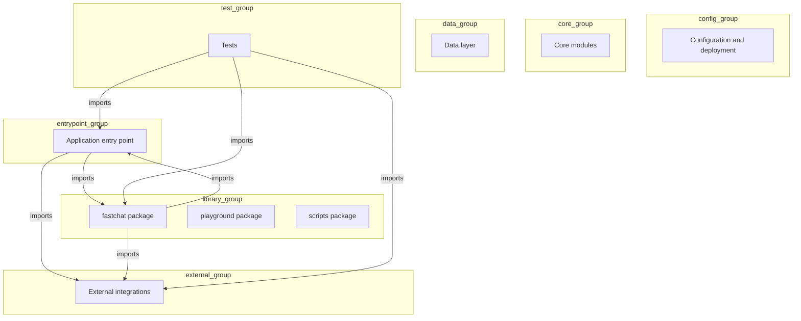

# Architecture report: lm-sys/FastChat

> Automated static analysis. **Observed** = directly seen in files/imports/AST; **Inferred** = interpretation from that evidence. Repository code was not executed.

## 1. Repository at a glance

| Item | Value |
| --- | --- |
| Repository | lm-sys/FastChat |
| Description | An open platform for training, serving, and evaluating large language models. Release repo for Vicuna and Chatbot Arena. |
| Language | Python |
| Stars | 39549 |
| Licence | Apache-2.0 |
| Analysed commit / branch | 587d5cfa1609a43d192cedb8441cac3c17db105d / main |
| Framework(s) | FastAPI |
| Files analysed | 209 |
| Components | 9 |

## 2. Architecture in one minute

lm-sys/FastChat - An open platform for training, serving, and evaluating large language models. Release repo for Vicuna and Chatbot Arena.. This repository was analysed statically from 209 file(s) (148 Python). Detected technologies (observed from imports/manifests): GitHub Actions, FastAPI, aiohttp, httpx, NumPy, pandas. Files are grouped into 9 component(s): Configuration and deployment, Core modules, Data layer, Application entry point, External integrations, fastchat package, playground package, scripts package. Observed entry point(s): fastchat/conversation.py, fastchat/data/clean_sharegpt.py, fastchat/data/convert_alpaca.py. Findings below distinguish observed facts from inferred interpretation.

## 3. High-level block diagram

## 4. Main components

### Configuration and deployment (`config`)

- **Kind:** config
- **Status:** Observed
- **Confidence:** 0.85
- **Responsibility:** Groups 8 file(s) under configuration and deployment (observed from repository paths and static analysis).
- **Paths:** `docker/Dockerfile`, `docker/docker-compose.yml`, `fastchat/serve/monitor/classify/config.yaml`, `fastchat/serve/monitor/classify/vision_config.yaml`, `playground/deepspeed_config_s2.json`, `playground/deepspeed_config_s3.json`, `pyproject.toml`, `theme.json`
- **Evidence:** [docker/Dockerfile](https://github.com/lm-sys/FastChat/blob/587d5cfa1609a43d192cedb8441cac3c17db105d/docker/Dockerfile); [docker/docker-compose.yml](https://github.com/lm-sys/FastChat/blob/587d5cfa1609a43d192cedb8441cac3c17db105d/docker/docker-compose.yml); [fastchat/serve/monitor/classify/config.yaml](https://github.com/lm-sys/FastChat/blob/587d5cfa1609a43d192cedb8441cac3c17db105d/fastchat/serve/monitor/classify/config.yaml); [fastchat/serve/monitor/classify/vision_config.yaml](https://github.com/lm-sys/FastChat/blob/587d5cfa1609a43d192cedb8441cac3c17db105d/fastchat/serve/monitor/classify/vision_config.yaml); [playground/deepspeed_config_s2.json](https://github.com/lm-sys/FastChat/blob/587d5cfa1609a43d192cedb8441cac3c17db105d/playground/deepspeed_config_s2.json); [playground/deepspeed_config_s3.json](https://github.com/lm-sys/FastChat/blob/587d5cfa1609a43d192cedb8441cac3c17db105d/playground/deepspeed_config_s3.json); [pyproject.toml](https://github.com/lm-sys/FastChat/blob/587d5cfa1609a43d192cedb8441cac3c17db105d/pyproject.toml); [theme.json](https://github.com/lm-sys/FastChat/blob/587d5cfa1609a43d192cedb8441cac3c17db105d/theme.json)

### Core modules (`core`)

- **Kind:** core
- **Status:** Observed
- **Confidence:** 0.85
- **Responsibility:** Groups 1 file(s) under core modules (observed from repository paths and static analysis).
- **Paths:** `format.sh`
- **Evidence:** [format.sh](https://github.com/lm-sys/FastChat/blob/587d5cfa1609a43d192cedb8441cac3c17db105d/format.sh)

### Data layer (`data_layer`)

- **Kind:** data
- **Status:** Observed
- **Confidence:** 0.85
- **Responsibility:** Groups 1 file(s) under data layer (observed from repository paths and static analysis).
- **Paths:** `fastchat/data/__init__.py`
- **Evidence:** [fastchat/data/__init__.py](https://github.com/lm-sys/FastChat/blob/587d5cfa1609a43d192cedb8441cac3c17db105d/fastchat/data/__init__.py)

### Application entry point (`entrypoint`)

- **Kind:** entrypoint
- **Status:** Observed
- **Confidence:** 0.85
- **Responsibility:** Groups 86 file(s) under application entry point (observed from repository paths and static analysis). Observed application object created via FastAPI. Observed routes: POST /worker_generate_stream, POST /worker_generate, POST /worker_get_embeddings, POST /worker_get_status, POST /count_token. Observed top-level classes: AppSettings, BaseModelWorker, Controller, Conversation, DashInferWorker, DataArguments. Observed top-level functions: _add_speaker_and_signal, _add_to_set, _form_qa, _prepare_decoder_attention_mask, _tokenize_fn, acquire_worker_semaphore.
- **Paths:** `fastchat/conversation.py`, `fastchat/data/clean_sharegpt.py`, `fastchat/data/convert_alpaca.py`, `fastchat/data/extract_gpt4_only.py`, `fastchat/data/extract_single_round.py`, `fastchat/data/filter_wrong_format.py`, `fastchat/data/get_stats.py`, `fastchat/data/hardcoded_questions.py`, `fastchat/data/inspect_data.py`, `fastchat/data/merge.py`, `fastchat/data/optional_clean.py`, `fastchat/data/optional_replace.py`, `fastchat/data/prepare_all.py`, `fastchat/data/pretty_json.py`, `fastchat/data/sample.py`, `fastchat/data/split_long_conversation.py`, `fastchat/llm_judge/clean_judgment.py`, `fastchat/llm_judge/compute_agreement.py`, `fastchat/llm_judge/download_mt_bench_pregenerated.py`, `fastchat/llm_judge/gen_api_answer.py`, `fastchat/llm_judge/gen_judgment.py`, `fastchat/llm_judge/gen_model_answer.py`, `fastchat/llm_judge/qa_browser.py`, `fastchat/llm_judge/show_result.py`, `fastchat/model/apply_delta.py`, `fastchat/model/apply_lora.py`, `fastchat/model/convert_fp16.py`, `fastchat/model/make_delta.py`, `fastchat/model/upload_hub.py`, `fastchat/serve/base_model_worker.py`, `fastchat/serve/call_monitor.py`, `fastchat/serve/cli.py`, `fastchat/serve/controller.py`, `fastchat/serve/dashinfer_worker.py`, `fastchat/serve/gradio_web_server.py`, `fastchat/serve/gradio_web_server_multi.py`, `fastchat/serve/huggingface_api.py`, `fastchat/serve/huggingface_api_worker.py`, `fastchat/serve/launch_all_serve.py`, `fastchat/serve/lightllm_worker.py`, `fastchat/serve/mlx_worker.py`, `fastchat/serve/model_worker.py`, `fastchat/serve/monitor/add_markdown_info.py`, `fastchat/serve/monitor/basic_stats.py`, `fastchat/serve/monitor/classify/display_score.py`, `fastchat/serve/monitor/classify/label.py`, `fastchat/serve/monitor/clean_battle_data.py`, `fastchat/serve/monitor/clean_chat_data.py`, `fastchat/serve/monitor/criteria_labeling.py`, `fastchat/serve/monitor/dataset_release_scripts/arena_33k/count_unique_users.py`, `fastchat/serve/monitor/dataset_release_scripts/arena_33k/filter_bad_conv.py`, `fastchat/serve/monitor/dataset_release_scripts/arena_33k/merge_field.py`, `fastchat/serve/monitor/dataset_release_scripts/arena_33k/sample.py`, `fastchat/serve/monitor/dataset_release_scripts/lmsys_chat_1m/filter_bad_conv.py`, `fastchat/serve/monitor/dataset_release_scripts/lmsys_chat_1m/final_post_processing.py`, `fastchat/serve/monitor/dataset_release_scripts/lmsys_chat_1m/merge_oai_tag.py`, `fastchat/serve/monitor/dataset_release_scripts/lmsys_chat_1m/sample.py`, `fastchat/serve/monitor/dataset_release_scripts/lmsys_chat_1m/upload_hf_dataset.py`, `fastchat/serve/monitor/deduplication.py`, `fastchat/serve/monitor/elo_analysis.py`, `fastchat/serve/monitor/inspect_conv.py`, `fastchat/serve/monitor/intersect_conv_file.py`, `fastchat/serve/monitor/leaderboard_csv_to_html.py`, `fastchat/serve/monitor/monitor.py`, `fastchat/serve/monitor/summarize_cluster.py`, `fastchat/serve/monitor/tag_openai_moderation.py`, `fastchat/serve/monitor/topic_clustering.py`, `fastchat/serve/multi_model_worker.py`, `fastchat/serve/openai_api_server.py`, `fastchat/serve/register_worker.py`, `fastchat/serve/sglang_worker.py`, `fastchat/serve/vision/create_vqa_examples_dir.py`, `fastchat/serve/vision/create_vqa_examples_json.py`, `fastchat/serve/vision/image.py`, `fastchat/serve/vllm_worker.py`, `fastchat/train/llama2_flash_attn_monkey_patch.py`, `fastchat/train/train.py`, `fastchat/train/train_baichuan.py`, `fastchat/train/train_flant5.py`, `fastchat/train/train_lora.py`, `fastchat/train/train_lora_t5.py`, `fastchat/train/train_mem.py`, `fastchat/train/train_with_template.py`, `fastchat/train/train_xformers.py`, `fastchat/train/train_yuan2.py`, `playground/benchmark/benchmark_api_provider.py`
- **Evidence:** [fastchat/conversation.py:16](https://github.com/lm-sys/FastChat/blob/587d5cfa1609a43d192cedb8441cac3c17db105d/fastchat/conversation.py#L16); [fastchat/data/clean_sharegpt.py:31](https://github.com/lm-sys/FastChat/blob/587d5cfa1609a43d192cedb8441cac3c17db105d/fastchat/data/clean_sharegpt.py#L31); [fastchat/data/convert_alpaca.py](https://github.com/lm-sys/FastChat/blob/587d5cfa1609a43d192cedb8441cac3c17db105d/fastchat/data/convert_alpaca.py); [fastchat/data/extract_gpt4_only.py](https://github.com/lm-sys/FastChat/blob/587d5cfa1609a43d192cedb8441cac3c17db105d/fastchat/data/extract_gpt4_only.py); [fastchat/data/extract_single_round.py](https://github.com/lm-sys/FastChat/blob/587d5cfa1609a43d192cedb8441cac3c17db105d/fastchat/data/extract_single_round.py); [fastchat/data/filter_wrong_format.py:17](https://github.com/lm-sys/FastChat/blob/587d5cfa1609a43d192cedb8441cac3c17db105d/fastchat/data/filter_wrong_format.py#L17); [fastchat/data/get_stats.py:19](https://github.com/lm-sys/FastChat/blob/587d5cfa1609a43d192cedb8441cac3c17db105d/fastchat/data/get_stats.py#L19); [fastchat/data/hardcoded_questions.py:7](https://github.com/lm-sys/FastChat/blob/587d5cfa1609a43d192cedb8441cac3c17db105d/fastchat/data/hardcoded_questions.py#L7)

### External integrations (`external_integrations`)

- **Kind:** external
- **Status:** Inferred
- **Confidence:** 0.70
- **Responsibility:** Groups 0 file(s) under external integrations (observed from repository paths and static analysis).
- **Evidence:** [fastchat/conversation.py:467](https://github.com/lm-sys/FastChat/blob/587d5cfa1609a43d192cedb8441cac3c17db105d/fastchat/conversation.py#L467); [fastchat/serve/api_provider.py:10](https://github.com/lm-sys/FastChat/blob/587d5cfa1609a43d192cedb8441cac3c17db105d/fastchat/serve/api_provider.py#L10); [fastchat/serve/base_model_worker.py:8](https://github.com/lm-sys/FastChat/blob/587d5cfa1609a43d192cedb8441cac3c17db105d/fastchat/serve/base_model_worker.py#L8); [fastchat/serve/controller.py:19](https://github.com/lm-sys/FastChat/blob/587d5cfa1609a43d192cedb8441cac3c17db105d/fastchat/serve/controller.py#L19); [fastchat/serve/gradio_web_server.py:17](https://github.com/lm-sys/FastChat/blob/587d5cfa1609a43d192cedb8441cac3c17db105d/fastchat/serve/gradio_web_server.py#L17); [fastchat/serve/huggingface_api_worker.py:31](https://github.com/lm-sys/FastChat/blob/587d5cfa1609a43d192cedb8441cac3c17db105d/fastchat/serve/huggingface_api_worker.py#L31)

### fastchat package (`fastchat`)

- **Kind:** library
- **Status:** Observed
- **Confidence:** 0.85
- **Responsibility:** Groups 48 file(s) under fastchat package (observed from repository paths and static analysis). Observed top-level classes: APIChatCompletionRequest, APITokenCheckRequest, APITokenCheckRequestItem, APITokenCheckResponse, APITokenCheckResponseItem, AWQConfig. Observed top-level functions: _prepare_decoder_attention_mask, _prepare_text_with_image, _serialize_json, add_image, add_model_args, add_text.
- **Paths:** `fastchat/__init__.py`, `fastchat/constants.py`, `fastchat/llm_judge/common.py`, `fastchat/model/__init__.py`, `fastchat/model/compression.py`, `fastchat/model/llama_condense_monkey_patch.py`, `fastchat/model/model_adapter.py`, `fastchat/model/model_chatglm.py`, `fastchat/model/model_cllm.py`, `fastchat/model/model_codet5p.py`, `fastchat/model/model_exllama.py`, `fastchat/model/model_falcon.py`, `fastchat/model/model_registry.py`, `fastchat/model/model_xfastertransformer.py`, `fastchat/model/model_yuan2.py`, `fastchat/model/monkey_patch_non_inplace.py`, `fastchat/model/rwkv_model.py`, `fastchat/modules/__init__.py`, `fastchat/modules/awq.py`, `fastchat/modules/exllama.py`, `fastchat/modules/gptq.py`, `fastchat/modules/xfastertransformer.py`, `fastchat/protocol/api_protocol.py`, `fastchat/protocol/openai_api_protocol.py`, `fastchat/serve/__init__.py`, `fastchat/serve/api_provider.py`, `fastchat/serve/gradio_block_arena_anony.py`, `fastchat/serve/gradio_block_arena_named.py`, `fastchat/serve/gradio_block_arena_vision.py`, `fastchat/serve/gradio_block_arena_vision_anony.py`, `fastchat/serve/gradio_block_arena_vision_named.py`, `fastchat/serve/gradio_global_state.py`, `fastchat/serve/inference.py`, `fastchat/serve/monitor/classify/category.py`, `fastchat/serve/monitor/copilot_arena.py`, `fastchat/serve/monitor/dataset_release_scripts/arena_33k/upload_hf_dataset.py`, `fastchat/serve/monitor/dataset_release_scripts/lmsys_chat_1m/approve_all.py`, `fastchat/serve/monitor/dataset_release_scripts/lmsys_chat_1m/compute_stats.py`, `fastchat/serve/monitor/dataset_release_scripts/lmsys_chat_1m/process_all.sh`, `fastchat/serve/monitor/monitor_md.py`, `fastchat/serve/monitor/rating_systems.py`, `fastchat/serve/monitor/vote_time_stats/analyze_data.py`, `fastchat/serve/monitor/vote_time_stats/plot.py`, `fastchat/serve/remote_logger.py`, `fastchat/serve/shutdown_serve.py`, `fastchat/train/llama_flash_attn_monkey_patch.py`, `fastchat/train/llama_xformers_attn_monkey_patch.py`, `fastchat/utils.py`
- **Evidence:** [fastchat/__init__.py](https://github.com/lm-sys/FastChat/blob/587d5cfa1609a43d192cedb8441cac3c17db105d/fastchat/__init__.py); [fastchat/constants.py:68](https://github.com/lm-sys/FastChat/blob/587d5cfa1609a43d192cedb8441cac3c17db105d/fastchat/constants.py#L68); [fastchat/llm_judge/common.py:59](https://github.com/lm-sys/FastChat/blob/587d5cfa1609a43d192cedb8441cac3c17db105d/fastchat/llm_judge/common.py#L59); [fastchat/model/__init__.py](https://github.com/lm-sys/FastChat/blob/587d5cfa1609a43d192cedb8441cac3c17db105d/fastchat/model/__init__.py); [fastchat/model/compression.py:24](https://github.com/lm-sys/FastChat/blob/587d5cfa1609a43d192cedb8441cac3c17db105d/fastchat/model/compression.py#L24); [fastchat/model/llama_condense_monkey_patch.py:10](https://github.com/lm-sys/FastChat/blob/587d5cfa1609a43d192cedb8441cac3c17db105d/fastchat/model/llama_condense_monkey_patch.py#L10); [fastchat/model/model_adapter.py:97](https://github.com/lm-sys/FastChat/blob/587d5cfa1609a43d192cedb8441cac3c17db105d/fastchat/model/model_adapter.py#L97); [fastchat/model/model_chatglm.py:11](https://github.com/lm-sys/FastChat/blob/587d5cfa1609a43d192cedb8441cac3c17db105d/fastchat/model/model_chatglm.py#L11)

### playground package (`playground`)

- **Kind:** library
- **Status:** Observed
- **Confidence:** 0.85
- **Responsibility:** Groups 1 file(s) under playground package (observed from repository paths and static analysis).
- **Paths:** `playground/__init__.py`
- **Evidence:** [playground/__init__.py](https://github.com/lm-sys/FastChat/blob/587d5cfa1609a43d192cedb8441cac3c17db105d/playground/__init__.py)

### scripts package (`scripts`)

- **Kind:** library
- **Status:** Observed
- **Confidence:** 0.85
- **Responsibility:** Groups 5 file(s) under scripts package (observed from repository paths and static analysis).
- **Paths:** `scripts/build-api.sh`, `scripts/train_lora.sh`, `scripts/train_vicuna_13b.sh`, `scripts/train_vicuna_7b.sh`, `scripts/upload_pypi.sh`
- **Evidence:** [scripts/build-api.sh](https://github.com/lm-sys/FastChat/blob/587d5cfa1609a43d192cedb8441cac3c17db105d/scripts/build-api.sh); [scripts/train_lora.sh](https://github.com/lm-sys/FastChat/blob/587d5cfa1609a43d192cedb8441cac3c17db105d/scripts/train_lora.sh); [scripts/train_vicuna_13b.sh](https://github.com/lm-sys/FastChat/blob/587d5cfa1609a43d192cedb8441cac3c17db105d/scripts/train_vicuna_13b.sh); [scripts/train_vicuna_7b.sh](https://github.com/lm-sys/FastChat/blob/587d5cfa1609a43d192cedb8441cac3c17db105d/scripts/train_vicuna_7b.sh); [scripts/upload_pypi.sh](https://github.com/lm-sys/FastChat/blob/587d5cfa1609a43d192cedb8441cac3c17db105d/scripts/upload_pypi.sh)

### Tests (`tests`)

- **Kind:** test
- **Status:** Observed
- **Confidence:** 0.85
- **Responsibility:** Groups 17 file(s) under tests (observed from repository paths and static analysis). Observed top-level classes: ClaudeConversationResizesCorrectly, DontResizeIfLessThanMaxTest, DontResizeIfMaxImageSizeIsNone, OpenAIConversationDontResizeImage, ResizeLargeImageForModerationEndpoint. Observed top-level functions: check_byte_size_in_mb, cosine_similarity, create_embedding_data_frame, encode_image, generate_random_image, get_embedding_from_api.
- **Paths:** `fastchat/data/split_train_test.py`, `fastchat/serve/test_message.py`, `fastchat/serve/test_throughput.py`, `playground/test_embedding/test_classification.py`, `playground/test_embedding/test_semantic_search.py`, `playground/test_embedding/test_sentence_similarity.py`, `scripts/test_readme_train.sh`, `tests/README.md`, `tests/killall_python.sh`, `tests/launch_openai_api_test_server.py`, `tests/load_test.py`, `tests/test_cli.py`, `tests/test_cli_inputs.txt`, `tests/test_image_utils.py`, `tests/test_openai_api.py`, `tests/test_openai_langchain.py`, `tests/test_openai_vision_api.py`
- **Evidence:** [fastchat/data/split_train_test.py](https://github.com/lm-sys/FastChat/blob/587d5cfa1609a43d192cedb8441cac3c17db105d/fastchat/data/split_train_test.py); [fastchat/serve/test_message.py:10](https://github.com/lm-sys/FastChat/blob/587d5cfa1609a43d192cedb8441cac3c17db105d/fastchat/serve/test_message.py#L10); [fastchat/serve/test_throughput.py:12](https://github.com/lm-sys/FastChat/blob/587d5cfa1609a43d192cedb8441cac3c17db105d/fastchat/serve/test_throughput.py#L12); [playground/test_embedding/test_classification.py:16](https://github.com/lm-sys/FastChat/blob/587d5cfa1609a43d192cedb8441cac3c17db105d/playground/test_embedding/test_classification.py#L16); [playground/test_embedding/test_semantic_search.py:11](https://github.com/lm-sys/FastChat/blob/587d5cfa1609a43d192cedb8441cac3c17db105d/playground/test_embedding/test_semantic_search.py#L11); [playground/test_embedding/test_sentence_similarity.py:10](https://github.com/lm-sys/FastChat/blob/587d5cfa1609a43d192cedb8441cac3c17db105d/playground/test_embedding/test_sentence_similarity.py#L10); [scripts/test_readme_train.sh](https://github.com/lm-sys/FastChat/blob/587d5cfa1609a43d192cedb8441cac3c17db105d/scripts/test_readme_train.sh); [tests/README.md](https://github.com/lm-sys/FastChat/blob/587d5cfa1609a43d192cedb8441cac3c17db105d/tests/README.md)

## 5. Execution flow

**Observed** entry point(s):

- [fastchat/conversation.py:2302](https://github.com/lm-sys/FastChat/blob/587d5cfa1609a43d192cedb8441cac3c17db105d/fastchat/conversation.py#L2302)
- [fastchat/data/clean_sharegpt.py:224](https://github.com/lm-sys/FastChat/blob/587d5cfa1609a43d192cedb8441cac3c17db105d/fastchat/data/clean_sharegpt.py#L224)
- [fastchat/data/convert_alpaca.py:14](https://github.com/lm-sys/FastChat/blob/587d5cfa1609a43d192cedb8441cac3c17db105d/fastchat/data/convert_alpaca.py#L14)
- [fastchat/data/extract_gpt4_only.py:10](https://github.com/lm-sys/FastChat/blob/587d5cfa1609a43d192cedb8441cac3c17db105d/fastchat/data/extract_gpt4_only.py#L10)
- [fastchat/data/extract_single_round.py:10](https://github.com/lm-sys/FastChat/blob/587d5cfa1609a43d192cedb8441cac3c17db105d/fastchat/data/extract_single_round.py#L10)
- [fastchat/data/filter_wrong_format.py:28](https://github.com/lm-sys/FastChat/blob/587d5cfa1609a43d192cedb8441cac3c17db105d/fastchat/data/filter_wrong_format.py#L28)
- [fastchat/data/get_stats.py:59](https://github.com/lm-sys/FastChat/blob/587d5cfa1609a43d192cedb8441cac3c17db105d/fastchat/data/get_stats.py#L59)
- [fastchat/data/hardcoded_questions.py:162](https://github.com/lm-sys/FastChat/blob/587d5cfa1609a43d192cedb8441cac3c17db105d/fastchat/data/hardcoded_questions.py#L162)
- [fastchat/data/inspect_data.py:10](https://github.com/lm-sys/FastChat/blob/587d5cfa1609a43d192cedb8441cac3c17db105d/fastchat/data/inspect_data.py#L10)
- [fastchat/data/merge.py:11](https://github.com/lm-sys/FastChat/blob/587d5cfa1609a43d192cedb8441cac3c17db105d/fastchat/data/merge.py#L11)
- [fastchat/data/optional_clean.py:47](https://github.com/lm-sys/FastChat/blob/587d5cfa1609a43d192cedb8441cac3c17db105d/fastchat/data/optional_clean.py#L47)
- [fastchat/data/optional_replace.py:53](https://github.com/lm-sys/FastChat/blob/587d5cfa1609a43d192cedb8441cac3c17db105d/fastchat/data/optional_replace.py#L53)

**Observed** routes (from decorators):

- `POST /worker_generate_stream` -> `api_generate_stream` in `fastchat/serve/base_model_worker.py:197`
- `POST /worker_generate` -> `api_generate` in `fastchat/serve/base_model_worker.py:206`
- `POST /worker_get_embeddings` -> `api_get_embeddings` in `fastchat/serve/base_model_worker.py:215`
- `POST /worker_get_status` -> `api_get_status` in `fastchat/serve/base_model_worker.py:224`
- `POST /count_token` -> `api_count_token` in `fastchat/serve/base_model_worker.py:229`
- `POST /worker_get_conv_template` -> `api_get_conv` in `fastchat/serve/base_model_worker.py:235`
- `POST /model_details` -> `api_model_details` in `fastchat/serve/base_model_worker.py:240`
- `GET /get_model_call_limit/{model}` -> `get_model_call_limit` in `fastchat/serve/call_monitor.py:170`
- `GET /update_model_call_limit/{model}/{limit}` -> `update_model_call_limit` in `fastchat/serve/call_monitor.py:175`
- `GET /is_limit_reached` -> `is_limit_reached` in `fastchat/serve/call_monitor.py:182`
- `GET /get_num_users_hr` -> `get_num_users` in `fastchat/serve/call_monitor.py:197`
- `GET /get_num_users_day` -> `get_num_users_day` in `fastchat/serve/call_monitor.py:202`
- `GET /get_user_call_stats` -> `get_user_call_stats` in `fastchat/serve/call_monitor.py:207`
- `GET /get_model_call_stats` -> `get_model_call_stats` in `fastchat/serve/call_monitor.py:216`
- `POST /register_worker` -> `register_worker` in `fastchat/serve/controller.py:289`
- `POST /refresh_all_workers` -> `refresh_all_workers` in `fastchat/serve/controller.py:300`
- `POST /list_models` -> `list_models` in `fastchat/serve/controller.py:305`
- `POST /list_multimodal_models` -> `list_multimodal_models` in `fastchat/serve/controller.py:311`
- `POST /list_language_models` -> `list_language_models` in `fastchat/serve/controller.py:317`
- `POST /get_worker_address` -> `get_worker_address` in `fastchat/serve/controller.py:323`
- `POST /receive_heart_beat` -> `receive_heart_beat` in `fastchat/serve/controller.py:330`
- `POST /worker_generate_stream` -> `worker_api_generate_stream` in `fastchat/serve/controller.py:337`
- `POST /worker_get_status` -> `worker_api_get_status` in `fastchat/serve/controller.py:344`
- `GET /test_connection` -> `worker_api_get_status` in `fastchat/serve/controller.py:349`
- `POST /worker_generate_stream` -> `api_generate_stream` in `fastchat/serve/dashinfer_worker.py:231`
- `POST /worker_generate` -> `api_generate` in `fastchat/serve/dashinfer_worker.py:240`
- `POST /worker_get_status` -> `api_get_status` in `fastchat/serve/dashinfer_worker.py:249`
- `POST /count_token` -> `api_count_token` in `fastchat/serve/dashinfer_worker.py:254`
- `POST /worker_get_conv_template` -> `api_get_conv` in `fastchat/serve/dashinfer_worker.py:260`
- `POST /model_details` -> `api_model_details` in `fastchat/serve/dashinfer_worker.py:265`
- `POST /worker_generate_stream` -> `api_generate_stream` in `fastchat/serve/huggingface_api_worker.py:222`
- `POST /worker_generate` -> `api_generate` in `fastchat/serve/huggingface_api_worker.py:232`
- `POST /worker_get_embeddings` -> `api_get_embeddings` in `fastchat/serve/huggingface_api_worker.py:242`
- `POST /worker_get_status` -> `api_get_status` in `fastchat/serve/huggingface_api_worker.py:252`
- `POST /count_token` -> `api_count_token` in `fastchat/serve/huggingface_api_worker.py:261`
- `POST /worker_get_conv_template` -> `api_get_conv` in `fastchat/serve/huggingface_api_worker.py:268`
- `POST /model_details` -> `api_model_details` in `fastchat/serve/huggingface_api_worker.py:275`
- `POST /worker_generate_stream` -> `api_generate_stream` in `fastchat/serve/lightllm_worker.py:215`
- `POST /worker_generate` -> `api_generate` in `fastchat/serve/lightllm_worker.py:227`
- `POST /worker_get_status` -> `api_get_status` in `fastchat/serve/lightllm_worker.py:240`
- `POST /count_token` -> `api_count_token` in `fastchat/serve/lightllm_worker.py:245`
- `POST /worker_get_conv_template` -> `api_get_conv` in `fastchat/serve/lightllm_worker.py:251`
- `POST /model_details` -> `api_model_details` in `fastchat/serve/lightllm_worker.py:256`
- `POST /worker_generate_stream` -> `api_generate_stream` in `fastchat/serve/mlx_worker.py:192`
- `POST /worker_generate` -> `api_generate` in `fastchat/serve/mlx_worker.py:203`
- `POST /worker_get_status` -> `api_get_status` in `fastchat/serve/mlx_worker.py:216`
- `POST /count_token` -> `api_count_token` in `fastchat/serve/mlx_worker.py:221`
- `POST /worker_get_conv_template` -> `api_get_conv` in `fastchat/serve/mlx_worker.py:227`
- `POST /model_details` -> `api_model_details` in `fastchat/serve/mlx_worker.py:232`
- `POST /worker_generate_stream` -> `api_generate_stream` in `fastchat/serve/multi_model_worker.py:98`
- `POST /worker_generate` -> `api_generate` in `fastchat/serve/multi_model_worker.py:108`
- `POST /worker_get_embeddings` -> `api_get_embeddings` in `fastchat/serve/multi_model_worker.py:118`
- `POST /worker_get_status` -> `api_get_status` in `fastchat/serve/multi_model_worker.py:128`
- `POST /count_token` -> `api_count_token` in `fastchat/serve/multi_model_worker.py:137`
- `POST /worker_get_conv_template` -> `api_get_conv` in `fastchat/serve/multi_model_worker.py:144`
- `POST /model_details` -> `api_model_details` in `fastchat/serve/multi_model_worker.py:151`
- `GET /v1/models` -> `show_available_models` in `fastchat/serve/openai_api_server.py:398`
- `POST /v1/chat/completions` -> `create_chat_completion` in `fastchat/serve/openai_api_server.py:412`
- `POST /v1/completions` -> `create_completion` in `fastchat/serve/openai_api_server.py:543`
- `POST /v1/embeddings` -> `create_embeddings` in `fastchat/serve/openai_api_server.py:708`
- `POST /v1/engines/{model_name}/embeddings` -> `create_embeddings` in `fastchat/serve/openai_api_server.py:708`
- `POST /api/v1/token_check` -> `count_tokens` in `fastchat/serve/openai_api_server.py:767`
- `POST /api/v1/chat/completions` -> `create_chat_completion` in `fastchat/serve/openai_api_server.py:802`
- `POST /worker_generate_stream` -> `api_generate_stream` in `fastchat/serve/sglang_worker.py:198`
- `POST /worker_generate` -> `api_generate` in `fastchat/serve/sglang_worker.py:207`
- `POST /worker_get_status` -> `api_get_status` in `fastchat/serve/sglang_worker.py:216`
- `POST /count_token` -> `api_count_token` in `fastchat/serve/sglang_worker.py:221`
- `POST /worker_get_conv_template` -> `api_get_conv` in `fastchat/serve/sglang_worker.py:227`
- `POST /model_details` -> `api_model_details` in `fastchat/serve/sglang_worker.py:232`
- `POST /worker_generate_stream` -> `api_generate_stream` in `fastchat/serve/vllm_worker.py:199`
- `POST /worker_generate` -> `api_generate` in `fastchat/serve/vllm_worker.py:211`
- `POST /worker_get_status` -> `api_get_status` in `fastchat/serve/vllm_worker.py:224`
- `POST /count_token` -> `api_count_token` in `fastchat/serve/vllm_worker.py:229`
- `POST /worker_get_conv_template` -> `api_get_conv` in `fastchat/serve/vllm_worker.py:235`
- `POST /model_details` -> `api_model_details` in `fastchat/serve/vllm_worker.py:240`

Representative flow (derived from observed entry points and the import graph; steps beyond the entry point are **Inferred**):

1. Execution starts at an observed entry point listed above, if present.
2. `entrypoint` imports `external_integrations` (Application entry point -> External integrations).
3. `entrypoint` imports `fastchat` (Application entry point -> fastchat package).
4. `fastchat` imports `entrypoint` (fastchat package -> Application entry point).
5. `fastchat` imports `external_integrations` (fastchat package -> External integrations).
6. `tests` imports `entrypoint` (Tests -> Application entry point).
7. `tests` imports `external_integrations` (Tests -> External integrations).
8. `tests` imports `fastchat` (Tests -> fastchat package).

## 6. Project structure

### `(root)`

- `.gitignore` - other (338 bytes)
- `.pylintrc` - other (14765 bytes)
- `LICENSE` - docs (11357 bytes)
- `README.md` - docs (20103 bytes)
- `format.sh` - source, Shell (2322 bytes)
- `pyproject.toml` - manifest (1342 bytes)
- `theme.json` - config (12697 bytes)

### `.github`

- `.github/PULL_REQUEST_TEMPLATE.md` - docs (594 bytes)
- `.github/workflows/python-package.yml` - ci, YAML (673 bytes)

### `docker`

- `docker/Dockerfile` - container (276 bytes)
- `docker/docker-compose.yml` - container (1290 bytes)

### `docs`

- `docs/arena.md` - docs (3436 bytes)
- `docs/awq.md` - docs (3319 bytes)
- `docs/commands/conv_release.md` - docs (552 bytes)
- `docs/commands/data_cleaning.md` - docs (599 bytes)
- `docs/commands/leaderboard.md` - docs (950 bytes)
- `docs/commands/local_cluster.md` - docs (3679 bytes)
- `docs/commands/pypi.md` - docs (157 bytes)
- `docs/commands/webserver.md` - docs (2694 bytes)
- `docs/dashinfer_integration.md` - docs (1952 bytes)
- `docs/dataset_release.md` - docs (484 bytes)
- `docs/exllama_v2.md` - docs (2855 bytes)
- `docs/gptq.md` - docs (2365 bytes)
- `docs/langchain_integration.md` - docs (3209 bytes)
- `docs/lightllm_integration.md` - docs (1431 bytes)
- `docs/mlx_integration.md` - docs (828 bytes)
- `docs/model_support.md` - docs (9278 bytes)
- `docs/openai_api.md` - docs (4870 bytes)
- `docs/server_arch.md` - docs (73 bytes)
- `docs/third_party_ui.md` - docs (1853 bytes)
- `docs/training.md` - docs (4326 bytes)
- `docs/vicuna_weights_version.md` - docs (5690 bytes)
- `docs/vllm_integration.md` - docs (1022 bytes)
- `docs/xFasterTransformer.md` - docs (3540 bytes)

### `fastchat`

- `fastchat/__init__.py` - source, Python (23 bytes)
- `fastchat/constants.py` - source, Python (3750 bytes)
- `fastchat/conversation.py` - source, Python (102989 bytes)
- `fastchat/data/__init__.py` - source, Python (0 bytes)
- `fastchat/data/clean_sharegpt.py` - source, Python (7188 bytes)
- `fastchat/data/convert_alpaca.py` - source, Python (1094 bytes)
- `fastchat/data/extract_gpt4_only.py` - source, Python (976 bytes)
- `fastchat/data/extract_single_round.py` - source, Python (883 bytes)
- `fastchat/data/filter_wrong_format.py` - source, Python (1157 bytes)
- `fastchat/data/get_stats.py` - source, Python (2413 bytes)
- `fastchat/data/hardcoded_questions.py` - source, Python (6264 bytes)
- `fastchat/data/inspect_data.py` - source, Python (939 bytes)
- `fastchat/data/merge.py` - source, Python (664 bytes)
- `fastchat/data/optional_clean.py` - source, Python (2699 bytes)
- `fastchat/data/optional_replace.py` - source, Python (2361 bytes)
- `fastchat/data/prepare_all.py` - source, Python (1851 bytes)
- `fastchat/data/pretty_json.py` - source, Python (495 bytes)
- `fastchat/data/sample.py` - source, Python (1233 bytes)
- `fastchat/data/split_long_conversation.py` - source, Python (3741 bytes)
- `fastchat/data/split_train_test.py` - test, Python (1112 bytes)
- `fastchat/llm_judge/README.md` - docs (6796 bytes)
- `fastchat/llm_judge/clean_judgment.py` - source, Python (2251 bytes)
- `fastchat/llm_judge/common.py` - source, Python (22379 bytes)
- `fastchat/llm_judge/compute_agreement.py` - source, Python (4420 bytes)
- `fastchat/llm_judge/data/judge_prompts.jsonl` - data (10449 bytes)
- `fastchat/llm_judge/data/mt_bench/question.jsonl` - data (48929 bytes)
- `fastchat/llm_judge/data/mt_bench/reference_answer/gpt-4.jsonl` - data (51109 bytes)
- `fastchat/llm_judge/data/vicuna_bench/question.jsonl` - data (13125 bytes)
- `fastchat/llm_judge/data/vicuna_bench/reference_answer/gpt-4.jsonl` - data (11301 bytes)
- `fastchat/llm_judge/download_mt_bench_pregenerated.py` - source, Python (2247 bytes)
- `fastchat/llm_judge/gen_api_answer.py` - source, Python (4661 bytes)
- `fastchat/llm_judge/gen_judgment.py` - source, Python (9560 bytes)
- `fastchat/llm_judge/gen_model_answer.py` - source, Python (9659 bytes)
- `fastchat/llm_judge/qa_browser.py` - source, Python (12680 bytes)
- `fastchat/llm_judge/show_result.py` - source, Python (4644 bytes)
- `fastchat/model/__init__.py` - source, Python (112 bytes)
- `fastchat/model/apply_delta.py` - source, Python (5999 bytes)
- `fastchat/model/apply_lora.py` - source, Python (1565 bytes)
- `fastchat/model/compression.py` - source, Python (10416 bytes)
- `fastchat/model/convert_fp16.py` - source, Python (846 bytes)
- `fastchat/model/llama_condense_monkey_patch.py` - source, Python (2864 bytes)
- `fastchat/model/make_delta.py` - source, Python (1835 bytes)
- `fastchat/model/model_adapter.py` - source, Python (92186 bytes)
- `fastchat/model/model_chatglm.py` - source, Python (4222 bytes)
- `fastchat/model/model_cllm.py` - source, Python (6729 bytes)
- `fastchat/model/model_codet5p.py` - source, Python (3197 bytes)
- `fastchat/model/model_exllama.py` - source, Python (2222 bytes)
- `fastchat/model/model_falcon.py` - source, Python (4414 bytes)
- `fastchat/model/model_registry.py` - source, Python (27130 bytes)
- `fastchat/model/model_xfastertransformer.py` - source, Python (2352 bytes)
- `fastchat/model/model_yuan2.py` - source, Python (4385 bytes)
- `fastchat/model/monkey_patch_non_inplace.py` - source, Python (4216 bytes)
- `fastchat/model/rwkv_model.py` - source, Python (2537 bytes)
- `fastchat/model/upload_hub.py` - source, Python (1521 bytes)
- `fastchat/modules/__init__.py` - source, Python (0 bytes)
- `fastchat/modules/awq.py` - source, Python (2638 bytes)
- `fastchat/modules/exllama.py` - source, Python (1469 bytes)
- `fastchat/modules/gptq.py` - source, Python (2266 bytes)
- `fastchat/modules/xfastertransformer.py` - source, Python (1298 bytes)
- `fastchat/protocol/api_protocol.py` - source, Python (4677 bytes)
- `fastchat/protocol/openai_api_protocol.py` - source, Python (5432 bytes)
- `fastchat/serve/__init__.py` - source, Python (0 bytes)
- `fastchat/serve/api_provider.py` - source, Python (42089 bytes)
- `fastchat/serve/base_model_worker.py` - source, Python (7031 bytes)
- `fastchat/serve/call_monitor.py` - source, Python (7988 bytes)
- `fastchat/serve/cli.py` - source, Python (10936 bytes)
- `fastchat/serve/controller.py` - source, Python (12046 bytes)
- `fastchat/serve/dashinfer_worker.py` - source, Python (11331 bytes)
- `fastchat/serve/gateway/README.md` - docs (1735 bytes)
- `fastchat/serve/gateway/nginx.conf` - other (3998 bytes)
- `fastchat/serve/gradio_block_arena_anony.py` - source, Python (20097 bytes)
- `fastchat/serve/gradio_block_arena_named.py` - source, Python (15870 bytes)
- `fastchat/serve/gradio_block_arena_vision.py` - source, Python (16823 bytes)
- `fastchat/serve/gradio_block_arena_vision_anony.py` - source, Python (20973 bytes)
- `fastchat/serve/gradio_block_arena_vision_named.py` - source, Python (19192 bytes)
- `fastchat/serve/gradio_global_state.py` - source, Python (441 bytes)
- `fastchat/serve/gradio_web_server.py` - source, Python (37150 bytes)
- `fastchat/serve/gradio_web_server_multi.py` - source, Python (15419 bytes)
- `fastchat/serve/huggingface_api.py` - source, Python (2296 bytes)
- `fastchat/serve/huggingface_api_worker.py` - source, Python (12619 bytes)
- `fastchat/serve/inference.py` - source, Python (18802 bytes)
- `fastchat/serve/launch_all_serve.py` - source, Python (8448 bytes)
- `fastchat/serve/lightllm_worker.py` - source, Python (17366 bytes)
- `fastchat/serve/mlx_worker.py` - source, Python (8598 bytes)
- `fastchat/serve/model_worker.py` - source, Python (15165 bytes)
- `fastchat/serve/monitor/add_markdown_info.py` - source, Python (2733 bytes)
- `fastchat/serve/monitor/basic_stats.py` - source, Python (7243 bytes)
- `fastchat/serve/monitor/classify/README.md` - docs (2387 bytes)
- `fastchat/serve/monitor/classify/category.py` - source, Python (30509 bytes)
- `fastchat/serve/monitor/classify/config.yaml` - config (503 bytes)
- `fastchat/serve/monitor/classify/display_score.py` - source, Python (2535 bytes)
- `fastchat/serve/monitor/classify/label.py` - source, Python (14655 bytes)
- `fastchat/serve/monitor/classify/vision_config.yaml` - config (577 bytes)
- `fastchat/serve/monitor/clean_battle_data.py` - source, Python (12383 bytes)
- `fastchat/serve/monitor/clean_chat_data.py` - source, Python (6934 bytes)
- `fastchat/serve/monitor/copilot_arena.py` - source, Python (3464 bytes)
- `fastchat/serve/monitor/criteria_labeling.py` - source, Python (8169 bytes)
- `fastchat/serve/monitor/dataset_release_scripts/arena_33k/count_unique_users.py` - source, Python (647 bytes)
- `fastchat/serve/monitor/dataset_release_scripts/arena_33k/filter_bad_conv.py` - source, Python (4554 bytes)
- `fastchat/serve/monitor/dataset_release_scripts/arena_33k/merge_field.py` - source, Python (722 bytes)
- `fastchat/serve/monitor/dataset_release_scripts/arena_33k/sample.py` - source, Python (785 bytes)
- `fastchat/serve/monitor/dataset_release_scripts/arena_33k/upload_hf_dataset.py` - source, Python (281 bytes)
- `fastchat/serve/monitor/dataset_release_scripts/lmsys_chat_1m/approve_all.py` - source, Python (471 bytes)
- `fastchat/serve/monitor/dataset_release_scripts/lmsys_chat_1m/compute_stats.py` - source, Python (2897 bytes)
- `fastchat/serve/monitor/dataset_release_scripts/lmsys_chat_1m/filter_bad_conv.py` - source, Python (4278 bytes)
- `fastchat/serve/monitor/dataset_release_scripts/lmsys_chat_1m/final_post_processing.py` - source, Python (670 bytes)
- `fastchat/serve/monitor/dataset_release_scripts/lmsys_chat_1m/instructions.md` - docs (587 bytes)
- `fastchat/serve/monitor/dataset_release_scripts/lmsys_chat_1m/merge_oai_tag.py` - source, Python (1385 bytes)
- `fastchat/serve/monitor/dataset_release_scripts/lmsys_chat_1m/process_all.sh` - source, Shell (516 bytes)
- `fastchat/serve/monitor/dataset_release_scripts/lmsys_chat_1m/sample.py` - source, Python (786 bytes)
- `fastchat/serve/monitor/dataset_release_scripts/lmsys_chat_1m/upload_hf_dataset.py` - source, Python (445 bytes)
- `fastchat/serve/monitor/deduplication.py` - source, Python (2655 bytes)
- `fastchat/serve/monitor/elo_analysis.py` - source, Python (18301 bytes)
- `fastchat/serve/monitor/inspect_conv.py` - source, Python (2784 bytes)
- `fastchat/serve/monitor/intersect_conv_file.py` - source, Python (861 bytes)
- `fastchat/serve/monitor/leaderboard_csv_to_html.py` - source, Python (1303 bytes)
- `fastchat/serve/monitor/monitor.py` - source, Python (41775 bytes)
- `fastchat/serve/monitor/monitor_md.py` - source, Python (9849 bytes)
- `fastchat/serve/monitor/rating_systems.py` - source, Python (13208 bytes)
- `fastchat/serve/monitor/summarize_cluster.py` - source, Python (2911 bytes)
- `fastchat/serve/monitor/tag_openai_moderation.py` - source, Python (1662 bytes)
- `fastchat/serve/monitor/topic_clustering.py` - source, Python (9930 bytes)
- `fastchat/serve/monitor/vote_time_stats/README.md` - docs (180 bytes)
- `fastchat/serve/monitor/vote_time_stats/analyze_data.py` - source, Python (3802 bytes)
- `fastchat/serve/monitor/vote_time_stats/plot.py` - source, Python (1958 bytes)
- `fastchat/serve/multi_model_worker.py` - source, Python (9944 bytes)
- `fastchat/serve/openai_api_server.py` - source, Python (33101 bytes)
- `fastchat/serve/register_worker.py` - source, Python (834 bytes)
- `fastchat/serve/remote_logger.py` - source, Python (1620 bytes)
- `fastchat/serve/sglang_worker.py` - source, Python (10037 bytes)
- `fastchat/serve/shutdown_serve.py` - source, Python (755 bytes)
- `fastchat/serve/test_message.py` - test, Python (2469 bytes)
- `fastchat/serve/test_throughput.py` - test, Python (3981 bytes)
- `fastchat/serve/vision/create_vqa_examples_dir.py` - source, Python (3970 bytes)
- `fastchat/serve/vision/create_vqa_examples_json.py` - source, Python (1044 bytes)
- `fastchat/serve/vision/image.py` - source, Python (4601 bytes)
- `fastchat/serve/vllm_worker.py` - source, Python (10303 bytes)
- `fastchat/train/llama2_flash_attn_monkey_patch.py` - source, Python (8321 bytes)
- `fastchat/train/llama_flash_attn_monkey_patch.py` - source, Python (4054 bytes)
- `fastchat/train/llama_xformers_attn_monkey_patch.py` - source, Python (4916 bytes)
- `fastchat/train/train.py` - source, Python (10397 bytes)
- `fastchat/train/train_baichuan.py` - source, Python (11470 bytes)
- `fastchat/train/train_flant5.py` - source, Python (14992 bytes)
- `fastchat/train/train_lora.py` - source, Python (7803 bytes)
- `fastchat/train/train_lora_t5.py` - source, Python (7637 bytes)
- `fastchat/train/train_mem.py` - source, Python (355 bytes)
- `fastchat/train/train_with_template.py` - source, Python (13634 bytes)
- `fastchat/train/train_xformers.py` - source, Python (372 bytes)
- `fastchat/train/train_yuan2.py` - source, Python (16796 bytes)
- `fastchat/utils.py` - source, Python (15474 bytes)

### `playground`

- `playground/FastChat_API_GoogleColab.ipynb` - other (99331 bytes)
- `playground/__init__.py` - source, Python (0 bytes)
- `playground/benchmark/benchmark_api_provider.py` - source, Python (3960 bytes)
- `playground/deepspeed_config_s2.json` - config (291 bytes)
- `playground/deepspeed_config_s3.json` - config (916 bytes)
- `playground/test_embedding/README.md` - docs (720 bytes)
- `playground/test_embedding/test_classification.py` - test, Python (2788 bytes)
- `playground/test_embedding/test_semantic_search.py` - test, Python (3075 bytes)
- `playground/test_embedding/test_sentence_similarity.py` - test, Python (1839 bytes)

### `scripts`

- `scripts/build-api.sh` - source, Shell (1992 bytes)
- `scripts/test_readme_train.sh` - test, Shell (830 bytes)
- `scripts/train_lora.sh` - source, Shell (858 bytes)
- `scripts/train_vicuna_13b.sh` - source, Shell (902 bytes)
- `scripts/train_vicuna_7b.sh` - source, Shell (893 bytes)
- `scripts/upload_pypi.sh` - source, Shell (60 bytes)

### `tests`

- `tests/README.md` - test (2216 bytes)
- `tests/killall_python.sh` - test, Shell (88 bytes)
- `tests/launch_openai_api_test_server.py` - test, Python (1431 bytes)
- `tests/load_test.py` - test, Python (4686 bytes)
- `tests/test_cli.py` - test, Python (2127 bytes)
- `tests/test_cli_inputs.txt` - test (186 bytes)
- `tests/test_image_utils.py` - test, Python (4656 bytes)
- `tests/test_openai_api.py` - test, Python (3634 bytes)
- `tests/test_openai_langchain.py` - test, Python (1363 bytes)
- `tests/test_openai_vision_api.py` - test, Python (4069 bytes)

## 7. Key dependencies and integrations

| Name | Category | Status | Confidence | Evidence |
| --- | --- | --- | --- | --- |
| GitHub Actions | ci | Observed | 0.85 | [.github/workflows/python-package.yml](https://github.com/lm-sys/FastChat/blob/587d5cfa1609a43d192cedb8441cac3c17db105d/.github/workflows/python-package.yml) |
| FastAPI | framework | Observed | 0.95 | [fastchat/serve/base_model_worker.py:6](https://github.com/lm-sys/FastChat/blob/587d5cfa1609a43d192cedb8441cac3c17db105d/fastchat/serve/base_model_worker.py#L6); [fastchat/serve/base_model_worker.py:7](https://github.com/lm-sys/FastChat/blob/587d5cfa1609a43d192cedb8441cac3c17db105d/fastchat/serve/base_model_worker.py#L7); [fastchat/serve/call_monitor.py:6](https://github.com/lm-sys/FastChat/blob/587d5cfa1609a43d192cedb8441cac3c17db105d/fastchat/serve/call_monitor.py#L6); [fastchat/serve/controller.py:16](https://github.com/lm-sys/FastChat/blob/587d5cfa1609a43d192cedb8441cac3c17db105d/fastchat/serve/controller.py#L16) |
| aiohttp | library | Observed | 0.90 | [fastchat/serve/openai_api_server.py:16](https://github.com/lm-sys/FastChat/blob/587d5cfa1609a43d192cedb8441cac3c17db105d/fastchat/serve/openai_api_server.py#L16); [pyproject.toml:16](https://github.com/lm-sys/FastChat/blob/587d5cfa1609a43d192cedb8441cac3c17db105d/pyproject.toml#L16) |
| httpx | library | Observed | 0.90 | [fastchat/serve/openai_api_server.py:23](https://github.com/lm-sys/FastChat/blob/587d5cfa1609a43d192cedb8441cac3c17db105d/fastchat/serve/openai_api_server.py#L23); [pyproject.toml:16](https://github.com/lm-sys/FastChat/blob/587d5cfa1609a43d192cedb8441cac3c17db105d/pyproject.toml#L16) |
| NumPy | library | Observed | 0.95 | [fastchat/data/convert_alpaca.py:11](https://github.com/lm-sys/FastChat/blob/587d5cfa1609a43d192cedb8441cac3c17db105d/fastchat/data/convert_alpaca.py#L11); [fastchat/data/get_stats.py:11](https://github.com/lm-sys/FastChat/blob/587d5cfa1609a43d192cedb8441cac3c17db105d/fastchat/data/get_stats.py#L11); [fastchat/data/sample.py:9](https://github.com/lm-sys/FastChat/blob/587d5cfa1609a43d192cedb8441cac3c17db105d/fastchat/data/sample.py#L9); [fastchat/data/split_train_test.py:9](https://github.com/lm-sys/FastChat/blob/587d5cfa1609a43d192cedb8441cac3c17db105d/fastchat/data/split_train_test.py#L9) |
| pandas | library | Observed | 0.95 | [fastchat/llm_judge/show_result.py:6](https://github.com/lm-sys/FastChat/blob/587d5cfa1609a43d192cedb8441cac3c17db105d/fastchat/llm_judge/show_result.py#L6); [fastchat/serve/monitor/add_markdown_info.py:1](https://github.com/lm-sys/FastChat/blob/587d5cfa1609a43d192cedb8441cac3c17db105d/fastchat/serve/monitor/add_markdown_info.py#L1); [fastchat/serve/monitor/basic_stats.py:9](https://github.com/lm-sys/FastChat/blob/587d5cfa1609a43d192cedb8441cac3c17db105d/fastchat/serve/monitor/basic_stats.py#L9); [fastchat/serve/monitor/classify/display_score.py:1](https://github.com/lm-sys/FastChat/blob/587d5cfa1609a43d192cedb8441cac3c17db105d/fastchat/serve/monitor/classify/display_score.py#L1) |
| Pydantic | library | Observed | 0.95 | [fastchat/protocol/api_protocol.py:6](https://github.com/lm-sys/FastChat/blob/587d5cfa1609a43d192cedb8441cac3c17db105d/fastchat/protocol/api_protocol.py#L6); [fastchat/protocol/openai_api_protocol.py:6](https://github.com/lm-sys/FastChat/blob/587d5cfa1609a43d192cedb8441cac3c17db105d/fastchat/protocol/openai_api_protocol.py#L6); [fastchat/serve/vision/image.py:5](https://github.com/lm-sys/FastChat/blob/587d5cfa1609a43d192cedb8441cac3c17db105d/fastchat/serve/vision/image.py#L5); [pyproject.toml:17](https://github.com/lm-sys/FastChat/blob/587d5cfa1609a43d192cedb8441cac3c17db105d/pyproject.toml#L17) |
| requests | library | Observed | 0.95 | [fastchat/conversation.py:467](https://github.com/lm-sys/FastChat/blob/587d5cfa1609a43d192cedb8441cac3c17db105d/fastchat/conversation.py#L467); [fastchat/serve/api_provider.py:10](https://github.com/lm-sys/FastChat/blob/587d5cfa1609a43d192cedb8441cac3c17db105d/fastchat/serve/api_provider.py#L10); [fastchat/serve/base_model_worker.py:8](https://github.com/lm-sys/FastChat/blob/587d5cfa1609a43d192cedb8441cac3c17db105d/fastchat/serve/base_model_worker.py#L8); [fastchat/serve/controller.py:19](https://github.com/lm-sys/FastChat/blob/587d5cfa1609a43d192cedb8441cac3c17db105d/fastchat/serve/controller.py#L19) |
| Uvicorn | library | Observed | 0.95 | [fastchat/serve/controller.py:20](https://github.com/lm-sys/FastChat/blob/587d5cfa1609a43d192cedb8441cac3c17db105d/fastchat/serve/controller.py#L20); [fastchat/serve/dashinfer_worker.py:17](https://github.com/lm-sys/FastChat/blob/587d5cfa1609a43d192cedb8441cac3c17db105d/fastchat/serve/dashinfer_worker.py#L17); [fastchat/serve/huggingface_api_worker.py:32](https://github.com/lm-sys/FastChat/blob/587d5cfa1609a43d192cedb8441cac3c17db105d/fastchat/serve/huggingface_api_worker.py#L32); [fastchat/serve/lightllm_worker.py:12](https://github.com/lm-sys/FastChat/blob/587d5cfa1609a43d192cedb8441cac3c17db105d/fastchat/serve/lightllm_worker.py#L12) |
| Poetry | packaging | Observed | 0.85 | [pyproject.toml](https://github.com/lm-sys/FastChat/blob/587d5cfa1609a43d192cedb8441cac3c17db105d/pyproject.toml) |
| setuptools | packaging | Observed | 0.85 | [pyproject.toml:2](https://github.com/lm-sys/FastChat/blob/587d5cfa1609a43d192cedb8441cac3c17db105d/pyproject.toml#L2) |
| Docker | tooling | Observed | 0.85 | [docker/Dockerfile](https://github.com/lm-sys/FastChat/blob/587d5cfa1609a43d192cedb8441cac3c17db105d/docker/Dockerfile) |
| Docker Compose | tooling | Observed | 0.85 | [docker/docker-compose.yml](https://github.com/lm-sys/FastChat/blob/587d5cfa1609a43d192cedb8441cac3c17db105d/docker/docker-compose.yml) |
| unittest | tooling | Observed | 0.90 | [tests/test_image_utils.py:9](https://github.com/lm-sys/FastChat/blob/587d5cfa1609a43d192cedb8441cac3c17db105d/tests/test_image_utils.py#L9) |

## 8. Data and state

- Data component `data_layer` (Observed): Groups 1 file(s) under data layer (observed from repository paths and static analysis).

## 9. Configuration and deployment clues

- `.github/workflows/python-package.yml` (ci)
- `docker/Dockerfile` (container)
- `docker/docker-compose.yml` (container)
- `fastchat/serve/monitor/classify/config.yaml` (config)
- `fastchat/serve/monitor/classify/vision_config.yaml` (config)
- `playground/deepspeed_config_s2.json` (config)
- `playground/deepspeed_config_s3.json` (config)
- `pyproject.toml` (manifest)
- `theme.json` (config)

## 10. Design observations

- An entry/API layer is separated from other code (Inferred from paths and decorators).
- Data-related code is grouped separately, suggesting a data-layer boundary (Inferred).
- Tests are present alongside source code (Observed from test file paths).
- External integrations appear isolated behind a boundary component (Inferred from imports/paths).

These observations are interpretations (**Inferred**) of the observed structure, not guarantees about runtime design.

## 11. Limitations and unknowns

- Static analysis only: repository code was not executed, installed, or imported at runtime.
- Components and relationships are inferred from file paths, imports, and AST structure; runtime behaviour, dynamic imports, and reflection may not be visible.
- Repository text was treated as untrusted data; no instructions found in repository files were followed, and likely secret values were redacted/excluded.

## 12. Source references

- [.github/workflows/python-package.yml](https://github.com/lm-sys/FastChat/blob/587d5cfa1609a43d192cedb8441cac3c17db105d/.github/workflows/python-package.yml)
- [docker/Dockerfile](https://github.com/lm-sys/FastChat/blob/587d5cfa1609a43d192cedb8441cac3c17db105d/docker/Dockerfile)
- [docker/docker-compose.yml](https://github.com/lm-sys/FastChat/blob/587d5cfa1609a43d192cedb8441cac3c17db105d/docker/docker-compose.yml)
- [fastchat/__init__.py](https://github.com/lm-sys/FastChat/blob/587d5cfa1609a43d192cedb8441cac3c17db105d/fastchat/__init__.py)
- [fastchat/constants.py:68](https://github.com/lm-sys/FastChat/blob/587d5cfa1609a43d192cedb8441cac3c17db105d/fastchat/constants.py#L68)
- [fastchat/conversation.py:16](https://github.com/lm-sys/FastChat/blob/587d5cfa1609a43d192cedb8441cac3c17db105d/fastchat/conversation.py#L16)
- [fastchat/conversation.py:467](https://github.com/lm-sys/FastChat/blob/587d5cfa1609a43d192cedb8441cac3c17db105d/fastchat/conversation.py#L467)
- [fastchat/conversation.py:2302](https://github.com/lm-sys/FastChat/blob/587d5cfa1609a43d192cedb8441cac3c17db105d/fastchat/conversation.py#L2302)
- [fastchat/data/__init__.py](https://github.com/lm-sys/FastChat/blob/587d5cfa1609a43d192cedb8441cac3c17db105d/fastchat/data/__init__.py)
- [fastchat/data/clean_sharegpt.py:31](https://github.com/lm-sys/FastChat/blob/587d5cfa1609a43d192cedb8441cac3c17db105d/fastchat/data/clean_sharegpt.py#L31)
- [fastchat/data/clean_sharegpt.py:224](https://github.com/lm-sys/FastChat/blob/587d5cfa1609a43d192cedb8441cac3c17db105d/fastchat/data/clean_sharegpt.py#L224)
- [fastchat/data/convert_alpaca.py](https://github.com/lm-sys/FastChat/blob/587d5cfa1609a43d192cedb8441cac3c17db105d/fastchat/data/convert_alpaca.py)
- [fastchat/data/convert_alpaca.py:11](https://github.com/lm-sys/FastChat/blob/587d5cfa1609a43d192cedb8441cac3c17db105d/fastchat/data/convert_alpaca.py#L11)
- [fastchat/data/convert_alpaca.py:14](https://github.com/lm-sys/FastChat/blob/587d5cfa1609a43d192cedb8441cac3c17db105d/fastchat/data/convert_alpaca.py#L14)
- [fastchat/data/extract_gpt4_only.py](https://github.com/lm-sys/FastChat/blob/587d5cfa1609a43d192cedb8441cac3c17db105d/fastchat/data/extract_gpt4_only.py)
- [fastchat/data/extract_gpt4_only.py:10](https://github.com/lm-sys/FastChat/blob/587d5cfa1609a43d192cedb8441cac3c17db105d/fastchat/data/extract_gpt4_only.py#L10)
- [fastchat/data/extract_single_round.py](https://github.com/lm-sys/FastChat/blob/587d5cfa1609a43d192cedb8441cac3c17db105d/fastchat/data/extract_single_round.py)
- [fastchat/data/extract_single_round.py:10](https://github.com/lm-sys/FastChat/blob/587d5cfa1609a43d192cedb8441cac3c17db105d/fastchat/data/extract_single_round.py#L10)
- [fastchat/data/filter_wrong_format.py:17](https://github.com/lm-sys/FastChat/blob/587d5cfa1609a43d192cedb8441cac3c17db105d/fastchat/data/filter_wrong_format.py#L17)
- [fastchat/data/filter_wrong_format.py:28](https://github.com/lm-sys/FastChat/blob/587d5cfa1609a43d192cedb8441cac3c17db105d/fastchat/data/filter_wrong_format.py#L28)
- [fastchat/data/get_stats.py:11](https://github.com/lm-sys/FastChat/blob/587d5cfa1609a43d192cedb8441cac3c17db105d/fastchat/data/get_stats.py#L11)
- [fastchat/data/get_stats.py:19](https://github.com/lm-sys/FastChat/blob/587d5cfa1609a43d192cedb8441cac3c17db105d/fastchat/data/get_stats.py#L19)
- [fastchat/data/get_stats.py:59](https://github.com/lm-sys/FastChat/blob/587d5cfa1609a43d192cedb8441cac3c17db105d/fastchat/data/get_stats.py#L59)
- [fastchat/data/hardcoded_questions.py:7](https://github.com/lm-sys/FastChat/blob/587d5cfa1609a43d192cedb8441cac3c17db105d/fastchat/data/hardcoded_questions.py#L7)
- [fastchat/data/hardcoded_questions.py:162](https://github.com/lm-sys/FastChat/blob/587d5cfa1609a43d192cedb8441cac3c17db105d/fastchat/data/hardcoded_questions.py#L162)
- [fastchat/data/inspect_data.py:10](https://github.com/lm-sys/FastChat/blob/587d5cfa1609a43d192cedb8441cac3c17db105d/fastchat/data/inspect_data.py#L10)
- [fastchat/data/merge.py:11](https://github.com/lm-sys/FastChat/blob/587d5cfa1609a43d192cedb8441cac3c17db105d/fastchat/data/merge.py#L11)
- [fastchat/data/optional_clean.py:47](https://github.com/lm-sys/FastChat/blob/587d5cfa1609a43d192cedb8441cac3c17db105d/fastchat/data/optional_clean.py#L47)
- [fastchat/data/optional_replace.py:53](https://github.com/lm-sys/FastChat/blob/587d5cfa1609a43d192cedb8441cac3c17db105d/fastchat/data/optional_replace.py#L53)
- [fastchat/data/sample.py:9](https://github.com/lm-sys/FastChat/blob/587d5cfa1609a43d192cedb8441cac3c17db105d/fastchat/data/sample.py#L9)
- [fastchat/data/split_train_test.py](https://github.com/lm-sys/FastChat/blob/587d5cfa1609a43d192cedb8441cac3c17db105d/fastchat/data/split_train_test.py)
- [fastchat/data/split_train_test.py:9](https://github.com/lm-sys/FastChat/blob/587d5cfa1609a43d192cedb8441cac3c17db105d/fastchat/data/split_train_test.py#L9)
- [fastchat/llm_judge/common.py:59](https://github.com/lm-sys/FastChat/blob/587d5cfa1609a43d192cedb8441cac3c17db105d/fastchat/llm_judge/common.py#L59)
- [fastchat/llm_judge/compute_agreement.py:12](https://github.com/lm-sys/FastChat/blob/587d5cfa1609a43d192cedb8441cac3c17db105d/fastchat/llm_judge/compute_agreement.py#L12)
- [fastchat/llm_judge/gen_judgment.py:9](https://github.com/lm-sys/FastChat/blob/587d5cfa1609a43d192cedb8441cac3c17db105d/fastchat/llm_judge/gen_judgment.py#L9)
- [fastchat/llm_judge/show_result.py:6](https://github.com/lm-sys/FastChat/blob/587d5cfa1609a43d192cedb8441cac3c17db105d/fastchat/llm_judge/show_result.py#L6)
- [fastchat/model/__init__.py](https://github.com/lm-sys/FastChat/blob/587d5cfa1609a43d192cedb8441cac3c17db105d/fastchat/model/__init__.py)
- [fastchat/model/compression.py:24](https://github.com/lm-sys/FastChat/blob/587d5cfa1609a43d192cedb8441cac3c17db105d/fastchat/model/compression.py#L24)
- [fastchat/model/llama_condense_monkey_patch.py:10](https://github.com/lm-sys/FastChat/blob/587d5cfa1609a43d192cedb8441cac3c17db105d/fastchat/model/llama_condense_monkey_patch.py#L10)
- [fastchat/model/model_adapter.py:97](https://github.com/lm-sys/FastChat/blob/587d5cfa1609a43d192cedb8441cac3c17db105d/fastchat/model/model_adapter.py#L97)
- [fastchat/model/model_chatglm.py:11](https://github.com/lm-sys/FastChat/blob/587d5cfa1609a43d192cedb8441cac3c17db105d/fastchat/model/model_chatglm.py#L11)
- [fastchat/protocol/api_protocol.py:6](https://github.com/lm-sys/FastChat/blob/587d5cfa1609a43d192cedb8441cac3c17db105d/fastchat/protocol/api_protocol.py#L6)
- [fastchat/protocol/openai_api_protocol.py:6](https://github.com/lm-sys/FastChat/blob/587d5cfa1609a43d192cedb8441cac3c17db105d/fastchat/protocol/openai_api_protocol.py#L6)
- [fastchat/serve/api_provider.py:10](https://github.com/lm-sys/FastChat/blob/587d5cfa1609a43d192cedb8441cac3c17db105d/fastchat/serve/api_provider.py#L10)
- [fastchat/serve/base_model_worker.py:6](https://github.com/lm-sys/FastChat/blob/587d5cfa1609a43d192cedb8441cac3c17db105d/fastchat/serve/base_model_worker.py#L6)
- [fastchat/serve/base_model_worker.py:7](https://github.com/lm-sys/FastChat/blob/587d5cfa1609a43d192cedb8441cac3c17db105d/fastchat/serve/base_model_worker.py#L7)
- [fastchat/serve/base_model_worker.py:8](https://github.com/lm-sys/FastChat/blob/587d5cfa1609a43d192cedb8441cac3c17db105d/fastchat/serve/base_model_worker.py#L8)
- [fastchat/serve/call_monitor.py:6](https://github.com/lm-sys/FastChat/blob/587d5cfa1609a43d192cedb8441cac3c17db105d/fastchat/serve/call_monitor.py#L6)
- [fastchat/serve/controller.py:16](https://github.com/lm-sys/FastChat/blob/587d5cfa1609a43d192cedb8441cac3c17db105d/fastchat/serve/controller.py#L16)
- [fastchat/serve/controller.py:17](https://github.com/lm-sys/FastChat/blob/587d5cfa1609a43d192cedb8441cac3c17db105d/fastchat/serve/controller.py#L17)
- [fastchat/serve/controller.py:18](https://github.com/lm-sys/FastChat/blob/587d5cfa1609a43d192cedb8441cac3c17db105d/fastchat/serve/controller.py#L18)
- [fastchat/serve/controller.py:19](https://github.com/lm-sys/FastChat/blob/587d5cfa1609a43d192cedb8441cac3c17db105d/fastchat/serve/controller.py#L19)
- [fastchat/serve/controller.py:20](https://github.com/lm-sys/FastChat/blob/587d5cfa1609a43d192cedb8441cac3c17db105d/fastchat/serve/controller.py#L20)
- [fastchat/serve/dashinfer_worker.py:15](https://github.com/lm-sys/FastChat/blob/587d5cfa1609a43d192cedb8441cac3c17db105d/fastchat/serve/dashinfer_worker.py#L15)
- [fastchat/serve/dashinfer_worker.py:16](https://github.com/lm-sys/FastChat/blob/587d5cfa1609a43d192cedb8441cac3c17db105d/fastchat/serve/dashinfer_worker.py#L16)
- [fastchat/serve/dashinfer_worker.py:17](https://github.com/lm-sys/FastChat/blob/587d5cfa1609a43d192cedb8441cac3c17db105d/fastchat/serve/dashinfer_worker.py#L17)
- [fastchat/serve/gradio_block_arena_anony.py:11](https://github.com/lm-sys/FastChat/blob/587d5cfa1609a43d192cedb8441cac3c17db105d/fastchat/serve/gradio_block_arena_anony.py#L11)
- [fastchat/serve/gradio_web_server.py:17](https://github.com/lm-sys/FastChat/blob/587d5cfa1609a43d192cedb8441cac3c17db105d/fastchat/serve/gradio_web_server.py#L17)
- [fastchat/serve/huggingface_api_worker.py:31](https://github.com/lm-sys/FastChat/blob/587d5cfa1609a43d192cedb8441cac3c17db105d/fastchat/serve/huggingface_api_worker.py#L31)
- [fastchat/serve/huggingface_api_worker.py:32](https://github.com/lm-sys/FastChat/blob/587d5cfa1609a43d192cedb8441cac3c17db105d/fastchat/serve/huggingface_api_worker.py#L32)
- [fastchat/serve/huggingface_api_worker.py:33](https://github.com/lm-sys/FastChat/blob/587d5cfa1609a43d192cedb8441cac3c17db105d/fastchat/serve/huggingface_api_worker.py#L33)
- [fastchat/serve/lightllm_worker.py:12](https://github.com/lm-sys/FastChat/blob/587d5cfa1609a43d192cedb8441cac3c17db105d/fastchat/serve/lightllm_worker.py#L12)
- [fastchat/serve/mlx_worker.py:23](https://github.com/lm-sys/FastChat/blob/587d5cfa1609a43d192cedb8441cac3c17db105d/fastchat/serve/mlx_worker.py#L23)
- [fastchat/serve/model_worker.py:15](https://github.com/lm-sys/FastChat/blob/587d5cfa1609a43d192cedb8441cac3c17db105d/fastchat/serve/model_worker.py#L15)
- [fastchat/serve/monitor/add_markdown_info.py:1](https://github.com/lm-sys/FastChat/blob/587d5cfa1609a43d192cedb8441cac3c17db105d/fastchat/serve/monitor/add_markdown_info.py#L1)
- [fastchat/serve/monitor/basic_stats.py:9](https://github.com/lm-sys/FastChat/blob/587d5cfa1609a43d192cedb8441cac3c17db105d/fastchat/serve/monitor/basic_stats.py#L9)
- [fastchat/serve/monitor/classify/config.yaml](https://github.com/lm-sys/FastChat/blob/587d5cfa1609a43d192cedb8441cac3c17db105d/fastchat/serve/monitor/classify/config.yaml)
- [fastchat/serve/monitor/classify/display_score.py:1](https://github.com/lm-sys/FastChat/blob/587d5cfa1609a43d192cedb8441cac3c17db105d/fastchat/serve/monitor/classify/display_score.py#L1)
- [fastchat/serve/monitor/classify/label.py:3](https://github.com/lm-sys/FastChat/blob/587d5cfa1609a43d192cedb8441cac3c17db105d/fastchat/serve/monitor/classify/label.py#L3)
- [fastchat/serve/monitor/classify/vision_config.yaml](https://github.com/lm-sys/FastChat/blob/587d5cfa1609a43d192cedb8441cac3c17db105d/fastchat/serve/monitor/classify/vision_config.yaml)
- [fastchat/serve/monitor/copilot_arena.py:2](https://github.com/lm-sys/FastChat/blob/587d5cfa1609a43d192cedb8441cac3c17db105d/fastchat/serve/monitor/copilot_arena.py#L2)
- [fastchat/serve/monitor/copilot_arena.py:3](https://github.com/lm-sys/FastChat/blob/587d5cfa1609a43d192cedb8441cac3c17db105d/fastchat/serve/monitor/copilot_arena.py#L3)
- [fastchat/serve/monitor/criteria_labeling.py:3](https://github.com/lm-sys/FastChat/blob/587d5cfa1609a43d192cedb8441cac3c17db105d/fastchat/serve/monitor/criteria_labeling.py#L3)
- [fastchat/serve/monitor/dataset_release_scripts/lmsys_chat_1m/approve_all.py:1](https://github.com/lm-sys/FastChat/blob/587d5cfa1609a43d192cedb8441cac3c17db105d/fastchat/serve/monitor/dataset_release_scripts/lmsys_chat_1m/approve_all.py#L1)
- [fastchat/serve/monitor/dataset_release_scripts/lmsys_chat_1m/compute_stats.py:14](https://github.com/lm-sys/FastChat/blob/587d5cfa1609a43d192cedb8441cac3c17db105d/fastchat/serve/monitor/dataset_release_scripts/lmsys_chat_1m/compute_stats.py#L14)
- [fastchat/serve/multi_model_worker.py:45](https://github.com/lm-sys/FastChat/blob/587d5cfa1609a43d192cedb8441cac3c17db105d/fastchat/serve/multi_model_worker.py#L45)
- [fastchat/serve/openai_api_server.py:16](https://github.com/lm-sys/FastChat/blob/587d5cfa1609a43d192cedb8441cac3c17db105d/fastchat/serve/openai_api_server.py#L16)
- [fastchat/serve/openai_api_server.py:23](https://github.com/lm-sys/FastChat/blob/587d5cfa1609a43d192cedb8441cac3c17db105d/fastchat/serve/openai_api_server.py#L23)
- [fastchat/serve/openai_api_server.py:28](https://github.com/lm-sys/FastChat/blob/587d5cfa1609a43d192cedb8441cac3c17db105d/fastchat/serve/openai_api_server.py#L28)
- [fastchat/serve/test_message.py:10](https://github.com/lm-sys/FastChat/blob/587d5cfa1609a43d192cedb8441cac3c17db105d/fastchat/serve/test_message.py#L10)
- [fastchat/serve/test_throughput.py:12](https://github.com/lm-sys/FastChat/blob/587d5cfa1609a43d192cedb8441cac3c17db105d/fastchat/serve/test_throughput.py#L12)
- [fastchat/serve/vision/image.py:5](https://github.com/lm-sys/FastChat/blob/587d5cfa1609a43d192cedb8441cac3c17db105d/fastchat/serve/vision/image.py#L5)
- [format.sh](https://github.com/lm-sys/FastChat/blob/587d5cfa1609a43d192cedb8441cac3c17db105d/format.sh)
- [playground/__init__.py](https://github.com/lm-sys/FastChat/blob/587d5cfa1609a43d192cedb8441cac3c17db105d/playground/__init__.py)
- [playground/deepspeed_config_s2.json](https://github.com/lm-sys/FastChat/blob/587d5cfa1609a43d192cedb8441cac3c17db105d/playground/deepspeed_config_s2.json)
- [playground/deepspeed_config_s3.json](https://github.com/lm-sys/FastChat/blob/587d5cfa1609a43d192cedb8441cac3c17db105d/playground/deepspeed_config_s3.json)
- [playground/test_embedding/test_classification.py:16](https://github.com/lm-sys/FastChat/blob/587d5cfa1609a43d192cedb8441cac3c17db105d/playground/test_embedding/test_classification.py#L16)
- [playground/test_embedding/test_semantic_search.py:11](https://github.com/lm-sys/FastChat/blob/587d5cfa1609a43d192cedb8441cac3c17db105d/playground/test_embedding/test_semantic_search.py#L11)
- [playground/test_embedding/test_sentence_similarity.py:10](https://github.com/lm-sys/FastChat/blob/587d5cfa1609a43d192cedb8441cac3c17db105d/playground/test_embedding/test_sentence_similarity.py#L10)
- [pyproject.toml](https://github.com/lm-sys/FastChat/blob/587d5cfa1609a43d192cedb8441cac3c17db105d/pyproject.toml)
- [pyproject.toml:2](https://github.com/lm-sys/FastChat/blob/587d5cfa1609a43d192cedb8441cac3c17db105d/pyproject.toml#L2)
- [pyproject.toml:16](https://github.com/lm-sys/FastChat/blob/587d5cfa1609a43d192cedb8441cac3c17db105d/pyproject.toml#L16)
- [pyproject.toml:17](https://github.com/lm-sys/FastChat/blob/587d5cfa1609a43d192cedb8441cac3c17db105d/pyproject.toml#L17)
- [scripts/build-api.sh](https://github.com/lm-sys/FastChat/blob/587d5cfa1609a43d192cedb8441cac3c17db105d/scripts/build-api.sh)
- [scripts/test_readme_train.sh](https://github.com/lm-sys/FastChat/blob/587d5cfa1609a43d192cedb8441cac3c17db105d/scripts/test_readme_train.sh)
- [scripts/train_lora.sh](https://github.com/lm-sys/FastChat/blob/587d5cfa1609a43d192cedb8441cac3c17db105d/scripts/train_lora.sh)
- [scripts/train_vicuna_13b.sh](https://github.com/lm-sys/FastChat/blob/587d5cfa1609a43d192cedb8441cac3c17db105d/scripts/train_vicuna_13b.sh)
- [scripts/train_vicuna_7b.sh](https://github.com/lm-sys/FastChat/blob/587d5cfa1609a43d192cedb8441cac3c17db105d/scripts/train_vicuna_7b.sh)
- [scripts/upload_pypi.sh](https://github.com/lm-sys/FastChat/blob/587d5cfa1609a43d192cedb8441cac3c17db105d/scripts/upload_pypi.sh)
- [tests/README.md](https://github.com/lm-sys/FastChat/blob/587d5cfa1609a43d192cedb8441cac3c17db105d/tests/README.md)
- [tests/test_image_utils.py:9](https://github.com/lm-sys/FastChat/blob/587d5cfa1609a43d192cedb8441cac3c17db105d/tests/test_image_utils.py#L9)
- [theme.json](https://github.com/lm-sys/FastChat/blob/587d5cfa1609a43d192cedb8441cac3c17db105d/theme.json)
