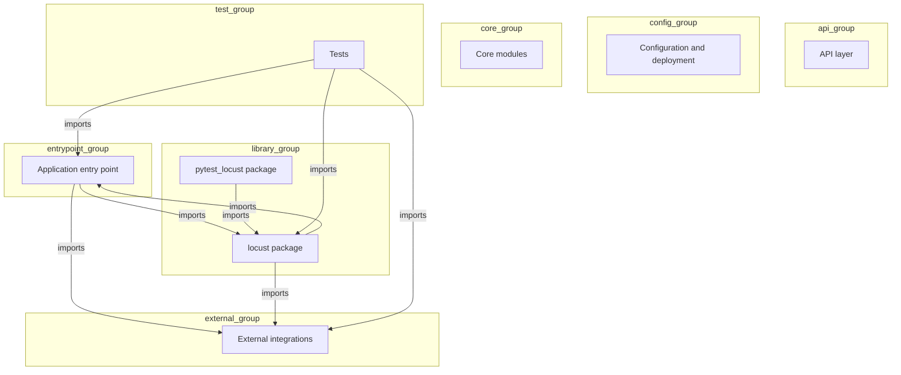

# Architecture report: locustio/locust

> Automated static analysis. **Observed** = directly seen in files/imports/AST; **Inferred** = interpretation from that evidence. Repository code was not executed.

## 1. Repository at a glance

| Item | Value |
| --- | --- |
| Repository | locustio/locust |
| Description | Write scalable load tests in plain Python 🚗💨 |
| Language | Python |
| Stars | 28285 |
| Licence | MIT |
| Analysed commit / branch | 3debc468b53f10d00cb7b449c8f6086f2e5c5be1 / master |
| Framework(s) | Flask, React |
| Files analysed | 408 |
| Components | 8 |

## 2. Architecture in one minute

locustio/locust - Write scalable load tests in plain Python 🚗💨. This repository was analysed statically from 408 file(s) (155 Python). Detected technologies (observed from imports/manifests): GitHub Actions, MongoDB, PostgreSQL, Flask, React, httpx. Files are grouped into 8 component(s): API layer, Configuration and deployment, Core modules, Application entry point, External integrations, locust package, pytest_locust package, Tests. Observed entry point(s): benchmarks/dispatch.py, locust/main.py, locust/runners.py. Findings below distinguish observed facts from inferred interpretation.

## 3. High-level block diagram

## 4. Main components

### API layer (`api_layer`)

- **Kind:** api
- **Status:** Observed
- **Confidence:** 0.85
- **Responsibility:** Groups 1 file(s) under api layer (observed from repository paths and static analysis).
- **Paths:** `locust/webui/src/redux/api/swarm.ts`
- **Evidence:** [locust/webui/src/redux/api/swarm.ts](https://github.com/locustio/locust/blob/3debc468b53f10d00cb7b449c8f6086f2e5c5be1/locust/webui/src/redux/api/swarm.ts)

### Configuration and deployment (`config`)

- **Kind:** config
- **Status:** Observed
- **Confidence:** 0.85
- **Responsibility:** Groups 9 file(s) under configuration and deployment (observed from repository paths and static analysis).
- **Paths:** `Dockerfile`, `Dockerfile.ci`, `Dockerfile.otel`, `_typos.toml`, `locust/webui/.yarnrc.yml`, `locust/webui/package.json`, `locust/webui/tsconfig.json`, `package.json`, `pyproject.toml`
- **Evidence:** [Dockerfile](https://github.com/locustio/locust/blob/3debc468b53f10d00cb7b449c8f6086f2e5c5be1/Dockerfile); [Dockerfile.ci](https://github.com/locustio/locust/blob/3debc468b53f10d00cb7b449c8f6086f2e5c5be1/Dockerfile.ci); [Dockerfile.otel](https://github.com/locustio/locust/blob/3debc468b53f10d00cb7b449c8f6086f2e5c5be1/Dockerfile.otel); [_typos.toml](https://github.com/locustio/locust/blob/3debc468b53f10d00cb7b449c8f6086f2e5c5be1/_typos.toml); [locust/webui/.yarnrc.yml](https://github.com/locustio/locust/blob/3debc468b53f10d00cb7b449c8f6086f2e5c5be1/locust/webui/.yarnrc.yml); [locust/webui/package.json](https://github.com/locustio/locust/blob/3debc468b53f10d00cb7b449c8f6086f2e5c5be1/locust/webui/package.json); [locust/webui/tsconfig.json](https://github.com/locustio/locust/blob/3debc468b53f10d00cb7b449c8f6086f2e5c5be1/locust/webui/tsconfig.json); [package.json](https://github.com/locustio/locust/blob/3debc468b53f10d00cb7b449c8f6086f2e5c5be1/package.json)

### Core modules (`core`)

- **Kind:** core
- **Status:** Observed
- **Confidence:** 0.85
- **Responsibility:** Groups 2 file(s) under core modules (observed from repository paths and static analysis). Observed top-level classes: BuildFrontend.
- **Paths:** `generate_changelog.py`, `hatch_build.py`
- **Evidence:** [generate_changelog.py](https://github.com/locustio/locust/blob/3debc468b53f10d00cb7b449c8f6086f2e5c5be1/generate_changelog.py); [hatch_build.py:8](https://github.com/locustio/locust/blob/3debc468b53f10d00cb7b449c8f6086f2e5c5be1/hatch_build.py#L8)

### Application entry point (`entrypoint`)

- **Kind:** entrypoint
- **Status:** Observed
- **Confidence:** 0.85
- **Responsibility:** Groups 5 file(s) under application entry point (observed from repository paths and static analysis). Observed application object created via Flask, Group. Observed top-level classes: AuthArgs, AuthProvider, CustomForm, DistributedRunner, ExceptionDict, InputField. Observed top-level functions: _aggregate_dispatched_users, _format_user_classes_count_for_log, create_environment, locust_exception_handler, main, merge_locustfiles_content.
- **Paths:** `benchmarks/dispatch.py`, `locust/__main__.py`, `locust/main.py`, `locust/runners.py`, `locust/web.py`
- **Evidence:** [benchmarks/dispatch.py](https://github.com/locustio/locust/blob/3debc468b53f10d00cb7b449c8f6086f2e5c5be1/benchmarks/dispatch.py); [locust/__main__.py](https://github.com/locustio/locust/blob/3debc468b53f10d00cb7b449c8f6086f2e5c5be1/locust/__main__.py); [locust/main.py:56](https://github.com/locustio/locust/blob/3debc468b53f10d00cb7b449c8f6086f2e5c5be1/locust/main.py#L56); [locust/runners.py:249](https://github.com/locustio/locust/blob/3debc468b53f10d00cb7b449c8f6086f2e5c5be1/locust/runners.py#L249); [locust/web.py:159](https://github.com/locustio/locust/blob/3debc468b53f10d00cb7b449c8f6086f2e5c5be1/locust/web.py#L159)

### External integrations (`external_integrations`)

- **Kind:** external
- **Status:** Inferred
- **Confidence:** 0.70
- **Responsibility:** Groups 0 file(s) under external integrations (observed from repository paths and static analysis).
- **Evidence:** [examples/testdata_management.py:33](https://github.com/locustio/locust/blob/3debc468b53f10d00cb7b449c8f6086f2e5c5be1/examples/testdata_management.py#L33); [locust/__init__.py:19](https://github.com/locustio/locust/blob/3debc468b53f10d00cb7b449c8f6086f2e5c5be1/locust/__init__.py#L19); [locust/argument_parser.py:15](https://github.com/locustio/locust/blob/3debc468b53f10d00cb7b449c8f6086f2e5c5be1/locust/argument_parser.py#L15); [locust/argument_parser.py:27](https://github.com/locustio/locust/blob/3debc468b53f10d00cb7b449c8f6086f2e5c5be1/locust/argument_parser.py#L27); [locust/clients.py:13](https://github.com/locustio/locust/blob/3debc468b53f10d00cb7b449c8f6086f2e5c5be1/locust/clients.py#L13); [locust/clients.py:14](https://github.com/locustio/locust/blob/3debc468b53f10d00cb7b449c8f6086f2e5c5be1/locust/clients.py#L14)

### locust package (`locust`)

- **Kind:** library
- **Status:** Observed
- **Confidence:** 0.85
- **Responsibility:** Groups 158 file(s) under locust package (observed from repository paths and static analysis). Observed top-level classes: BaseClient, BaseSocket, CSVWriter, CatchResponseError, Client, CsvRequestLogger. Observed top-level functions: _calc_distribution, _construct_basic_auth_str, _generate_mqtt_event_name, _generate_random_id, _get_task_ratio, _is_valid_percentile.
- **Paths:** `locust/__init__.py`, `locust/argument_parser.py`, `locust/clients.py`, `locust/contrib/__init__.py`, `locust/contrib/csv_request_logger.py`, `locust/contrib/dns.py`, `locust/contrib/fasthttp.py`, `locust/contrib/milvus.py`, `locust/contrib/mongodb.py`, `locust/contrib/mqtt.py`, `locust/contrib/oai.py`, `locust/contrib/postgres.py`, `locust/contrib/qdrant.py`, `locust/contrib/socketio.py`, `locust/debug.py`, `locust/dispatch.py`, `locust/env.py`, `locust/event.py`, `locust/exception.py`, `locust/html.py`, `locust/input_events.py`, `locust/log.py`, `locust/opentelemetry.py`, `locust/rpc/__init__.py`, `locust/rpc/protocol.py`, `locust/rpc/zmqrpc.py`, `locust/shape.py`, `locust/stats.py`, `locust/user/__init__.py`, `locust/user/inspectuser.py`, `locust/user/markov_taskset.py`, `locust/user/sequential_taskset.py`, `locust/user/task.py`, `locust/user/users.py`, `locust/user/wait_time.py`, `locust/util/__init__.py`, `locust/util/cache.py`, `locust/util/date.py`, `locust/util/deprecation.py`, `locust/util/directory.py`, `locust/util/exception_handler.py`, `locust/util/load_locustfile.py`, `locust/util/rounding.py`, `locust/util/timespan.py`, `locust/util/url.py`, `locust/webui/eslint.config.mjs`, `locust/webui/src/App.test.tsx`, `locust/webui/src/App.tsx`, `locust/webui/src/HtmlReport.tsx`, `locust/webui/src/assets/Logo.tsx`, `locust/webui/src/components/DataTable/DataTable.test.tsx`, `locust/webui/src/components/DataTable/DataTable.tsx`, `locust/webui/src/components/ExceptionsTab/ExceptionsTab.tsx`, `locust/webui/src/components/ExceptionsTable/ExceptionsTable.tsx`, `locust/webui/src/components/ExceptionsTable/ExceptionsTableContainer.tsx`, `locust/webui/src/components/FailuresTable/FailuresTable.tsx`, `locust/webui/src/components/FailuresTable/FailuresTableContainer.tsx`, `locust/webui/src/components/FallbackRender/FallbackRender.test.tsx`, `locust/webui/src/components/FallbackRender/FallbackRender.tsx`, `locust/webui/src/components/Form/CustomInput.tsx`, `locust/webui/src/components/Form/Form.tsx`, `locust/webui/src/components/Form/NumericField.tsx`, `locust/webui/src/components/Form/PasswordField.tsx`, `locust/webui/src/components/Form/Select.tsx`, `locust/webui/src/components/Layout/Footer/About.tsx`, `locust/webui/src/components/Layout/Footer/Footer.tsx`, `locust/webui/src/components/Layout/Layout.tsx`, `locust/webui/src/components/Layout/Navbar/DarkLightToggle.tsx`, `locust/webui/src/components/Layout/Navbar/Navbar.tsx`, `locust/webui/src/components/Layout/Navbar/SwarmMonitor.test.tsx`, `locust/webui/src/components/Layout/Navbar/SwarmMonitor.tsx`, `locust/webui/src/components/LineChart/LineChart.constants.ts`, `locust/webui/src/components/LineChart/LineChart.tsx`, `locust/webui/src/components/LineChart/LineChart.types.ts`, `locust/webui/src/components/LineChart/LineChart.utils.ts`, `locust/webui/src/components/LogViewer/LogDisplay.tsx`, `locust/webui/src/components/LogViewer/LogViewer.tsx`, `locust/webui/src/components/LogViewer/LogViewer.utils.tsx`, `locust/webui/src/components/LogViewer/WorkerLogs.tsx`, `locust/webui/src/components/LogViewer/useLogViewer.ts`, `locust/webui/src/components/Modal/Modal.tsx`, `locust/webui/src/components/Reports/Reports.test.tsx`, `locust/webui/src/components/Reports/Reports.tsx`, `locust/webui/src/components/ResponseTimeTable/ResponseTimeTable.test.tsx`, `locust/webui/src/components/ResponseTimeTable/ResponseTimeTable.tsx`, `locust/webui/src/components/StateButtons/EditButton.tsx`, `locust/webui/src/components/StateButtons/NewTestButton.tsx`, `locust/webui/src/components/StateButtons/ResetButton.tsx`, `locust/webui/src/components/StateButtons/StateButtons.tsx`, `locust/webui/src/components/StateButtons/StopButton.tsx`, `locust/webui/src/components/StatsTable/StatsTable.tsx`, `locust/webui/src/components/StatsTable/StatsTableContainer.tsx`, `locust/webui/src/components/SwarmCharts/SwarmCharts.tsx`, `locust/webui/src/components/SwarmCharts/SwarmChartsContainer.tsx`, `locust/webui/src/components/SwarmForm/SwarmCustomParameters.tsx`, `locust/webui/src/components/SwarmForm/SwarmForm.tsx`, `locust/webui/src/components/SwarmForm/SwarmUserClassPicker.tsx`, `locust/webui/src/components/SwarmRatios/SwarmRatios.test.tsx`, `locust/webui/src/components/SwarmRatios/SwarmRatios.tsx`, `locust/webui/src/components/SwarmRatios/SwarmRatiosContainer.tsx`, `locust/webui/src/components/SwarmRatiosTab/SwarmRatiosTab.tsx`, `locust/webui/src/components/Table/Table.test.tsx`, `locust/webui/src/components/Table/Table.tsx`, `locust/webui/src/components/Tabs/Tabs.constants.tsx`, `locust/webui/src/components/Tabs/Tabs.test.tsx`, `locust/webui/src/components/Tabs/Tabs.tsx`, `locust/webui/src/components/ViewColumnSelector/ViewColumnSelector.test.tsx`, `locust/webui/src/components/ViewColumnSelector/ViewColumnSelector.tsx`, `locust/webui/src/components/WorkersTable/WorkersTable.tsx`, `locust/webui/src/constants/auth.ts`, `locust/webui/src/constants/logs.ts`, `locust/webui/src/constants/swarm.ts`, `locust/webui/src/constants/theme.ts`, `locust/webui/src/global.d.ts`, `locust/webui/src/hooks/useCreateTheme.ts`, `locust/webui/src/hooks/useFetchExceptions.ts`, `locust/webui/src/hooks/useFetchStats.ts`, `locust/webui/src/hooks/useFetchTasks.ts`, `locust/webui/src/hooks/useFetchWorkerCount.ts`, `locust/webui/src/hooks/useForm.ts`, `locust/webui/src/hooks/useInterval.ts`, `locust/webui/src/hooks/useNotifications.ts`, `locust/webui/src/hooks/useSelectViewColumns.ts`, `locust/webui/src/hooks/useSortByField.ts`, `locust/webui/src/images.d.ts`, `locust/webui/src/index.tsx`, `locust/webui/src/lib.tsx`, `locust/webui/src/pages/Auth.tsx`, `locust/webui/src/pages/Dashboard.tsx`, `locust/webui/src/pages/HtmlReport.tsx`, `locust/webui/src/redux/hooks.ts`, `locust/webui/src/redux/slice/logViewer.slice.ts`, `locust/webui/src/redux/slice/notification.slice.ts`, `locust/webui/src/redux/slice/root.slice.ts`, `locust/webui/src/redux/slice/swarm.slice.ts`, `locust/webui/src/redux/slice/theme.slice.ts`, `locust/webui/src/redux/slice/ui.slice.ts`, `locust/webui/src/redux/slice/url.slice.ts`, `locust/webui/src/redux/store.ts`, `locust/webui/src/redux/utils.ts`, `locust/webui/src/styles/theme.ts`, `locust/webui/src/types/auth.types.ts`, `locust/webui/src/types/form.types.ts`, `locust/webui/src/types/swarm.types.ts`, `locust/webui/src/types/tab.types.ts`, `locust/webui/src/types/table.types.ts`, `locust/webui/src/types/ui.types.ts`, `locust/webui/src/types/window.types.ts`, `locust/webui/src/utils/array.ts`, `locust/webui/src/utils/date.ts`, `locust/webui/src/utils/number.ts`, `locust/webui/src/utils/object.ts`, `locust/webui/src/utils/string.ts`, `locust/webui/src/utils/url.ts`, `locust/webui/vite.config.ts`, `locust/webui/vite.lib.config.ts`, `locust/webui/vite.report.config.ts`, `locust/webui/vitest.config.ts`
- **Evidence:** [locust/__init__.py](https://github.com/locustio/locust/blob/3debc468b53f10d00cb7b449c8f6086f2e5c5be1/locust/__init__.py); [locust/argument_parser.py:40](https://github.com/locustio/locust/blob/3debc468b53f10d00cb7b449c8f6086f2e5c5be1/locust/argument_parser.py#L40); [locust/clients.py:65](https://github.com/locustio/locust/blob/3debc468b53f10d00cb7b449c8f6086f2e5c5be1/locust/clients.py#L65); [locust/contrib/__init__.py](https://github.com/locustio/locust/blob/3debc468b53f10d00cb7b449c8f6086f2e5c5be1/locust/contrib/__init__.py); [locust/contrib/csv_request_logger.py:71](https://github.com/locustio/locust/blob/3debc468b53f10d00cb7b449c8f6086f2e5c5be1/locust/contrib/csv_request_logger.py#L71); [locust/contrib/dns.py:12](https://github.com/locustio/locust/blob/3debc468b53f10d00cb7b449c8f6086f2e5c5be1/locust/contrib/dns.py#L12); [locust/contrib/fasthttp.py:87](https://github.com/locustio/locust/blob/3debc468b53f10d00cb7b449c8f6086f2e5c5be1/locust/contrib/fasthttp.py#L87); [locust/contrib/milvus.py:18](https://github.com/locustio/locust/blob/3debc468b53f10d00cb7b449c8f6086f2e5c5be1/locust/contrib/milvus.py#L18)

### pytest_locust package (`pytest_locust`)

- **Kind:** library
- **Status:** Observed
- **Confidence:** 0.85
- **Responsibility:** Groups 1 file(s) under pytest_locust package (observed from repository paths and static analysis). Observed top-level classes: NoOpEvent. Observed top-level functions: fastsession, pytest_addoption, pytest_configure, session.
- **Paths:** `pytest_locust/plugin.py`
- **Evidence:** [pytest_locust/plugin.py:10](https://github.com/locustio/locust/blob/3debc468b53f10d00cb7b449c8f6086f2e5c5be1/pytest_locust/plugin.py#L10)

### Tests (`tests`)

- **Kind:** test
- **Status:** Observed
- **Confidence:** 0.85
- **Responsibility:** Groups 80 file(s) under tests (observed from repository paths and static analysis). Observed application object created via Flask, Group. Observed routes: PATCH sys.stderr.write, PATCH locust.runners.HEARTBEAT_INTERVAL, PATCH locust.runners.HEARTBEAT_INTERVAL, PATCH locust.runners.HEARTBEAT_DEAD_INTERNAL, PATCH locust.runners.HEARTBEAT_INTERVAL. Observed top-level classes: AwesomeUser, BrowseDocumentation, BrowseDocumentationSequence, DebugTestCase, DistributedIntegrationTests, HeyAnException. Observed top-level functions: _aggregate_dispatched_users, _counts_by_name, _fire, _make_environment…
- **Paths:** `examples/browse_docs_sequence_test.py`, `examples/browse_docs_test.py`, `examples/test_pytest.py`, `locust/test/__init__.py`, `locust/test/fake_module1_for_env_test.py`, `locust/test/fake_module2_for_env_test.py`, `locust/test/mock_locustfile.py`, `locust/test/mock_logging.py`, `locust/test/subprocess_utils.py`, `locust/test/test_csv_request_logger.py`, `locust/test/test_date.py`, `locust/test/test_debugging.py`, `locust/test/test_dispatch.py`, `locust/test/test_env.py`, `locust/test/test_event.py`, `locust/test/test_fasthttp.py`, `locust/test/test_html_filename.py`, `locust/test/test_http.py`, `locust/test/test_interruptible_task.py`, `locust/test/test_load_locustfile.py`, `locust/test/test_locust_class.py`, `locust/test/test_log.py`, `locust/test/test_main.py`, `locust/test/test_markov_taskset.py`, `locust/test/test_mongodb.py`, `locust/test/test_oai.py`, `locust/test/test_old_wait_api.py`, `locust/test/test_opentelemetry.py`, `locust/test/test_opentelemetry_request_listener.py`, `locust/test/test_parser.py`, `locust/test/test_pytest_locustfile.py`, `locust/test/test_runners.py`, `locust/test/test_sequential_taskset.py`, `locust/test/test_socketio.py`, `locust/test/test_stats.py`, `locust/test/test_tags.py`, `locust/test/test_taskratio.py`, `locust/test/test_users.py`, `locust/test/test_util.py`, `locust/test/test_wait_time.py`, `locust/test/test_web.py`, `locust/test/test_zmqrpc.py`, `locust/test/testcases.py`, `locust/test/util.py`, `locust/webui/src/components/Form/tests/CustomInput.test.tsx`, `locust/webui/src/components/Form/tests/Form.test.tsx`, `locust/webui/src/components/Form/tests/NumericField.test.tsx`, `locust/webui/src/components/Form/tests/PasswordField.test.tsx`, `locust/webui/src/components/Form/tests/Select.test.tsx`, `locust/webui/src/components/LineChart/tests/LineChart.mocks.ts`, `locust/webui/src/components/LineChart/tests/LineChart.test.tsx`, `locust/webui/src/components/LineChart/tests/LineChartUtils.test.tsx`, `locust/webui/src/components/LogViewer/tests/LogViewer.test.tsx`, `locust/webui/src/components/LogViewer/tests/WorkerLogs.test.tsx`, `locust/webui/src/components/LogViewer/tests/useLogViewer.test.tsx`, `locust/webui/src/components/StateButtons/tests/ResetButton.test.tsx`, `locust/webui/src/components/StateButtons/tests/StateButtons.test.tsx`, `locust/webui/src/components/StateButtons/tests/StopButton.test.tsx`, `locust/webui/src/components/SwarmForm/tests/SwarmCustomParameters.test.tsx`, `locust/webui/src/components/SwarmForm/tests/SwarmForm.test.tsx`, `locust/webui/src/components/SwarmForm/tests/SwarmUserClassPicker.test.tsx`, `locust/webui/src/hooks/tests/useFetchExceptions.test.tsx`, `locust/webui/src/hooks/tests/useFetchStats.test.tsx`, `locust/webui/src/hooks/tests/useFetchTasks.test.tsx`, `locust/webui/src/hooks/tests/useNotifications.test.tsx`, `locust/webui/src/hooks/tests/useSelectedViewColumns.test.tsx`, `locust/webui/src/hooks/tests/useSortByField.test.tsx`, `locust/webui/src/pages/tests/Auth.test.tsx`, `locust/webui/src/pages/tests/Dashboard.test.tsx`, `locust/webui/src/pages/tests/HtmlReport.test.tsx`, `locust/webui/src/redux/slice/tests/ui.slice.test.ts`, `locust/webui/src/test/constants.ts`, `locust/webui/src/test/mocks/statsRequest.mock.ts`, `locust/webui/src/test/mocks/swarmState.mock.ts`, `locust/webui/src/test/setup.ts`, `locust/webui/src/test/testUtils.tsx`, `locust/webui/src/utils/tests/number.test.ts`, `locust/webui/src/utils/tests/object.test.ts`, `locust/webui/src/utils/tests/string.test.ts`, `locust/webui/src/utils/tests/url.test.ts`
- **Evidence:** [examples/browse_docs_sequence_test.py:11](https://github.com/locustio/locust/blob/3debc468b53f10d00cb7b449c8f6086f2e5c5be1/examples/browse_docs_sequence_test.py#L11); [examples/browse_docs_test.py:11](https://github.com/locustio/locust/blob/3debc468b53f10d00cb7b449c8f6086f2e5c5be1/examples/browse_docs_test.py#L11); [examples/test_pytest.py:8](https://github.com/locustio/locust/blob/3debc468b53f10d00cb7b449c8f6086f2e5c5be1/examples/test_pytest.py#L8); [locust/test/__init__.py](https://github.com/locustio/locust/blob/3debc468b53f10d00cb7b449c8f6086f2e5c5be1/locust/test/__init__.py); [locust/test/fake_module1_for_env_test.py:6](https://github.com/locustio/locust/blob/3debc468b53f10d00cb7b449c8f6086f2e5c5be1/locust/test/fake_module1_for_env_test.py#L6); [locust/test/fake_module2_for_env_test.py:6](https://github.com/locustio/locust/blob/3debc468b53f10d00cb7b449c8f6086f2e5c5be1/locust/test/fake_module2_for_env_test.py#L6); [locust/test/mock_locustfile.py:36](https://github.com/locustio/locust/blob/3debc468b53f10d00cb7b449c8f6086f2e5c5be1/locust/test/mock_locustfile.py#L36); [locust/test/mock_logging.py:9](https://github.com/locustio/locust/blob/3debc468b53f10d00cb7b449c8f6086f2e5c5be1/locust/test/mock_logging.py#L9)

## 5. Execution flow

**Observed** entry point(s):

- [benchmarks/dispatch.py:50](https://github.com/locustio/locust/blob/3debc468b53f10d00cb7b449c8f6086f2e5c5be1/benchmarks/dispatch.py#L50)
- [locust/main.py](https://github.com/locustio/locust/blob/3debc468b53f10d00cb7b449c8f6086f2e5c5be1/locust/main.py)
- [locust/runners.py:249](https://github.com/locustio/locust/blob/3debc468b53f10d00cb7b449c8f6086f2e5c5be1/locust/runners.py#L249)
- [locust/web.py:159](https://github.com/locustio/locust/blob/3debc468b53f10d00cb7b449c8f6086f2e5c5be1/locust/web.py#L159)
- [locust/webui/src/App.tsx](https://github.com/locustio/locust/blob/3debc468b53f10d00cb7b449c8f6086f2e5c5be1/locust/webui/src/App.tsx)
- [locust/webui/src/index.tsx](https://github.com/locustio/locust/blob/3debc468b53f10d00cb7b449c8f6086f2e5c5be1/locust/webui/src/index.tsx)

**Observed** routes (from decorators):

- `PATCH sys.stderr.write` -> `test_greenlet_exception_logger` in `locust/test/test_log.py:23`
- `PATCH locust.runners.HEARTBEAT_INTERVAL` -> `test_last_worker_missing_stops_test` in `locust/test/test_runners.py:2487`
- `PATCH locust.runners.HEARTBEAT_INTERVAL` -> `test_worker_missing_after_heartbeat_dead_interval` in `locust/test/test_runners.py:2559`
- `PATCH locust.runners.HEARTBEAT_DEAD_INTERNAL` -> `test_worker_missing_after_heartbeat_dead_interval` in `locust/test/test_runners.py:2559`
- `PATCH locust.runners.HEARTBEAT_INTERVAL` -> `test_rebalance_locust_users_on_worker_connect` in `locust/test/test_runners.py:2799`
- `PATCH locust.stats.PERCENTILES_TO_CHART` -> `test_stats_validation_fail_on_too_many_percentiles_to_chart` in `locust/test/test_stats.py:56`
- `PATCH locust.stats.PERCENTILES_TO_CHART` -> `test_stats_validation_fail_on_too_high_chart_value` in `locust/test/test_stats.py:67`
- `PATCH locust.stats.PERCENTILES_TO_STATISTICS` -> `test_stats_validation_fail_on_too_high_statistic_value` in `locust/test/test_stats.py:78`
- `PATCH locust.stats.PERCENTILES_TO_CHART` -> `test_stats_validation_fail_on_wrong_type_chart_value` in `locust/test/test_stats.py:89`
- `PATCH locust.stats.PERCENTILES_TO_STATISTICS` -> `test_stats_validation_fail_on_wrong_type_statistic_value` in `locust/test/test_stats.py:100`
- `PATCH locust.stats.CSV_STATS_INTERVAL_SEC` -> `test_csv_stats_writer` in `locust/test/test_stats.py:552`
- `PATCH locust.stats.CSV_STATS_INTERVAL_SEC` -> `test_csv_stats_writer_full_history` in `locust/test/test_stats.py:569`
- `PATCH locust.stats.CSV_STATS_INTERVAL_SEC` -> `test_user_count_in_csv_history_stats` in `locust/test/test_stats.py:668`
- `ROUTE /ultra_fast` -> `ultra_fast` in `locust/test/testcases.py:25`
- `ROUTE /fast` -> `fast` in `locust/test/testcases.py:30`
- `ROUTE /slow` -> `slow` in `locust/test/testcases.py:36`
- `ROUTE /consistent` -> `consistent` in `locust/test/testcases.py:45`
- `ROUTE /request_method` -> `request_method` in `locust/test/testcases.py:51`
- `ROUTE /request_header_test` -> `request_header_test` in `locust/test/testcases.py:56`
- `ROUTE /echo_target/<path:subpath>` -> `echo_target` in `locust/test/testcases.py:65`
- `ROUTE /post` -> `manipulate` in `locust/test/testcases.py:71`
- `ROUTE /put` -> `manipulate` in `locust/test/testcases.py:71`
- `ROUTE /get_arg` -> `get_arg` in `locust/test/testcases.py:76`
- `ROUTE /fail` -> `failed_request` in `locust/test/testcases.py:81`
- `ROUTE /status/204` -> `status_204` in `locust/test/testcases.py:86`
- `ROUTE /redirect` -> `do_redirect` in `locust/test/testcases.py:91`
- `ROUTE /basic_auth` -> `basic_auth` in `locust/test/testcases.py:99`
- `ROUTE /no_content_length` -> `no_content_length` in `locust/test/testcases.py:109`
- `ROUTE /streaming/<int:iterations>` -> `streaming_response` in `locust/test/testcases.py:125`
- `ROUTE /set_cookie` -> `set_cookie` in `locust/test/testcases.py:139`
- `ROUTE /get_cookie` -> `get_cookie` in `locust/test/testcases.py:146`
- `ROUTE /rest` -> `rest` in `locust/test/testcases.py:151`
- `ROUTE /content_type_missing_charset` -> `content_type_missing_charset` in `locust/test/testcases.py:156`
- `ROUTE /content_type_regular` -> `content_type_regular` in `locust/test/testcases.py:163`
- `ROUTE /content_type_with_extra_stuff` -> `content_type_with_extra_stuff` in `locust/test/testcases.py:170`

Representative flow (derived from observed entry points and the import graph; steps beyond the entry point are **Inferred**):

1. Execution starts at an observed entry point listed above, if present.
2. `entrypoint` imports `external_integrations` (Application entry point -> External integrations).
3. `entrypoint` imports `locust` (Application entry point -> locust package).
4. `locust` imports `entrypoint` (locust package -> Application entry point).
5. `locust` imports `external_integrations` (locust package -> External integrations).
6. `pytest_locust` imports `locust` (pytest_locust package -> locust package).
7. `tests` imports `entrypoint` (Tests -> Application entry point).
8. `tests` imports `external_integrations` (Tests -> External integrations).
9. `tests` imports `locust` (Tests -> locust package).

## 6. Project structure

### `(root)`

- `.coveragerc` - other (300 bytes)
- `.dockerignore` - container (191 bytes)
- `.git-blame-ignore-revs` - other (701 bytes)
- `.gitattributes` - other (470 bytes)
- `.gitignore` - other (423 bytes)
- `.pre-commit-config.yaml` - config (692 bytes)
- `.readthedocs.yaml` - config (381 bytes)
- `AGENTS.md` - docs (5765 bytes)
- `CHANGELOG.md` - docs (58293 bytes)
- `Dockerfile` - container (1870 bytes)
- `Dockerfile.ci` - container (1033 bytes)
- `Dockerfile.otel` - container (284 bytes)
- `LICENSE` - docs (1110 bytes)
- `Makefile` - other (1242 bytes)
- `README.md` - docs (8923 bytes)
- `SECURITY.md` - docs (713 bytes)
- `Vagrantfile` - other (205 bytes)
- `_typos.toml` - config (189 bytes)
- `generate_changelog.py` - source, Python (805 bytes)
- `hatch_build.py` - source, Python (975 bytes)
- `package.json` - manifest (554 bytes)
- `pyproject.toml` - manifest (8973 bytes)

### `.github`

- `.github/CONTRIBUTING.md` - docs (475 bytes)
- `.github/ISSUE_TEMPLATE/bug.yml` - config (1853 bytes)
- `.github/ISSUE_TEMPLATE/config.yml` - config (28 bytes)
- `.github/ISSUE_TEMPLATE/feature_request.yml` - config (1222 bytes)
- `.github/dependabot.yaml` - config (653 bytes)
- `.github/workflows/stale.yml` - ci, YAML (1216 bytes)
- `.github/workflows/tests.yml` - ci, YAML (17239 bytes)

### `.vscode`

- `.vscode/extensions.json` - config (102 bytes)
- `.vscode/launch.json` - config (1329 bytes)
- `.vscode/launch_locust.json` - config (512 bytes)
- `.vscode/settings.json` - config (1545 bytes)

### `benchmarks`

- `benchmarks/dispatch.py` - source, Python (8304 bytes)

### `docs`

- `docs/_ext/llms_txt.py` - docs (8649 bytes)
- `docs/_static/azure-logo.svg` - docs (7514 bytes)
- `docs/_static/theme-overrides.css` - docs (795 bytes)
- `docs/_templates/footer.html` - docs (216 bytes)
- `docs/ai-docs.rst` - docs (1678 bytes)
- `docs/api.rst` - docs (5183 bytes)
- `docs/asyncio.rst` - docs (1018 bytes)
- `docs/changelog.rst` - docs (71263 bytes)
- `docs/conf.py` - docs (6138 bytes)
- `docs/configuration.rst` - docs (21306 bytes)
- `docs/developing-locust.rst` - docs (5749 bytes)
- `docs/extending-locust.rst` - docs (12395 bytes)
- `docs/extensions.rst` - docs (1379 bytes)
- `docs/faq.rst` - docs (5015 bytes)
- `docs/further-reading.rst` - docs (1416 bytes)
- `docs/history.rst` - docs (1717 bytes)
- `docs/hosted-load-testing.rst` - docs (1486 bytes)
- `docs/images/microsoft_logo.svg` - docs (331 bytes)
- `docs/increase-performance.rst` - docs (5411 bytes)
- `docs/increasing-request-rate.rst` - docs (2445 bytes)
- `docs/index.rst` - docs (1085 bytes)
- `docs/installation.rst` - docs (4038 bytes)
- `docs/kubernetes-operator.rst` - docs (10683 bytes)
- `docs/logging.rst` - docs (2547 bytes)
- `docs/quickstart.rst` - docs (4400 bytes)
- `docs/running-distributed.rst` - docs (7322 bytes)
- `docs/running-in-debugger.rst` - docs (4310 bytes)
- `docs/running-in-docker.rst` - docs (1555 bytes)
- `docs/running-without-web-ui.rst` - docs (5229 bytes)
- `docs/tasksets.rst` - docs (9261 bytes)
- `docs/telemetry.rst` - docs (3329 bytes)
- `docs/testing-other-systems.rst` - docs (5431 bytes)
- `docs/use-as-lib.rst` - docs (2647 bytes)
- `docs/vscode-extension.rst` - docs (1321 bytes)
- `docs/what-is-locust.rst` - docs (4290 bytes)
- `docs/writing-a-locustfile.rst` - docs (26772 bytes)

### `examples`

- `examples/add_command_line_argument.py` - source, Python (1668 bytes)
- `examples/azure/README.md` - docs (615 bytes)
- `examples/azure/grpc.yaml` - config (491 bytes)
- `examples/azure/postgres.yaml` - config (629 bytes)
- `examples/azure/requirements.txt` - manifest (223 bytes)
- `examples/basic.py` - source, Python (589 bytes)
- `examples/bottlenecked_server.py` - source, Python (1112 bytes)
- `examples/browse_docs_sequence_test.py` - test, Python (1523 bytes)
- `examples/browse_docs_test.py` - test, Python (1378 bytes)
- `examples/csrf_form_authentication.py` - source, Python (818 bytes)
- `examples/custom_messages.py` - source, Python (2609 bytes)
- `examples/custom_shape/double_wave.py` - source, Python (1339 bytes)
- `examples/custom_shape/stages.py` - source, Python (1473 bytes)
- `examples/custom_shape/staging_user_classes.py` - source, Python (1895 bytes)
- `examples/custom_shape/step_load.py` - source, Python (900 bytes)
- `examples/custom_shape/wait_user_count.py` - source, Python (2238 bytes)
- `examples/custom_wait_function.py` - source, Python (1369 bytes)
- `examples/custom_xmlrpc_client/server.py` - source, Python (470 bytes)
- `examples/custom_xmlrpc_client/xmlrpc_locustfile.py` - source, Python (2242 bytes)
- `examples/debugging.py` - source, Python (445 bytes)
- `examples/debugging_advanced.py` - source, Python (655 bytes)
- `examples/dispatch_test_scripts/locustfile.py` - source, Python (2111 bytes)
- `examples/dispatch_test_scripts/run-distributed-headless.sh` - source, Shell (1282 bytes)
- `examples/dispatch_test_scripts/run-distributed-web.sh` - source, Shell (1268 bytes)
- `examples/dispatch_test_scripts/run-local-headless.sh` - source, Shell (458 bytes)
- `examples/dispatch_test_scripts/run-local-web.sh` - source, Shell (444 bytes)
- `examples/dns_ex.py` - source, Python (769 bytes)
- `examples/docker-compose/docker-compose.yml` - container (348 bytes)
- `examples/dynamic_user_credentials.py` - source, Python (639 bytes)
- `examples/events.py` - source, Python (2307 bytes)
- `examples/extend_web_ui.py` - source, Python (5142 bytes)
- `examples/fast_http_locust.py` - source, Python (610 bytes)
- `examples/grpc/grpc_user.py` - source, Python (1920 bytes)
- `examples/grpc/hello.proto` - other (219 bytes)
- `examples/grpc/hello_pb2.py` - source, Python (1638 bytes)
- `examples/grpc/hello_pb2_grpc.py` - source, Python (2416 bytes)
- `examples/grpc/hello_server.py` - source, Python (751 bytes)
- `examples/grpc/locustfile.py` - source, Python (542 bytes)
- `examples/locustfile.py` - source, Python (495 bytes)
- `examples/manual_stats_reporting.py` - source, Python (2127 bytes)
- `examples/markov_taskset.py` - source, Python (2307 bytes)
- `examples/milvus/README.md` - docs (815 bytes)
- `examples/milvus/locustfile.py` - source, Python (2422 bytes)
- `examples/mongodb/README.md` - docs (598 bytes)
- `examples/mongodb/locustfile.py` - source, Python (399 bytes)
- `examples/mqtt/README.md` - docs (818 bytes)
- `examples/mqtt/locustfile.py` - source, Python (1033 bytes)
- `examples/mqtt/locustfile_custom_mqtt_client.py` - source, Python (1367 bytes)
- `examples/mqtt/mosquitto_config/mosquitto.conf` - other (69 bytes)
- `examples/multiple_hosts.py` - source, Python (862 bytes)
- `examples/nested_inline_tasksets.py` - source, Python (581 bytes)
- `examples/open_closed_workload.py` - source, Python (626 bytes)
- `examples/openai_ex.py` - source, Python (1124 bytes)
- `examples/poisson_demo.py` - source, Python (423 bytes)
- `examples/postgres/README.md` - docs (379 bytes)
- `examples/postgres/locustfile.py` - source, Python (1110 bytes)
- `examples/qdrant/README.md` - docs (931 bytes)
- `examples/qdrant/locustfile.py` - source, Python (1435 bytes)
- `examples/response_validations.py` - source, Python (2651 bytes)
- `examples/rest.py` - source, Python (4289 bytes)
- `examples/sdk_session_patching/session_patch_locustfile.py` - source, Python (758 bytes)
- `examples/semaphore_wait.py` - source, Python (428 bytes)
- `examples/socketio/echo_server.py` - source, Python (1510 bytes)
- `examples/socketio/socketio_ex.py` - source, Python (1960 bytes)
- `examples/stop_on_threshold.py` - source, Python (1041 bytes)
- `examples/terraform/aws/README.md` - docs (1806 bytes)
- `examples/terraform/aws/data_subnet.tf` - other (114 bytes)
- `examples/terraform/aws/main.tf` - other (935 bytes)
- `examples/terraform/aws/output.tf` - other (759 bytes)
- `examples/terraform/aws/plan/basic.py` - source, Python (490 bytes)
- `examples/terraform/aws/provisioner.tf` - other (47 bytes)
- `examples/terraform/aws/variables.tf` - other (504 bytes)
- `examples/test_pytest.py` - test, Python (1564 bytes)
- `examples/testdata_from_csv.csv` - data (60 bytes)
- `examples/testdata_from_csv.py` - source, Python (1768 bytes)
- `examples/testdata_management.py` - source, Python (5210 bytes)
- `examples/use_as_lib.py` - source, Python (1111 bytes)
- `examples/vagrant/README.md` - docs (0 bytes)
- `examples/vagrant/supervisord.conf` - other (1569 bytes)
- `examples/web_ui_auth/basic.py` - source, Python (2498 bytes)
- `examples/web_ui_auth/custom_form.py` - source, Python (3783 bytes)
- `examples/web_ui_cache_stats.py` - source, Python (6845 bytes)
- `examples/worker_index.py` - source, Python (644 bytes)
- `examples/x-forwarded-for.py` - source, Python (576 bytes)

### `locust`

- `locust/__init__.py` - source, Python (1900 bytes)
- `locust/__main__.py` - source, Python (31 bytes)
- `locust/argument_parser.py` - source, Python (34773 bytes)
- `locust/clients.py` - source, Python (23545 bytes)
- `locust/contrib/__init__.py` - source, Python (290 bytes)
- `locust/contrib/csv_request_logger.py` - source, Python (6034 bytes)
- `locust/contrib/dns.py` - source, Python (2071 bytes)
- `locust/contrib/fasthttp.py` - source, Python (30661 bytes)
- `locust/contrib/milvus.py` - source, Python (13019 bytes)
- `locust/contrib/mongodb.py` - source, Python (1313 bytes)
- `locust/contrib/mqtt.py` - source, Python (19493 bytes)
- `locust/contrib/oai.py` - source, Python (2483 bytes)
- `locust/contrib/postgres.py` - source, Python (1247 bytes)
- `locust/contrib/qdrant.py` - source, Python (7263 bytes)
- `locust/contrib/socketio.py` - source, Python (3232 bytes)
- `locust/debug.py` - source, Python (5095 bytes)
- `locust/dispatch.py` - source, Python (16558 bytes)
- `locust/env.py` - source, Python (13203 bytes)
- `locust/event.py` - source, Python (9009 bytes)
- `locust/exception.py` - source, Python (2054 bytes)
- `locust/html.py` - source, Python (4267 bytes)
- `locust/input_events.py` - source, Python (3325 bytes)
- `locust/log.py` - source, Python (3569 bytes)
- `locust/main.py` - source, Python (29299 bytes)
- `locust/opentelemetry.py` - source, Python (11692 bytes)
- `locust/py.typed` - other (65 bytes)
- `locust/rpc/__init__.py` - source, Python (99 bytes)
- `locust/rpc/protocol.py` - source, Python (1282 bytes)
- `locust/rpc/zmqrpc.py` - source, Python (3214 bytes)
- `locust/runners.py` - source, Python (72519 bytes)
- `locust/shape.py` - source, Python (1973 bytes)
- `locust/stats.py` - source, Python (49933 bytes)
- `locust/test/__init__.py` - test, Python (508 bytes)
- `locust/test/fake_module1_for_env_test.py` - test, Python (164 bytes)
- `locust/test/fake_module2_for_env_test.py` - test, Python (164 bytes)
- `locust/test/mock_locustfile.py` - test, Python (1270 bytes)
- `locust/test/mock_logging.py` - test, Python (775 bytes)
- `locust/test/subprocess_utils.py` - test, Python (5762 bytes)
- `locust/test/test_csv_request_logger.py` - test, Python (6486 bytes)
- `locust/test/test_date.py` - test, Python (3517 bytes)
- `locust/test/test_debugging.py` - test, Python (1053 bytes)
- `locust/test/test_dispatch.py` - test, Python (170155 bytes)
- `locust/test/test_env.py` - test, Python (8919 bytes)
- `locust/test/test_event.py` - test, Python (1974 bytes)
- `locust/test/test_fasthttp.py` - test, Python (45251 bytes)
- `locust/test/test_html_filename.py` - test, Python (3095 bytes)
- `locust/test/test_http.py` - test, Python (20060 bytes)
- `locust/test/test_interruptible_task.py` - test, Python (1377 bytes)
- `locust/test/test_load_locustfile.py` - test, Python (12017 bytes)
- `locust/test/test_locust_class.py` - test, Python (28199 bytes)
- `locust/test/test_log.py` - test, Python (7578 bytes)
- `locust/test/test_main.py` - test, Python (76706 bytes)
- `locust/test/test_markov_taskset.py` - test, Python (7046 bytes)
- `locust/test/test_mongodb.py` - test, Python (1189 bytes)
- `locust/test/test_oai.py` - test, Python (1343 bytes)
- `locust/test/test_old_wait_api.py` - test, Python (0 bytes)
- `locust/test/test_opentelemetry.py` - test, Python (3222 bytes)
- `locust/test/test_opentelemetry_request_listener.py` - test, Python (2910 bytes)
- `locust/test/test_parser.py` - test, Python (18698 bytes)
- `locust/test/test_pytest_locustfile.py` - test, Python (2794 bytes)
- `locust/test/test_runners.py` - test, Python (178291 bytes)
- `locust/test/test_sequential_taskset.py` - test, Python (3890 bytes)
- `locust/test/test_socketio.py` - test, Python (1552 bytes)
- `locust/test/test_stats.py` - test, Python (44127 bytes)
- `locust/test/test_tags.py` - test, Python (13138 bytes)
- `locust/test/test_taskratio.py` - test, Python (3639 bytes)
- `locust/test/test_users.py` - test, Python (2135 bytes)
- `locust/test/test_util.py` - test, Python (2434 bytes)
- `locust/test/test_wait_time.py` - test, Python (4758 bytes)
- `locust/test/test_web.py` - test, Python (57379 bytes)
- `locust/test/test_zmqrpc.py` - test, Python (2156 bytes)
- `locust/test/testcases.py` - test, Python (7119 bytes)
- `locust/test/util.py` - test, Python (4082 bytes)
- `locust/user/__init__.py` - source, Python (151 bytes)
- `locust/user/inspectuser.py` - source, Python (2875 bytes)
- `locust/user/markov_taskset.py` - source, Python (11779 bytes)
- `locust/user/sequential_taskset.py` - source, Python (2687 bytes)
- `locust/user/task.py` - source, Python (17410 bytes)
- `locust/user/users.py` - source, Python (15702 bytes)
- `locust/user/wait_time.py` - source, Python (4109 bytes)
- `locust/util/__init__.py` - source, Python (0 bytes)
- `locust/util/cache.py` - source, Python (1000 bytes)
- `locust/util/date.py` - source, Python (814 bytes)
- `locust/util/deprecation.py` - source, Python (2026 bytes)
- `locust/util/directory.py` - source, Python (326 bytes)
- `locust/util/exception_handler.py` - source, Python (796 bytes)
- `locust/util/load_locustfile.py` - source, Python (5187 bytes)
- `locust/util/rounding.py` - source, Python (159 bytes)
- `locust/util/timespan.py` - source, Python (1016 bytes)
- `locust/util/url.py` - source, Python (268 bytes)
- `locust/web.py` - source, Python (34072 bytes)
- `locust/webui/.gitignore` - other (170 bytes)
- `locust/webui/.prettierrc` - other (167 bytes)
- `locust/webui/.yarnrc.yml` - config (67 bytes)
- `locust/webui/LICENSE` - docs (1091 bytes)
- `locust/webui/README.md` - docs (5202 bytes)
- `locust/webui/auth.html` - other (653 bytes)
- `locust/webui/dev.html` - other (1238 bytes)
- `locust/webui/eslint.config.mjs` - source, JavaScript (2304 bytes)
- `locust/webui/index.html` - other (631 bytes)
- `locust/webui/package.json` - manifest (2793 bytes)
- `locust/webui/report.html` - other (709 bytes)
- `locust/webui/src/App.test.tsx` - source, TypeScript (827 bytes)
- `locust/webui/src/App.tsx` - source, TypeScript (660 bytes)
- `locust/webui/src/HtmlReport.tsx` - source, TypeScript (529 bytes)
- `locust/webui/src/assets/Logo.tsx` - source, TypeScript (3276 bytes)
- `locust/webui/src/assets/microsoft_logo.svg` - other (331 bytes)
- `locust/webui/src/components/DataTable/DataTable.test.tsx` - source, TypeScript (994 bytes)
- `locust/webui/src/components/DataTable/DataTable.tsx` - source, TypeScript (1265 bytes)
- `locust/webui/src/components/ExceptionsTab/ExceptionsTab.tsx` - source, TypeScript (242 bytes)
- `locust/webui/src/components/ExceptionsTable/ExceptionsTable.tsx` - source, TypeScript (425 bytes)
- `locust/webui/src/components/ExceptionsTable/ExceptionsTableContainer.tsx` - source, TypeScript (296 bytes)
- `locust/webui/src/components/FailuresTable/FailuresTable.tsx` - source, TypeScript (943 bytes)
- `locust/webui/src/components/FailuresTable/FailuresTableContainer.tsx` - source, TypeScript (280 bytes)
- `locust/webui/src/components/FallbackRender/FallbackRender.test.tsx` - source, TypeScript (1095 bytes)
- `locust/webui/src/components/FallbackRender/FallbackRender.tsx` - source, TypeScript (532 bytes)
- `locust/webui/src/components/Form/CustomInput.tsx` - source, TypeScript (1250 bytes)
- `locust/webui/src/components/Form/Form.tsx` - source, TypeScript (1826 bytes)
- `locust/webui/src/components/Form/NumericField.tsx` - source, TypeScript (862 bytes)
- `locust/webui/src/components/Form/PasswordField.tsx` - source, TypeScript (1219 bytes)
- `locust/webui/src/components/Form/Select.tsx` - source, TypeScript (1028 bytes)
- `locust/webui/src/components/Form/tests/CustomInput.test.tsx` - test, TypeScript (4748 bytes)
- `locust/webui/src/components/Form/tests/Form.test.tsx` - test, TypeScript (3024 bytes)
- `locust/webui/src/components/Form/tests/NumericField.test.tsx` - test, TypeScript (2285 bytes)
- `locust/webui/src/components/Form/tests/PasswordField.test.tsx` - test, TypeScript (1274 bytes)
- `locust/webui/src/components/Form/tests/Select.test.tsx` - test, TypeScript (1919 bytes)
- `locust/webui/src/components/Layout/Footer/About.tsx` - source, TypeScript (2585 bytes)
- `locust/webui/src/components/Layout/Footer/Footer.tsx` - source, TypeScript (376 bytes)
- `locust/webui/src/components/Layout/Layout.tsx` - source, TypeScript (467 bytes)
- `locust/webui/src/components/Layout/Navbar/DarkLightToggle.tsx` - source, TypeScript (1013 bytes)
- `locust/webui/src/components/Layout/Navbar/Navbar.tsx` - source, TypeScript (2466 bytes)
- `locust/webui/src/components/Layout/Navbar/SwarmMonitor.test.tsx` - source, TypeScript (2647 bytes)
- `locust/webui/src/components/Layout/Navbar/SwarmMonitor.tsx` - source, TypeScript (3196 bytes)
- `locust/webui/src/components/LineChart/LineChart.constants.ts` - source, TypeScript (271 bytes)
- `locust/webui/src/components/LineChart/LineChart.tsx` - source, TypeScript (4213 bytes)
- `locust/webui/src/components/LineChart/LineChart.types.ts` - source, TypeScript (854 bytes)
- `locust/webui/src/components/LineChart/LineChart.utils.ts` - source, TypeScript (4661 bytes)
- `locust/webui/src/components/LineChart/tests/LineChart.mocks.ts` - test, TypeScript (1959 bytes)
- `locust/webui/src/components/LineChart/tests/LineChart.test.tsx` - test, TypeScript (1267 bytes)
- `locust/webui/src/components/LineChart/tests/LineChartUtils.test.tsx` - test, TypeScript (8487 bytes)
- `locust/webui/src/components/LogViewer/LogDisplay.tsx` - source, TypeScript (604 bytes)
- `locust/webui/src/components/LogViewer/LogViewer.tsx` - source, TypeScript (1164 bytes)
- `locust/webui/src/components/LogViewer/LogViewer.utils.tsx` - source, TypeScript (127 bytes)
- `locust/webui/src/components/LogViewer/WorkerLogs.tsx` - source, TypeScript (1370 bytes)
- `locust/webui/src/components/LogViewer/tests/LogViewer.test.tsx` - test, TypeScript (1486 bytes)
- `locust/webui/src/components/LogViewer/tests/WorkerLogs.test.tsx` - test, TypeScript (1041 bytes)
- `locust/webui/src/components/LogViewer/tests/useLogViewer.test.tsx` - test, TypeScript (2839 bytes)
- `locust/webui/src/components/LogViewer/useLogViewer.ts` - source, TypeScript (1485 bytes)
- `locust/webui/src/components/Modal/Modal.tsx` - source, TypeScript (1131 bytes)
- `locust/webui/src/components/Reports/Reports.test.tsx` - source, TypeScript (3100 bytes)
- `locust/webui/src/components/Reports/Reports.tsx` - source, TypeScript (1731 bytes)
- `locust/webui/src/components/ResponseTimeTable/ResponseTimeTable.test.tsx` - source, TypeScript (1071 bytes)
- `locust/webui/src/components/ResponseTimeTable/ResponseTimeTable.tsx` - source, TypeScript (755 bytes)
- `locust/webui/src/components/StateButtons/EditButton.tsx` - source, TypeScript (1051 bytes)
- `locust/webui/src/components/StateButtons/NewTestButton.tsx` - source, TypeScript (584 bytes)
- `locust/webui/src/components/StateButtons/ResetButton.tsx` - source, TypeScript (381 bytes)
- `locust/webui/src/components/StateButtons/StateButtons.tsx` - source, TypeScript (848 bytes)
- `locust/webui/src/components/StateButtons/StopButton.tsx` - source, TypeScript (638 bytes)
- `locust/webui/src/components/StateButtons/tests/ResetButton.test.tsx` - test, TypeScript (987 bytes)
- `locust/webui/src/components/StateButtons/tests/StateButtons.test.tsx` - test, TypeScript (1815 bytes)
- `locust/webui/src/components/StateButtons/tests/StopButton.test.tsx` - test, TypeScript (1066 bytes)
- `locust/webui/src/components/StatsTable/StatsTable.tsx` - source, TypeScript (1877 bytes)
- `locust/webui/src/components/StatsTable/StatsTableContainer.tsx` - source, TypeScript (266 bytes)
- `locust/webui/src/components/SwarmCharts/SwarmCharts.tsx` - source, TypeScript (1444 bytes)
- `locust/webui/src/components/SwarmCharts/SwarmChartsContainer.tsx` - source, TypeScript (312 bytes)
- `locust/webui/src/components/SwarmForm/SwarmCustomParameters.tsx` - source, TypeScript (1197 bytes)
- `locust/webui/src/components/SwarmForm/SwarmForm.tsx` - source, TypeScript (12065 bytes)
- `locust/webui/src/components/SwarmForm/SwarmUserClassPicker.tsx` - source, TypeScript (6571 bytes)
- `locust/webui/src/components/SwarmForm/tests/SwarmCustomParameters.test.tsx` - test, TypeScript (9044 bytes)
- `locust/webui/src/components/SwarmForm/tests/SwarmForm.test.tsx` - test, TypeScript (8335 bytes)
- `locust/webui/src/components/SwarmForm/tests/SwarmUserClassPicker.test.tsx` - test, TypeScript (4833 bytes)
- `locust/webui/src/components/SwarmRatios/SwarmRatios.test.tsx` - source, TypeScript (2675 bytes)
- `locust/webui/src/components/SwarmRatios/SwarmRatios.tsx` - source, TypeScript (1003 bytes)
- `locust/webui/src/components/SwarmRatios/SwarmRatiosContainer.tsx` - source, TypeScript (275 bytes)
- `locust/webui/src/components/SwarmRatiosTab/SwarmRatiosTab.tsx` - source, TypeScript (212 bytes)
- `locust/webui/src/components/Table/Table.test.tsx` - source, TypeScript (2281 bytes)
- `locust/webui/src/components/Table/Table.tsx` - source, TypeScript (2549 bytes)
- `locust/webui/src/components/Tabs/Tabs.constants.tsx` - source, TypeScript (1685 bytes)
- `locust/webui/src/components/Tabs/Tabs.test.tsx` - source, TypeScript (2100 bytes)
- `locust/webui/src/components/Tabs/Tabs.tsx` - source, TypeScript (3423 bytes)
- `locust/webui/src/components/ViewColumnSelector/ViewColumnSelector.test.tsx` - source, TypeScript (1742 bytes)
- `locust/webui/src/components/ViewColumnSelector/ViewColumnSelector.tsx` - source, TypeScript (1811 bytes)
- `locust/webui/src/components/WorkersTable/WorkersTable.tsx` - source, TypeScript (776 bytes)
- `locust/webui/src/constants/auth.ts` - source, TypeScript (189 bytes)
- `locust/webui/src/constants/logs.ts` - source, TypeScript (43 bytes)
- `locust/webui/src/constants/swarm.ts` - source, TypeScript (946 bytes)
- `locust/webui/src/constants/theme.ts` - source, TypeScript (355 bytes)
- `locust/webui/src/global.d.ts` - source, TypeScript (104 bytes)
- `locust/webui/src/hooks/tests/useFetchExceptions.test.tsx` - test, TypeScript (1248 bytes)
- `locust/webui/src/hooks/tests/useFetchStats.test.tsx` - test, TypeScript (2155 bytes)
- `locust/webui/src/hooks/tests/useFetchTasks.test.tsx` - test, TypeScript (1150 bytes)
- `locust/webui/src/hooks/tests/useNotifications.test.tsx` - test, TypeScript (2729 bytes)
- `locust/webui/src/hooks/tests/useSelectedViewColumns.test.tsx` - test, TypeScript (1917 bytes)
- `locust/webui/src/hooks/tests/useSortByField.test.tsx` - test, TypeScript (4414 bytes)
- `locust/webui/src/hooks/useCreateTheme.ts` - source, TypeScript (424 bytes)
- `locust/webui/src/hooks/useFetchExceptions.ts` - source, TypeScript (899 bytes)
- `locust/webui/src/hooks/useFetchStats.ts` - source, TypeScript (2921 bytes)
- `locust/webui/src/hooks/useFetchTasks.ts` - source, TypeScript (839 bytes)
- `locust/webui/src/hooks/useFetchWorkerCount.ts` - source, TypeScript (897 bytes)
- `locust/webui/src/hooks/useForm.ts` - source, TypeScript (2244 bytes)
- `locust/webui/src/hooks/useInterval.ts` - source, TypeScript (691 bytes)
- `locust/webui/src/hooks/useNotifications.ts` - source, TypeScript (1229 bytes)
- `locust/webui/src/hooks/useSelectViewColumns.ts` - source, TypeScript (780 bytes)
- `locust/webui/src/hooks/useSortByField.ts` - source, TypeScript (2090 bytes)
- `locust/webui/src/images.d.ts` - source, TypeScript (48 bytes)
- `locust/webui/src/index.tsx` - source, TypeScript (372 bytes)
- `locust/webui/src/lib.tsx` - source, TypeScript (3957 bytes)
- `locust/webui/src/pages/Auth.tsx` - source, TypeScript (3756 bytes)
- `locust/webui/src/pages/Dashboard.tsx` - source, TypeScript (1397 bytes)
- `locust/webui/src/pages/HtmlReport.tsx` - source, TypeScript (5129 bytes)
- `locust/webui/src/pages/tests/Auth.test.tsx` - test, TypeScript (2345 bytes)
- `locust/webui/src/pages/tests/Dashboard.test.tsx` - test, TypeScript (1117 bytes)
- `locust/webui/src/pages/tests/HtmlReport.test.tsx` - test, TypeScript (2925 bytes)
- `locust/webui/src/redux/api/swarm.ts` - source, TypeScript (2508 bytes)
- `locust/webui/src/redux/hooks.ts` - source, TypeScript (709 bytes)
- `locust/webui/src/redux/slice/logViewer.slice.ts` - source, TypeScript (621 bytes)
- `locust/webui/src/redux/slice/notification.slice.ts` - source, TypeScript (574 bytes)
- `locust/webui/src/redux/slice/root.slice.ts` - source, TypeScript (1119 bytes)
- `locust/webui/src/redux/slice/swarm.slice.ts` - source, TypeScript (578 bytes)
- `locust/webui/src/redux/slice/tests/ui.slice.test.ts` - test, TypeScript (3394 bytes)
- `locust/webui/src/redux/slice/theme.slice.ts` - source, TypeScript (479 bytes)
- `locust/webui/src/redux/slice/ui.slice.ts` - source, TypeScript (2304 bytes)
- `locust/webui/src/redux/slice/url.slice.ts` - source, TypeScript (569 bytes)
- `locust/webui/src/redux/store.ts` - source, TypeScript (634 bytes)
- `locust/webui/src/redux/utils.ts` - source, TypeScript (269 bytes)
- `locust/webui/src/styles/theme.ts` - source, TypeScript (547 bytes)
- `locust/webui/src/test/constants.ts` - test, TypeScript (47 bytes)
- `locust/webui/src/test/mocks/statsRequest.mock.ts` - test, TypeScript (4133 bytes)
- `locust/webui/src/test/mocks/swarmState.mock.ts` - test, TypeScript (1467 bytes)
- `locust/webui/src/test/setup.ts` - test, TypeScript (1089 bytes)
- `locust/webui/src/test/testUtils.tsx` - test, TypeScript (712 bytes)
- `locust/webui/src/types/auth.types.ts` - source, TypeScript (391 bytes)
- `locust/webui/src/types/form.types.ts` - source, TypeScript (234 bytes)
- `locust/webui/src/types/swarm.types.ts` - source, TypeScript (2738 bytes)
- `locust/webui/src/types/tab.types.ts` - source, TypeScript (242 bytes)
- `locust/webui/src/types/table.types.ts` - source, TypeScript (87 bytes)
- `locust/webui/src/types/ui.types.ts` - source, TypeScript (2652 bytes)
- `locust/webui/src/types/window.types.ts` - source, TypeScript (309 bytes)
- `locust/webui/src/utils/array.ts` - source, TypeScript (185 bytes)
- `locust/webui/src/utils/date.ts` - source, TypeScript (225 bytes)
- `locust/webui/src/utils/number.ts` - source, TypeScript (163 bytes)
- `locust/webui/src/utils/object.ts` - source, TypeScript (1136 bytes)
- `locust/webui/src/utils/string.ts` - source, TypeScript (2143 bytes)
- `locust/webui/src/utils/tests/number.test.ts` - test, TypeScript (405 bytes)
- `locust/webui/src/utils/tests/object.test.ts` - test, TypeScript (3504 bytes)
- `locust/webui/src/utils/tests/string.test.ts` - test, TypeScript (6212 bytes)
- `locust/webui/src/utils/tests/url.test.ts` - test, TypeScript (1309 bytes)
- `locust/webui/src/utils/url.ts` - source, TypeScript (455 bytes)
- `locust/webui/tsconfig.json` - config (476 bytes)
- `locust/webui/vite.config.ts` - source, TypeScript (593 bytes)
- `locust/webui/vite.lib.config.ts` - source, TypeScript (1153 bytes)
- `locust/webui/vite.report.config.ts` - source, TypeScript (425 bytes)
- `locust/webui/vitest.config.ts` - source, TypeScript (338 bytes)

### `pytest_locust`

- `pytest_locust/plugin.py` - source, Python (1669 bytes)

## 7. Key dependencies and integrations

| Name | Category | Status | Confidence | Evidence |
| --- | --- | --- | --- | --- |
| GitHub Actions | ci | Observed | 0.90 | [.github/workflows/stale.yml](https://github.com/locustio/locust/blob/3debc468b53f10d00cb7b449c8f6086f2e5c5be1/.github/workflows/stale.yml); [.github/workflows/tests.yml](https://github.com/locustio/locust/blob/3debc468b53f10d00cb7b449c8f6086f2e5c5be1/.github/workflows/tests.yml) |
| MongoDB | database | Observed | 0.95 | [locust/contrib/mongodb.py:5](https://github.com/locustio/locust/blob/3debc468b53f10d00cb7b449c8f6086f2e5c5be1/locust/contrib/mongodb.py#L5); [locust/contrib/mongodb.py:6](https://github.com/locustio/locust/blob/3debc468b53f10d00cb7b449c8f6086f2e5c5be1/locust/contrib/mongodb.py#L6); [locust/test/test_mongodb.py:9](https://github.com/locustio/locust/blob/3debc468b53f10d00cb7b449c8f6086f2e5c5be1/locust/test/test_mongodb.py#L9) |
| PostgreSQL | database | Observed | 0.90 | [examples/azure/requirements.txt:9](https://github.com/locustio/locust/blob/3debc468b53f10d00cb7b449c8f6086f2e5c5be1/examples/azure/requirements.txt#L9); [locust/contrib/postgres.py:5](https://github.com/locustio/locust/blob/3debc468b53f10d00cb7b449c8f6086f2e5c5be1/locust/contrib/postgres.py#L5) |
| Flask | framework | Observed | 0.95 | [examples/extend_web_ui.py:13](https://github.com/locustio/locust/blob/3debc468b53f10d00cb7b449c8f6086f2e5c5be1/examples/extend_web_ui.py#L13); [examples/response_validations.py:54](https://github.com/locustio/locust/blob/3debc468b53f10d00cb7b449c8f6086f2e5c5be1/examples/response_validations.py#L54); [examples/socketio/echo_server.py:8](https://github.com/locustio/locust/blob/3debc468b53f10d00cb7b449c8f6086f2e5c5be1/examples/socketio/echo_server.py#L8); [examples/testdata_from_csv.py:36](https://github.com/locustio/locust/blob/3debc468b53f10d00cb7b449c8f6086f2e5c5be1/examples/testdata_from_csv.py#L36) |
| React | framework | Observed | 0.90 | [locust/webui/package.json:33](https://github.com/locustio/locust/blob/3debc468b53f10d00cb7b449c8f6086f2e5c5be1/locust/webui/package.json#L33); [locust/webui/package.json:38](https://github.com/locustio/locust/blob/3debc468b53f10d00cb7b449c8f6086f2e5c5be1/locust/webui/package.json#L38) |
| httpx | library | Observed | 0.90 | [locust/contrib/oai.py:10](https://github.com/locustio/locust/blob/3debc468b53f10d00cb7b449c8f6086f2e5c5be1/locust/contrib/oai.py#L10) |
| Redux Toolkit | library | Observed | 0.85 | [locust/webui/package.json:47](https://github.com/locustio/locust/blob/3debc468b53f10d00cb7b449c8f6086f2e5c5be1/locust/webui/package.json#L47) |
| requests | library | Observed | 0.95 | [examples/testdata_management.py:33](https://github.com/locustio/locust/blob/3debc468b53f10d00cb7b449c8f6086f2e5c5be1/examples/testdata_management.py#L33); [locust/argument_parser.py:27](https://github.com/locustio/locust/blob/3debc468b53f10d00cb7b449c8f6086f2e5c5be1/locust/argument_parser.py#L27); [locust/clients.py:13](https://github.com/locustio/locust/blob/3debc468b53f10d00cb7b449c8f6086f2e5c5be1/locust/clients.py#L13); [locust/clients.py:14](https://github.com/locustio/locust/blob/3debc468b53f10d00cb7b449c8f6086f2e5c5be1/locust/clients.py#L14) |
| Poetry | packaging | Observed | 0.85 | [pyproject.toml](https://github.com/locustio/locust/blob/3debc468b53f10d00cb7b449c8f6086f2e5c5be1/pyproject.toml) |
| Docker | tooling | Observed | 0.90 | [.github/workflows/tests.yml:274](https://github.com/locustio/locust/blob/3debc468b53f10d00cb7b449c8f6086f2e5c5be1/.github/workflows/tests.yml#L274); [Dockerfile](https://github.com/locustio/locust/blob/3debc468b53f10d00cb7b449c8f6086f2e5c5be1/Dockerfile); [Dockerfile.ci](https://github.com/locustio/locust/blob/3debc468b53f10d00cb7b449c8f6086f2e5c5be1/Dockerfile.ci); [Dockerfile.otel](https://github.com/locustio/locust/blob/3debc468b53f10d00cb7b449c8f6086f2e5c5be1/Dockerfile.otel) |
| Docker Compose | tooling | Observed | 0.85 | [examples/docker-compose/docker-compose.yml](https://github.com/locustio/locust/blob/3debc468b53f10d00cb7b449c8f6086f2e5c5be1/examples/docker-compose/docker-compose.yml) |
| pytest | tooling | Observed | 0.95 | [.github/workflows/tests.yml:189](https://github.com/locustio/locust/blob/3debc468b53f10d00cb7b449c8f6086f2e5c5be1/.github/workflows/tests.yml#L189); [locust/test/subprocess_utils.py:9](https://github.com/locustio/locust/blob/3debc468b53f10d00cb7b449c8f6086f2e5c5be1/locust/test/subprocess_utils.py#L9); [locust/test/test_date.py:5](https://github.com/locustio/locust/blob/3debc468b53f10d00cb7b449c8f6086f2e5c5be1/locust/test/test_date.py#L5); [locust/test/test_event.py:7](https://github.com/locustio/locust/blob/3debc468b53f10d00cb7b449c8f6086f2e5c5be1/locust/test/test_event.py#L7) |
| TypeScript | tooling | Observed | 0.85 | [locust/webui/package.json:73](https://github.com/locustio/locust/blob/3debc468b53f10d00cb7b449c8f6086f2e5c5be1/locust/webui/package.json#L73) |
| unittest | tooling | Observed | 0.95 | [locust/test/test_csv_request_logger.py:10](https://github.com/locustio/locust/blob/3debc468b53f10d00cb7b449c8f6086f2e5c5be1/locust/test/test_csv_request_logger.py#L10); [locust/test/test_csv_request_logger.py:11](https://github.com/locustio/locust/blob/3debc468b53f10d00cb7b449c8f6086f2e5c5be1/locust/test/test_csv_request_logger.py#L11); [locust/test/test_debugging.py:8](https://github.com/locustio/locust/blob/3debc468b53f10d00cb7b449c8f6086f2e5c5be1/locust/test/test_debugging.py#L8); [locust/test/test_dispatch.py:10](https://github.com/locustio/locust/blob/3debc468b53f10d00cb7b449c8f6086f2e5c5be1/locust/test/test_dispatch.py#L10) |
| Vite | tooling | Observed | 0.85 | [locust/webui/package.json:18](https://github.com/locustio/locust/blob/3debc468b53f10d00cb7b449c8f6086f2e5c5be1/locust/webui/package.json#L18) |
| Vitest | tooling | Observed | 0.85 | [locust/webui/package.json:30](https://github.com/locustio/locust/blob/3debc468b53f10d00cb7b449c8f6086f2e5c5be1/locust/webui/package.json#L30) |

## 8. Data and state

- **MongoDB** (Observed, confidence 0.95) - evidence: [locust/contrib/mongodb.py:5](https://github.com/locustio/locust/blob/3debc468b53f10d00cb7b449c8f6086f2e5c5be1/locust/contrib/mongodb.py#L5); [locust/contrib/mongodb.py:6](https://github.com/locustio/locust/blob/3debc468b53f10d00cb7b449c8f6086f2e5c5be1/locust/contrib/mongodb.py#L6); [locust/test/test_mongodb.py:9](https://github.com/locustio/locust/blob/3debc468b53f10d00cb7b449c8f6086f2e5c5be1/locust/test/test_mongodb.py#L9)
- **PostgreSQL** (Observed, confidence 0.90) - evidence: [examples/azure/requirements.txt:9](https://github.com/locustio/locust/blob/3debc468b53f10d00cb7b449c8f6086f2e5c5be1/examples/azure/requirements.txt#L9); [locust/contrib/postgres.py:5](https://github.com/locustio/locust/blob/3debc468b53f10d00cb7b449c8f6086f2e5c5be1/locust/contrib/postgres.py#L5)

## 9. Configuration and deployment clues

- `.dockerignore` (container)
- `.github/ISSUE_TEMPLATE/bug.yml` (config)
- `.github/ISSUE_TEMPLATE/config.yml` (config)
- `.github/ISSUE_TEMPLATE/feature_request.yml` (config)
- `.github/dependabot.yaml` (config)
- `.github/workflows/stale.yml` (ci)
- `.github/workflows/tests.yml` (ci)
- `.pre-commit-config.yaml` (config)
- `.readthedocs.yaml` (config)
- `.vscode/extensions.json` (config)
- `.vscode/launch.json` (config)
- `.vscode/launch_locust.json` (config)
- `.vscode/settings.json` (config)
- `Dockerfile` (container)
- `Dockerfile.ci` (container)
- `Dockerfile.otel` (container)
- `_typos.toml` (config)
- `examples/azure/grpc.yaml` (config)
- `examples/azure/postgres.yaml` (config)
- `examples/azure/requirements.txt` (manifest)
- `examples/docker-compose/docker-compose.yml` (container)
- `locust/webui/.yarnrc.yml` (config)
- `locust/webui/package.json` (manifest)
- `locust/webui/tsconfig.json` (config)
- `package.json` (manifest)
- `pyproject.toml` (manifest)

Console scripts declared in packaging metadata (**Observed**):

- `locust` -> `locust.main:main`

## 10. Design observations

- An entry/API layer is separated from other code (Inferred from paths and decorators).
- Tests are present alongside source code (Observed from test file paths).
- External integrations appear isolated behind a boundary component (Inferred from imports/paths).

These observations are interpretations (**Inferred**) of the observed structure, not guarantees about runtime design.

## 11. Limitations and unknowns

- Static analysis only: repository code was not executed, installed, or imported at runtime.
- Components and relationships are inferred from file paths, imports, and AST structure; runtime behaviour, dynamic imports, and reflection may not be visible.
- Repository text was treated as untrusted data; no instructions found in repository files were followed, and likely secret values were redacted/excluded.

## 12. Source references

- [.github/workflows/stale.yml](https://github.com/locustio/locust/blob/3debc468b53f10d00cb7b449c8f6086f2e5c5be1/.github/workflows/stale.yml)
- [.github/workflows/tests.yml](https://github.com/locustio/locust/blob/3debc468b53f10d00cb7b449c8f6086f2e5c5be1/.github/workflows/tests.yml)
- [.github/workflows/tests.yml:189](https://github.com/locustio/locust/blob/3debc468b53f10d00cb7b449c8f6086f2e5c5be1/.github/workflows/tests.yml#L189)
- [.github/workflows/tests.yml:274](https://github.com/locustio/locust/blob/3debc468b53f10d00cb7b449c8f6086f2e5c5be1/.github/workflows/tests.yml#L274)
- [Dockerfile](https://github.com/locustio/locust/blob/3debc468b53f10d00cb7b449c8f6086f2e5c5be1/Dockerfile)
- [Dockerfile.ci](https://github.com/locustio/locust/blob/3debc468b53f10d00cb7b449c8f6086f2e5c5be1/Dockerfile.ci)
- [Dockerfile.otel](https://github.com/locustio/locust/blob/3debc468b53f10d00cb7b449c8f6086f2e5c5be1/Dockerfile.otel)
- [_typos.toml](https://github.com/locustio/locust/blob/3debc468b53f10d00cb7b449c8f6086f2e5c5be1/_typos.toml)
- [benchmarks/dispatch.py](https://github.com/locustio/locust/blob/3debc468b53f10d00cb7b449c8f6086f2e5c5be1/benchmarks/dispatch.py)
- [benchmarks/dispatch.py:50](https://github.com/locustio/locust/blob/3debc468b53f10d00cb7b449c8f6086f2e5c5be1/benchmarks/dispatch.py#L50)
- [examples/azure/requirements.txt:9](https://github.com/locustio/locust/blob/3debc468b53f10d00cb7b449c8f6086f2e5c5be1/examples/azure/requirements.txt#L9)
- [examples/browse_docs_sequence_test.py:11](https://github.com/locustio/locust/blob/3debc468b53f10d00cb7b449c8f6086f2e5c5be1/examples/browse_docs_sequence_test.py#L11)
- [examples/browse_docs_test.py:11](https://github.com/locustio/locust/blob/3debc468b53f10d00cb7b449c8f6086f2e5c5be1/examples/browse_docs_test.py#L11)
- [examples/docker-compose/docker-compose.yml](https://github.com/locustio/locust/blob/3debc468b53f10d00cb7b449c8f6086f2e5c5be1/examples/docker-compose/docker-compose.yml)
- [examples/extend_web_ui.py:13](https://github.com/locustio/locust/blob/3debc468b53f10d00cb7b449c8f6086f2e5c5be1/examples/extend_web_ui.py#L13)
- [examples/response_validations.py:54](https://github.com/locustio/locust/blob/3debc468b53f10d00cb7b449c8f6086f2e5c5be1/examples/response_validations.py#L54)
- [examples/socketio/echo_server.py:8](https://github.com/locustio/locust/blob/3debc468b53f10d00cb7b449c8f6086f2e5c5be1/examples/socketio/echo_server.py#L8)
- [examples/test_pytest.py:8](https://github.com/locustio/locust/blob/3debc468b53f10d00cb7b449c8f6086f2e5c5be1/examples/test_pytest.py#L8)
- [examples/testdata_from_csv.py:36](https://github.com/locustio/locust/blob/3debc468b53f10d00cb7b449c8f6086f2e5c5be1/examples/testdata_from_csv.py#L36)
- [examples/testdata_management.py:33](https://github.com/locustio/locust/blob/3debc468b53f10d00cb7b449c8f6086f2e5c5be1/examples/testdata_management.py#L33)
- [examples/web_ui_auth/basic.py:14](https://github.com/locustio/locust/blob/3debc468b53f10d00cb7b449c8f6086f2e5c5be1/examples/web_ui_auth/basic.py#L14)
- [examples/web_ui_auth/custom_form.py:17](https://github.com/locustio/locust/blob/3debc468b53f10d00cb7b449c8f6086f2e5c5be1/examples/web_ui_auth/custom_form.py#L17)
- [examples/web_ui_cache_stats.py:13](https://github.com/locustio/locust/blob/3debc468b53f10d00cb7b449c8f6086f2e5c5be1/examples/web_ui_cache_stats.py#L13)
- [generate_changelog.py](https://github.com/locustio/locust/blob/3debc468b53f10d00cb7b449c8f6086f2e5c5be1/generate_changelog.py)
- [hatch_build.py:8](https://github.com/locustio/locust/blob/3debc468b53f10d00cb7b449c8f6086f2e5c5be1/hatch_build.py#L8)
- [locust/__init__.py](https://github.com/locustio/locust/blob/3debc468b53f10d00cb7b449c8f6086f2e5c5be1/locust/__init__.py)
- [locust/__init__.py:19](https://github.com/locustio/locust/blob/3debc468b53f10d00cb7b449c8f6086f2e5c5be1/locust/__init__.py#L19)
- [locust/__main__.py](https://github.com/locustio/locust/blob/3debc468b53f10d00cb7b449c8f6086f2e5c5be1/locust/__main__.py)
- [locust/argument_parser.py:15](https://github.com/locustio/locust/blob/3debc468b53f10d00cb7b449c8f6086f2e5c5be1/locust/argument_parser.py#L15)
- [locust/argument_parser.py:27](https://github.com/locustio/locust/blob/3debc468b53f10d00cb7b449c8f6086f2e5c5be1/locust/argument_parser.py#L27)
- [locust/argument_parser.py:40](https://github.com/locustio/locust/blob/3debc468b53f10d00cb7b449c8f6086f2e5c5be1/locust/argument_parser.py#L40)
- [locust/clients.py:13](https://github.com/locustio/locust/blob/3debc468b53f10d00cb7b449c8f6086f2e5c5be1/locust/clients.py#L13)
- [locust/clients.py:14](https://github.com/locustio/locust/blob/3debc468b53f10d00cb7b449c8f6086f2e5c5be1/locust/clients.py#L14)
- [locust/clients.py:15](https://github.com/locustio/locust/blob/3debc468b53f10d00cb7b449c8f6086f2e5c5be1/locust/clients.py#L15)
- [locust/clients.py:16](https://github.com/locustio/locust/blob/3debc468b53f10d00cb7b449c8f6086f2e5c5be1/locust/clients.py#L16)
- [locust/clients.py:17](https://github.com/locustio/locust/blob/3debc468b53f10d00cb7b449c8f6086f2e5c5be1/locust/clients.py#L17)
- [locust/clients.py:18](https://github.com/locustio/locust/blob/3debc468b53f10d00cb7b449c8f6086f2e5c5be1/locust/clients.py#L18)
- [locust/clients.py:65](https://github.com/locustio/locust/blob/3debc468b53f10d00cb7b449c8f6086f2e5c5be1/locust/clients.py#L65)
- [locust/contrib/__init__.py](https://github.com/locustio/locust/blob/3debc468b53f10d00cb7b449c8f6086f2e5c5be1/locust/contrib/__init__.py)
- [locust/contrib/csv_request_logger.py:71](https://github.com/locustio/locust/blob/3debc468b53f10d00cb7b449c8f6086f2e5c5be1/locust/contrib/csv_request_logger.py#L71)
- [locust/contrib/dns.py:12](https://github.com/locustio/locust/blob/3debc468b53f10d00cb7b449c8f6086f2e5c5be1/locust/contrib/dns.py#L12)
- [locust/contrib/fasthttp.py:87](https://github.com/locustio/locust/blob/3debc468b53f10d00cb7b449c8f6086f2e5c5be1/locust/contrib/fasthttp.py#L87)
- [locust/contrib/milvus.py:18](https://github.com/locustio/locust/blob/3debc468b53f10d00cb7b449c8f6086f2e5c5be1/locust/contrib/milvus.py#L18)
- [locust/contrib/mongodb.py:5](https://github.com/locustio/locust/blob/3debc468b53f10d00cb7b449c8f6086f2e5c5be1/locust/contrib/mongodb.py#L5)
- [locust/contrib/mongodb.py:6](https://github.com/locustio/locust/blob/3debc468b53f10d00cb7b449c8f6086f2e5c5be1/locust/contrib/mongodb.py#L6)
- [locust/contrib/oai.py:10](https://github.com/locustio/locust/blob/3debc468b53f10d00cb7b449c8f6086f2e5c5be1/locust/contrib/oai.py#L10)
- [locust/contrib/postgres.py:5](https://github.com/locustio/locust/blob/3debc468b53f10d00cb7b449c8f6086f2e5c5be1/locust/contrib/postgres.py#L5)
- [locust/main.py](https://github.com/locustio/locust/blob/3debc468b53f10d00cb7b449c8f6086f2e5c5be1/locust/main.py)
- [locust/main.py:56](https://github.com/locustio/locust/blob/3debc468b53f10d00cb7b449c8f6086f2e5c5be1/locust/main.py#L56)
- [locust/runners.py:249](https://github.com/locustio/locust/blob/3debc468b53f10d00cb7b449c8f6086f2e5c5be1/locust/runners.py#L249)
- [locust/test/__init__.py](https://github.com/locustio/locust/blob/3debc468b53f10d00cb7b449c8f6086f2e5c5be1/locust/test/__init__.py)
- [locust/test/fake_module1_for_env_test.py:6](https://github.com/locustio/locust/blob/3debc468b53f10d00cb7b449c8f6086f2e5c5be1/locust/test/fake_module1_for_env_test.py#L6)
- [locust/test/fake_module2_for_env_test.py:6](https://github.com/locustio/locust/blob/3debc468b53f10d00cb7b449c8f6086f2e5c5be1/locust/test/fake_module2_for_env_test.py#L6)
- [locust/test/mock_locustfile.py:36](https://github.com/locustio/locust/blob/3debc468b53f10d00cb7b449c8f6086f2e5c5be1/locust/test/mock_locustfile.py#L36)
- [locust/test/mock_logging.py:9](https://github.com/locustio/locust/blob/3debc468b53f10d00cb7b449c8f6086f2e5c5be1/locust/test/mock_logging.py#L9)
- [locust/test/subprocess_utils.py:9](https://github.com/locustio/locust/blob/3debc468b53f10d00cb7b449c8f6086f2e5c5be1/locust/test/subprocess_utils.py#L9)
- [locust/test/test_csv_request_logger.py:10](https://github.com/locustio/locust/blob/3debc468b53f10d00cb7b449c8f6086f2e5c5be1/locust/test/test_csv_request_logger.py#L10)
- [locust/test/test_csv_request_logger.py:11](https://github.com/locustio/locust/blob/3debc468b53f10d00cb7b449c8f6086f2e5c5be1/locust/test/test_csv_request_logger.py#L11)
- [locust/test/test_date.py:5](https://github.com/locustio/locust/blob/3debc468b53f10d00cb7b449c8f6086f2e5c5be1/locust/test/test_date.py#L5)
- [locust/test/test_debugging.py:8](https://github.com/locustio/locust/blob/3debc468b53f10d00cb7b449c8f6086f2e5c5be1/locust/test/test_debugging.py#L8)
- [locust/test/test_dispatch.py:10](https://github.com/locustio/locust/blob/3debc468b53f10d00cb7b449c8f6086f2e5c5be1/locust/test/test_dispatch.py#L10)
- [locust/test/test_event.py:7](https://github.com/locustio/locust/blob/3debc468b53f10d00cb7b449c8f6086f2e5c5be1/locust/test/test_event.py#L7)
- [locust/test/test_fasthttp.py:19](https://github.com/locustio/locust/blob/3debc468b53f10d00cb7b449c8f6086f2e5c5be1/locust/test/test_fasthttp.py#L19)
- [locust/test/test_html_filename.py:3](https://github.com/locustio/locust/blob/3debc468b53f10d00cb7b449c8f6086f2e5c5be1/locust/test/test_html_filename.py#L3)
- [locust/test/test_html_filename.py:4](https://github.com/locustio/locust/blob/3debc468b53f10d00cb7b449c8f6086f2e5c5be1/locust/test/test_html_filename.py#L4)
- [locust/test/test_http.py:15](https://github.com/locustio/locust/blob/3debc468b53f10d00cb7b449c8f6086f2e5c5be1/locust/test/test_http.py#L15)
- [locust/test/test_interruptible_task.py:6](https://github.com/locustio/locust/blob/3debc468b53f10d00cb7b449c8f6086f2e5c5be1/locust/test/test_interruptible_task.py#L6)
- [locust/test/test_mongodb.py:3](https://github.com/locustio/locust/blob/3debc468b53f10d00cb7b449c8f6086f2e5c5be1/locust/test/test_mongodb.py#L3)
- [locust/test/test_mongodb.py:9](https://github.com/locustio/locust/blob/3debc468b53f10d00cb7b449c8f6086f2e5c5be1/locust/test/test_mongodb.py#L9)
- [locust/test/test_oai.py:3](https://github.com/locustio/locust/blob/3debc468b53f10d00cb7b449c8f6086f2e5c5be1/locust/test/test_oai.py#L3)
- [locust/test/test_opentelemetry.py:5](https://github.com/locustio/locust/blob/3debc468b53f10d00cb7b449c8f6086f2e5c5be1/locust/test/test_opentelemetry.py#L5)
- [locust/test/testcases.py:18](https://github.com/locustio/locust/blob/3debc468b53f10d00cb7b449c8f6086f2e5c5be1/locust/test/testcases.py#L18)
- [locust/web.py:159](https://github.com/locustio/locust/blob/3debc468b53f10d00cb7b449c8f6086f2e5c5be1/locust/web.py#L159)
- [locust/webui/.yarnrc.yml](https://github.com/locustio/locust/blob/3debc468b53f10d00cb7b449c8f6086f2e5c5be1/locust/webui/.yarnrc.yml)
- [locust/webui/package.json](https://github.com/locustio/locust/blob/3debc468b53f10d00cb7b449c8f6086f2e5c5be1/locust/webui/package.json)
- [locust/webui/package.json:18](https://github.com/locustio/locust/blob/3debc468b53f10d00cb7b449c8f6086f2e5c5be1/locust/webui/package.json#L18)
- [locust/webui/package.json:30](https://github.com/locustio/locust/blob/3debc468b53f10d00cb7b449c8f6086f2e5c5be1/locust/webui/package.json#L30)
- [locust/webui/package.json:33](https://github.com/locustio/locust/blob/3debc468b53f10d00cb7b449c8f6086f2e5c5be1/locust/webui/package.json#L33)
- [locust/webui/package.json:38](https://github.com/locustio/locust/blob/3debc468b53f10d00cb7b449c8f6086f2e5c5be1/locust/webui/package.json#L38)
- [locust/webui/package.json:47](https://github.com/locustio/locust/blob/3debc468b53f10d00cb7b449c8f6086f2e5c5be1/locust/webui/package.json#L47)
- [locust/webui/package.json:73](https://github.com/locustio/locust/blob/3debc468b53f10d00cb7b449c8f6086f2e5c5be1/locust/webui/package.json#L73)
- [locust/webui/src/App.tsx](https://github.com/locustio/locust/blob/3debc468b53f10d00cb7b449c8f6086f2e5c5be1/locust/webui/src/App.tsx)
- [locust/webui/src/index.tsx](https://github.com/locustio/locust/blob/3debc468b53f10d00cb7b449c8f6086f2e5c5be1/locust/webui/src/index.tsx)
- [locust/webui/src/redux/api/swarm.ts](https://github.com/locustio/locust/blob/3debc468b53f10d00cb7b449c8f6086f2e5c5be1/locust/webui/src/redux/api/swarm.ts)
- [locust/webui/tsconfig.json](https://github.com/locustio/locust/blob/3debc468b53f10d00cb7b449c8f6086f2e5c5be1/locust/webui/tsconfig.json)
- [package.json](https://github.com/locustio/locust/blob/3debc468b53f10d00cb7b449c8f6086f2e5c5be1/package.json)
- [pyproject.toml](https://github.com/locustio/locust/blob/3debc468b53f10d00cb7b449c8f6086f2e5c5be1/pyproject.toml)
- [pytest_locust/plugin.py:10](https://github.com/locustio/locust/blob/3debc468b53f10d00cb7b449c8f6086f2e5c5be1/pytest_locust/plugin.py#L10)
