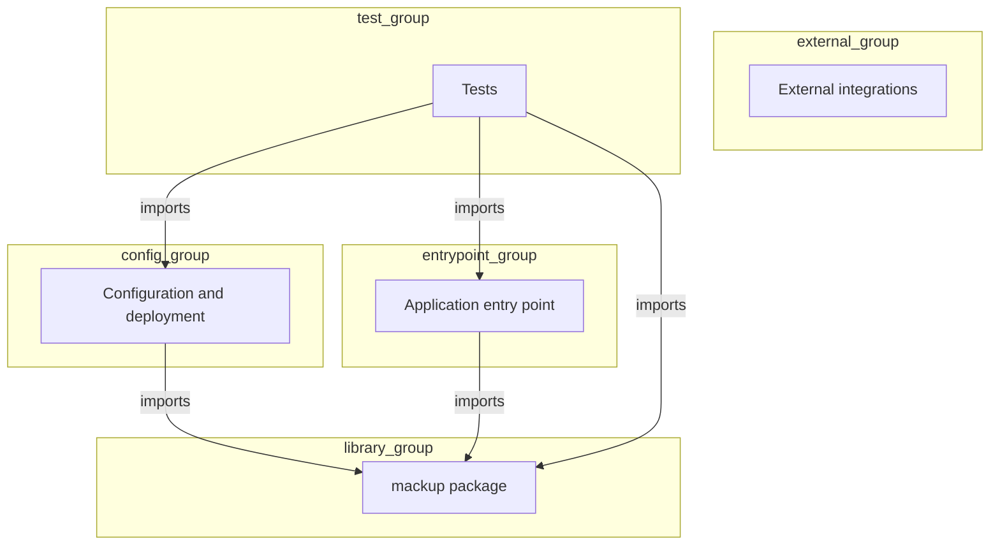

# Architecture report: lra/mackup

> Automated static analysis. **Observed** = directly seen in files/imports/AST; **Inferred** = interpretation from that evidence. Repository code was not executed.

## 1. Repository at a glance

| Item | Value |
| --- | --- |
| Repository | lra/mackup |
| Description | Backup and keep your application settings in sync. |
| Language | Python |
| Stars | 15360 |
| Licence | GPL-3.0 |
| Analysed commit / branch | 123929adf4b382564f0602e778e221ddf080953d / master |
| Framework(s) | None detected |
| Files analysed | 677 |
| Components | 5 |

## 2. Architecture in one minute

lra/mackup - Backup and keep your application settings in sync.. This repository was analysed statically from 677 file(s) (18 Python). Detected technologies (observed from imports/manifests): GitHub Actions, SQLite, Poetry, pytest, unittest. Files are grouped into 5 component(s): Configuration and deployment, Application entry point, External integrations, mackup package, Tests. Observed entry point(s): src/mackup/main.py. Findings below distinguish observed facts from inferred interpretation.

## 3. High-level block diagram

## 4. Main components

### Configuration and deployment (`config`)

- **Kind:** config
- **Status:** Observed
- **Confidence:** 0.85
- **Responsibility:** Groups 611 file(s) under configuration and deployment (observed from repository paths and static analysis). Observed top-level classes: Config, ConfigError.
- **Paths:** `pyproject.toml`, `snap/snapcraft.yaml`, `src/mackup/applications/1password-4.cfg`, `src/mackup/applications/2do.cfg`, `src/mackup/applications/ack.cfg`, `src/mackup/applications/act.cfg`, `src/mackup/applications/activitywatch.cfg`, `src/mackup/applications/adium.cfg`, `src/mackup/applications/adobe-camera-raw.cfg`, `src/mackup/applications/aerc.cfg`, `src/mackup/applications/aerospace.cfg`, `src/mackup/applications/affinity-designer.cfg`, `src/mackup/applications/affinity-photo.cfg`, `src/mackup/applications/affinity-publisher.cfg`, `src/mackup/applications/airflow.cfg`, `src/mackup/applications/airmail.cfg`, `src/mackup/applications/akamai-cli.cfg`, `src/mackup/applications/alacritty.cfg`, `src/mackup/applications/aldente.cfg`, `src/mackup/applications/alt-tab.cfg`, `src/mackup/applications/amethyst.cfg`, `src/mackup/applications/ancient-domains-of-mystery.cfg`, `src/mackup/applications/androidstudio-13.cfg`, `src/mackup/applications/ansible.cfg`, `src/mackup/applications/appcleaner.cfg`, `src/mackup/applications/appcode-2.cfg`, `src/mackup/applications/appcode-3.cfg`, `src/mackup/applications/appcode-31.cfg`, `src/mackup/applications/appcode-32.cfg`, `src/mackup/applications/apple-music.cfg`, `src/mackup/applications/apptivate.cfg`, `src/mackup/applications/arara.cfg`, `src/mackup/applications/aria2c.cfg`, `src/mackup/applications/arm.cfg`, `src/mackup/applications/asciinema.cfg`, `src/mackup/applications/asdf.cfg`, `src/mackup/applications/aspell.cfg`, `src/mackup/applications/astyle.cfg`, `src/mackup/applications/atlantis.cfg`, `src/mackup/applications/atom.cfg`, `src/mackup/applications/audacious.cfg`, `src/mackup/applications/auskey.cfg`, `src/mackup/applications/autokey.cfg`, `src/mackup/applications/awareness.cfg`, `src/mackup/applications/aws.cfg`, `src/mackup/applications/azure.cfg`, `src/mackup/applications/b-ryan_powerline-shell.cfg`, `src/mackup/applications/bartender.cfg`, `src/mackup/applications/base.cfg`, `src/mackup/applications/bash-it.cfg`, `src/mackup/applications/bash.cfg`, `src/mackup/applications/bat.cfg`, `src/mackup/applications/bc.cfg`, `src/mackup/applications/beatport-pro.cfg`, `src/mackup/applications/beets.cfg`, `src/mackup/applications/bettersnaptool.cfg`, `src/mackup/applications/bettertouchtool.cfg`, `src/mackup/applications/beyond-compare.cfg`, `src/mackup/applications/bibdesk.cfg`, `src/mackup/applications/billings-pro-server-admin.cfg`, `src/mackup/applications/bitbar.cfg`, `src/mackup/applications/bitchx.cfg`, `src/mackup/applications/blackfire.cfg`, `src/mackup/applications/blender.cfg`, `src/mackup/applications/blesh.cfg`, `src/mackup/applications/boto.cfg`, `src/mackup/applications/boxer.cfg`, `src/mackup/applications/brackets.cfg`, `src/mackup/applications/brave.cfg`, `src/mackup/applications/btop.cfg`, `src/mackup/applications/bump.cfg`, `src/mackup/applications/bundler.cfg`, `src/mackup/applications/byobu.cfg`, `src/mackup/applications/caffeine.cfg`, `src/mackup/applications/calibre.cfg`, `src/mackup/applications/capture-one.cfg`, `src/mackup/applications/cartographica.cfg`, `src/mackup/applications/cerebro.cfg`, `src/mackup/applications/charles.cfg`, `src/mackup/applications/cheat.cfg`, `src/mackup/applications/chef.cfg`, `src/mackup/applications/chicken.cfg`, `src/mackup/applications/choosy.cfg`, `src/mackup/applications/chunkwm.cfg`, `src/mackup/applications/cider.cfg`, `src/mackup/applications/clashx.cfg`, `src/mackup/applications/clasp.cfg`, `src/mackup/applications/claude-code.cfg`, `src/mackup/applications/cleanshot.cfg`, `src/mackup/applications/clementine.cfg`, `src/mackup/applications/clion.cfg`, `src/mackup/applications/clipmenu.cfg`, `src/mackup/applications/clipy.cfg`, `src/mackup/applications/cloudapp.cfg`, `src/mackup/applications/coda-2.cfg`, `src/mackup/applications/codex.cfg`, `src/mackup/applications/colloquy.cfg`, `src/mackup/applications/colorschemer-studio-2.cfg`, `src/mackup/applications/colorslurp.cfg`, `src/mackup/applications/colorsync.cfg`, `src/mackup/applications/composer.cfg`, `src/mackup/applications/concentrate.cfg`, `src/mackup/applications/conky.cfg`, `src/mackup/applications/consular.cfg`, `src/mackup/applications/context7.cfg`, `src/mackup/applications/contexts.cfg`, `src/mackup/applications/controlplane.cfg`, `src/mackup/applications/copyq.cfg`, `src/mackup/applications/cord.cfg`, `src/mackup/applications/coteditor.cfg`, `src/mackup/applications/ctags.cfg`, `src/mackup/applications/curl.cfg`, `src/mackup/applications/cursor.cfg`, `src/mackup/applications/cvim.cfg`, `src/mackup/applications/cyberduck.cfg`, `src/mackup/applications/daisydisk.cfg`, `src/mackup/applications/dash.cfg`, `src/mackup/applications/datagrip.cfg`, `src/mackup/applications/day-o.cfg`, `src/mackup/applications/dbeaver.cfg`, `src/mackup/applications/dbvisualizer.cfg`, `src/mackup/applications/deal-alert.cfg`, `src/mackup/applications/deepin-dde-dock.cfg`, `src/mackup/applications/deepin-dde-file-manager.cfg`, `src/mackup/applications/deepin-terminal.cfg`, `src/mackup/applications/default-folder-x.cfg`, `src/mackup/applications/defaultkeybinding.cfg`, `src/mackup/applications/devilspie.cfg`, `src/mackup/applications/devilspie2.cfg`, `src/mackup/applications/dig.cfg`, `src/mackup/applications/divvy.cfg`, `src/mackup/applications/docker.cfg`, `src/mackup/applications/dolphin.cfg`, `src/mackup/applications/doom-emacs.cfg`, `src/mackup/applications/doublecmd.cfg`, `src/mackup/applications/doxie.cfg`, `src/mackup/applications/dozer.cfg`, `src/mackup/applications/draft.cfg`, `src/mackup/applications/droplr.cfg`, `src/mackup/applications/dropzone.cfg`, `src/mackup/applications/drush.cfg`, `src/mackup/applications/editorconfig.cfg`, `src/mackup/applications/electrum.cfg`, `src/mackup/applications/emacs.cfg`, `src/mackup/applications/enjoyable.cfg`, `src/mackup/applications/environmental-station-alpha.cfg`, `src/mackup/applications/eqmac-2.cfg`, `src/mackup/applications/eslint.cfg`, `src/mackup/applications/espanso.cfg`, `src/mackup/applications/exercism.cfg`, `src/mackup/applications/expandrive.cfg`, `src/mackup/applications/factorio.cfg`, `src/mackup/applications/factory-droid.cfg`, `src/mackup/applications/fantastical.cfg`, `src/mackup/applications/fasd.cfg`, `src/mackup/applications/fastlane.cfg`, `src/mackup/applications/fastscripts.cfg`, `src/mackup/applications/feeds.cfg`, `src/mackup/applications/filezilla.cfg`, `src/mackup/applications/finicky.cfg`, `src/mackup/applications/fish.cfg`, `src/mackup/applications/fisher.cfg`, `src/mackup/applications/flake8.cfg`, `src/mackup/applications/flameshot.cfg`, `src/mackup/applications/flexget.cfg`, `src/mackup/applications/flux.cfg`, `src/mackup/applications/focus.cfg`, `src/mackup/applications/fontconfig.cfg`, `src/mackup/applications/fontexplorer-x.cfg`, `src/mackup/applications/forge.cfg`, `src/mackup/applications/fork.cfg`, `src/mackup/applications/forklift.cfg`, `src/mackup/applications/franz.cfg`, `src/mackup/applications/gasmask.cfg`, `src/mackup/applications/gdb.cfg`, `src/mackup/applications/gearplayer.cfg`, `src/mackup/applications/geektool.cfg`, `src/mackup/applications/ghci.cfg`, `src/mackup/applications/ghidra.cfg`, `src/mackup/applications/ghostty.cfg`, `src/mackup/applications/ghostwriter.cfg`, `src/mackup/applications/gimp.cfg`, `src/mackup/applications/git-hooks.cfg`, `src/mackup/applications/git.cfg`, `src/mackup/applications/gitbox.cfg`, `src/mackup/applications/gitfox.cfg`, `src/mackup/applications/github-cli.cfg`, `src/mackup/applications/gitkraken.cfg`, `src/mackup/applications/gitup.cfg`, `src/mackup/applications/gmail-notifr.cfg`, `src/mackup/applications/gmailctl.cfg`, `src/mackup/applications/gmvault.cfg`, `src/mackup/applications/gnu-stow.cfg`, `src/mackup/applications/gnupg.cfg`, `src/mackup/applications/go2shell.cfg`, `src/mackup/applications/goku.cfg`, `src/mackup/applications/goland.cfg`, `src/mackup/applications/goldendict.cfg`, `src/mackup/applications/goodsync.cfg`, `src/mackup/applications/goshare.cfg`, `src/mackup/applications/gradle.cfg`, `src/mackup/applications/grandtotal-3.cfg`, `src/mackup/applications/grsync.cfg`, `src/mackup/applications/gstm.cfg`, `src/mackup/applications/hammerspoon.cfg`, `src/mackup/applications/handbrake.cfg`, `src/mackup/applications/hands-off.cfg`, `src/mackup/applications/hazel.cfg`, `src/mackup/applications/helix.cfg`, `src/mackup/applications/hero-lab.cfg`, `src/mackup/applications/heroku.cfg`, `src/mackup/applications/hexchat.cfg`, `src/mackup/applications/hexels.cfg`, `src/mackup/applications/hocus-focus.cfg`, `src/mackup/applications/homebrew.cfg`, `src/mackup/applications/homebridge.cfg`, `src/mackup/applications/houdini.cfg`, `src/mackup/applications/hstr.cfg`, `src/mackup/applications/htop.cfg`, `src/mackup/applications/httpie.cfg`, `src/mackup/applications/hub.cfg`, `src/mackup/applications/hyper.cfg`, `src/mackup/applications/hyperdock.cfg`, `src/mackup/applications/hyperswitch.cfg`, `src/mackup/applications/i2cssh.cfg`, `src/mackup/applications/i3.cfg`, `src/mackup/applications/idapro.cfg`, `src/mackup/applications/ideavim.cfg`, `src/mackup/applications/iina.cfg`, `src/mackup/applications/illustrator.cfg`, `src/mackup/applications/inkscape.cfg`, `src/mackup/applications/insomnia.cfg`, `src/mackup/applications/intellijidea.cfg`, `src/mackup/applications/ipython.cfg`, `src/mackup/applications/irssi.cfg`, `src/mackup/applications/istat-menus.cfg`, `src/mackup/applications/iterm2.cfg`, `src/mackup/applications/itermocil.cfg`, `src/mackup/applications/itsycal.cfg`, `src/mackup/applications/itunes-scripts.cfg`, `src/mackup/applications/jankyborders.cfg`, `src/mackup/applications/janus.cfg`, `src/mackup/applications/jitouch.cfg`, `src/mackup/applications/joplin.cfg`, `src/mackup/applications/jrnl.cfg`, `src/mackup/applications/jsbeautifier.cfg`, `src/mackup/applications/jshint.cfg`, `src/mackup/applications/julia.cfg`, `src/mackup/applications/jumpcut.cfg`, `src/mackup/applications/jupyter.cfg`, `src/mackup/applications/k9s.cfg`, `src/mackup/applications/kaggle.cfg`, `src/mackup/applications/kaleidoscope.cfg`, `src/mackup/applications/karabiner-elements.cfg`, `src/mackup/applications/karabiner.cfg`, `src/mackup/applications/kdenlive.cfg`, `src/mackup/applications/keepassx.cfg`, `src/mackup/applications/keepassxc.cfg`, `src/mackup/applications/keepingyouawake.cfg`, `src/mackup/applications/keka.cfg`, `src/mackup/applications/keybase.cfg`, `src/mackup/applications/keyboard-maestro.cfg`, `src/mackup/applications/keymo.cfg`, `src/mackup/applications/keyremap4macbook.cfg`, `src/mackup/applications/khd.cfg`, `src/mackup/applications/kiro.cfg`, `src/mackup/applications/kitty.cfg`, `src/mackup/applications/krew.cfg`, `src/mackup/applications/kubectl.cfg`, `src/mackup/applications/kwm.cfg`, `src/mackup/applications/latexit.cfg`, `src/mackup/applications/launchbar.cfg`, `src/mackup/applications/lazydocker.cfg`, `src/mackup/applications/lazygit.cfg`, `src/mackup/applications/ledger.cfg`, `src/mackup/applications/leiningen.cfg`, `src/mackup/applications/lf.cfg`, `src/mackup/applications/libreoffice.cfg`, `src/mackup/applications/liftoff.cfg`, `src/mackup/applications/light-table.cfg`, `src/mackup/applications/lightpaper.cfg`, `src/mackup/applications/lightroom-classic.cfg`, `src/mackup/applications/lightroom.cfg`, `src/mackup/applications/limechat.cfg`, `src/mackup/applications/liquidprompt.cfg`, `src/mackup/applications/littlesnitch.cfg`, `src/mackup/applications/livestreamer.cfg`, `src/mackup/applications/logitech-options.cfg`, `src/mackup/applications/logseq.cfg`, `src/mackup/applications/lollypop.cfg`, `src/mackup/applications/loopback.cfg`, `src/mackup/applications/luftrausers.cfg`, `src/mackup/applications/lunarvim.cfg`, `src/mackup/applications/macdive2.cfg`, `src/mackup/applications/macdown.cfg`, `src/mackup/applications/mackup.cfg`, `src/mackup/applications/macosx.cfg`, `src/mackup/applications/macvim.cfg`, `src/mackup/applications/magic-launch.cfg`, `src/mackup/applications/magicprefs.cfg`, `src/mackup/applications/magnet.cfg`, `src/mackup/applications/maid.cfg`, `src/mackup/applications/mail.cfg`, `src/mackup/applications/mailmate.cfg`, `src/mackup/applications/mailplane.cfg`, `src/mackup/applications/mako.cfg`, `src/mackup/applications/marked2.cfg`, `src/mackup/applications/marta.cfg`, `src/mackup/applications/matlab.cfg`, `src/mackup/applications/maven.cfg`, `src/mackup/applications/max.cfg`, `src/mackup/applications/mendeley.cfg`, `src/mackup/applications/menumeters.cfg`, `src/mackup/applications/mercurial.cfg`, `src/mackup/applications/mercurymover.cfg`, `src/mackup/applications/messages.cfg`, `src/mackup/applications/micro.cfg`, `src/mackup/applications/microsoft-remote-desktop.cfg`, `src/mackup/applications/mise.cfg`, `src/mackup/applications/mitmproxy.cfg`, `src/mackup/applications/mkcert.cfg`, `src/mackup/applications/mole.cfg`, `src/mackup/applications/monodevelop.cfg`, `src/mackup/applications/moom.cfg`, `src/mackup/applications/mosaic.cfg`, `src/mackup/applications/mou.cfg`, `src/mackup/applications/mpd.cfg`, `src/mackup/applications/mplayerx.cfg`, `src/mackup/applications/mps-youtube.cfg`, `src/mackup/applications/mpv.cfg`, `src/mackup/applications/mtmr.cfg`, `src/mackup/applications/multitouch.cfg`, `src/mackup/applications/mumu.cfg`, `src/mackup/applications/musicbrainz-picard.cfg`, `src/mackup/applications/mutespotifyads.cfg`, `src/mackup/applications/mycli.cfg`, `src/mackup/applications/myrepos.cfg`, `src/mackup/applications/mysql.cfg`, `src/mackup/applications/mysqlworkbench.cfg`, `src/mackup/applications/name-mangler.cfg`, `src/mackup/applications/nano.cfg`, `src/mackup/applications/navicat.cfg`, `src/mackup/applications/ncmpcpp.cfg`, `src/mackup/applications/neofetch.cfg`, `src/mackup/applications/neovim.cfg`, `src/mackup/applications/nethack.cfg`, `src/mackup/applications/netlify.cfg`, `src/mackup/applications/newsbeuter.cfg`, `src/mackup/applications/ngrok.cfg`, `src/mackup/applications/ni.cfg`, `src/mackup/applications/nomacs.cfg`, `src/mackup/applications/nosqlbooster-for-mongodb.cfg`, `src/mackup/applications/notion-enhancer.cfg`, `src/mackup/applications/nova.cfg`, `src/mackup/applications/npm.cfg`, `src/mackup/applications/npmrc.cfg`, `src/mackup/applications/nslogger.cfg`, `src/mackup/applications/nuget.cfg`, `src/mackup/applications/nushell.cfg`, `src/mackup/applications/nvalt.cfg`, `src/mackup/applications/nvm.cfg`, `src/mackup/applications/nvpy.cfg`, `src/mackup/applications/obs.cfg`, `src/mackup/applications/oci.cfg`, `src/mackup/applications/offlineimap.cfg`, `src/mackup/applications/ogdesign-eagle.cfg`, `src/mackup/applications/oh-my-fish.cfg`, `src/mackup/applications/oh-my-tmux.cfg`, `src/mackup/applications/okta-awscli.cfg`, `src/mackup/applications/omnifocus.cfg`, `src/mackup/applications/omnigraffle.cfg`, `src/mackup/applications/openbox.cfg`, `src/mackup/applications/opencode.cfg`, `src/mackup/applications/openemu.cfg`, `src/mackup/applications/opera.cfg`, `src/mackup/applications/p10k.cfg`, `src/mackup/applications/paintbrush.cfg`, `src/mackup/applications/pandoc.cfg`, `src/mackup/applications/pass.cfg`, `src/mackup/applications/pastebot.cfg`, `src/mackup/applications/path-finder.cfg`, `src/mackup/applications/pdfjam.cfg`, `src/mackup/applications/pear.cfg`, `src/mackup/applications/pentadactyl.cfg`, `src/mackup/applications/perl.cfg`, `src/mackup/applications/pgsql.cfg`, `src/mackup/applications/phoenix.cfg`, `src/mackup/applications/phoneview.cfg`, `src/mackup/applications/photoshop.cfg`, `src/mackup/applications/phpstorm.cfg`, `src/mackup/applications/picgo.cfg`, `src/mackup/applications/pidgin.cfg`, `src/mackup/applications/pip.cfg`, `src/mackup/applications/pixelsnap.cfg`, `src/mackup/applications/pixelsnap2.cfg`, `src/mackup/applications/planner.cfg`, `src/mackup/applications/plover.cfg`, `src/mackup/applications/pnpm.cfg`, `src/mackup/applications/pock.cfg`, `src/mackup/applications/podman.cfg`, `src/mackup/applications/poedit.cfg`, `src/mackup/applications/poetry.cfg`, `src/mackup/applications/pokerstars.cfg`, `src/mackup/applications/polybar.cfg`, `src/mackup/applications/popclip.cfg`, `src/mackup/applications/popcorn-time.cfg`, `src/mackup/applications/postico.cfg`, `src/mackup/applications/pow.cfg`, `src/mackup/applications/powerline.cfg`, `src/mackup/applications/prezto.cfg`, `src/mackup/applications/processing.cfg`, `src/mackup/applications/proselint.cfg`, `src/mackup/applications/proxychains.cfg`, `src/mackup/applications/proxyman.cfg`, `src/mackup/applications/prusa-slicer.cfg`, `src/mackup/applications/psysh.cfg`, `src/mackup/applications/punto-switcher.cfg`, `src/mackup/applications/pycharm.cfg`, `src/mackup/applications/pypi.cfg`, `src/mackup/applications/pyradio.cfg`, `src/mackup/applications/querious.cfg`, `src/mackup/applications/quicklook.cfg`, `src/mackup/applications/quicksilver.cfg`, `src/mackup/applications/quitter.cfg`, `src/mackup/applications/qutebrowser.cfg`, `src/mackup/applications/qv2ray.cfg`, `src/mackup/applications/r.cfg`, `src/mackup/applications/rails.cfg`, `src/mackup/applications/ranger.cfg`, `src/mackup/applications/rbenv.cfg`, `src/mackup/applications/rclone.cfg`, `src/mackup/applications/rectangle.cfg`, `src/mackup/applications/redshift-scheduler.cfg`, `src/mackup/applications/redshift.cfg`, `src/mackup/applications/remote-desktop-manager.cfg`, `src/mackup/applications/rhythmbox.cfg`, `src/mackup/applications/rime.cfg`, `src/mackup/applications/ripgrep.cfg`, `src/mackup/applications/robo3t.cfg`, `src/mackup/applications/rocket.cfg`, `src/mackup/applications/rofi.cfg`, `src/mackup/applications/royaltsx.cfg`, `src/mackup/applications/rstudio.cfg`, `src/mackup/applications/rtorrent.cfg`, `src/mackup/applications/rtx.cfg`, `src/mackup/applications/rubitrack5.cfg`, `src/mackup/applications/rubocop.cfg`, `src/mackup/applications/ruby-version.cfg`, `src/mackup/applications/ruby.cfg`, `src/mackup/applications/rubymine.cfg`, `src/mackup/applications/rust.cfg`, `src/mackup/applications/rustrover.cfg`, `src/mackup/applications/rvm.cfg`, `src/mackup/applications/s3cmd.cfg`, `src/mackup/applications/sabnzbd.cfg`, `src/mackup/applications/sbcl.cfg`, `src/mackup/applications/sbt.cfg`, `src/mackup/applications/scenario.cfg`, `src/mackup/applications/screen.cfg`, `src/mackup/applications/screenhero.cfg`, `src/mackup/applications/scrivener.cfg`, `src/mackup/applications/scroll-reverser.cfg`, `src/mackup/applications/secure-pipes.cfg`, `src/mackup/applications/securecrt.cfg`, `src/mackup/applications/seil.cfg`, `src/mackup/applications/selfcontrol.cfg`, `src/mackup/applications/sequel-pro.cfg`, `src/mackup/applications/shadowsocksx-ng.cfg`, `src/mackup/applications/shiftit.cfg`, `src/mackup/applications/shifty.cfg`, `src/mackup/applications/shimo.cfg`, `src/mackup/applications/showyedge.cfg`, `src/mackup/applications/shsh-blobs.cfg`, `src/mackup/applications/shuttle.cfg`, `src/mackup/applications/sizeup.cfg`, `src/mackup/applications/sizzy.cfg`, `src/mackup/applications/sketchybar.cfg`, `src/mackup/applications/skhd.cfg`, `src/mackup/applications/skim.cfg`, `src/mackup/applications/skitch.cfg`, `src/mackup/applications/slate.cfg`, `src/mackup/applications/slic3r.cfg`, `src/mackup/applications/slogger.cfg`, `src/mackup/applications/smartgit.cfg`, `src/mackup/applications/smooth-mouse.cfg`, `src/mackup/applications/soulver.cfg`, `src/mackup/applications/sourcetree.cfg`, `src/mackup/applications/spacelauncher.cfg`, `src/mackup/applications/spacemacs.cfg`, `src/mackup/applications/spacevim.cfg`, `src/mackup/applications/spamsieve.cfg`, `src/mackup/applications/spark.cfg`, `src/mackup/applications/spectacle.cfg`, `src/mackup/applications/spectrwm.cfg`, `src/mackup/applications/splice.cfg`, `src/mackup/applications/spotify-notifications.cfg`, `src/mackup/applications/spotify.cfg`, `src/mackup/applications/sqitch.cfg`, `src/mackup/applications/ssh.cfg`, `src/mackup/applications/starship.cfg`, `src/mackup/applications/startupizer2.cfg`, `src/mackup/applications/stata.cfg`, `src/mackup/applications/stats.cfg`, `src/mackup/applications/stay.cfg`, `src/mackup/applications/storyist-3.cfg`, `src/mackup/applications/streamdeck.cfg`, `src/mackup/applications/subler.cfg`, `src/mackup/applications/sublime-merge.cfg`, `src/mackup/applications/sublime-text-2.cfg`, `src/mackup/applications/sublime-text-3.cfg`, `src/mackup/applications/sublime-text.cfg`, `src/mackup/applications/subversion.cfg`, `src/mackup/applications/superduper.cfg`, `src/mackup/applications/surge.cfg`, `src/mackup/applications/swaywm.cfg`, `src/mackup/applications/swinsian.cfg`, `src/mackup/applications/swish.cfg`, `src/mackup/applications/switchhosts.cfg`, `src/mackup/applications/t.cfg`, `src/mackup/applications/tableplus.cfg`, `src/mackup/applications/taskpaper.cfg`, `src/mackup/applications/taskwarrior.cfg`, `src/mackup/applications/teamocil.cfg`, `src/mackup/applications/telegram_macos.cfg`, `src/mackup/applications/terminal.cfg`, `src/mackup/applications/terminator.cfg`, `src/mackup/applications/termite.cfg`, `src/mackup/applications/termux.cfg`, `src/mackup/applications/terraform.cfg`, `src/mackup/applications/textexpander.cfg`, `src/mackup/applications/textmate.cfg`, `src/mackup/applications/textual.cfg`, `src/mackup/applications/things.cfg`, `src/mackup/applications/tidy.cfg`, `src/mackup/applications/tig.cfg`, `src/mackup/applications/tiles.cfg`, `src/mackup/applications/tilix.cfg`, `src/mackup/applications/timeout.cfg`, `src/mackup/applications/tint2.cfg`, `src/mackup/applications/tinyfugue.cfg`, `src/mackup/applications/tmux.cfg`, `src/mackup/applications/tmuxinator.cfg`, `src/mackup/applications/tmuxp.cfg`, `src/mackup/applications/todotxt-cli.cfg`, `src/mackup/applications/toothfairy.cfg`, `src/mackup/applications/topgrade.cfg`, `src/mackup/applications/totalspaces2.cfg`, `src/mackup/applications/tower-2.cfg`, `src/mackup/applications/tower-3.cfg`, `src/mackup/applications/tower.cfg`, `src/mackup/applications/transmission.cfg`, `src/mackup/applications/transmit.cfg`, `src/mackup/applications/tripmode.cfg`, `src/mackup/applications/trizen.cfg`, `src/mackup/applications/tunnelblick.cfg`, `src/mackup/applications/tvnamer.cfg`, `src/mackup/applications/twitterrific.cfg`, `src/mackup/applications/typinator.cfg`, `src/mackup/applications/typora.cfg`, `src/mackup/applications/ubersicht.cfg`, `src/mackup/applications/ulauncher.cfg`, `src/mackup/applications/ventrilo.cfg`, `src/mackup/applications/verdaccio.cfg`, `src/mackup/applications/versions.cfg`, `src/mackup/applications/vim.cfg`, `src/mackup/applications/vimperator.cfg`, `src/mackup/applications/vimwiki.cfg`, `src/mackup/applications/viscosity.cfg`, `src/mackup/applications/vlc.cfg`, `src/mackup/applications/volt.cfg`, `src/mackup/applications/vs4mac.cfg`, `src/mackup/applications/vscode-insiders.cfg`, `src/mackup/applications/vscode-oss.cfg`, `src/mackup/applications/vscode.cfg`, `src/mackup/applications/vscodium.cfg`, `src/mackup/applications/wakatime.cfg`, `src/mackup/applications/warp.cfg`, `src/mackup/applications/waybar.cfg`, `src/mackup/applications/webstorm.cfg`, `src/mackup/applications/wezterm.cfg`, `src/mackup/applications/wget.cfg`, `src/mackup/applications/whatsapp.cfg`, `src/mackup/applications/windsurf.cfg`, `src/mackup/applications/wireshark.cfg`, `src/mackup/applications/witch.cfg`, `src/mackup/applications/wordgrinder.cfg`, `src/mackup/applications/workrave.cfg`, `src/mackup/applications/wp-cli.cfg`, `src/mackup/applications/x11.cfg`, `src/mackup/applications/xamarinstudio-5.cfg`, `src/mackup/applications/xbar.cfg`, `src/mackup/applications/xbindkeys.cfg`, `src/mackup/applications/xchat.cfg`, `src/mackup/applications/xcode.cfg`, `src/mackup/applications/xee.cfg`, `src/mackup/applications/xemacs.cfg`, `src/mackup/applications/xld.cfg`, `src/mackup/applications/xonsh.cfg`, `src/mackup/applications/xtrafinder.cfg`, `src/mackup/applications/yabai.cfg`, `src/mackup/applications/yarn.cfg`, `src/mackup/applications/yazi.cfg`, `src/mackup/applications/youtube-dl.cfg`, `src/mackup/applications/yummyftp.cfg`, `src/mackup/applications/zabbix-cli.cfg`, `src/mackup/applications/zathura.cfg`, `src/mackup/applications/zed.cfg`, `src/mackup/applications/zoom.cfg`, `src/mackup/applications/zoxide.cfg`, `src/mackup/applications/zsh.cfg`, `src/mackup/config.py`
- **Evidence:** [pyproject.toml](https://github.com/lra/mackup/blob/123929adf4b382564f0602e778e221ddf080953d/pyproject.toml); [snap/snapcraft.yaml](https://github.com/lra/mackup/blob/123929adf4b382564f0602e778e221ddf080953d/snap/snapcraft.yaml); [src/mackup/applications/1password-4.cfg](https://github.com/lra/mackup/blob/123929adf4b382564f0602e778e221ddf080953d/src/mackup/applications/1password-4.cfg); [src/mackup/applications/2do.cfg](https://github.com/lra/mackup/blob/123929adf4b382564f0602e778e221ddf080953d/src/mackup/applications/2do.cfg); [src/mackup/applications/ack.cfg](https://github.com/lra/mackup/blob/123929adf4b382564f0602e778e221ddf080953d/src/mackup/applications/ack.cfg); [src/mackup/applications/act.cfg](https://github.com/lra/mackup/blob/123929adf4b382564f0602e778e221ddf080953d/src/mackup/applications/act.cfg); [src/mackup/applications/activitywatch.cfg](https://github.com/lra/mackup/blob/123929adf4b382564f0602e778e221ddf080953d/src/mackup/applications/activitywatch.cfg); [src/mackup/applications/adium.cfg](https://github.com/lra/mackup/blob/123929adf4b382564f0602e778e221ddf080953d/src/mackup/applications/adium.cfg)

### Application entry point (`entrypoint`)

- **Kind:** entrypoint
- **Status:** Observed
- **Confidence:** 0.85
- **Responsibility:** Groups 1 file(s) under application entry point (observed from repository paths and static analysis). Observed top-level classes: ColorFormatCodes, _Context. Observed top-level functions: _cmd_backup, _cmd_link, _cmd_link_install, _cmd_link_uninstall, _cmd_list, _cmd_restore.
- **Paths:** `src/mackup/main.py`
- **Evidence:** [src/mackup/main.py:61](https://github.com/lra/mackup/blob/123929adf4b382564f0602e778e221ddf080953d/src/mackup/main.py#L61)

### External integrations (`external_integrations`)

- **Kind:** external
- **Status:** Inferred
- **Confidence:** 0.70
- **Responsibility:** Groups 0 file(s) under external integrations (observed from repository paths and static analysis).
- **Evidence:** [src/mackup/utils.py:8](https://github.com/lra/mackup/blob/123929adf4b382564f0602e778e221ddf080953d/src/mackup/utils.py#L8); [tests/test_utils.py:2](https://github.com/lra/mackup/blob/123929adf4b382564f0602e778e221ddf080953d/tests/test_utils.py#L2)

### mackup package (`mackup`)

- **Kind:** library
- **Status:** Observed
- **Confidence:** 0.85
- **Responsibility:** Groups 6 file(s) under mackup package (observed from repository paths and static analysis). Observed top-level classes: ApplicationProfile, ApplicationsDatabase, Mackup. Observed top-level functions: can_file_be_synced_on_current_platform, chmod, confirm, copy, delete, error.
- **Paths:** `src/mackup/__init__.py`, `src/mackup/application.py`, `src/mackup/appsdb.py`, `src/mackup/constants.py`, `src/mackup/mackup.py`, `src/mackup/utils.py`
- **Evidence:** [src/mackup/__init__.py](https://github.com/lra/mackup/blob/123929adf4b382564f0602e778e221ddf080953d/src/mackup/__init__.py); [src/mackup/application.py:14](https://github.com/lra/mackup/blob/123929adf4b382564f0602e778e221ddf080953d/src/mackup/application.py#L14); [src/mackup/appsdb.py:14](https://github.com/lra/mackup/blob/123929adf4b382564f0602e778e221ddf080953d/src/mackup/appsdb.py#L14); [src/mackup/constants.py:22](https://github.com/lra/mackup/blob/123929adf4b382564f0602e778e221ddf080953d/src/mackup/constants.py#L22); [src/mackup/mackup.py:15](https://github.com/lra/mackup/blob/123929adf4b382564f0602e778e221ddf080953d/src/mackup/mackup.py#L15); [src/mackup/utils.py:26](https://github.com/lra/mackup/blob/123929adf4b382564f0602e778e221ddf080953d/src/mackup/utils.py#L26)

### Tests (`tests`)

- **Kind:** test
- **Status:** Observed
- **Confidence:** 0.85
- **Responsibility:** Groups 31 file(s) under tests (observed from repository paths and static analysis). Observed top-level classes: TestApplicationProfile, TestApplicationsDatabaseXDG, TestBackupAfterLinkInstall, TestCLI, TestConfig, TestConfigFileOption. Observed top-level functions: assert_correct_config_read, convert_to_octal.
- **Paths:** `tests/README.md`, `tests/__init__.py`, `tests/fixtures/.mackup/legacy-test-app.cfg`, `tests/fixtures/.mackup/priority-test-app.cfg`, `tests/fixtures/Library/Application Support/Box/Box Sync/sync_root_folder.txt`, `tests/fixtures/Library/Mobile Documents/com~apple~CloudDocs/_blank_.md`, `tests/fixtures/mackup-apps_to_ignore.cfg`, `tests/fixtures/mackup-apps_to_ignore_and_sync.cfg`, `tests/fixtures/mackup-apps_to_sync.cfg`, `tests/fixtures/mackup-empty.cfg`, `tests/fixtures/mackup-engine-dropbox.cfg`, `tests/fixtures/mackup-engine-file_system-absolute.cfg`, `tests/fixtures/mackup-engine-file_system-no_path.cfg`, `tests/fixtures/mackup-engine-file_system.cfg`, `tests/fixtures/mackup-engine-google_drive.cfg`, `tests/fixtures/mackup-engine-icloud.cfg`, `tests/fixtures/mackup-engine-unknown.cfg`, `tests/fixtures/mackup-envarcheck.cfg`, `tests/fixtures/mackup-old-config.cfg`, `tests/fixtures/xdg-config-home/mackup/applications/priority-test-app.cfg`, `tests/fixtures/xdg-config-home/mackup/applications/xdg-test-app.cfg`, `tests/fixtures/xdg-config-home/mackup/mackup.cfg`, `tests/test_application.py`, `tests/test_appsdb_xdg.py`, `tests/test_backup_after_link_install.py`, `tests/test_cli.py`, `tests/test_config.py`, `tests/test_config_file_option.py`, `tests/test_constants.py`, `tests/test_main.py`, `tests/test_utils.py`
- **Evidence:** [tests/README.md](https://github.com/lra/mackup/blob/123929adf4b382564f0602e778e221ddf080953d/tests/README.md); [tests/__init__.py](https://github.com/lra/mackup/blob/123929adf4b382564f0602e778e221ddf080953d/tests/__init__.py); [tests/fixtures/.mackup/legacy-test-app.cfg](https://github.com/lra/mackup/blob/123929adf4b382564f0602e778e221ddf080953d/tests/fixtures/.mackup/legacy-test-app.cfg); [tests/fixtures/.mackup/priority-test-app.cfg](https://github.com/lra/mackup/blob/123929adf4b382564f0602e778e221ddf080953d/tests/fixtures/.mackup/priority-test-app.cfg); [tests/fixtures/Library/Application Support/Box/Box Sync/sync_root_folder.txt](https://github.com/lra/mackup/blob/123929adf4b382564f0602e778e221ddf080953d/tests/fixtures/Library/Application%20Support/Box/Box%20Sync/sync_root_folder.txt); [tests/fixtures/Library/Mobile Documents/com~apple~CloudDocs/_blank_.md](https://github.com/lra/mackup/blob/123929adf4b382564f0602e778e221ddf080953d/tests/fixtures/Library/Mobile%20Documents/com~apple~CloudDocs/_blank_.md); [tests/fixtures/mackup-apps_to_ignore.cfg](https://github.com/lra/mackup/blob/123929adf4b382564f0602e778e221ddf080953d/tests/fixtures/mackup-apps_to_ignore.cfg); [tests/fixtures/mackup-apps_to_ignore_and_sync.cfg](https://github.com/lra/mackup/blob/123929adf4b382564f0602e778e221ddf080953d/tests/fixtures/mackup-apps_to_ignore_and_sync.cfg)

## 5. Execution flow

**Observed** entry point(s):

- [src/mackup/main.py](https://github.com/lra/mackup/blob/123929adf4b382564f0602e778e221ddf080953d/src/mackup/main.py)

Representative flow (derived from observed entry points and the import graph; steps beyond the entry point are **Inferred**):

1. Execution starts at an observed entry point listed above, if present.
2. `config` imports `mackup` (Configuration and deployment -> mackup package).
3. `entrypoint` imports `mackup` (Application entry point -> mackup package).
4. `tests` imports `config` (Tests -> Configuration and deployment).
5. `tests` imports `entrypoint` (Tests -> Application entry point).
6. `tests` imports `mackup` (Tests -> mackup package).

## 6. Project structure

### `(root)`

- `.gitignore` - other (207 bytes)
- `.linelint.yml` - config (589 bytes)
- `INSTALL.md` - docs (1057 bytes)
- `LICENSE` - docs (35140 bytes)
- `Makefile` - other (1019 bytes)
- `README.md` - docs (36926 bytes)
- `pyproject.toml` - manifest (4017 bytes)

### `.github`

- `.github/CONTRIBUTING.md` - docs (3462 bytes)
- `.github/PULL_REQUEST_TEMPLATE.md` - docs (921 bytes)
- `.github/workflows/install.yaml` - ci, YAML (886 bytes)
- `.github/workflows/linelint.yaml` - ci, YAML (443 bytes)
- `.github/workflows/markdown.yaml` - ci, YAML (271 bytes)
- `.github/workflows/mypy.yaml` - ci, YAML (316 bytes)
- `.github/workflows/release.yaml` - ci, YAML (548 bytes)
- `.github/workflows/ruff.yaml` - ci, YAML (265 bytes)
- `.github/workflows/snap.yaml` - ci, YAML (494 bytes)
- `.github/workflows/test.yaml` - ci, YAML (508 bytes)

### `doc`

- `doc/.mackup.cfg` - config (2161 bytes)
- `doc/.mackup/gnupg.cfg` - config (164 bytes)
- `doc/.mackup/mackup.cfg` - config (71 bytes)
- `doc/.mackup/my-own-files.cfg` - config (96 bytes)
- `doc/.mackup/ssh.cfg` - config (53 bytes)
- `doc/ARCHITECTURE.md` - docs (8869 bytes)
- `doc/README.md` - docs (8632 bytes)
- `doc/architecture.svg` - other (10338 bytes)
- `doc/configuration_merge_guide.md` - docs (6471 bytes)
- `doc/develop.md` - docs (1043 bytes)
- `doc/release.md` - docs (1044 bytes)
- `doc/syncing-private-keys.md` - docs (316 bytes)

### `snap`

- `snap/snapcraft.yaml` - config (945 bytes)

### `src`

- `src/mackup/__init__.py` - source, Python (26 bytes)
- `src/mackup/application.py` - source, Python (15889 bytes)
- `src/mackup/applications/1password-4.cfg` - config (154 bytes)
- `src/mackup/applications/2do.cfg` - config (97 bytes)
- `src/mackup/applications/ack.cfg` - config (55 bytes)
- `src/mackup/applications/act.cfg` - config (55 bytes)
- `src/mackup/applications/activitywatch.cfg` - config (101 bytes)
- `src/mackup/applications/adium.cfg` - config (132 bytes)
- `src/mackup/applications/adobe-camera-raw.cfg` - config (105 bytes)
- `src/mackup/applications/aerc.cfg` - config (74 bytes)
- `src/mackup/applications/aerospace.cfg` - config (122 bytes)
- `src/mackup/applications/affinity-designer.cfg` - config (137 bytes)
- `src/mackup/applications/affinity-photo.cfg` - config (131 bytes)
- `src/mackup/applications/affinity-publisher.cfg` - config (139 bytes)
- `src/mackup/applications/airflow.cfg` - config (136 bytes)
- `src/mackup/applications/airmail.cfg` - config (105 bytes)
- `src/mackup/applications/akamai-cli.cfg` - config (63 bytes)
- `src/mackup/applications/alacritty.cfg` - config (161 bytes)
- `src/mackup/applications/aldente.cfg` - config (146 bytes)
- `src/mackup/applications/alt-tab.cfg` - config (102 bytes)
- `src/mackup/applications/amethyst.cfg` - config (150 bytes)
- `src/mackup/applications/ancient-domains-of-mystery.cfg` - config (82 bytes)
- `src/mackup/applications/androidstudio-13.cfg` - config (145 bytes)
- `src/mackup/applications/ansible.cfg` - config (74 bytes)
- `src/mackup/applications/appcleaner.cfg` - config (173 bytes)
- `src/mackup/applications/appcode-2.cfg` - config (122 bytes)
- `src/mackup/applications/appcode-3.cfg` - config (122 bytes)
- `src/mackup/applications/appcode-31.cfg` - config (124 bytes)
- `src/mackup/applications/appcode-32.cfg` - config (124 bytes)
- `src/mackup/applications/apple-music.cfg` - config (165 bytes)
- `src/mackup/applications/apptivate.cfg` - config (100 bytes)
- `src/mackup/applications/arara.cfg` - config (85 bytes)
- `src/mackup/applications/aria2c.cfg` - config (91 bytes)
- `src/mackup/applications/arm.cfg` - config (59 bytes)
- `src/mackup/applications/asciinema.cfg` - config (68 bytes)
- `src/mackup/applications/asdf.cfg` - config (176 bytes)
- `src/mackup/applications/aspell.cfg` - config (96 bytes)
- `src/mackup/applications/astyle.cfg` - config (69 bytes)
- `src/mackup/applications/atlantis.cfg` - config (90 bytes)
- `src/mackup/applications/atom.cfg` - config (198 bytes)
- `src/mackup/applications/audacious.cfg` - config (170 bytes)
- `src/mackup/applications/auskey.cfg` - config (99 bytes)
- `src/mackup/applications/autokey.cfg` - config (64 bytes)
- `src/mackup/applications/awareness.cfg` - config (106 bytes)
- `src/mackup/applications/aws.cfg` - config (57 bytes)
- `src/mackup/applications/azure.cfg` - config (61 bytes)
- `src/mackup/applications/b-ryan_powerline-shell.cfg` - config (99 bytes)
- `src/mackup/applications/bartender.cfg` - config (240 bytes)
- `src/mackup/applications/base.cfg` - config (251 bytes)
- `src/mackup/applications/bash-it.cfg` - config (69 bytes)
- `src/mackup/applications/bash.cfg` - config (137 bytes)
- `src/mackup/applications/bat.cfg` - config (87 bytes)
- `src/mackup/applications/bc.cfg` - config (53 bytes)
- `src/mackup/applications/beatport-pro.cfg` - config (108 bytes)
- `src/mackup/applications/beets.cfg` - config (72 bytes)
- `src/mackup/applications/bettersnaptool.cfg` - config (157 bytes)
- `src/mackup/applications/bettertouchtool.cfg` - config (501 bytes)
- `src/mackup/applications/beyond-compare.cfg` - config (348 bytes)
- `src/mackup/applications/bibdesk.cfg` - config (143 bytes)
- `src/mackup/applications/billings-pro-server-admin.cfg` - config (136 bytes)
- `src/mackup/applications/bitbar.cfg` - config (96 bytes)
- `src/mackup/applications/bitchx.cfg` - config (73 bytes)
- `src/mackup/applications/blackfire.cfg` - config (69 bytes)
- `src/mackup/applications/blender.cfg` - config (123 bytes)
- `src/mackup/applications/blesh.cfg` - config (58 bytes)
- `src/mackup/applications/boto.cfg` - config (55 bytes)
- `src/mackup/applications/boxer.cfg` - config (122 bytes)
- `src/mackup/applications/brackets.cfg` - config (137 bytes)
- `src/mackup/applications/brave.cfg` - config (126 bytes)
- `src/mackup/applications/btop.cfg` - config (58 bytes)
- `src/mackup/applications/bump.cfg` - config (60 bytes)
- `src/mackup/applications/bundler.cfg` - config (67 bytes)
- `src/mackup/applications/byobu.cfg` - config (367 bytes)
- `src/mackup/applications/caffeine.cfg` - config (165 bytes)
- `src/mackup/applications/calibre.cfg` - config (115 bytes)
- `src/mackup/applications/capture-one.cfg` - config (96 bytes)
- `src/mackup/applications/cartographica.cfg` - config (154 bytes)
- `src/mackup/applications/cerebro.cfg` - config (207 bytes)
- `src/mackup/applications/charles.cfg` - config (132 bytes)
- `src/mackup/applications/cheat.cfg` - config (99 bytes)
- `src/mackup/applications/chef.cfg` - config (55 bytes)
- `src/mackup/applications/chicken.cfg` - config (102 bytes)
- `src/mackup/applications/choosy.cfg` - config (103 bytes)
- `src/mackup/applications/chunkwm.cfg` - config (80 bytes)
- `src/mackup/applications/cider.cfg` - config (57 bytes)
- `src/mackup/applications/clashx.cfg` - config (61 bytes)
- `src/mackup/applications/clasp.cfg` - config (64 bytes)
- `src/mackup/applications/claude-code.cfg` - config (204 bytes)
- `src/mackup/applications/cleanshot.cfg` - config (159 bytes)
- `src/mackup/applications/clementine.cfg` - config (114 bytes)
- `src/mackup/applications/clion.cfg` - config (222 bytes)
- `src/mackup/applications/clipmenu.cfg` - config (137 bytes)
- `src/mackup/applications/clipy.cfg` - config (96 bytes)
- `src/mackup/applications/cloudapp.cfg` - config (108 bytes)
- `src/mackup/applications/coda-2.cfg` - config (128 bytes)
- `src/mackup/applications/codex.cfg` - config (103 bytes)
- `src/mackup/applications/colloquy.cfg` - config (130 bytes)
- `src/mackup/applications/colorschemer-studio-2.cfg` - config (158 bytes)
- `src/mackup/applications/colorslurp.cfg` - config (197 bytes)
- `src/mackup/applications/colorsync.cfg` - config (81 bytes)
- `src/mackup/applications/composer.cfg` - config (119 bytes)
- `src/mackup/applications/concentrate.cfg` - config (116 bytes)
- `src/mackup/applications/conky.cfg` - config (59 bytes)
- `src/mackup/applications/consular.cfg` - config (100 bytes)
- `src/mackup/applications/context7.cfg` - config (80 bytes)
- `src/mackup/applications/contexts.cfg` - config (107 bytes)
- `src/mackup/applications/controlplane.cfg` - config (110 bytes)
- `src/mackup/applications/copyq.cfg` - config (60 bytes)
- `src/mackup/applications/cord.cfg` - config (82 bytes)
- `src/mackup/applications/coteditor.cfg` - config (228 bytes)
- `src/mackup/applications/ctags.cfg` - config (66 bytes)
- `src/mackup/applications/curl.cfg` - config (64 bytes)
- `src/mackup/applications/cursor.cfg` - config (314 bytes)
- `src/mackup/applications/cvim.cfg` - config (57 bytes)
- `src/mackup/applications/cyberduck.cfg` - config (390 bytes)
- `src/mackup/applications/daisydisk.cfg` - config (173 bytes)
- `src/mackup/applications/dash.cfg` - config (244 bytes)
- `src/mackup/applications/datagrip.cfg` - config (584 bytes)
- `src/mackup/applications/day-o.cfg` - config (97 bytes)
- `src/mackup/applications/dbeaver.cfg` - config (176 bytes)
- `src/mackup/applications/dbvisualizer.cfg` - config (64 bytes)
- `src/mackup/applications/deal-alert.cfg` - config (105 bytes)
- `src/mackup/applications/deepin-dde-dock.cfg` - config (85 bytes)
- `src/mackup/applications/deepin-dde-file-manager.cfg` - config (101 bytes)
- `src/mackup/applications/deepin-terminal.cfg` - config (99 bytes)
- `src/mackup/applications/default-folder-x.cfg` - config (251 bytes)
- `src/mackup/applications/defaultkeybinding.cfg` - config (105 bytes)
- `src/mackup/applications/devilspie.cfg` - config (67 bytes)
- `src/mackup/applications/devilspie2.cfg` - config (70 bytes)
- `src/mackup/applications/dig.cfg` - config (55 bytes)
- `src/mackup/applications/divvy.cfg` - config (143 bytes)
- `src/mackup/applications/docker.cfg` - config (91 bytes)
- `src/mackup/applications/dolphin.cfg` - config (138 bytes)
- `src/mackup/applications/doom-emacs.cfg` - config (95 bytes)
- `src/mackup/applications/doublecmd.cfg` - config (155 bytes)
- `src/mackup/applications/doxie.cfg` - config (95 bytes)
- `src/mackup/applications/dozer.cfg` - config (95 bytes)
- `src/mackup/applications/draft.cfg` - config (69 bytes)
- `src/mackup/applications/droplr.cfg` - config (99 bytes)
- `src/mackup/applications/dropzone.cfg` - config (142 bytes)
- `src/mackup/applications/drush.cfg` - config (57 bytes)
- `src/mackup/applications/editorconfig.cfg` - config (71 bytes)
- `src/mackup/applications/electrum.cfg` - config (70 bytes)
- `src/mackup/applications/emacs.cfg` - config (99 bytes)
- `src/mackup/applications/enjoyable.cfg` - config (107 bytes)
- `src/mackup/applications/environmental-station-alpha.cfg` - config (116 bytes)
- `src/mackup/applications/eqmac-2.cfg` - config (96 bytes)
- `src/mackup/applications/eslint.cfg` - config (132 bytes)
- `src/mackup/applications/espanso.cfg` - config (151 bytes)
- `src/mackup/applications/exercism.cfg` - config (114 bytes)
- `src/mackup/applications/expandrive.cfg` - config (184 bytes)
- `src/mackup/applications/factorio.cfg` - config (295 bytes)
- `src/mackup/applications/factory-droid.cfg` - config (192 bytes)
- `src/mackup/applications/fantastical.cfg` - config (234 bytes)
- `src/mackup/applications/fasd.cfg` - config (63 bytes)
- `src/mackup/applications/fastlane.cfg` - config (75 bytes)
- `src/mackup/applications/fastscripts.cfg` - config (150 bytes)
- `src/mackup/applications/feeds.cfg` - config (95 bytes)
- `src/mackup/applications/filezilla.cfg` - config (163 bytes)
- `src/mackup/applications/finicky.cfg` - config (64 bytes)
- `src/mackup/applications/fish.cfg` - config (134 bytes)
- `src/mackup/applications/fisher.cfg` - config (73 bytes)
- `src/mackup/applications/flake8.cfg` - config (93 bytes)
- `src/mackup/applications/flameshot.cfg` - config (82 bytes)
- `src/mackup/applications/flexget.cfg` - config (118 bytes)
- `src/mackup/applications/flux.cfg` - config (89 bytes)
- `src/mackup/applications/focus.cfg` - config (96 bytes)
- `src/mackup/applications/fontconfig.cfg` - config (70 bytes)
- `src/mackup/applications/fontexplorer-x.cfg` - config (126 bytes)
- `src/mackup/applications/forge.cfg` - config (84 bytes)
- `src/mackup/applications/fork.cfg` - config (168 bytes)
- `src/mackup/applications/forklift.cfg` - config (222 bytes)
- `src/mackup/applications/franz.cfg` - config (135 bytes)
- `src/mackup/applications/gasmask.cfg` - config (115 bytes)
- `src/mackup/applications/gdb.cfg` - config (57 bytes)
- `src/mackup/applications/gearplayer.cfg` - config (208 bytes)
- `src/mackup/applications/geektool.cfg` - config (347 bytes)
- `src/mackup/applications/ghci.cfg` - config (55 bytes)
- `src/mackup/applications/ghidra.cfg` - config (59 bytes)
- `src/mackup/applications/ghostty.cfg` - config (144 bytes)
- `src/mackup/applications/ghostwriter.cfg` - config (72 bytes)
- `src/mackup/applications/gimp.cfg` - config (1765 bytes)
- `src/mackup/applications/git-hooks.cfg` - config (65 bytes)
- `src/mackup/applications/git.cfg` - config (123 bytes)
- `src/mackup/applications/gitbox.cfg` - config (97 bytes)
- `src/mackup/applications/gitfox.cfg` - config (203 bytes)
- `src/mackup/applications/github-cli.cfg` - config (73 bytes)
- `src/mackup/applications/gitkraken.cfg` - config (113 bytes)
- `src/mackup/applications/gitup.cfg` - config (89 bytes)
- `src/mackup/applications/gmail-notifr.cfg` - config (107 bytes)
- `src/mackup/applications/gmailctl.cfg` - config (239 bytes)
- `src/mackup/applications/gmvault.cfg` - config (83 bytes)
- `src/mackup/applications/gnu-stow.cfg` - config (81 bytes)
- `src/mackup/applications/gnupg.cfg` - config (88 bytes)
- `src/mackup/applications/go2shell.cfg` - config (102 bytes)
- `src/mackup/applications/goku.cfg` - config (67 bytes)
- `src/mackup/applications/goland.cfg` - config (645 bytes)
- `src/mackup/applications/goldendict.cfg` - config (74 bytes)
- `src/mackup/applications/goodsync.cfg` - config (63 bytes)
- `src/mackup/applications/goshare.cfg` - config (72 bytes)
- `src/mackup/applications/gradle.cfg` - config (112 bytes)
- `src/mackup/applications/grandtotal-3.cfg` - config (169 bytes)
- `src/mackup/applications/grsync.cfg` - config (70 bytes)
- `src/mackup/applications/gstm.cfg` - config (75 bytes)
- `src/mackup/applications/hammerspoon.cfg` - config (69 bytes)
- `src/mackup/applications/handbrake.cfg` - config (156 bytes)
- `src/mackup/applications/hands-off.cfg` - config (103 bytes)
- `src/mackup/applications/hazel.cfg` - config (131 bytes)
- `src/mackup/applications/helix.cfg` - config (106 bytes)
- `src/mackup/applications/hero-lab.cfg` - config (187 bytes)
- `src/mackup/applications/heroku.cfg` - config (84 bytes)
- `src/mackup/applications/hexchat.cfg` - config (64 bytes)
- `src/mackup/applications/hexels.cfg` - config (96 bytes)
- `src/mackup/applications/hocus-focus.cfg` - config (312 bytes)
- `src/mackup/applications/homebrew.cfg` - config (72 bytes)
- `src/mackup/applications/homebridge.cfg` - config (67 bytes)
- `src/mackup/applications/houdini.cfg` - config (135 bytes)
- `src/mackup/applications/hstr.cfg` - config (81 bytes)
- `src/mackup/applications/htop.cfg` - config (96 bytes)
- `src/mackup/applications/httpie.cfg` - config (71 bytes)
- `src/mackup/applications/hub.cfg` - config (56 bytes)
- `src/mackup/applications/hyper.cfg` - config (64 bytes)
- `src/mackup/applications/hyperdock.cfg` - config (193 bytes)
- `src/mackup/applications/hyperswitch.cfg` - config (105 bytes)
- `src/mackup/applications/i2cssh.cfg` - config (61 bytes)
- `src/mackup/applications/i3.cfg` - config (110 bytes)
- `src/mackup/applications/idapro.cfg` - config (60 bytes)
- `src/mackup/applications/ideavim.cfg` - config (61 bytes)
- `src/mackup/applications/iina.cfg` - config (154 bytes)
- `src/mackup/applications/illustrator.cfg` - config (2627 bytes)
- `src/mackup/applications/inkscape.cfg` - config (82 bytes)
- `src/mackup/applications/insomnia.cfg` - config (126 bytes)
- `src/mackup/applications/intellijidea.cfg` - config (2946 bytes)
- `src/mackup/applications/ipython.cfg` - config (61 bytes)
- `src/mackup/applications/irssi.cfg` - config (57 bytes)
- `src/mackup/applications/istat-menus.cfg` - config (329 bytes)
- `src/mackup/applications/iterm2.cfg` - config (160 bytes)
- `src/mackup/applications/itermocil.cfg` - config (65 bytes)
- `src/mackup/applications/itsycal.cfg` - config (101 bytes)
- `src/mackup/applications/itunes-scripts.cfg` - config (82 bytes)
- `src/mackup/applications/jankyborders.cfg` - config (80 bytes)
- `src/mackup/applications/janus.cfg` - config (84 bytes)
- `src/mackup/applications/jitouch.cfg` - config (98 bytes)
- `src/mackup/applications/joplin.cfg` - config (114 bytes)
- `src/mackup/applications/jrnl.cfg` - config (104 bytes)
- `src/mackup/applications/jsbeautifier.cfg` - config (72 bytes)
- `src/mackup/applications/jshint.cfg` - config (61 bytes)
- `src/mackup/applications/julia.cfg` - config (87 bytes)
- `src/mackup/applications/jumpcut.cfg` - config (129 bytes)
- `src/mackup/applications/jupyter.cfg` - config (61 bytes)
- `src/mackup/applications/k9s.cfg` - config (80 bytes)
- `src/mackup/applications/kaggle.cfg` - config (71 bytes)
- `src/mackup/applications/kaleidoscope.cfg` - config (152 bytes)
- `src/mackup/applications/karabiner-elements.cfg` - config (77 bytes)
- `src/mackup/applications/karabiner.cfg` - config (259 bytes)
- `src/mackup/applications/kdenlive.cfg` - config (100 bytes)
- `src/mackup/applications/keepassx.cfg` - config (212 bytes)
- `src/mackup/applications/keepassxc.cfg` - config (156 bytes)
- `src/mackup/applications/keepingyouawake.cfg` - config (122 bytes)
- `src/mackup/applications/keka.cfg` - config (89 bytes)
- `src/mackup/applications/keybase.cfg` - config (73 bytes)
- `src/mackup/applications/keyboard-maestro.cfg` - config (106 bytes)
- `src/mackup/applications/keymo.cfg` - config (97 bytes)
- `src/mackup/applications/keyremap4macbook.cfg` - config (242 bytes)
- `src/mackup/applications/khd.cfg` - config (55 bytes)
- `src/mackup/applications/kiro.cfg` - config (203 bytes)
- `src/mackup/applications/kitty.cfg` - config (71 bytes)
- `src/mackup/applications/krew.cfg` - config (55 bytes)
- `src/mackup/applications/kubectl.cfg` - config (65 bytes)
- `src/mackup/applications/kwm.cfg` - config (53 bytes)
- `src/mackup/applications/latexit.cfg` - config (109 bytes)
- `src/mackup/applications/launchbar.cfg` - config (310 bytes)
- `src/mackup/applications/lazydocker.cfg` - config (119 bytes)
- `src/mackup/applications/lazygit.cfg` - config (206 bytes)
- `src/mackup/applications/ledger.cfg` - config (61 bytes)
- `src/mackup/applications/leiningen.cfg` - config (60 bytes)
- `src/mackup/applications/lf.cfg` - config (59 bytes)
- `src/mackup/applications/libreoffice.cfg` - config (72 bytes)
- `src/mackup/applications/liftoff.cfg` - config (63 bytes)
- `src/mackup/applications/light-table.cfg` - config (243 bytes)
- `src/mackup/applications/lightpaper.cfg` - config (171 bytes)
- `src/mackup/applications/lightroom-classic.cfg` - config (124 bytes)
- `src/mackup/applications/lightroom.cfg` - config (245 bytes)
- `src/mackup/applications/limechat.cfg` - config (110 bytes)
- `src/mackup/applications/liquidprompt.cfg` - config (116 bytes)
- `src/mackup/applications/littlesnitch.cfg` - config (429 bytes)
- `src/mackup/applications/livestreamer.cfg` - config (141 bytes)
- `src/mackup/applications/logitech-options.cfg` - config (121 bytes)
- `src/mackup/applications/logseq.cfg` - config (59 bytes)
- `src/mackup/applications/lollypop.cfg` - config (75 bytes)
- `src/mackup/applications/loopback.cfg` - config (155 bytes)
- `src/mackup/applications/luftrausers.cfg` - config (69 bytes)
- `src/mackup/applications/lunarvim.cfg` - config (73 bytes)
- `src/mackup/applications/macdive2.cfg` - config (140 bytes)
- `src/mackup/applications/macdown.cfg` - config (185 bytes)
- `src/mackup/applications/mackup.cfg` - config (71 bytes)
- `src/mackup/applications/macosx.cfg` - config (285 bytes)
- `src/mackup/applications/macvim.cfg` - config (150 bytes)
- `src/mackup/applications/magic-launch.cfg` - config (115 bytes)
- `src/mackup/applications/magicprefs.cfg` - config (175 bytes)
- `src/mackup/applications/magnet.cfg` - config (104 bytes)
- `src/mackup/applications/maid.cfg` - config (55 bytes)
- `src/mackup/applications/mail.cfg` - config (90 bytes)
- `src/mackup/applications/mailmate.cfg` - config (533 bytes)
- `src/mackup/applications/mailplane.cfg` - config (161 bytes)
- `src/mackup/applications/mako.cfg` - config (65 bytes)
- `src/mackup/applications/marked2.cfg` - config (142 bytes)
- `src/mackup/applications/marta.cfg` - config (278 bytes)
- `src/mackup/applications/matlab.cfg` - config (59 bytes)
- `src/mackup/applications/maven.cfg` - config (112 bytes)
- `src/mackup/applications/max.cfg` - config (89 bytes)
- `src/mackup/applications/mendeley.cfg` - config (106 bytes)
- `src/mackup/applications/menumeters.cfg` - config (109 bytes)
- `src/mackup/applications/mercurial.cfg` - config (77 bytes)
- `src/mackup/applications/mercurymover.cfg` - config (108 bytes)
- `src/mackup/applications/messages.cfg` - config (253 bytes)
- `src/mackup/applications/micro.cfg` - config (126 bytes)
- `src/mackup/applications/microsoft-remote-desktop.cfg` - config (167 bytes)
- `src/mackup/applications/mise.cfg` - config (222 bytes)
- `src/mackup/applications/mitmproxy.cfg` - config (77 bytes)
- `src/mackup/applications/mkcert.cfg` - config (86 bytes)
- `src/mackup/applications/mole.cfg` - config (68 bytes)
- `src/mackup/applications/monodevelop.cfg` - config (244 bytes)
- `src/mackup/applications/moom.cfg` - config (135 bytes)
- `src/mackup/applications/mosaic.cfg` - config (127 bytes)
- `src/mackup/applications/mou.cfg` - config (179 bytes)
- `src/mackup/applications/mpd.cfg` - config (62 bytes)
- `src/mackup/applications/mplayerx.cfg` - config (99 bytes)
- `src/mackup/applications/mps-youtube.cfg` - config (103 bytes)
- `src/mackup/applications/mpv.cfg` - config (205 bytes)
- `src/mackup/applications/mtmr.cfg` - config (93 bytes)
- `src/mackup/applications/multitouch.cfg` - config (109 bytes)
- `src/mackup/applications/mumu.cfg` - config (82 bytes)
- `src/mackup/applications/musicbrainz-picard.cfg` - config (79 bytes)
- `src/mackup/applications/mutespotifyads.cfg` - config (115 bytes)
- `src/mackup/applications/mycli.cfg` - config (59 bytes)
- `src/mackup/applications/myrepos.cfg` - config (62 bytes)
- `src/mackup/applications/mysql.cfg` - config (58 bytes)
- `src/mackup/applications/mysqlworkbench.cfg` - config (297 bytes)
- `src/mackup/applications/name-mangler.cfg` - config (151 bytes)
- `src/mackup/applications/nano.cfg` - config (57 bytes)
- `src/mackup/applications/navicat.cfg` - config (348 bytes)
- `src/mackup/applications/ncmpcpp.cfg` - config (61 bytes)
- `src/mackup/applications/neofetch.cfg` - config (78 bytes)
- `src/mackup/applications/neovim.cfg` - config (219 bytes)
- `src/mackup/applications/nethack.cfg` - config (63 bytes)
- `src/mackup/applications/netlify.cfg` - config (73 bytes)
- `src/mackup/applications/newsbeuter.cfg` - config (91 bytes)
- `src/mackup/applications/ngrok.cfg` - config (65 bytes)
- `src/mackup/applications/ni.cfg` - config (53 bytes)
- `src/mackup/applications/nomacs.cfg` - config (62 bytes)
- `src/mackup/applications/nosqlbooster-for-mongodb.cfg` - config (92 bytes)
- `src/mackup/applications/notion-enhancer.cfg` - config (77 bytes)
- `src/mackup/applications/nova.cfg` - config (90 bytes)
- `src/mackup/applications/npm.cfg` - config (55 bytes)
- `src/mackup/applications/npmrc.cfg` - config (58 bytes)
- `src/mackup/applications/nslogger.cfg` - config (106 bytes)
- `src/mackup/applications/nuget.cfg` - config (76 bytes)
- `src/mackup/applications/nushell.cfg` - config (201 bytes)
- `src/mackup/applications/nvalt.cfg` - config (146 bytes)
- `src/mackup/applications/nvm.cfg` - config (70 bytes)
- `src/mackup/applications/nvpy.cfg` - config (59 bytes)
- `src/mackup/applications/obs.cfg` - config (195 bytes)
- `src/mackup/applications/oci.cfg` - config (104 bytes)
- `src/mackup/applications/offlineimap.cfg` - config (71 bytes)
- `src/mackup/applications/ogdesign-eagle.cfg` - config (104 bytes)
- `src/mackup/applications/oh-my-fish.cfg` - config (63 bytes)
- `src/mackup/applications/oh-my-tmux.cfg` - config (72 bytes)
- `src/mackup/applications/okta-awscli.cfg` - config (66 bytes)
- `src/mackup/applications/omnifocus.cfg` - config (196 bytes)
- `src/mackup/applications/omnigraffle.cfg` - config (111 bytes)
- `src/mackup/applications/openbox.cfg` - config (126 bytes)
- `src/mackup/applications/opencode.cfg` - config (279 bytes)
- `src/mackup/applications/openemu.cfg` - config (134 bytes)
- `src/mackup/applications/opera.cfg` - config (382 bytes)
- `src/mackup/applications/p10k.cfg` - config (68 bytes)
- `src/mackup/applications/paintbrush.cfg` - config (109 bytes)
- `src/mackup/applications/pandoc.cfg` - config (59 bytes)
- `src/mackup/applications/pass.cfg` - config (65 bytes)
- `src/mackup/applications/pastebot.cfg` - config (221 bytes)
- `src/mackup/applications/path-finder.cfg` - config (147 bytes)
- `src/mackup/applications/pdfjam.cfg` - config (64 bytes)
- `src/mackup/applications/pear.cfg` - config (57 bytes)
- `src/mackup/applications/pentadactyl.cfg` - config (84 bytes)
- `src/mackup/applications/perl.cfg` - config (84 bytes)
- `src/mackup/applications/pgsql.cfg` - config (71 bytes)
- `src/mackup/applications/phoenix.cfg` - config (64 bytes)
- `src/mackup/applications/phoneview.cfg` - config (100 bytes)
- `src/mackup/applications/photoshop.cfg` - config (705 bytes)
- `src/mackup/applications/phpstorm.cfg` - config (2479 bytes)
- `src/mackup/applications/picgo.cfg` - config (94 bytes)
- `src/mackup/applications/pidgin.cfg` - config (59 bytes)
- `src/mackup/applications/pip.cfg` - config (143 bytes)
- `src/mackup/applications/pixelsnap.cfg` - config (101 bytes)
- `src/mackup/applications/pixelsnap2.cfg` - config (107 bytes)
- `src/mackup/applications/planner.cfg` - config (138 bytes)
- `src/mackup/applications/plover.cfg` - config (86 bytes)
- `src/mackup/applications/pnpm.cfg` - config (99 bytes)
- `src/mackup/applications/pock.cfg` - config (94 bytes)
- `src/mackup/applications/podman.cfg` - config (90 bytes)
- `src/mackup/applications/poedit.cfg` - config (137 bytes)
- `src/mackup/applications/poetry.cfg` - config (189 bytes)
- `src/mackup/applications/pokerstars.cfg` - config (332 bytes)
- `src/mackup/applications/polybar.cfg` - config (163 bytes)
- `src/mackup/applications/popclip.cfg` - config (147 bytes)
- `src/mackup/applications/popcorn-time.cfg` - config (342 bytes)
- `src/mackup/applications/postico.cfg` - config (272 bytes)
- `src/mackup/applications/pow.cfg` - config (74 bytes)
- `src/mackup/applications/powerline.cfg` - config (142 bytes)
- `src/mackup/applications/prezto.cfg` - config (62 bytes)
- `src/mackup/applications/processing.cfg` - config (90 bytes)
- `src/mackup/applications/proselint.cfg` - config (111 bytes)
- `src/mackup/applications/proxychains.cfg` - config (69 bytes)
- `src/mackup/applications/proxyman.cfg` - config (259 bytes)
- `src/mackup/applications/prusa-slicer.cfg` - config (72 bytes)
- `src/mackup/applications/psysh.cfg` - config (71 bytes)
- `src/mackup/applications/punto-switcher.cfg` - config (101 bytes)
- `src/mackup/applications/pycharm.cfg` - config (2014 bytes)
- `src/mackup/applications/pypi.cfg` - config (57 bytes)
- `src/mackup/applications/pyradio.cfg` - config (74 bytes)
- `src/mackup/applications/querious.cfg` - config (143 bytes)
- `src/mackup/applications/quicklook.cfg` - config (72 bytes)
- `src/mackup/applications/quicksilver.cfg` - config (148 bytes)
- `src/mackup/applications/quitter.cfg` - config (102 bytes)
- `src/mackup/applications/qutebrowser.cfg` - config (157 bytes)
- `src/mackup/applications/qv2ray.cfg` - config (133 bytes)
- `src/mackup/applications/r.cfg` - config (145 bytes)
- `src/mackup/applications/rails.cfg` - config (59 bytes)
- `src/mackup/applications/ranger.cfg` - config (138 bytes)
- `src/mackup/applications/rbenv.cfg` - config (70 bytes)
- `src/mackup/applications/rclone.cfg` - config (62 bytes)
- `src/mackup/applications/rectangle.cfg` - config (104 bytes)
- `src/mackup/applications/redshift-scheduler.cfg` - config (97 bytes)
- `src/mackup/applications/redshift.cfg` - config (71 bytes)
- `src/mackup/applications/remote-desktop-manager.cfg` - config (232 bytes)
- `src/mackup/applications/rhythmbox.cfg` - config (76 bytes)
- `src/mackup/applications/rime.cfg` - config (448 bytes)
- `src/mackup/applications/ripgrep.cfg` - config (63 bytes)
- `src/mackup/applications/robo3t.cfg` - config (99 bytes)
- `src/mackup/applications/rocket.cfg` - config (137 bytes)
- `src/mackup/applications/rofi.cfg` - config (70 bytes)
- `src/mackup/applications/royaltsx.cfg` - config (218 bytes)
- `src/mackup/applications/rstudio.cfg` - config (150 bytes)
- `src/mackup/applications/rtorrent.cfg` - config (66 bytes)
- `src/mackup/applications/rtx.cfg` - config (256 bytes)
- `src/mackup/applications/rubitrack5.cfg` - config (113 bytes)
- `src/mackup/applications/rubocop.cfg` - config (65 bytes)
- `src/mackup/applications/ruby-version.cfg` - config (71 bytes)
- `src/mackup/applications/ruby.cfg` - config (93 bytes)
- `src/mackup/applications/rubymine.cfg` - config (899 bytes)
- `src/mackup/applications/rust.cfg` - config (82 bytes)
- `src/mackup/applications/rustrover.cfg` - config (234 bytes)
- `src/mackup/applications/rvm.cfg` - config (72 bytes)
- `src/mackup/applications/s3cmd.cfg` - config (57 bytes)
- `src/mackup/applications/sabnzbd.cfg` - config (155 bytes)
- `src/mackup/applications/sbcl.cfg` - config (57 bytes)
- `src/mackup/applications/sbt.cfg` - config (352 bytes)
- `src/mackup/applications/scenario.cfg` - config (117 bytes)
- `src/mackup/applications/screen.cfg` - config (61 bytes)
- `src/mackup/applications/screenhero.cfg` - config (107 bytes)
- `src/mackup/applications/scrivener.cfg` - config (152 bytes)
- `src/mackup/applications/scroll-reverser.cfg` - config (116 bytes)
- `src/mackup/applications/secure-pipes.cfg` - config (262 bytes)
- `src/mackup/applications/securecrt.cfg` - config (155 bytes)
- `src/mackup/applications/seil.cfg` - config (139 bytes)
- `src/mackup/applications/selfcontrol.cfg` - config (106 bytes)
- `src/mackup/applications/sequel-pro.cfg` - config (242 bytes)
- `src/mackup/applications/shadowsocksx-ng.cfg` - config (77 bytes)
- `src/mackup/applications/shiftit.cfg` - config (101 bytes)
- `src/mackup/applications/shifty.cfg` - config (100 bytes)
- `src/mackup/applications/shimo.cfg` - config (150 bytes)
- `src/mackup/applications/showyedge.cfg` - config (99 bytes)
- `src/mackup/applications/shsh-blobs.cfg` - config (61 bytes)
- `src/mackup/applications/shuttle.cfg` - config (66 bytes)
- `src/mackup/applications/sizeup.cfg` - config (163 bytes)
- `src/mackup/applications/sizzy.cfg` - config (148 bytes)
- `src/mackup/applications/sketchybar.cfg` - config (102 bytes)
- `src/mackup/applications/skhd.cfg` - config (96 bytes)
- `src/mackup/applications/skim.cfg` - config (105 bytes)
- `src/mackup/applications/skitch.cfg` - config (139 bytes)
- `src/mackup/applications/slate.cfg` - config (111 bytes)
- `src/mackup/applications/slic3r.cfg` - config (86 bytes)
- `src/mackup/applications/slogger.cfg` - config (60 bytes)
- `src/mackup/applications/smartgit.cfg` - config (101 bytes)
- `src/mackup/applications/smooth-mouse.cfg` - config (107 bytes)
- `src/mackup/applications/soulver.cfg` - config (227 bytes)
- `src/mackup/applications/sourcetree.cfg` - config (282 bytes)
- `src/mackup/applications/spacelauncher.cfg` - config (108 bytes)
- `src/mackup/applications/spacemacs.cfg` - config (78 bytes)
- `src/mackup/applications/spacevim.cfg` - config (207 bytes)
- `src/mackup/applications/spamsieve.cfg` - config (142 bytes)
- `src/mackup/applications/spark.cfg` - config (84 bytes)
- `src/mackup/applications/spectacle.cfg` - config (148 bytes)
- `src/mackup/applications/spectrwm.cfg` - config (68 bytes)
- `src/mackup/applications/splice.cfg` - config (95 bytes)
- `src/mackup/applications/spotify-notifications.cfg` - config (127 bytes)
- `src/mackup/applications/spotify.cfg` - config (97 bytes)
- `src/mackup/applications/sqitch.cfg` - config (71 bytes)
- `src/mackup/applications/ssh.cfg` - config (81 bytes)
- `src/mackup/applications/starship.cfg` - config (205 bytes)
- `src/mackup/applications/startupizer2.cfg` - config (97 bytes)
- `src/mackup/applications/stata.cfg` - config (213 bytes)
- `src/mackup/applications/stats.cfg` - config (93 bytes)
- `src/mackup/applications/stay.cfg` - config (129 bytes)
- `src/mackup/applications/storyist-3.cfg` - config (152 bytes)
- `src/mackup/applications/streamdeck.cfg` - config (112 bytes)
- `src/mackup/applications/subler.cfg` - config (86 bytes)
- `src/mackup/applications/sublime-merge.cfg` - config (114 bytes)
- `src/mackup/applications/sublime-text-2.cfg` - config (222 bytes)
- `src/mackup/applications/sublime-text-3.cfg` - config (222 bytes)
- `src/mackup/applications/sublime-text.cfg` - config (216 bytes)
- `src/mackup/applications/subversion.cfg` - config (67 bytes)
- `src/mackup/applications/superduper.cfg` - config (96 bytes)
- `src/mackup/applications/surge.cfg` - config (62 bytes)
- `src/mackup/applications/swaywm.cfg` - config (60 bytes)
- `src/mackup/applications/swinsian.cfg` - config (275 bytes)
- `src/mackup/applications/swish.cfg` - config (103 bytes)
- `src/mackup/applications/switchhosts.cfg` - config (91 bytes)
- `src/mackup/applications/t.cfg` - config (51 bytes)
- `src/mackup/applications/tableplus.cfg` - config (344 bytes)
- `src/mackup/applications/taskpaper.cfg` - config (152 bytes)
- `src/mackup/applications/taskwarrior.cfg` - config (272 bytes)
- `src/mackup/applications/teamocil.cfg` - config (63 bytes)
- `src/mackup/applications/telegram_macos.cfg` - config (111 bytes)
- `src/mackup/applications/terminal.cfg` - config (98 bytes)
- `src/mackup/applications/terminator.cfg` - config (77 bytes)
- `src/mackup/applications/termite.cfg` - config (67 bytes)
- `src/mackup/applications/termux.cfg` - config (138 bytes)
- `src/mackup/applications/terraform.cfg` - config (80 bytes)
- `src/mackup/applications/textexpander.cfg` - config (176 bytes)
- `src/mackup/applications/textmate.cfg` - config (325 bytes)
- `src/mackup/applications/textual.cfg` - config (237 bytes)
- `src/mackup/applications/things.cfg` - config (158 bytes)
- `src/mackup/applications/tidy.cfg` - config (62 bytes)
- `src/mackup/applications/tig.cfg` - config (93 bytes)
- `src/mackup/applications/tiles.cfg` - config (95 bytes)
- `src/mackup/applications/tilix.cfg` - config (62 bytes)
- `src/mackup/applications/timeout.cfg` - config (106 bytes)
- `src/mackup/applications/tint2.cfg` - config (68 bytes)
- `src/mackup/applications/tinyfugue.cfg` - config (60 bytes)
- `src/mackup/applications/tmux.cfg` - config (102 bytes)
- `src/mackup/applications/tmuxinator.cfg` - config (70 bytes)
- `src/mackup/applications/tmuxp.cfg` - config (58 bytes)
- `src/mackup/applications/todotxt-cli.cfg` - config (70 bytes)
- `src/mackup/applications/toothfairy.cfg` - config (111 bytes)
- `src/mackup/applications/topgrade.cfg` - config (105 bytes)
- `src/mackup/applications/totalspaces2.cfg` - config (110 bytes)
- `src/mackup/applications/tower-2.cfg` - config (146 bytes)
- `src/mackup/applications/tower-3.cfg` - config (146 bytes)
- `src/mackup/applications/tower.cfg` - config (223 bytes)
- `src/mackup/applications/transmission.cfg` - config (354 bytes)
- `src/mackup/applications/transmit.cfg` - config (191 bytes)
- `src/mackup/applications/tripmode.cfg` - config (90 bytes)
- `src/mackup/applications/trizen.cfg` - config (74 bytes)
- `src/mackup/applications/tunnelblick.cfg` - config (111 bytes)
- `src/mackup/applications/tvnamer.cfg` - config (66 bytes)
- `src/mackup/applications/twitterrific.cfg` - config (98 bytes)
- `src/mackup/applications/typinator.cfg` - config (142 bytes)
- `src/mackup/applications/typora.cfg` - config (145 bytes)
- `src/mackup/applications/ubersicht.cfg` - config (147 bytes)
- `src/mackup/applications/ulauncher.cfg` - config (133 bytes)
- `src/mackup/applications/ventrilo.cfg` - config (82 bytes)
- `src/mackup/applications/verdaccio.cfg` - config (80 bytes)
- `src/mackup/applications/versions.cfg` - config (148 bytes)
- `src/mackup/applications/vim.cfg` - config (282 bytes)
- `src/mackup/applications/vimperator.cfg` - config (81 bytes)
- `src/mackup/applications/vimwiki.cfg` - config (60 bytes)
- `src/mackup/applications/viscosity.cfg` - config (153 bytes)
- `src/mackup/applications/vlc.cfg` - config (233 bytes)
- `src/mackup/applications/volt.cfg` - config (86 bytes)
- `src/mackup/applications/vs4mac.cfg` - config (323 bytes)
- `src/mackup/applications/vscode-insiders.cfg` - config (446 bytes)
- `src/mackup/applications/vscode-oss.cfg` - config (370 bytes)
- `src/mackup/applications/vscode.cfg` - config (360 bytes)
- `src/mackup/applications/vscodium.cfg` - config (328 bytes)
- `src/mackup/applications/wakatime.cfg` - config (67 bytes)
- `src/mackup/applications/warp.cfg` - config (55 bytes)
- `src/mackup/applications/waybar.cfg` - config (62 bytes)
- `src/mackup/applications/webstorm.cfg` - config (1857 bytes)
- `src/mackup/applications/wezterm.cfg` - config (100 bytes)
- `src/mackup/applications/wget.cfg` - config (68 bytes)
- `src/mackup/applications/whatsapp.cfg` - config (234 bytes)
- `src/mackup/applications/windsurf.cfg` - config (328 bytes)
- `src/mackup/applications/wireshark.cfg` - config (70 bytes)
- `src/mackup/applications/witch.cfg` - config (97 bytes)
- `src/mackup/applications/wordgrinder.cfg` - config (78 bytes)
- `src/mackup/applications/workrave.cfg` - config (89 bytes)
- `src/mackup/applications/wp-cli.cfg` - config (59 bytes)
- `src/mackup/applications/x11.cfg` - config (85 bytes)
- `src/mackup/applications/xamarinstudio-5.cfg` - config (99 bytes)
- `src/mackup/applications/xbar.cfg` - config (140 bytes)
- `src/mackup/applications/xbindkeys.cfg` - config (67 bytes)
- `src/mackup/applications/xchat.cfg` - config (58 bytes)
- `src/mackup/applications/xcode.cfg` - config (473 bytes)
- `src/mackup/applications/xee.cfg` - config (85 bytes)
- `src/mackup/applications/xemacs.cfg` - config (59 bytes)
- `src/mackup/applications/xld.cfg` - config (118 bytes)
- `src/mackup/applications/xonsh.cfg` - config (92 bytes)
- `src/mackup/applications/xtrafinder.cfg` - config (106 bytes)
- `src/mackup/applications/yabai.cfg` - config (100 bytes)
- `src/mackup/applications/yarn.cfg` - config (57 bytes)
- `src/mackup/applications/yazi.cfg` - config (101 bytes)
- `src/mackup/applications/youtube-dl.cfg` - config (91 bytes)
- `src/mackup/applications/yummyftp.cfg` - config (215 bytes)
- `src/mackup/applications/zabbix-cli.cfg` - config (83 bytes)
- `src/mackup/applications/zathura.cfg` - config (74 bytes)
- `src/mackup/applications/zed.cfg` - config (86 bytes)
- `src/mackup/applications/zoom.cfg` - config (261 bytes)
- `src/mackup/applications/zoxide.cfg` - config (86 bytes)
- `src/mackup/applications/zsh.cfg` - config (90 bytes)
- `src/mackup/appsdb.py` - source, Python (7009 bytes)
- `src/mackup/config.py` - source, Python (10593 bytes)
- `src/mackup/constants.py` - source, Python (1633 bytes)
- `src/mackup/mackup.py` - source, Python (3543 bytes)
- `src/mackup/main.py` - source, Python (10877 bytes)
- `src/mackup/utils.py` - source, Python (11879 bytes)

### `tests`

- `tests/README.md` - test (376 bytes)
- `tests/__init__.py` - test, Python (31 bytes)
- `tests/fixtures/.mackup/legacy-test-app.cfg` - test (84 bytes)
- `tests/fixtures/.mackup/priority-test-app.cfg` - test (91 bytes)
- `tests/fixtures/Library/Application Support/Box/Box Sync/sync_root_folder.txt` - test (24 bytes)
- `tests/fixtures/Library/Mobile Documents/com~apple~CloudDocs/_blank_.md` - test (24 bytes)
- `tests/fixtures/mackup-apps_to_ignore.cfg` - test (89 bytes)
- `tests/fixtures/mackup-apps_to_ignore_and_sync.cfg` - test (110 bytes)
- `tests/fixtures/mackup-apps_to_sync.cfg` - test (50 bytes)
- `tests/fixtures/mackup-empty.cfg` - test (0 bytes)
- `tests/fixtures/mackup-engine-dropbox.cfg` - test (56 bytes)
- `tests/fixtures/mackup-engine-file_system-absolute.cfg` - test (134 bytes)
- `tests/fixtures/mackup-engine-file_system-no_path.cfg` - test (50 bytes)
- `tests/fixtures/mackup-engine-file_system.cfg` - test (110 bytes)
- `tests/fixtures/mackup-engine-google_drive.cfg` - test (139 bytes)
- `tests/fixtures/mackup-engine-icloud.cfg` - test (133 bytes)
- `tests/fixtures/mackup-engine-unknown.cfg` - test (34 bytes)
- `tests/fixtures/mackup-envarcheck.cfg` - test (41 bytes)
- `tests/fixtures/mackup-old-config.cfg` - test (194 bytes)
- `tests/fixtures/xdg-config-home/mackup/applications/priority-test-app.cfg` - test (85 bytes)
- `tests/fixtures/xdg-config-home/mackup/applications/xdg-test-app.cfg` - test (78 bytes)
- `tests/fixtures/xdg-config-home/mackup/mackup.cfg` - test (38 bytes)
- `tests/test_application.py` - test, Python (25195 bytes)
- `tests/test_appsdb_xdg.py` - test, Python (4621 bytes)
- `tests/test_backup_after_link_install.py` - test, Python (6169 bytes)
- `tests/test_cli.py` - test, Python (16958 bytes)
- `tests/test_config.py` - test, Python (9008 bytes)
- `tests/test_config_file_option.py` - test, Python (1881 bytes)
- `tests/test_constants.py` - test, Python (560 bytes)
- `tests/test_main.py` - test, Python (258 bytes)
- `tests/test_utils.py` - test, Python (16654 bytes)

## 7. Key dependencies and integrations

| Name | Category | Status | Confidence | Evidence |
| --- | --- | --- | --- | --- |
| GitHub Actions | ci | Observed | 0.90 | [.github/workflows/install.yaml](https://github.com/lra/mackup/blob/123929adf4b382564f0602e778e221ddf080953d/.github/workflows/install.yaml); [.github/workflows/linelint.yaml](https://github.com/lra/mackup/blob/123929adf4b382564f0602e778e221ddf080953d/.github/workflows/linelint.yaml); [.github/workflows/markdown.yaml](https://github.com/lra/mackup/blob/123929adf4b382564f0602e778e221ddf080953d/.github/workflows/markdown.yaml); [.github/workflows/mypy.yaml](https://github.com/lra/mackup/blob/123929adf4b382564f0602e778e221ddf080953d/.github/workflows/mypy.yaml) |
| SQLite | database | Observed | 0.95 | [src/mackup/utils.py:8](https://github.com/lra/mackup/blob/123929adf4b382564f0602e778e221ddf080953d/src/mackup/utils.py#L8); [tests/test_utils.py:2](https://github.com/lra/mackup/blob/123929adf4b382564f0602e778e221ddf080953d/tests/test_utils.py#L2) |
| Poetry | packaging | Observed | 0.85 | [pyproject.toml](https://github.com/lra/mackup/blob/123929adf4b382564f0602e778e221ddf080953d/pyproject.toml) |
| pytest | tooling | Observed | 0.95 | [.github/workflows/test.yaml:10](https://github.com/lra/mackup/blob/123929adf4b382564f0602e778e221ddf080953d/.github/workflows/test.yaml#L10); [tests/test_cli.py:9](https://github.com/lra/mackup/blob/123929adf4b382564f0602e778e221ddf080953d/tests/test_cli.py#L9); [tests/test_config.py:6](https://github.com/lra/mackup/blob/123929adf4b382564f0602e778e221ddf080953d/tests/test_config.py#L6); [tests/test_config_file_option.py:5](https://github.com/lra/mackup/blob/123929adf4b382564f0602e778e221ddf080953d/tests/test_config_file_option.py#L5) |
| unittest | tooling | Observed | 0.95 | [tests/test_application.py:5](https://github.com/lra/mackup/blob/123929adf4b382564f0602e778e221ddf080953d/tests/test_application.py#L5); [tests/test_application.py:7](https://github.com/lra/mackup/blob/123929adf4b382564f0602e778e221ddf080953d/tests/test_application.py#L7); [tests/test_appsdb_xdg.py:4](https://github.com/lra/mackup/blob/123929adf4b382564f0602e778e221ddf080953d/tests/test_appsdb_xdg.py#L4); [tests/test_backup_after_link_install.py:6](https://github.com/lra/mackup/blob/123929adf4b382564f0602e778e221ddf080953d/tests/test_backup_after_link_install.py#L6) |

## 8. Data and state

- **SQLite** (Observed, confidence 0.95) - evidence: [src/mackup/utils.py:8](https://github.com/lra/mackup/blob/123929adf4b382564f0602e778e221ddf080953d/src/mackup/utils.py#L8); [tests/test_utils.py:2](https://github.com/lra/mackup/blob/123929adf4b382564f0602e778e221ddf080953d/tests/test_utils.py#L2)

## 9. Configuration and deployment clues

- `.github/workflows/install.yaml` (ci)
- `.github/workflows/linelint.yaml` (ci)
- `.github/workflows/markdown.yaml` (ci)
- `.github/workflows/mypy.yaml` (ci)
- `.github/workflows/release.yaml` (ci)
- `.github/workflows/ruff.yaml` (ci)
- `.github/workflows/snap.yaml` (ci)
- `.github/workflows/test.yaml` (ci)
- `.linelint.yml` (config)
- `doc/.mackup.cfg` (config)
- `doc/.mackup/gnupg.cfg` (config)
- `doc/.mackup/mackup.cfg` (config)
- `doc/.mackup/my-own-files.cfg` (config)
- `doc/.mackup/ssh.cfg` (config)
- `pyproject.toml` (manifest)
- `snap/snapcraft.yaml` (config)
- `src/mackup/applications/1password-4.cfg` (config)
- `src/mackup/applications/2do.cfg` (config)
- `src/mackup/applications/ack.cfg` (config)
- `src/mackup/applications/act.cfg` (config)
- `src/mackup/applications/activitywatch.cfg` (config)
- `src/mackup/applications/adium.cfg` (config)
- `src/mackup/applications/adobe-camera-raw.cfg` (config)
- `src/mackup/applications/aerc.cfg` (config)
- `src/mackup/applications/aerospace.cfg` (config)
- `src/mackup/applications/affinity-designer.cfg` (config)
- `src/mackup/applications/affinity-photo.cfg` (config)
- `src/mackup/applications/affinity-publisher.cfg` (config)
- `src/mackup/applications/airflow.cfg` (config)
- `src/mackup/applications/airmail.cfg` (config)
- `src/mackup/applications/akamai-cli.cfg` (config)
- `src/mackup/applications/alacritty.cfg` (config)
- `src/mackup/applications/aldente.cfg` (config)
- `src/mackup/applications/alt-tab.cfg` (config)
- `src/mackup/applications/amethyst.cfg` (config)
- `src/mackup/applications/ancient-domains-of-mystery.cfg` (config)
- `src/mackup/applications/androidstudio-13.cfg` (config)
- `src/mackup/applications/ansible.cfg` (config)
- `src/mackup/applications/appcleaner.cfg` (config)
- `src/mackup/applications/appcode-2.cfg` (config)
- `src/mackup/applications/appcode-3.cfg` (config)
- `src/mackup/applications/appcode-31.cfg` (config)
- `src/mackup/applications/appcode-32.cfg` (config)
- `src/mackup/applications/apple-music.cfg` (config)
- `src/mackup/applications/apptivate.cfg` (config)
- `src/mackup/applications/arara.cfg` (config)
- `src/mackup/applications/aria2c.cfg` (config)
- `src/mackup/applications/arm.cfg` (config)
- `src/mackup/applications/asciinema.cfg` (config)
- `src/mackup/applications/asdf.cfg` (config)
- `src/mackup/applications/aspell.cfg` (config)
- `src/mackup/applications/astyle.cfg` (config)
- `src/mackup/applications/atlantis.cfg` (config)
- `src/mackup/applications/atom.cfg` (config)
- `src/mackup/applications/audacious.cfg` (config)
- `src/mackup/applications/auskey.cfg` (config)
- `src/mackup/applications/autokey.cfg` (config)
- `src/mackup/applications/awareness.cfg` (config)
- `src/mackup/applications/aws.cfg` (config)
- `src/mackup/applications/azure.cfg` (config)
- `src/mackup/applications/b-ryan_powerline-shell.cfg` (config)
- `src/mackup/applications/bartender.cfg` (config)
- `src/mackup/applications/base.cfg` (config)
- `src/mackup/applications/bash-it.cfg` (config)
- `src/mackup/applications/bash.cfg` (config)
- `src/mackup/applications/bat.cfg` (config)
- `src/mackup/applications/bc.cfg` (config)
- `src/mackup/applications/beatport-pro.cfg` (config)
- `src/mackup/applications/beets.cfg` (config)
- `src/mackup/applications/bettersnaptool.cfg` (config)
- `src/mackup/applications/bettertouchtool.cfg` (config)
- `src/mackup/applications/beyond-compare.cfg` (config)
- `src/mackup/applications/bibdesk.cfg` (config)
- `src/mackup/applications/billings-pro-server-admin.cfg` (config)
- `src/mackup/applications/bitbar.cfg` (config)
- `src/mackup/applications/bitchx.cfg` (config)
- `src/mackup/applications/blackfire.cfg` (config)
- `src/mackup/applications/blender.cfg` (config)
- `src/mackup/applications/blesh.cfg` (config)
- `src/mackup/applications/boto.cfg` (config)
- `src/mackup/applications/boxer.cfg` (config)
- `src/mackup/applications/brackets.cfg` (config)
- `src/mackup/applications/brave.cfg` (config)
- `src/mackup/applications/btop.cfg` (config)
- `src/mackup/applications/bump.cfg` (config)
- `src/mackup/applications/bundler.cfg` (config)
- `src/mackup/applications/byobu.cfg` (config)
- `src/mackup/applications/caffeine.cfg` (config)
- `src/mackup/applications/calibre.cfg` (config)
- `src/mackup/applications/capture-one.cfg` (config)
- `src/mackup/applications/cartographica.cfg` (config)
- `src/mackup/applications/cerebro.cfg` (config)
- `src/mackup/applications/charles.cfg` (config)
- `src/mackup/applications/cheat.cfg` (config)
- `src/mackup/applications/chef.cfg` (config)
- `src/mackup/applications/chicken.cfg` (config)
- `src/mackup/applications/choosy.cfg` (config)
- `src/mackup/applications/chunkwm.cfg` (config)
- `src/mackup/applications/cider.cfg` (config)
- `src/mackup/applications/clashx.cfg` (config)
- `src/mackup/applications/clasp.cfg` (config)
- `src/mackup/applications/claude-code.cfg` (config)
- `src/mackup/applications/cleanshot.cfg` (config)
- `src/mackup/applications/clementine.cfg` (config)
- `src/mackup/applications/clion.cfg` (config)
- `src/mackup/applications/clipmenu.cfg` (config)
- `src/mackup/applications/clipy.cfg` (config)
- `src/mackup/applications/cloudapp.cfg` (config)
- `src/mackup/applications/coda-2.cfg` (config)
- `src/mackup/applications/codex.cfg` (config)
- `src/mackup/applications/colloquy.cfg` (config)
- `src/mackup/applications/colorschemer-studio-2.cfg` (config)
- `src/mackup/applications/colorslurp.cfg` (config)
- `src/mackup/applications/colorsync.cfg` (config)
- `src/mackup/applications/composer.cfg` (config)
- `src/mackup/applications/concentrate.cfg` (config)
- `src/mackup/applications/conky.cfg` (config)
- `src/mackup/applications/consular.cfg` (config)
- `src/mackup/applications/context7.cfg` (config)
- `src/mackup/applications/contexts.cfg` (config)
- `src/mackup/applications/controlplane.cfg` (config)
- `src/mackup/applications/copyq.cfg` (config)
- `src/mackup/applications/cord.cfg` (config)
- `src/mackup/applications/coteditor.cfg` (config)
- `src/mackup/applications/ctags.cfg` (config)
- `src/mackup/applications/curl.cfg` (config)
- `src/mackup/applications/cursor.cfg` (config)
- `src/mackup/applications/cvim.cfg` (config)
- `src/mackup/applications/cyberduck.cfg` (config)
- `src/mackup/applications/daisydisk.cfg` (config)
- `src/mackup/applications/dash.cfg` (config)
- `src/mackup/applications/datagrip.cfg` (config)
- `src/mackup/applications/day-o.cfg` (config)
- `src/mackup/applications/dbeaver.cfg` (config)
- `src/mackup/applications/dbvisualizer.cfg` (config)
- `src/mackup/applications/deal-alert.cfg` (config)
- `src/mackup/applications/deepin-dde-dock.cfg` (config)
- `src/mackup/applications/deepin-dde-file-manager.cfg` (config)
- `src/mackup/applications/deepin-terminal.cfg` (config)
- `src/mackup/applications/default-folder-x.cfg` (config)
- `src/mackup/applications/defaultkeybinding.cfg` (config)
- `src/mackup/applications/devilspie.cfg` (config)
- `src/mackup/applications/devilspie2.cfg` (config)
- `src/mackup/applications/dig.cfg` (config)
- `src/mackup/applications/divvy.cfg` (config)
- `src/mackup/applications/docker.cfg` (config)
- `src/mackup/applications/dolphin.cfg` (config)
- `src/mackup/applications/doom-emacs.cfg` (config)
- `src/mackup/applications/doublecmd.cfg` (config)
- `src/mackup/applications/doxie.cfg` (config)
- `src/mackup/applications/dozer.cfg` (config)
- `src/mackup/applications/draft.cfg` (config)
- `src/mackup/applications/droplr.cfg` (config)
- `src/mackup/applications/dropzone.cfg` (config)
- `src/mackup/applications/drush.cfg` (config)
- `src/mackup/applications/editorconfig.cfg` (config)
- `src/mackup/applications/electrum.cfg` (config)
- `src/mackup/applications/emacs.cfg` (config)
- `src/mackup/applications/enjoyable.cfg` (config)
- `src/mackup/applications/environmental-station-alpha.cfg` (config)
- `src/mackup/applications/eqmac-2.cfg` (config)
- `src/mackup/applications/eslint.cfg` (config)
- `src/mackup/applications/espanso.cfg` (config)
- `src/mackup/applications/exercism.cfg` (config)
- `src/mackup/applications/expandrive.cfg` (config)
- `src/mackup/applications/factorio.cfg` (config)
- `src/mackup/applications/factory-droid.cfg` (config)
- `src/mackup/applications/fantastical.cfg` (config)
- `src/mackup/applications/fasd.cfg` (config)
- `src/mackup/applications/fastlane.cfg` (config)
- `src/mackup/applications/fastscripts.cfg` (config)
- `src/mackup/applications/feeds.cfg` (config)
- `src/mackup/applications/filezilla.cfg` (config)
- `src/mackup/applications/finicky.cfg` (config)
- `src/mackup/applications/fish.cfg` (config)
- `src/mackup/applications/fisher.cfg` (config)
- `src/mackup/applications/flake8.cfg` (config)
- `src/mackup/applications/flameshot.cfg` (config)
- `src/mackup/applications/flexget.cfg` (config)
- `src/mackup/applications/flux.cfg` (config)
- `src/mackup/applications/focus.cfg` (config)
- `src/mackup/applications/fontconfig.cfg` (config)
- `src/mackup/applications/fontexplorer-x.cfg` (config)
- `src/mackup/applications/forge.cfg` (config)
- `src/mackup/applications/fork.cfg` (config)
- `src/mackup/applications/forklift.cfg` (config)
- `src/mackup/applications/franz.cfg` (config)
- `src/mackup/applications/gasmask.cfg` (config)
- `src/mackup/applications/gdb.cfg` (config)
- `src/mackup/applications/gearplayer.cfg` (config)
- `src/mackup/applications/geektool.cfg` (config)
- `src/mackup/applications/ghci.cfg` (config)
- `src/mackup/applications/ghidra.cfg` (config)
- `src/mackup/applications/ghostty.cfg` (config)
- `src/mackup/applications/ghostwriter.cfg` (config)
- `src/mackup/applications/gimp.cfg` (config)
- `src/mackup/applications/git-hooks.cfg` (config)
- `src/mackup/applications/git.cfg` (config)
- `src/mackup/applications/gitbox.cfg` (config)
- `src/mackup/applications/gitfox.cfg` (config)
- `src/mackup/applications/github-cli.cfg` (config)
- `src/mackup/applications/gitkraken.cfg` (config)
- `src/mackup/applications/gitup.cfg` (config)
- `src/mackup/applications/gmail-notifr.cfg` (config)
- `src/mackup/applications/gmailctl.cfg` (config)
- `src/mackup/applications/gmvault.cfg` (config)
- `src/mackup/applications/gnu-stow.cfg` (config)
- `src/mackup/applications/gnupg.cfg` (config)
- `src/mackup/applications/go2shell.cfg` (config)
- `src/mackup/applications/goku.cfg` (config)
- `src/mackup/applications/goland.cfg` (config)
- `src/mackup/applications/goldendict.cfg` (config)
- `src/mackup/applications/goodsync.cfg` (config)
- `src/mackup/applications/goshare.cfg` (config)
- `src/mackup/applications/gradle.cfg` (config)
- `src/mackup/applications/grandtotal-3.cfg` (config)
- `src/mackup/applications/grsync.cfg` (config)
- `src/mackup/applications/gstm.cfg` (config)
- `src/mackup/applications/hammerspoon.cfg` (config)
- `src/mackup/applications/handbrake.cfg` (config)
- `src/mackup/applications/hands-off.cfg` (config)
- `src/mackup/applications/hazel.cfg` (config)
- `src/mackup/applications/helix.cfg` (config)
- `src/mackup/applications/hero-lab.cfg` (config)
- `src/mackup/applications/heroku.cfg` (config)
- `src/mackup/applications/hexchat.cfg` (config)
- `src/mackup/applications/hexels.cfg` (config)
- `src/mackup/applications/hocus-focus.cfg` (config)
- `src/mackup/applications/homebrew.cfg` (config)
- `src/mackup/applications/homebridge.cfg` (config)
- `src/mackup/applications/houdini.cfg` (config)
- `src/mackup/applications/hstr.cfg` (config)
- `src/mackup/applications/htop.cfg` (config)
- `src/mackup/applications/httpie.cfg` (config)
- `src/mackup/applications/hub.cfg` (config)
- `src/mackup/applications/hyper.cfg` (config)
- `src/mackup/applications/hyperdock.cfg` (config)
- `src/mackup/applications/hyperswitch.cfg` (config)
- `src/mackup/applications/i2cssh.cfg` (config)
- `src/mackup/applications/i3.cfg` (config)
- `src/mackup/applications/idapro.cfg` (config)
- `src/mackup/applications/ideavim.cfg` (config)
- `src/mackup/applications/iina.cfg` (config)
- `src/mackup/applications/illustrator.cfg` (config)
- `src/mackup/applications/inkscape.cfg` (config)
- `src/mackup/applications/insomnia.cfg` (config)
- `src/mackup/applications/intellijidea.cfg` (config)
- `src/mackup/applications/ipython.cfg` (config)
- `src/mackup/applications/irssi.cfg` (config)
- `src/mackup/applications/istat-menus.cfg` (config)
- `src/mackup/applications/iterm2.cfg` (config)
- `src/mackup/applications/itermocil.cfg` (config)
- `src/mackup/applications/itsycal.cfg` (config)
- `src/mackup/applications/itunes-scripts.cfg` (config)
- `src/mackup/applications/jankyborders.cfg` (config)
- `src/mackup/applications/janus.cfg` (config)
- `src/mackup/applications/jitouch.cfg` (config)
- `src/mackup/applications/joplin.cfg` (config)
- `src/mackup/applications/jrnl.cfg` (config)
- `src/mackup/applications/jsbeautifier.cfg` (config)
- `src/mackup/applications/jshint.cfg` (config)
- `src/mackup/applications/julia.cfg` (config)
- `src/mackup/applications/jumpcut.cfg` (config)
- `src/mackup/applications/jupyter.cfg` (config)
- `src/mackup/applications/k9s.cfg` (config)
- `src/mackup/applications/kaggle.cfg` (config)
- `src/mackup/applications/kaleidoscope.cfg` (config)
- `src/mackup/applications/karabiner-elements.cfg` (config)
- `src/mackup/applications/karabiner.cfg` (config)
- `src/mackup/applications/kdenlive.cfg` (config)
- `src/mackup/applications/keepassx.cfg` (config)
- `src/mackup/applications/keepassxc.cfg` (config)
- `src/mackup/applications/keepingyouawake.cfg` (config)
- `src/mackup/applications/keka.cfg` (config)
- `src/mackup/applications/keybase.cfg` (config)
- `src/mackup/applications/keyboard-maestro.cfg` (config)
- `src/mackup/applications/keymo.cfg` (config)
- `src/mackup/applications/keyremap4macbook.cfg` (config)
- `src/mackup/applications/khd.cfg` (config)
- `src/mackup/applications/kiro.cfg` (config)
- `src/mackup/applications/kitty.cfg` (config)
- `src/mackup/applications/krew.cfg` (config)
- `src/mackup/applications/kubectl.cfg` (config)
- `src/mackup/applications/kwm.cfg` (config)
- `src/mackup/applications/latexit.cfg` (config)
- `src/mackup/applications/launchbar.cfg` (config)
- `src/mackup/applications/lazydocker.cfg` (config)
- `src/mackup/applications/lazygit.cfg` (config)
- `src/mackup/applications/ledger.cfg` (config)
- `src/mackup/applications/leiningen.cfg` (config)
- `src/mackup/applications/lf.cfg` (config)
- `src/mackup/applications/libreoffice.cfg` (config)
- `src/mackup/applications/liftoff.cfg` (config)
- `src/mackup/applications/light-table.cfg` (config)
- `src/mackup/applications/lightpaper.cfg` (config)
- `src/mackup/applications/lightroom-classic.cfg` (config)
- `src/mackup/applications/lightroom.cfg` (config)
- `src/mackup/applications/limechat.cfg` (config)
- `src/mackup/applications/liquidprompt.cfg` (config)
- `src/mackup/applications/littlesnitch.cfg` (config)
- `src/mackup/applications/livestreamer.cfg` (config)
- `src/mackup/applications/logitech-options.cfg` (config)
- `src/mackup/applications/logseq.cfg` (config)
- `src/mackup/applications/lollypop.cfg` (config)
- `src/mackup/applications/loopback.cfg` (config)
- `src/mackup/applications/luftrausers.cfg` (config)
- `src/mackup/applications/lunarvim.cfg` (config)
- `src/mackup/applications/macdive2.cfg` (config)
- `src/mackup/applications/macdown.cfg` (config)
- `src/mackup/applications/mackup.cfg` (config)
- `src/mackup/applications/macosx.cfg` (config)
- `src/mackup/applications/macvim.cfg` (config)
- `src/mackup/applications/magic-launch.cfg` (config)
- `src/mackup/applications/magicprefs.cfg` (config)
- `src/mackup/applications/magnet.cfg` (config)
- `src/mackup/applications/maid.cfg` (config)
- `src/mackup/applications/mail.cfg` (config)
- `src/mackup/applications/mailmate.cfg` (config)
- `src/mackup/applications/mailplane.cfg` (config)
- `src/mackup/applications/mako.cfg` (config)
- `src/mackup/applications/marked2.cfg` (config)
- `src/mackup/applications/marta.cfg` (config)
- `src/mackup/applications/matlab.cfg` (config)
- `src/mackup/applications/maven.cfg` (config)
- `src/mackup/applications/max.cfg` (config)
- `src/mackup/applications/mendeley.cfg` (config)
- `src/mackup/applications/menumeters.cfg` (config)
- `src/mackup/applications/mercurial.cfg` (config)
- `src/mackup/applications/mercurymover.cfg` (config)
- `src/mackup/applications/messages.cfg` (config)
- `src/mackup/applications/micro.cfg` (config)
- `src/mackup/applications/microsoft-remote-desktop.cfg` (config)
- `src/mackup/applications/mise.cfg` (config)
- `src/mackup/applications/mitmproxy.cfg` (config)
- `src/mackup/applications/mkcert.cfg` (config)
- `src/mackup/applications/mole.cfg` (config)
- `src/mackup/applications/monodevelop.cfg` (config)
- `src/mackup/applications/moom.cfg` (config)
- `src/mackup/applications/mosaic.cfg` (config)
- `src/mackup/applications/mou.cfg` (config)
- `src/mackup/applications/mpd.cfg` (config)
- `src/mackup/applications/mplayerx.cfg` (config)
- `src/mackup/applications/mps-youtube.cfg` (config)
- `src/mackup/applications/mpv.cfg` (config)
- `src/mackup/applications/mtmr.cfg` (config)
- `src/mackup/applications/multitouch.cfg` (config)
- `src/mackup/applications/mumu.cfg` (config)
- `src/mackup/applications/musicbrainz-picard.cfg` (config)
- `src/mackup/applications/mutespotifyads.cfg` (config)
- `src/mackup/applications/mycli.cfg` (config)
- `src/mackup/applications/myrepos.cfg` (config)
- `src/mackup/applications/mysql.cfg` (config)
- `src/mackup/applications/mysqlworkbench.cfg` (config)
- `src/mackup/applications/name-mangler.cfg` (config)
- `src/mackup/applications/nano.cfg` (config)
- `src/mackup/applications/navicat.cfg` (config)
- `src/mackup/applications/ncmpcpp.cfg` (config)
- `src/mackup/applications/neofetch.cfg` (config)
- `src/mackup/applications/neovim.cfg` (config)
- `src/mackup/applications/nethack.cfg` (config)
- `src/mackup/applications/netlify.cfg` (config)
- `src/mackup/applications/newsbeuter.cfg` (config)
- `src/mackup/applications/ngrok.cfg` (config)
- `src/mackup/applications/ni.cfg` (config)
- `src/mackup/applications/nomacs.cfg` (config)
- `src/mackup/applications/nosqlbooster-for-mongodb.cfg` (config)
- `src/mackup/applications/notion-enhancer.cfg` (config)
- `src/mackup/applications/nova.cfg` (config)
- `src/mackup/applications/npm.cfg` (config)
- `src/mackup/applications/npmrc.cfg` (config)
- `src/mackup/applications/nslogger.cfg` (config)
- `src/mackup/applications/nuget.cfg` (config)
- `src/mackup/applications/nushell.cfg` (config)
- `src/mackup/applications/nvalt.cfg` (config)
- `src/mackup/applications/nvm.cfg` (config)
- `src/mackup/applications/nvpy.cfg` (config)
- `src/mackup/applications/obs.cfg` (config)
- `src/mackup/applications/oci.cfg` (config)
- `src/mackup/applications/offlineimap.cfg` (config)
- `src/mackup/applications/ogdesign-eagle.cfg` (config)
- `src/mackup/applications/oh-my-fish.cfg` (config)
- `src/mackup/applications/oh-my-tmux.cfg` (config)
- `src/mackup/applications/okta-awscli.cfg` (config)
- `src/mackup/applications/omnifocus.cfg` (config)
- `src/mackup/applications/omnigraffle.cfg` (config)
- `src/mackup/applications/openbox.cfg` (config)
- `src/mackup/applications/opencode.cfg` (config)
- `src/mackup/applications/openemu.cfg` (config)
- `src/mackup/applications/opera.cfg` (config)
- `src/mackup/applications/p10k.cfg` (config)
- `src/mackup/applications/paintbrush.cfg` (config)
- `src/mackup/applications/pandoc.cfg` (config)
- `src/mackup/applications/pass.cfg` (config)
- `src/mackup/applications/pastebot.cfg` (config)
- `src/mackup/applications/path-finder.cfg` (config)
- `src/mackup/applications/pdfjam.cfg` (config)
- `src/mackup/applications/pear.cfg` (config)
- `src/mackup/applications/pentadactyl.cfg` (config)
- `src/mackup/applications/perl.cfg` (config)
- `src/mackup/applications/pgsql.cfg` (config)
- `src/mackup/applications/phoenix.cfg` (config)
- `src/mackup/applications/phoneview.cfg` (config)
- `src/mackup/applications/photoshop.cfg` (config)
- `src/mackup/applications/phpstorm.cfg` (config)
- `src/mackup/applications/picgo.cfg` (config)
- `src/mackup/applications/pidgin.cfg` (config)
- `src/mackup/applications/pip.cfg` (config)
- `src/mackup/applications/pixelsnap.cfg` (config)
- `src/mackup/applications/pixelsnap2.cfg` (config)
- `src/mackup/applications/planner.cfg` (config)
- `src/mackup/applications/plover.cfg` (config)
- `src/mackup/applications/pnpm.cfg` (config)
- `src/mackup/applications/pock.cfg` (config)
- `src/mackup/applications/podman.cfg` (config)
- `src/mackup/applications/poedit.cfg` (config)
- `src/mackup/applications/poetry.cfg` (config)
- `src/mackup/applications/pokerstars.cfg` (config)
- `src/mackup/applications/polybar.cfg` (config)
- `src/mackup/applications/popclip.cfg` (config)
- `src/mackup/applications/popcorn-time.cfg` (config)
- `src/mackup/applications/postico.cfg` (config)
- `src/mackup/applications/pow.cfg` (config)
- `src/mackup/applications/powerline.cfg` (config)
- `src/mackup/applications/prezto.cfg` (config)
- `src/mackup/applications/processing.cfg` (config)
- `src/mackup/applications/proselint.cfg` (config)
- `src/mackup/applications/proxychains.cfg` (config)
- `src/mackup/applications/proxyman.cfg` (config)
- `src/mackup/applications/prusa-slicer.cfg` (config)
- `src/mackup/applications/psysh.cfg` (config)
- `src/mackup/applications/punto-switcher.cfg` (config)
- `src/mackup/applications/pycharm.cfg` (config)
- `src/mackup/applications/pypi.cfg` (config)
- `src/mackup/applications/pyradio.cfg` (config)
- `src/mackup/applications/querious.cfg` (config)
- `src/mackup/applications/quicklook.cfg` (config)
- `src/mackup/applications/quicksilver.cfg` (config)
- `src/mackup/applications/quitter.cfg` (config)
- `src/mackup/applications/qutebrowser.cfg` (config)
- `src/mackup/applications/qv2ray.cfg` (config)
- `src/mackup/applications/r.cfg` (config)
- `src/mackup/applications/rails.cfg` (config)
- `src/mackup/applications/ranger.cfg` (config)
- `src/mackup/applications/rbenv.cfg` (config)
- `src/mackup/applications/rclone.cfg` (config)
- `src/mackup/applications/rectangle.cfg` (config)
- `src/mackup/applications/redshift-scheduler.cfg` (config)
- `src/mackup/applications/redshift.cfg` (config)
- `src/mackup/applications/remote-desktop-manager.cfg` (config)
- `src/mackup/applications/rhythmbox.cfg` (config)
- `src/mackup/applications/rime.cfg` (config)
- `src/mackup/applications/ripgrep.cfg` (config)
- `src/mackup/applications/robo3t.cfg` (config)
- `src/mackup/applications/rocket.cfg` (config)
- `src/mackup/applications/rofi.cfg` (config)
- `src/mackup/applications/royaltsx.cfg` (config)
- `src/mackup/applications/rstudio.cfg` (config)
- `src/mackup/applications/rtorrent.cfg` (config)
- `src/mackup/applications/rtx.cfg` (config)
- `src/mackup/applications/rubitrack5.cfg` (config)
- `src/mackup/applications/rubocop.cfg` (config)
- `src/mackup/applications/ruby-version.cfg` (config)
- `src/mackup/applications/ruby.cfg` (config)
- `src/mackup/applications/rubymine.cfg` (config)
- `src/mackup/applications/rust.cfg` (config)
- `src/mackup/applications/rustrover.cfg` (config)
- `src/mackup/applications/rvm.cfg` (config)
- `src/mackup/applications/s3cmd.cfg` (config)
- `src/mackup/applications/sabnzbd.cfg` (config)
- `src/mackup/applications/sbcl.cfg` (config)
- `src/mackup/applications/sbt.cfg` (config)
- `src/mackup/applications/scenario.cfg` (config)
- `src/mackup/applications/screen.cfg` (config)
- `src/mackup/applications/screenhero.cfg` (config)
- `src/mackup/applications/scrivener.cfg` (config)
- `src/mackup/applications/scroll-reverser.cfg` (config)
- `src/mackup/applications/secure-pipes.cfg` (config)
- `src/mackup/applications/securecrt.cfg` (config)
- `src/mackup/applications/seil.cfg` (config)
- `src/mackup/applications/selfcontrol.cfg` (config)
- `src/mackup/applications/sequel-pro.cfg` (config)
- `src/mackup/applications/shadowsocksx-ng.cfg` (config)
- `src/mackup/applications/shiftit.cfg` (config)
- `src/mackup/applications/shifty.cfg` (config)
- `src/mackup/applications/shimo.cfg` (config)
- `src/mackup/applications/showyedge.cfg` (config)
- `src/mackup/applications/shsh-blobs.cfg` (config)
- `src/mackup/applications/shuttle.cfg` (config)
- `src/mackup/applications/sizeup.cfg` (config)
- `src/mackup/applications/sizzy.cfg` (config)
- `src/mackup/applications/sketchybar.cfg` (config)
- `src/mackup/applications/skhd.cfg` (config)
- `src/mackup/applications/skim.cfg` (config)
- `src/mackup/applications/skitch.cfg` (config)
- `src/mackup/applications/slate.cfg` (config)
- `src/mackup/applications/slic3r.cfg` (config)
- `src/mackup/applications/slogger.cfg` (config)
- `src/mackup/applications/smartgit.cfg` (config)
- `src/mackup/applications/smooth-mouse.cfg` (config)
- `src/mackup/applications/soulver.cfg` (config)
- `src/mackup/applications/sourcetree.cfg` (config)
- `src/mackup/applications/spacelauncher.cfg` (config)
- `src/mackup/applications/spacemacs.cfg` (config)
- `src/mackup/applications/spacevim.cfg` (config)
- `src/mackup/applications/spamsieve.cfg` (config)
- `src/mackup/applications/spark.cfg` (config)
- `src/mackup/applications/spectacle.cfg` (config)
- `src/mackup/applications/spectrwm.cfg` (config)
- `src/mackup/applications/splice.cfg` (config)
- `src/mackup/applications/spotify-notifications.cfg` (config)
- `src/mackup/applications/spotify.cfg` (config)
- `src/mackup/applications/sqitch.cfg` (config)
- `src/mackup/applications/ssh.cfg` (config)
- `src/mackup/applications/starship.cfg` (config)
- `src/mackup/applications/startupizer2.cfg` (config)
- `src/mackup/applications/stata.cfg` (config)
- `src/mackup/applications/stats.cfg` (config)
- `src/mackup/applications/stay.cfg` (config)
- `src/mackup/applications/storyist-3.cfg` (config)
- `src/mackup/applications/streamdeck.cfg` (config)
- `src/mackup/applications/subler.cfg` (config)
- `src/mackup/applications/sublime-merge.cfg` (config)
- `src/mackup/applications/sublime-text-2.cfg` (config)
- `src/mackup/applications/sublime-text-3.cfg` (config)
- `src/mackup/applications/sublime-text.cfg` (config)
- `src/mackup/applications/subversion.cfg` (config)
- `src/mackup/applications/superduper.cfg` (config)
- `src/mackup/applications/surge.cfg` (config)
- `src/mackup/applications/swaywm.cfg` (config)
- `src/mackup/applications/swinsian.cfg` (config)
- `src/mackup/applications/swish.cfg` (config)
- `src/mackup/applications/switchhosts.cfg` (config)
- `src/mackup/applications/t.cfg` (config)
- `src/mackup/applications/tableplus.cfg` (config)
- `src/mackup/applications/taskpaper.cfg` (config)
- `src/mackup/applications/taskwarrior.cfg` (config)
- `src/mackup/applications/teamocil.cfg` (config)
- `src/mackup/applications/telegram_macos.cfg` (config)
- `src/mackup/applications/terminal.cfg` (config)
- `src/mackup/applications/terminator.cfg` (config)
- `src/mackup/applications/termite.cfg` (config)
- `src/mackup/applications/termux.cfg` (config)
- `src/mackup/applications/terraform.cfg` (config)
- `src/mackup/applications/textexpander.cfg` (config)
- `src/mackup/applications/textmate.cfg` (config)
- `src/mackup/applications/textual.cfg` (config)
- `src/mackup/applications/things.cfg` (config)
- `src/mackup/applications/tidy.cfg` (config)
- `src/mackup/applications/tig.cfg` (config)
- `src/mackup/applications/tiles.cfg` (config)
- `src/mackup/applications/tilix.cfg` (config)
- `src/mackup/applications/timeout.cfg` (config)
- `src/mackup/applications/tint2.cfg` (config)
- `src/mackup/applications/tinyfugue.cfg` (config)
- `src/mackup/applications/tmux.cfg` (config)
- `src/mackup/applications/tmuxinator.cfg` (config)
- `src/mackup/applications/tmuxp.cfg` (config)
- `src/mackup/applications/todotxt-cli.cfg` (config)
- `src/mackup/applications/toothfairy.cfg` (config)
- `src/mackup/applications/topgrade.cfg` (config)
- `src/mackup/applications/totalspaces2.cfg` (config)
- `src/mackup/applications/tower-2.cfg` (config)
- `src/mackup/applications/tower-3.cfg` (config)
- `src/mackup/applications/tower.cfg` (config)
- `src/mackup/applications/transmission.cfg` (config)
- `src/mackup/applications/transmit.cfg` (config)
- `src/mackup/applications/tripmode.cfg` (config)
- `src/mackup/applications/trizen.cfg` (config)
- `src/mackup/applications/tunnelblick.cfg` (config)
- `src/mackup/applications/tvnamer.cfg` (config)
- `src/mackup/applications/twitterrific.cfg` (config)
- `src/mackup/applications/typinator.cfg` (config)
- `src/mackup/applications/typora.cfg` (config)
- `src/mackup/applications/ubersicht.cfg` (config)
- `src/mackup/applications/ulauncher.cfg` (config)
- `src/mackup/applications/ventrilo.cfg` (config)
- `src/mackup/applications/verdaccio.cfg` (config)
- `src/mackup/applications/versions.cfg` (config)
- `src/mackup/applications/vim.cfg` (config)
- `src/mackup/applications/vimperator.cfg` (config)
- `src/mackup/applications/vimwiki.cfg` (config)
- `src/mackup/applications/viscosity.cfg` (config)
- `src/mackup/applications/vlc.cfg` (config)
- `src/mackup/applications/volt.cfg` (config)
- `src/mackup/applications/vs4mac.cfg` (config)
- `src/mackup/applications/vscode-insiders.cfg` (config)
- `src/mackup/applications/vscode-oss.cfg` (config)
- `src/mackup/applications/vscode.cfg` (config)
- `src/mackup/applications/vscodium.cfg` (config)
- `src/mackup/applications/wakatime.cfg` (config)
- `src/mackup/applications/warp.cfg` (config)
- `src/mackup/applications/waybar.cfg` (config)
- `src/mackup/applications/webstorm.cfg` (config)
- `src/mackup/applications/wezterm.cfg` (config)
- `src/mackup/applications/wget.cfg` (config)
- `src/mackup/applications/whatsapp.cfg` (config)
- `src/mackup/applications/windsurf.cfg` (config)
- `src/mackup/applications/wireshark.cfg` (config)
- `src/mackup/applications/witch.cfg` (config)
- `src/mackup/applications/wordgrinder.cfg` (config)
- `src/mackup/applications/workrave.cfg` (config)
- `src/mackup/applications/wp-cli.cfg` (config)
- `src/mackup/applications/x11.cfg` (config)
- `src/mackup/applications/xamarinstudio-5.cfg` (config)
- `src/mackup/applications/xbar.cfg` (config)
- `src/mackup/applications/xbindkeys.cfg` (config)
- `src/mackup/applications/xchat.cfg` (config)
- `src/mackup/applications/xcode.cfg` (config)
- `src/mackup/applications/xee.cfg` (config)
- `src/mackup/applications/xemacs.cfg` (config)
- `src/mackup/applications/xld.cfg` (config)
- `src/mackup/applications/xonsh.cfg` (config)
- `src/mackup/applications/xtrafinder.cfg` (config)
- `src/mackup/applications/yabai.cfg` (config)
- `src/mackup/applications/yarn.cfg` (config)
- `src/mackup/applications/yazi.cfg` (config)
- `src/mackup/applications/youtube-dl.cfg` (config)
- `src/mackup/applications/yummyftp.cfg` (config)
- `src/mackup/applications/zabbix-cli.cfg` (config)
- `src/mackup/applications/zathura.cfg` (config)
- `src/mackup/applications/zed.cfg` (config)
- `src/mackup/applications/zoom.cfg` (config)
- `src/mackup/applications/zoxide.cfg` (config)
- `src/mackup/applications/zsh.cfg` (config)

Console scripts declared in packaging metadata (**Observed**):

- `mackup` -> `mackup.main:main`

## 10. Design observations

- An entry/API layer is separated from other code (Inferred from paths and decorators).
- Tests are present alongside source code (Observed from test file paths).
- External integrations appear isolated behind a boundary component (Inferred from imports/paths).

These observations are interpretations (**Inferred**) of the observed structure, not guarantees about runtime design.

## 11. Limitations and unknowns

- Static analysis only: repository code was not executed, installed, or imported at runtime.
- Components and relationships are inferred from file paths, imports, and AST structure; runtime behaviour, dynamic imports, and reflection may not be visible.
- 1 file(s) were skipped during inventory (1 x lockfile excluded).
- Repository text was treated as untrusted data; no instructions found in repository files were followed, and likely secret values were redacted/excluded.

## 12. Source references

- [.github/workflows/install.yaml](https://github.com/lra/mackup/blob/123929adf4b382564f0602e778e221ddf080953d/.github/workflows/install.yaml)
- [.github/workflows/linelint.yaml](https://github.com/lra/mackup/blob/123929adf4b382564f0602e778e221ddf080953d/.github/workflows/linelint.yaml)
- [.github/workflows/markdown.yaml](https://github.com/lra/mackup/blob/123929adf4b382564f0602e778e221ddf080953d/.github/workflows/markdown.yaml)
- [.github/workflows/mypy.yaml](https://github.com/lra/mackup/blob/123929adf4b382564f0602e778e221ddf080953d/.github/workflows/mypy.yaml)
- [.github/workflows/release.yaml](https://github.com/lra/mackup/blob/123929adf4b382564f0602e778e221ddf080953d/.github/workflows/release.yaml)
- [.github/workflows/ruff.yaml](https://github.com/lra/mackup/blob/123929adf4b382564f0602e778e221ddf080953d/.github/workflows/ruff.yaml)
- [.github/workflows/snap.yaml](https://github.com/lra/mackup/blob/123929adf4b382564f0602e778e221ddf080953d/.github/workflows/snap.yaml)
- [.github/workflows/test.yaml](https://github.com/lra/mackup/blob/123929adf4b382564f0602e778e221ddf080953d/.github/workflows/test.yaml)
- [.github/workflows/test.yaml:10](https://github.com/lra/mackup/blob/123929adf4b382564f0602e778e221ddf080953d/.github/workflows/test.yaml#L10)
- [pyproject.toml](https://github.com/lra/mackup/blob/123929adf4b382564f0602e778e221ddf080953d/pyproject.toml)
- [snap/snapcraft.yaml](https://github.com/lra/mackup/blob/123929adf4b382564f0602e778e221ddf080953d/snap/snapcraft.yaml)
- [src/mackup/__init__.py](https://github.com/lra/mackup/blob/123929adf4b382564f0602e778e221ddf080953d/src/mackup/__init__.py)
- [src/mackup/application.py:14](https://github.com/lra/mackup/blob/123929adf4b382564f0602e778e221ddf080953d/src/mackup/application.py#L14)
- [src/mackup/applications/1password-4.cfg](https://github.com/lra/mackup/blob/123929adf4b382564f0602e778e221ddf080953d/src/mackup/applications/1password-4.cfg)
- [src/mackup/applications/2do.cfg](https://github.com/lra/mackup/blob/123929adf4b382564f0602e778e221ddf080953d/src/mackup/applications/2do.cfg)
- [src/mackup/applications/ack.cfg](https://github.com/lra/mackup/blob/123929adf4b382564f0602e778e221ddf080953d/src/mackup/applications/ack.cfg)
- [src/mackup/applications/act.cfg](https://github.com/lra/mackup/blob/123929adf4b382564f0602e778e221ddf080953d/src/mackup/applications/act.cfg)
- [src/mackup/applications/activitywatch.cfg](https://github.com/lra/mackup/blob/123929adf4b382564f0602e778e221ddf080953d/src/mackup/applications/activitywatch.cfg)
- [src/mackup/applications/adium.cfg](https://github.com/lra/mackup/blob/123929adf4b382564f0602e778e221ddf080953d/src/mackup/applications/adium.cfg)
- [src/mackup/appsdb.py:14](https://github.com/lra/mackup/blob/123929adf4b382564f0602e778e221ddf080953d/src/mackup/appsdb.py#L14)
- [src/mackup/constants.py:22](https://github.com/lra/mackup/blob/123929adf4b382564f0602e778e221ddf080953d/src/mackup/constants.py#L22)
- [src/mackup/mackup.py:15](https://github.com/lra/mackup/blob/123929adf4b382564f0602e778e221ddf080953d/src/mackup/mackup.py#L15)
- [src/mackup/main.py](https://github.com/lra/mackup/blob/123929adf4b382564f0602e778e221ddf080953d/src/mackup/main.py)
- [src/mackup/main.py:61](https://github.com/lra/mackup/blob/123929adf4b382564f0602e778e221ddf080953d/src/mackup/main.py#L61)
- [src/mackup/utils.py:8](https://github.com/lra/mackup/blob/123929adf4b382564f0602e778e221ddf080953d/src/mackup/utils.py#L8)
- [src/mackup/utils.py:26](https://github.com/lra/mackup/blob/123929adf4b382564f0602e778e221ddf080953d/src/mackup/utils.py#L26)
- [tests/README.md](https://github.com/lra/mackup/blob/123929adf4b382564f0602e778e221ddf080953d/tests/README.md)
- [tests/__init__.py](https://github.com/lra/mackup/blob/123929adf4b382564f0602e778e221ddf080953d/tests/__init__.py)
- [tests/fixtures/.mackup/legacy-test-app.cfg](https://github.com/lra/mackup/blob/123929adf4b382564f0602e778e221ddf080953d/tests/fixtures/.mackup/legacy-test-app.cfg)
- [tests/fixtures/.mackup/priority-test-app.cfg](https://github.com/lra/mackup/blob/123929adf4b382564f0602e778e221ddf080953d/tests/fixtures/.mackup/priority-test-app.cfg)
- [tests/fixtures/Library/Application Support/Box/Box Sync/sync_root_folder.txt](https://github.com/lra/mackup/blob/123929adf4b382564f0602e778e221ddf080953d/tests/fixtures/Library/Application%20Support/Box/Box%20Sync/sync_root_folder.txt)
- [tests/fixtures/Library/Mobile Documents/com~apple~CloudDocs/_blank_.md](https://github.com/lra/mackup/blob/123929adf4b382564f0602e778e221ddf080953d/tests/fixtures/Library/Mobile%20Documents/com~apple~CloudDocs/_blank_.md)
- [tests/fixtures/mackup-apps_to_ignore.cfg](https://github.com/lra/mackup/blob/123929adf4b382564f0602e778e221ddf080953d/tests/fixtures/mackup-apps_to_ignore.cfg)
- [tests/fixtures/mackup-apps_to_ignore_and_sync.cfg](https://github.com/lra/mackup/blob/123929adf4b382564f0602e778e221ddf080953d/tests/fixtures/mackup-apps_to_ignore_and_sync.cfg)
- [tests/test_application.py:5](https://github.com/lra/mackup/blob/123929adf4b382564f0602e778e221ddf080953d/tests/test_application.py#L5)
- [tests/test_application.py:7](https://github.com/lra/mackup/blob/123929adf4b382564f0602e778e221ddf080953d/tests/test_application.py#L7)
- [tests/test_appsdb_xdg.py:4](https://github.com/lra/mackup/blob/123929adf4b382564f0602e778e221ddf080953d/tests/test_appsdb_xdg.py#L4)
- [tests/test_backup_after_link_install.py:6](https://github.com/lra/mackup/blob/123929adf4b382564f0602e778e221ddf080953d/tests/test_backup_after_link_install.py#L6)
- [tests/test_backup_after_link_install.py:8](https://github.com/lra/mackup/blob/123929adf4b382564f0602e778e221ddf080953d/tests/test_backup_after_link_install.py#L8)
- [tests/test_cli.py:6](https://github.com/lra/mackup/blob/123929adf4b382564f0602e778e221ddf080953d/tests/test_cli.py#L6)
- [tests/test_cli.py:7](https://github.com/lra/mackup/blob/123929adf4b382564f0602e778e221ddf080953d/tests/test_cli.py#L7)
- [tests/test_cli.py:9](https://github.com/lra/mackup/blob/123929adf4b382564f0602e778e221ddf080953d/tests/test_cli.py#L9)
- [tests/test_config.py:3](https://github.com/lra/mackup/blob/123929adf4b382564f0602e778e221ddf080953d/tests/test_config.py#L3)
- [tests/test_config.py:6](https://github.com/lra/mackup/blob/123929adf4b382564f0602e778e221ddf080953d/tests/test_config.py#L6)
- [tests/test_config_file_option.py:5](https://github.com/lra/mackup/blob/123929adf4b382564f0602e778e221ddf080953d/tests/test_config_file_option.py#L5)
- [tests/test_utils.py:2](https://github.com/lra/mackup/blob/123929adf4b382564f0602e778e221ddf080953d/tests/test_utils.py#L2)
- [tests/test_utils.py:8](https://github.com/lra/mackup/blob/123929adf4b382564f0602e778e221ddf080953d/tests/test_utils.py#L8)
