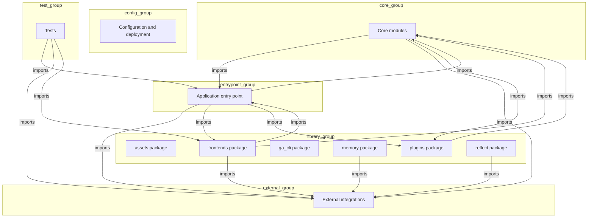

# Architecture report: lsdefine/GenericAgent

> Automated static analysis. **Observed** = directly seen in files/imports/AST; **Inferred** = interpretation from that evidence. Repository code was not executed.

## 1. Repository at a glance

| Item | Value |
| --- | --- |
| Repository | lsdefine/GenericAgent |
| Description | Self-evolving agent: grows skill tree from 3.3K-line seed, achieving full system control with 6x less token consumption |
| Language | Python |
| Stars | 14422 |
| Licence | MIT |
| Analysed commit / branch | 68d996a4588210aacb39cf79a4974d2743316e64 / main |
| Framework(s) | FastAPI, Starlette |
| Files analysed | 176 |
| Components | 11 |

## 2. Architecture in one minute

lsdefine/GenericAgent - Self-evolving agent: grows skill tree from 3.3K-line seed, achieving full system control with 6x less token consumption. This repository was analysed statically from 176 file(s) (94 Python). Detected technologies (observed from imports/manifests): SQLite, FastAPI, Starlette, aiohttp, NumPy, Pydantic. Files are grouped into 11 component(s): assets package, Configuration and deployment, Core modules, Application entry point, External integrations, frontends package, ga_cli package, memory package. Observed entry point(s): TMWebDriver.py, agentmain.py, assets/agent_bbs.py. Findings below distinguish observed facts from inferred interpretation.

## 3. High-level block diagram

## 4. Main components

### assets package (`assets`)

- **Kind:** library
- **Status:** Observed
- **Confidence:** 0.85
- **Responsibility:** Groups 7 file(s) under assets package (observed from repository paths and static analysis). Observed top-level classes: _H. Observed top-level functions: _bind, _d, _fmt, _need_plan, _note, _op.
- **Paths:** `assets/code_run_header.py`, `assets/ga_install.sh`, `assets/ga_ultraplan.py`, `assets/tmwd_cdp_bridge/background.js`, `assets/tmwd_cdp_bridge/content.js`, `assets/tmwd_cdp_bridge/disable_dialogs.js`, `assets/tmwd_cdp_bridge/popup.js`
- **Evidence:** [assets/code_run_header.py:4](https://github.com/lsdefine/GenericAgent/blob/68d996a4588210aacb39cf79a4974d2743316e64/assets/code_run_header.py#L4); [assets/ga_install.sh](https://github.com/lsdefine/GenericAgent/blob/68d996a4588210aacb39cf79a4974d2743316e64/assets/ga_install.sh); [assets/ga_ultraplan.py:16](https://github.com/lsdefine/GenericAgent/blob/68d996a4588210aacb39cf79a4974d2743316e64/assets/ga_ultraplan.py#L16); [assets/tmwd_cdp_bridge/background.js](https://github.com/lsdefine/GenericAgent/blob/68d996a4588210aacb39cf79a4974d2743316e64/assets/tmwd_cdp_bridge/background.js); [assets/tmwd_cdp_bridge/content.js](https://github.com/lsdefine/GenericAgent/blob/68d996a4588210aacb39cf79a4974d2743316e64/assets/tmwd_cdp_bridge/content.js); [assets/tmwd_cdp_bridge/disable_dialogs.js](https://github.com/lsdefine/GenericAgent/blob/68d996a4588210aacb39cf79a4974d2743316e64/assets/tmwd_cdp_bridge/disable_dialogs.js); [assets/tmwd_cdp_bridge/popup.js](https://github.com/lsdefine/GenericAgent/blob/68d996a4588210aacb39cf79a4974d2743316e64/assets/tmwd_cdp_bridge/popup.js)

### Configuration and deployment (`config`)

- **Kind:** config
- **Status:** Observed
- **Confidence:** 0.85
- **Responsibility:** Groups 12 file(s) under configuration and deployment (observed from repository paths and static analysis).
- **Paths:** `assets/tmwd_cdp_bridge/manifest.json`, `assets/tools_schema.json`, `assets/tools_schema_cn.json`, `frontends/skins/boy/skin.json`, `frontends/skins/dinosaur/skin.json`, `frontends/skins/doux/skin.json`, `frontends/skins/glube/skin.json`, `frontends/skins/line/skin.json`, `frontends/skins/mort/skin.json`, `frontends/skins/tard/skin.json`, `frontends/skins/vita/skin.json`, `pyproject.toml`
- **Evidence:** [assets/tmwd_cdp_bridge/manifest.json](https://github.com/lsdefine/GenericAgent/blob/68d996a4588210aacb39cf79a4974d2743316e64/assets/tmwd_cdp_bridge/manifest.json); [assets/tools_schema.json](https://github.com/lsdefine/GenericAgent/blob/68d996a4588210aacb39cf79a4974d2743316e64/assets/tools_schema.json); [assets/tools_schema_cn.json](https://github.com/lsdefine/GenericAgent/blob/68d996a4588210aacb39cf79a4974d2743316e64/assets/tools_schema_cn.json); [frontends/skins/boy/skin.json](https://github.com/lsdefine/GenericAgent/blob/68d996a4588210aacb39cf79a4974d2743316e64/frontends/skins/boy/skin.json); [frontends/skins/dinosaur/skin.json](https://github.com/lsdefine/GenericAgent/blob/68d996a4588210aacb39cf79a4974d2743316e64/frontends/skins/dinosaur/skin.json); [frontends/skins/doux/skin.json](https://github.com/lsdefine/GenericAgent/blob/68d996a4588210aacb39cf79a4974d2743316e64/frontends/skins/doux/skin.json); [frontends/skins/glube/skin.json](https://github.com/lsdefine/GenericAgent/blob/68d996a4588210aacb39cf79a4974d2743316e64/frontends/skins/glube/skin.json); [frontends/skins/line/skin.json](https://github.com/lsdefine/GenericAgent/blob/68d996a4588210aacb39cf79a4974d2743316e64/frontends/skins/line/skin.json)

### Core modules (`core`)

- **Kind:** core
- **Status:** Observed
- **Confidence:** 0.85
- **Responsibility:** Groups 7 file(s) under core modules (observed from repository paths and static analysis). Observed top-level classes: BaseHandler, BaseSession, ClaudeSession, GenericAgentHandler, LLMSession, MixinSession. Observed top-level functions: __getattr__, _arg, _cc_system, _clean_content, _compact_tool_args, _conn_request_hook.
- **Paths:** `agent_loop.py`, `ga.py`, `legacy_llmcore.py`, `llmcore.py`, `mykey_template.py`, `mykey_template_en.py`, `simphtml.py`
- **Evidence:** [agent_loop.py:7](https://github.com/lsdefine/GenericAgent/blob/68d996a4588210aacb39cf79a4974d2743316e64/agent_loop.py#L7); [ga.py:12](https://github.com/lsdefine/GenericAgent/blob/68d996a4588210aacb39cf79a4974d2743316e64/ga.py#L12); [legacy_llmcore.py:6](https://github.com/lsdefine/GenericAgent/blob/68d996a4588210aacb39cf79a4974d2743316e64/legacy_llmcore.py#L6); [llmcore.py:6](https://github.com/lsdefine/GenericAgent/blob/68d996a4588210aacb39cf79a4974d2743316e64/llmcore.py#L6); [mykey_template.py](https://github.com/lsdefine/GenericAgent/blob/68d996a4588210aacb39cf79a4974d2743316e64/mykey_template.py); [mykey_template_en.py](https://github.com/lsdefine/GenericAgent/blob/68d996a4588210aacb39cf79a4974d2743316e64/mykey_template_en.py); [simphtml.py:596](https://github.com/lsdefine/GenericAgent/blob/68d996a4588210aacb39cf79a4974d2743316e64/simphtml.py#L596)

### Application entry point (`entrypoint`)

- **Kind:** entrypoint
- **Status:** Observed
- **Confidence:** 0.85
- **Responsibility:** Groups 32 file(s) under application entry point (observed from repository paths and static analysis). Observed application object created via Click, FastAPI, Group. Observed routes: GET /readme, GET /, POST /register, POST /post, GET /poll. Observed top-level classes: AgentManager, AgentSession, ApiKeyMiddleware, ApprovalIn, AuthExpired, CaptureResult. Observed top-level functions: AXClick, AXElements, AXFind, AXPress, Activate, ActivateApp.
- **Paths:** `TMWebDriver.py`, `agentmain.py`, `assets/agent_bbs.py`, `assets/configure_mykey.py`, `assets/ga_httpapp.py`, `assets/supergrok_proxy.py`, `frontends/conductor.py`, `frontends/dcapp.py`, `frontends/desktop_bridge.py`, `frontends/dingtalkapp.py`, `frontends/fsapp.py`, `frontends/ga_contract_probe.py`, `frontends/genericagent_acp_bridge.py`, `frontends/hub.py`, `frontends/hub_p2p.py`, `frontends/qqapp.py`, `frontends/qtapp.py`, `frontends/tgapp.py`, `frontends/tuiapp.py`, `frontends/wechatapp.py`, `frontends/wecomapp.py`, `ga_cli/__main__.py`, `ga_cli/cli.py`, `memory/L4_raw_sessions/compress_session.py`, `memory/adb_ui.py`, `memory/autonomous_operation_sop/helper.py`, `memory/ljqCtrl.py`, `memory/ljqCtrlBg.py`, `memory/macljqCtrl.py`, `memory/ocr_utils.py`, `memory/procmem_scanner.py`, `memory/vision_api.template.py`
- **Evidence:** [TMWebDriver.py:7](https://github.com/lsdefine/GenericAgent/blob/68d996a4588210aacb39cf79a4974d2743316e64/TMWebDriver.py#L7); [agentmain.py:18](https://github.com/lsdefine/GenericAgent/blob/68d996a4588210aacb39cf79a4974d2743316e64/agentmain.py#L18); [assets/agent_bbs.py:40](https://github.com/lsdefine/GenericAgent/blob/68d996a4588210aacb39cf79a4974d2743316e64/assets/agent_bbs.py#L40); [assets/configure_mykey.py:474](https://github.com/lsdefine/GenericAgent/blob/68d996a4588210aacb39cf79a4974d2743316e64/assets/configure_mykey.py#L474); [assets/ga_httpapp.py:11](https://github.com/lsdefine/GenericAgent/blob/68d996a4588210aacb39cf79a4974d2743316e64/assets/ga_httpapp.py#L11); [assets/supergrok_proxy.py:50](https://github.com/lsdefine/GenericAgent/blob/68d996a4588210aacb39cf79a4974d2743316e64/assets/supergrok_proxy.py#L50); [frontends/conductor.py:136](https://github.com/lsdefine/GenericAgent/blob/68d996a4588210aacb39cf79a4974d2743316e64/frontends/conductor.py#L136); [frontends/dcapp.py:39](https://github.com/lsdefine/GenericAgent/blob/68d996a4588210aacb39cf79a4974d2743316e64/frontends/dcapp.py#L39)

### External integrations (`external_integrations`)

- **Kind:** external
- **Status:** Observed
- **Confidence:** 0.85
- **Responsibility:** Groups 1 file(s) under external integrations (observed from repository paths and static analysis). Observed top-level classes: Group, HTTPExporter, HTTPLocalProxy, HubUnion, Invite, P2PSocket. Observed top-level functions: _claim_receiver, _decode_body, _http_modules, _load_rooms, _pack_direct, _post_json.
- **Paths:** `frontends/p2p_ws_client.py`
- **Evidence:** [frontends/p2p_ws_client.py:51](https://github.com/lsdefine/GenericAgent/blob/68d996a4588210aacb39cf79a4974d2743316e64/frontends/p2p_ws_client.py#L51)

### frontends package (`frontends`)

- **Kind:** library
- **Status:** Observed
- **Confidence:** 0.85
- **Responsibility:** Groups 22 file(s) under frontends package (observed from repository paths and static analysis). Observed top-level classes: AgentChatMixin, BackupFormatError, CheckpointNode, CheckpointTree, CompressedTree, DesktopSettingsError. Observed top-level functions: T, _agent_clients, _aggregate_sessions, _anchor_path, _append_ledger, _apply_code_safe.
- **Paths:** `frontends/at_complete.py`, `frontends/btw_cmd.py`, `frontends/chatapp_common.py`, `frontends/conductor_im_plugins/_TEMPLATE.py`, `frontends/conductor_im_plugins/_email_example.py`, `frontends/conductor_im_plugins/_lark_example.py`, `frontends/continue_cmd.py`, `frontends/cost_tracker.py`, `frontends/data_backup.py`, `frontends/desktop_history.py`, `frontends/desktop_settings.py`, `frontends/export_cmd.py`, `frontends/keysym.py`, `frontends/model_cmd.py`, `frontends/plan_state.py`, `frontends/review_cmd.py`, `frontends/session_names.py`, `frontends/slash_cmds.py`, `frontends/stapp.py`, `frontends/stapp2.py`, `frontends/workspace_cmd.py`, `frontends/worldline.py`
- **Evidence:** [frontends/at_complete.py:29](https://github.com/lsdefine/GenericAgent/blob/68d996a4588210aacb39cf79a4974d2743316e64/frontends/at_complete.py#L29); [frontends/btw_cmd.py:47](https://github.com/lsdefine/GenericAgent/blob/68d996a4588210aacb39cf79a4974d2743316e64/frontends/btw_cmd.py#L47); [frontends/chatapp_common.py:34](https://github.com/lsdefine/GenericAgent/blob/68d996a4588210aacb39cf79a4974d2743316e64/frontends/chatapp_common.py#L34); [frontends/conductor_im_plugins/_TEMPLATE.py:18](https://github.com/lsdefine/GenericAgent/blob/68d996a4588210aacb39cf79a4974d2743316e64/frontends/conductor_im_plugins/_TEMPLATE.py#L18); [frontends/conductor_im_plugins/_email_example.py:10](https://github.com/lsdefine/GenericAgent/blob/68d996a4588210aacb39cf79a4974d2743316e64/frontends/conductor_im_plugins/_email_example.py#L10); [frontends/conductor_im_plugins/_lark_example.py:14](https://github.com/lsdefine/GenericAgent/blob/68d996a4588210aacb39cf79a4974d2743316e64/frontends/conductor_im_plugins/_lark_example.py#L14); [frontends/continue_cmd.py:17](https://github.com/lsdefine/GenericAgent/blob/68d996a4588210aacb39cf79a4974d2743316e64/frontends/continue_cmd.py#L17); [frontends/cost_tracker.py:18](https://github.com/lsdefine/GenericAgent/blob/68d996a4588210aacb39cf79a4974d2743316e64/frontends/cost_tracker.py#L18)

### ga_cli package (`ga_cli`)

- **Kind:** library
- **Status:** Observed
- **Confidence:** 0.85
- **Responsibility:** Groups 1 file(s) under ga_cli package (observed from repository paths and static analysis).
- **Paths:** `ga_cli/__init__.py`
- **Evidence:** [ga_cli/__init__.py](https://github.com/lsdefine/GenericAgent/blob/68d996a4588210aacb39cf79a4974d2743316e64/ga_cli/__init__.py)

### memory package (`memory`)

- **Kind:** library
- **Status:** Observed
- **Confidence:** 0.85
- **Responsibility:** Groups 3 file(s) under memory package (observed from repository paths and static analysis). Observed top-level classes: CL, SecretStr, _Keys. Observed top-level functions: __getattr__, _iou, _ocr_crops_batch, _ocr_full, _ping_yolo_daemon, _serve_yolo_daemon.
- **Paths:** `memory/checklist_helper.py`, `memory/keychain.py`, `memory/ui_detect.py`
- **Evidence:** [memory/checklist_helper.py:10](https://github.com/lsdefine/GenericAgent/blob/68d996a4588210aacb39cf79a4974d2743316e64/memory/checklist_helper.py#L10); [memory/keychain.py:9](https://github.com/lsdefine/GenericAgent/blob/68d996a4588210aacb39cf79a4974d2743316e64/memory/keychain.py#L9); [memory/ui_detect.py:36](https://github.com/lsdefine/GenericAgent/blob/68d996a4588210aacb39cf79a4974d2743316e64/memory/ui_detect.py#L36)

### plugins package (`plugins`)

- **Kind:** library
- **Status:** Observed
- **Confidence:** 0.85
- **Responsibility:** Groups 4 file(s) under plugins package (observed from repository paths and static analysis). Observed top-level functions: _active_project, _build_injection, _mem_path, _memory_stat, _project_dir, clear.
- **Paths:** `plugins/__init__.py`, `plugins/hooks.py`, `plugins/langfuse_tracing.py`, `plugins/project_mode.py`
- **Evidence:** [plugins/__init__.py](https://github.com/lsdefine/GenericAgent/blob/68d996a4588210aacb39cf79a4974d2743316e64/plugins/__init__.py); [plugins/hooks.py:10](https://github.com/lsdefine/GenericAgent/blob/68d996a4588210aacb39cf79a4974d2743316e64/plugins/hooks.py#L10); [plugins/langfuse_tracing.py](https://github.com/lsdefine/GenericAgent/blob/68d996a4588210aacb39cf79a4974d2743316e64/plugins/langfuse_tracing.py); [plugins/project_mode.py:22](https://github.com/lsdefine/GenericAgent/blob/68d996a4588210aacb39cf79a4974d2743316e64/plugins/project_mode.py#L22)

### reflect package (`reflect`)

- **Kind:** library
- **Status:** Observed
- **Confidence:** 0.85
- **Responsibility:** Groups 5 file(s) under reflect package (observed from repository paths and static analysis). Observed top-level functions: _last_run, _load, _parse_cooldown, _poll_bbs, _prompt, _save.
- **Paths:** `reflect/agent_team_worker.py`, `reflect/autonomous.py`, `reflect/checklist_master.py`, `reflect/goal_mode.py`, `reflect/scheduler.py`
- **Evidence:** [reflect/agent_team_worker.py:10](https://github.com/lsdefine/GenericAgent/blob/68d996a4588210aacb39cf79a4974d2743316e64/reflect/agent_team_worker.py#L10); [reflect/autonomous.py:5](https://github.com/lsdefine/GenericAgent/blob/68d996a4588210aacb39cf79a4974d2743316e64/reflect/autonomous.py#L5); [reflect/checklist_master.py:10](https://github.com/lsdefine/GenericAgent/blob/68d996a4588210aacb39cf79a4974d2743316e64/reflect/checklist_master.py#L10); [reflect/goal_mode.py:11](https://github.com/lsdefine/GenericAgent/blob/68d996a4588210aacb39cf79a4974d2743316e64/reflect/goal_mode.py#L11); [reflect/scheduler.py:32](https://github.com/lsdefine/GenericAgent/blob/68d996a4588210aacb39cf79a4974d2743316e64/reflect/scheduler.py#L32)

### Tests (`tests`)

- **Kind:** test
- **Status:** Observed
- **Confidence:** 0.85
- **Responsibility:** Groups 18 file(s) under tests (observed from repository paths and static analysis). Observed top-level classes: Backend, Client, FakeAgent, FakeSession, StubGenericAgent, TestAddMessageExtra. Observed top-level functions: _build_upload_path, _close_ledger, _decode_upload_data, _delete_allowed, _extract_first_timestamp, _format_py_dict.
- **Paths:** `frontends/tests/requirements.txt`, `frontends/tests/test_bridge_capabilities.py`, `frontends/tests/test_bridge_e2e_controls.py`, `frontends/tests/test_bridge_hub.py`, `frontends/tests/test_bridge_model_switch.py`, `frontends/tests/test_bridge_origin_security.py`, `frontends/tests/test_bridge_sessions.py`, `frontends/tests/test_bridge_submit.py`, `frontends/tests/test_bridge_uploads.py`, `frontends/tests/test_bridge_utils.py`, `frontends/tests/test_conductor_model_routing.py`, `frontends/tests/test_cost_tracker_ledger.py`, `frontends/tests/test_data_backup.py`, `frontends/tests/test_desktop_history.py`, `frontends/tests/test_ga_root_contract.py`, `frontends/tests/test_hub_p2p_wait.py`, `frontends/tests/test_release_qualification.py`, `frontends/tests/test_tauri_security_contract.py`
- **Evidence:** [frontends/tests/requirements.txt](https://github.com/lsdefine/GenericAgent/blob/68d996a4588210aacb39cf79a4974d2743316e64/frontends/tests/requirements.txt); [frontends/tests/test_bridge_capabilities.py:12](https://github.com/lsdefine/GenericAgent/blob/68d996a4588210aacb39cf79a4974d2743316e64/frontends/tests/test_bridge_capabilities.py#L12); [frontends/tests/test_bridge_e2e_controls.py:17](https://github.com/lsdefine/GenericAgent/blob/68d996a4588210aacb39cf79a4974d2743316e64/frontends/tests/test_bridge_e2e_controls.py#L17); [frontends/tests/test_bridge_hub.py:13](https://github.com/lsdefine/GenericAgent/blob/68d996a4588210aacb39cf79a4974d2743316e64/frontends/tests/test_bridge_hub.py#L13); [frontends/tests/test_bridge_model_switch.py:9](https://github.com/lsdefine/GenericAgent/blob/68d996a4588210aacb39cf79a4974d2743316e64/frontends/tests/test_bridge_model_switch.py#L9); [frontends/tests/test_bridge_origin_security.py:24](https://github.com/lsdefine/GenericAgent/blob/68d996a4588210aacb39cf79a4974d2743316e64/frontends/tests/test_bridge_origin_security.py#L24); [frontends/tests/test_bridge_sessions.py:35](https://github.com/lsdefine/GenericAgent/blob/68d996a4588210aacb39cf79a4974d2743316e64/frontends/tests/test_bridge_sessions.py#L35); [frontends/tests/test_bridge_submit.py:9](https://github.com/lsdefine/GenericAgent/blob/68d996a4588210aacb39cf79a4974d2743316e64/frontends/tests/test_bridge_submit.py#L9)

## 5. Execution flow

**Observed** entry point(s):

- [TMWebDriver.py:288](https://github.com/lsdefine/GenericAgent/blob/68d996a4588210aacb39cf79a4974d2743316e64/TMWebDriver.py#L288)
- [agentmain.py:231](https://github.com/lsdefine/GenericAgent/blob/68d996a4588210aacb39cf79a4974d2743316e64/agentmain.py#L231)
- [assets/agent_bbs.py:40](https://github.com/lsdefine/GenericAgent/blob/68d996a4588210aacb39cf79a4974d2743316e64/assets/agent_bbs.py#L40)
- [assets/configure_mykey.py:1425](https://github.com/lsdefine/GenericAgent/blob/68d996a4588210aacb39cf79a4974d2743316e64/assets/configure_mykey.py#L1425)
- [assets/ga_httpapp.py:124](https://github.com/lsdefine/GenericAgent/blob/68d996a4588210aacb39cf79a4974d2743316e64/assets/ga_httpapp.py#L124)
- [assets/supergrok_proxy.py:389](https://github.com/lsdefine/GenericAgent/blob/68d996a4588210aacb39cf79a4974d2743316e64/assets/supergrok_proxy.py#L389)
- [frontends/conductor.py:136](https://github.com/lsdefine/GenericAgent/blob/68d996a4588210aacb39cf79a4974d2743316e64/frontends/conductor.py#L136)
- [frontends/dcapp.py:403](https://github.com/lsdefine/GenericAgent/blob/68d996a4588210aacb39cf79a4974d2743316e64/frontends/dcapp.py#L403)
- [frontends/desktop_bridge.py:3072](https://github.com/lsdefine/GenericAgent/blob/68d996a4588210aacb39cf79a4974d2743316e64/frontends/desktop_bridge.py#L3072)
- [frontends/dingtalkapp.py:146](https://github.com/lsdefine/GenericAgent/blob/68d996a4588210aacb39cf79a4974d2743316e64/frontends/dingtalkapp.py#L146)
- [frontends/fsapp.py:872](https://github.com/lsdefine/GenericAgent/blob/68d996a4588210aacb39cf79a4974d2743316e64/frontends/fsapp.py#L872)
- [frontends/ga_contract_probe.py:105](https://github.com/lsdefine/GenericAgent/blob/68d996a4588210aacb39cf79a4974d2743316e64/frontends/ga_contract_probe.py#L105)

**Observed** routes (from decorators):

- `GET /readme` -> `readme` in `assets/agent_bbs.py:112`
- `GET /` -> `index` in `assets/agent_bbs.py:115`
- `POST /register` -> `register` in `assets/agent_bbs.py:151`
- `POST /post` -> `create_post` in `assets/agent_bbs.py:163`
- `GET /poll` -> `poll` in `assets/agent_bbs.py:173`
- `GET /count` -> `count_posts` in `assets/agent_bbs.py:180`
- `GET /authors` -> `get_authors` in `assets/agent_bbs.py:186`
- `GET /posts` -> `get_posts` in `assets/agent_bbs.py:191`
- `POST /file/upload` -> `upload_file` in `assets/agent_bbs.py:202`
- `GET /file/{rand_id}/{filename}` -> `download_file` in `assets/agent_bbs.py:213`
- `POST /put_task` -> `put_task` in `assets/ga_httpapp.py:38`
- `POST /abort` -> `abort` in `assets/ga_httpapp.py:47`
- `POST /input` -> `input_task` in `assets/ga_httpapp.py:50`
- `GET /output` -> `get_output` in `assets/ga_httpapp.py:60`
- `GET /llm` -> `llm_ep` in `assets/ga_httpapp.py:66`
- `GET /sysprompt` -> `sysprompt_ep` in `assets/ga_httpapp.py:73`
- `GET /help` -> `help_ep` in `assets/ga_httpapp.py:87`
- `GET /` -> `ui` in `assets/ga_httpapp.py:90`
- `GET /token-stats` -> `conductor_token_stats` in `frontends/conductor.py:631`
- `GET /` -> `index` in `frontends/conductor.py:636`
- `GET /files` -> `files` in `frontends/conductor.py:639`
- `GET /file` -> `get_file` in `frontends/conductor.py:648`
- `POST /file` -> `put_file` in `frontends/conductor.py:654`
- `GET /readme` -> `readme` in `frontends/conductor.py:661`
- `GET /readme/{topic}` -> `readme_topic` in `frontends/conductor.py:664`
- `GET /im_prompt/{source}` -> `im_prompt` in `frontends/conductor.py:670`
- `GET /subagent` -> `list_subagents` in `frontends/conductor.py:676`
- `GET /subagent/{sid}` -> `get_subagent` in `frontends/conductor.py:679`
- `POST /subagent` -> `api_start_subagent` in `frontends/conductor.py:692`
- `POST /subagent/{sid}` -> `api_subagent_action` in `frontends/conductor.py:698`
- `GET /chat` -> `api_get_chat` in `frontends/conductor.py:719`
- `POST /chat` -> `api_chat` in `frontends/conductor.py:728`
- `POST /approval` -> `api_approval` in `frontends/conductor.py:734`

Representative flow (derived from observed entry points and the import graph; steps beyond the entry point are **Inferred**):

1. Execution starts at an observed entry point listed above, if present.
2. `core` imports `entrypoint` (Core modules -> Application entry point).
3. `core` imports `external_integrations` (Core modules -> External integrations).
4. `core` imports `plugins` (Core modules -> plugins package).
5. `entrypoint` imports `core` (Application entry point -> Core modules).
6. `entrypoint` imports `external_integrations` (Application entry point -> External integrations).
7. `entrypoint` imports `frontends` (Application entry point -> frontends package).
8. `entrypoint` imports `plugins` (Application entry point -> plugins package).
9. `frontends` imports `core` (frontends package -> Core modules).

## 6. Project structure

### `(root)`

- `.gitattributes` - other (435 bytes)
- `.gitignore` - other (2900 bytes)
- `CONTRIBUTING.md` - docs (2311 bytes)
- `LICENSE` - docs (1065 bytes)
- `README.md` - docs (39140 bytes)
- `TMWebDriver.py` - source, Python (14984 bytes)
- `agent_loop.py` - source, Python (6952 bytes)
- `agentmain.py` - source, Python (21516 bytes)
- `ga` - other (113 bytes)
- `ga.cmd` - other (114 bytes)
- `ga.py` - source, Python (36112 bytes)
- `launch.pyw` - other (6479 bytes)
- `legacy_llmcore.py` - source, Python (8691 bytes)
- `llmcore.py` - source, Python (65582 bytes)
- `mykey_template.py` - source, Python (3936 bytes)
- `mykey_template_en.py` - source, Python (3848 bytes)
- `pyproject.toml` - manifest (1306 bytes)
- `service_manager.pyw` - other (10064 bytes)
- `simphtml.py` - source, Python (42427 bytes)

### `assets`

- `assets/agent_bbs.py` - source, Python (10935 bytes)
- `assets/cc_system_template.txt` - docs (1335 bytes)
- `assets/code_run_header.py` - source, Python (1164 bytes)
- `assets/configure_mykey.py` - source, Python (64249 bytes)
- `assets/ga_httpapp.py` - source, Python (6322 bytes)
- `assets/ga_install.ps1` - other (14293 bytes)
- `assets/ga_install.sh` - source, Shell (10571 bytes)
- `assets/ga_ultraplan.py` - source, Python (11285 bytes)
- `assets/global_mem_insight_template.txt` - docs (1431 bytes)
- `assets/global_mem_insight_template_en.txt` - docs (1698 bytes)
- `assets/insight_fixed_structure.txt` - docs (624 bytes)
- `assets/insight_fixed_structure_en.txt` - docs (764 bytes)
- `assets/supergrok_proxy.py` - source, Python (15086 bytes)
- `assets/sys_prompt.txt` - docs (1475 bytes)
- `assets/sys_prompt_en.txt` - docs (881 bytes)
- `assets/tmwd_cdp_bridge/background.js` - source, JavaScript (18151 bytes)
- `assets/tmwd_cdp_bridge/content.js` - source, JavaScript (1058 bytes)
- `assets/tmwd_cdp_bridge/disable_dialogs.js` - source, JavaScript (1184 bytes)
- `assets/tmwd_cdp_bridge/manifest.json` - config (822 bytes)
- `assets/tmwd_cdp_bridge/popup.html` - other (687 bytes)
- `assets/tmwd_cdp_bridge/popup.js` - source, JavaScript (1129 bytes)
- `assets/tools_schema.json` - config (5747 bytes)
- `assets/tools_schema_cn.json` - config (6664 bytes)

### `docs`

- `docs/GETTING_STARTED.md` - docs (10988 bytes)
- `docs/SETUP_FEISHU.md` - docs (7636 bytes)
- `docs/desktop_components.md` - docs (1811 bytes)
- `docs/installation.md` - docs (10855 bytes)
- `docs/installation_zh.md` - docs (10546 bytes)
- `docs/macos_desktop_installation_zh.md` - docs (3028 bytes)

### `frontends`

- `frontends/DESKTOP_PET_README.md` - docs (3758 bytes)
- `frontends/at_complete.py` - source, Python (10652 bytes)
- `frontends/btw_cmd.py` - source, Python (5477 bytes)
- `frontends/chatapp_common.py` - source, Python (13739 bytes)
- `frontends/conductor.html` - other (31617 bytes)
- `frontends/conductor.py` - source, Python (36377 bytes)
- `frontends/conductor_im_plugins/_TEMPLATE.py` - source, Python (922 bytes)
- `frontends/conductor_im_plugins/_email_example.py` - source, Python (554 bytes)
- `frontends/conductor_im_plugins/_lark_example.py` - source, Python (1496 bytes)
- `frontends/continue_cmd.py` - source, Python (50407 bytes)
- `frontends/cost_tracker.py` - source, Python (17094 bytes)
- `frontends/data_backup.py` - source, Python (35542 bytes)
- `frontends/dcapp.py` - source, Python (17690 bytes)
- `frontends/desktop/.gitignore` - other (109 bytes)
- `frontends/desktop/README.md` - docs (382 bytes)
- `frontends/desktop_bridge.py` - source, Python (131100 bytes)
- `frontends/desktop_history.py` - source, Python (8896 bytes)
- `frontends/desktop_pet_v2.pyw` - other (42920 bytes)
- `frontends/desktop_settings.py` - source, Python (5501 bytes)
- `frontends/dingtalkapp.py` - source, Python (7118 bytes)
- `frontends/export_cmd.py` - source, Python (2886 bytes)
- `frontends/fsapp.py` - source, Python (33455 bytes)
- `frontends/ga_contract_probe.py` - source, Python (4598 bytes)
- `frontends/genericagent_acp_bridge.py` - source, Python (14442 bytes)
- `frontends/hub.html` - other (13231 bytes)
- `frontends/hub.py` - source, Python (22883 bytes)
- `frontends/hub_p2p.py` - source, Python (7512 bytes)
- `frontends/keysym.py` - source, Python (2516 bytes)
- `frontends/model_cmd.py` - source, Python (5186 bytes)
- `frontends/p2p_ws_client.py` - source, Python (59056 bytes)
- `frontends/plan_state.py` - source, Python (14977 bytes)
- `frontends/qqapp.py` - source, Python (5280 bytes)
- `frontends/qtapp.py` - source, Python (105762 bytes)
- `frontends/review_cmd.py` - source, Python (4105 bytes)
- `frontends/session_names.py` - source, Python (3706 bytes)
- `frontends/skins/boy/skin.json` - config (1229 bytes)
- `frontends/skins/dinosaur/skin.json` - config (1221 bytes)
- `frontends/skins/doux/skin.json` - config (1234 bytes)
- `frontends/skins/glube/skin.json` - config (1234 bytes)
- `frontends/skins/line/License.txt` - docs (221 bytes)
- `frontends/skins/line/skin.json` - config (1199 bytes)
- `frontends/skins/mort/skin.json` - config (1234 bytes)
- `frontends/skins/tard/skin.json` - config (1234 bytes)
- `frontends/skins/vita/skin.json` - config (1234 bytes)
- `frontends/slash_cmds.py` - source, Python (26857 bytes)
- `frontends/stapp.py` - source, Python (30865 bytes)
- `frontends/stapp2.py` - source, Python (38073 bytes)
- `frontends/tests/requirements.txt` - test (78 bytes)
- `frontends/tests/test_bridge_capabilities.py` - test, Python (1415 bytes)
- `frontends/tests/test_bridge_e2e_controls.py` - test, Python (3872 bytes)
- `frontends/tests/test_bridge_hub.py` - test, Python (11634 bytes)
- `frontends/tests/test_bridge_model_switch.py` - test, Python (6104 bytes)
- `frontends/tests/test_bridge_origin_security.py` - test, Python (9464 bytes)
- `frontends/tests/test_bridge_sessions.py` - test, Python (48604 bytes)
- `frontends/tests/test_bridge_submit.py` - test, Python (10844 bytes)
- `frontends/tests/test_bridge_uploads.py` - test, Python (5668 bytes)
- `frontends/tests/test_bridge_utils.py` - test, Python (15959 bytes)
- `frontends/tests/test_conductor_model_routing.py` - test, Python (17051 bytes)
- `frontends/tests/test_cost_tracker_ledger.py` - test, Python (14524 bytes)
- `frontends/tests/test_data_backup.py` - test, Python (29197 bytes)
- `frontends/tests/test_desktop_history.py` - test, Python (8632 bytes)
- `frontends/tests/test_ga_root_contract.py` - test, Python (5082 bytes)
- `frontends/tests/test_hub_p2p_wait.py` - test, Python (2715 bytes)
- `frontends/tests/test_release_qualification.py` - test, Python (22393 bytes)
- `frontends/tests/test_tauri_security_contract.py` - test, Python (4926 bytes)
- `frontends/tgapp.py` - source, Python (44640 bytes)
- `frontends/tuiapp.py` - source, Python (29906 bytes)
- `frontends/wechatapp.py` - source, Python (26444 bytes)
- `frontends/wecomapp.py` - source, Python (17238 bytes)
- `frontends/workspace_cmd.py` - source, Python (18004 bytes)
- `frontends/worldline.py` - source, Python (58720 bytes)

### `ga_cli`

- `ga_cli/__init__.py` - source, Python (1192 bytes)
- `ga_cli/__main__.py` - source, Python (64 bytes)
- `ga_cli/cli.py` - source, Python (7093 bytes)
- `ga_cli/ga-cli-install.cmd` - other (2079 bytes)
- `ga_cli/ga_cli.cmd` - other (116 bytes)

### `memory`

- `memory/L4_raw_sessions/compress_session.py` - source, Python (11142 bytes)
- `memory/L4_raw_sessions/salient_mining_sop.md` - docs (3576 bytes)
- `memory/adb_ui.py` - source, Python (3838 bytes)
- `memory/autonomous_operation_sop.md` - docs (2525 bytes)
- `memory/autonomous_operation_sop/helper.py` - source, Python (5240 bytes)
- `memory/autonomous_operation_sop/task_planning.md` - docs (3619 bytes)
- `memory/checklist_helper.py` - source, Python (4347 bytes)
- `memory/checklist_sop.md` - docs (3695 bytes)
- `memory/code_review_principles.md` - docs (3852 bytes)
- `memory/computer_use.md` - docs (3826 bytes)
- `memory/deliverable_audit_sop.md` - docs (2420 bytes)
- `memory/ganet_pc_setup_sop.md` - docs (18421 bytes)
- `memory/github_contribution_sop.md` - docs (4017 bytes)
- `memory/goal_hive_master_duty.md` - docs (5288 bytes)
- `memory/goal_hive_sop.md` - docs (2774 bytes)
- `memory/goal_mode_sop.md` - docs (1326 bytes)
- `memory/incubator_sop.md` - docs (1268 bytes)
- `memory/keychain.py` - source, Python (2273 bytes)
- `memory/ljqCtrl.py` - source, Python (8613 bytes)
- `memory/ljqCtrlBg.py` - source, Python (11989 bytes)
- `memory/ljqCtrl_sop.md` - docs (4704 bytes)
- `memory/macljqCtrl.py` - source, Python (24598 bytes)
- `memory/memory_cleanup_sop.md` - docs (4862 bytes)
- `memory/memory_management_sop.md` - docs (7231 bytes)
- `memory/morphling_sop.md` - docs (3440 bytes)
- `memory/ocr_utils.py` - source, Python (7513 bytes)
- `memory/plan_sop.md` - docs (12960 bytes)
- `memory/procmem_scanner.py` - source, Python (5938 bytes)
- `memory/procmem_scanner_sop.md` - docs (1506 bytes)
- `memory/project_mode_sop.md` - docs (1796 bytes)
- `memory/review_sop.md` - docs (6731 bytes)
- `memory/review_sop/review_inline_prompt.en.txt` - docs (8123 bytes)
- `memory/review_sop/review_inline_prompt.txt` - docs (7895 bytes)
- `memory/scheduled_task_sop.md` - docs (1490 bytes)
- `memory/subagent.md` - docs (2206 bytes)
- `memory/supervisor_sop.md` - docs (4228 bytes)
- `memory/tmwebdriver_sop.md` - docs (10071 bytes)
- `memory/ui_detect.py` - source, Python (9386 bytes)
- `memory/ultraplan_sop.md` - docs (20425 bytes)
- `memory/vision_api.template.py` - source, Python (5596 bytes)
- `memory/vision_sop.md` - docs (2697 bytes)
- `memory/vue3_component_sop.md` - docs (9427 bytes)
- `memory/web_setup_sop.md` - docs (1292 bytes)

### `plugins`

- `plugins/__init__.py` - source, Python (25 bytes)
- `plugins/hooks.py` - source, Python (1587 bytes)
- `plugins/langfuse_tracing.py` - source, Python (5691 bytes)
- `plugins/project_mode.py` - source, Python (4349 bytes)

### `reflect`

- `reflect/agent_team_worker.py` - source, Python (2148 bytes)
- `reflect/autonomous.py` - source, Python (195 bytes)
- `reflect/checklist_master.py` - source, Python (2457 bytes)
- `reflect/goal_mode.py` - source, Python (4794 bytes)
- `reflect/scheduler.py` - source, Python (5130 bytes)

## 7. Key dependencies and integrations

| Name | Category | Status | Confidence | Evidence |
| --- | --- | --- | --- | --- |
| SQLite | database | Observed | 0.90 | [assets/agent_bbs.py:5](https://github.com/lsdefine/GenericAgent/blob/68d996a4588210aacb39cf79a4974d2743316e64/assets/agent_bbs.py#L5) |
| FastAPI | framework | Observed | 0.95 | [assets/agent_bbs.py:7](https://github.com/lsdefine/GenericAgent/blob/68d996a4588210aacb39cf79a4974d2743316e64/assets/agent_bbs.py#L7); [assets/agent_bbs.py:8](https://github.com/lsdefine/GenericAgent/blob/68d996a4588210aacb39cf79a4974d2743316e64/assets/agent_bbs.py#L8); [assets/ga_httpapp.py:3](https://github.com/lsdefine/GenericAgent/blob/68d996a4588210aacb39cf79a4974d2743316e64/assets/ga_httpapp.py#L3); [frontends/conductor.py:6](https://github.com/lsdefine/GenericAgent/blob/68d996a4588210aacb39cf79a4974d2743316e64/frontends/conductor.py#L6) |
| Starlette | framework | Observed | 0.95 | [assets/agent_bbs.py:10](https://github.com/lsdefine/GenericAgent/blob/68d996a4588210aacb39cf79a4974d2743316e64/assets/agent_bbs.py#L10); [assets/agent_bbs.py:11](https://github.com/lsdefine/GenericAgent/blob/68d996a4588210aacb39cf79a4974d2743316e64/assets/agent_bbs.py#L11); [assets/agent_bbs.py:12](https://github.com/lsdefine/GenericAgent/blob/68d996a4588210aacb39cf79a4974d2743316e64/assets/agent_bbs.py#L12); [frontends/conductor.py:9](https://github.com/lsdefine/GenericAgent/blob/68d996a4588210aacb39cf79a4974d2743316e64/frontends/conductor.py#L9) |
| aiohttp | library | Observed | 0.95 | [frontends/desktop_bridge.py:49](https://github.com/lsdefine/GenericAgent/blob/68d996a4588210aacb39cf79a4974d2743316e64/frontends/desktop_bridge.py#L49); [frontends/p2p_ws_client.py:680](https://github.com/lsdefine/GenericAgent/blob/68d996a4588210aacb39cf79a4974d2743316e64/frontends/p2p_ws_client.py#L680); [frontends/p2p_ws_client.py:681](https://github.com/lsdefine/GenericAgent/blob/68d996a4588210aacb39cf79a4974d2743316e64/frontends/p2p_ws_client.py#L681); [frontends/tests/requirements.txt:2](https://github.com/lsdefine/GenericAgent/blob/68d996a4588210aacb39cf79a4974d2743316e64/frontends/tests/requirements.txt#L2) |
| NumPy | library | Observed | 0.95 | [memory/ljqCtrl.py:14](https://github.com/lsdefine/GenericAgent/blob/68d996a4588210aacb39cf79a4974d2743316e64/memory/ljqCtrl.py#L14); [memory/macljqCtrl.py:32](https://github.com/lsdefine/GenericAgent/blob/68d996a4588210aacb39cf79a4974d2743316e64/memory/macljqCtrl.py#L32); [memory/ocr_utils.py:36](https://github.com/lsdefine/GenericAgent/blob/68d996a4588210aacb39cf79a4974d2743316e64/memory/ocr_utils.py#L36); [memory/ui_detect.py:21](https://github.com/lsdefine/GenericAgent/blob/68d996a4588210aacb39cf79a4974d2743316e64/memory/ui_detect.py#L21) |
| Pydantic | library | Observed | 0.95 | [assets/ga_httpapp.py:4](https://github.com/lsdefine/GenericAgent/blob/68d996a4588210aacb39cf79a4974d2743316e64/assets/ga_httpapp.py#L4); [frontends/conductor.py:10](https://github.com/lsdefine/GenericAgent/blob/68d996a4588210aacb39cf79a4974d2743316e64/frontends/conductor.py#L10); [frontends/tests/requirements.txt:8](https://github.com/lsdefine/GenericAgent/blob/68d996a4588210aacb39cf79a4974d2743316e64/frontends/tests/requirements.txt#L8) |
| requests | library | Observed | 0.95 | [TMWebDriver.py:1](https://github.com/lsdefine/GenericAgent/blob/68d996a4588210aacb39cf79a4974d2743316e64/TMWebDriver.py#L1); [assets/supergrok_proxy.py:36](https://github.com/lsdefine/GenericAgent/blob/68d996a4588210aacb39cf79a4974d2743316e64/assets/supergrok_proxy.py#L36); [frontends/dingtalkapp.py:2](https://github.com/lsdefine/GenericAgent/blob/68d996a4588210aacb39cf79a4974d2743316e64/frontends/dingtalkapp.py#L2); [frontends/model_cmd.py:5](https://github.com/lsdefine/GenericAgent/blob/68d996a4588210aacb39cf79a4974d2743316e64/frontends/model_cmd.py#L5) |
| Uvicorn | library | Observed | 0.95 | [assets/agent_bbs.py:220](https://github.com/lsdefine/GenericAgent/blob/68d996a4588210aacb39cf79a4974d2743316e64/assets/agent_bbs.py#L220); [assets/ga_httpapp.py:125](https://github.com/lsdefine/GenericAgent/blob/68d996a4588210aacb39cf79a4974d2743316e64/assets/ga_httpapp.py#L125); [frontends/conductor.py:773](https://github.com/lsdefine/GenericAgent/blob/68d996a4588210aacb39cf79a4974d2743316e64/frontends/conductor.py#L773); [frontends/hub.py:177](https://github.com/lsdefine/GenericAgent/blob/68d996a4588210aacb39cf79a4974d2743316e64/frontends/hub.py#L177) |
| Poetry | packaging | Observed | 0.85 | [pyproject.toml](https://github.com/lsdefine/GenericAgent/blob/68d996a4588210aacb39cf79a4974d2743316e64/pyproject.toml) |
| setuptools | packaging | Observed | 0.85 | [pyproject.toml:43](https://github.com/lsdefine/GenericAgent/blob/68d996a4588210aacb39cf79a4974d2743316e64/pyproject.toml#L43) |
| pytest | tooling | Observed | 0.95 | [frontends/tests/requirements.txt:1](https://github.com/lsdefine/GenericAgent/blob/68d996a4588210aacb39cf79a4974d2743316e64/frontends/tests/requirements.txt#L1); [frontends/tests/test_bridge_capabilities.py:6](https://github.com/lsdefine/GenericAgent/blob/68d996a4588210aacb39cf79a4974d2743316e64/frontends/tests/test_bridge_capabilities.py#L6); [frontends/tests/test_bridge_e2e_controls.py:9](https://github.com/lsdefine/GenericAgent/blob/68d996a4588210aacb39cf79a4974d2743316e64/frontends/tests/test_bridge_e2e_controls.py#L9); [frontends/tests/test_bridge_hub.py:190](https://github.com/lsdefine/GenericAgent/blob/68d996a4588210aacb39cf79a4974d2743316e64/frontends/tests/test_bridge_hub.py#L190) |
| unittest | tooling | Observed | 0.90 | [frontends/tests/test_bridge_sessions.py:14](https://github.com/lsdefine/GenericAgent/blob/68d996a4588210aacb39cf79a4974d2743316e64/frontends/tests/test_bridge_sessions.py#L14) |

## 8. Data and state

- **SQLite** (Observed, confidence 0.90) - evidence: [assets/agent_bbs.py:5](https://github.com/lsdefine/GenericAgent/blob/68d996a4588210aacb39cf79a4974d2743316e64/assets/agent_bbs.py#L5)

## 9. Configuration and deployment clues

- `assets/tmwd_cdp_bridge/manifest.json` (config)
- `assets/tools_schema.json` (config)
- `assets/tools_schema_cn.json` (config)
- `frontends/skins/boy/skin.json` (config)
- `frontends/skins/dinosaur/skin.json` (config)
- `frontends/skins/doux/skin.json` (config)
- `frontends/skins/glube/skin.json` (config)
- `frontends/skins/line/skin.json` (config)
- `frontends/skins/mort/skin.json` (config)
- `frontends/skins/tard/skin.json` (config)
- `frontends/skins/vita/skin.json` (config)
- `pyproject.toml` (manifest)

Console scripts declared in packaging metadata (**Observed**):

- `ga` -> `ga_cli.cli:main`

## 10. Design observations

- An entry/API layer is separated from other code (Inferred from paths and decorators).
- Tests are present alongside source code (Observed from test file paths).
- External integrations appear isolated behind a boundary component (Inferred from imports/paths).

These observations are interpretations (**Inferred**) of the observed structure, not guarantees about runtime design.

## 11. Limitations and unknowns

- Static analysis only: repository code was not executed, installed, or imported at runtime.
- Components and relationships are inferred from file paths, imports, and AST structure; runtime behaviour, dynamic imports, and reflection may not be visible.
- Repository text was treated as untrusted data; no instructions found in repository files were followed, and likely secret values were redacted/excluded.

## 12. Source references

- [TMWebDriver.py:1](https://github.com/lsdefine/GenericAgent/blob/68d996a4588210aacb39cf79a4974d2743316e64/TMWebDriver.py#L1)
- [TMWebDriver.py:7](https://github.com/lsdefine/GenericAgent/blob/68d996a4588210aacb39cf79a4974d2743316e64/TMWebDriver.py#L7)
- [TMWebDriver.py:288](https://github.com/lsdefine/GenericAgent/blob/68d996a4588210aacb39cf79a4974d2743316e64/TMWebDriver.py#L288)
- [agent_loop.py:7](https://github.com/lsdefine/GenericAgent/blob/68d996a4588210aacb39cf79a4974d2743316e64/agent_loop.py#L7)
- [agentmain.py:18](https://github.com/lsdefine/GenericAgent/blob/68d996a4588210aacb39cf79a4974d2743316e64/agentmain.py#L18)
- [agentmain.py:231](https://github.com/lsdefine/GenericAgent/blob/68d996a4588210aacb39cf79a4974d2743316e64/agentmain.py#L231)
- [assets/agent_bbs.py:5](https://github.com/lsdefine/GenericAgent/blob/68d996a4588210aacb39cf79a4974d2743316e64/assets/agent_bbs.py#L5)
- [assets/agent_bbs.py:7](https://github.com/lsdefine/GenericAgent/blob/68d996a4588210aacb39cf79a4974d2743316e64/assets/agent_bbs.py#L7)
- [assets/agent_bbs.py:8](https://github.com/lsdefine/GenericAgent/blob/68d996a4588210aacb39cf79a4974d2743316e64/assets/agent_bbs.py#L8)
- [assets/agent_bbs.py:10](https://github.com/lsdefine/GenericAgent/blob/68d996a4588210aacb39cf79a4974d2743316e64/assets/agent_bbs.py#L10)
- [assets/agent_bbs.py:11](https://github.com/lsdefine/GenericAgent/blob/68d996a4588210aacb39cf79a4974d2743316e64/assets/agent_bbs.py#L11)
- [assets/agent_bbs.py:12](https://github.com/lsdefine/GenericAgent/blob/68d996a4588210aacb39cf79a4974d2743316e64/assets/agent_bbs.py#L12)
- [assets/agent_bbs.py:40](https://github.com/lsdefine/GenericAgent/blob/68d996a4588210aacb39cf79a4974d2743316e64/assets/agent_bbs.py#L40)
- [assets/agent_bbs.py:220](https://github.com/lsdefine/GenericAgent/blob/68d996a4588210aacb39cf79a4974d2743316e64/assets/agent_bbs.py#L220)
- [assets/code_run_header.py:4](https://github.com/lsdefine/GenericAgent/blob/68d996a4588210aacb39cf79a4974d2743316e64/assets/code_run_header.py#L4)
- [assets/configure_mykey.py:474](https://github.com/lsdefine/GenericAgent/blob/68d996a4588210aacb39cf79a4974d2743316e64/assets/configure_mykey.py#L474)
- [assets/configure_mykey.py:1425](https://github.com/lsdefine/GenericAgent/blob/68d996a4588210aacb39cf79a4974d2743316e64/assets/configure_mykey.py#L1425)
- [assets/ga_httpapp.py:3](https://github.com/lsdefine/GenericAgent/blob/68d996a4588210aacb39cf79a4974d2743316e64/assets/ga_httpapp.py#L3)
- [assets/ga_httpapp.py:4](https://github.com/lsdefine/GenericAgent/blob/68d996a4588210aacb39cf79a4974d2743316e64/assets/ga_httpapp.py#L4)
- [assets/ga_httpapp.py:11](https://github.com/lsdefine/GenericAgent/blob/68d996a4588210aacb39cf79a4974d2743316e64/assets/ga_httpapp.py#L11)
- [assets/ga_httpapp.py:124](https://github.com/lsdefine/GenericAgent/blob/68d996a4588210aacb39cf79a4974d2743316e64/assets/ga_httpapp.py#L124)
- [assets/ga_httpapp.py:125](https://github.com/lsdefine/GenericAgent/blob/68d996a4588210aacb39cf79a4974d2743316e64/assets/ga_httpapp.py#L125)
- [assets/ga_install.sh](https://github.com/lsdefine/GenericAgent/blob/68d996a4588210aacb39cf79a4974d2743316e64/assets/ga_install.sh)
- [assets/ga_ultraplan.py:16](https://github.com/lsdefine/GenericAgent/blob/68d996a4588210aacb39cf79a4974d2743316e64/assets/ga_ultraplan.py#L16)
- [assets/supergrok_proxy.py:36](https://github.com/lsdefine/GenericAgent/blob/68d996a4588210aacb39cf79a4974d2743316e64/assets/supergrok_proxy.py#L36)
- [assets/supergrok_proxy.py:50](https://github.com/lsdefine/GenericAgent/blob/68d996a4588210aacb39cf79a4974d2743316e64/assets/supergrok_proxy.py#L50)
- [assets/supergrok_proxy.py:389](https://github.com/lsdefine/GenericAgent/blob/68d996a4588210aacb39cf79a4974d2743316e64/assets/supergrok_proxy.py#L389)
- [assets/tmwd_cdp_bridge/background.js](https://github.com/lsdefine/GenericAgent/blob/68d996a4588210aacb39cf79a4974d2743316e64/assets/tmwd_cdp_bridge/background.js)
- [assets/tmwd_cdp_bridge/content.js](https://github.com/lsdefine/GenericAgent/blob/68d996a4588210aacb39cf79a4974d2743316e64/assets/tmwd_cdp_bridge/content.js)
- [assets/tmwd_cdp_bridge/disable_dialogs.js](https://github.com/lsdefine/GenericAgent/blob/68d996a4588210aacb39cf79a4974d2743316e64/assets/tmwd_cdp_bridge/disable_dialogs.js)
- [assets/tmwd_cdp_bridge/manifest.json](https://github.com/lsdefine/GenericAgent/blob/68d996a4588210aacb39cf79a4974d2743316e64/assets/tmwd_cdp_bridge/manifest.json)
- [assets/tmwd_cdp_bridge/popup.js](https://github.com/lsdefine/GenericAgent/blob/68d996a4588210aacb39cf79a4974d2743316e64/assets/tmwd_cdp_bridge/popup.js)
- [assets/tools_schema.json](https://github.com/lsdefine/GenericAgent/blob/68d996a4588210aacb39cf79a4974d2743316e64/assets/tools_schema.json)
- [assets/tools_schema_cn.json](https://github.com/lsdefine/GenericAgent/blob/68d996a4588210aacb39cf79a4974d2743316e64/assets/tools_schema_cn.json)
- [frontends/at_complete.py:29](https://github.com/lsdefine/GenericAgent/blob/68d996a4588210aacb39cf79a4974d2743316e64/frontends/at_complete.py#L29)
- [frontends/btw_cmd.py:47](https://github.com/lsdefine/GenericAgent/blob/68d996a4588210aacb39cf79a4974d2743316e64/frontends/btw_cmd.py#L47)
- [frontends/chatapp_common.py:34](https://github.com/lsdefine/GenericAgent/blob/68d996a4588210aacb39cf79a4974d2743316e64/frontends/chatapp_common.py#L34)
- [frontends/conductor.py:6](https://github.com/lsdefine/GenericAgent/blob/68d996a4588210aacb39cf79a4974d2743316e64/frontends/conductor.py#L6)
- [frontends/conductor.py:7](https://github.com/lsdefine/GenericAgent/blob/68d996a4588210aacb39cf79a4974d2743316e64/frontends/conductor.py#L7)
- [frontends/conductor.py:8](https://github.com/lsdefine/GenericAgent/blob/68d996a4588210aacb39cf79a4974d2743316e64/frontends/conductor.py#L8)
- [frontends/conductor.py:9](https://github.com/lsdefine/GenericAgent/blob/68d996a4588210aacb39cf79a4974d2743316e64/frontends/conductor.py#L9)
- [frontends/conductor.py:10](https://github.com/lsdefine/GenericAgent/blob/68d996a4588210aacb39cf79a4974d2743316e64/frontends/conductor.py#L10)
- [frontends/conductor.py:136](https://github.com/lsdefine/GenericAgent/blob/68d996a4588210aacb39cf79a4974d2743316e64/frontends/conductor.py#L136)
- [frontends/conductor.py:773](https://github.com/lsdefine/GenericAgent/blob/68d996a4588210aacb39cf79a4974d2743316e64/frontends/conductor.py#L773)
- [frontends/conductor_im_plugins/_TEMPLATE.py:18](https://github.com/lsdefine/GenericAgent/blob/68d996a4588210aacb39cf79a4974d2743316e64/frontends/conductor_im_plugins/_TEMPLATE.py#L18)
- [frontends/conductor_im_plugins/_email_example.py:10](https://github.com/lsdefine/GenericAgent/blob/68d996a4588210aacb39cf79a4974d2743316e64/frontends/conductor_im_plugins/_email_example.py#L10)
- [frontends/conductor_im_plugins/_lark_example.py:14](https://github.com/lsdefine/GenericAgent/blob/68d996a4588210aacb39cf79a4974d2743316e64/frontends/conductor_im_plugins/_lark_example.py#L14)
- [frontends/continue_cmd.py:17](https://github.com/lsdefine/GenericAgent/blob/68d996a4588210aacb39cf79a4974d2743316e64/frontends/continue_cmd.py#L17)
- [frontends/cost_tracker.py:18](https://github.com/lsdefine/GenericAgent/blob/68d996a4588210aacb39cf79a4974d2743316e64/frontends/cost_tracker.py#L18)
- [frontends/dcapp.py:39](https://github.com/lsdefine/GenericAgent/blob/68d996a4588210aacb39cf79a4974d2743316e64/frontends/dcapp.py#L39)
- [frontends/dcapp.py:403](https://github.com/lsdefine/GenericAgent/blob/68d996a4588210aacb39cf79a4974d2743316e64/frontends/dcapp.py#L403)
- [frontends/desktop_bridge.py:49](https://github.com/lsdefine/GenericAgent/blob/68d996a4588210aacb39cf79a4974d2743316e64/frontends/desktop_bridge.py#L49)
- [frontends/desktop_bridge.py:3072](https://github.com/lsdefine/GenericAgent/blob/68d996a4588210aacb39cf79a4974d2743316e64/frontends/desktop_bridge.py#L3072)
- [frontends/dingtalkapp.py:2](https://github.com/lsdefine/GenericAgent/blob/68d996a4588210aacb39cf79a4974d2743316e64/frontends/dingtalkapp.py#L2)
- [frontends/dingtalkapp.py:146](https://github.com/lsdefine/GenericAgent/blob/68d996a4588210aacb39cf79a4974d2743316e64/frontends/dingtalkapp.py#L146)
- [frontends/fsapp.py:872](https://github.com/lsdefine/GenericAgent/blob/68d996a4588210aacb39cf79a4974d2743316e64/frontends/fsapp.py#L872)
- [frontends/ga_contract_probe.py:105](https://github.com/lsdefine/GenericAgent/blob/68d996a4588210aacb39cf79a4974d2743316e64/frontends/ga_contract_probe.py#L105)
- [frontends/hub.py:176](https://github.com/lsdefine/GenericAgent/blob/68d996a4588210aacb39cf79a4974d2743316e64/frontends/hub.py#L176)
- [frontends/hub.py:177](https://github.com/lsdefine/GenericAgent/blob/68d996a4588210aacb39cf79a4974d2743316e64/frontends/hub.py#L177)
- [frontends/model_cmd.py:5](https://github.com/lsdefine/GenericAgent/blob/68d996a4588210aacb39cf79a4974d2743316e64/frontends/model_cmd.py#L5)
- [frontends/p2p_ws_client.py:51](https://github.com/lsdefine/GenericAgent/blob/68d996a4588210aacb39cf79a4974d2743316e64/frontends/p2p_ws_client.py#L51)
- [frontends/p2p_ws_client.py:680](https://github.com/lsdefine/GenericAgent/blob/68d996a4588210aacb39cf79a4974d2743316e64/frontends/p2p_ws_client.py#L680)
- [frontends/p2p_ws_client.py:681](https://github.com/lsdefine/GenericAgent/blob/68d996a4588210aacb39cf79a4974d2743316e64/frontends/p2p_ws_client.py#L681)
- [frontends/skins/boy/skin.json](https://github.com/lsdefine/GenericAgent/blob/68d996a4588210aacb39cf79a4974d2743316e64/frontends/skins/boy/skin.json)
- [frontends/skins/dinosaur/skin.json](https://github.com/lsdefine/GenericAgent/blob/68d996a4588210aacb39cf79a4974d2743316e64/frontends/skins/dinosaur/skin.json)
- [frontends/skins/doux/skin.json](https://github.com/lsdefine/GenericAgent/blob/68d996a4588210aacb39cf79a4974d2743316e64/frontends/skins/doux/skin.json)
- [frontends/skins/glube/skin.json](https://github.com/lsdefine/GenericAgent/blob/68d996a4588210aacb39cf79a4974d2743316e64/frontends/skins/glube/skin.json)
- [frontends/skins/line/skin.json](https://github.com/lsdefine/GenericAgent/blob/68d996a4588210aacb39cf79a4974d2743316e64/frontends/skins/line/skin.json)
- [frontends/tests/requirements.txt](https://github.com/lsdefine/GenericAgent/blob/68d996a4588210aacb39cf79a4974d2743316e64/frontends/tests/requirements.txt)
- [frontends/tests/requirements.txt:1](https://github.com/lsdefine/GenericAgent/blob/68d996a4588210aacb39cf79a4974d2743316e64/frontends/tests/requirements.txt#L1)
- [frontends/tests/requirements.txt:2](https://github.com/lsdefine/GenericAgent/blob/68d996a4588210aacb39cf79a4974d2743316e64/frontends/tests/requirements.txt#L2)
- [frontends/tests/requirements.txt:3](https://github.com/lsdefine/GenericAgent/blob/68d996a4588210aacb39cf79a4974d2743316e64/frontends/tests/requirements.txt#L3)
- [frontends/tests/requirements.txt:6](https://github.com/lsdefine/GenericAgent/blob/68d996a4588210aacb39cf79a4974d2743316e64/frontends/tests/requirements.txt#L6)
- [frontends/tests/requirements.txt:8](https://github.com/lsdefine/GenericAgent/blob/68d996a4588210aacb39cf79a4974d2743316e64/frontends/tests/requirements.txt#L8)
- [frontends/tests/test_bridge_capabilities.py:6](https://github.com/lsdefine/GenericAgent/blob/68d996a4588210aacb39cf79a4974d2743316e64/frontends/tests/test_bridge_capabilities.py#L6)
- [frontends/tests/test_bridge_capabilities.py:7](https://github.com/lsdefine/GenericAgent/blob/68d996a4588210aacb39cf79a4974d2743316e64/frontends/tests/test_bridge_capabilities.py#L7)
- [frontends/tests/test_bridge_capabilities.py:12](https://github.com/lsdefine/GenericAgent/blob/68d996a4588210aacb39cf79a4974d2743316e64/frontends/tests/test_bridge_capabilities.py#L12)
- [frontends/tests/test_bridge_e2e_controls.py:9](https://github.com/lsdefine/GenericAgent/blob/68d996a4588210aacb39cf79a4974d2743316e64/frontends/tests/test_bridge_e2e_controls.py#L9)
- [frontends/tests/test_bridge_e2e_controls.py:17](https://github.com/lsdefine/GenericAgent/blob/68d996a4588210aacb39cf79a4974d2743316e64/frontends/tests/test_bridge_e2e_controls.py#L17)
- [frontends/tests/test_bridge_hub.py:13](https://github.com/lsdefine/GenericAgent/blob/68d996a4588210aacb39cf79a4974d2743316e64/frontends/tests/test_bridge_hub.py#L13)
- [frontends/tests/test_bridge_hub.py:190](https://github.com/lsdefine/GenericAgent/blob/68d996a4588210aacb39cf79a4974d2743316e64/frontends/tests/test_bridge_hub.py#L190)
- [frontends/tests/test_bridge_model_switch.py:9](https://github.com/lsdefine/GenericAgent/blob/68d996a4588210aacb39cf79a4974d2743316e64/frontends/tests/test_bridge_model_switch.py#L9)
- [frontends/tests/test_bridge_origin_security.py:7](https://github.com/lsdefine/GenericAgent/blob/68d996a4588210aacb39cf79a4974d2743316e64/frontends/tests/test_bridge_origin_security.py#L7)
- [frontends/tests/test_bridge_origin_security.py:8](https://github.com/lsdefine/GenericAgent/blob/68d996a4588210aacb39cf79a4974d2743316e64/frontends/tests/test_bridge_origin_security.py#L8)
- [frontends/tests/test_bridge_origin_security.py:9](https://github.com/lsdefine/GenericAgent/blob/68d996a4588210aacb39cf79a4974d2743316e64/frontends/tests/test_bridge_origin_security.py#L9)
- [frontends/tests/test_bridge_origin_security.py:24](https://github.com/lsdefine/GenericAgent/blob/68d996a4588210aacb39cf79a4974d2743316e64/frontends/tests/test_bridge_origin_security.py#L24)
- [frontends/tests/test_bridge_sessions.py:14](https://github.com/lsdefine/GenericAgent/blob/68d996a4588210aacb39cf79a4974d2743316e64/frontends/tests/test_bridge_sessions.py#L14)
- [frontends/tests/test_bridge_sessions.py:16](https://github.com/lsdefine/GenericAgent/blob/68d996a4588210aacb39cf79a4974d2743316e64/frontends/tests/test_bridge_sessions.py#L16)
- [frontends/tests/test_bridge_sessions.py:35](https://github.com/lsdefine/GenericAgent/blob/68d996a4588210aacb39cf79a4974d2743316e64/frontends/tests/test_bridge_sessions.py#L35)
- [frontends/tests/test_bridge_submit.py:9](https://github.com/lsdefine/GenericAgent/blob/68d996a4588210aacb39cf79a4974d2743316e64/frontends/tests/test_bridge_submit.py#L9)
- [frontends/tests/test_bridge_utils.py:360](https://github.com/lsdefine/GenericAgent/blob/68d996a4588210aacb39cf79a4974d2743316e64/frontends/tests/test_bridge_utils.py#L360)
- [frontends/tests/test_conductor_model_routing.py:13](https://github.com/lsdefine/GenericAgent/blob/68d996a4588210aacb39cf79a4974d2743316e64/frontends/tests/test_conductor_model_routing.py#L13)
- [frontends/wechatapp.py:4](https://github.com/lsdefine/GenericAgent/blob/68d996a4588210aacb39cf79a4974d2743316e64/frontends/wechatapp.py#L4)
- [ga.py:12](https://github.com/lsdefine/GenericAgent/blob/68d996a4588210aacb39cf79a4974d2743316e64/ga.py#L12)
- [ga_cli/__init__.py](https://github.com/lsdefine/GenericAgent/blob/68d996a4588210aacb39cf79a4974d2743316e64/ga_cli/__init__.py)
- [legacy_llmcore.py:6](https://github.com/lsdefine/GenericAgent/blob/68d996a4588210aacb39cf79a4974d2743316e64/legacy_llmcore.py#L6)
- [llmcore.py:1](https://github.com/lsdefine/GenericAgent/blob/68d996a4588210aacb39cf79a4974d2743316e64/llmcore.py#L1)
- [llmcore.py:6](https://github.com/lsdefine/GenericAgent/blob/68d996a4588210aacb39cf79a4974d2743316e64/llmcore.py#L6)
- [memory/checklist_helper.py:10](https://github.com/lsdefine/GenericAgent/blob/68d996a4588210aacb39cf79a4974d2743316e64/memory/checklist_helper.py#L10)
- [memory/keychain.py:9](https://github.com/lsdefine/GenericAgent/blob/68d996a4588210aacb39cf79a4974d2743316e64/memory/keychain.py#L9)
- [memory/ljqCtrl.py:14](https://github.com/lsdefine/GenericAgent/blob/68d996a4588210aacb39cf79a4974d2743316e64/memory/ljqCtrl.py#L14)
- [memory/macljqCtrl.py:32](https://github.com/lsdefine/GenericAgent/blob/68d996a4588210aacb39cf79a4974d2743316e64/memory/macljqCtrl.py#L32)
- [memory/ocr_utils.py:36](https://github.com/lsdefine/GenericAgent/blob/68d996a4588210aacb39cf79a4974d2743316e64/memory/ocr_utils.py#L36)
- [memory/ui_detect.py:21](https://github.com/lsdefine/GenericAgent/blob/68d996a4588210aacb39cf79a4974d2743316e64/memory/ui_detect.py#L21)
- [memory/ui_detect.py:36](https://github.com/lsdefine/GenericAgent/blob/68d996a4588210aacb39cf79a4974d2743316e64/memory/ui_detect.py#L36)
- [memory/vision_api.template.py:1](https://github.com/lsdefine/GenericAgent/blob/68d996a4588210aacb39cf79a4974d2743316e64/memory/vision_api.template.py#L1)
- [mykey_template.py](https://github.com/lsdefine/GenericAgent/blob/68d996a4588210aacb39cf79a4974d2743316e64/mykey_template.py)
- [mykey_template_en.py](https://github.com/lsdefine/GenericAgent/blob/68d996a4588210aacb39cf79a4974d2743316e64/mykey_template_en.py)
- [plugins/__init__.py](https://github.com/lsdefine/GenericAgent/blob/68d996a4588210aacb39cf79a4974d2743316e64/plugins/__init__.py)
- [plugins/hooks.py:10](https://github.com/lsdefine/GenericAgent/blob/68d996a4588210aacb39cf79a4974d2743316e64/plugins/hooks.py#L10)
- [plugins/langfuse_tracing.py](https://github.com/lsdefine/GenericAgent/blob/68d996a4588210aacb39cf79a4974d2743316e64/plugins/langfuse_tracing.py)
- [plugins/project_mode.py:22](https://github.com/lsdefine/GenericAgent/blob/68d996a4588210aacb39cf79a4974d2743316e64/plugins/project_mode.py#L22)
- [pyproject.toml](https://github.com/lsdefine/GenericAgent/blob/68d996a4588210aacb39cf79a4974d2743316e64/pyproject.toml)
- [pyproject.toml:16](https://github.com/lsdefine/GenericAgent/blob/68d996a4588210aacb39cf79a4974d2743316e64/pyproject.toml#L16)
- [pyproject.toml:43](https://github.com/lsdefine/GenericAgent/blob/68d996a4588210aacb39cf79a4974d2743316e64/pyproject.toml#L43)
- [reflect/agent_team_worker.py:10](https://github.com/lsdefine/GenericAgent/blob/68d996a4588210aacb39cf79a4974d2743316e64/reflect/agent_team_worker.py#L10)
- [reflect/autonomous.py:5](https://github.com/lsdefine/GenericAgent/blob/68d996a4588210aacb39cf79a4974d2743316e64/reflect/autonomous.py#L5)
- [reflect/checklist_master.py:10](https://github.com/lsdefine/GenericAgent/blob/68d996a4588210aacb39cf79a4974d2743316e64/reflect/checklist_master.py#L10)
- [reflect/goal_mode.py:11](https://github.com/lsdefine/GenericAgent/blob/68d996a4588210aacb39cf79a4974d2743316e64/reflect/goal_mode.py#L11)
- [reflect/scheduler.py:32](https://github.com/lsdefine/GenericAgent/blob/68d996a4588210aacb39cf79a4974d2743316e64/reflect/scheduler.py#L32)
- [simphtml.py:596](https://github.com/lsdefine/GenericAgent/blob/68d996a4588210aacb39cf79a4974d2743316e64/simphtml.py#L596)
