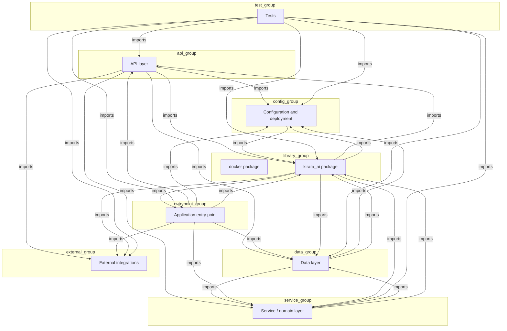

# Architecture report: lss233/kirara-ai

> Automated static analysis. **Observed** = directly seen in files/imports/AST; **Inferred** = interpretation from that evidence. Repository code was not executed.

## 1. Repository at a glance

| Item | Value |
| --- | --- |
| Repository | lss233/kirara-ai |
| Description | 🤖 可 DIY 的 多模态 AI 聊天机器人 | 🚀 快速接入 微信、 QQ、Telegram、等聊天平台 | 🦈支持DeepSeek、Grok、Claude、Ollama、Gemini、OpenAI | 工作流系统、网页搜索、AI画图、人设调教、虚拟女仆、语音对话 |  |
| Language | Python |
| Stars | 19293 |
| Licence | AGPL-3.0 |
| Analysed commit / branch | 36249e4a0aa8e3d8930acdfe4e14ec2be6484f63 / master |
| Framework(s) | FastAPI, Starlette |
| Files analysed | 339 |
| Components | 9 |

## 2. Architecture in one minute

lss233/kirara-ai - 🤖 可 DIY 的 多模态 AI 聊天机器人 | 🚀 快速接入 微信、 QQ、Telegram、等聊天平台 | 🦈支持DeepSeek、Grok、Claude、Ollama、Gemini、OpenAI | 工作流系统、网页搜索、AI画图、人设调教、虚拟女仆、语音对话 | . This repository was analysed statically from 339 file(s) (288 Python). Detected technologies (observed from imports/manifests): GitHub Actions, Redis, FastAPI, Starlette, aiohttp, Pydantic. Files are grouped into 9 component(s): API layer, Configuration and deployment, Data layer, docker package, Application entry point, External integrations, kirara_ai package, Service / domain layer. Observed entry point(s): kirara_ai/__main__.py, kirara_ai/web/app.py. Findings below distinguish observed facts from inferred interpretation.

## 3. High-level block diagram

## 4. Main components

### API layer (`api_layer`)

- **Kind:** api
- **Status:** Observed
- **Confidence:** 0.85
- **Responsibility:** Groups 38 file(s) under api layer (observed from repository paths and static analysis). Observed routes: ROUTE /status, ROUTE /config, ROUTE /start, ROUTE /stop, ROUTE /download. Observed top-level classes: BaseDiagnostic, BlockInstance, BlockType, BlockTypeList, BlockTypeResponse, DispatchRuleList. Observed top-level functions: _convert_media_to_api_item, _convert_to_server_info, _create_adapter, _get_media_manager, auto_detect_models, batch_delete.
- **Paths:** `kirara_ai/plugins/bundled_frpc/routes.py`, `kirara_ai/web/api/block/__init__.py`, `kirara_ai/web/api/block/diagnostics/base_diagnostic.py`, `kirara_ai/web/api/block/diagnostics/import_check.py`, `kirara_ai/web/api/block/diagnostics/jedi_syntax_check.py`, `kirara_ai/web/api/block/diagnostics/mandatory_function.py`, `kirara_ai/web/api/block/diagnostics/pyflakes_check.py`, `kirara_ai/web/api/block/models.py`, `kirara_ai/web/api/block/python_lsp.py`, `kirara_ai/web/api/block/routes.py`, `kirara_ai/web/api/dispatch/__init__.py`, `kirara_ai/web/api/dispatch/models.py`, `kirara_ai/web/api/dispatch/routes.py`, `kirara_ai/web/api/im/__init__.py`, `kirara_ai/web/api/im/models.py`, `kirara_ai/web/api/im/routes.py`, `kirara_ai/web/api/llm/__init__.py`, `kirara_ai/web/api/llm/models.py`, `kirara_ai/web/api/llm/routes.py`, `kirara_ai/web/api/mcp/__init__.py`, `kirara_ai/web/api/mcp/models.py`, `kirara_ai/web/api/mcp/routes.py`, `kirara_ai/web/api/media/__init__.py`, `kirara_ai/web/api/media/models.py`, `kirara_ai/web/api/media/routes.py`, `kirara_ai/web/api/plugin/__init__.py`, `kirara_ai/web/api/plugin/models.py`, `kirara_ai/web/api/plugin/routes.py`, `kirara_ai/web/api/system/__init__.py`, `kirara_ai/web/api/system/models.py`, `kirara_ai/web/api/system/routes.py`, `kirara_ai/web/api/system/utils.py`, `kirara_ai/web/api/tracing/__init__.py`, `kirara_ai/web/api/tracing/routes.py`, `kirara_ai/web/api/workflow/__init__.py`, `kirara_ai/web/api/workflow/models.py`, `kirara_ai/web/api/workflow/routes.py`, `kirara_ai/web/auth/routes.py`
- **Evidence:** [kirara_ai/plugins/bundled_frpc/routes.py:17](https://github.com/lss233/kirara-ai/blob/36249e4a0aa8e3d8930acdfe4e14ec2be6484f63/kirara_ai/plugins/bundled_frpc/routes.py#L17); [kirara_ai/web/api/block/__init__.py](https://github.com/lss233/kirara-ai/blob/36249e4a0aa8e3d8930acdfe4e14ec2be6484f63/kirara_ai/web/api/block/__init__.py); [kirara_ai/web/api/block/diagnostics/base_diagnostic.py:13](https://github.com/lss233/kirara-ai/blob/36249e4a0aa8e3d8930acdfe4e14ec2be6484f63/kirara_ai/web/api/block/diagnostics/base_diagnostic.py#L13); [kirara_ai/web/api/block/diagnostics/import_check.py:16](https://github.com/lss233/kirara-ai/blob/36249e4a0aa8e3d8930acdfe4e14ec2be6484f63/kirara_ai/web/api/block/diagnostics/import_check.py#L16); [kirara_ai/web/api/block/diagnostics/jedi_syntax_check.py:14](https://github.com/lss233/kirara-ai/blob/36249e4a0aa8e3d8930acdfe4e14ec2be6484f63/kirara_ai/web/api/block/diagnostics/jedi_syntax_check.py#L14); [kirara_ai/web/api/block/diagnostics/mandatory_function.py:15](https://github.com/lss233/kirara-ai/blob/36249e4a0aa8e3d8930acdfe4e14ec2be6484f63/kirara_ai/web/api/block/diagnostics/mandatory_function.py#L15); [kirara_ai/web/api/block/diagnostics/pyflakes_check.py:17](https://github.com/lss233/kirara-ai/blob/36249e4a0aa8e3d8930acdfe4e14ec2be6484f63/kirara_ai/web/api/block/diagnostics/pyflakes_check.py#L17); [kirara_ai/web/api/block/models.py:8](https://github.com/lss233/kirara-ai/blob/36249e4a0aa8e3d8930acdfe4e14ec2be6484f63/kirara_ai/web/api/block/models.py#L8)

### Configuration and deployment (`config`)

- **Kind:** config
- **Status:** Observed
- **Confidence:** 0.85
- **Responsibility:** Groups 18 file(s) under configuration and deployment (observed from repository paths and static analysis). Observed top-level classes: ConfigJsonSchema, ConfigLoader, DefaultConfig, FrpcConfig, GlobalConfig, IMConfig. Observed top-level functions: pydantic_validation_wrapper.
- **Paths:** `Dockerfile`, `MANIFEST.in`, `alembic.ini`, `data/dispatch_rules/rules.yaml`, `data/workflows/chat/dsr_thinking.yaml`, `data/workflows/chat/memory_store.yaml`, `data/workflows/chat/normal_multimodal.yaml`, `data/workflows/chat/talk_break.yaml`, `kirara_ai/config/__init__.py`, `kirara_ai/config/config_loader.py`, `kirara_ai/config/global_config.py`, `kirara_ai/plugins/im_http_legacy_adapter/setup.py`, `kirara_ai/plugins/im_qqbot_adapter/setup.py`, `kirara_ai/plugins/im_telegram_adapter/setup.py`, `kirara_ai/plugins/im_wecom_adapter/setup.py`, `kirara_ai/plugins/llm_preset_adapters/setup.py`, `pyproject.toml`, `pytest.ini`
- **Evidence:** [Dockerfile](https://github.com/lss233/kirara-ai/blob/36249e4a0aa8e3d8930acdfe4e14ec2be6484f63/Dockerfile); [MANIFEST.in](https://github.com/lss233/kirara-ai/blob/36249e4a0aa8e3d8930acdfe4e14ec2be6484f63/MANIFEST.in); [alembic.ini](https://github.com/lss233/kirara-ai/blob/36249e4a0aa8e3d8930acdfe4e14ec2be6484f63/alembic.ini); [data/dispatch_rules/rules.yaml](https://github.com/lss233/kirara-ai/blob/36249e4a0aa8e3d8930acdfe4e14ec2be6484f63/data/dispatch_rules/rules.yaml); [data/workflows/chat/dsr_thinking.yaml](https://github.com/lss233/kirara-ai/blob/36249e4a0aa8e3d8930acdfe4e14ec2be6484f63/data/workflows/chat/dsr_thinking.yaml); [data/workflows/chat/memory_store.yaml](https://github.com/lss233/kirara-ai/blob/36249e4a0aa8e3d8930acdfe4e14ec2be6484f63/data/workflows/chat/memory_store.yaml); [data/workflows/chat/normal_multimodal.yaml](https://github.com/lss233/kirara-ai/blob/36249e4a0aa8e3d8930acdfe4e14ec2be6484f63/data/workflows/chat/normal_multimodal.yaml); [data/workflows/chat/talk_break.yaml](https://github.com/lss233/kirara-ai/blob/36249e4a0aa8e3d8930acdfe4e14ec2be6484f63/data/workflows/chat/talk_break.yaml)

### Data layer (`data_layer`)

- **Kind:** data
- **Status:** Observed
- **Confidence:** 0.85
- **Responsibility:** Groups 8 file(s) under data layer (observed from repository paths and static analysis). Observed top-level classes: ChangePasswordRequest, CombinedDispatchRule, DatabaseManager, FrpcConfigUpdate, FrpcDownloadProgress, FrpcStatus.
- **Paths:** `kirara_ai/database/__init__.py`, `kirara_ai/database/manager.py`, `kirara_ai/mcp_module/models.py`, `kirara_ai/plugin_manager/models.py`, `kirara_ai/plugins/bundled_frpc/models.py`, `kirara_ai/tracing/models.py`, `kirara_ai/web/auth/models.py`, `kirara_ai/workflow/core/dispatch/models/dispatch_rules.py`
- **Evidence:** [kirara_ai/database/__init__.py](https://github.com/lss233/kirara-ai/blob/36249e4a0aa8e3d8930acdfe4e14ec2be6484f63/kirara_ai/database/__init__.py); [kirara_ai/database/manager.py:20](https://github.com/lss233/kirara-ai/blob/36249e4a0aa8e3d8930acdfe4e14ec2be6484f63/kirara_ai/database/manager.py#L20); [kirara_ai/mcp_module/models.py:4](https://github.com/lss233/kirara-ai/blob/36249e4a0aa8e3d8930acdfe4e14ec2be6484f63/kirara_ai/mcp_module/models.py#L4); [kirara_ai/plugin_manager/models.py:6](https://github.com/lss233/kirara-ai/blob/36249e4a0aa8e3d8930acdfe4e14ec2be6484f63/kirara_ai/plugin_manager/models.py#L6); [kirara_ai/plugins/bundled_frpc/models.py:8](https://github.com/lss233/kirara-ai/blob/36249e4a0aa8e3d8930acdfe4e14ec2be6484f63/kirara_ai/plugins/bundled_frpc/models.py#L8); [kirara_ai/tracing/models.py:11](https://github.com/lss233/kirara-ai/blob/36249e4a0aa8e3d8930acdfe4e14ec2be6484f63/kirara_ai/tracing/models.py#L11); [kirara_ai/web/auth/models.py:4](https://github.com/lss233/kirara-ai/blob/36249e4a0aa8e3d8930acdfe4e14ec2be6484f63/kirara_ai/web/auth/models.py#L4); [kirara_ai/workflow/core/dispatch/models/dispatch_rules.py:13](https://github.com/lss233/kirara-ai/blob/36249e4a0aa8e3d8930acdfe4e14ec2be6484f63/kirara_ai/workflow/core/dispatch/models/dispatch_rules.py#L13)

### docker package (`docker`)

- **Kind:** library
- **Status:** Observed
- **Confidence:** 0.85
- **Responsibility:** Groups 1 file(s) under docker package (observed from repository paths and static analysis).
- **Paths:** `docker/start.sh`
- **Evidence:** [docker/start.sh](https://github.com/lss233/kirara-ai/blob/36249e4a0aa8e3d8930acdfe4e14ec2be6484f63/docker/start.sh)

### Application entry point (`entrypoint`)

- **Kind:** entrypoint
- **Status:** Observed
- **Confidence:** 0.85
- **Responsibility:** Groups 3 file(s) under application entry point (observed from repository paths and static analysis). Observed application object created via FastAPI. Observed top-level classes: MCPServer, WebServer. Observed top-level functions: create_app, create_web_api_app, main.
- **Paths:** `kirara_ai/__main__.py`, `kirara_ai/mcp_module/server.py`, `kirara_ai/web/app.py`
- **Evidence:** [kirara_ai/__main__.py:10](https://github.com/lss233/kirara-ai/blob/36249e4a0aa8e3d8930acdfe4e14ec2be6484f63/kirara_ai/__main__.py#L10); [kirara_ai/mcp_module/server.py:19](https://github.com/lss233/kirara-ai/blob/36249e4a0aa8e3d8930acdfe4e14ec2be6484f63/kirara_ai/mcp_module/server.py#L19); [kirara_ai/web/app.py:109](https://github.com/lss233/kirara-ai/blob/36249e4a0aa8e3d8930acdfe4e14ec2be6484f63/kirara_ai/web/app.py#L109)

### External integrations (`external_integrations`)

- **Kind:** external
- **Status:** Inferred
- **Confidence:** 0.70
- **Responsibility:** Groups 0 file(s) under external integrations (observed from repository paths and static analysis).
- **Evidence:** [kirara_ai/alembic/env.py:4](https://github.com/lss233/kirara-ai/blob/36249e4a0aa8e3d8930acdfe4e14ec2be6484f63/kirara_ai/alembic/env.py#L4); [kirara_ai/alembic/versions/4a364dbb8dab_initial_migration.py:10](https://github.com/lss233/kirara-ai/blob/36249e4a0aa8e3d8930acdfe4e14ec2be6484f63/kirara_ai/alembic/versions/4a364dbb8dab_initial_migration.py#L10); [kirara_ai/database/manager.py:8](https://github.com/lss233/kirara-ai/blob/36249e4a0aa8e3d8930acdfe4e14ec2be6484f63/kirara_ai/database/manager.py#L8); [kirara_ai/database/manager.py:9](https://github.com/lss233/kirara-ai/blob/36249e4a0aa8e3d8930acdfe4e14ec2be6484f63/kirara_ai/database/manager.py#L9); [kirara_ai/memory/persistences/redis_persistence.py:21](https://github.com/lss233/kirara-ai/blob/36249e4a0aa8e3d8930acdfe4e14ec2be6484f63/kirara_ai/memory/persistences/redis_persistence.py#L21); [kirara_ai/plugins/bundled_frpc/frpc_manager.py:13](https://github.com/lss233/kirara-ai/blob/36249e4a0aa8e3d8930acdfe4e14ec2be6484f63/kirara_ai/plugins/bundled_frpc/frpc_manager.py#L13)

### kirara_ai package (`kirara_ai`)

- **Kind:** library
- **Status:** Observed
- **Confidence:** 0.85
- **Responsibility:** Groups 137 file(s) under kirara_ai package (observed from repository paths and static analysis). Observed top-level classes: AlibabaCloudAdapter, AlibabaCloudConfig, AppendIMMessage, ApplicationStarted, ApplicationStopping, AsyncMemoryPersistence. Observed top-level functions: _ensure_valid_secret, _format_rule_condition, _format_rule_group, _signal_handler, auto_generate_webhook_url, check_update.
- **Paths:** `kirara_ai/__init__.py`, `kirara_ai/alembic/env.py`, `kirara_ai/alembic/versions/4a364dbb8dab_initial_migration.py`, `kirara_ai/entry.py`, `kirara_ai/events/__init__.py`, `kirara_ai/events/application.py`, `kirara_ai/events/event_bus.py`, `kirara_ai/events/im.py`, `kirara_ai/events/listen.py`, `kirara_ai/events/llm.py`, `kirara_ai/events/plugin.py`, `kirara_ai/events/tracing/__init__.py`, `kirara_ai/events/tracing/base.py`, `kirara_ai/events/tracing/llm.py`, `kirara_ai/events/workflow.py`, `kirara_ai/im/__init__.py`, `kirara_ai/im/adapter.py`, `kirara_ai/im/im_registry.py`, `kirara_ai/im/manager.py`, `kirara_ai/im/message.py`, `kirara_ai/im/profile.py`, `kirara_ai/im/sender.py`, `kirara_ai/internal.py`, `kirara_ai/ioc/__init__.py`, `kirara_ai/ioc/container.py`, `kirara_ai/ioc/inject.py`, `kirara_ai/llm/adapter.py`, `kirara_ai/llm/format/__init__.py`, `kirara_ai/llm/format/embedding.py`, `kirara_ai/llm/format/message.py`, `kirara_ai/llm/format/request.py`, `kirara_ai/llm/format/rerank.py`, `kirara_ai/llm/format/response.py`, `kirara_ai/llm/format/tool.py`, `kirara_ai/llm/llm_manager.py`, `kirara_ai/llm/llm_registry.py`, `kirara_ai/llm/model_types.py`, `kirara_ai/logger.py`, `kirara_ai/mcp_module/__init__.py`, `kirara_ai/mcp_module/manager.py`, `kirara_ai/media/__init__.py`, `kirara_ai/media/carrier/__init__.py`, `kirara_ai/media/carrier/provider.py`, `kirara_ai/media/carrier/registry.py`, `kirara_ai/media/manager.py`, `kirara_ai/media/media_object.py`, `kirara_ai/media/metadata.py`, `kirara_ai/media/types/__init__.py`, `kirara_ai/media/types/media_type.py`, `kirara_ai/media/utils/__init__.py`, `kirara_ai/media/utils/mime.py`, `kirara_ai/memory/composes/__init__.py`, `kirara_ai/memory/composes/base.py`, `kirara_ai/memory/composes/builtin_composes.py`, `kirara_ai/memory/composes/composer_strategy.py`, `kirara_ai/memory/composes/decomposer_strategy.py`, `kirara_ai/memory/composes/xml_helper.py`, `kirara_ai/memory/entry.py`, `kirara_ai/memory/memory_manager.py`, `kirara_ai/memory/persistences/__init__.py`, `kirara_ai/memory/persistences/base.py`, `kirara_ai/memory/persistences/codecs.py`, `kirara_ai/memory/persistences/file_persistence.py`, `kirara_ai/memory/persistences/redis_persistence.py`, `kirara_ai/memory/registry.py`, `kirara_ai/memory/scopes/__init__.py`, `kirara_ai/memory/scopes/base.py`, `kirara_ai/memory/scopes/builtin_scopes.py`, `kirara_ai/plugin_manager/plugin.py`, `kirara_ai/plugin_manager/plugin_event_bus.py`, `kirara_ai/plugin_manager/plugin_loader.py`, `kirara_ai/plugin_manager/utils.py`, `kirara_ai/plugins/bundled_frpc/__init__.py`, `kirara_ai/plugins/bundled_frpc/frpc_manager.py`, `kirara_ai/plugins/im_http_legacy_adapter/__init__.py`, `kirara_ai/plugins/im_http_legacy_adapter/adapter.py`, `kirara_ai/plugins/im_qqbot_adapter/__init__.py`, `kirara_ai/plugins/im_qqbot_adapter/adapter.py`, `kirara_ai/plugins/im_qqbot_adapter/utils.py`, `kirara_ai/plugins/im_telegram_adapter/__init__.py`, `kirara_ai/plugins/im_telegram_adapter/adapter.py`, `kirara_ai/plugins/im_wecom_adapter/__init__.py`, `kirara_ai/plugins/im_wecom_adapter/adapter.py`, `kirara_ai/plugins/im_wecom_adapter/delegates.py`, `kirara_ai/plugins/llm_preset_adapters/__init__.py`, `kirara_ai/plugins/llm_preset_adapters/alibabacloud_adapter.py`, `kirara_ai/plugins/llm_preset_adapters/claude_adapter.py`, `kirara_ai/plugins/llm_preset_adapters/deepseek_adapter.py`, `kirara_ai/plugins/llm_preset_adapters/gemini_adapter.py`, `kirara_ai/plugins/llm_preset_adapters/minimax_adapter.py`, `kirara_ai/plugins/llm_preset_adapters/mistral_adapter.py`, `kirara_ai/plugins/llm_preset_adapters/moonshot_adapter.py`, `kirara_ai/plugins/llm_preset_adapters/ollama_adapter.py`, `kirara_ai/plugins/llm_preset_adapters/openai_adapter.py`, `kirara_ai/plugins/llm_preset_adapters/openrouter_adapter.py`, `kirara_ai/plugins/llm_preset_adapters/siliconflow_adapter.py`, `kirara_ai/plugins/llm_preset_adapters/tencentcloud_adapter.py`, `kirara_ai/plugins/llm_preset_adapters/utils.py`, `kirara_ai/plugins/llm_preset_adapters/volcengine_adapter.py`, `kirara_ai/plugins/llm_preset_adapters/voyage_adapter.py`, `kirara_ai/system/__init__.py`, `kirara_ai/system/updater.py`, `kirara_ai/tracing/__init__.py`, `kirara_ai/tracing/core.py`, `kirara_ai/tracing/decorator.py`, `kirara_ai/tracing/llm_tracer.py`, `kirara_ai/tracing/manager.py`, `kirara_ai/web/__init__.py`, `kirara_ai/web/auth/middleware.py`, `kirara_ai/web/auth/utils.py`, `kirara_ai/web/utils.py`, `kirara_ai/workflow/implementations/__init__.py`, `kirara_ai/workflow/implementations/blocks/__init__.py`, `kirara_ai/workflow/implementations/blocks/game/dice.py`, `kirara_ai/workflow/implementations/blocks/game/gacha.py`, `kirara_ai/workflow/implementations/blocks/im/basic.py`, `kirara_ai/workflow/implementations/blocks/im/messages.py`, `kirara_ai/workflow/implementations/blocks/im/states.py`, `kirara_ai/workflow/implementations/blocks/im/user_profile.py`, `kirara_ai/workflow/implementations/blocks/llm/basic.py`, `kirara_ai/workflow/implementations/blocks/llm/chat.py`, `kirara_ai/workflow/implementations/blocks/llm/image.py`, `kirara_ai/workflow/implementations/blocks/mcp/__init__.py`, `kirara_ai/workflow/implementations/blocks/mcp/tool.py`, `kirara_ai/workflow/implementations/blocks/memory/chat_memory.py`, `kirara_ai/workflow/implementations/blocks/memory/clear_memory.py`, `kirara_ai/workflow/implementations/blocks/system/basic.py`, `kirara_ai/workflow/implementations/blocks/system/help.py`, `kirara_ai/workflow/implementations/blocks/system_blocks.py`, `kirara_ai/workflow/implementations/blocks/variables/variable_blocks.py`, `kirara_ai/workflow/implementations/factories/__init__.py`, `kirara_ai/workflow/implementations/factories/default_factory.py`, `kirara_ai/workflow/implementations/factories/game_factory.py`, `kirara_ai/workflow/implementations/factories/system_factory.py`, `kirara_ai/workflow/implementations/workflows/__init__.py`, `kirara_ai/workflow/implementations/workflows/system_workflows.py`, `kirara_ai/workflow/utils/__init__.py`
- **Evidence:** [kirara_ai/__init__.py](https://github.com/lss233/kirara-ai/blob/36249e4a0aa8e3d8930acdfe4e14ec2be6484f63/kirara_ai/__init__.py); [kirara_ai/alembic/env.py:30](https://github.com/lss233/kirara-ai/blob/36249e4a0aa8e3d8930acdfe4e14ec2be6484f63/kirara_ai/alembic/env.py#L30); [kirara_ai/alembic/versions/4a364dbb8dab_initial_migration.py:20](https://github.com/lss233/kirara-ai/blob/36249e4a0aa8e3d8930acdfe4e14ec2be6484f63/kirara_ai/alembic/versions/4a364dbb8dab_initial_migration.py#L20); [kirara_ai/entry.py:40](https://github.com/lss233/kirara-ai/blob/36249e4a0aa8e3d8930acdfe4e14ec2be6484f63/kirara_ai/entry.py#L40); [kirara_ai/events/__init__.py](https://github.com/lss233/kirara-ai/blob/36249e4a0aa8e3d8930acdfe4e14ec2be6484f63/kirara_ai/events/__init__.py); [kirara_ai/events/application.py:2](https://github.com/lss233/kirara-ai/blob/36249e4a0aa8e3d8930acdfe4e14ec2be6484f63/kirara_ai/events/application.py#L2); [kirara_ai/events/event_bus.py:7](https://github.com/lss233/kirara-ai/blob/36249e4a0aa8e3d8930acdfe4e14ec2be6484f63/kirara_ai/events/event_bus.py#L7); [kirara_ai/events/im.py:7](https://github.com/lss233/kirara-ai/blob/36249e4a0aa8e3d8930acdfe4e14ec2be6484f63/kirara_ai/events/im.py#L7)

### Service / domain layer (`service_layer`)

- **Kind:** service
- **Status:** Observed
- **Confidence:** 0.85
- **Responsibility:** Groups 25 file(s) under service / domain layer (observed from repository paths and static analysis). Observed top-level classes: AuthService, Block, BlockConfig, BlockExecutionFailedException, BlockInput, BlockOutput. Observed top-level functions: extract_block_param, get_block_class.
- **Paths:** `kirara_ai/media/carrier/service.py`, `kirara_ai/web/auth/services.py`, `kirara_ai/workflow/core/__init__.py`, `kirara_ai/workflow/core/block/__init__.py`, `kirara_ai/workflow/core/block/base.py`, `kirara_ai/workflow/core/block/input_output.py`, `kirara_ai/workflow/core/block/param.py`, `kirara_ai/workflow/core/block/registry.py`, `kirara_ai/workflow/core/block/schema.py`, `kirara_ai/workflow/core/block/type_system.py`, `kirara_ai/workflow/core/dispatch/__init__.py`, `kirara_ai/workflow/core/dispatch/dispatcher.py`, `kirara_ai/workflow/core/dispatch/exceptions.py`, `kirara_ai/workflow/core/dispatch/registry.py`, `kirara_ai/workflow/core/dispatch/rules/base.py`, `kirara_ai/workflow/core/dispatch/rules/message_rules.py`, `kirara_ai/workflow/core/dispatch/rules/sender_rules.py`, `kirara_ai/workflow/core/dispatch/rules/system_rules.py`, `kirara_ai/workflow/core/execution/__init__.py`, `kirara_ai/workflow/core/execution/exceptions.py`, `kirara_ai/workflow/core/execution/executor.py`, `kirara_ai/workflow/core/workflow/__init__.py`, `kirara_ai/workflow/core/workflow/base.py`, `kirara_ai/workflow/core/workflow/builder.py`, `kirara_ai/workflow/core/workflow/registry.py`
- **Evidence:** [kirara_ai/media/carrier/service.py:10](https://github.com/lss233/kirara-ai/blob/36249e4a0aa8e3d8930acdfe4e14ec2be6484f63/kirara_ai/media/carrier/service.py#L10); [kirara_ai/web/auth/services.py:7](https://github.com/lss233/kirara-ai/blob/36249e4a0aa8e3d8930acdfe4e14ec2be6484f63/kirara_ai/web/auth/services.py#L7); [kirara_ai/workflow/core/__init__.py](https://github.com/lss233/kirara-ai/blob/36249e4a0aa8e3d8930acdfe4e14ec2be6484f63/kirara_ai/workflow/core/__init__.py); [kirara_ai/workflow/core/block/__init__.py](https://github.com/lss233/kirara-ai/blob/36249e4a0aa8e3d8930acdfe4e14ec2be6484f63/kirara_ai/workflow/core/block/__init__.py); [kirara_ai/workflow/core/block/base.py:7](https://github.com/lss233/kirara-ai/blob/36249e4a0aa8e3d8930acdfe4e14ec2be6484f63/kirara_ai/workflow/core/block/base.py#L7); [kirara_ai/workflow/core/block/input_output.py:4](https://github.com/lss233/kirara-ai/blob/36249e4a0aa8e3d8930acdfe4e14ec2be6484f63/kirara_ai/workflow/core/block/input_output.py#L4); [kirara_ai/workflow/core/block/param.py:9](https://github.com/lss233/kirara-ai/blob/36249e4a0aa8e3d8930acdfe4e14ec2be6484f63/kirara_ai/workflow/core/block/param.py#L9); [kirara_ai/workflow/core/block/registry.py:12](https://github.com/lss233/kirara-ai/blob/36249e4a0aa8e3d8930acdfe4e14ec2be6484f63/kirara_ai/workflow/core/block/registry.py#L12)

### Tests (`tests`)

- **Kind:** test
- **Status:** Observed
- **Confidence:** 0.85
- **Responsibility:** Groups 70 file(s) under tests (observed from repository paths and static analysis). Observed application object created via FastAPI. Observed routes: POST /models/{model}:generateContent, POST /models/{model}:batchEmbedContents, POST /api/embed, POST /chat/completions, POST /embeddings. Observed top-level classes: AssistantMessage, AudioContent, BatchEmbeddingPart, BatchEmbeddingParts, BatchEmbeddingPayload, BatchEmbeddingRequest. Observed top-level functions: MOCK_PLUGIN_INFO_RESPONSE, MOCK_PLUGIN_SEARCH_RESPONSE, adapter, app, auth_headers, auth_token.
- **Paths:** `kirara_ai/plugins/im_http_legacy_adapter/tests/api_test.py`, `kirara_ai/plugins/llm_preset_adapters/tests/test_utils.py`, `tests/__init__.py`, `tests/llm_adapters/__init__.py`, `tests/llm_adapters/conftest.py`, `tests/llm_adapters/mock_app/__init__.py`, `tests/llm_adapters/mock_app/app.py`, `tests/llm_adapters/mock_app/gemini.py`, `tests/llm_adapters/mock_app/models/gemini.py`, `tests/llm_adapters/mock_app/models/openai.py`, `tests/llm_adapters/mock_app/ollama.py`, `tests/llm_adapters/mock_app/openai.py`, `tests/llm_adapters/mock_app/voyage.py`, `tests/llm_adapters/test_gemini_adapter.py`, `tests/llm_adapters/test_ollama_adapter.py`, `tests/llm_adapters/test_openai_adapter.py`, `tests/llm_adapters/test_voyage_adapter.py`, `tests/memory/__init__.py`, `tests/memory/test_composer_decomposer.py`, `tests/memory/test_composer_strategy.py`, `tests/memory/test_decomposer_strategy.py`, `tests/memory/test_memory_manager.py`, `tests/memory/test_persistence.py`, `tests/memory/test_scope.py`, `tests/resources/test_image.txt`, `tests/system_blocks/__init__.py`, `tests/system_blocks/game/__init__.py`, `tests/system_blocks/game/test_dice.py`, `tests/system_blocks/game/test_gacha.py`, `tests/system_blocks/im/__init__.py`, `tests/system_blocks/im/test_messages.py`, `tests/system_blocks/im/test_states.py`, `tests/system_blocks/llm/__init__.py`, `tests/system_blocks/llm/test_basic.py`, `tests/system_blocks/llm/test_chat.py`, `tests/system_blocks/llm/test_image.py`, `tests/system_blocks/memory/__init__.py`, `tests/system_blocks/memory/test_chat_memory.py`, `tests/system_blocks/memory/test_clear_memory.py`, `tests/system_blocks/system/__init__.py`, `tests/system_blocks/system/test_basic.py`, `tests/system_blocks/system/test_help.py`, `tests/test_config_loader.py`, `tests/test_game_blocks.py`, `tests/test_mcp_server.py`, `tests/test_media.py`, `tests/test_media_element.py`, `tests/test_system_blocks.py`, `tests/test_workflow_builder.py`, `tests/test_workflow_factories.py`, `tests/tracing/__init__.py`, `tests/tracing/test_base.py`, `tests/tracing/test_core.py`, `tests/tracing/test_decorator.py`, `tests/tracing/test_llm_tracer.py`, `tests/tracing/test_manager.py`, `tests/tracing/test_models.py`, `tests/utils/auth_test_utils.py`, `tests/utils/test_block_registry.py`, `tests/web/api/im/test_im.py`, `tests/web/api/llm/test_llm.py`, `tests/web/api/media/test_media.py`, `tests/web/api/plugin/test_plugin.py`, `tests/web/api/system/test_system.py`, `tests/web/api/workflow/test_workflow.py`, `tests/web/auth/test_auth.py`, `tests/workflow_executor/test_block.py`, `tests/workflow_executor/test_executor.py`, `tests/workflow_executor/test_input_output.py`, `tests/workflow_executor/test_workflow_basic.py`
- **Evidence:** [kirara_ai/plugins/im_http_legacy_adapter/tests/api_test.py:24](https://github.com/lss233/kirara-ai/blob/36249e4a0aa8e3d8930acdfe4e14ec2be6484f63/kirara_ai/plugins/im_http_legacy_adapter/tests/api_test.py#L24); [kirara_ai/plugins/llm_preset_adapters/tests/test_utils.py:267](https://github.com/lss233/kirara-ai/blob/36249e4a0aa8e3d8930acdfe4e14ec2be6484f63/kirara_ai/plugins/llm_preset_adapters/tests/test_utils.py#L267); [tests/__init__.py](https://github.com/lss233/kirara-ai/blob/36249e4a0aa8e3d8930acdfe4e14ec2be6484f63/tests/__init__.py); [tests/llm_adapters/__init__.py](https://github.com/lss233/kirara-ai/blob/36249e4a0aa8e3d8930acdfe4e14ec2be6484f63/tests/llm_adapters/__init__.py); [tests/llm_adapters/conftest.py:8](https://github.com/lss233/kirara-ai/blob/36249e4a0aa8e3d8930acdfe4e14ec2be6484f63/tests/llm_adapters/conftest.py#L8); [tests/llm_adapters/mock_app/__init__.py](https://github.com/lss233/kirara-ai/blob/36249e4a0aa8e3d8930acdfe4e14ec2be6484f63/tests/llm_adapters/mock_app/__init__.py); [tests/llm_adapters/mock_app/app.py:16](https://github.com/lss233/kirara-ai/blob/36249e4a0aa8e3d8930acdfe4e14ec2be6484f63/tests/llm_adapters/mock_app/app.py#L16); [tests/llm_adapters/mock_app/gemini.py:8](https://github.com/lss233/kirara-ai/blob/36249e4a0aa8e3d8930acdfe4e14ec2be6484f63/tests/llm_adapters/mock_app/gemini.py#L8)

## 5. Execution flow

**Observed** entry point(s):

- [kirara_ai/__main__.py](https://github.com/lss233/kirara-ai/blob/36249e4a0aa8e3d8930acdfe4e14ec2be6484f63/kirara_ai/__main__.py)
- [kirara_ai/web/app.py:109](https://github.com/lss233/kirara-ai/blob/36249e4a0aa8e3d8930acdfe4e14ec2be6484f63/kirara_ai/web/app.py#L109)

**Observed** routes (from decorators):

- `ROUTE /status` -> `get_status` in `kirara_ai/plugins/bundled_frpc/routes.py:17`
- `ROUTE /config` -> `update_config` in `kirara_ai/plugins/bundled_frpc/routes.py:38`
- `ROUTE /start` -> `start_frpc` in `kirara_ai/plugins/bundled_frpc/routes.py:88`
- `ROUTE /stop` -> `stop_frpc` in `kirara_ai/plugins/bundled_frpc/routes.py:119`
- `ROUTE /download` -> `download_frpc` in `kirara_ai/plugins/bundled_frpc/routes.py:149`
- `ROUTE /types` -> `list_block_types` in `kirara_ai/web/api/block/routes.py:20`
- `ROUTE /types/<type_name>` -> `get_block_type` in `kirara_ai/web/api/block/routes.py:52`
- `ROUTE /types/compatibility` -> `get_type_compatibility` in `kirara_ai/web/api/block/routes.py:82`
- `ROUTE /rules` -> `list_rules` in `kirara_ai/web/api/dispatch/routes.py:14`
- `ROUTE /rules/<rule_id>` -> `get_rule` in `kirara_ai/web/api/dispatch/routes.py:25`
- `ROUTE /rules` -> `create_rule` in `kirara_ai/web/api/dispatch/routes.py:38`
- `ROUTE /rules/<rule_id>` -> `update_rule` in `kirara_ai/web/api/dispatch/routes.py:68`
- `ROUTE /rules/<rule_id>` -> `delete_rule` in `kirara_ai/web/api/dispatch/routes.py:100`
- `ROUTE /rules/<rule_id>/enable` -> `enable_rule` in `kirara_ai/web/api/dispatch/routes.py:119`
- `ROUTE /rules/<rule_id>/disable` -> `disable_rule` in `kirara_ai/web/api/dispatch/routes.py:141`
- `ROUTE /types` -> `get_rule_types` in `kirara_ai/web/api/dispatch/routes.py:163`
- `ROUTE /types/<rule_type>/config-schema` -> `get_rule_config_schema` in `kirara_ai/web/api/dispatch/routes.py:170`
- `ROUTE /types` -> `get_adapter_types` in `kirara_ai/web/api/im/routes.py:30`
- `ROUTE /adapters` -> `list_adapters` in `kirara_ai/web/api/im/routes.py:40`
- `ROUTE /adapters/<adapter_id>` -> `get_adapter` in `kirara_ai/web/api/im/routes.py:59`
- `ROUTE /adapters` -> `create_adapter` in `kirara_ai/web/api/im/routes.py:86`
- `ROUTE /adapters/<adapter_id>` -> `update_adapter` in `kirara_ai/web/api/im/routes.py:128`
- `ROUTE /adapters/<adapter_id>` -> `delete_adapter` in `kirara_ai/web/api/im/routes.py:203`
- `ROUTE /adapters/<adapter_id>/start` -> `start_adapter` in `kirara_ai/web/api/im/routes.py:224`
- `ROUTE /adapters/<adapter_id>/stop` -> `stop_adapter` in `kirara_ai/web/api/im/routes.py:241`
- `ROUTE /types/<adapter_type>/config-schema` -> `get_adapter_config_schema` in `kirara_ai/web/api/im/routes.py:258`
- `ROUTE /types` -> `get_adapter_types` in `kirara_ai/web/api/llm/routes.py:22`
- `ROUTE /backends` -> `list_backends` in `kirara_ai/web/api/llm/routes.py:30`
- `ROUTE /backends/<backend_name>` -> `get_backend` in `kirara_ai/web/api/llm/routes.py:55`
- `ROUTE /backends` -> `create_backend` in `kirara_ai/web/api/llm/routes.py:81`
- `ROUTE /backends/<backend_name>` -> `update_backend` in `kirara_ai/web/api/llm/routes.py:122`
- `ROUTE /backends/<backend_name>` -> `delete_backend` in `kirara_ai/web/api/llm/routes.py:171`
- `ROUTE /types/<adapter_type>/config-schema` -> `get_adapter_config_schema` in `kirara_ai/web/api/llm/routes.py:215`
- `ROUTE /types/<adapter_type>/supports-auto-detect-models` -> `supports_auto_detect_models` in `kirara_ai/web/api/llm/routes.py:232`
- `ROUTE /backends/<backend_name>/auto-detect-models` -> `auto_detect_models` in `kirara_ai/web/api/llm/routes.py:256`
- `ROUTE /servers` -> `list_servers` in `kirara_ai/web/api/mcp/routes.py:39`
- `ROUTE /statistics` -> `get_statistics` in `kirara_ai/web/api/mcp/routes.py:99`
- `ROUTE /servers/<server_id>` -> `get_server` in `kirara_ai/web/api/mcp/routes.py:129`
- `ROUTE /servers/<server_id>/tools` -> `get_server_tools` in `kirara_ai/web/api/mcp/routes.py:152`
- `ROUTE /servers/check/<server_id>` -> `check_server_id` in `kirara_ai/web/api/mcp/routes.py:189`
- `ROUTE /servers` -> `create_server` in `kirara_ai/web/api/mcp/routes.py:209`
- `ROUTE /servers/<server_id>` -> `update_server` in `kirara_ai/web/api/mcp/routes.py:255`
- `ROUTE /servers/<server_id>` -> `delete_server` in `kirara_ai/web/api/mcp/routes.py:332`
- `ROUTE /servers/<server_id>/start` -> `start_server` in `kirara_ai/web/api/mcp/routes.py:371`
- `ROUTE /servers/<server_id>/stop` -> `stop_server` in `kirara_ai/web/api/mcp/routes.py:392`
- `ROUTE /tools` -> `get_all_tools` in `kirara_ai/web/api/mcp/routes.py:413`
- `ROUTE /servers/<server_id>/tools/call` -> `call_tool` in `kirara_ai/web/api/mcp/routes.py:439`
- `ROUTE /servers/<server_id>/prompts` -> `get_server_prompts` in `kirara_ai/web/api/mcp/routes.py:465`
- `ROUTE /servers/<server_id>/resources` -> `get_server_resources` in `kirara_ai/web/api/mcp/routes.py:486`
- `ROUTE /list` -> `list_media` in `kirara_ai/web/api/media/routes.py:79`
- `ROUTE /file/<media_id>` -> `get_media_file` in `kirara_ai/web/api/media/routes.py:161`
- `ROUTE /preview/<media_id>` -> `get_thumbnail` in `kirara_ai/web/api/media/routes.py:172`
- `ROUTE /delete/<media_id>` -> `delete_media` in `kirara_ai/web/api/media/routes.py:198`
- `ROUTE /batch-delete` -> `batch_delete` in `kirara_ai/web/api/media/routes.py:213`
- `ROUTE /system` -> `get_system_info` in `kirara_ai/web/api/media/routes.py:231`
- `ROUTE /system/config` -> `set_config` in `kirara_ai/web/api/media/routes.py:272`
- `ROUTE /system/cleanup-unreferenced` -> `cleanup_unreferenced` in `kirara_ai/web/api/media/routes.py:285`
- `ROUTE /v1/search` -> `search_plugins` in `kirara_ai/web/api/plugin/routes.py:77`
- `ROUTE /v1/info/<plugin_name>` -> `get_market_plugin_info` in `kirara_ai/web/api/plugin/routes.py:99`
- `ROUTE /plugins` -> `list_plugins` in `kirara_ai/web/api/plugin/routes.py:115`
- `ROUTE /plugins/<plugin_name>` -> `get_plugin_details` in `kirara_ai/web/api/plugin/routes.py:124`
- `ROUTE /plugins` -> `install_plugin` in `kirara_ai/web/api/plugin/routes.py:137`
- `ROUTE /plugins/<plugin_name>` -> `uninstall_plugin` in `kirara_ai/web/api/plugin/routes.py:168`
- `ROUTE /plugins/<plugin_name>/enable` -> `enable_plugin` in `kirara_ai/web/api/plugin/routes.py:198`
- `ROUTE /plugins/<plugin_name>/disable` -> `disable_plugin` in `kirara_ai/web/api/plugin/routes.py:228`
- `ROUTE /plugins/<plugin_name>` -> `update_plugin` in `kirara_ai/web/api/plugin/routes.py:264`
- `ROUTE /config` -> `get_system_config` in `kirara_ai/web/api/system/routes.py:66`
- `ROUTE /config/web` -> `update_web_config` in `kirara_ai/web/api/system/routes.py:94`
- `ROUTE /config/plugins` -> `update_plugins_config` in `kirara_ai/web/api/system/routes.py:111`
- `ROUTE /config/update` -> `update_registry_config` in `kirara_ai/web/api/system/routes.py:127`
- `ROUTE /config/system` -> `update_system_config` in `kirara_ai/web/api/system/routes.py:147`
- `ROUTE /config/tracing` -> `update_tracing_config` in `kirara_ai/web/api/system/routes.py:173`
- `ROUTE /status` -> `get_system_status` in `kirara_ai/web/api/system/routes.py:190`
- `ROUTE /check-update` -> `check_update` in `kirara_ai/web/api/system/routes.py:251`
- `ROUTE /update` -> `perform_update` in `kirara_ai/web/api/system/routes.py:277`
- `ROUTE /restart` -> `restart_system` in `kirara_ai/web/api/system/routes.py:316`
- `ROUTE /types` -> `get_trace_types` in `kirara_ai/web/api/tracing/routes.py:21`
- `ROUTE /llm/traces` -> `get_llm_traces` in `kirara_ai/web/api/tracing/routes.py:33`
- `ROUTE /llm/detail/<trace_id>` -> `get_llm_trace_detail` in `kirara_ai/web/api/tracing/routes.py:77`
- `ROUTE /llm/statistics` -> `get_llm_statistics` in `kirara_ai/web/api/tracing/routes.py:95`
- `ROUTE ` -> `list_workflows` in `kirara_ai/web/api/workflow/routes.py:18`
- `ROUTE /<group_id>/<workflow_id>` -> `get_workflow` in `kirara_ai/web/api/workflow/routes.py:43`
- `ROUTE /<group_id>/<workflow_id>` -> `create_workflow` in `kirara_ai/web/api/workflow/routes.py:93`
- `ROUTE /<group_id>/<workflow_id>` -> `update_workflow` in `kirara_ai/web/api/workflow/routes.py:151`
- `ROUTE /<group_id>/<workflow_id>` -> `delete_workflow` in `kirara_ai/web/api/workflow/routes.py:216`
- `ROUTE /login` -> `login` in `kirara_ai/web/auth/routes.py:17`
- `ROUTE /change-password` -> `change_password` in `kirara_ai/web/auth/routes.py:37`
- `ROUTE /check-first-time` -> `check_first_time` in `kirara_ai/web/auth/routes.py:57`
- `POST /models/{model}:generateContent` -> `chat` in `tests/llm_adapters/mock_app/gemini.py:15`
- `POST /models/{model}:batchEmbedContents` -> `batch_embed_contents` in `tests/llm_adapters/mock_app/gemini.py:40`
- `POST /api/embed` -> `embedding` in `tests/llm_adapters/mock_app/ollama.py:14`
- `POST /chat/completions` -> `completions` in `tests/llm_adapters/mock_app/openai.py:10`
- `POST /embeddings` -> `embeddings` in `tests/llm_adapters/mock_app/openai.py:49`
- `POST /v1/embeddings` -> `get_embeddings` in `tests/llm_adapters/mock_app/voyage.py:39`
- `POST /v1/multimodalembeddings` -> `get_multimodal_embeddings` in `tests/llm_adapters/mock_app/voyage.py:56`
- `POST /v1/rerank` -> `get_rerank` in `tests/llm_adapters/mock_app/voyage.py:75`
- `PATCH kirara_ai.workflow.implementations.blocks.llm.chat.ChatMessageConstructor.execute` -> `test_chat_message_constructor` in `tests/system_blocks/llm/test_chat.py:182`

Representative flow (derived from observed entry points and the import graph; steps beyond the entry point are **Inferred**):

1. Execution starts at an observed entry point listed above, if present.
2. `api_layer` imports `config` (API layer -> Configuration and deployment).
3. `api_layer` imports `data_layer` (API layer -> Data layer).
4. `api_layer` imports `external_integrations` (API layer -> External integrations).
5. `api_layer` imports `kirara_ai` (API layer -> kirara_ai package).
6. `api_layer` imports `service_layer` (API layer -> Service / domain layer).
7. `config` imports `kirara_ai` (Configuration and deployment -> kirara_ai package).
8. `data_layer` imports `config` (Data layer -> Configuration and deployment).
9. `data_layer` imports `kirara_ai` (Data layer -> kirara_ai package).

## 6. Project structure

### `(root)`

- `.dockerignore` - container (58 bytes)
- `.editorconfig` - config (244 bytes)
- `.gitignore` - other (367 bytes)
- `.pre-commit-config.yaml` - config (411 bytes)
- `.pylintrc` - other (1445 bytes)
- `Dockerfile` - container (1644 bytes)
- `LICENSE` - docs (34523 bytes)
- `MANIFEST.in` - manifest (294 bytes)
- `README.md` - docs (11363 bytes)
- `alembic.ini` - config (3743 bytes)
- `config.yaml.example` - other (2344 bytes)
- `pyproject.toml` - manifest (1815 bytes)
- `pytest.ini` - config (88 bytes)

### `.cursor`

- `.cursor/rules/create-workflow.mdc` - other (3366 bytes)

### `.github`

- `.github/ISSUE_TEMPLATE/bug-report.md` - docs (768 bytes)
- `.github/ISSUE_TEMPLATE/feature-request.md` - docs (140 bytes)
- `.github/dependabot.yml` - config (502 bytes)
- `.github/quickstarts/windows/scripts/启动.cmd` - other (520 bytes)
- `.github/workflows/docker-latest.yml` - ci, YAML (966 bytes)
- `.github/workflows/docker-tag.yml` - ci, YAML (1367 bytes)
- `.github/workflows/pr_review.yml` - ci, YAML (15075 bytes)
- `.github/workflows/project_check.yml` - ci, YAML (6983 bytes)
- `.github/workflows/quickstart-windows.yml` - ci, YAML (4344 bytes)
- `.github/workflows/run-tests.yml` - ci, YAML (1663 bytes)
- `.github/workflows/stale.yml` - ci, YAML (2572 bytes)

### `data`

- `data/.gitkeep` - other (0 bytes)
- `data/dispatch_rules/rules.yaml` - config (2266 bytes)
- `data/media/.gitignore` - other (18 bytes)
- `data/memory/.gitignore` - other (6 bytes)
- `data/web/.gitkeep` - other (0 bytes)
- `data/workflows/.gitkeep` - other (0 bytes)
- `data/workflows/chat/dsr_thinking.yaml` - config (6144 bytes)
- `data/workflows/chat/memory_store.yaml` - config (552 bytes)
- `data/workflows/chat/normal_multimodal.yaml` - config (5584 bytes)
- `data/workflows/chat/talk_break.yaml` - config (5433 bytes)

### `docker`

- `docker/start.sh` - source, Shell (831 bytes)

### `kirara_ai`

- `kirara_ai/__init__.py` - source, Python (212 bytes)
- `kirara_ai/__main__.py` - source, Python (1196 bytes)
- `kirara_ai/alembic/README` - other (38 bytes)
- `kirara_ai/alembic/env.py` - source, Python (2201 bytes)
- `kirara_ai/alembic/script.py.mako` - other (689 bytes)
- `kirara_ai/alembic/versions/4a364dbb8dab_initial_migration.py` - source, Python (3116 bytes)
- `kirara_ai/config/__init__.py` - source, Python (487 bytes)
- `kirara_ai/config/config_loader.py` - source, Python (3121 bytes)
- `kirara_ai/config/global_config.py` - source, Python (6693 bytes)
- `kirara_ai/database/__init__.py` - source, Python (122 bytes)
- `kirara_ai/database/manager.py` - source, Python (3578 bytes)
- `kirara_ai/entry.py` - source, Python (11352 bytes)
- `kirara_ai/events/__init__.py` - source, Python (675 bytes)
- `kirara_ai/events/application.py` - source, Python (196 bytes)
- `kirara_ai/events/event_bus.py` - source, Python (987 bytes)
- `kirara_ai/events/im.py` - source, Python (355 bytes)
- `kirara_ai/events/listen.py` - source, Python (805 bytes)
- `kirara_ai/events/llm.py` - source, Python (461 bytes)
- `kirara_ai/events/plugin.py` - source, Python (371 bytes)
- `kirara_ai/events/tracing/__init__.py` - source, Python (356 bytes)
- `kirara_ai/events/tracing/base.py` - source, Python (516 bytes)
- `kirara_ai/events/tracing/llm.py` - source, Python (2262 bytes)
- `kirara_ai/events/workflow.py` - source, Python (682 bytes)
- `kirara_ai/im/__init__.py` - source, Python (107 bytes)
- `kirara_ai/im/adapter.py` - source, Python (2489 bytes)
- `kirara_ai/im/im_registry.py` - source, Python (2687 bytes)
- `kirara_ai/im/manager.py` - source, Python (7021 bytes)
- `kirara_ai/im/message.py` - source, Python (12409 bytes)
- `kirara_ai/im/profile.py` - source, Python (1038 bytes)
- `kirara_ai/im/sender.py` - source, Python (2498 bytes)
- `kirara_ai/internal.py` - source, Python (298 bytes)
- `kirara_ai/ioc/__init__.py` - source, Python (0 bytes)
- `kirara_ai/ioc/container.py` - source, Python (5648 bytes)
- `kirara_ai/ioc/inject.py` - source, Python (4549 bytes)
- `kirara_ai/llm/adapter.py` - source, Python (1113 bytes)
- `kirara_ai/llm/format/__init__.py` - source, Python (372 bytes)
- `kirara_ai/llm/format/embedding.py` - source, Python (2115 bytes)
- `kirara_ai/llm/format/message.py` - source, Python (2355 bytes)
- `kirara_ai/llm/format/request.py` - source, Python (1276 bytes)
- `kirara_ai/llm/format/rerank.py` - source, Python (3050 bytes)
- `kirara_ai/llm/format/response.py` - source, Python (600 bytes)
- `kirara_ai/llm/format/tool.py` - source, Python (3666 bytes)
- `kirara_ai/llm/llm_manager.py` - source, Python (8805 bytes)
- `kirara_ai/llm/llm_registry.py` - source, Python (2298 bytes)
- `kirara_ai/llm/model_types.py` - source, Python (3007 bytes)
- `kirara_ai/logger.py` - source, Python (7603 bytes)
- `kirara_ai/mcp_module/__init__.py` - source, Python (174 bytes)
- `kirara_ai/mcp_module/manager.py` - source, Python (16946 bytes)
- `kirara_ai/mcp_module/models.py` - source, Python (204 bytes)
- `kirara_ai/mcp_module/server.py` - source, Python (12263 bytes)
- `kirara_ai/media/__init__.py` - source, Python (352 bytes)
- `kirara_ai/media/carrier/__init__.py` - source, Python (225 bytes)
- `kirara_ai/media/carrier/provider.py` - source, Python (371 bytes)
- `kirara_ai/media/carrier/registry.py` - source, Python (1230 bytes)
- `kirara_ai/media/carrier/service.py` - source, Python (5042 bytes)
- `kirara_ai/media/manager.py` - source, Python (24029 bytes)
- `kirara_ai/media/media_object.py` - source, Python (4124 bytes)
- `kirara_ai/media/metadata.py` - source, Python (2576 bytes)
- `kirara_ai/media/types/__init__.py` - source, Python (80 bytes)
- `kirara_ai/media/types/media_type.py` - source, Python (553 bytes)
- `kirara_ai/media/utils/__init__.py` - source, Python (122 bytes)
- `kirara_ai/media/utils/mime.py` - source, Python (1183 bytes)
- `kirara_ai/memory/composes/__init__.py` - source, Python (719 bytes)
- `kirara_ai/memory/composes/base.py` - source, Python (1146 bytes)
- `kirara_ai/memory/composes/builtin_composes.py` - source, Python (3296 bytes)
- `kirara_ai/memory/composes/composer_strategy.py` - source, Python (7102 bytes)
- `kirara_ai/memory/composes/decomposer_strategy.py` - source, Python (15604 bytes)
- `kirara_ai/memory/composes/xml_helper.py` - source, Python (2192 bytes)
- `kirara_ai/memory/entry.py` - source, Python (367 bytes)
- `kirara_ai/memory/memory_manager.py` - source, Python (7376 bytes)
- `kirara_ai/memory/persistences/__init__.py` - source, Python (309 bytes)
- `kirara_ai/memory/persistences/base.py` - source, Python (1763 bytes)
- `kirara_ai/memory/persistences/codecs.py` - source, Python (1690 bytes)
- `kirara_ai/memory/persistences/file_persistence.py` - source, Python (2277 bytes)
- `kirara_ai/memory/persistences/redis_persistence.py` - source, Python (1977 bytes)
- `kirara_ai/memory/registry.py` - source, Python (1758 bytes)
- `kirara_ai/memory/scopes/__init__.py` - source, Python (166 bytes)
- `kirara_ai/memory/scopes/base.py` - source, Python (408 bytes)
- `kirara_ai/memory/scopes/builtin_scopes.py` - source, Python (1752 bytes)
- `kirara_ai/plugin_manager/models.py` - source, Python (444 bytes)
- `kirara_ai/plugin_manager/plugin.py` - source, Python (1008 bytes)
- `kirara_ai/plugin_manager/plugin_event_bus.py` - source, Python (1057 bytes)
- `kirara_ai/plugin_manager/plugin_loader.py` - source, Python (20152 bytes)
- `kirara_ai/plugin_manager/utils.py` - source, Python (733 bytes)
- `kirara_ai/plugins/.gitkeep` - other (0 bytes)
- `kirara_ai/plugins/bundled_frpc/__init__.py` - source, Python (1471 bytes)
- `kirara_ai/plugins/bundled_frpc/frpc_manager.py` - source, Python (14261 bytes)
- `kirara_ai/plugins/bundled_frpc/models.py` - source, Python (776 bytes)
- `kirara_ai/plugins/bundled_frpc/routes.py` - source, Python (6897 bytes)
- `kirara_ai/plugins/im_http_legacy_adapter/__init__.py` - source, Python (1103 bytes)
- `kirara_ai/plugins/im_http_legacy_adapter/adapter.py` - source, Python (11405 bytes)
- `kirara_ai/plugins/im_http_legacy_adapter/setup.py` - manifest, Python (429 bytes)
- `kirara_ai/plugins/im_http_legacy_adapter/tests/api_test.py` - test, Python (3264 bytes)
- `kirara_ai/plugins/im_qqbot_adapter/__init__.py` - source, Python (1900 bytes)
- `kirara_ai/plugins/im_qqbot_adapter/adapter.py` - source, Python (11482 bytes)
- `kirara_ai/plugins/im_qqbot_adapter/setup.py` - manifest, Python (388 bytes)
- `kirara_ai/plugins/im_qqbot_adapter/utils.py` - source, Python (317 bytes)
- `kirara_ai/plugins/im_telegram_adapter/__init__.py` - source, Python (1908 bytes)
- `kirara_ai/plugins/im_telegram_adapter/adapter.py` - source, Python (14552 bytes)
- `kirara_ai/plugins/im_telegram_adapter/setup.py` - manifest, Python (439 bytes)
- `kirara_ai/plugins/im_wecom_adapter/__init__.py` - source, Python (1263 bytes)
- `kirara_ai/plugins/im_wecom_adapter/adapter.py` - source, Python (15765 bytes)
- `kirara_ai/plugins/im_wecom_adapter/delegates.py` - source, Python (4844 bytes)
- `kirara_ai/plugins/im_wecom_adapter/setup.py` - manifest, Python (383 bytes)
- `kirara_ai/plugins/llm_preset_adapters/__init__.py` - source, Python (2667 bytes)
- `kirara_ai/plugins/llm_preset_adapters/alibabacloud_adapter.py` - source, Python (810 bytes)
- `kirara_ai/plugins/llm_preset_adapters/claude_adapter.py` - source, Python (7930 bytes)
- `kirara_ai/plugins/llm_preset_adapters/deepseek_adapter.py` - source, Python (280 bytes)
- `kirara_ai/plugins/llm_preset_adapters/gemini_adapter.py` - source, Python (13490 bytes)
- `kirara_ai/plugins/llm_preset_adapters/minimax_adapter.py` - source, Python (276 bytes)
- `kirara_ai/plugins/llm_preset_adapters/mistral_adapter.py` - source, Python (1658 bytes)
- `kirara_ai/plugins/llm_preset_adapters/moonshot_adapter.py` - source, Python (409 bytes)
- `kirara_ai/plugins/llm_preset_adapters/ollama_adapter.py` - source, Python (8508 bytes)
- `kirara_ai/plugins/llm_preset_adapters/openai_adapter.py` - source, Python (11214 bytes)
- `kirara_ai/plugins/llm_preset_adapters/openrouter_adapter.py` - source, Python (1842 bytes)
- `kirara_ai/plugins/llm_preset_adapters/setup.py` - manifest, Python (393 bytes)
- `kirara_ai/plugins/llm_preset_adapters/siliconflow_adapter.py` - source, Python (801 bytes)
- `kirara_ai/plugins/llm_preset_adapters/tencentcloud_adapter.py` - source, Python (292 bytes)
- `kirara_ai/plugins/llm_preset_adapters/tests/test_utils.py` - test, Python (12001 bytes)
- `kirara_ai/plugins/llm_preset_adapters/utils.py` - source, Python (6822 bytes)
- `kirara_ai/plugins/llm_preset_adapters/volcengine_adapter.py` - source, Python (7217 bytes)
- `kirara_ai/plugins/llm_preset_adapters/voyage_adapter.py` - source, Python (8208 bytes)
- `kirara_ai/system/__init__.py` - source, Python (0 bytes)
- `kirara_ai/system/updater.py` - source, Python (0 bytes)
- `kirara_ai/tracing/__init__.py` - source, Python (375 bytes)
- `kirara_ai/tracing/core.py` - source, Python (7420 bytes)
- `kirara_ai/tracing/decorator.py` - source, Python (1006 bytes)
- `kirara_ai/tracing/llm_tracer.py` - source, Python (13225 bytes)
- `kirara_ai/tracing/manager.py` - source, Python (3738 bytes)
- `kirara_ai/tracing/models.py` - source, Python (5079 bytes)
- `kirara_ai/web/README.md` - docs (3896 bytes)
- `kirara_ai/web/__init__.py` - source, Python (0 bytes)
- `kirara_ai/web/api/block/README.md` - docs (5738 bytes)
- `kirara_ai/web/api/block/__init__.py` - source, Python (54 bytes)
- `kirara_ai/web/api/block/diagnostics/base_diagnostic.py` - source, Python (6573 bytes)
- `kirara_ai/web/api/block/diagnostics/import_check.py` - source, Python (11302 bytes)
- `kirara_ai/web/api/block/diagnostics/jedi_syntax_check.py` - source, Python (3267 bytes)
- `kirara_ai/web/api/block/diagnostics/mandatory_function.py` - source, Python (12047 bytes)
- `kirara_ai/web/api/block/diagnostics/pyflakes_check.py` - source, Python (10777 bytes)
- `kirara_ai/web/api/block/models.py` - source, Python (551 bytes)
- `kirara_ai/web/api/block/python_lsp.py` - source, Python (21901 bytes)
- `kirara_ai/web/api/block/routes.py` - source, Python (5221 bytes)
- `kirara_ai/web/api/dispatch/README.md` - docs (6258 bytes)
- `kirara_ai/web/api/dispatch/__init__.py` - source, Python (60 bytes)
- `kirara_ai/web/api/dispatch/models.py` - source, Python (330 bytes)
- `kirara_ai/web/api/dispatch/routes.py` - source, Python (5621 bytes)
- `kirara_ai/web/api/im/README.md` - docs (4416 bytes)
- `kirara_ai/web/api/im/__init__.py` - source, Python (48 bytes)
- `kirara_ai/web/api/im/models.py` - source, Python (895 bytes)
- `kirara_ai/web/api/im/routes.py` - source, Python (9865 bytes)
- `kirara_ai/web/api/llm/README.md` - docs (6149 bytes)
- `kirara_ai/web/api/llm/__init__.py` - source, Python (50 bytes)
- `kirara_ai/web/api/llm/models.py` - source, Python (1189 bytes)
- `kirara_ai/web/api/llm/routes.py` - source, Python (10552 bytes)
- `kirara_ai/web/api/mcp/README.md` - docs (4959 bytes)
- `kirara_ai/web/api/mcp/__init__.py` - source, Python (49 bytes)
- `kirara_ai/web/api/mcp/models.py` - source, Python (1435 bytes)
- `kirara_ai/web/api/mcp/routes.py` - source, Python (17951 bytes)
- `kirara_ai/web/api/media/README.md` - docs (2820 bytes)
- `kirara_ai/web/api/media/__init__.py` - source, Python (53 bytes)
- `kirara_ai/web/api/media/models.py` - source, Python (1276 bytes)
- `kirara_ai/web/api/media/routes.py` - source, Python (10845 bytes)
- `kirara_ai/web/api/plugin/README.md` - docs (6001 bytes)
- `kirara_ai/web/api/plugin/__init__.py` - source, Python (56 bytes)
- `kirara_ai/web/api/plugin/models.py` - source, Python (480 bytes)
- `kirara_ai/web/api/plugin/routes.py` - source, Python (9737 bytes)
- `kirara_ai/web/api/system/README.md` - docs (4547 bytes)
- `kirara_ai/web/api/system/__init__.py` - source, Python (56 bytes)
- `kirara_ai/web/api/system/models.py` - source, Python (838 bytes)
- `kirara_ai/web/api/system/routes.py` - source, Python (11276 bytes)
- `kirara_ai/web/api/system/utils.py` - source, Python (4620 bytes)
- `kirara_ai/web/api/tracing/__init__.py` - source, Python (57 bytes)
- `kirara_ai/web/api/tracing/routes.py` - source, Python (5550 bytes)
- `kirara_ai/web/api/workflow/README.md` - docs (8170 bytes)
- `kirara_ai/web/api/workflow/__init__.py` - source, Python (60 bytes)
- `kirara_ai/web/api/workflow/models.py` - source, Python (1180 bytes)
- `kirara_ai/web/api/workflow/routes.py` - source, Python (8127 bytes)
- `kirara_ai/web/app.py` - source, Python (13557 bytes)
- `kirara_ai/web/auth/middleware.py` - source, Python (1011 bytes)
- `kirara_ai/web/auth/models.py` - source, Python (255 bytes)
- `kirara_ai/web/auth/routes.py` - source, Python (2112 bytes)
- `kirara_ai/web/auth/services.py` - source, Python (2407 bytes)
- `kirara_ai/web/auth/utils.py` - source, Python (1415 bytes)
- `kirara_ai/web/utils.py` - source, Python (5129 bytes)
- `kirara_ai/workflow/core/__init__.py` - source, Python (0 bytes)
- `kirara_ai/workflow/core/block/__init__.py` - source, Python (435 bytes)
- `kirara_ai/workflow/core/block/base.py` - source, Python (3144 bytes)
- `kirara_ai/workflow/core/block/input_output.py` - source, Python (909 bytes)
- `kirara_ai/workflow/core/block/param.py` - source, Python (719 bytes)
- `kirara_ai/workflow/core/block/registry.py` - source, Python (7416 bytes)
- `kirara_ai/workflow/core/block/schema.py` - source, Python (814 bytes)
- `kirara_ai/workflow/core/block/type_system.py` - source, Python (4882 bytes)
- `kirara_ai/workflow/core/dispatch/__init__.py` - source, Python (610 bytes)
- `kirara_ai/workflow/core/dispatch/dispatcher.py` - source, Python (3102 bytes)
- `kirara_ai/workflow/core/dispatch/exceptions.py` - source, Python (189 bytes)
- `kirara_ai/workflow/core/dispatch/models/dispatch_rules.py` - source, Python (3347 bytes)
- `kirara_ai/workflow/core/dispatch/registry.py` - source, Python (7152 bytes)
- `kirara_ai/workflow/core/dispatch/rules/base.py` - source, Python (2540 bytes)
- `kirara_ai/workflow/core/dispatch/rules/message_rules.py` - source, Python (4186 bytes)
- `kirara_ai/workflow/core/dispatch/rules/sender_rules.py` - source, Python (4642 bytes)
- `kirara_ai/workflow/core/dispatch/rules/system_rules.py` - source, Python (3381 bytes)
- `kirara_ai/workflow/core/execution/__init__.py` - source, Python (0 bytes)
- `kirara_ai/workflow/core/execution/exceptions.py` - source, Python (119 bytes)
- `kirara_ai/workflow/core/execution/executor.py` - source, Python (13356 bytes)
- `kirara_ai/workflow/core/workflow/__init__.py` - source, Python (214 bytes)
- `kirara_ai/workflow/core/workflow/base.py` - source, Python (1031 bytes)
- `kirara_ai/workflow/core/workflow/builder.py` - source, Python (23444 bytes)
- `kirara_ai/workflow/core/workflow/registry.py` - source, Python (4773 bytes)
- `kirara_ai/workflow/implementations/__init__.py` - source, Python (0 bytes)
- `kirara_ai/workflow/implementations/blocks/__init__.py` - source, Python (88 bytes)
- `kirara_ai/workflow/implementations/blocks/game/dice.py` - source, Python (1891 bytes)
- `kirara_ai/workflow/implementations/blocks/game/gacha.py` - source, Python (2156 bytes)
- `kirara_ai/workflow/implementations/blocks/im/basic.py` - source, Python (727 bytes)
- `kirara_ai/workflow/implementations/blocks/im/messages.py` - source, Python (4134 bytes)
- `kirara_ai/workflow/implementations/blocks/im/states.py` - source, Python (1155 bytes)
- `kirara_ai/workflow/implementations/blocks/im/user_profile.py` - source, Python (1732 bytes)
- `kirara_ai/workflow/implementations/blocks/llm/basic.py` - source, Python (1002 bytes)
- `kirara_ai/workflow/implementations/blocks/llm/chat.py` - source, Python (11616 bytes)
- `kirara_ai/workflow/implementations/blocks/llm/image.py` - source, Python (2496 bytes)
- `kirara_ai/workflow/implementations/blocks/mcp/__init__.py` - source, Python (0 bytes)
- `kirara_ai/workflow/implementations/blocks/mcp/tool.py` - source, Python (4089 bytes)
- `kirara_ai/workflow/implementations/blocks/memory/chat_memory.py` - source, Python (6598 bytes)
- `kirara_ai/workflow/implementations/blocks/memory/clear_memory.py` - source, Python (1529 bytes)
- `kirara_ai/workflow/implementations/blocks/system/basic.py` - source, Python (5372 bytes)
- `kirara_ai/workflow/implementations/blocks/system/help.py` - source, Python (3487 bytes)
- `kirara_ai/workflow/implementations/blocks/system_blocks.py` - source, Python (4155 bytes)
- `kirara_ai/workflow/implementations/blocks/variables/variable_blocks.py` - source, Python (1923 bytes)
- `kirara_ai/workflow/implementations/factories/__init__.py` - source, Python (0 bytes)
- `kirara_ai/workflow/implementations/factories/default_factory.py` - source, Python (4471 bytes)
- `kirara_ai/workflow/implementations/factories/game_factory.py` - source, Python (944 bytes)
- `kirara_ai/workflow/implementations/factories/system_factory.py` - source, Python (1045 bytes)
- `kirara_ai/workflow/implementations/workflows/__init__.py` - source, Python (98 bytes)
- `kirara_ai/workflow/implementations/workflows/system_workflows.py` - source, Python (1133 bytes)
- `kirara_ai/workflow/utils/__init__.py` - source, Python (0 bytes)

### `tests`

- `tests/__init__.py` - test, Python (0 bytes)
- `tests/llm_adapters/__init__.py` - test, Python (120 bytes)
- `tests/llm_adapters/conftest.py` - test, Python (2779 bytes)
- `tests/llm_adapters/mock_app/__init__.py` - test, Python (650 bytes)
- `tests/llm_adapters/mock_app/app.py` - test, Python (1080 bytes)
- `tests/llm_adapters/mock_app/gemini.py` - test, Python (1552 bytes)
- `tests/llm_adapters/mock_app/models/gemini.py` - test, Python (7931 bytes)
- `tests/llm_adapters/mock_app/models/openai.py` - test, Python (4663 bytes)
- `tests/llm_adapters/mock_app/ollama.py` - test, Python (618 bytes)
- `tests/llm_adapters/mock_app/openai.py` - test, Python (1707 bytes)
- `tests/llm_adapters/mock_app/voyage.py` - test, Python (2436 bytes)
- `tests/llm_adapters/test_gemini_adapter.py` - test, Python (2201 bytes)
- `tests/llm_adapters/test_ollama_adapter.py` - test, Python (1497 bytes)
- `tests/llm_adapters/test_openai_adapter.py` - test, Python (3376 bytes)
- `tests/llm_adapters/test_voyage_adapter.py` - test, Python (3780 bytes)
- `tests/memory/__init__.py` - test, Python (28 bytes)
- `tests/memory/test_composer_decomposer.py` - test, Python (5881 bytes)
- `tests/memory/test_composer_strategy.py` - test, Python (9375 bytes)
- `tests/memory/test_decomposer_strategy.py` - test, Python (12326 bytes)
- `tests/memory/test_memory_manager.py` - test, Python (6385 bytes)
- `tests/memory/test_persistence.py` - test, Python (4832 bytes)
- `tests/memory/test_scope.py` - test, Python (4482 bytes)
- `tests/resources/test_image.txt` - test (46 bytes)
- `tests/system_blocks/__init__.py` - test, Python (21 bytes)
- `tests/system_blocks/game/__init__.py` - test, Python (27 bytes)
- `tests/system_blocks/game/test_dice.py` - test, Python (3521 bytes)
- `tests/system_blocks/game/test_gacha.py` - test, Python (1972 bytes)
- `tests/system_blocks/im/__init__.py` - test, Python (24 bytes)
- `tests/system_blocks/im/test_messages.py` - test, Python (5576 bytes)
- `tests/system_blocks/im/test_states.py` - test, Python (1139 bytes)
- `tests/system_blocks/llm/__init__.py` - test, Python (25 bytes)
- `tests/system_blocks/llm/test_basic.py` - test, Python (1405 bytes)
- `tests/system_blocks/llm/test_chat.py` - test, Python (10791 bytes)
- `tests/system_blocks/llm/test_image.py` - test, Python (2047 bytes)
- `tests/system_blocks/memory/__init__.py` - test, Python (27 bytes)
- `tests/system_blocks/memory/test_chat_memory.py` - test, Python (4299 bytes)
- `tests/system_blocks/memory/test_clear_memory.py` - test, Python (2578 bytes)
- `tests/system_blocks/system/__init__.py` - test, Python (27 bytes)
- `tests/system_blocks/system/test_basic.py` - test, Python (2886 bytes)
- `tests/system_blocks/system/test_help.py` - test, Python (6256 bytes)
- `tests/test_config_loader.py` - test, Python (3558 bytes)
- `tests/test_game_blocks.py` - test, Python (3226 bytes)
- `tests/test_mcp_server.py` - test, Python (9141 bytes)
- `tests/test_media.py` - test, Python (15617 bytes)
- `tests/test_media_element.py` - test, Python (3076 bytes)
- `tests/test_system_blocks.py` - test, Python (6202 bytes)
- `tests/test_workflow_builder.py` - test, Python (7409 bytes)
- `tests/test_workflow_factories.py` - test, Python (1535 bytes)
- `tests/tracing/__init__.py` - test, Python (30 bytes)
- `tests/tracing/test_base.py` - test, Python (3033 bytes)
- `tests/tracing/test_core.py` - test, Python (4886 bytes)
- `tests/tracing/test_decorator.py` - test, Python (2683 bytes)
- `tests/tracing/test_llm_tracer.py` - test, Python (5293 bytes)
- `tests/tracing/test_manager.py` - test, Python (3393 bytes)
- `tests/tracing/test_models.py` - test, Python (4228 bytes)
- `tests/utils/auth_test_utils.py` - test, Python (867 bytes)
- `tests/utils/test_block_registry.py` - test, Python (638 bytes)
- `tests/web/api/im/test_im.py` - test, Python (11143 bytes)
- `tests/web/api/llm/test_llm.py` - test, Python (8942 bytes)
- `tests/web/api/media/test_media.py` - test, Python (10293 bytes)
- `tests/web/api/plugin/test_plugin.py` - test, Python (10588 bytes)
- `tests/web/api/system/test_system.py` - test, Python (5202 bytes)
- `tests/web/api/workflow/test_workflow.py` - test, Python (7244 bytes)
- `tests/web/auth/test_auth.py` - test, Python (4423 bytes)
- `tests/workflow_executor/test_block.py` - test, Python (887 bytes)
- `tests/workflow_executor/test_executor.py` - test, Python (6353 bytes)
- `tests/workflow_executor/test_input_output.py` - test, Python (907 bytes)
- `tests/workflow_executor/test_workflow_basic.py` - test, Python (1408 bytes)

### `web`

- `web/.gitkeep` - other (0 bytes)

## 7. Key dependencies and integrations

| Name | Category | Status | Confidence | Evidence |
| --- | --- | --- | --- | --- |
| GitHub Actions | ci | Observed | 0.90 | [.github/workflows/docker-latest.yml](https://github.com/lss233/kirara-ai/blob/36249e4a0aa8e3d8930acdfe4e14ec2be6484f63/.github/workflows/docker-latest.yml); [.github/workflows/docker-tag.yml](https://github.com/lss233/kirara-ai/blob/36249e4a0aa8e3d8930acdfe4e14ec2be6484f63/.github/workflows/docker-tag.yml); [.github/workflows/pr_review.yml](https://github.com/lss233/kirara-ai/blob/36249e4a0aa8e3d8930acdfe4e14ec2be6484f63/.github/workflows/pr_review.yml); [.github/workflows/project_check.yml](https://github.com/lss233/kirara-ai/blob/36249e4a0aa8e3d8930acdfe4e14ec2be6484f63/.github/workflows/project_check.yml) |
| Redis | database | Observed | 0.90 | [kirara_ai/memory/persistences/redis_persistence.py:21](https://github.com/lss233/kirara-ai/blob/36249e4a0aa8e3d8930acdfe4e14ec2be6484f63/kirara_ai/memory/persistences/redis_persistence.py#L21); [pyproject.toml:39](https://github.com/lss233/kirara-ai/blob/36249e4a0aa8e3d8930acdfe4e14ec2be6484f63/pyproject.toml#L39) |
| FastAPI | framework | Observed | 0.95 | [kirara_ai/plugins/im_http_legacy_adapter/adapter.py:6](https://github.com/lss233/kirara-ai/blob/36249e4a0aa8e3d8930acdfe4e14ec2be6484f63/kirara_ai/plugins/im_http_legacy_adapter/adapter.py#L6); [kirara_ai/plugins/im_http_legacy_adapter/adapter.py:7](https://github.com/lss233/kirara-ai/blob/36249e4a0aa8e3d8930acdfe4e14ec2be6484f63/kirara_ai/plugins/im_http_legacy_adapter/adapter.py#L7); [kirara_ai/plugins/im_http_legacy_adapter/tests/api_test.py:6](https://github.com/lss233/kirara-ai/blob/36249e4a0aa8e3d8930acdfe4e14ec2be6484f63/kirara_ai/plugins/im_http_legacy_adapter/tests/api_test.py#L6); [kirara_ai/plugins/im_wecom_adapter/adapter.py:9](https://github.com/lss233/kirara-ai/blob/36249e4a0aa8e3d8930acdfe4e14ec2be6484f63/kirara_ai/plugins/im_wecom_adapter/adapter.py#L9) |
| Starlette | framework | Observed | 0.90 | [kirara_ai/plugins/im_wecom_adapter/adapter.py:11](https://github.com/lss233/kirara-ai/blob/36249e4a0aa8e3d8930acdfe4e14ec2be6484f63/kirara_ai/plugins/im_wecom_adapter/adapter.py#L11) |
| aiohttp | library | Observed | 0.95 | [kirara_ai/plugins/bundled_frpc/frpc_manager.py:13](https://github.com/lss233/kirara-ai/blob/36249e4a0aa8e3d8930acdfe4e14ec2be6484f63/kirara_ai/plugins/bundled_frpc/frpc_manager.py#L13); [kirara_ai/plugins/im_http_legacy_adapter/setup.py:9](https://github.com/lss233/kirara-ai/blob/36249e4a0aa8e3d8930acdfe4e14ec2be6484f63/kirara_ai/plugins/im_http_legacy_adapter/setup.py#L9); [kirara_ai/plugins/im_wecom_adapter/adapter.py:8](https://github.com/lss233/kirara-ai/blob/36249e4a0aa8e3d8930acdfe4e14ec2be6484f63/kirara_ai/plugins/im_wecom_adapter/adapter.py#L8); [kirara_ai/plugins/llm_preset_adapters/claude_adapter.py:5](https://github.com/lss233/kirara-ai/blob/36249e4a0aa8e3d8930acdfe4e14ec2be6484f63/kirara_ai/plugins/llm_preset_adapters/claude_adapter.py#L5) |
| Pydantic | library | Observed | 0.95 | [kirara_ai/config/config_loader.py:6](https://github.com/lss233/kirara-ai/blob/36249e4a0aa8e3d8930acdfe4e14ec2be6484f63/kirara_ai/config/config_loader.py#L6); [kirara_ai/config/config_loader.py:7](https://github.com/lss233/kirara-ai/blob/36249e4a0aa8e3d8930acdfe4e14ec2be6484f63/kirara_ai/config/config_loader.py#L7); [kirara_ai/config/global_config.py:3](https://github.com/lss233/kirara-ai/blob/36249e4a0aa8e3d8930acdfe4e14ec2be6484f63/kirara_ai/config/global_config.py#L3); [kirara_ai/im/adapter.py:4](https://github.com/lss233/kirara-ai/blob/36249e4a0aa8e3d8930acdfe4e14ec2be6484f63/kirara_ai/im/adapter.py#L4) |
| requests | library | Observed | 0.95 | [kirara_ai/plugins/im_http_legacy_adapter/setup.py:9](https://github.com/lss233/kirara-ai/blob/36249e4a0aa8e3d8930acdfe4e14ec2be6484f63/kirara_ai/plugins/im_http_legacy_adapter/setup.py#L9); [kirara_ai/plugins/llm_preset_adapters/claude_adapter.py:6](https://github.com/lss233/kirara-ai/blob/36249e4a0aa8e3d8930acdfe4e14ec2be6484f63/kirara_ai/plugins/llm_preset_adapters/claude_adapter.py#L6); [kirara_ai/plugins/llm_preset_adapters/gemini_adapter.py:6](https://github.com/lss233/kirara-ai/blob/36249e4a0aa8e3d8930acdfe4e14ec2be6484f63/kirara_ai/plugins/llm_preset_adapters/gemini_adapter.py#L6); [kirara_ai/plugins/llm_preset_adapters/ollama_adapter.py:5](https://github.com/lss233/kirara-ai/blob/36249e4a0aa8e3d8930acdfe4e14ec2be6484f63/kirara_ai/plugins/llm_preset_adapters/ollama_adapter.py#L5) |
| SQLAlchemy | library | Observed | 0.95 | [kirara_ai/alembic/env.py:4](https://github.com/lss233/kirara-ai/blob/36249e4a0aa8e3d8930acdfe4e14ec2be6484f63/kirara_ai/alembic/env.py#L4); [kirara_ai/alembic/versions/4a364dbb8dab_initial_migration.py:10](https://github.com/lss233/kirara-ai/blob/36249e4a0aa8e3d8930acdfe4e14ec2be6484f63/kirara_ai/alembic/versions/4a364dbb8dab_initial_migration.py#L10); [kirara_ai/database/manager.py:8](https://github.com/lss233/kirara-ai/blob/36249e4a0aa8e3d8930acdfe4e14ec2be6484f63/kirara_ai/database/manager.py#L8); [kirara_ai/database/manager.py:9](https://github.com/lss233/kirara-ai/blob/36249e4a0aa8e3d8930acdfe4e14ec2be6484f63/kirara_ai/database/manager.py#L9) |
| Uvicorn | library | Observed | 0.90 | [tests/llm_adapters/conftest.py:15](https://github.com/lss233/kirara-ai/blob/36249e4a0aa8e3d8930acdfe4e14ec2be6484f63/tests/llm_adapters/conftest.py#L15) |
| Poetry | packaging | Observed | 0.85 | [pyproject.toml](https://github.com/lss233/kirara-ai/blob/36249e4a0aa8e3d8930acdfe4e14ec2be6484f63/pyproject.toml) |
| setuptools | packaging | Observed | 0.95 | [kirara_ai/plugins/im_http_legacy_adapter/setup.py:1](https://github.com/lss233/kirara-ai/blob/36249e4a0aa8e3d8930acdfe4e14ec2be6484f63/kirara_ai/plugins/im_http_legacy_adapter/setup.py#L1); [kirara_ai/plugins/im_qqbot_adapter/setup.py:1](https://github.com/lss233/kirara-ai/blob/36249e4a0aa8e3d8930acdfe4e14ec2be6484f63/kirara_ai/plugins/im_qqbot_adapter/setup.py#L1); [kirara_ai/plugins/im_telegram_adapter/setup.py:1](https://github.com/lss233/kirara-ai/blob/36249e4a0aa8e3d8930acdfe4e14ec2be6484f63/kirara_ai/plugins/im_telegram_adapter/setup.py#L1); [kirara_ai/plugins/im_wecom_adapter/setup.py:1](https://github.com/lss233/kirara-ai/blob/36249e4a0aa8e3d8930acdfe4e14ec2be6484f63/kirara_ai/plugins/im_wecom_adapter/setup.py#L1) |
| Alembic | tooling | Observed | 0.95 | [kirara_ai/alembic/env.py:3](https://github.com/lss233/kirara-ai/blob/36249e4a0aa8e3d8930acdfe4e14ec2be6484f63/kirara_ai/alembic/env.py#L3); [kirara_ai/alembic/versions/4a364dbb8dab_initial_migration.py:11](https://github.com/lss233/kirara-ai/blob/36249e4a0aa8e3d8930acdfe4e14ec2be6484f63/kirara_ai/alembic/versions/4a364dbb8dab_initial_migration.py#L11); [kirara_ai/database/manager.py:4](https://github.com/lss233/kirara-ai/blob/36249e4a0aa8e3d8930acdfe4e14ec2be6484f63/kirara_ai/database/manager.py#L4); [kirara_ai/database/manager.py:5](https://github.com/lss233/kirara-ai/blob/36249e4a0aa8e3d8930acdfe4e14ec2be6484f63/kirara_ai/database/manager.py#L5) |
| Docker | tooling | Observed | 0.90 | [.github/workflows/docker-latest.yml:1](https://github.com/lss233/kirara-ai/blob/36249e4a0aa8e3d8930acdfe4e14ec2be6484f63/.github/workflows/docker-latest.yml#L1); [.github/workflows/docker-tag.yml:1](https://github.com/lss233/kirara-ai/blob/36249e4a0aa8e3d8930acdfe4e14ec2be6484f63/.github/workflows/docker-tag.yml#L1); [.github/workflows/run-tests.yml:21](https://github.com/lss233/kirara-ai/blob/36249e4a0aa8e3d8930acdfe4e14ec2be6484f63/.github/workflows/run-tests.yml#L21); [Dockerfile](https://github.com/lss233/kirara-ai/blob/36249e4a0aa8e3d8930acdfe4e14ec2be6484f63/Dockerfile) |
| pytest | tooling | Observed | 0.95 | [.github/workflows/run-tests.yml:31](https://github.com/lss233/kirara-ai/blob/36249e4a0aa8e3d8930acdfe4e14ec2be6484f63/.github/workflows/run-tests.yml#L31); [kirara_ai/plugins/im_http_legacy_adapter/tests/api_test.py:5](https://github.com/lss233/kirara-ai/blob/36249e4a0aa8e3d8930acdfe4e14ec2be6484f63/kirara_ai/plugins/im_http_legacy_adapter/tests/api_test.py#L5); [pyproject.toml:27](https://github.com/lss233/kirara-ai/blob/36249e4a0aa8e3d8930acdfe4e14ec2be6484f63/pyproject.toml#L27); [tests/llm_adapters/conftest.py:2](https://github.com/lss233/kirara-ai/blob/36249e4a0aa8e3d8930acdfe4e14ec2be6484f63/tests/llm_adapters/conftest.py#L2) |
| unittest | tooling | Observed | 0.95 | [tests/llm_adapters/conftest.py:1](https://github.com/lss233/kirara-ai/blob/36249e4a0aa8e3d8930acdfe4e14ec2be6484f63/tests/llm_adapters/conftest.py#L1); [tests/memory/test_composer_decomposer.py:2](https://github.com/lss233/kirara-ai/blob/36249e4a0aa8e3d8930acdfe4e14ec2be6484f63/tests/memory/test_composer_decomposer.py#L2); [tests/memory/test_composer_strategy.py:1](https://github.com/lss233/kirara-ai/blob/36249e4a0aa8e3d8930acdfe4e14ec2be6484f63/tests/memory/test_composer_strategy.py#L1); [tests/memory/test_decomposer_strategy.py:2](https://github.com/lss233/kirara-ai/blob/36249e4a0aa8e3d8930acdfe4e14ec2be6484f63/tests/memory/test_decomposer_strategy.py#L2) |

## 8. Data and state

- **Redis** (Observed, confidence 0.90) - evidence: [kirara_ai/memory/persistences/redis_persistence.py:21](https://github.com/lss233/kirara-ai/blob/36249e4a0aa8e3d8930acdfe4e14ec2be6484f63/kirara_ai/memory/persistences/redis_persistence.py#L21); [pyproject.toml:39](https://github.com/lss233/kirara-ai/blob/36249e4a0aa8e3d8930acdfe4e14ec2be6484f63/pyproject.toml#L39)
- Data component `data_layer` (Observed): Groups 8 file(s) under data layer (observed from repository paths and static analysis). Observed top-level classes: ChangePasswordRequest, CombinedDispatchRule, DatabaseManager, FrpcConfigUpdate, FrpcDownloadProgress, FrpcStatus.

## 9. Configuration and deployment clues

- `.dockerignore` (container)
- `.editorconfig` (config)
- `.github/dependabot.yml` (config)
- `.github/workflows/docker-latest.yml` (ci)
- `.github/workflows/docker-tag.yml` (ci)
- `.github/workflows/pr_review.yml` (ci)
- `.github/workflows/project_check.yml` (ci)
- `.github/workflows/quickstart-windows.yml` (ci)
- `.github/workflows/run-tests.yml` (ci)
- `.github/workflows/stale.yml` (ci)
- `.pre-commit-config.yaml` (config)
- `Dockerfile` (container)
- `MANIFEST.in` (manifest)
- `alembic.ini` (config)
- `data/dispatch_rules/rules.yaml` (config)
- `data/workflows/chat/dsr_thinking.yaml` (config)
- `data/workflows/chat/memory_store.yaml` (config)
- `data/workflows/chat/normal_multimodal.yaml` (config)
- `data/workflows/chat/talk_break.yaml` (config)
- `kirara_ai/plugins/im_http_legacy_adapter/setup.py` (manifest)
- `kirara_ai/plugins/im_qqbot_adapter/setup.py` (manifest)
- `kirara_ai/plugins/im_telegram_adapter/setup.py` (manifest)
- `kirara_ai/plugins/im_wecom_adapter/setup.py` (manifest)
- `kirara_ai/plugins/llm_preset_adapters/setup.py` (manifest)
- `pyproject.toml` (manifest)
- `pytest.ini` (config)

Console scripts declared in packaging metadata (**Observed**):

- `http_legacy` -> `im_http_legacy_adapter.plugin:HttpLegacyAdapterPlugin`
- `kirara_ai` -> `kirara_ai.__main__:main`
- `llm_presets` -> `llm_preset_adapters.plugin:LLMPresetsPlugin`
- `qqbot` -> `im_qqbot_adapter.plugin:QQBotAdapterPlugin`
- `telegram` -> `im_telegram_adapter.plugin:TelegramAdapterPlugin`
- `wecom` -> `im_wecom_adapter.plugin:WeComAdapterPlugin`

## 10. Design observations

- An entry/API layer is separated from other code (Inferred from paths and decorators).
- Data-related code is grouped separately, suggesting a data-layer boundary (Inferred).
- Service/domain code is distinct from entry and data code, suggesting layered separation (Inferred).
- Tests are present alongside source code (Observed from test file paths).
- External integrations appear isolated behind a boundary component (Inferred from imports/paths).

These observations are interpretations (**Inferred**) of the observed structure, not guarantees about runtime design.

## 11. Limitations and unknowns

- Static analysis only: repository code was not executed, installed, or imported at runtime.
- Components and relationships are inferred from file paths, imports, and AST structure; runtime behaviour, dynamic imports, and reflection may not be visible.
- Repository text was treated as untrusted data; no instructions found in repository files were followed, and likely secret values were redacted/excluded.

## 12. Source references

- [.github/workflows/docker-latest.yml](https://github.com/lss233/kirara-ai/blob/36249e4a0aa8e3d8930acdfe4e14ec2be6484f63/.github/workflows/docker-latest.yml)
- [.github/workflows/docker-latest.yml:1](https://github.com/lss233/kirara-ai/blob/36249e4a0aa8e3d8930acdfe4e14ec2be6484f63/.github/workflows/docker-latest.yml#L1)
- [.github/workflows/docker-tag.yml](https://github.com/lss233/kirara-ai/blob/36249e4a0aa8e3d8930acdfe4e14ec2be6484f63/.github/workflows/docker-tag.yml)
- [.github/workflows/docker-tag.yml:1](https://github.com/lss233/kirara-ai/blob/36249e4a0aa8e3d8930acdfe4e14ec2be6484f63/.github/workflows/docker-tag.yml#L1)
- [.github/workflows/pr_review.yml](https://github.com/lss233/kirara-ai/blob/36249e4a0aa8e3d8930acdfe4e14ec2be6484f63/.github/workflows/pr_review.yml)
- [.github/workflows/project_check.yml](https://github.com/lss233/kirara-ai/blob/36249e4a0aa8e3d8930acdfe4e14ec2be6484f63/.github/workflows/project_check.yml)
- [.github/workflows/quickstart-windows.yml](https://github.com/lss233/kirara-ai/blob/36249e4a0aa8e3d8930acdfe4e14ec2be6484f63/.github/workflows/quickstart-windows.yml)
- [.github/workflows/run-tests.yml](https://github.com/lss233/kirara-ai/blob/36249e4a0aa8e3d8930acdfe4e14ec2be6484f63/.github/workflows/run-tests.yml)
- [.github/workflows/run-tests.yml:21](https://github.com/lss233/kirara-ai/blob/36249e4a0aa8e3d8930acdfe4e14ec2be6484f63/.github/workflows/run-tests.yml#L21)
- [.github/workflows/run-tests.yml:31](https://github.com/lss233/kirara-ai/blob/36249e4a0aa8e3d8930acdfe4e14ec2be6484f63/.github/workflows/run-tests.yml#L31)
- [.github/workflows/stale.yml](https://github.com/lss233/kirara-ai/blob/36249e4a0aa8e3d8930acdfe4e14ec2be6484f63/.github/workflows/stale.yml)
- [Dockerfile](https://github.com/lss233/kirara-ai/blob/36249e4a0aa8e3d8930acdfe4e14ec2be6484f63/Dockerfile)
- [MANIFEST.in](https://github.com/lss233/kirara-ai/blob/36249e4a0aa8e3d8930acdfe4e14ec2be6484f63/MANIFEST.in)
- [alembic.ini](https://github.com/lss233/kirara-ai/blob/36249e4a0aa8e3d8930acdfe4e14ec2be6484f63/alembic.ini)
- [data/dispatch_rules/rules.yaml](https://github.com/lss233/kirara-ai/blob/36249e4a0aa8e3d8930acdfe4e14ec2be6484f63/data/dispatch_rules/rules.yaml)
- [data/workflows/chat/dsr_thinking.yaml](https://github.com/lss233/kirara-ai/blob/36249e4a0aa8e3d8930acdfe4e14ec2be6484f63/data/workflows/chat/dsr_thinking.yaml)
- [data/workflows/chat/memory_store.yaml](https://github.com/lss233/kirara-ai/blob/36249e4a0aa8e3d8930acdfe4e14ec2be6484f63/data/workflows/chat/memory_store.yaml)
- [data/workflows/chat/normal_multimodal.yaml](https://github.com/lss233/kirara-ai/blob/36249e4a0aa8e3d8930acdfe4e14ec2be6484f63/data/workflows/chat/normal_multimodal.yaml)
- [data/workflows/chat/talk_break.yaml](https://github.com/lss233/kirara-ai/blob/36249e4a0aa8e3d8930acdfe4e14ec2be6484f63/data/workflows/chat/talk_break.yaml)
- [docker/start.sh](https://github.com/lss233/kirara-ai/blob/36249e4a0aa8e3d8930acdfe4e14ec2be6484f63/docker/start.sh)
- [kirara_ai/__init__.py](https://github.com/lss233/kirara-ai/blob/36249e4a0aa8e3d8930acdfe4e14ec2be6484f63/kirara_ai/__init__.py)
- [kirara_ai/__main__.py](https://github.com/lss233/kirara-ai/blob/36249e4a0aa8e3d8930acdfe4e14ec2be6484f63/kirara_ai/__main__.py)
- [kirara_ai/__main__.py:10](https://github.com/lss233/kirara-ai/blob/36249e4a0aa8e3d8930acdfe4e14ec2be6484f63/kirara_ai/__main__.py#L10)
- [kirara_ai/alembic/env.py:3](https://github.com/lss233/kirara-ai/blob/36249e4a0aa8e3d8930acdfe4e14ec2be6484f63/kirara_ai/alembic/env.py#L3)
- [kirara_ai/alembic/env.py:4](https://github.com/lss233/kirara-ai/blob/36249e4a0aa8e3d8930acdfe4e14ec2be6484f63/kirara_ai/alembic/env.py#L4)
- [kirara_ai/alembic/env.py:30](https://github.com/lss233/kirara-ai/blob/36249e4a0aa8e3d8930acdfe4e14ec2be6484f63/kirara_ai/alembic/env.py#L30)
- [kirara_ai/alembic/versions/4a364dbb8dab_initial_migration.py:10](https://github.com/lss233/kirara-ai/blob/36249e4a0aa8e3d8930acdfe4e14ec2be6484f63/kirara_ai/alembic/versions/4a364dbb8dab_initial_migration.py#L10)
- [kirara_ai/alembic/versions/4a364dbb8dab_initial_migration.py:11](https://github.com/lss233/kirara-ai/blob/36249e4a0aa8e3d8930acdfe4e14ec2be6484f63/kirara_ai/alembic/versions/4a364dbb8dab_initial_migration.py#L11)
- [kirara_ai/alembic/versions/4a364dbb8dab_initial_migration.py:20](https://github.com/lss233/kirara-ai/blob/36249e4a0aa8e3d8930acdfe4e14ec2be6484f63/kirara_ai/alembic/versions/4a364dbb8dab_initial_migration.py#L20)
- [kirara_ai/config/config_loader.py:6](https://github.com/lss233/kirara-ai/blob/36249e4a0aa8e3d8930acdfe4e14ec2be6484f63/kirara_ai/config/config_loader.py#L6)
- [kirara_ai/config/config_loader.py:7](https://github.com/lss233/kirara-ai/blob/36249e4a0aa8e3d8930acdfe4e14ec2be6484f63/kirara_ai/config/config_loader.py#L7)
- [kirara_ai/config/global_config.py:3](https://github.com/lss233/kirara-ai/blob/36249e4a0aa8e3d8930acdfe4e14ec2be6484f63/kirara_ai/config/global_config.py#L3)
- [kirara_ai/database/__init__.py](https://github.com/lss233/kirara-ai/blob/36249e4a0aa8e3d8930acdfe4e14ec2be6484f63/kirara_ai/database/__init__.py)
- [kirara_ai/database/manager.py:4](https://github.com/lss233/kirara-ai/blob/36249e4a0aa8e3d8930acdfe4e14ec2be6484f63/kirara_ai/database/manager.py#L4)
- [kirara_ai/database/manager.py:5](https://github.com/lss233/kirara-ai/blob/36249e4a0aa8e3d8930acdfe4e14ec2be6484f63/kirara_ai/database/manager.py#L5)
- [kirara_ai/database/manager.py:6](https://github.com/lss233/kirara-ai/blob/36249e4a0aa8e3d8930acdfe4e14ec2be6484f63/kirara_ai/database/manager.py#L6)
- [kirara_ai/database/manager.py:7](https://github.com/lss233/kirara-ai/blob/36249e4a0aa8e3d8930acdfe4e14ec2be6484f63/kirara_ai/database/manager.py#L7)
- [kirara_ai/database/manager.py:8](https://github.com/lss233/kirara-ai/blob/36249e4a0aa8e3d8930acdfe4e14ec2be6484f63/kirara_ai/database/manager.py#L8)
- [kirara_ai/database/manager.py:9](https://github.com/lss233/kirara-ai/blob/36249e4a0aa8e3d8930acdfe4e14ec2be6484f63/kirara_ai/database/manager.py#L9)
- [kirara_ai/database/manager.py:20](https://github.com/lss233/kirara-ai/blob/36249e4a0aa8e3d8930acdfe4e14ec2be6484f63/kirara_ai/database/manager.py#L20)
- [kirara_ai/entry.py:40](https://github.com/lss233/kirara-ai/blob/36249e4a0aa8e3d8930acdfe4e14ec2be6484f63/kirara_ai/entry.py#L40)
- [kirara_ai/events/__init__.py](https://github.com/lss233/kirara-ai/blob/36249e4a0aa8e3d8930acdfe4e14ec2be6484f63/kirara_ai/events/__init__.py)
- [kirara_ai/events/application.py:2](https://github.com/lss233/kirara-ai/blob/36249e4a0aa8e3d8930acdfe4e14ec2be6484f63/kirara_ai/events/application.py#L2)
- [kirara_ai/events/event_bus.py:7](https://github.com/lss233/kirara-ai/blob/36249e4a0aa8e3d8930acdfe4e14ec2be6484f63/kirara_ai/events/event_bus.py#L7)
- [kirara_ai/events/im.py:7](https://github.com/lss233/kirara-ai/blob/36249e4a0aa8e3d8930acdfe4e14ec2be6484f63/kirara_ai/events/im.py#L7)
- [kirara_ai/im/adapter.py:4](https://github.com/lss233/kirara-ai/blob/36249e4a0aa8e3d8930acdfe4e14ec2be6484f63/kirara_ai/im/adapter.py#L4)
- [kirara_ai/im/im_registry.py:3](https://github.com/lss233/kirara-ai/blob/36249e4a0aa8e3d8930acdfe4e14ec2be6484f63/kirara_ai/im/im_registry.py#L3)
- [kirara_ai/im/manager.py:4](https://github.com/lss233/kirara-ai/blob/36249e4a0aa8e3d8930acdfe4e14ec2be6484f63/kirara_ai/im/manager.py#L4)
- [kirara_ai/im/profile.py:4](https://github.com/lss233/kirara-ai/blob/36249e4a0aa8e3d8930acdfe4e14ec2be6484f63/kirara_ai/im/profile.py#L4)
- [kirara_ai/llm/format/embedding.py:2](https://github.com/lss233/kirara-ai/blob/36249e4a0aa8e3d8930acdfe4e14ec2be6484f63/kirara_ai/llm/format/embedding.py#L2)
- [kirara_ai/mcp_module/models.py:4](https://github.com/lss233/kirara-ai/blob/36249e4a0aa8e3d8930acdfe4e14ec2be6484f63/kirara_ai/mcp_module/models.py#L4)
- [kirara_ai/mcp_module/server.py:19](https://github.com/lss233/kirara-ai/blob/36249e4a0aa8e3d8930acdfe4e14ec2be6484f63/kirara_ai/mcp_module/server.py#L19)
- [kirara_ai/media/carrier/service.py:10](https://github.com/lss233/kirara-ai/blob/36249e4a0aa8e3d8930acdfe4e14ec2be6484f63/kirara_ai/media/carrier/service.py#L10)
- [kirara_ai/memory/persistences/redis_persistence.py:21](https://github.com/lss233/kirara-ai/blob/36249e4a0aa8e3d8930acdfe4e14ec2be6484f63/kirara_ai/memory/persistences/redis_persistence.py#L21)
- [kirara_ai/plugin_manager/models.py:6](https://github.com/lss233/kirara-ai/blob/36249e4a0aa8e3d8930acdfe4e14ec2be6484f63/kirara_ai/plugin_manager/models.py#L6)
- [kirara_ai/plugins/bundled_frpc/frpc_manager.py:13](https://github.com/lss233/kirara-ai/blob/36249e4a0aa8e3d8930acdfe4e14ec2be6484f63/kirara_ai/plugins/bundled_frpc/frpc_manager.py#L13)
- [kirara_ai/plugins/bundled_frpc/models.py:8](https://github.com/lss233/kirara-ai/blob/36249e4a0aa8e3d8930acdfe4e14ec2be6484f63/kirara_ai/plugins/bundled_frpc/models.py#L8)
- [kirara_ai/plugins/bundled_frpc/routes.py:17](https://github.com/lss233/kirara-ai/blob/36249e4a0aa8e3d8930acdfe4e14ec2be6484f63/kirara_ai/plugins/bundled_frpc/routes.py#L17)
- [kirara_ai/plugins/im_http_legacy_adapter/adapter.py:6](https://github.com/lss233/kirara-ai/blob/36249e4a0aa8e3d8930acdfe4e14ec2be6484f63/kirara_ai/plugins/im_http_legacy_adapter/adapter.py#L6)
- [kirara_ai/plugins/im_http_legacy_adapter/adapter.py:7](https://github.com/lss233/kirara-ai/blob/36249e4a0aa8e3d8930acdfe4e14ec2be6484f63/kirara_ai/plugins/im_http_legacy_adapter/adapter.py#L7)
- [kirara_ai/plugins/im_http_legacy_adapter/setup.py:1](https://github.com/lss233/kirara-ai/blob/36249e4a0aa8e3d8930acdfe4e14ec2be6484f63/kirara_ai/plugins/im_http_legacy_adapter/setup.py#L1)
- [kirara_ai/plugins/im_http_legacy_adapter/setup.py:9](https://github.com/lss233/kirara-ai/blob/36249e4a0aa8e3d8930acdfe4e14ec2be6484f63/kirara_ai/plugins/im_http_legacy_adapter/setup.py#L9)
- [kirara_ai/plugins/im_http_legacy_adapter/tests/api_test.py:5](https://github.com/lss233/kirara-ai/blob/36249e4a0aa8e3d8930acdfe4e14ec2be6484f63/kirara_ai/plugins/im_http_legacy_adapter/tests/api_test.py#L5)
- [kirara_ai/plugins/im_http_legacy_adapter/tests/api_test.py:6](https://github.com/lss233/kirara-ai/blob/36249e4a0aa8e3d8930acdfe4e14ec2be6484f63/kirara_ai/plugins/im_http_legacy_adapter/tests/api_test.py#L6)
- [kirara_ai/plugins/im_http_legacy_adapter/tests/api_test.py:24](https://github.com/lss233/kirara-ai/blob/36249e4a0aa8e3d8930acdfe4e14ec2be6484f63/kirara_ai/plugins/im_http_legacy_adapter/tests/api_test.py#L24)
- [kirara_ai/plugins/im_qqbot_adapter/setup.py:1](https://github.com/lss233/kirara-ai/blob/36249e4a0aa8e3d8930acdfe4e14ec2be6484f63/kirara_ai/plugins/im_qqbot_adapter/setup.py#L1)
- [kirara_ai/plugins/im_telegram_adapter/setup.py:1](https://github.com/lss233/kirara-ai/blob/36249e4a0aa8e3d8930acdfe4e14ec2be6484f63/kirara_ai/plugins/im_telegram_adapter/setup.py#L1)
- [kirara_ai/plugins/im_wecom_adapter/adapter.py:8](https://github.com/lss233/kirara-ai/blob/36249e4a0aa8e3d8930acdfe4e14ec2be6484f63/kirara_ai/plugins/im_wecom_adapter/adapter.py#L8)
- [kirara_ai/plugins/im_wecom_adapter/adapter.py:9](https://github.com/lss233/kirara-ai/blob/36249e4a0aa8e3d8930acdfe4e14ec2be6484f63/kirara_ai/plugins/im_wecom_adapter/adapter.py#L9)
- [kirara_ai/plugins/im_wecom_adapter/adapter.py:11](https://github.com/lss233/kirara-ai/blob/36249e4a0aa8e3d8930acdfe4e14ec2be6484f63/kirara_ai/plugins/im_wecom_adapter/adapter.py#L11)
- [kirara_ai/plugins/im_wecom_adapter/setup.py:1](https://github.com/lss233/kirara-ai/blob/36249e4a0aa8e3d8930acdfe4e14ec2be6484f63/kirara_ai/plugins/im_wecom_adapter/setup.py#L1)
- [kirara_ai/plugins/llm_preset_adapters/claude_adapter.py:5](https://github.com/lss233/kirara-ai/blob/36249e4a0aa8e3d8930acdfe4e14ec2be6484f63/kirara_ai/plugins/llm_preset_adapters/claude_adapter.py#L5)
- [kirara_ai/plugins/llm_preset_adapters/claude_adapter.py:6](https://github.com/lss233/kirara-ai/blob/36249e4a0aa8e3d8930acdfe4e14ec2be6484f63/kirara_ai/plugins/llm_preset_adapters/claude_adapter.py#L6)
- [kirara_ai/plugins/llm_preset_adapters/gemini_adapter.py:5](https://github.com/lss233/kirara-ai/blob/36249e4a0aa8e3d8930acdfe4e14ec2be6484f63/kirara_ai/plugins/llm_preset_adapters/gemini_adapter.py#L5)
- [kirara_ai/plugins/llm_preset_adapters/gemini_adapter.py:6](https://github.com/lss233/kirara-ai/blob/36249e4a0aa8e3d8930acdfe4e14ec2be6484f63/kirara_ai/plugins/llm_preset_adapters/gemini_adapter.py#L6)
- [kirara_ai/plugins/llm_preset_adapters/mistral_adapter.py:1](https://github.com/lss233/kirara-ai/blob/36249e4a0aa8e3d8930acdfe4e14ec2be6484f63/kirara_ai/plugins/llm_preset_adapters/mistral_adapter.py#L1)
- [kirara_ai/plugins/llm_preset_adapters/ollama_adapter.py:4](https://github.com/lss233/kirara-ai/blob/36249e4a0aa8e3d8930acdfe4e14ec2be6484f63/kirara_ai/plugins/llm_preset_adapters/ollama_adapter.py#L4)
- [kirara_ai/plugins/llm_preset_adapters/ollama_adapter.py:5](https://github.com/lss233/kirara-ai/blob/36249e4a0aa8e3d8930acdfe4e14ec2be6484f63/kirara_ai/plugins/llm_preset_adapters/ollama_adapter.py#L5)
- [kirara_ai/plugins/llm_preset_adapters/openai_adapter.py:5](https://github.com/lss233/kirara-ai/blob/36249e4a0aa8e3d8930acdfe4e14ec2be6484f63/kirara_ai/plugins/llm_preset_adapters/openai_adapter.py#L5)
- [kirara_ai/plugins/llm_preset_adapters/openai_adapter.py:6](https://github.com/lss233/kirara-ai/blob/36249e4a0aa8e3d8930acdfe4e14ec2be6484f63/kirara_ai/plugins/llm_preset_adapters/openai_adapter.py#L6)
- [kirara_ai/plugins/llm_preset_adapters/setup.py:1](https://github.com/lss233/kirara-ai/blob/36249e4a0aa8e3d8930acdfe4e14ec2be6484f63/kirara_ai/plugins/llm_preset_adapters/setup.py#L1)
- [kirara_ai/plugins/llm_preset_adapters/setup.py:9](https://github.com/lss233/kirara-ai/blob/36249e4a0aa8e3d8930acdfe4e14ec2be6484f63/kirara_ai/plugins/llm_preset_adapters/setup.py#L9)
- [kirara_ai/plugins/llm_preset_adapters/tests/test_utils.py:267](https://github.com/lss233/kirara-ai/blob/36249e4a0aa8e3d8930acdfe4e14ec2be6484f63/kirara_ai/plugins/llm_preset_adapters/tests/test_utils.py#L267)
- [kirara_ai/plugins/llm_preset_adapters/voyage_adapter.py:4](https://github.com/lss233/kirara-ai/blob/36249e4a0aa8e3d8930acdfe4e14ec2be6484f63/kirara_ai/plugins/llm_preset_adapters/voyage_adapter.py#L4)
- [kirara_ai/tracing/core.py:7](https://github.com/lss233/kirara-ai/blob/36249e4a0aa8e3d8930acdfe4e14ec2be6484f63/kirara_ai/tracing/core.py#L7)
- [kirara_ai/tracing/core.py:120](https://github.com/lss233/kirara-ai/blob/36249e4a0aa8e3d8930acdfe4e14ec2be6484f63/kirara_ai/tracing/core.py#L120)
- [kirara_ai/tracing/core.py:151](https://github.com/lss233/kirara-ai/blob/36249e4a0aa8e3d8930acdfe4e14ec2be6484f63/kirara_ai/tracing/core.py#L151)
- [kirara_ai/tracing/llm_tracer.py:4](https://github.com/lss233/kirara-ai/blob/36249e4a0aa8e3d8930acdfe4e14ec2be6484f63/kirara_ai/tracing/llm_tracer.py#L4)
- [kirara_ai/tracing/models.py:11](https://github.com/lss233/kirara-ai/blob/36249e4a0aa8e3d8930acdfe4e14ec2be6484f63/kirara_ai/tracing/models.py#L11)
- [kirara_ai/web/api/block/__init__.py](https://github.com/lss233/kirara-ai/blob/36249e4a0aa8e3d8930acdfe4e14ec2be6484f63/kirara_ai/web/api/block/__init__.py)
- [kirara_ai/web/api/block/diagnostics/base_diagnostic.py:13](https://github.com/lss233/kirara-ai/blob/36249e4a0aa8e3d8930acdfe4e14ec2be6484f63/kirara_ai/web/api/block/diagnostics/base_diagnostic.py#L13)
- [kirara_ai/web/api/block/diagnostics/import_check.py:16](https://github.com/lss233/kirara-ai/blob/36249e4a0aa8e3d8930acdfe4e14ec2be6484f63/kirara_ai/web/api/block/diagnostics/import_check.py#L16)
- [kirara_ai/web/api/block/diagnostics/jedi_syntax_check.py:14](https://github.com/lss233/kirara-ai/blob/36249e4a0aa8e3d8930acdfe4e14ec2be6484f63/kirara_ai/web/api/block/diagnostics/jedi_syntax_check.py#L14)
- [kirara_ai/web/api/block/diagnostics/mandatory_function.py:15](https://github.com/lss233/kirara-ai/blob/36249e4a0aa8e3d8930acdfe4e14ec2be6484f63/kirara_ai/web/api/block/diagnostics/mandatory_function.py#L15)
- [kirara_ai/web/api/block/diagnostics/pyflakes_check.py:17](https://github.com/lss233/kirara-ai/blob/36249e4a0aa8e3d8930acdfe4e14ec2be6484f63/kirara_ai/web/api/block/diagnostics/pyflakes_check.py#L17)
- [kirara_ai/web/api/block/models.py:8](https://github.com/lss233/kirara-ai/blob/36249e4a0aa8e3d8930acdfe4e14ec2be6484f63/kirara_ai/web/api/block/models.py#L8)
- [kirara_ai/web/app.py:7](https://github.com/lss233/kirara-ai/blob/36249e4a0aa8e3d8930acdfe4e14ec2be6484f63/kirara_ai/web/app.py#L7)
- [kirara_ai/web/app.py:8](https://github.com/lss233/kirara-ai/blob/36249e4a0aa8e3d8930acdfe4e14ec2be6484f63/kirara_ai/web/app.py#L8)
- [kirara_ai/web/app.py:9](https://github.com/lss233/kirara-ai/blob/36249e4a0aa8e3d8930acdfe4e14ec2be6484f63/kirara_ai/web/app.py#L9)
- [kirara_ai/web/app.py:109](https://github.com/lss233/kirara-ai/blob/36249e4a0aa8e3d8930acdfe4e14ec2be6484f63/kirara_ai/web/app.py#L109)
- [kirara_ai/web/auth/models.py:4](https://github.com/lss233/kirara-ai/blob/36249e4a0aa8e3d8930acdfe4e14ec2be6484f63/kirara_ai/web/auth/models.py#L4)
- [kirara_ai/web/auth/services.py:7](https://github.com/lss233/kirara-ai/blob/36249e4a0aa8e3d8930acdfe4e14ec2be6484f63/kirara_ai/web/auth/services.py#L7)
- [kirara_ai/web/utils.py:9](https://github.com/lss233/kirara-ai/blob/36249e4a0aa8e3d8930acdfe4e14ec2be6484f63/kirara_ai/web/utils.py#L9)
- [kirara_ai/workflow/core/__init__.py](https://github.com/lss233/kirara-ai/blob/36249e4a0aa8e3d8930acdfe4e14ec2be6484f63/kirara_ai/workflow/core/__init__.py)
- [kirara_ai/workflow/core/block/__init__.py](https://github.com/lss233/kirara-ai/blob/36249e4a0aa8e3d8930acdfe4e14ec2be6484f63/kirara_ai/workflow/core/block/__init__.py)
- [kirara_ai/workflow/core/block/base.py:7](https://github.com/lss233/kirara-ai/blob/36249e4a0aa8e3d8930acdfe4e14ec2be6484f63/kirara_ai/workflow/core/block/base.py#L7)
- [kirara_ai/workflow/core/block/input_output.py:4](https://github.com/lss233/kirara-ai/blob/36249e4a0aa8e3d8930acdfe4e14ec2be6484f63/kirara_ai/workflow/core/block/input_output.py#L4)
- [kirara_ai/workflow/core/block/param.py:9](https://github.com/lss233/kirara-ai/blob/36249e4a0aa8e3d8930acdfe4e14ec2be6484f63/kirara_ai/workflow/core/block/param.py#L9)
- [kirara_ai/workflow/core/block/registry.py:12](https://github.com/lss233/kirara-ai/blob/36249e4a0aa8e3d8930acdfe4e14ec2be6484f63/kirara_ai/workflow/core/block/registry.py#L12)
- [kirara_ai/workflow/core/dispatch/models/dispatch_rules.py:13](https://github.com/lss233/kirara-ai/blob/36249e4a0aa8e3d8930acdfe4e14ec2be6484f63/kirara_ai/workflow/core/dispatch/models/dispatch_rules.py#L13)
- [kirara_ai/workflow/implementations/blocks/llm/image.py:4](https://github.com/lss233/kirara-ai/blob/36249e4a0aa8e3d8930acdfe4e14ec2be6484f63/kirara_ai/workflow/implementations/blocks/llm/image.py#L4)
- [pyproject.toml](https://github.com/lss233/kirara-ai/blob/36249e4a0aa8e3d8930acdfe4e14ec2be6484f63/pyproject.toml)
- [pyproject.toml:2](https://github.com/lss233/kirara-ai/blob/36249e4a0aa8e3d8930acdfe4e14ec2be6484f63/pyproject.toml#L2)
- [pyproject.toml:27](https://github.com/lss233/kirara-ai/blob/36249e4a0aa8e3d8930acdfe4e14ec2be6484f63/pyproject.toml#L27)
- [pyproject.toml:39](https://github.com/lss233/kirara-ai/blob/36249e4a0aa8e3d8930acdfe4e14ec2be6484f63/pyproject.toml#L39)
- [pyproject.toml:54](https://github.com/lss233/kirara-ai/blob/36249e4a0aa8e3d8930acdfe4e14ec2be6484f63/pyproject.toml#L54)
- [tests/__init__.py](https://github.com/lss233/kirara-ai/blob/36249e4a0aa8e3d8930acdfe4e14ec2be6484f63/tests/__init__.py)
- [tests/llm_adapters/__init__.py](https://github.com/lss233/kirara-ai/blob/36249e4a0aa8e3d8930acdfe4e14ec2be6484f63/tests/llm_adapters/__init__.py)
- [tests/llm_adapters/conftest.py:1](https://github.com/lss233/kirara-ai/blob/36249e4a0aa8e3d8930acdfe4e14ec2be6484f63/tests/llm_adapters/conftest.py#L1)
- [tests/llm_adapters/conftest.py:2](https://github.com/lss233/kirara-ai/blob/36249e4a0aa8e3d8930acdfe4e14ec2be6484f63/tests/llm_adapters/conftest.py#L2)
- [tests/llm_adapters/conftest.py:8](https://github.com/lss233/kirara-ai/blob/36249e4a0aa8e3d8930acdfe4e14ec2be6484f63/tests/llm_adapters/conftest.py#L8)
- [tests/llm_adapters/conftest.py:15](https://github.com/lss233/kirara-ai/blob/36249e4a0aa8e3d8930acdfe4e14ec2be6484f63/tests/llm_adapters/conftest.py#L15)
- [tests/llm_adapters/mock_app/__init__.py](https://github.com/lss233/kirara-ai/blob/36249e4a0aa8e3d8930acdfe4e14ec2be6484f63/tests/llm_adapters/mock_app/__init__.py)
- [tests/llm_adapters/mock_app/app.py:16](https://github.com/lss233/kirara-ai/blob/36249e4a0aa8e3d8930acdfe4e14ec2be6484f63/tests/llm_adapters/mock_app/app.py#L16)
- [tests/llm_adapters/mock_app/gemini.py:8](https://github.com/lss233/kirara-ai/blob/36249e4a0aa8e3d8930acdfe4e14ec2be6484f63/tests/llm_adapters/mock_app/gemini.py#L8)
- [tests/llm_adapters/test_gemini_adapter.py:7](https://github.com/lss233/kirara-ai/blob/36249e4a0aa8e3d8930acdfe4e14ec2be6484f63/tests/llm_adapters/test_gemini_adapter.py#L7)
- [tests/llm_adapters/test_ollama_adapter.py:5](https://github.com/lss233/kirara-ai/blob/36249e4a0aa8e3d8930acdfe4e14ec2be6484f63/tests/llm_adapters/test_ollama_adapter.py#L5)
- [tests/llm_adapters/test_openai_adapter.py:7](https://github.com/lss233/kirara-ai/blob/36249e4a0aa8e3d8930acdfe4e14ec2be6484f63/tests/llm_adapters/test_openai_adapter.py#L7)
- [tests/llm_adapters/test_voyage_adapter.py:7](https://github.com/lss233/kirara-ai/blob/36249e4a0aa8e3d8930acdfe4e14ec2be6484f63/tests/llm_adapters/test_voyage_adapter.py#L7)
- [tests/memory/test_composer_decomposer.py:2](https://github.com/lss233/kirara-ai/blob/36249e4a0aa8e3d8930acdfe4e14ec2be6484f63/tests/memory/test_composer_decomposer.py#L2)
- [tests/memory/test_composer_strategy.py:1](https://github.com/lss233/kirara-ai/blob/36249e4a0aa8e3d8930acdfe4e14ec2be6484f63/tests/memory/test_composer_strategy.py#L1)
- [tests/memory/test_decomposer_strategy.py:2](https://github.com/lss233/kirara-ai/blob/36249e4a0aa8e3d8930acdfe4e14ec2be6484f63/tests/memory/test_decomposer_strategy.py#L2)
- [tests/memory/test_memory_manager.py:3](https://github.com/lss233/kirara-ai/blob/36249e4a0aa8e3d8930acdfe4e14ec2be6484f63/tests/memory/test_memory_manager.py#L3)
- [tests/memory/test_persistence.py:5](https://github.com/lss233/kirara-ai/blob/36249e4a0aa8e3d8930acdfe4e14ec2be6484f63/tests/memory/test_persistence.py#L5)
- [tests/system_blocks/llm/test_chat.py:3](https://github.com/lss233/kirara-ai/blob/36249e4a0aa8e3d8930acdfe4e14ec2be6484f63/tests/system_blocks/llm/test_chat.py#L3)
- [tests/system_blocks/llm/test_image.py:3](https://github.com/lss233/kirara-ai/blob/36249e4a0aa8e3d8930acdfe4e14ec2be6484f63/tests/system_blocks/llm/test_image.py#L3)
