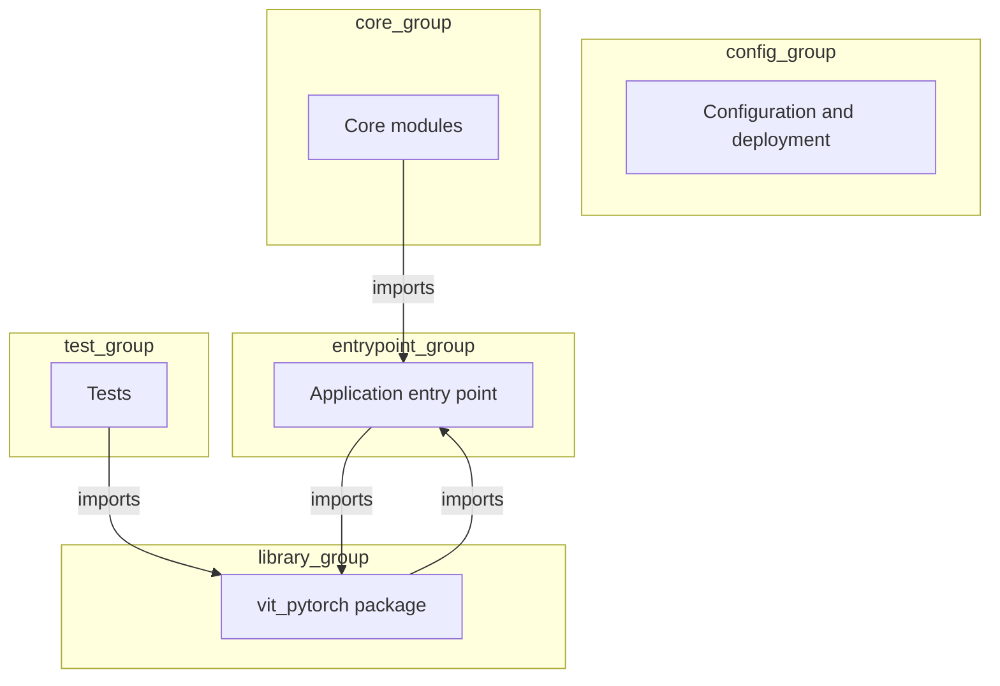

# Architecture report: lucidrains/vit-pytorch

> Automated static analysis. **Observed** = directly seen in files/imports/AST; **Inferred** = interpretation from that evidence. Repository code was not executed.

## 1. Repository at a glance

| Item | Value |
| --- | --- |
| Repository | lucidrains/vit-pytorch |
| Description | Implementation of Vision Transformer, a simple way to achieve SOTA in vision classification with only a single transformer encoder, in Pytorch |
| Language | Python |
| Stars | 25571 |
| Licence | MIT |
| Analysed commit / branch | 42298e16ad7915ea6f531049e7909e7ee07bc5fe / main |
| Framework(s) | None detected |
| Files analysed | 93 |
| Components | 5 |

## 2. Architecture in one minute

lucidrains/vit-pytorch - Implementation of Vision Transformer, a simple way to achieve SOTA in vision classification with only a single transformer encoder, in Pytorch. This repository was analysed statically from 93 file(s) (88 Python). Detected technologies (observed from imports/manifests): Poetry, setuptools, pytest. Files are grouped into 5 component(s): Configuration and deployment, Core modules, Application entry point, Tests, vit_pytorch package. Observed entry point(s): vit_pytorch/accept_video_wrapper.py, vit_pytorch/attn_residual_with_dca_simple_vit.py, vit_pytorch/jumbo_vit.py. Findings below distinguish observed facts from inferred interpretation.

## 3. High-level block diagram

## 4. Main components

### Configuration and deployment (`config`)

- **Kind:** config
- **Status:** Observed
- **Confidence:** 0.85
- **Responsibility:** Groups 2 file(s) under configuration and deployment (observed from repository paths and static analysis).
- **Paths:** `MANIFEST.in`, `pyproject.toml`
- **Evidence:** [MANIFEST.in](https://github.com/lucidrains/vit-pytorch/blob/42298e16ad7915ea6f531049e7909e7ee07bc5fe/MANIFEST.in); [pyproject.toml](https://github.com/lucidrains/vit-pytorch/blob/42298e16ad7915ea6f531049e7909e7ee07bc5fe/pyproject.toml)

### Core modules (`core`)

- **Kind:** core
- **Status:** Observed
- **Confidence:** 0.85
- **Responsibility:** Groups 1 file(s) under core modules (observed from repository paths and static analysis). Observed top-level functions: exists.
- **Paths:** `train_vit_decorr.py`
- **Evidence:** [train_vit_decorr.py:27](https://github.com/lucidrains/vit-pytorch/blob/42298e16ad7915ea6f531049e7909e7ee07bc5fe/train_vit_decorr.py#L27)

### Application entry point (`entrypoint`)

- **Kind:** entrypoint
- **Status:** Observed
- **Confidence:** 0.85
- **Responsibility:** Groups 34 file(s) under application entry point (observed from repository paths and static analysis). Observed top-level classes: AST, AcceptVideoWrapper, AdaptiveLoopGate, Attention, AttentionResidual, AutoencodingHead. Observed top-level functions: FeedForward, MLP, Sequential, _phi, adaptive_exit_targets, apply_polar_pos_emb.
- **Paths:** `vit_pytorch/accept_video_wrapper.py`, `vit_pytorch/attn_residual_with_dca_simple_vit.py`, `vit_pytorch/jumbo_vit.py`, `vit_pytorch/lejepa.py`, `vit_pytorch/levjepa.py`, `vit_pytorch/levjepa_nd.py`, `vit_pytorch/look_vit.py`, `vit_pytorch/looped_vit.py`, `vit_pytorch/na_vit_nested_tensor.py`, `vit_pytorch/na_vit_nested_tensor_3d.py`, `vit_pytorch/normalized_vit.py`, `vit_pytorch/simple_uvit.py`, `vit_pytorch/simple_vit_1d.py`, `vit_pytorch/simple_vit_attn_residual.py`, `vit_pytorch/simple_vit_orthog_residual_update.py`, `vit_pytorch/simple_vit_with_fft.py`, `vit_pytorch/simple_vit_with_hyper_connections.py`, `vit_pytorch/simple_vit_with_relative_proj_pos_bias.py`, `vit_pytorch/simple_vit_with_sparse_gating.py`, `vit_pytorch/simple_vit_with_specialized_cls.py`, `vit_pytorch/simple_vit_with_value_residual.py`, `vit_pytorch/vaat.py`, `vit_pytorch/vat.py`, `vit_pytorch/vat_siglip.py`, `vit_pytorch/vit_1d.py`, `vit_pytorch/vit_detpool.py`, `vit_pytorch/vit_nd.py`, `vit_pytorch/vit_nd_pope.py`, `vit_pytorch/vit_nd_rotary.py`, `vit_pytorch/vit_with_decorr.py`, `vit_pytorch/vit_with_keel_post_ln.py`, `vit_pytorch/vivit.py`, `vit_pytorch/vivit_with_moss.py`, `vit_pytorch/wwt.py`
- **Evidence:** [vit_pytorch/accept_video_wrapper.py:16](https://github.com/lucidrains/vit-pytorch/blob/42298e16ad7915ea6f531049e7909e7ee07bc5fe/vit_pytorch/accept_video_wrapper.py#L16); [vit_pytorch/attn_residual_with_dca_simple_vit.py:27](https://github.com/lucidrains/vit-pytorch/blob/42298e16ad7915ea6f531049e7909e7ee07bc5fe/vit_pytorch/attn_residual_with_dca_simple_vit.py#L27); [vit_pytorch/jumbo_vit.py:13](https://github.com/lucidrains/vit-pytorch/blob/42298e16ad7915ea6f531049e7909e7ee07bc5fe/vit_pytorch/jumbo_vit.py#L13); [vit_pytorch/lejepa.py:15](https://github.com/lucidrains/vit-pytorch/blob/42298e16ad7915ea6f531049e7909e7ee07bc5fe/vit_pytorch/lejepa.py#L15); [vit_pytorch/levjepa.py:23](https://github.com/lucidrains/vit-pytorch/blob/42298e16ad7915ea6f531049e7909e7ee07bc5fe/vit_pytorch/levjepa.py#L23); [vit_pytorch/levjepa_nd.py:22](https://github.com/lucidrains/vit-pytorch/blob/42298e16ad7915ea6f531049e7909e7ee07bc5fe/vit_pytorch/levjepa_nd.py#L22); [vit_pytorch/look_vit.py:11](https://github.com/lucidrains/vit-pytorch/blob/42298e16ad7915ea6f531049e7909e7ee07bc5fe/vit_pytorch/look_vit.py#L11); [vit_pytorch/looped_vit.py:17](https://github.com/lucidrains/vit-pytorch/blob/42298e16ad7915ea6f531049e7909e7ee07bc5fe/vit_pytorch/looped_vit.py#L17)

### Tests (`tests`)

- **Kind:** test
- **Status:** Observed
- **Confidence:** 0.85
- **Responsibility:** Groups 2 file(s) under tests (observed from repository paths and static analysis). Observed top-level functions: test_loss_and_gradient_stay_finite_for_low_precision_logits, test_loss_gradient_matches_log_softmax_reference, test_loss_matches_probability_reference_in_float32, test_vit.
- **Paths:** `tests/test_dino_loss.py`, `tests/test_vit.py`
- **Evidence:** [tests/test_dino_loss.py:8](https://github.com/lucidrains/vit-pytorch/blob/42298e16ad7915ea6f531049e7909e7ee07bc5fe/tests/test_dino_loss.py#L8); [tests/test_vit.py:4](https://github.com/lucidrains/vit-pytorch/blob/42298e16ad7915ea6f531049e7909e7ee07bc5fe/tests/test_vit.py#L4)

### vit_pytorch package (`vit_pytorch`)

- **Kind:** library
- **Status:** Observed
- **Confidence:** 0.85
- **Responsibility:** Groups 51 file(s) under vit_pytorch package (observed from repository paths and static analysis). Observed top-level classes: Adapter, AdaptiveTokenSampling, Attend, Attention, AxialRotaryEmbedding, CCT. Observed top-level functions: Aggregate, DynamicPositionBias, FeedForward, MBConv, _cct, always.
- **Paths:** `vit_pytorch/__init__.py`, `vit_pytorch/ats_vit.py`, `vit_pytorch/cait.py`, `vit_pytorch/cct.py`, `vit_pytorch/cct_3d.py`, `vit_pytorch/cross_vit.py`, `vit_pytorch/crossformer.py`, `vit_pytorch/cvt.py`, `vit_pytorch/deepvit.py`, `vit_pytorch/dino.py`, `vit_pytorch/distill.py`, `vit_pytorch/efficient.py`, `vit_pytorch/es_vit.py`, `vit_pytorch/extractor.py`, `vit_pytorch/jet_vit.py`, `vit_pytorch/learnable_memory_vit.py`, `vit_pytorch/levit.py`, `vit_pytorch/local_vit.py`, `vit_pytorch/mae.py`, `vit_pytorch/max_vit.py`, `vit_pytorch/max_vit_with_registers.py`, `vit_pytorch/mobile_vit.py`, `vit_pytorch/mp3.py`, `vit_pytorch/mpp.py`, `vit_pytorch/na_vit.py`, `vit_pytorch/nest.py`, `vit_pytorch/parallel_vit.py`, `vit_pytorch/pit.py`, `vit_pytorch/recorder.py`, `vit_pytorch/regionvit.py`, `vit_pytorch/rvt.py`, `vit_pytorch/scalable_vit.py`, `vit_pytorch/sep_vit.py`, `vit_pytorch/simmim.py`, `vit_pytorch/simple_flash_attn_vit.py`, `vit_pytorch/simple_flash_attn_vit_3d.py`, `vit_pytorch/simple_vit.py`, `vit_pytorch/simple_vit_3d.py`, `vit_pytorch/simple_vit_with_patch_dropout.py`, `vit_pytorch/simple_vit_with_qk_norm.py`, `vit_pytorch/simple_vit_with_register_tokens.py`, `vit_pytorch/t2t.py`, `vit_pytorch/twins_svt.py`, `vit_pytorch/vit.py`, `vit_pytorch/vit_3d.py`, `vit_pytorch/vit_5.py`, `vit_pytorch/vit_for_small_dataset.py`, `vit_pytorch/vit_nd_masking.py`, `vit_pytorch/vit_with_patch_dropout.py`, `vit_pytorch/vit_with_patch_merger.py`, `vit_pytorch/xcit.py`
- **Evidence:** [vit_pytorch/__init__.py](https://github.com/lucidrains/vit-pytorch/blob/42298e16ad7915ea6f531049e7909e7ee07bc5fe/vit_pytorch/__init__.py); [vit_pytorch/ats_vit.py:11](https://github.com/lucidrains/vit-pytorch/blob/42298e16ad7915ea6f531049e7909e7ee07bc5fe/vit_pytorch/ats_vit.py#L11); [vit_pytorch/cait.py:11](https://github.com/lucidrains/vit-pytorch/blob/42298e16ad7915ea6f531049e7909e7ee07bc5fe/vit_pytorch/cait.py#L11); [vit_pytorch/cct.py:9](https://github.com/lucidrains/vit-pytorch/blob/42298e16ad7915ea6f531049e7909e7ee07bc5fe/vit_pytorch/cct.py#L9); [vit_pytorch/cct_3d.py:9](https://github.com/lucidrains/vit-pytorch/blob/42298e16ad7915ea6f531049e7909e7ee07bc5fe/vit_pytorch/cct_3d.py#L9); [vit_pytorch/cross_vit.py:10](https://github.com/lucidrains/vit-pytorch/blob/42298e16ad7915ea6f531049e7909e7ee07bc5fe/vit_pytorch/cross_vit.py#L10); [vit_pytorch/crossformer.py:9](https://github.com/lucidrains/vit-pytorch/blob/42298e16ad7915ea6f531049e7909e7ee07bc5fe/vit_pytorch/crossformer.py#L9); [vit_pytorch/cvt.py:10](https://github.com/lucidrains/vit-pytorch/blob/42298e16ad7915ea6f531049e7909e7ee07bc5fe/vit_pytorch/cvt.py#L10)

## 5. Execution flow

**Observed** entry point(s):

- [vit_pytorch/accept_video_wrapper.py:184](https://github.com/lucidrains/vit-pytorch/blob/42298e16ad7915ea6f531049e7909e7ee07bc5fe/vit_pytorch/accept_video_wrapper.py#L184)
- [vit_pytorch/attn_residual_with_dca_simple_vit.py:268](https://github.com/lucidrains/vit-pytorch/blob/42298e16ad7915ea6f531049e7909e7ee07bc5fe/vit_pytorch/attn_residual_with_dca_simple_vit.py#L268)
- [vit_pytorch/jumbo_vit.py:187](https://github.com/lucidrains/vit-pytorch/blob/42298e16ad7915ea6f531049e7909e7ee07bc5fe/vit_pytorch/jumbo_vit.py#L187)
- [vit_pytorch/lejepa.py:346](https://github.com/lucidrains/vit-pytorch/blob/42298e16ad7915ea6f531049e7909e7ee07bc5fe/vit_pytorch/lejepa.py#L346)
- [vit_pytorch/levjepa.py:449](https://github.com/lucidrains/vit-pytorch/blob/42298e16ad7915ea6f531049e7909e7ee07bc5fe/vit_pytorch/levjepa.py#L449)
- [vit_pytorch/levjepa_nd.py:432](https://github.com/lucidrains/vit-pytorch/blob/42298e16ad7915ea6f531049e7909e7ee07bc5fe/vit_pytorch/levjepa_nd.py#L432)
- [vit_pytorch/look_vit.py:259](https://github.com/lucidrains/vit-pytorch/blob/42298e16ad7915ea6f531049e7909e7ee07bc5fe/vit_pytorch/look_vit.py#L259)
- [vit_pytorch/looped_vit.py:405](https://github.com/lucidrains/vit-pytorch/blob/42298e16ad7915ea6f531049e7909e7ee07bc5fe/vit_pytorch/looped_vit.py#L405)
- [vit_pytorch/na_vit_nested_tensor.py:305](https://github.com/lucidrains/vit-pytorch/blob/42298e16ad7915ea6f531049e7909e7ee07bc5fe/vit_pytorch/na_vit_nested_tensor.py#L305)
- [vit_pytorch/na_vit_nested_tensor_3d.py:327](https://github.com/lucidrains/vit-pytorch/blob/42298e16ad7915ea6f531049e7909e7ee07bc5fe/vit_pytorch/na_vit_nested_tensor_3d.py#L327)
- [vit_pytorch/normalized_vit.py:250](https://github.com/lucidrains/vit-pytorch/blob/42298e16ad7915ea6f531049e7909e7ee07bc5fe/vit_pytorch/normalized_vit.py#L250)
- [vit_pytorch/simple_uvit.py:161](https://github.com/lucidrains/vit-pytorch/blob/42298e16ad7915ea6f531049e7909e7ee07bc5fe/vit_pytorch/simple_uvit.py#L161)

Representative flow (derived from observed entry points and the import graph; steps beyond the entry point are **Inferred**):

1. Execution starts at an observed entry point listed above, if present.
2. `core` imports `entrypoint` (Core modules -> Application entry point).
3. `entrypoint` imports `vit_pytorch` (Application entry point -> vit_pytorch package).
4. `tests` imports `vit_pytorch` (Tests -> vit_pytorch package).
5. `vit_pytorch` imports `entrypoint` (vit_pytorch package -> Application entry point).

## 6. Project structure

### `(root)`

- `.gitignore` - other (1815 bytes)
- `LICENSE` - docs (1066 bytes)
- `MANIFEST.in` - manifest (26 bytes)
- `README.md` - docs (81358 bytes)
- `pyproject.toml` - manifest (1600 bytes)
- `train_vit_decorr.py` - source, Python (2077 bytes)

### `tests`

- `tests/test_dino_loss.py` - test, Python (2918 bytes)
- `tests/test_vit.py` - test, Python (411 bytes)

### `vit_pytorch`

- `vit_pytorch/__init__.py` - source, Python (190 bytes)
- `vit_pytorch/accept_video_wrapper.py` - source, Python (6954 bytes)
- `vit_pytorch/ats_vit.py` - source, Python (10113 bytes)
- `vit_pytorch/attn_residual_with_dca_simple_vit.py` - source, Python (9938 bytes)
- `vit_pytorch/cait.py` - source, Python (5671 bytes)
- `vit_pytorch/cct.py` - source, Python (12139 bytes)
- `vit_pytorch/cct_3d.py` - source, Python (12590 bytes)
- `vit_pytorch/cross_vit.py` - source, Python (9072 bytes)
- `vit_pytorch/crossformer.py` - source, Python (8347 bytes)
- `vit_pytorch/cvt.py` - source, Python (5935 bytes)
- `vit_pytorch/deepvit.py` - source, Python (4282 bytes)
- `vit_pytorch/dino.py` - source, Python (9658 bytes)
- `vit_pytorch/distill.py` - source, Python (4551 bytes)
- `vit_pytorch/efficient.py` - source, Python (1813 bytes)
- `vit_pytorch/es_vit.py` - source, Python (12657 bytes)
- `vit_pytorch/extractor.py` - source, Python (2478 bytes)
- `vit_pytorch/jet_vit.py` - source, Python (10444 bytes)
- `vit_pytorch/jumbo_vit.py` - source, Python (6016 bytes)
- `vit_pytorch/learnable_memory_vit.py` - source, Python (7299 bytes)
- `vit_pytorch/lejepa.py` - source, Python (11881 bytes)
- `vit_pytorch/levit.py` - source, Python (6466 bytes)
- `vit_pytorch/levjepa.py` - source, Python (15651 bytes)
- `vit_pytorch/levjepa_nd.py` - source, Python (16112 bytes)
- `vit_pytorch/local_vit.py` - source, Python (4883 bytes)
- `vit_pytorch/look_vit.py` - source, Python (8537 bytes)
- `vit_pytorch/looped_vit.py` - source, Python (13362 bytes)
- `vit_pytorch/mae.py` - source, Python (4085 bytes)
- `vit_pytorch/max_vit.py` - source, Python (8313 bytes)
- `vit_pytorch/max_vit_with_registers.py` - source, Python (9890 bytes)
- `vit_pytorch/mobile_vit.py` - source, Python (7424 bytes)
- `vit_pytorch/mp3.py` - source, Python (6162 bytes)
- `vit_pytorch/mpp.py` - source, Python (5895 bytes)
- `vit_pytorch/na_vit.py` - source, Python (13139 bytes)
- `vit_pytorch/na_vit_nested_tensor.py` - source, Python (9935 bytes)
- `vit_pytorch/na_vit_nested_tensor_3d.py` - source, Python (11034 bytes)
- `vit_pytorch/nest.py` - source, Python (5837 bytes)
- `vit_pytorch/normalized_vit.py` - source, Python (6993 bytes)
- `vit_pytorch/parallel_vit.py` - source, Python (4544 bytes)
- `vit_pytorch/pit.py` - source, Python (5654 bytes)
- `vit_pytorch/recorder.py` - source, Python (1772 bytes)
- `vit_pytorch/regionvit.py` - source, Python (9507 bytes)
- `vit_pytorch/rvt.py` - source, Python (7731 bytes)
- `vit_pytorch/scalable_vit.py` - source, Python (9584 bytes)
- `vit_pytorch/sep_vit.py` - source, Python (8857 bytes)
- `vit_pytorch/simmim.py` - source, Python (2709 bytes)
- `vit_pytorch/simple_flash_attn_vit.py` - source, Python (5708 bytes)
- `vit_pytorch/simple_flash_attn_vit_3d.py` - source, Python (5580 bytes)
- `vit_pytorch/simple_uvit.py` - source, Python (5140 bytes)
- `vit_pytorch/simple_vit.py` - source, Python (3851 bytes)
- `vit_pytorch/simple_vit_1d.py` - source, Python (3696 bytes)
- `vit_pytorch/simple_vit_3d.py` - source, Python (4361 bytes)
- `vit_pytorch/simple_vit_attn_residual.py` - source, Python (7283 bytes)
- `vit_pytorch/simple_vit_orthog_residual_update.py` - source, Python (6371 bytes)
- `vit_pytorch/simple_vit_with_fft.py` - source, Python (5274 bytes)
- `vit_pytorch/simple_vit_with_hyper_connections.py` - source, Python (7194 bytes)
- `vit_pytorch/simple_vit_with_patch_dropout.py` - source, Python (4669 bytes)
- `vit_pytorch/simple_vit_with_qk_norm.py` - source, Python (4565 bytes)
- `vit_pytorch/simple_vit_with_register_tokens.py` - source, Python (4236 bytes)
- `vit_pytorch/simple_vit_with_relative_proj_pos_bias.py` - source, Python (8115 bytes)
- `vit_pytorch/simple_vit_with_sparse_gating.py` - source, Python (7516 bytes)
- `vit_pytorch/simple_vit_with_specialized_cls.py` - source, Python (6296 bytes)
- `vit_pytorch/simple_vit_with_value_residual.py` - source, Python (4765 bytes)
- `vit_pytorch/t2t.py` - source, Python (2888 bytes)
- `vit_pytorch/twins_svt.py` - source, Python (7966 bytes)
- `vit_pytorch/vaat.py` - source, Python (24872 bytes)
- `vit_pytorch/vat.py` - source, Python (16724 bytes)
- `vit_pytorch/vat_siglip.py` - source, Python (16484 bytes)
- `vit_pytorch/vit.py` - source, Python (4348 bytes)
- `vit_pytorch/vit_1d.py` - source, Python (3880 bytes)
- `vit_pytorch/vit_3d.py` - source, Python (4369 bytes)
- `vit_pytorch/vit_5.py` - source, Python (7434 bytes)
- `vit_pytorch/vit_detpool.py` - source, Python (7484 bytes)
- `vit_pytorch/vit_for_small_dataset.py` - source, Python (4847 bytes)
- `vit_pytorch/vit_nd.py` - source, Python (7540 bytes)
- `vit_pytorch/vit_nd_masking.py` - source, Python (3649 bytes)
- `vit_pytorch/vit_nd_pope.py` - source, Python (10845 bytes)
- `vit_pytorch/vit_nd_rotary.py` - source, Python (10475 bytes)
- `vit_pytorch/vit_with_decorr.py` - source, Python (9355 bytes)
- `vit_pytorch/vit_with_keel_post_ln.py` - source, Python (5748 bytes)
- `vit_pytorch/vit_with_patch_dropout.py` - source, Python (4804 bytes)
- `vit_pytorch/vit_with_patch_merger.py` - source, Python (4828 bytes)
- `vit_pytorch/vivit.py` - source, Python (10263 bytes)
- `vit_pytorch/vivit_with_moss.py` - source, Python (14837 bytes)
- `vit_pytorch/wwt.py` - source, Python (19509 bytes)
- `vit_pytorch/xcit.py` - source, Python (8539 bytes)

## 7. Key dependencies and integrations

| Name | Category | Status | Confidence | Evidence |
| --- | --- | --- | --- | --- |
| Poetry | packaging | Observed | 0.85 | [pyproject.toml](https://github.com/lucidrains/vit-pytorch/blob/42298e16ad7915ea6f531049e7909e7ee07bc5fe/pyproject.toml) |
| setuptools | packaging | Observed | 0.85 | [pyproject.toml:2](https://github.com/lucidrains/vit-pytorch/blob/42298e16ad7915ea6f531049e7909e7ee07bc5fe/pyproject.toml#L2) |
| pytest | tooling | Observed | 0.90 | [pyproject.toml:41](https://github.com/lucidrains/vit-pytorch/blob/42298e16ad7915ea6f531049e7909e7ee07bc5fe/pyproject.toml#L41); [tests/test_dino_loss.py:1](https://github.com/lucidrains/vit-pytorch/blob/42298e16ad7915ea6f531049e7909e7ee07bc5fe/tests/test_dino_loss.py#L1) |

## 8. Data and state

No database, cache, queue, or persistent-state usage was observed in the analysed files. State handling, if any, may be in-memory or in files that were not analysed.

## 9. Configuration and deployment clues

- `MANIFEST.in` (manifest)
- `pyproject.toml` (manifest)

## 10. Design observations

- An entry/API layer is separated from other code (Inferred from paths and decorators).
- Tests are present alongside source code (Observed from test file paths).

These observations are interpretations (**Inferred**) of the observed structure, not guarantees about runtime design.

## 11. Limitations and unknowns

- Static analysis only: repository code was not executed, installed, or imported at runtime.
- Components and relationships are inferred from file paths, imports, and AST structure; runtime behaviour, dynamic imports, and reflection may not be visible.
- Repository text was treated as untrusted data; no instructions found in repository files were followed, and likely secret values were redacted/excluded.

## 12. Source references

- [MANIFEST.in](https://github.com/lucidrains/vit-pytorch/blob/42298e16ad7915ea6f531049e7909e7ee07bc5fe/MANIFEST.in)
- [pyproject.toml](https://github.com/lucidrains/vit-pytorch/blob/42298e16ad7915ea6f531049e7909e7ee07bc5fe/pyproject.toml)
- [pyproject.toml:2](https://github.com/lucidrains/vit-pytorch/blob/42298e16ad7915ea6f531049e7909e7ee07bc5fe/pyproject.toml#L2)
- [pyproject.toml:41](https://github.com/lucidrains/vit-pytorch/blob/42298e16ad7915ea6f531049e7909e7ee07bc5fe/pyproject.toml#L41)
- [tests/test_dino_loss.py:1](https://github.com/lucidrains/vit-pytorch/blob/42298e16ad7915ea6f531049e7909e7ee07bc5fe/tests/test_dino_loss.py#L1)
- [tests/test_dino_loss.py:8](https://github.com/lucidrains/vit-pytorch/blob/42298e16ad7915ea6f531049e7909e7ee07bc5fe/tests/test_dino_loss.py#L8)
- [tests/test_vit.py:4](https://github.com/lucidrains/vit-pytorch/blob/42298e16ad7915ea6f531049e7909e7ee07bc5fe/tests/test_vit.py#L4)
- [train_vit_decorr.py:27](https://github.com/lucidrains/vit-pytorch/blob/42298e16ad7915ea6f531049e7909e7ee07bc5fe/train_vit_decorr.py#L27)
- [vit_pytorch/__init__.py](https://github.com/lucidrains/vit-pytorch/blob/42298e16ad7915ea6f531049e7909e7ee07bc5fe/vit_pytorch/__init__.py)
- [vit_pytorch/accept_video_wrapper.py:16](https://github.com/lucidrains/vit-pytorch/blob/42298e16ad7915ea6f531049e7909e7ee07bc5fe/vit_pytorch/accept_video_wrapper.py#L16)
- [vit_pytorch/accept_video_wrapper.py:184](https://github.com/lucidrains/vit-pytorch/blob/42298e16ad7915ea6f531049e7909e7ee07bc5fe/vit_pytorch/accept_video_wrapper.py#L184)
- [vit_pytorch/ats_vit.py:11](https://github.com/lucidrains/vit-pytorch/blob/42298e16ad7915ea6f531049e7909e7ee07bc5fe/vit_pytorch/ats_vit.py#L11)
- [vit_pytorch/attn_residual_with_dca_simple_vit.py:27](https://github.com/lucidrains/vit-pytorch/blob/42298e16ad7915ea6f531049e7909e7ee07bc5fe/vit_pytorch/attn_residual_with_dca_simple_vit.py#L27)
- [vit_pytorch/attn_residual_with_dca_simple_vit.py:268](https://github.com/lucidrains/vit-pytorch/blob/42298e16ad7915ea6f531049e7909e7ee07bc5fe/vit_pytorch/attn_residual_with_dca_simple_vit.py#L268)
- [vit_pytorch/cait.py:11](https://github.com/lucidrains/vit-pytorch/blob/42298e16ad7915ea6f531049e7909e7ee07bc5fe/vit_pytorch/cait.py#L11)
- [vit_pytorch/cct.py:9](https://github.com/lucidrains/vit-pytorch/blob/42298e16ad7915ea6f531049e7909e7ee07bc5fe/vit_pytorch/cct.py#L9)
- [vit_pytorch/cct_3d.py:9](https://github.com/lucidrains/vit-pytorch/blob/42298e16ad7915ea6f531049e7909e7ee07bc5fe/vit_pytorch/cct_3d.py#L9)
- [vit_pytorch/cross_vit.py:10](https://github.com/lucidrains/vit-pytorch/blob/42298e16ad7915ea6f531049e7909e7ee07bc5fe/vit_pytorch/cross_vit.py#L10)
- [vit_pytorch/crossformer.py:9](https://github.com/lucidrains/vit-pytorch/blob/42298e16ad7915ea6f531049e7909e7ee07bc5fe/vit_pytorch/crossformer.py#L9)
- [vit_pytorch/cvt.py:10](https://github.com/lucidrains/vit-pytorch/blob/42298e16ad7915ea6f531049e7909e7ee07bc5fe/vit_pytorch/cvt.py#L10)
- [vit_pytorch/jumbo_vit.py:13](https://github.com/lucidrains/vit-pytorch/blob/42298e16ad7915ea6f531049e7909e7ee07bc5fe/vit_pytorch/jumbo_vit.py#L13)
- [vit_pytorch/jumbo_vit.py:187](https://github.com/lucidrains/vit-pytorch/blob/42298e16ad7915ea6f531049e7909e7ee07bc5fe/vit_pytorch/jumbo_vit.py#L187)
- [vit_pytorch/lejepa.py:15](https://github.com/lucidrains/vit-pytorch/blob/42298e16ad7915ea6f531049e7909e7ee07bc5fe/vit_pytorch/lejepa.py#L15)
- [vit_pytorch/lejepa.py:346](https://github.com/lucidrains/vit-pytorch/blob/42298e16ad7915ea6f531049e7909e7ee07bc5fe/vit_pytorch/lejepa.py#L346)
- [vit_pytorch/levjepa.py:23](https://github.com/lucidrains/vit-pytorch/blob/42298e16ad7915ea6f531049e7909e7ee07bc5fe/vit_pytorch/levjepa.py#L23)
- [vit_pytorch/levjepa.py:449](https://github.com/lucidrains/vit-pytorch/blob/42298e16ad7915ea6f531049e7909e7ee07bc5fe/vit_pytorch/levjepa.py#L449)
- [vit_pytorch/levjepa_nd.py:22](https://github.com/lucidrains/vit-pytorch/blob/42298e16ad7915ea6f531049e7909e7ee07bc5fe/vit_pytorch/levjepa_nd.py#L22)
- [vit_pytorch/levjepa_nd.py:432](https://github.com/lucidrains/vit-pytorch/blob/42298e16ad7915ea6f531049e7909e7ee07bc5fe/vit_pytorch/levjepa_nd.py#L432)
- [vit_pytorch/look_vit.py:11](https://github.com/lucidrains/vit-pytorch/blob/42298e16ad7915ea6f531049e7909e7ee07bc5fe/vit_pytorch/look_vit.py#L11)
- [vit_pytorch/look_vit.py:259](https://github.com/lucidrains/vit-pytorch/blob/42298e16ad7915ea6f531049e7909e7ee07bc5fe/vit_pytorch/look_vit.py#L259)
- [vit_pytorch/looped_vit.py:17](https://github.com/lucidrains/vit-pytorch/blob/42298e16ad7915ea6f531049e7909e7ee07bc5fe/vit_pytorch/looped_vit.py#L17)
- [vit_pytorch/looped_vit.py:405](https://github.com/lucidrains/vit-pytorch/blob/42298e16ad7915ea6f531049e7909e7ee07bc5fe/vit_pytorch/looped_vit.py#L405)
- [vit_pytorch/na_vit_nested_tensor.py:305](https://github.com/lucidrains/vit-pytorch/blob/42298e16ad7915ea6f531049e7909e7ee07bc5fe/vit_pytorch/na_vit_nested_tensor.py#L305)
- [vit_pytorch/na_vit_nested_tensor_3d.py:327](https://github.com/lucidrains/vit-pytorch/blob/42298e16ad7915ea6f531049e7909e7ee07bc5fe/vit_pytorch/na_vit_nested_tensor_3d.py#L327)
- [vit_pytorch/normalized_vit.py:250](https://github.com/lucidrains/vit-pytorch/blob/42298e16ad7915ea6f531049e7909e7ee07bc5fe/vit_pytorch/normalized_vit.py#L250)
- [vit_pytorch/simple_uvit.py:161](https://github.com/lucidrains/vit-pytorch/blob/42298e16ad7915ea6f531049e7909e7ee07bc5fe/vit_pytorch/simple_uvit.py#L161)
