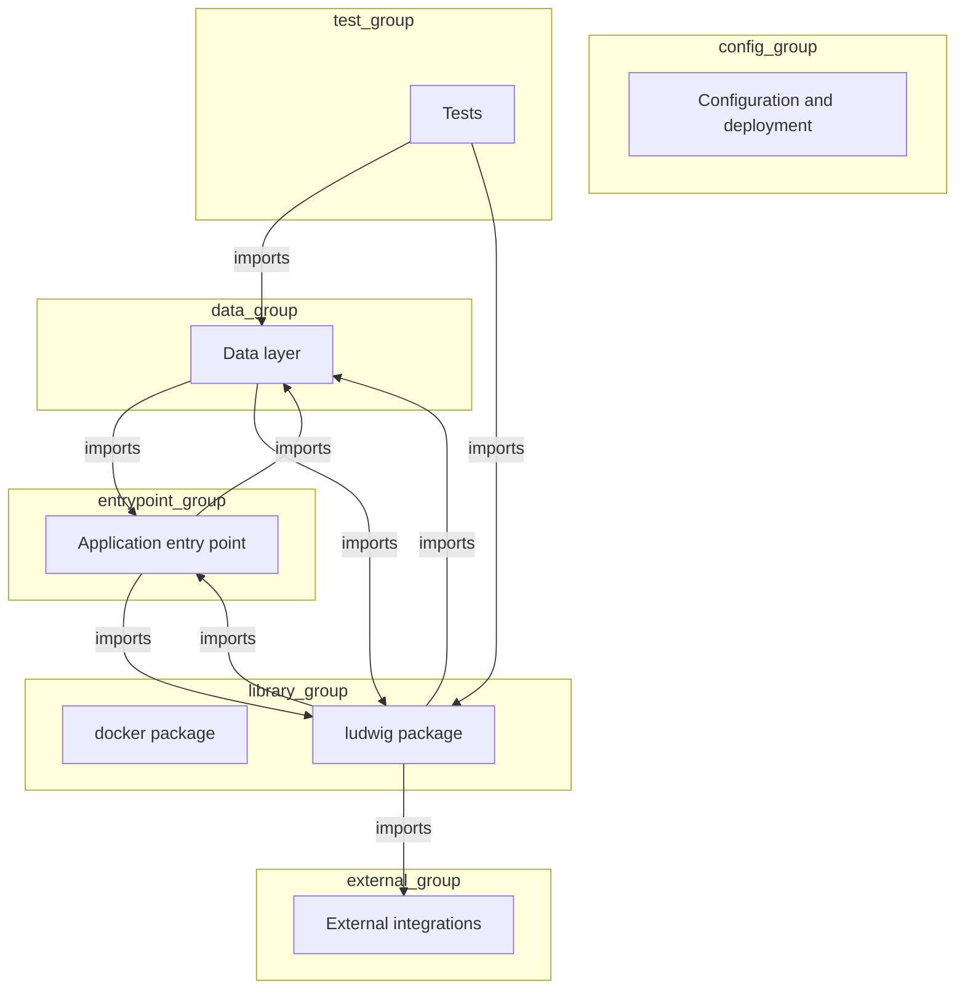

# Architecture report: ludwig-ai/ludwig

> Automated static analysis. **Observed** = directly seen in files/imports/AST; **Inferred** = interpretation from that evidence. Repository code was not executed.

## 1. Repository at a glance

| Item | Value |
| --- | --- |
| Repository | ludwig-ai/ludwig |
| Description | Low-code framework for building custom LLMs, neural networks, and other AI models |
| Language | Python |
| Stars | 11790 |
| Licence | Apache-2.0 |
| Analysed commit / branch | b16404c1e985a23f2b7c0246228c4fc85b7cf406 / main |
| Framework(s) | None detected |
| Files analysed | 800 |
| Components | 7 |

## 2. Architecture in one minute

ludwig-ai/ludwig - Low-code framework for building custom LLMs, neural networks, and other AI models. This repository was analysed statically from 800 file(s) (148 Python). Detected technologies (observed from imports/manifests): GitHub Actions, NumPy, pandas, Pydantic, requests, Docker. Files are grouped into 7 component(s): Configuration and deployment, Data layer, docker package, Application entry point, External integrations, ludwig package, Tests. Observed entry point(s): ludwig/benchmarking/summarize.py, ludwig/cli.py, ludwig/collect.py. Findings below distinguish observed facts from inferred interpretation.

## 3. High-level block diagram

## 4. Main components

### Configuration and deployment (`config`)

- **Kind:** config
- **Status:** Observed
- **Confidence:** 0.85
- **Responsibility:** Groups 475 file(s) under configuration and deployment (observed from repository paths and static analysis).
- **Paths:** `docker/ludwig-gpu/Dockerfile`, `docker/ludwig-ray-gpu/Dockerfile`, `docker/ludwig-ray/Dockerfile`, `docker/ludwig/Dockerfile`, `ludwig/automl/defaults/base_automl_config.yaml`, `ludwig/automl/defaults/combiner/concat_config.yaml`, `ludwig/automl/defaults/combiner/ft_transformer_config.yaml`, `ludwig/automl/defaults/combiner/tabnet_config.yaml`, `ludwig/automl/defaults/combiner/tabtransformer_config.yaml`, `ludwig/automl/defaults/combiner/transformer_config.yaml`, `ludwig/automl/defaults/reference_configs.yaml`, `ludwig/automl/defaults/text/bert_config.yaml`, `ludwig/benchmarking/configs/allstate_claims_severity.yaml`, `ludwig/benchmarking/configs/amazon_review_polarity.yaml`, `ludwig/benchmarking/configs/amazon_reviews.yaml`, `ludwig/benchmarking/configs/ames_housing.yaml`, `ludwig/benchmarking/configs/bnp_claims_management.yaml`, `ludwig/benchmarking/configs/connect4.yaml`, `ludwig/benchmarking/configs/goemotions.yaml`, `ludwig/benchmarking/configs/higgs.yaml`, `ludwig/benchmarking/configs/ieee_fraud.yaml`, `ludwig/benchmarking/configs/imbalanced_insurance.yaml`, `ludwig/benchmarking/configs/mercedes_benz_greener.yaml`, `ludwig/benchmarking/configs/otto_group_product.yaml`, `ludwig/benchmarking/configs/porto_seguro_safe_driver.yaml`, `ludwig/benchmarking/configs/protein.yaml`, `ludwig/benchmarking/configs/santander_customer_satisfaction.yaml`, `ludwig/benchmarking/configs/santander_customer_transaction.yaml`, `ludwig/benchmarking/configs/sst2.yaml`, `ludwig/benchmarking/configs/sst3.yaml`, `ludwig/benchmarking/configs/sst5.yaml`, `ludwig/benchmarking/configs/titanic.yaml`, `ludwig/benchmarking/configs/yelp_reviews.yaml`, `ludwig/benchmarking/examples/benchmarking_config.yaml`, `ludwig/datasets/configs/__init__.py`, `ludwig/datasets/configs/abjad_kids.yaml`, `ludwig/datasets/configs/acronym_identification.yaml`, `ludwig/datasets/configs/adult_census_income.yaml`, `ludwig/datasets/configs/adult_income_hf.yaml`, `ludwig/datasets/configs/ae_price_prediction.yaml`, `ludwig/datasets/configs/aegis_safety.yaml`, `ludwig/datasets/configs/aeslc.yaml`, `ludwig/datasets/configs/ag_news_hf.yaml`, `ludwig/datasets/configs/agnews.yaml`, `ludwig/datasets/configs/ai2d_diagrams.yaml`, `ludwig/datasets/configs/ai_generated_ecommerce.yaml`, `ludwig/datasets/configs/allocine.yaml`, `ludwig/datasets/configs/allstate_claims_severity.yaml`, `ludwig/datasets/configs/alpaca.yaml`, `ludwig/datasets/configs/alpaca_cleaned.yaml`, `ludwig/datasets/configs/alpaca_gpt4.yaml`, `ludwig/datasets/configs/alpaca_gpt4_zh.yaml`, `ludwig/datasets/configs/amazon_employee_access_challenge.yaml`, `ludwig/datasets/configs/amazon_massive_intent.yaml`, `ludwig/datasets/configs/amazon_massive_scenario.yaml`, `ludwig/datasets/configs/amazon_polarity.yaml`, `ludwig/datasets/configs/amazon_review_polarity.yaml`, `ludwig/datasets/configs/amazon_reviews.yaml`, `ludwig/datasets/configs/amazon_reviews_2023.yaml`, `ludwig/datasets/configs/amazon_science_massive.yaml`, `ludwig/datasets/configs/ambig_qa.yaml`, `ludwig/datasets/configs/ames_housing.yaml`, `ludwig/datasets/configs/ami_asr.yaml`, `ludwig/datasets/configs/anli.yaml`, `ludwig/datasets/configs/app_reviews.yaml`, `ludwig/datasets/configs/aqua_rat.yaml`, `ludwig/datasets/configs/arc_challenge.yaml`, `ludwig/datasets/configs/arc_easy.yaml`, `ludwig/datasets/configs/arxiv_abstracts_2021.yaml`, `ludwig/datasets/configs/arxiv_summarization.yaml`, `ludwig/datasets/configs/audioset_balanced.yaml`, `ludwig/datasets/configs/banking77.yaml`, `ludwig/datasets/configs/banking77_legacy.yaml`, `ludwig/datasets/configs/bbcnews.yaml`, `ludwig/datasets/configs/bbh.yaml`, `ludwig/datasets/configs/beans.yaml`, `ludwig/datasets/configs/beavertails.yaml`, `ludwig/datasets/configs/belebele.yaml`, `ludwig/datasets/configs/belebele_fr.yaml`, `ludwig/datasets/configs/big_patent.yaml`, `ludwig/datasets/configs/bigbench.yaml`, `ludwig/datasets/configs/billsum.yaml`, `ludwig/datasets/configs/bitext_customer_intent.yaml`, `ludwig/datasets/configs/bitext_customer_support.yaml`, `ludwig/datasets/configs/blimp.yaml`, `ludwig/datasets/configs/bnp_claims_management.yaml`, `ludwig/datasets/configs/bookprice_prediction.yaml`, `ludwig/datasets/configs/boolq.yaml`, `ludwig/datasets/configs/boolq_standalone.yaml`, `ludwig/datasets/configs/bornholm_bitext.yaml`, `ludwig/datasets/configs/brazilian_toxic_tweets.yaml`, `ludwig/datasets/configs/california_house_price.yaml`, `ludwig/datasets/configs/california_housing.yaml`, `ludwig/datasets/configs/camseq.yaml`, `ludwig/datasets/configs/cantonese_asr.yaml`, `ludwig/datasets/configs/ccnews.yaml`, `ludwig/datasets/configs/cifar10.yaml`, `ludwig/datasets/configs/cifar100.yaml`, `ludwig/datasets/configs/civil_comments.yaml`, `ludwig/datasets/configs/climate_fever.yaml`, `ludwig/datasets/configs/climate_sentiment.yaml`, `ludwig/datasets/configs/clinc_oos.yaml`, `ludwig/datasets/configs/clue_afqmc.yaml`, `ludwig/datasets/configs/cmrc2018.yaml`, `ludwig/datasets/configs/cnn_dailymail.yaml`, `ludwig/datasets/configs/cnn_dm_hf.yaml`, `ludwig/datasets/configs/code_alpaca.yaml`, `ludwig/datasets/configs/code_contests.yaml`, `ludwig/datasets/configs/code_defect_detection.yaml`, `ludwig/datasets/configs/code_search_net.yaml`, `ludwig/datasets/configs/codex_thinking.yaml`, `ludwig/datasets/configs/codexglue_code_to_text.yaml`, `ludwig/datasets/configs/coig_cqia.yaml`, `ludwig/datasets/configs/cola.yaml`, `ludwig/datasets/configs/commitment_bank.yaml`, `ludwig/datasets/configs/commonsense_qa.yaml`, `ludwig/datasets/configs/compas_recidivism.yaml`, `ludwig/datasets/configs/connect4.yaml`, `ludwig/datasets/configs/consumer_complaints.yaml`, `ludwig/datasets/configs/copa.yaml`, `ludwig/datasets/configs/cord_v2.yaml`, `ludwig/datasets/configs/credit_card_default.yaml`, `ludwig/datasets/configs/creditcard_fraud.yaml`, `ludwig/datasets/configs/customer_churn_prediction.yaml`, `ludwig/datasets/configs/customer_reviews.yaml`, `ludwig/datasets/configs/dair_emotion.yaml`, `ludwig/datasets/configs/data_scientist_salary.yaml`, `ludwig/datasets/configs/databench_qa.yaml`, `ludwig/datasets/configs/databricks_dolly_15k.yaml`, `ludwig/datasets/configs/dbpedia.yaml`, `ludwig/datasets/configs/dbpedia_14.yaml`, `ludwig/datasets/configs/diabetes_readmission.yaml`, `ludwig/datasets/configs/dialogsum.yaml`, `ludwig/datasets/configs/docvqa.yaml`, `ludwig/datasets/configs/dolly_15k.yaml`, `ludwig/datasets/configs/drop.yaml`, `ludwig/datasets/configs/duorc.yaml`, `ludwig/datasets/configs/electricity.yaml`, `ludwig/datasets/configs/electricity_tabular.yaml`, `ludwig/datasets/configs/emodb.yaml`, `ludwig/datasets/configs/emotion.yaml`, `ludwig/datasets/configs/enron_spam.yaml`, `ludwig/datasets/configs/esc50.yaml`, `ludwig/datasets/configs/europarl_bg_cs.yaml`, `ludwig/datasets/configs/europarl_bg_en.yaml`, `ludwig/datasets/configs/europarl_cs_en.yaml`, `ludwig/datasets/configs/europarl_da_en.yaml`, `ludwig/datasets/configs/europarl_de_en.yaml`, `ludwig/datasets/configs/europarl_el_en.yaml`, `ludwig/datasets/configs/europarl_en_es.yaml`, `ludwig/datasets/configs/europarl_en_fr.yaml`, `ludwig/datasets/configs/europarl_en_it.yaml`, `ludwig/datasets/configs/europarl_en_nl.yaml`, `ludwig/datasets/configs/europarl_en_pl.yaml`, `ludwig/datasets/configs/europarl_en_pt.yaml`, `ludwig/datasets/configs/europarl_en_ro.yaml`, `ludwig/datasets/configs/europarl_en_sv.yaml`, `ludwig/datasets/configs/eurosat.yaml`, `ludwig/datasets/configs/eurosat_rgb.yaml`, `ludwig/datasets/configs/factcheck.yaml`, `ludwig/datasets/configs/fake_job_postings2.yaml`, `ludwig/datasets/configs/fake_news_detection.yaml`, `ludwig/datasets/configs/farstail_nli.yaml`, `ludwig/datasets/configs/fashion_mnist.yaml`, `ludwig/datasets/configs/fever.yaml`, `ludwig/datasets/configs/fever_gold.yaml`, `ludwig/datasets/configs/few_nerd.yaml`, `ludwig/datasets/configs/financial_phrasebank.yaml`, `ludwig/datasets/configs/fineweb_edu.yaml`, `ludwig/datasets/configs/flashrag_2wikimultihop.yaml`, `ludwig/datasets/configs/flickr8k.yaml`, `ludwig/datasets/configs/flores_101.yaml`, `ludwig/datasets/configs/food101.yaml`, `ludwig/datasets/configs/forest_cover.yaml`, `ludwig/datasets/configs/gaia_cepheids.yaml`, `ludwig/datasets/configs/gaia_rrlyrae.yaml`, `ludwig/datasets/configs/gaia_spectroscopic_binaries.yaml`, `ludwig/datasets/configs/gaia_young_stellar_objects.yaml`, `ludwig/datasets/configs/gaiasky_qa.yaml`, `ludwig/datasets/configs/germeval18.yaml`, `ludwig/datasets/configs/go_emotions.yaml`, `ludwig/datasets/configs/go_emotions_multiclass.yaml`, `ludwig/datasets/configs/goemotions.yaml`, `ludwig/datasets/configs/goodbooks_books.yaml`, `ludwig/datasets/configs/google_qa_answer_type_reason_explanation.yaml`, `ludwig/datasets/configs/google_qa_question_type_reason_explanation.yaml`, `ludwig/datasets/configs/google_quest_qa.yaml`, `ludwig/datasets/configs/govreport_summarization.yaml`, `ludwig/datasets/configs/graid_bdd.yaml`, `ludwig/datasets/configs/gsm8k.yaml`, `ludwig/datasets/configs/gsm8k_openai.yaml`, `ludwig/datasets/configs/gtsrb.yaml`, `ludwig/datasets/configs/handwritten_crossouts.yaml`, `ludwig/datasets/configs/hate_speech18.yaml`, `ludwig/datasets/configs/hatespeech_offensive.yaml`, `ludwig/datasets/configs/hc3.yaml`, `ludwig/datasets/configs/hc3_chinese.yaml`, `ludwig/datasets/configs/heart_failure.yaml`, `ludwig/datasets/configs/hellaswag.yaml`, `ludwig/datasets/configs/helpsteer2.yaml`, `ludwig/datasets/configs/hermes_function_calling.yaml`, `ludwig/datasets/configs/hh_rlhf.yaml`, `ludwig/datasets/configs/higgs.yaml`, `ludwig/datasets/configs/hotpot_qa.yaml`, `ludwig/datasets/configs/hugging_face.yaml`, `ludwig/datasets/configs/ieee_fraud.yaml`, `ludwig/datasets/configs/imagenet_100.yaml`, `ludwig/datasets/configs/imbalanced_insurance.yaml`, `ludwig/datasets/configs/imdb.yaml`, `ludwig/datasets/configs/imdb_genre_prediction.yaml`, `ludwig/datasets/configs/imdb_mteb.yaml`, `ludwig/datasets/configs/imdb_sentiment.yaml`, `ludwig/datasets/configs/indic_glue.yaml`, `ludwig/datasets/configs/insurance_lite.yaml`, `ludwig/datasets/configs/intuitive_physics.yaml`, `ludwig/datasets/configs/invoice_data.yaml`, `ludwig/datasets/configs/iris.yaml`, `ludwig/datasets/configs/iris_sklearn.yaml`, `ludwig/datasets/configs/irony.yaml`, `ludwig/datasets/configs/jc_penney_products.yaml`, `ludwig/datasets/configs/jigsaw_unintended_bias.yaml`, `ludwig/datasets/configs/jigsaw_unintended_bias100k.yaml`, `ludwig/datasets/configs/kdd_appetency.yaml`, `ludwig/datasets/configs/kdd_churn.yaml`, `ludwig/datasets/configs/kdd_upselling.yaml`, `ludwig/datasets/configs/kick_starter_funding.yaml`, `ludwig/datasets/configs/kilt_nq.yaml`, `ludwig/datasets/configs/klue_sts.yaml`, `ludwig/datasets/configs/klue_topic.yaml`, `ludwig/datasets/configs/kmmlu.yaml`, `ludwig/datasets/configs/kvasir_vqa.yaml`, `ludwig/datasets/configs/language_identification.yaml`, `ludwig/datasets/configs/lex_glue_ecthr.yaml`, `ludwig/datasets/configs/lex_glue_eurlex.yaml`, `ludwig/datasets/configs/librispeech.yaml`, `ludwig/datasets/configs/lmsys_arena.yaml`, `ludwig/datasets/configs/m3cot.yaml`, `ludwig/datasets/configs/m_mmlu.yaml`, `ludwig/datasets/configs/map_trace.yaml`, `ludwig/datasets/configs/math500.yaml`, `ludwig/datasets/configs/mathvista.yaml`, `ludwig/datasets/configs/mbpp.yaml`, `ludwig/datasets/configs/measuring_hate_speech.yaml`, `ludwig/datasets/configs/medical_flashcards.yaml`, `ludwig/datasets/configs/medmcqa.yaml`, `ludwig/datasets/configs/melbourne_airbnb.yaml`, `ludwig/datasets/configs/mercari_price_suggestion.yaml`, `ludwig/datasets/configs/mercari_price_suggestion100K.yaml`, `ludwig/datasets/configs/mercedes_benz_greener.yaml`, `ludwig/datasets/configs/merit.yaml`, `ludwig/datasets/configs/minds14.yaml`, `ludwig/datasets/configs/mini_imagenet.yaml`, `ludwig/datasets/configs/mls_german.yaml`, `ludwig/datasets/configs/mmlu.yaml`, `ludwig/datasets/configs/mmlu_lighteval.yaml`, `ludwig/datasets/configs/mmlu_pro.yaml`, `ludwig/datasets/configs/mmsulab.yaml`, `ludwig/datasets/configs/mnist.yaml`, `ludwig/datasets/configs/mnist_ylecun.yaml`, `ludwig/datasets/configs/mnli.yaml`, `ludwig/datasets/configs/mobile_mold.yaml`, `ludwig/datasets/configs/moral_stories.yaml`, `ludwig/datasets/configs/mrpc.yaml`, `ludwig/datasets/configs/msmarco_passage.yaml`, `ludwig/datasets/configs/mteb_amazon_polarity.yaml`, `ludwig/datasets/configs/mteb_amazon_reviews_class_de.yaml`, `ludwig/datasets/configs/mteb_amazon_reviews_class_en.yaml`, `ludwig/datasets/configs/mteb_amazon_reviews_class_es.yaml`, `ludwig/datasets/configs/mteb_amazon_reviews_class_fr.yaml`, `ludwig/datasets/configs/mteb_amazon_reviews_class_ja.yaml`, `ludwig/datasets/configs/mteb_amazon_reviews_class_zh.yaml`, `ludwig/datasets/configs/mteb_biosses.yaml`, `ludwig/datasets/configs/mteb_cyrillic_turkic.yaml`, `ludwig/datasets/configs/mteb_emotion.yaml`, `ludwig/datasets/configs/mteb_financial_phrasebank.yaml`, `ludwig/datasets/configs/mteb_frenk_en.yaml`, `ludwig/datasets/configs/mteb_frenk_hr.yaml`, `ludwig/datasets/configs/mteb_frenk_sl.yaml`, `ludwig/datasets/configs/mteb_georeview.yaml`, `ludwig/datasets/configs/mteb_greek_legal.yaml`, `ludwig/datasets/configs/mteb_imdb.yaml`, `ludwig/datasets/configs/mteb_ita_casehold.yaml`, `ludwig/datasets/configs/mteb_jd_review.yaml`, `ludwig/datasets/configs/mteb_kor_sarcasm.yaml`, `ludwig/datasets/configs/mteb_language_class.yaml`, `ludwig/datasets/configs/mteb_massive_intent_af.yaml`, `ludwig/datasets/configs/mteb_massive_intent_am.yaml`, `ludwig/datasets/configs/mteb_massive_intent_ar.yaml`, `ludwig/datasets/configs/mteb_massive_intent_az.yaml`, `ludwig/datasets/configs/mteb_massive_intent_bn.yaml`, `ludwig/datasets/configs/mteb_massive_intent_cy.yaml`, `ludwig/datasets/configs/mteb_massive_intent_da.yaml`, `ludwig/datasets/configs/mteb_massive_intent_de.yaml`, `ludwig/datasets/configs/mteb_massive_intent_el.yaml`, `ludwig/datasets/configs/mteb_massive_intent_en.yaml`, `ludwig/datasets/configs/mteb_massive_intent_es.yaml`, `ludwig/datasets/configs/mteb_massive_intent_fa.yaml`, `ludwig/datasets/configs/mteb_massive_intent_fi.yaml`, `ludwig/datasets/configs/mteb_massive_intent_fr.yaml`, `ludwig/datasets/configs/mteb_massive_intent_he.yaml`, `ludwig/datasets/configs/mteb_massive_intent_hi.yaml`, `ludwig/datasets/configs/mteb_massive_intent_hu.yaml`, `ludwig/datasets/configs/mteb_massive_intent_hy.yaml`, `ludwig/datasets/configs/mteb_massive_intent_id.yaml`, `ludwig/datasets/configs/mteb_massive_intent_is.yaml`, `ludwig/datasets/configs/mteb_massive_intent_it.yaml`, `ludwig/datasets/configs/mteb_massive_intent_ja.yaml`, `ludwig/datasets/configs/mteb_massive_intent_jv.yaml`, `ludwig/datasets/configs/mteb_massive_intent_ka.yaml`, `ludwig/datasets/configs/mteb_massive_intent_km.yaml`, `ludwig/datasets/configs/mteb_massive_intent_kn.yaml`, `ludwig/datasets/configs/mteb_massive_intent_ko.yaml`, `ludwig/datasets/configs/mteb_massive_intent_lv.yaml`, `ludwig/datasets/configs/mteb_massive_intent_ml.yaml`, `ludwig/datasets/configs/mteb_massive_intent_mn.yaml`, `ludwig/datasets/configs/mteb_massive_intent_ms.yaml`, `ludwig/datasets/configs/mteb_massive_intent_my.yaml`, `ludwig/datasets/configs/mteb_massive_intent_nb.yaml`, `ludwig/datasets/configs/mteb_massive_intent_nl.yaml`, `ludwig/datasets/configs/mteb_massive_intent_pl.yaml`, `ludwig/datasets/configs/mteb_massive_intent_pt.yaml`, `ludwig/datasets/configs/mteb_massive_intent_ro.yaml`, `ludwig/datasets/configs/mteb_massive_intent_ru.yaml`, `ludwig/datasets/configs/mteb_massive_intent_sl.yaml`, `ludwig/datasets/configs/mteb_massive_intent_sq.yaml`, `ludwig/datasets/configs/mteb_massive_intent_sv.yaml`, `ludwig/datasets/configs/mteb_massive_intent_sw.yaml`, `ludwig/datasets/configs/mteb_massive_intent_ta.yaml`, `ludwig/datasets/configs/mteb_massive_intent_te.yaml`, `ludwig/datasets/configs/mteb_massive_intent_th.yaml`, `ludwig/datasets/configs/mteb_massive_intent_tl.yaml`, `ludwig/datasets/configs/mteb_massive_intent_tr.yaml`, `ludwig/datasets/configs/mteb_massive_intent_ur.yaml`, `ludwig/datasets/configs/mteb_massive_intent_vi.yaml`, `ludwig/datasets/configs/mteb_massive_intent_zh_cn.yaml`, `ludwig/datasets/configs/mteb_massive_intent_zh_tw.yaml`, `ludwig/datasets/configs/mteb_massive_scenario_af.yaml`, `ludwig/datasets/configs/mteb_massive_scenario_am.yaml`, `ludwig/datasets/configs/mteb_massive_scenario_ar.yaml`, `ludwig/datasets/configs/mteb_massive_scenario_az.yaml`, `ludwig/datasets/configs/mteb_massive_scenario_bn.yaml`, `ludwig/datasets/configs/mteb_massive_scenario_cy.yaml`, `ludwig/datasets/configs/mteb_massive_scenario_da.yaml`, `ludwig/datasets/configs/mteb_massive_scenario_de.yaml`, `ludwig/datasets/configs/mteb_massive_scenario_el.yaml`, `ludwig/datasets/configs/mteb_massive_scenario_en.yaml`, `ludwig/datasets/configs/mteb_massive_scenario_es.yaml`, `ludwig/datasets/configs/mteb_massive_scenario_fa.yaml`, `ludwig/datasets/configs/mteb_massive_scenario_fi.yaml`, `ludwig/datasets/configs/mteb_massive_scenario_fr.yaml`, `ludwig/datasets/configs/mteb_massive_scenario_he.yaml`, `ludwig/datasets/configs/mteb_massive_scenario_hi.yaml`, `ludwig/datasets/configs/mteb_massive_scenario_hu.yaml`, `ludwig/datasets/configs/mteb_massive_scenario_hy.yaml`, `ludwig/datasets/configs/mteb_massive_scenario_id.yaml`, `ludwig/datasets/configs/mteb_massive_scenario_is.yaml`, `ludwig/datasets/configs/mteb_massive_scenario_it.yaml`, `ludwig/datasets/configs/mteb_massive_scenario_ja.yaml`, `ludwig/datasets/configs/mteb_massive_scenario_jv.yaml`, `ludwig/datasets/configs/mteb_massive_scenario_ka.yaml`, `ludwig/datasets/configs/mteb_massive_scenario_km.yaml`, `ludwig/datasets/configs/mteb_massive_scenario_kn.yaml`, `ludwig/datasets/configs/mteb_massive_scenario_ko.yaml`, `ludwig/datasets/configs/mteb_massive_scenario_lv.yaml`, `ludwig/datasets/configs/mteb_massive_scenario_ml.yaml`, `ludwig/datasets/configs/mteb_massive_scenario_mn.yaml`, `ludwig/datasets/configs/mteb_massive_scenario_ms.yaml`, `ludwig/datasets/configs/mteb_massive_scenario_my.yaml`, `ludwig/datasets/configs/mteb_massive_scenario_nb.yaml`, `ludwig/datasets/configs/mteb_massive_scenario_nl.yaml`, `ludwig/datasets/configs/mteb_massive_scenario_pl.yaml`, `ludwig/datasets/configs/mteb_massive_scenario_pt.yaml`, `ludwig/datasets/configs/mteb_massive_scenario_ro.yaml`, `ludwig/datasets/configs/mteb_massive_scenario_ru.yaml`, `ludwig/datasets/configs/mteb_massive_scenario_sl.yaml`, `ludwig/datasets/configs/mteb_massive_scenario_sq.yaml`, `ludwig/datasets/configs/mteb_massive_scenario_sv.yaml`, `ludwig/datasets/configs/mteb_massive_scenario_sw.yaml`, `ludwig/datasets/configs/mteb_massive_scenario_ta.yaml`, `ludwig/datasets/configs/mteb_massive_scenario_te.yaml`, `ludwig/datasets/configs/mteb_massive_scenario_th.yaml`, `ludwig/datasets/configs/mteb_massive_scenario_tl.yaml`, `ludwig/datasets/configs/mteb_massive_scenario_tr.yaml`, `ludwig/datasets/configs/mteb_massive_scenario_ur.yaml`, `ludwig/datasets/configs/mteb_massive_scenario_vi.yaml`, `ludwig/datasets/configs/mteb_massive_scenario_zh_cn.yaml`, `ludwig/datasets/configs/mteb_massive_scenario_zh_tw.yaml`, `ludwig/datasets/configs/mteb_mtop_domain_de.yaml`, `ludwig/datasets/configs/mteb_mtop_domain_en.yaml`, `ludwig/datasets/configs/mteb_mtop_domain_es.yaml`, `ludwig/datasets/configs/mteb_mtop_domain_fr.yaml`, `ludwig/datasets/configs/mteb_mtop_domain_hi.yaml`, `ludwig/datasets/configs/mteb_mtop_domain_th.yaml`, `ludwig/datasets/configs/mteb_mtop_intent_de2.yaml`, `ludwig/datasets/configs/mteb_mtop_intent_en.yaml`, `ludwig/datasets/configs/mteb_mtop_intent_es2.yaml`, `ludwig/datasets/configs/mteb_mtop_intent_fr2.yaml`, `ludwig/datasets/configs/mteb_mtop_intent_hi2.yaml`, `ludwig/datasets/configs/mteb_mtop_intent_th2.yaml`, `ludwig/datasets/configs/mteb_multilingual_sentiment.yaml`, `ludwig/datasets/configs/mteb_naija_senti_hau.yaml`, `ludwig/datasets/configs/mteb_naija_senti_ibo.yaml`, `ludwig/datasets/configs/mteb_naija_senti_pcm.yaml`, `ludwig/datasets/configs/mteb_naija_senti_yor.yaml`, `ludwig/datasets/configs/mteb_nepali_news.yaml`, `ludwig/datasets/configs/mteb_nordic_lang.yaml`, `ludwig/datasets/configs/mteb_online_shopping.yaml`, `ludwig/datasets/configs/mteb_poem_sentiment.yaml`, `ludwig/datasets/configs/mteb_sensitive_topics.yaml`, `ludwig/datasets/configs/mteb_sentiment_hindi.yaml`, `ludwig/datasets/configs/mteb_sts17_ar.yaml`, `ludwig/datasets/configs/mteb_sts17_de.yaml`, `ludwig/datasets/configs/mteb_sts17_en.yaml`, `ludwig/datasets/configs/mteb_sts17_es.yaml`, `ludwig/datasets/configs/mteb_sts17_fr.yaml`, `ludwig/datasets/configs/mteb_sts22_ar.yaml`, `ludwig/datasets/configs/mteb_sts22_de.yaml`, `ludwig/datasets/configs/mteb_sts22_de_en.yaml`, `ludwig/datasets/configs/mteb_sts22_de_fr.yaml`, `ludwig/datasets/configs/mteb_sts22_en.yaml`, `ludwig/datasets/configs/mteb_sts22_es.yaml`, `ludwig/datasets/configs/mteb_sts22_es_en.yaml`, `ludwig/datasets/configs/mteb_sts22_es_it.yaml`, `ludwig/datasets/configs/mteb_sts22_fr.yaml`, `ludwig/datasets/configs/mteb_sts22_it.yaml`, `ludwig/datasets/configs/mteb_sts22_pl.yaml`, `ludwig/datasets/configs/mteb_sts22_pl_en.yaml`, `ludwig/datasets/configs/mteb_sts22_ru.yaml`, `ludwig/datasets/configs/mteb_sts22_tr.yaml`, `ludwig/datasets/configs/mteb_sts22_zh.yaml`, `ludwig/datasets/configs/mteb_sts22_zh_en.yaml`, `ludwig/datasets/configs/mteb_stsbenchmark.yaml`, `ludwig/datasets/configs/mteb_swiss_judgement_de.yaml`, `ludwig/datasets/configs/mteb_swiss_judgement_fr.yaml`, `ludwig/datasets/configs/mteb_swiss_judgement_it.yaml`, `ludwig/datasets/configs/mteb_tnews.yaml`, `ludwig/datasets/configs/mteb_toxic_convo.yaml`, `ludwig/datasets/configs/mteb_turkish_product.yaml`, `ludwig/datasets/configs/mteb_tweet_sentiment.yaml`, `ludwig/datasets/configs/mteb_tweet_topic.yaml`, `ludwig/datasets/configs/mteb_waimai.yaml`, `ludwig/datasets/configs/mteb_yahoo_answers.yaml`, `ludwig/datasets/configs/multi30k.yaml`, `ludwig/datasets/configs/multi_nli.yaml`, `ludwig/datasets/configs/multinerd.yaml`, `ludwig/datasets/configs/multirc.yaml`, `ludwig/datasets/configs/multiun_ar_en.yaml`, `ludwig/datasets/configs/mushroom_edibility.yaml`, `ludwig/datasets/configs/natural_questions.yaml`, `ludwig/datasets/configs/natural_questions_hard_negatives.yaml`, `ludwig/datasets/configs/naturelm_audio.yaml`, `ludwig/datasets/configs/naval.yaml`, `ludwig/datasets/configs/naver_news_summary.yaml`, `ludwig/datasets/configs/nemotron_pii.yaml`, `ludwig/datasets/configs/nemotron_safety.yaml`, `ludwig/datasets/configs/news_category.yaml`, `ludwig/datasets/configs/news_channel.yaml`, `ludwig/datasets/configs/news_popularity2.yaml`, `ludwig/datasets/configs/newyorker_caption_contest.yaml`, `ludwig/datasets/configs/nli_zh_all.yaml`, `ludwig/datasets/configs/no_robots.yaml`, `ludwig/datasets/configs/noshow_appointments.yaml`, `ludwig/datasets/configs/nq_open.yaml`, `ludwig/datasets/configs/numerai28pt6.yaml`, `ludwig/datasets/configs/numinamath.yaml`, `ludwig/datasets/configs/oasst1.yaml`, `ludwig/datasets/configs/ohsumed_7400.yaml`, `ludwig/datasets/configs/ohsumed_cmu.yaml`, `ludwig/datasets/configs/openbookqa.yaml`, `ludwig/datasets/configs/openfake.yaml`, `ludwig/datasets/configs/opus100_en_es.yaml`, `ludwig/datasets/configs/opus100_en_fr.yaml`, `ludwig/datasets/configs/opus_books_en_fr.yaml`, `ludwig/datasets/configs/or_bench.yaml`, `ludwig/datasets/configs/orca_dpo_pairs.yaml`
- **Evidence:** [docker/ludwig-gpu/Dockerfile](https://github.com/ludwig-ai/ludwig/blob/b16404c1e985a23f2b7c0246228c4fc85b7cf406/docker/ludwig-gpu/Dockerfile); [docker/ludwig-ray-gpu/Dockerfile](https://github.com/ludwig-ai/ludwig/blob/b16404c1e985a23f2b7c0246228c4fc85b7cf406/docker/ludwig-ray-gpu/Dockerfile); [docker/ludwig-ray/Dockerfile](https://github.com/ludwig-ai/ludwig/blob/b16404c1e985a23f2b7c0246228c4fc85b7cf406/docker/ludwig-ray/Dockerfile); [docker/ludwig/Dockerfile](https://github.com/ludwig-ai/ludwig/blob/b16404c1e985a23f2b7c0246228c4fc85b7cf406/docker/ludwig/Dockerfile); [ludwig/automl/defaults/base_automl_config.yaml](https://github.com/ludwig-ai/ludwig/blob/b16404c1e985a23f2b7c0246228c4fc85b7cf406/ludwig/automl/defaults/base_automl_config.yaml); [ludwig/automl/defaults/combiner/concat_config.yaml](https://github.com/ludwig-ai/ludwig/blob/b16404c1e985a23f2b7c0246228c4fc85b7cf406/ludwig/automl/defaults/combiner/concat_config.yaml); [ludwig/automl/defaults/combiner/ft_transformer_config.yaml](https://github.com/ludwig-ai/ludwig/blob/b16404c1e985a23f2b7c0246228c4fc85b7cf406/ludwig/automl/defaults/combiner/ft_transformer_config.yaml); [ludwig/automl/defaults/combiner/tabnet_config.yaml](https://github.com/ludwig-ai/ludwig/blob/b16404c1e985a23f2b7c0246228c4fc85b7cf406/ludwig/automl/defaults/combiner/tabnet_config.yaml)

### Data layer (`data_layer`)

- **Kind:** data
- **Status:** Observed
- **Confidence:** 0.85
- **Responsibility:** Groups 34 file(s) under data layer (observed from repository paths and static analysis). Observed top-level classes: AudioMetadata, Batcher, BinaryMetadata, BucketedBatcher, CacheableDataframe, CacheableDataset. Observed top-level functions: _get_cache_hit_message, _get_config_dict, _get_dtype, _get_prompt_config, _get_sampled_dataset_df, _get_template_fields.
- **Paths:** `ludwig/contribs/mlflow/model.py`, `ludwig/data/__init__.py`, `ludwig/data/batcher/__init__.py`, `ludwig/data/batcher/base.py`, `ludwig/data/batcher/bucketed.py`, `ludwig/data/batcher/iterable.py`, `ludwig/data/batcher/random_access.py`, `ludwig/data/cache/__init__.py`, `ludwig/data/cache/manager.py`, `ludwig/data/cache/types.py`, `ludwig/data/cache/util.py`, `ludwig/data/dataframe/__init__.py`, `ludwig/data/dataframe/base.py`, `ludwig/data/dataframe/dask.py`, `ludwig/data/dataframe/modin.py`, `ludwig/data/dataframe/pandas.py`, `ludwig/data/dataset/__init__.py`, `ludwig/data/dataset/base.py`, `ludwig/data/dataset/pandas.py`, `ludwig/data/dataset/ray.py`, `ludwig/data/format_registry.py`, `ludwig/data/lazy_utils.py`, `ludwig/data/multimodal_collator.py`, `ludwig/data/negative_sampling.py`, `ludwig/data/postprocessing.py`, `ludwig/data/preprocessing.py`, `ludwig/data/preprocessing_progress.py`, `ludwig/data/prompt.py`, `ludwig/data/sampler.py`, `ludwig/data/split.py`, `ludwig/data/split_utils.py`, `ludwig/data/statistics.py`, `ludwig/data/types.py`, `ludwig/data/utils.py`
- **Evidence:** [ludwig/contribs/mlflow/model.py:28](https://github.com/ludwig-ai/ludwig/blob/b16404c1e985a23f2b7c0246228c4fc85b7cf406/ludwig/contribs/mlflow/model.py#L28); [ludwig/data/__init__.py](https://github.com/ludwig-ai/ludwig/blob/b16404c1e985a23f2b7c0246228c4fc85b7cf406/ludwig/data/__init__.py); [ludwig/data/batcher/__init__.py](https://github.com/ludwig-ai/ludwig/blob/b16404c1e985a23f2b7c0246228c4fc85b7cf406/ludwig/data/batcher/__init__.py); [ludwig/data/batcher/base.py:22](https://github.com/ludwig-ai/ludwig/blob/b16404c1e985a23f2b7c0246228c4fc85b7cf406/ludwig/data/batcher/base.py#L22); [ludwig/data/batcher/bucketed.py:21](https://github.com/ludwig-ai/ludwig/blob/b16404c1e985a23f2b7c0246228c4fc85b7cf406/ludwig/data/batcher/bucketed.py#L21); [ludwig/data/batcher/iterable.py:19](https://github.com/ludwig-ai/ludwig/blob/b16404c1e985a23f2b7c0246228c4fc85b7cf406/ludwig/data/batcher/iterable.py#L19); [ludwig/data/batcher/random_access.py:30](https://github.com/ludwig-ai/ludwig/blob/b16404c1e985a23f2b7c0246228c4fc85b7cf406/ludwig/data/batcher/random_access.py#L30); [ludwig/data/cache/__init__.py](https://github.com/ludwig-ai/ludwig/blob/b16404c1e985a23f2b7c0246228c4fc85b7cf406/ludwig/data/cache/__init__.py)

### docker package (`docker`)

- **Kind:** library
- **Status:** Observed
- **Confidence:** 0.85
- **Responsibility:** Groups 1 file(s) under docker package (observed from repository paths and static analysis).
- **Paths:** `docker/build_and_push.sh`
- **Evidence:** [docker/build_and_push.sh](https://github.com/ludwig-ai/ludwig/blob/b16404c1e985a23f2b7c0246228c4fc85b7cf406/docker/build_and_push.sh)

### Application entry point (`entrypoint`)

- **Kind:** entrypoint
- **Status:** Observed
- **Confidence:** 0.85
- **Responsibility:** Groups 6 file(s) under application entry point (observed from repository paths and static analysis). Observed top-level classes: CLI. Observed top-level functions: _get_feature_encoder_or_decoder, assign_vocab, build_feature_parameters, build_synthetic_dataset, build_synthetic_dataset_df, build_vocab.
- **Paths:** `ludwig/benchmarking/summarize.py`, `ludwig/cli.py`, `ludwig/collect.py`, `ludwig/data/concatenate_datasets.py`, `ludwig/data/dataset_synthesizer.py`, `ludwig/data/split_dataset.py`
- **Evidence:** [ludwig/benchmarking/summarize.py:19](https://github.com/ludwig-ai/ludwig/blob/b16404c1e985a23f2b7c0246228c4fc85b7cf406/ludwig/benchmarking/summarize.py#L19); [ludwig/cli.py:24](https://github.com/ludwig-ai/ludwig/blob/b16404c1e985a23f2b7c0246228c4fc85b7cf406/ludwig/cli.py#L24); [ludwig/collect.py:38](https://github.com/ludwig-ai/ludwig/blob/b16404c1e985a23f2b7c0246228c4fc85b7cf406/ludwig/collect.py#L38); [ludwig/data/concatenate_datasets.py:28](https://github.com/ludwig-ai/ludwig/blob/b16404c1e985a23f2b7c0246228c4fc85b7cf406/ludwig/data/concatenate_datasets.py#L28); [ludwig/data/dataset_synthesizer.py:104](https://github.com/ludwig-ai/ludwig/blob/b16404c1e985a23f2b7c0246228c4fc85b7cf406/ludwig/data/dataset_synthesizer.py#L104); [ludwig/data/split_dataset.py:20](https://github.com/ludwig-ai/ludwig/blob/b16404c1e985a23f2b7c0246228c4fc85b7cf406/ludwig/data/split_dataset.py#L20)

### External integrations (`external_integrations`)

- **Kind:** external
- **Status:** Inferred
- **Confidence:** 0.70
- **Responsibility:** Groups 0 file(s) under external integrations (observed from repository paths and static analysis).
- **Evidence:** [examples/kfold_cv/prepare_classification_data_set.py:14](https://github.com/ludwig-ai/ludwig/blob/b16404c1e985a23f2b7c0246228c4fc85b7cf406/examples/kfold_cv/prepare_classification_data_set.py#L14); [examples/serve/client_program.py:4](https://github.com/ludwig-ai/ludwig/blob/b16404c1e985a23f2b7c0246228c4fc85b7cf406/examples/serve/client_program.py#L4); [examples/serve/vllm_client.py:16](https://github.com/ludwig-ai/ludwig/blob/b16404c1e985a23f2b7c0246228c4fc85b7cf406/examples/serve/vllm_client.py#L16); [ludwig/backend/datasource.py:8](https://github.com/ludwig-ai/ludwig/blob/b16404c1e985a23f2b7c0246228c4fc85b7cf406/ludwig/backend/datasource.py#L8)

### ludwig package (`ludwig`)

- **Kind:** library
- **Status:** Observed
- **Confidence:** 0.85
- **Responsibility:** Groups 55 file(s) under ludwig package (observed from repository paths and static analysis). Observed top-level classes: AimCallback, AimLoader, ArchiveType, AutoTrainResults, Backend, BackendCapabilities. Observed top-level functions: Deprecated, DeveloperAPI, PublicAPI, __getattr__, _append_doc, _build_config_dict.
- **Paths:** `ludwig/__init__.py`, `ludwig/accounting/__init__.py`, `ludwig/accounting/used_tokens.py`, `ludwig/api.py`, `ludwig/api_annotations.py`, `ludwig/api_types.py`, `ludwig/automl/__init__.py`, `ludwig/automl/auto_tune_config.py`, `ludwig/automl/automl.py`, `ludwig/automl/base_config.py`, `ludwig/automl/config_enumerator.py`, `ludwig/automl/config_sampler.py`, `ludwig/automl/config_validator.py`, `ludwig/automl/search_space.py`, `ludwig/automl/target_detection.py`, `ludwig/backend/__init__.py`, `ludwig/backend/base.py`, `ludwig/backend/datasource.py`, `ludwig/backend/ray.py`, `ludwig/backend/utils/__init__.py`, `ludwig/backend/utils/storage.py`, `ludwig/benchmarking/__init__.py`, `ludwig/benchmarking/artifacts.py`, `ludwig/benchmarking/benchmark.py`, `ludwig/benchmarking/examples/process_config.py`, `ludwig/benchmarking/profiler.py`, `ludwig/benchmarking/profiler_callbacks.py`, `ludwig/benchmarking/profiler_dataclasses.py`, `ludwig/benchmarking/reporting.py`, `ludwig/benchmarking/summary_dataclasses.py`, `ludwig/benchmarking/utils.py`, `ludwig/callbacks/__init__.py`, `ludwig/callbacks/studio.py`, `ludwig/check.py`, `ludwig/combiners/__init__.py`, `ludwig/combiners/combiners.py`, `ludwig/combiners/tabpfn_v2_combiner.py`, `ludwig/config_generation.py`, `ludwig/config_sampling/__init__.py`, `ludwig/config_sampling/explore_schema.py`, `ludwig/config_sampling/parameter_sampling.py`, `ludwig/config_validation/__init__.py`, `ludwig/config_validation/checks.py`, `ludwig/config_validation/preprocessing.py`, `ludwig/config_validation/validation.py`, `ludwig/constants.py`, `ludwig/contrib.py`, `ludwig/contribs/__init__.py`, `ludwig/contribs/aim.py`, `ludwig/contribs/comet.py`, `ludwig/contribs/mlflow/__init__.py`, `ludwig/contribs/mlflow/mlflow3.py`, `ludwig/contribs/wandb.py`, `ludwig/datasets/__init__.py`, `ludwig/datasets/archives.py`
- **Evidence:** [ludwig/__init__.py](https://github.com/ludwig-ai/ludwig/blob/b16404c1e985a23f2b7c0246228c4fc85b7cf406/ludwig/__init__.py); [ludwig/accounting/__init__.py](https://github.com/ludwig-ai/ludwig/blob/b16404c1e985a23f2b7c0246228c4fc85b7cf406/ludwig/accounting/__init__.py); [ludwig/accounting/used_tokens.py:4](https://github.com/ludwig-ai/ludwig/blob/b16404c1e985a23f2b7c0246228c4fc85b7cf406/ludwig/accounting/used_tokens.py#L4); [ludwig/api.py:119](https://github.com/ludwig-ai/ludwig/blob/b16404c1e985a23f2b7c0246228c4fc85b7cf406/ludwig/api.py#L119); [ludwig/api_annotations.py:1](https://github.com/ludwig-ai/ludwig/blob/b16404c1e985a23f2b7c0246228c4fc85b7cf406/ludwig/api_annotations.py#L1); [ludwig/api_types.py:37](https://github.com/ludwig-ai/ludwig/blob/b16404c1e985a23f2b7c0246228c4fc85b7cf406/ludwig/api_types.py#L37); [ludwig/automl/__init__.py](https://github.com/ludwig-ai/ludwig/blob/b16404c1e985a23f2b7c0246228c4fc85b7cf406/ludwig/automl/__init__.py); [ludwig/automl/auto_tune_config.py:76](https://github.com/ludwig-ai/ludwig/blob/b16404c1e985a23f2b7c0246228c4fc85b7cf406/ludwig/automl/auto_tune_config.py#L76)

### Tests (`tests`)

- **Kind:** test
- **Status:** Observed
- **Confidence:** 0.85
- **Responsibility:** Groups 1 file(s) under tests (observed from repository paths and static analysis). Observed top-level functions: test_pandas_batcher_use_all_samples, test_pandas_size.
- **Paths:** `ludwig/data/batcher/test_batcher.py`
- **Evidence:** [ludwig/data/batcher/test_batcher.py:10](https://github.com/ludwig-ai/ludwig/blob/b16404c1e985a23f2b7c0246228c4fc85b7cf406/ludwig/data/batcher/test_batcher.py#L10)

## 5. Execution flow

**Observed** entry point(s):

- [ludwig/benchmarking/summarize.py:95](https://github.com/ludwig-ai/ludwig/blob/b16404c1e985a23f2b7c0246228c4fc85b7cf406/ludwig/benchmarking/summarize.py#L95)
- [ludwig/cli.py:200](https://github.com/ludwig-ai/ludwig/blob/b16404c1e985a23f2b7c0246228c4fc85b7cf406/ludwig/cli.py#L200)
- [ludwig/collect.py:446](https://github.com/ludwig-ai/ludwig/blob/b16404c1e985a23f2b7c0246228c4fc85b7cf406/ludwig/collect.py#L446)
- [ludwig/data/concatenate_datasets.py:91](https://github.com/ludwig-ai/ludwig/blob/b16404c1e985a23f2b7c0246228c4fc85b7cf406/ludwig/data/concatenate_datasets.py#L91)
- [ludwig/data/dataset_synthesizer.py:640](https://github.com/ludwig-ai/ludwig/blob/b16404c1e985a23f2b7c0246228c4fc85b7cf406/ludwig/data/dataset_synthesizer.py#L640)
- [ludwig/data/split_dataset.py:38](https://github.com/ludwig-ai/ludwig/blob/b16404c1e985a23f2b7c0246228c4fc85b7cf406/ludwig/data/split_dataset.py#L38)

Representative flow (derived from observed entry points and the import graph; steps beyond the entry point are **Inferred**):

1. Execution starts at an observed entry point listed above, if present.
2. `data_layer` imports `entrypoint` (Data layer -> Application entry point).
3. `data_layer` imports `ludwig` (Data layer -> ludwig package).
4. `entrypoint` imports `data_layer` (Application entry point -> Data layer).
5. `entrypoint` imports `ludwig` (Application entry point -> ludwig package).
6. `ludwig` imports `data_layer` (ludwig package -> Data layer).
7. `ludwig` imports `entrypoint` (ludwig package -> Application entry point).
8. `ludwig` imports `external_integrations` (ludwig package -> External integrations).
9. `tests` imports `data_layer` (Tests -> Data layer).

## 6. Project structure

### `(root)`

- `.actrc` - other (37 bytes)
- `.deepsource.toml` - config (118 bytes)
- `.flake8` - other (330 bytes)
- `.gitignore` - other (1818 bytes)
- `.nojekyll` - other (0 bytes)
- `.plan` - other (11808 bytes)
- `.plan-lazy-preprocessing.md` - docs (16376 bytes)
- `.pre-commit-config.yaml` - config (1721 bytes)
- `.protolint.yaml` - config (1555 bytes)
- `CODEOWNERS` - other (62 bytes)
- `CODE_OF_CONDUCT.md` - docs (123 bytes)
- `CONTRIBUTING.md` - docs (8632 bytes)
- `IMPROVEMENT_PLAN.md` - docs (16398 bytes)
- `LICENSE` - docs (13489 bytes)
- `NOTICE` - docs (2617 bytes)
- `README.md` - docs (17831 bytes)
- `README_KR.md` - docs (17064 bytes)
- `RELEASES.md` - docs (1925 bytes)
- `SECURITY.md` - docs (3914 bytes)

### `.claude`

- `.claude/commands/ludwig_review.md` - docs (3453 bytes)
- `.claude/scheduled_tasks.lock` - other (116 bytes)
- `.claude/settings.json` - config (82 bytes)

### `.devcontainer`

- `.devcontainer/Dockerfile` - container (665 bytes)
- `.devcontainer/devcontainer.json` - config (468 bytes)

### `.github`

- `.github/ISSUE_TEMPLATE/bug_report.md` - docs (821 bytes)
- `.github/ISSUE_TEMPLATE/feature_request.md` - docs (695 bytes)
- `.github/pull_request_template.md` - docs (680 bytes)
- `.github/workflows/docker.yml` - ci, YAML (2767 bytes)
- `.github/workflows/pytest.yml` - ci, YAML (8754 bytes)
- `.github/workflows/pytest_slow.yml` - ci, YAML (2355 bytes)
- `.github/workflows/schema.yml` - ci, YAML (2586 bytes)
- `.github/workflows/test-results.yml` - ci, YAML (2236 bytes)
- `.github/workflows/upload-pypi.yml` - ci, YAML (989 bytes)

### `.vscode`

- `.vscode/settings.json` - config (473 bytes)

### `docker`

- `docker/README.md` - docs (4501 bytes)
- `docker/build_and_push.sh` - source, Shell (1890 bytes)
- `docker/ludwig-gpu/Dockerfile` - container (1142 bytes)
- `docker/ludwig-ray-gpu/Dockerfile` - container (1029 bytes)
- `docker/ludwig-ray/Dockerfile` - container (981 bytes)
- `docker/ludwig/Dockerfile` - container (976 bytes)

### `docs`

- `docs/developer_guide/adding_a_feature_type.md` - docs (13770 bytes)

### `examples`

- `examples/README.md` - docs (3195 bytes)
- `examples/alignment/README.md` - docs (5447 bytes)
- `examples/alignment/alignment_dpo.ipynb` - other (15448 bytes)
- `examples/alignment/config_dpo.yaml` - config (437 bytes)
- `examples/alignment/config_grpo.yaml` - config (600 bytes)
- `examples/alignment/config_kto.yaml` - config (489 bytes)
- `examples/alignment/config_orpo.yaml` - config (487 bytes)
- `examples/alignment/prepare_dataset.py` - source, Python (4752 bytes)
- `examples/alignment/train_dpo.py` - source, Python (2617 bytes)
- `examples/alignment/train_grpo.py` - source, Python (19280 bytes)
- `examples/anomaly_detection/README.md` - docs (4588 bytes)
- `examples/anomaly_detection/anomaly_detection.ipynb` - other (16799 bytes)
- `examples/anomaly_detection/config_deep_sad.yaml` - config (1137 bytes)
- `examples/anomaly_detection/config_deep_svdd.yaml` - config (775 bytes)
- `examples/anomaly_detection/config_drocc.yaml` - config (973 bytes)
- `examples/anomaly_detection/train.py` - source, Python (6385 bytes)
- `examples/calibration/README.md` - docs (1056 bytes)
- `examples/calibration/train_forest_cover_calibrated.py` - source, Python (2747 bytes)
- `examples/calibration/train_mushroom_edibility_calibrated.py` - source, Python (3289 bytes)
- `examples/class_imbalance/README.md` - docs (3085 bytes)
- `examples/class_imbalance/balanced_model_config.yaml` - config (676 bytes)
- `examples/class_imbalance/model_training.py` - source, Python (1531 bytes)
- `examples/class_imbalance/model_training_results.ipynb` - other (138817 bytes)
- `examples/class_imbalance/standard_model_config.yaml` - config (633 bytes)
- `examples/forecasting/README.md` - docs (271 bytes)
- `examples/forecasting/config.yaml` - config (362 bytes)
- `examples/getting_started/rotten_tomatoes.yaml` - config (354 bytes)
- `examples/getting_started/run.sh` - source, Shell (611 bytes)
- `examples/hypernetwork/README.md` - docs (3495 bytes)
- `examples/hypernetwork/config_concat.yaml` - config (506 bytes)
- `examples/hypernetwork/config_hypernetwork.yaml` - config (516 bytes)
- `examples/hypernetwork/hypernetwork.ipynb` - other (15942 bytes)
- `examples/hypernetwork/train_hypernetwork.py` - source, Python (5474 bytes)
- `examples/hyperopt/README.md` - docs (1009 bytes)
- `examples/hyperopt/README_optuna.md` - docs (3938 bytes)
- `examples/hyperopt/config_optuna.yaml` - config (1882 bytes)
- `examples/hyperopt/optuna_executor.ipynb` - other (16078 bytes)
- `examples/hyperopt/optuna_executor.py` - source, Python (5133 bytes)
- `examples/image_encoders/README.md` - docs (4030 bytes)
- `examples/image_encoders/compare_encoders.py` - source, Python (5731 bytes)
- `examples/image_encoders/config_clip.yaml` - config (246 bytes)
- `examples/image_encoders/config_dinov2_finetuned.yaml` - config (247 bytes)
- `examples/image_encoders/config_dinov2_linear_probe.yaml` - config (248 bytes)
- `examples/image_encoders/config_siglip.yaml` - config (248 bytes)
- `examples/image_encoders/config_stacked_cnn.yaml` - config (231 bytes)
- `examples/image_encoders/image_encoders.ipynb` - other (26137 bytes)
- `examples/insurance_lite/config.yaml` - config (1450 bytes)
- `examples/insurance_lite/train.py` - source, Python (1014 bytes)
- `examples/kfold_cv/README.md` - docs (5248 bytes)
- `examples/kfold_cv/display_kfold_cv_results.py` - source, Python (936 bytes)
- `examples/kfold_cv/k-fold_cv_classification.sh` - source, Shell (373 bytes)
- `examples/kfold_cv/prepare_classification_data_set.py` - source, Python (2550 bytes)
- `examples/kfold_cv/regression_example.ipynb` - other (32352 bytes)
- `examples/lbfgs/config.yaml` - config (773 bytes)
- `examples/lbfgs/model.py` - source, Python (1033 bytes)
- `examples/llama2_7b_finetuning_4bit/README.md` - docs (1345 bytes)
- `examples/llama2_7b_finetuning_4bit/llama2_7b_4bit.yaml` - config (394 bytes)
- `examples/llama2_7b_finetuning_4bit/run_train.sh` - source, Shell (298 bytes)
- `examples/llama2_7b_finetuning_4bit/train_alpaca.py` - source, Python (1161 bytes)
- `examples/llm_base_model_dequantization/README.md` - docs (4998 bytes)
- `examples/llm_base_model_dequantization/phi_2_dequantization.py` - source, Python (991 bytes)
- `examples/llm_config_generation/README.md` - docs (3876 bytes)
- `examples/llm_config_generation/example_description.txt` - docs (827 bytes)
- `examples/llm_config_generation/generate_and_train.py` - source, Python (8019 bytes)
- `examples/llm_config_generation/llm_config_generation.ipynb` - other (14949 bytes)
- `examples/llm_few_shot_learning/simple_model_training.py` - source, Python (4148 bytes)
- `examples/llm_finetuning/README.md` - docs (2187 bytes)
- `examples/llm_finetuning/imdb_deepspeed_zero3.yaml` - config (443 bytes)
- `examples/llm_finetuning/imdb_deepspeed_zero3_ray.yaml` - config (522 bytes)
- `examples/llm_finetuning/run_train_dsz3.sh` - source, Shell (353 bytes)
- `examples/llm_finetuning/run_train_dsz3_ray.sh` - source, Shell (306 bytes)
- `examples/llm_finetuning/train_imdb_ray.py` - source, Python (1247 bytes)
- `examples/llm_instruction_tuning/train_alpaca_ray.py` - source, Python (1190 bytes)
- `examples/llm_structured_output/README.md` - docs (3435 bytes)
- `examples/llm_structured_output/config_constrained.yaml` - config (683 bytes)
- `examples/llm_structured_output/config_json_schema.yaml` - config (1077 bytes)
- `examples/llm_structured_output/run_structured.py` - source, Python (7336 bytes)
- `examples/llm_structured_output/structured_output.ipynb` - other (13038 bytes)
- `examples/llm_text_generation/simple_model_training.py` - source, Python (3317 bytes)
- `examples/llm_zero_shot_learning/simple_model_training.py` - source, Python (3974 bytes)
- `examples/mamba_encoders/README.md` - docs (3332 bytes)
- `examples/mamba_encoders/jamba_sequence.yaml` - config (1513 bytes)
- `examples/mamba_encoders/mamba2_text_classification.yaml` - config (1387 bytes)
- `examples/mnist/README.md` - docs (1215 bytes)
- `examples/mnist/advanced_model_training.py` - source, Python (2588 bytes)
- `examples/mnist/assess_model_performance.py` - source, Python (1072 bytes)
- `examples/mnist/config.yaml` - config (476 bytes)
- `examples/mnist/simple_model_training.py` - source, Python (1027 bytes)
- `examples/multi_task/README.md` - docs (4800 bytes)
- `examples/multi_task/compare_balancers.py` - source, Python (3722 bytes)
- `examples/multi_task/config_famo.yaml` - config (1252 bytes)
- `examples/multi_task/config_nash_mtl.yaml` - config (1294 bytes)
- `examples/multi_task/config_no_balancing.yaml` - config (1252 bytes)
- `examples/multi_task/config_uncertainty.yaml` - config (1259 bytes)
- `examples/multi_task/multi_task.ipynb` - other (16868 bytes)
- `examples/multi_task/train_multi_task.py` - source, Python (7669 bytes)
- `examples/open_set_recognition/README.md` - docs (4502 bytes)
- `examples/open_set_recognition/config_baseline.yaml` - config (386 bytes)
- `examples/open_set_recognition/config_baseline_mnist.yaml` - config (817 bytes)
- `examples/open_set_recognition/config_entropic.yaml` - config (819 bytes)
- `examples/open_set_recognition/config_entropic_mnist.yaml` - config (1386 bytes)
- `examples/open_set_recognition/config_objectosphere.yaml` - config (937 bytes)
- `examples/open_set_recognition/config_objectosphere_mnist.yaml` - config (1529 bytes)
- `examples/open_set_recognition/open_set_mnist.ipynb` - other (26530 bytes)
- `examples/open_set_recognition/train_open_set.py` - source, Python (9093 bytes)
- `examples/optimizers/README.md` - docs (2536 bytes)
- `examples/optimizers/config_adafactor.yaml` - config (680 bytes)
- `examples/optimizers/config_adamw.yaml` - config (628 bytes)
- `examples/optimizers/config_muon.yaml` - config (627 bytes)
- `examples/optimizers/config_radam.yaml` - config (628 bytes)
- `examples/optimizers/config_schedule_free_adamw.yaml` - config (730 bytes)
- `examples/optimizers/optimizer_comparison.ipynb` - other (19107 bytes)
- `examples/optimizers/optimizer_comparison.py` - source, Python (4497 bytes)
- `examples/peft_advanced/README.md` - docs (2915 bytes)
- `examples/peft_advanced/compare_adapters.py` - source, Python (2826 bytes)
- `examples/peft_advanced/corda_lora.yaml` - config (581 bytes)
- `examples/peft_advanced/eva_lora.yaml` - config (750 bytes)
- `examples/peft_advanced/ln_tuning_llm.yaml` - config (623 bytes)
- `examples/peft_advanced/loftq_lora.yaml` - config (579 bytes)
- `examples/peft_advanced/oft_llm.yaml` - config (676 bytes)
- `examples/peft_advanced/pissa_lora.yaml` - config (591 bytes)
- `examples/peft_advanced/tinylora_llm.yaml` - config (738 bytes)
- `examples/peft_advanced/train_example.py` - source, Python (2218 bytes)
- `examples/peft_advanced/vblora_llm.yaml` - config (698 bytes)
- `examples/ray/job_submission/README.md` - docs (3637 bytes)
- `examples/ray/job_submission/config.yaml` - config (786 bytes)
- `examples/ray/job_submission/submit_job.py` - source, Python (7869 bytes)
- `examples/ray/job_submission/train_on_cluster.py` - source, Python (2784 bytes)
- `examples/ray/kubernetes/README.md` - docs (1644 bytes)
- `examples/ray/kubernetes/clusters/ludwig-ray-cpu-cluster.yaml` - config (3826 bytes)
- `examples/ray/kubernetes/clusters/ludwig-ray-gpu-cluster.yaml` - config (3908 bytes)
- `examples/ray/kubernetes/utils/attach.sh` - source, Shell (159 bytes)
- `examples/ray/kubernetes/utils/dashboard.sh` - source, Shell (162 bytes)
- `examples/ray/kubernetes/utils/krsync.sh` - source, Shell (409 bytes)
- `examples/ray/kubernetes/utils/ray_down.sh` - source, Shell (94 bytes)
- `examples/ray/kubernetes/utils/ray_up.sh` - source, Shell (93 bytes)
- `examples/ray/kubernetes/utils/rsync_up.sh` - source, Shell (491 bytes)
- `examples/ray/kubernetes/utils/submit.sh` - source, Shell (264 bytes)
- `examples/ray/kubernetes/utils/upload.sh` - source, Shell (229 bytes)
- `examples/regex_freezing/ecd_freezing_with_regex_training.py` - source, Python (1999 bytes)
- `examples/regex_freezing/llm_freezing_with_regex_training.py` - source, Python (1219 bytes)
- `examples/semantic_segmentation/README.md` - docs (4072 bytes)
- `examples/semantic_segmentation/camseq.py` - source, Python (1866 bytes)
- `examples/semantic_segmentation/config_camseq.yaml` - config (624 bytes)
- `examples/semantic_segmentation/config_fpn.yaml` - config (633 bytes)
- `examples/semantic_segmentation/config_segformer.yaml` - config (688 bytes)
- `examples/semantic_segmentation/config_unet_depth.yaml` - config (658 bytes)
- `examples/semantic_segmentation/semantic_segmentation.ipynb` - other (19855 bytes)
- `examples/semantic_segmentation/unet_depth_sweep.py` - source, Python (3735 bytes)
- `examples/serve/README.md` - docs (3456 bytes)
- `examples/serve/client_program.py` - source, Python (2758 bytes)
- `examples/serve/prometheus_monitoring/README.md` - docs (2387 bytes)
- `examples/serve/prometheus_monitoring/docker-compose.yml` - container (1589 bytes)
- `examples/serve/prometheus_monitoring/prometheus.yml` - config (159 bytes)
- `examples/serve/vllm_client.py` - source, Python (6227 bytes)
- `examples/serve/vllm_serving.ipynb` - other (14053 bytes)
- `examples/serving/kserve/README.md` - docs (3138 bytes)
- `examples/serving/kserve/serving_config.yaml` - config (1399 bytes)
- `examples/serving/ray_serve/README.md` - docs (2281 bytes)
- `examples/serving/ray_serve/deploy.py` - source, Python (2614 bytes)
- `examples/synthetic/train.py` - source, Python (559 bytes)
- `examples/tabnet/higgs/medium_config.yaml` - config (1737 bytes)
- `examples/tabnet/higgs/small_config.yaml` - config (1739 bytes)
- `examples/tabnet/higgs/train_higgs_medium.py` - source, Python (295 bytes)
- `examples/tabnet/higgs/train_higgs_small.py` - source, Python (292 bytes)
- `examples/timeseries_forecasting/nbeats_example.yaml` - config (350 bytes)
- `examples/timeseries_forecasting/patchtst_example.yaml` - config (391 bytes)
- `examples/titanic/README.md` - docs (2022 bytes)
- `examples/titanic/model1_config.yaml` - config (478 bytes)
- `examples/titanic/model2_config.yaml` - config (711 bytes)
- `examples/titanic/model_training_results.ipynb` - other (109018 bytes)
- `examples/titanic/multiple_model_training.py` - source, Python (1326 bytes)
- `examples/titanic/simple_model_training.py` - source, Python (1765 bytes)
- `examples/twitter_bots/README.md` - docs (1617 bytes)
- `examples/twitter_bots/train_twitter_bots.py` - source, Python (2920 bytes)
- `examples/twitter_bots/train_twitter_bots_text_only.py` - source, Python (2802 bytes)
- `examples/uncertainty/README.md` - docs (3490 bytes)
- `examples/uncertainty/config_baseline.yaml` - config (1337 bytes)
- `examples/uncertainty/config_calibrated.yaml` - config (1695 bytes)
- `examples/uncertainty/config_mc_dropout.yaml` - config (1927 bytes)
- `examples/uncertainty/train.py` - source, Python (10561 bytes)
- `examples/uncertainty/uncertainty.ipynb` - other (21046 bytes)
- `examples/vlm_finetuning/README.md` - docs (1692 bytes)
- `examples/vlm_finetuning/run.py` - source, Python (2185 bytes)
- `examples/vlm_finetuning/vlm_config.yaml` - config (1045 bytes)
- `examples/wine_quality/README.md` - docs (759 bytes)
- `examples/wine_quality/model_defaults_example.ipynb` - other (6501 bytes)
- `examples/wmt15/config_large.yaml` - config (192 bytes)
- `examples/wmt15/config_small.yaml` - config (109 bytes)
- `examples/wmt15/train_nmt.py` - source, Python (835 bytes)

### `ludwig`

- `ludwig/__init__.py` - source, Python (1686 bytes)
- `ludwig/accounting/__init__.py` - source, Python (0 bytes)
- `ludwig/accounting/used_tokens.py` - source, Python (1383 bytes)
- `ludwig/api.py` - source, Python (94777 bytes)
- `ludwig/api_annotations.py` - source, Python (6093 bytes)
- `ludwig/api_types.py` - source, Python (4770 bytes)
- `ludwig/automl/__init__.py` - source, Python (1139 bytes)
- `ludwig/automl/auto_tune_config.py` - source, Python (12250 bytes)
- `ludwig/automl/automl.py` - source, Python (18939 bytes)
- `ludwig/automl/base_config.py` - source, Python (15581 bytes)
- `ludwig/automl/config_enumerator.py` - source, Python (10071 bytes)
- `ludwig/automl/config_sampler.py` - source, Python (15258 bytes)
- `ludwig/automl/config_validator.py` - source, Python (11873 bytes)
- `ludwig/automl/defaults/base_automl_config.yaml` - config (515 bytes)
- `ludwig/automl/defaults/combiner/concat_config.yaml` - config (678 bytes)
- `ludwig/automl/defaults/combiner/ft_transformer_config.yaml` - config (809 bytes)
- `ludwig/automl/defaults/combiner/tabnet_config.yaml` - config (1183 bytes)
- `ludwig/automl/defaults/combiner/tabtransformer_config.yaml` - config (809 bytes)
- `ludwig/automl/defaults/combiner/transformer_config.yaml` - config (710 bytes)
- `ludwig/automl/defaults/reference_configs.yaml` - config (101826 bytes)
- `ludwig/automl/defaults/text/bert_config.yaml` - config (821 bytes)
- `ludwig/automl/search_space.py` - source, Python (16723 bytes)
- `ludwig/automl/target_detection.py` - source, Python (8822 bytes)
- `ludwig/backend/__init__.py` - source, Python (2628 bytes)
- `ludwig/backend/base.py` - source, Python (11452 bytes)
- `ludwig/backend/datasource.py` - source, Python (2175 bytes)
- `ludwig/backend/ray.py` - source, Python (44554 bytes)
- `ludwig/backend/utils/__init__.py` - source, Python (0 bytes)
- `ludwig/backend/utils/storage.py` - source, Python (1732 bytes)
- `ludwig/benchmarking/README.md` - docs (11749 bytes)
- `ludwig/benchmarking/__init__.py` - source, Python (0 bytes)
- `ludwig/benchmarking/artifacts.py` - source, Python (2531 bytes)
- `ludwig/benchmarking/benchmark.py` - source, Python (6477 bytes)
- `ludwig/benchmarking/configs/allstate_claims_severity.yaml` - config (7388 bytes)
- `ludwig/benchmarking/configs/amazon_review_polarity.yaml` - config (469 bytes)
- `ludwig/benchmarking/configs/amazon_reviews.yaml` - config (469 bytes)
- `ludwig/benchmarking/configs/ames_housing.yaml` - config (3487 bytes)
- `ludwig/benchmarking/configs/bnp_claims_management.yaml` - config (4630 bytes)
- `ludwig/benchmarking/configs/connect4.yaml` - config (2010 bytes)
- `ludwig/benchmarking/configs/goemotions.yaml` - config (419 bytes)
- `ludwig/benchmarking/configs/higgs.yaml` - config (1486 bytes)
- `ludwig/benchmarking/configs/ieee_fraud.yaml` - config (14332 bytes)
- `ludwig/benchmarking/configs/imbalanced_insurance.yaml` - config (673 bytes)
- `ludwig/benchmarking/configs/mercedes_benz_greener.yaml` - config (12481 bytes)
- `ludwig/benchmarking/configs/otto_group_product.yaml` - config (3758 bytes)
- `ludwig/benchmarking/configs/porto_seguro_safe_driver.yaml` - config (2816 bytes)
- `ludwig/benchmarking/configs/protein.yaml` - config (720 bytes)
- `ludwig/benchmarking/configs/santander_customer_satisfaction.yaml` - config (16992 bytes)
- `ludwig/benchmarking/configs/santander_customer_transaction.yaml` - config (7395 bytes)
- `ludwig/benchmarking/configs/sst2.yaml` - config (378 bytes)
- `ludwig/benchmarking/configs/sst3.yaml` - config (381 bytes)
- `ludwig/benchmarking/configs/sst5.yaml` - config (381 bytes)
- `ludwig/benchmarking/configs/titanic.yaml` - config (518 bytes)
- `ludwig/benchmarking/configs/yelp_reviews.yaml` - config (427 bytes)
- `ludwig/benchmarking/examples/benchmarking_config.yaml` - config (2947 bytes)
- `ludwig/benchmarking/examples/process_config.py` - source, Python (4162 bytes)
- `ludwig/benchmarking/profiler.py` - source, Python (12271 bytes)
- `ludwig/benchmarking/profiler_callbacks.py` - source, Python (2211 bytes)
- `ludwig/benchmarking/profiler_dataclasses.py` - source, Python (2575 bytes)
- `ludwig/benchmarking/reporting.py` - source, Python (11141 bytes)
- `ludwig/benchmarking/summarize.py` - source, Python (5148 bytes)
- `ludwig/benchmarking/summary_dataclasses.py` - source, Python (17744 bytes)
- `ludwig/benchmarking/utils.py` - source, Python (12201 bytes)
- `ludwig/callbacks/__init__.py` - source, Python (15184 bytes)
- `ludwig/callbacks/studio.py` - source, Python (9576 bytes)
- `ludwig/check.py` - source, Python (1934 bytes)
- `ludwig/cli.py` - source, Python (6285 bytes)
- `ludwig/collect.py` - source, Python (16394 bytes)
- `ludwig/combiners/__init__.py` - source, Python (140 bytes)
- `ludwig/combiners/combiners.py` - source, Python (59681 bytes)
- `ludwig/combiners/tabpfn_v2_combiner.py` - source, Python (4526 bytes)
- `ludwig/config_generation.py` - source, Python (9234 bytes)
- `ludwig/config_sampling/__init__.py` - source, Python (0 bytes)
- `ludwig/config_sampling/explore_schema.py` - source, Python (13987 bytes)
- `ludwig/config_sampling/parameter_sampling.py` - source, Python (4876 bytes)
- `ludwig/config_validation/__init__.py` - source, Python (0 bytes)
- `ludwig/config_validation/checks.py` - source, Python (30144 bytes)
- `ludwig/config_validation/preprocessing.py` - source, Python (1231 bytes)
- `ludwig/config_validation/validation.py` - source, Python (3023 bytes)
- `ludwig/constants.py` - source, Python (9695 bytes)
- `ludwig/contrib.py` - source, Python (1686 bytes)
- `ludwig/contribs/__init__.py` - source, Python (2559 bytes)
- `ludwig/contribs/aim.py` - source, Python (3645 bytes)
- `ludwig/contribs/comet.py` - source, Python (5379 bytes)
- `ludwig/contribs/mlflow/__init__.py` - source, Python (11482 bytes)
- `ludwig/contribs/mlflow/mlflow3.py` - source, Python (7485 bytes)
- `ludwig/contribs/mlflow/model.py` - source, Python (8908 bytes)
- `ludwig/contribs/wandb.py` - source, Python (2489 bytes)
- `ludwig/data/__init__.py` - source, Python (0 bytes)
- `ludwig/data/batcher/__init__.py` - source, Python (0 bytes)
- `ludwig/data/batcher/base.py` - source, Python (1105 bytes)
- `ludwig/data/batcher/bucketed.py` - source, Python (4345 bytes)
- `ludwig/data/batcher/iterable.py` - source, Python (1655 bytes)
- `ludwig/data/batcher/random_access.py` - source, Python (11165 bytes)
- `ludwig/data/batcher/test_batcher.py` - test, Python (3632 bytes)
- `ludwig/data/cache/__init__.py` - source, Python (0 bytes)
- `ludwig/data/cache/manager.py` - source, Python (6802 bytes)
- `ludwig/data/cache/types.py` - source, Python (2756 bytes)
- `ludwig/data/cache/util.py` - source, Python (1792 bytes)
- `ludwig/data/concatenate_datasets.py` - source, Python (3484 bytes)
- `ludwig/data/dataframe/__init__.py` - source, Python (717 bytes)
- `ludwig/data/dataframe/base.py` - source, Python (3019 bytes)
- `ludwig/data/dataframe/dask.py` - source, Python (13212 bytes)
- `ludwig/data/dataframe/modin.py` - source, Python (3466 bytes)
- `ludwig/data/dataframe/pandas.py` - source, Python (3549 bytes)
- `ludwig/data/dataset/__init__.py` - source, Python (1278 bytes)
- `ludwig/data/dataset/base.py` - source, Python (2448 bytes)
- `ludwig/data/dataset/pandas.py` - source, Python (17465 bytes)
- `ludwig/data/dataset/ray.py` - source, Python (17999 bytes)
- `ludwig/data/dataset_synthesizer.py` - source, Python (23020 bytes)
- `ludwig/data/format_registry.py` - source, Python (2008 bytes)
- `ludwig/data/lazy_utils.py` - source, Python (11738 bytes)
- `ludwig/data/multimodal_collator.py` - source, Python (4362 bytes)
- `ludwig/data/negative_sampling.py` - source, Python (3991 bytes)
- `ludwig/data/postprocessing.py` - source, Python (5173 bytes)
- `ludwig/data/preprocessing.py` - source, Python (77219 bytes)
- `ludwig/data/preprocessing_progress.py` - source, Python (6738 bytes)
- `ludwig/data/prompt.py` - source, Python (11087 bytes)
- `ludwig/data/sampler.py` - source, Python (3031 bytes)
- `ludwig/data/split.py` - source, Python (15188 bytes)
- `ludwig/data/split_dataset.py` - source, Python (1835 bytes)
- `ludwig/data/split_utils.py` - source, Python (2515 bytes)
- `ludwig/data/statistics.py` - source, Python (5125 bytes)
- `ludwig/data/types.py` - source, Python (8004 bytes)
- `ludwig/data/utils.py` - source, Python (2126 bytes)
- `ludwig/datasets/README.md` - docs (4389 bytes)
- `ludwig/datasets/__init__.py` - source, Python (16574 bytes)
- `ludwig/datasets/archives.py` - source, Python (9942 bytes)
- `ludwig/datasets/configs/__init__.py` - source, Python (0 bytes)
- `ludwig/datasets/configs/abjad_kids.yaml` - config (328 bytes)
- `ludwig/datasets/configs/acronym_identification.yaml` - config (369 bytes)
- `ludwig/datasets/configs/adult_census_income.yaml` - config (1261 bytes)
- `ludwig/datasets/configs/adult_income_hf.yaml` - config (729 bytes)
- `ludwig/datasets/configs/ae_price_prediction.yaml` - config (1229 bytes)
- `ludwig/datasets/configs/aegis_safety.yaml` - config (394 bytes)
- `ludwig/datasets/configs/aeslc.yaml` - config (325 bytes)
- `ludwig/datasets/configs/ag_news_hf.yaml` - config (294 bytes)
- `ludwig/datasets/configs/agnews.yaml` - config (743 bytes)
- `ludwig/datasets/configs/ai2d_diagrams.yaml` - config (382 bytes)
- `ludwig/datasets/configs/ai_generated_ecommerce.yaml` - config (338 bytes)
- `ludwig/datasets/configs/allocine.yaml` - config (314 bytes)
- `ludwig/datasets/configs/allstate_claims_severity.yaml` - config (509 bytes)
- `ludwig/datasets/configs/alpaca.yaml` - config (445 bytes)
- `ludwig/datasets/configs/alpaca_cleaned.yaml` - config (371 bytes)
- `ludwig/datasets/configs/alpaca_gpt4.yaml` - config (331 bytes)
- `ludwig/datasets/configs/alpaca_gpt4_zh.yaml` - config (357 bytes)
- `ludwig/datasets/configs/amazon_employee_access_challenge.yaml` - config (794 bytes)
- `ludwig/datasets/configs/amazon_massive_intent.yaml` - config (411 bytes)
- `ludwig/datasets/configs/amazon_massive_scenario.yaml` - config (397 bytes)
- `ludwig/datasets/configs/amazon_polarity.yaml` - config (341 bytes)
- `ludwig/datasets/configs/amazon_review_polarity.yaml` - config (938 bytes)
- `ludwig/datasets/configs/amazon_reviews.yaml` - config (881 bytes)
- `ludwig/datasets/configs/amazon_reviews_2023.yaml` - config (394 bytes)
- `ludwig/datasets/configs/amazon_science_massive.yaml` - config (568 bytes)
- `ludwig/datasets/configs/ambig_qa.yaml` - config (315 bytes)
- `ludwig/datasets/configs/ames_housing.yaml` - config (507 bytes)
- `ludwig/datasets/configs/ami_asr.yaml` - config (363 bytes)
- `ludwig/datasets/configs/anli.yaml` - config (390 bytes)
- `ludwig/datasets/configs/app_reviews.yaml` - config (296 bytes)
- `ludwig/datasets/configs/aqua_rat.yaml` - config (393 bytes)
- `ludwig/datasets/configs/arc_challenge.yaml` - config (410 bytes)
- `ludwig/datasets/configs/arc_easy.yaml` - config (397 bytes)
- `ludwig/datasets/configs/arxiv_abstracts_2021.yaml` - config (336 bytes)
- `ludwig/datasets/configs/arxiv_summarization.yaml` - config (384 bytes)
- `ludwig/datasets/configs/audioset_balanced.yaml` - config (435 bytes)
- `ludwig/datasets/configs/banking77.yaml` - config (336 bytes)
- `ludwig/datasets/configs/banking77_legacy.yaml` - config (338 bytes)
- `ludwig/datasets/configs/bbcnews.yaml` - config (436 bytes)
- `ludwig/datasets/configs/bbh.yaml` - config (336 bytes)
- `ludwig/datasets/configs/beans.yaml` - config (373 bytes)
- `ludwig/datasets/configs/beavertails.yaml` - config (415 bytes)
- `ludwig/datasets/configs/belebele.yaml` - config (636 bytes)
- `ludwig/datasets/configs/belebele_fr.yaml` - config (630 bytes)
- `ludwig/datasets/configs/big_patent.yaml` - config (364 bytes)
- `ludwig/datasets/configs/bigbench.yaml` - config (369 bytes)
- `ludwig/datasets/configs/billsum.yaml` - config (327 bytes)
- `ludwig/datasets/configs/bitext_customer_intent.yaml` - config (407 bytes)
- `ludwig/datasets/configs/bitext_customer_support.yaml` - config (419 bytes)
- `ludwig/datasets/configs/blimp.yaml` - config (510 bytes)
- `ludwig/datasets/configs/bnp_claims_management.yaml` - config (513 bytes)
- `ludwig/datasets/configs/bookprice_prediction.yaml` - config (1206 bytes)
- `ludwig/datasets/configs/boolq.yaml` - config (406 bytes)
- `ludwig/datasets/configs/boolq_standalone.yaml` - config (349 bytes)
- `ludwig/datasets/configs/bornholm_bitext.yaml` - config (346 bytes)
- `ludwig/datasets/configs/brazilian_toxic_tweets.yaml` - config (344 bytes)
- `ludwig/datasets/configs/california_house_price.yaml` - config (2485 bytes)
- `ludwig/datasets/configs/california_housing.yaml` - config (860 bytes)
- `ludwig/datasets/configs/camseq.yaml` - config (590 bytes)
- `ludwig/datasets/configs/cantonese_asr.yaml` - config (387 bytes)
- `ludwig/datasets/configs/ccnews.yaml` - config (367 bytes)
- `ludwig/datasets/configs/cifar10.yaml` - config (286 bytes)
- `ludwig/datasets/configs/cifar100.yaml` - config (342 bytes)
- `ludwig/datasets/configs/civil_comments.yaml` - config (559 bytes)
- `ludwig/datasets/configs/climate_fever.yaml` - config (370 bytes)
- `ludwig/datasets/configs/climate_sentiment.yaml` - config (316 bytes)
- `ludwig/datasets/configs/clinc_oos.yaml` - config (364 bytes)
- `ludwig/datasets/configs/clue_afqmc.yaml` - config (390 bytes)
- `ludwig/datasets/configs/cmrc2018.yaml` - config (355 bytes)
- `ludwig/datasets/configs/cnn_dailymail.yaml` - config (358 bytes)
- `ludwig/datasets/configs/cnn_dm_hf.yaml` - config (366 bytes)
- `ludwig/datasets/configs/code_alpaca.yaml` - config (628 bytes)
- `ludwig/datasets/configs/code_contests.yaml` - config (446 bytes)
- `ludwig/datasets/configs/code_defect_detection.yaml` - config (349 bytes)
- `ludwig/datasets/configs/code_search_net.yaml` - config (455 bytes)
- `ludwig/datasets/configs/codex_thinking.yaml` - config (326 bytes)
- `ludwig/datasets/configs/codexglue_code_to_text.yaml` - config (358 bytes)
- `ludwig/datasets/configs/coig_cqia.yaml` - config (433 bytes)
- `ludwig/datasets/configs/cola.yaml` - config (367 bytes)
- `ludwig/datasets/configs/commitment_bank.yaml` - config (406 bytes)
- `ludwig/datasets/configs/commonsense_qa.yaml` - config (388 bytes)
- `ludwig/datasets/configs/compas_recidivism.yaml` - config (1068 bytes)
- `ludwig/datasets/configs/connect4.yaml` - config (2071 bytes)
- `ludwig/datasets/configs/consumer_complaints.yaml` - config (1326 bytes)
- `ludwig/datasets/configs/copa.yaml` - config (463 bytes)
- `ludwig/datasets/configs/cord_v2.yaml` - config (389 bytes)
- `ludwig/datasets/configs/credit_card_default.yaml` - config (1375 bytes)
- `ludwig/datasets/configs/creditcard_fraud.yaml` - config (1392 bytes)
- `ludwig/datasets/configs/customer_churn_prediction.yaml` - config (590 bytes)
- `ludwig/datasets/configs/customer_reviews.yaml` - config (344 bytes)
- `ludwig/datasets/configs/dair_emotion.yaml` - config (324 bytes)
- `ludwig/datasets/configs/data_scientist_salary.yaml` - config (1117 bytes)
- `ludwig/datasets/configs/databench_qa.yaml` - config (393 bytes)
- `ludwig/datasets/configs/databricks_dolly_15k.yaml` - config (447 bytes)
- `ludwig/datasets/configs/dbpedia.yaml` - config (716 bytes)
- `ludwig/datasets/configs/dbpedia_14.yaml` - config (336 bytes)
- `ludwig/datasets/configs/diabetes_readmission.yaml` - config (6634 bytes)
- `ludwig/datasets/configs/dialogsum.yaml` - config (317 bytes)
- `ludwig/datasets/configs/docvqa.yaml` - config (381 bytes)
- `ludwig/datasets/configs/dolly_15k.yaml` - config (418 bytes)
- `ludwig/datasets/configs/drop.yaml` - config (362 bytes)
- `ludwig/datasets/configs/duorc.yaml` - config (343 bytes)
- `ludwig/datasets/configs/electricity.yaml` - config (651 bytes)
- `ludwig/datasets/configs/electricity_tabular.yaml` - config (514 bytes)
- `ludwig/datasets/configs/emodb.yaml` - config (373 bytes)
- `ludwig/datasets/configs/emotion.yaml` - config (325 bytes)
- `ludwig/datasets/configs/enron_spam.yaml` - config (459 bytes)
- `ludwig/datasets/configs/esc50.yaml` - config (1036 bytes)
- `ludwig/datasets/configs/europarl_bg_cs.yaml` - config (371 bytes)
- `ludwig/datasets/configs/europarl_bg_en.yaml` - config (355 bytes)
- `ludwig/datasets/configs/europarl_cs_en.yaml` - config (351 bytes)
- `ludwig/datasets/configs/europarl_da_en.yaml` - config (352 bytes)
- `ludwig/datasets/configs/europarl_de_en.yaml` - config (352 bytes)
- `ludwig/datasets/configs/europarl_el_en.yaml` - config (351 bytes)
- `ludwig/datasets/configs/europarl_en_es.yaml` - config (353 bytes)
- `ludwig/datasets/configs/europarl_en_fr.yaml` - config (352 bytes)
- `ludwig/datasets/configs/europarl_en_it.yaml` - config (353 bytes)
- `ludwig/datasets/configs/europarl_en_nl.yaml` - config (351 bytes)
- `ludwig/datasets/configs/europarl_en_pl.yaml` - config (352 bytes)
- `ludwig/datasets/configs/europarl_en_pt.yaml` - config (356 bytes)
- `ludwig/datasets/configs/europarl_en_ro.yaml` - config (354 bytes)
- `ludwig/datasets/configs/europarl_en_sv.yaml` - config (353 bytes)
- `ludwig/datasets/configs/eurosat.yaml` - config (317 bytes)
- `ludwig/datasets/configs/eurosat_rgb.yaml` - config (349 bytes)
- `ludwig/datasets/configs/factcheck.yaml` - config (436 bytes)
- `ludwig/datasets/configs/fake_job_postings2.yaml` - config (1051 bytes)
- `ludwig/datasets/configs/fake_news_detection.yaml` - config (334 bytes)
- `ludwig/datasets/configs/farstail_nli.yaml` - config (361 bytes)
- `ludwig/datasets/configs/fashion_mnist.yaml` - config (316 bytes)
- `ludwig/datasets/configs/fever.yaml` - config (900 bytes)
- `ludwig/datasets/configs/fever_gold.yaml` - config (343 bytes)
- `ludwig/datasets/configs/few_nerd.yaml` - config (356 bytes)
- `ludwig/datasets/configs/financial_phrasebank.yaml` - config (375 bytes)
- `ludwig/datasets/configs/fineweb_edu.yaml` - config (418 bytes)
- `ludwig/datasets/configs/flashrag_2wikimultihop.yaml` - config (380 bytes)
- `ludwig/datasets/configs/flickr8k.yaml` - config (1135 bytes)
- `ludwig/datasets/configs/flores_101.yaml` - config (525 bytes)
- `ludwig/datasets/configs/food101.yaml` - config (285 bytes)
- `ludwig/datasets/configs/forest_cover.yaml` - config (1114 bytes)
- `ludwig/datasets/configs/gaia_cepheids.yaml` - config (426 bytes)
- `ludwig/datasets/configs/gaia_rrlyrae.yaml` - config (349 bytes)
- `ludwig/datasets/configs/gaia_spectroscopic_binaries.yaml` - config (450 bytes)
- `ludwig/datasets/configs/gaia_young_stellar_objects.yaml` - config (415 bytes)
- `ludwig/datasets/configs/gaiasky_qa.yaml` - config (312 bytes)
- `ludwig/datasets/configs/germeval18.yaml` - config (330 bytes)
- `ludwig/datasets/configs/go_emotions.yaml` - config (1130 bytes)
- `ludwig/datasets/configs/go_emotions_multiclass.yaml` - config (409 bytes)
- `ludwig/datasets/configs/goemotions.yaml` - config (1043 bytes)
- `ludwig/datasets/configs/goodbooks_books.yaml` - config (1835 bytes)
- `ludwig/datasets/configs/google_qa_answer_type_reason_explanation.yaml` - config (3049 bytes)
- `ludwig/datasets/configs/google_qa_question_type_reason_explanation.yaml` - config (3055 bytes)
- `ludwig/datasets/configs/google_quest_qa.yaml` - config (2932 bytes)
- `ludwig/datasets/configs/govreport_summarization.yaml` - config (336 bytes)
- `ludwig/datasets/configs/graid_bdd.yaml` - config (391 bytes)
- `ludwig/datasets/configs/gsm8k.yaml` - config (328 bytes)
- `ludwig/datasets/configs/gsm8k_openai.yaml` - config (333 bytes)
- `ludwig/datasets/configs/gtsrb.yaml` - config (300 bytes)
- `ludwig/datasets/configs/handwritten_crossouts.yaml` - config (351 bytes)
- `ludwig/datasets/configs/hate_speech18.yaml` - config (327 bytes)
- `ludwig/datasets/configs/hatespeech_offensive.yaml` - config (394 bytes)
- `ludwig/datasets/configs/hc3.yaml` - config (598 bytes)
- `ludwig/datasets/configs/hc3_chinese.yaml` - config (546 bytes)
- `ludwig/datasets/configs/heart_failure.yaml` - config (816 bytes)
- `ludwig/datasets/configs/hellaswag.yaml` - config (425 bytes)
- `ludwig/datasets/configs/helpsteer2.yaml` - config (364 bytes)
- `ludwig/datasets/configs/hermes_function_calling.yaml` - config (469 bytes)
- `ludwig/datasets/configs/hh_rlhf.yaml` - config (321 bytes)
- `ludwig/datasets/configs/higgs.yaml` - config (1627 bytes)
- `ludwig/datasets/configs/hotpot_qa.yaml` - config (334 bytes)
- `ludwig/datasets/configs/hugging_face.yaml` - config (101 bytes)
- `ludwig/datasets/configs/ieee_fraud.yaml` - config (544 bytes)
- `ludwig/datasets/configs/imagenet_100.yaml` - config (316 bytes)
- `ludwig/datasets/configs/imbalanced_insurance.yaml` - config (1034 bytes)
- `ludwig/datasets/configs/imdb.yaml` - config (588 bytes)
- `ludwig/datasets/configs/imdb_genre_prediction.yaml` - config (1195 bytes)
- `ludwig/datasets/configs/imdb_mteb.yaml` - config (323 bytes)
- `ludwig/datasets/configs/imdb_sentiment.yaml` - config (317 bytes)
- `ludwig/datasets/configs/indic_glue.yaml` - config (358 bytes)
- `ludwig/datasets/configs/insurance_lite.yaml` - config (1008 bytes)
- `ludwig/datasets/configs/intuitive_physics.yaml` - config (346 bytes)
- `ludwig/datasets/configs/invoice_data.yaml` - config (423 bytes)
- `ludwig/datasets/configs/iris.yaml` - config (538 bytes)
- `ludwig/datasets/configs/iris_sklearn.yaml` - config (464 bytes)
- `ludwig/datasets/configs/irony.yaml` - config (550 bytes)
- `ludwig/datasets/configs/jc_penney_products.yaml` - config (859 bytes)
- `ludwig/datasets/configs/jigsaw_unintended_bias.yaml` - config (2739 bytes)
- `ludwig/datasets/configs/jigsaw_unintended_bias100k.yaml` - config (2572 bytes)
- `ludwig/datasets/configs/kdd_appetency.yaml` - config (9176 bytes)
- `ludwig/datasets/configs/kdd_churn.yaml` - config (9132 bytes)
- `ludwig/datasets/configs/kdd_upselling.yaml` - config (9176 bytes)
- `ludwig/datasets/configs/kick_starter_funding.yaml` - config (1062 bytes)
- `ludwig/datasets/configs/kilt_nq.yaml` - config (355 bytes)
- `ludwig/datasets/configs/klue_sts.yaml` - config (382 bytes)
- `ludwig/datasets/configs/klue_topic.yaml` - config (413 bytes)
- `ludwig/datasets/configs/kmmlu.yaml` - config (483 bytes)
- `ludwig/datasets/configs/kvasir_vqa.yaml` - config (404 bytes)
- `ludwig/datasets/configs/language_identification.yaml` - config (322 bytes)
- `ludwig/datasets/configs/lex_glue_ecthr.yaml` - config (374 bytes)
- `ludwig/datasets/configs/lex_glue_eurlex.yaml` - config (373 bytes)
- `ludwig/datasets/configs/librispeech.yaml` - config (485 bytes)
- `ludwig/datasets/configs/lmsys_arena.yaml` - config (418 bytes)
- `ludwig/datasets/configs/m3cot.yaml` - config (357 bytes)
- `ludwig/datasets/configs/m_mmlu.yaml` - config (505 bytes)
- `ludwig/datasets/configs/map_trace.yaml` - config (345 bytes)
- `ludwig/datasets/configs/math500.yaml` - config (448 bytes)
- `ludwig/datasets/configs/mathvista.yaml` - config (307 bytes)
- `ludwig/datasets/configs/mbpp.yaml` - config (318 bytes)
- `ludwig/datasets/configs/measuring_hate_speech.yaml` - config (7442 bytes)
- `ludwig/datasets/configs/medical_flashcards.yaml` - config (369 bytes)
- `ludwig/datasets/configs/medmcqa.yaml` - config (587 bytes)
- `ludwig/datasets/configs/melbourne_airbnb.yaml` - config (5251 bytes)
- `ludwig/datasets/configs/mercari_price_suggestion.yaml` - config (1359 bytes)
- `ludwig/datasets/configs/mercari_price_suggestion100K.yaml` - config (1190 bytes)
- `ludwig/datasets/configs/mercedes_benz_greener.yaml` - config (499 bytes)
- `ludwig/datasets/configs/merit.yaml` - config (367 bytes)
- `ludwig/datasets/configs/minds14.yaml` - config (407 bytes)
- `ludwig/datasets/configs/mini_imagenet.yaml` - config (337 bytes)
- `ludwig/datasets/configs/mls_german.yaml` - config (574 bytes)
- `ludwig/datasets/configs/mmlu.yaml` - config (393 bytes)
- `ludwig/datasets/configs/mmlu_lighteval.yaml` - config (463 bytes)
- `ludwig/datasets/configs/mmlu_pro.yaml` - config (413 bytes)
- `ludwig/datasets/configs/mmsulab.yaml` - config (310 bytes)
- `ludwig/datasets/configs/mnist.yaml` - config (1452 bytes)
- `ludwig/datasets/configs/mnist_ylecun.yaml` - config (301 bytes)
- `ludwig/datasets/configs/mnli.yaml` - config (431 bytes)
- `ludwig/datasets/configs/mobile_mold.yaml` - config (322 bytes)
- `ludwig/datasets/configs/moral_stories.yaml` - config (594 bytes)
- `ludwig/datasets/configs/mrpc.yaml` - config (394 bytes)
- `ludwig/datasets/configs/msmarco_passage.yaml` - config (340 bytes)
- `ludwig/datasets/configs/mteb_amazon_polarity.yaml` - config (345 bytes)
- `ludwig/datasets/configs/mteb_amazon_reviews_class_de.yaml` - config (385 bytes)
- `ludwig/datasets/configs/mteb_amazon_reviews_class_en.yaml` - config (386 bytes)
- `ludwig/datasets/configs/mteb_amazon_reviews_class_es.yaml` - config (386 bytes)
- `ludwig/datasets/configs/mteb_amazon_reviews_class_fr.yaml` - config (385 bytes)
- `ludwig/datasets/configs/mteb_amazon_reviews_class_ja.yaml` - config (387 bytes)
- `ludwig/datasets/configs/mteb_amazon_reviews_class_zh.yaml` - config (386 bytes)
- `ludwig/datasets/configs/mteb_biosses.yaml` - config (359 bytes)
- `ludwig/datasets/configs/mteb_cyrillic_turkic.yaml` - config (383 bytes)
- `ludwig/datasets/configs/mteb_emotion.yaml` - config (325 bytes)
- `ludwig/datasets/configs/mteb_financial_phrasebank.yaml` - config (364 bytes)
- `ludwig/datasets/configs/mteb_frenk_en.yaml` - config (326 bytes)
- `ludwig/datasets/configs/mteb_frenk_hr.yaml` - config (328 bytes)
- `ludwig/datasets/configs/mteb_frenk_sl.yaml` - config (330 bytes)
- `ludwig/datasets/configs/mteb_georeview.yaml` - config (352 bytes)
- `ludwig/datasets/configs/mteb_greek_legal.yaml` - config (344 bytes)
- `ludwig/datasets/configs/mteb_imdb.yaml` - config (289 bytes)
- `ludwig/datasets/configs/mteb_ita_casehold.yaml` - config (341 bytes)
- `ludwig/datasets/configs/mteb_jd_review.yaml` - config (321 bytes)
- `ludwig/datasets/configs/mteb_kor_sarcasm.yaml` - config (341 bytes)
- `ludwig/datasets/configs/mteb_language_class.yaml` - config (335 bytes)
- `ludwig/datasets/configs/mteb_massive_intent_af.yaml` - config (375 bytes)
- `ludwig/datasets/configs/mteb_massive_intent_am.yaml` - config (373 bytes)
- `ludwig/datasets/configs/mteb_massive_intent_ar.yaml` - config (376 bytes)
- `ludwig/datasets/configs/mteb_massive_intent_az.yaml` - config (377 bytes)
- `ludwig/datasets/configs/mteb_massive_intent_bn.yaml` - config (373 bytes)
- `ludwig/datasets/configs/mteb_massive_intent_cy.yaml` - config (371 bytes)
- `ludwig/datasets/configs/mteb_massive_intent_da.yaml` - config (372 bytes)
- `ludwig/datasets/configs/mteb_massive_intent_de.yaml` - config (376 bytes)
- `ludwig/datasets/configs/mteb_massive_intent_el.yaml` - config (371 bytes)
- `ludwig/datasets/configs/mteb_massive_intent_en.yaml` - config (377 bytes)
- `ludwig/datasets/configs/mteb_massive_intent_es.yaml` - config (377 bytes)
- `ludwig/datasets/configs/mteb_massive_intent_fa.yaml` - config (371 bytes)
- `ludwig/datasets/configs/mteb_massive_intent_fi.yaml` - config (373 bytes)
- `ludwig/datasets/configs/mteb_massive_intent_fr.yaml` - config (376 bytes)
- `ludwig/datasets/configs/mteb_massive_intent_he.yaml` - config (372 bytes)
- `ludwig/datasets/configs/mteb_massive_intent_hi.yaml` - config (371 bytes)
- `ludwig/datasets/configs/mteb_massive_intent_hu.yaml` - config (375 bytes)
- `ludwig/datasets/configs/mteb_massive_intent_hy.yaml` - config (374 bytes)
- `ludwig/datasets/configs/mteb_massive_intent_id.yaml` - config (376 bytes)
- `ludwig/datasets/configs/mteb_massive_intent_is.yaml` - config (375 bytes)
- `ludwig/datasets/configs/mteb_massive_intent_it.yaml` - config (373 bytes)
- `ludwig/datasets/configs/mteb_massive_intent_ja.yaml` - config (374 bytes)
- `ludwig/datasets/configs/mteb_massive_intent_jv.yaml` - config (374 bytes)
- `ludwig/datasets/configs/mteb_massive_intent_ka.yaml` - config (374 bytes)
- `ludwig/datasets/configs/mteb_massive_intent_km.yaml` - config (371 bytes)
- `ludwig/datasets/configs/mteb_massive_intent_kn.yaml` - config (373 bytes)
- `ludwig/datasets/configs/mteb_massive_intent_ko.yaml` - config (372 bytes)
- `ludwig/datasets/configs/mteb_massive_intent_lv.yaml` - config (373 bytes)
- `ludwig/datasets/configs/mteb_massive_intent_ml.yaml` - config (375 bytes)
- `ludwig/datasets/configs/mteb_massive_intent_mn.yaml` - config (375 bytes)
- `ludwig/datasets/configs/mteb_massive_intent_ms.yaml` - config (371 bytes)
- `ludwig/datasets/configs/mteb_massive_intent_my.yaml` - config (373 bytes)
- `ludwig/datasets/configs/mteb_massive_intent_nb.yaml` - config (375 bytes)
- `ludwig/datasets/configs/mteb_massive_intent_nl.yaml` - config (371 bytes)
- `ludwig/datasets/configs/mteb_massive_intent_pl.yaml` - config (372 bytes)
- `ludwig/datasets/configs/mteb_massive_intent_pt.yaml` - config (376 bytes)
- `ludwig/datasets/configs/mteb_massive_intent_ro.yaml` - config (374 bytes)
- `ludwig/datasets/configs/mteb_massive_intent_ru.yaml` - config (373 bytes)
- `ludwig/datasets/configs/mteb_massive_intent_sl.yaml` - config (375 bytes)
- `ludwig/datasets/configs/mteb_massive_intent_sq.yaml` - config (374 bytes)
- `ludwig/datasets/configs/mteb_massive_intent_sv.yaml` - config (373 bytes)
- `ludwig/datasets/configs/mteb_massive_intent_sw.yaml` - config (373 bytes)
- `ludwig/datasets/configs/mteb_massive_intent_ta.yaml` - config (371 bytes)
- `ludwig/datasets/configs/mteb_massive_intent_te.yaml` - config (372 bytes)
- `ludwig/datasets/configs/mteb_massive_intent_th.yaml` - config (370 bytes)
- `ludwig/datasets/configs/mteb_massive_intent_tl.yaml` - config (373 bytes)
- `ludwig/datasets/configs/mteb_massive_intent_tr.yaml` - config (373 bytes)
- `ludwig/datasets/configs/mteb_massive_intent_ur.yaml` - config (370 bytes)
- `ludwig/datasets/configs/mteb_massive_intent_vi.yaml` - config (376 bytes)
- `ludwig/datasets/configs/mteb_massive_intent_zh_cn.yaml` - config (392 bytes)
- `ludwig/datasets/configs/mteb_massive_intent_zh_tw.yaml` - config (393 bytes)
- `ludwig/datasets/configs/mteb_massive_scenario_af.yaml` - config (383 bytes)
- `ludwig/datasets/configs/mteb_massive_scenario_am.yaml` - config (381 bytes)
- `ludwig/datasets/configs/mteb_massive_scenario_ar.yaml` - config (380 bytes)
- `ludwig/datasets/configs/mteb_massive_scenario_az.yaml` - config (385 bytes)
- `ludwig/datasets/configs/mteb_massive_scenario_bn.yaml` - config (381 bytes)
- `ludwig/datasets/configs/mteb_massive_scenario_cy.yaml` - config (379 bytes)
- `ludwig/datasets/configs/mteb_massive_scenario_da.yaml` - config (380 bytes)
- `ludwig/datasets/configs/mteb_massive_scenario_de.yaml` - config (384 bytes)
- `ludwig/datasets/configs/mteb_massive_scenario_el.yaml` - config (379 bytes)
- `ludwig/datasets/configs/mteb_massive_scenario_en.yaml` - config (385 bytes)
- `ludwig/datasets/configs/mteb_massive_scenario_es.yaml` - config (385 bytes)
- `ludwig/datasets/configs/mteb_massive_scenario_fa.yaml` - config (379 bytes)
- `ludwig/datasets/configs/mteb_massive_scenario_fi.yaml` - config (381 bytes)
- `ludwig/datasets/configs/mteb_massive_scenario_fr.yaml` - config (384 bytes)
- `ludwig/datasets/configs/mteb_massive_scenario_he.yaml` - config (380 bytes)
- `ludwig/datasets/configs/mteb_massive_scenario_hi.yaml` - config (379 bytes)
- `ludwig/datasets/configs/mteb_massive_scenario_hu.yaml` - config (383 bytes)
- `ludwig/datasets/configs/mteb_massive_scenario_hy.yaml` - config (382 bytes)
- `ludwig/datasets/configs/mteb_massive_scenario_id.yaml` - config (384 bytes)
- `ludwig/datasets/configs/mteb_massive_scenario_is.yaml` - config (383 bytes)
- `ludwig/datasets/configs/mteb_massive_scenario_it.yaml` - config (381 bytes)
- `ludwig/datasets/configs/mteb_massive_scenario_ja.yaml` - config (382 bytes)
- `ludwig/datasets/configs/mteb_massive_scenario_jv.yaml` - config (382 bytes)
- `ludwig/datasets/configs/mteb_massive_scenario_ka.yaml` - config (382 bytes)
- `ludwig/datasets/configs/mteb_massive_scenario_km.yaml` - config (379 bytes)
- `ludwig/datasets/configs/mteb_massive_scenario_kn.yaml` - config (381 bytes)
- `ludwig/datasets/configs/mteb_massive_scenario_ko.yaml` - config (380 bytes)
- `ludwig/datasets/configs/mteb_massive_scenario_lv.yaml` - config (381 bytes)
- `ludwig/datasets/configs/mteb_massive_scenario_ml.yaml` - config (383 bytes)
- `ludwig/datasets/configs/mteb_massive_scenario_mn.yaml` - config (383 bytes)
- `ludwig/datasets/configs/mteb_massive_scenario_ms.yaml` - config (379 bytes)
- `ludwig/datasets/configs/mteb_massive_scenario_my.yaml` - config (381 bytes)
- `ludwig/datasets/configs/mteb_massive_scenario_nb.yaml` - config (383 bytes)
- `ludwig/datasets/configs/mteb_massive_scenario_nl.yaml` - config (379 bytes)
- `ludwig/datasets/configs/mteb_massive_scenario_pl.yaml` - config (380 bytes)
- `ludwig/datasets/configs/mteb_massive_scenario_pt.yaml` - config (384 bytes)
- `ludwig/datasets/configs/mteb_massive_scenario_ro.yaml` - config (382 bytes)
- `ludwig/datasets/configs/mteb_massive_scenario_ru.yaml` - config (381 bytes)
- `ludwig/datasets/configs/mteb_massive_scenario_sl.yaml` - config (383 bytes)
- `ludwig/datasets/configs/mteb_massive_scenario_sq.yaml` - config (382 bytes)
- `ludwig/datasets/configs/mteb_massive_scenario_sv.yaml` - config (381 bytes)
- `ludwig/datasets/configs/mteb_massive_scenario_sw.yaml` - config (381 bytes)
- `ludwig/datasets/configs/mteb_massive_scenario_ta.yaml` - config (379 bytes)
- `ludwig/datasets/configs/mteb_massive_scenario_te.yaml` - config (380 bytes)
- `ludwig/datasets/configs/mteb_massive_scenario_th.yaml` - config (378 bytes)
- `ludwig/datasets/configs/mteb_massive_scenario_tl.yaml` - config (381 bytes)
- `ludwig/datasets/configs/mteb_massive_scenario_tr.yaml` - config (381 bytes)
- `ludwig/datasets/configs/mteb_massive_scenario_ur.yaml` - config (378 bytes)
- `ludwig/datasets/configs/mteb_massive_scenario_vi.yaml` - config (384 bytes)
- `ludwig/datasets/configs/mteb_massive_scenario_zh_cn.yaml` - config (373 bytes)
- `ludwig/datasets/configs/mteb_massive_scenario_zh_tw.yaml` - config (401 bytes)
- `ludwig/datasets/configs/mteb_mtop_domain_de.yaml` - config (374 bytes)
- `ludwig/datasets/configs/mteb_mtop_domain_en.yaml` - config (375 bytes)
- `ludwig/datasets/configs/mteb_mtop_domain_es.yaml` - config (375 bytes)
- `ludwig/datasets/configs/mteb_mtop_domain_fr.yaml` - config (374 bytes)
- `ludwig/datasets/configs/mteb_mtop_domain_hi.yaml` - config (373 bytes)
- `ludwig/datasets/configs/mteb_mtop_domain_th.yaml` - config (372 bytes)
- `ludwig/datasets/configs/mteb_mtop_intent_de2.yaml` - config (375 bytes)
- `ludwig/datasets/configs/mteb_mtop_intent_en.yaml` - config (375 bytes)
- `ludwig/datasets/configs/mteb_mtop_intent_es2.yaml` - config (376 bytes)
- `ludwig/datasets/configs/mteb_mtop_intent_fr2.yaml` - config (375 bytes)
- `ludwig/datasets/configs/mteb_mtop_intent_hi2.yaml` - config (374 bytes)
- `ludwig/datasets/configs/mteb_mtop_intent_th2.yaml` - config (373 bytes)
- `ludwig/datasets/configs/mteb_multilingual_sentiment.yaml` - config (354 bytes)
- `ludwig/datasets/configs/mteb_naija_senti_hau.yaml` - config (349 bytes)
- `ludwig/datasets/configs/mteb_naija_senti_ibo.yaml` - config (348 bytes)
- `ludwig/datasets/configs/mteb_naija_senti_pcm.yaml` - config (359 bytes)
- `ludwig/datasets/configs/mteb_naija_senti_yor.yaml` - config (350 bytes)
- `ludwig/datasets/configs/mteb_nepali_news.yaml` - config (336 bytes)
- `ludwig/datasets/configs/mteb_nordic_lang.yaml` - config (346 bytes)
- `ludwig/datasets/configs/mteb_online_shopping.yaml` - config (335 bytes)
- `ludwig/datasets/configs/mteb_poem_sentiment.yaml` - config (346 bytes)
- `ludwig/datasets/configs/mteb_sensitive_topics.yaml` - config (346 bytes)
- `ludwig/datasets/configs/mteb_sentiment_hindi.yaml` - config (336 bytes)
- `ludwig/datasets/configs/mteb_sts17_ar.yaml` - config (387 bytes)
- `ludwig/datasets/configs/mteb_sts17_de.yaml` - config (395 bytes)
- `ludwig/datasets/configs/mteb_sts17_en.yaml` - config (393 bytes)
- `ludwig/datasets/configs/mteb_sts17_es.yaml` - config (396 bytes)
- `ludwig/datasets/configs/mteb_sts17_fr.yaml` - config (395 bytes)
- `ludwig/datasets/configs/mteb_sts22_ar.yaml` - config (381 bytes)
- `ludwig/datasets/configs/mteb_sts22_de.yaml` - config (381 bytes)
- `ludwig/datasets/configs/mteb_sts22_de_en.yaml` - config (398 bytes)
- `ludwig/datasets/configs/mteb_sts22_de_fr.yaml` - config (397 bytes)
- `ludwig/datasets/configs/mteb_sts22_en.yaml` - config (382 bytes)
- `ludwig/datasets/configs/mteb_sts22_es.yaml` - config (382 bytes)
- `ludwig/datasets/configs/mteb_sts22_es_en.yaml` - config (399 bytes)
- `ludwig/datasets/configs/mteb_sts22_es_it.yaml` - config (399 bytes)
- `ludwig/datasets/configs/mteb_sts22_fr.yaml` - config (381 bytes)
- `ludwig/datasets/configs/mteb_sts22_it.yaml` - config (382 bytes)
- `ludwig/datasets/configs/mteb_sts22_pl.yaml` - config (381 bytes)
- `ludwig/datasets/configs/mteb_sts22_pl_en.yaml` - config (398 bytes)
- `ludwig/datasets/configs/mteb_sts22_ru.yaml` - config (382 bytes)
- `ludwig/datasets/configs/mteb_sts22_tr.yaml` - config (382 bytes)
- `ludwig/datasets/configs/mteb_sts22_zh.yaml` - config (382 bytes)
- `ludwig/datasets/configs/mteb_sts22_zh_en.yaml` - config (399 bytes)
- `ludwig/datasets/configs/mteb_stsbenchmark.yaml` - config (378 bytes)
- `ludwig/datasets/configs/mteb_swiss_judgement_de.yaml` - config (396 bytes)
- `ludwig/datasets/configs/mteb_swiss_judgement_fr.yaml` - config (396 bytes)
- `ludwig/datasets/configs/mteb_swiss_judgement_it.yaml` - config (397 bytes)
- `ludwig/datasets/configs/mteb_tnews.yaml` - config (293 bytes)
- `ludwig/datasets/configs/mteb_toxic_convo.yaml` - config (320 bytes)
- `ludwig/datasets/configs/mteb_turkish_product.yaml` - config (361 bytes)
- `ludwig/datasets/configs/mteb_tweet_sentiment.yaml` - config (342 bytes)
- `ludwig/datasets/configs/mteb_tweet_topic.yaml` - config (354 bytes)
- `ludwig/datasets/configs/mteb_waimai.yaml` - config (308 bytes)
- `ludwig/datasets/configs/mteb_yahoo_answers.yaml` - config (364 bytes)
- `ludwig/datasets/configs/multi30k.yaml` - config (298 bytes)
- `ludwig/datasets/configs/multi_nli.yaml` - config (606 bytes)
- `ludwig/datasets/configs/multinerd.yaml` - config (331 bytes)
- `ludwig/datasets/configs/multirc.yaml` - config (421 bytes)
- `ludwig/datasets/configs/multiun_ar_en.yaml` - config (357 bytes)
- `ludwig/datasets/configs/mushroom_edibility.yaml` - config (1661 bytes)
- `ludwig/datasets/configs/natural_questions.yaml` - config (431 bytes)
- `ludwig/datasets/configs/natural_questions_hard_negatives.yaml` - config (339 bytes)
- `ludwig/datasets/configs/naturelm_audio.yaml` - config (465 bytes)
- `ludwig/datasets/configs/naval.yaml` - config (1085 bytes)
- `ludwig/datasets/configs/naver_news_summary.yaml` - config (471 bytes)
- `ludwig/datasets/configs/nemotron_pii.yaml` - config (363 bytes)
- `ludwig/datasets/configs/nemotron_safety.yaml` - config (446 bytes)
- `ludwig/datasets/configs/news_category.yaml` - config (386 bytes)
- `ludwig/datasets/configs/news_channel.yaml` - config (1640 bytes)
- `ludwig/datasets/configs/news_popularity2.yaml` - config (994 bytes)
- `ludwig/datasets/configs/newyorker_caption_contest.yaml` - config (1047 bytes)
- `ludwig/datasets/configs/nli_zh_all.yaml` - config (543 bytes)
- `ludwig/datasets/configs/no_robots.yaml` - config (344 bytes)
- `ludwig/datasets/configs/noshow_appointments.yaml` - config (1097 bytes)
- `ludwig/datasets/configs/nq_open.yaml` - config (377 bytes)
- `ludwig/datasets/configs/numerai28pt6.yaml` - config (1226 bytes)
- `ludwig/datasets/configs/numinamath.yaml` - config (427 bytes)
- `ludwig/datasets/configs/oasst1.yaml` - config (362 bytes)
- `ludwig/datasets/configs/ohsumed_7400.yaml` - config (706 bytes)
- `ludwig/datasets/configs/ohsumed_cmu.yaml` - config (637 bytes)
- `ludwig/datasets/configs/openbookqa.yaml` - config (406 bytes)
- `ludwig/datasets/configs/openfake.yaml` - config (339 bytes)
- `ludwig/datasets/configs/opus100_en_es.yaml` - config (342 bytes)
- `ludwig/datasets/configs/opus100_en_fr.yaml` - config (341 bytes)
- `ludwig/datasets/configs/opus_books_en_fr.yaml` - config (336 bytes)
- `ludwig/datasets/configs/or_bench.yaml` - config (358 bytes)
- `ludwig/datasets/configs/orca_dpo_pairs.yaml` - config (361 bytes)

## 7. Key dependencies and integrations

| Name | Category | Status | Confidence | Evidence |
| --- | --- | --- | --- | --- |
| GitHub Actions | ci | Observed | 0.90 | [.github/workflows/docker.yml](https://github.com/ludwig-ai/ludwig/blob/b16404c1e985a23f2b7c0246228c4fc85b7cf406/.github/workflows/docker.yml); [.github/workflows/pytest.yml](https://github.com/ludwig-ai/ludwig/blob/b16404c1e985a23f2b7c0246228c4fc85b7cf406/.github/workflows/pytest.yml); [.github/workflows/pytest_slow.yml](https://github.com/ludwig-ai/ludwig/blob/b16404c1e985a23f2b7c0246228c4fc85b7cf406/.github/workflows/pytest_slow.yml); [.github/workflows/schema.yml](https://github.com/ludwig-ai/ludwig/blob/b16404c1e985a23f2b7c0246228c4fc85b7cf406/.github/workflows/schema.yml) |
| NumPy | library | Observed | 0.95 | [examples/anomaly_detection/train.py:12](https://github.com/ludwig-ai/ludwig/blob/b16404c1e985a23f2b7c0246228c4fc85b7cf406/examples/anomaly_detection/train.py#L12); [examples/calibration/train_forest_cover_calibrated.py:7](https://github.com/ludwig-ai/ludwig/blob/b16404c1e985a23f2b7c0246228c4fc85b7cf406/examples/calibration/train_forest_cover_calibrated.py#L7); [examples/calibration/train_mushroom_edibility_calibrated.py:7](https://github.com/ludwig-ai/ludwig/blob/b16404c1e985a23f2b7c0246228c4fc85b7cf406/examples/calibration/train_mushroom_edibility_calibrated.py#L7); [examples/hypernetwork/train_hypernetwork.py:16](https://github.com/ludwig-ai/ludwig/blob/b16404c1e985a23f2b7c0246228c4fc85b7cf406/examples/hypernetwork/train_hypernetwork.py#L16) |
| pandas | library | Observed | 0.95 | [examples/alignment/prepare_dataset.py:23](https://github.com/ludwig-ai/ludwig/blob/b16404c1e985a23f2b7c0246228c4fc85b7cf406/examples/alignment/prepare_dataset.py#L23); [examples/alignment/train_grpo.py:43](https://github.com/ludwig-ai/ludwig/blob/b16404c1e985a23f2b7c0246228c4fc85b7cf406/examples/alignment/train_grpo.py#L43); [examples/anomaly_detection/train.py:13](https://github.com/ludwig-ai/ludwig/blob/b16404c1e985a23f2b7c0246228c4fc85b7cf406/examples/anomaly_detection/train.py#L13); [examples/hypernetwork/train_hypernetwork.py:17](https://github.com/ludwig-ai/ludwig/blob/b16404c1e985a23f2b7c0246228c4fc85b7cf406/examples/hypernetwork/train_hypernetwork.py#L17) |
| Pydantic | library | Observed | 0.90 | [ludwig/config_sampling/explore_schema.py:7](https://github.com/ludwig-ai/ludwig/blob/b16404c1e985a23f2b7c0246228c4fc85b7cf406/ludwig/config_sampling/explore_schema.py#L7) |
| requests | library | Observed | 0.95 | [examples/kfold_cv/prepare_classification_data_set.py:14](https://github.com/ludwig-ai/ludwig/blob/b16404c1e985a23f2b7c0246228c4fc85b7cf406/examples/kfold_cv/prepare_classification_data_set.py#L14); [examples/serve/client_program.py:4](https://github.com/ludwig-ai/ludwig/blob/b16404c1e985a23f2b7c0246228c4fc85b7cf406/examples/serve/client_program.py#L4); [examples/serve/vllm_client.py:16](https://github.com/ludwig-ai/ludwig/blob/b16404c1e985a23f2b7c0246228c4fc85b7cf406/examples/serve/vllm_client.py#L16) |
| Docker | tooling | Observed | 0.90 | [.devcontainer/Dockerfile](https://github.com/ludwig-ai/ludwig/blob/b16404c1e985a23f2b7c0246228c4fc85b7cf406/.devcontainer/Dockerfile); [.github/workflows/docker.yml:1](https://github.com/ludwig-ai/ludwig/blob/b16404c1e985a23f2b7c0246228c4fc85b7cf406/.github/workflows/docker.yml#L1); [.github/workflows/pytest.yml:137](https://github.com/ludwig-ai/ludwig/blob/b16404c1e985a23f2b7c0246228c4fc85b7cf406/.github/workflows/pytest.yml#L137); [docker/ludwig-gpu/Dockerfile](https://github.com/ludwig-ai/ludwig/blob/b16404c1e985a23f2b7c0246228c4fc85b7cf406/docker/ludwig-gpu/Dockerfile) |
| Docker Compose | tooling | Observed | 0.85 | [examples/serve/prometheus_monitoring/docker-compose.yml](https://github.com/ludwig-ai/ludwig/blob/b16404c1e985a23f2b7c0246228c4fc85b7cf406/examples/serve/prometheus_monitoring/docker-compose.yml) |
| pytest | tooling | Observed | 0.80 | [.github/workflows/pytest.yml:1](https://github.com/ludwig-ai/ludwig/blob/b16404c1e985a23f2b7c0246228c4fc85b7cf406/.github/workflows/pytest.yml#L1); [.github/workflows/pytest_slow.yml:3](https://github.com/ludwig-ai/ludwig/blob/b16404c1e985a23f2b7c0246228c4fc85b7cf406/.github/workflows/pytest_slow.yml#L3); [.github/workflows/test-results.yml:3](https://github.com/ludwig-ai/ludwig/blob/b16404c1e985a23f2b7c0246228c4fc85b7cf406/.github/workflows/test-results.yml#L3) |

## 8. Data and state

- Data component `data_layer` (Observed): Groups 34 file(s) under data layer (observed from repository paths and static analysis). Observed top-level classes: AudioMetadata, Batcher, BinaryMetadata, BucketedBatcher, CacheableDataframe, CacheableDataset. Observed top-level functions: _get_cache_hit_message, _get_config_dict, _get_dtype, _ge…

## 9. Configuration and deployment clues

- `.claude/settings.json` (config)
- `.deepsource.toml` (config)
- `.devcontainer/Dockerfile` (container)
- `.devcontainer/devcontainer.json` (config)
- `.github/workflows/docker.yml` (ci)
- `.github/workflows/pytest.yml` (ci)
- `.github/workflows/pytest_slow.yml` (ci)
- `.github/workflows/schema.yml` (ci)
- `.github/workflows/test-results.yml` (ci)
- `.github/workflows/upload-pypi.yml` (ci)
- `.pre-commit-config.yaml` (config)
- `.protolint.yaml` (config)
- `.vscode/settings.json` (config)
- `docker/ludwig-gpu/Dockerfile` (container)
- `docker/ludwig-ray-gpu/Dockerfile` (container)
- `docker/ludwig-ray/Dockerfile` (container)
- `docker/ludwig/Dockerfile` (container)
- `examples/alignment/config_dpo.yaml` (config)
- `examples/alignment/config_grpo.yaml` (config)
- `examples/alignment/config_kto.yaml` (config)
- `examples/alignment/config_orpo.yaml` (config)
- `examples/anomaly_detection/config_deep_sad.yaml` (config)
- `examples/anomaly_detection/config_deep_svdd.yaml` (config)
- `examples/anomaly_detection/config_drocc.yaml` (config)
- `examples/class_imbalance/balanced_model_config.yaml` (config)
- `examples/class_imbalance/standard_model_config.yaml` (config)
- `examples/forecasting/config.yaml` (config)
- `examples/getting_started/rotten_tomatoes.yaml` (config)
- `examples/hypernetwork/config_concat.yaml` (config)
- `examples/hypernetwork/config_hypernetwork.yaml` (config)
- `examples/hyperopt/config_optuna.yaml` (config)
- `examples/image_encoders/config_clip.yaml` (config)
- `examples/image_encoders/config_dinov2_finetuned.yaml` (config)
- `examples/image_encoders/config_dinov2_linear_probe.yaml` (config)
- `examples/image_encoders/config_siglip.yaml` (config)
- `examples/image_encoders/config_stacked_cnn.yaml` (config)
- `examples/insurance_lite/config.yaml` (config)
- `examples/lbfgs/config.yaml` (config)
- `examples/llama2_7b_finetuning_4bit/llama2_7b_4bit.yaml` (config)
- `examples/llm_finetuning/imdb_deepspeed_zero3.yaml` (config)
- `examples/llm_finetuning/imdb_deepspeed_zero3_ray.yaml` (config)
- `examples/llm_structured_output/config_constrained.yaml` (config)
- `examples/llm_structured_output/config_json_schema.yaml` (config)
- `examples/mamba_encoders/jamba_sequence.yaml` (config)
- `examples/mamba_encoders/mamba2_text_classification.yaml` (config)
- `examples/mnist/config.yaml` (config)
- `examples/multi_task/config_famo.yaml` (config)
- `examples/multi_task/config_nash_mtl.yaml` (config)
- `examples/multi_task/config_no_balancing.yaml` (config)
- `examples/multi_task/config_uncertainty.yaml` (config)
- `examples/open_set_recognition/config_baseline.yaml` (config)
- `examples/open_set_recognition/config_baseline_mnist.yaml` (config)
- `examples/open_set_recognition/config_entropic.yaml` (config)
- `examples/open_set_recognition/config_entropic_mnist.yaml` (config)
- `examples/open_set_recognition/config_objectosphere.yaml` (config)
- `examples/open_set_recognition/config_objectosphere_mnist.yaml` (config)
- `examples/optimizers/config_adafactor.yaml` (config)
- `examples/optimizers/config_adamw.yaml` (config)
- `examples/optimizers/config_muon.yaml` (config)
- `examples/optimizers/config_radam.yaml` (config)
- `examples/optimizers/config_schedule_free_adamw.yaml` (config)
- `examples/peft_advanced/corda_lora.yaml` (config)
- `examples/peft_advanced/eva_lora.yaml` (config)
- `examples/peft_advanced/ln_tuning_llm.yaml` (config)
- `examples/peft_advanced/loftq_lora.yaml` (config)
- `examples/peft_advanced/oft_llm.yaml` (config)
- `examples/peft_advanced/pissa_lora.yaml` (config)
- `examples/peft_advanced/tinylora_llm.yaml` (config)
- `examples/peft_advanced/vblora_llm.yaml` (config)
- `examples/ray/job_submission/config.yaml` (config)
- `examples/ray/kubernetes/clusters/ludwig-ray-cpu-cluster.yaml` (config)
- `examples/ray/kubernetes/clusters/ludwig-ray-gpu-cluster.yaml` (config)
- `examples/semantic_segmentation/config_camseq.yaml` (config)
- `examples/semantic_segmentation/config_fpn.yaml` (config)
- `examples/semantic_segmentation/config_segformer.yaml` (config)
- `examples/semantic_segmentation/config_unet_depth.yaml` (config)
- `examples/serve/prometheus_monitoring/docker-compose.yml` (container)
- `examples/serve/prometheus_monitoring/prometheus.yml` (config)
- `examples/serving/kserve/serving_config.yaml` (config)
- `examples/tabnet/higgs/medium_config.yaml` (config)
- `examples/tabnet/higgs/small_config.yaml` (config)
- `examples/timeseries_forecasting/nbeats_example.yaml` (config)
- `examples/timeseries_forecasting/patchtst_example.yaml` (config)
- `examples/titanic/model1_config.yaml` (config)
- `examples/titanic/model2_config.yaml` (config)
- `examples/uncertainty/config_baseline.yaml` (config)
- `examples/uncertainty/config_calibrated.yaml` (config)
- `examples/uncertainty/config_mc_dropout.yaml` (config)
- `examples/vlm_finetuning/vlm_config.yaml` (config)
- `examples/wmt15/config_large.yaml` (config)
- `examples/wmt15/config_small.yaml` (config)
- `ludwig/automl/defaults/base_automl_config.yaml` (config)
- `ludwig/automl/defaults/combiner/concat_config.yaml` (config)
- `ludwig/automl/defaults/combiner/ft_transformer_config.yaml` (config)
- `ludwig/automl/defaults/combiner/tabnet_config.yaml` (config)
- `ludwig/automl/defaults/combiner/tabtransformer_config.yaml` (config)
- `ludwig/automl/defaults/combiner/transformer_config.yaml` (config)
- `ludwig/automl/defaults/reference_configs.yaml` (config)
- `ludwig/automl/defaults/text/bert_config.yaml` (config)
- `ludwig/benchmarking/configs/allstate_claims_severity.yaml` (config)
- `ludwig/benchmarking/configs/amazon_review_polarity.yaml` (config)
- `ludwig/benchmarking/configs/amazon_reviews.yaml` (config)
- `ludwig/benchmarking/configs/ames_housing.yaml` (config)
- `ludwig/benchmarking/configs/bnp_claims_management.yaml` (config)
- `ludwig/benchmarking/configs/connect4.yaml` (config)
- `ludwig/benchmarking/configs/goemotions.yaml` (config)
- `ludwig/benchmarking/configs/higgs.yaml` (config)
- `ludwig/benchmarking/configs/ieee_fraud.yaml` (config)
- `ludwig/benchmarking/configs/imbalanced_insurance.yaml` (config)
- `ludwig/benchmarking/configs/mercedes_benz_greener.yaml` (config)
- `ludwig/benchmarking/configs/otto_group_product.yaml` (config)
- `ludwig/benchmarking/configs/porto_seguro_safe_driver.yaml` (config)
- `ludwig/benchmarking/configs/protein.yaml` (config)
- `ludwig/benchmarking/configs/santander_customer_satisfaction.yaml` (config)
- `ludwig/benchmarking/configs/santander_customer_transaction.yaml` (config)
- `ludwig/benchmarking/configs/sst2.yaml` (config)
- `ludwig/benchmarking/configs/sst3.yaml` (config)
- `ludwig/benchmarking/configs/sst5.yaml` (config)
- `ludwig/benchmarking/configs/titanic.yaml` (config)
- `ludwig/benchmarking/configs/yelp_reviews.yaml` (config)
- `ludwig/benchmarking/examples/benchmarking_config.yaml` (config)
- `ludwig/datasets/configs/abjad_kids.yaml` (config)
- `ludwig/datasets/configs/acronym_identification.yaml` (config)
- `ludwig/datasets/configs/adult_census_income.yaml` (config)
- `ludwig/datasets/configs/adult_income_hf.yaml` (config)
- `ludwig/datasets/configs/ae_price_prediction.yaml` (config)
- `ludwig/datasets/configs/aegis_safety.yaml` (config)
- `ludwig/datasets/configs/aeslc.yaml` (config)
- `ludwig/datasets/configs/ag_news_hf.yaml` (config)
- `ludwig/datasets/configs/agnews.yaml` (config)
- `ludwig/datasets/configs/ai2d_diagrams.yaml` (config)
- `ludwig/datasets/configs/ai_generated_ecommerce.yaml` (config)
- `ludwig/datasets/configs/allocine.yaml` (config)
- `ludwig/datasets/configs/allstate_claims_severity.yaml` (config)
- `ludwig/datasets/configs/alpaca.yaml` (config)
- `ludwig/datasets/configs/alpaca_cleaned.yaml` (config)
- `ludwig/datasets/configs/alpaca_gpt4.yaml` (config)
- `ludwig/datasets/configs/alpaca_gpt4_zh.yaml` (config)
- `ludwig/datasets/configs/amazon_employee_access_challenge.yaml` (config)
- `ludwig/datasets/configs/amazon_massive_intent.yaml` (config)
- `ludwig/datasets/configs/amazon_massive_scenario.yaml` (config)
- `ludwig/datasets/configs/amazon_polarity.yaml` (config)
- `ludwig/datasets/configs/amazon_review_polarity.yaml` (config)
- `ludwig/datasets/configs/amazon_reviews.yaml` (config)
- `ludwig/datasets/configs/amazon_reviews_2023.yaml` (config)
- `ludwig/datasets/configs/amazon_science_massive.yaml` (config)
- `ludwig/datasets/configs/ambig_qa.yaml` (config)
- `ludwig/datasets/configs/ames_housing.yaml` (config)
- `ludwig/datasets/configs/ami_asr.yaml` (config)
- `ludwig/datasets/configs/anli.yaml` (config)
- `ludwig/datasets/configs/app_reviews.yaml` (config)
- `ludwig/datasets/configs/aqua_rat.yaml` (config)
- `ludwig/datasets/configs/arc_challenge.yaml` (config)
- `ludwig/datasets/configs/arc_easy.yaml` (config)
- `ludwig/datasets/configs/arxiv_abstracts_2021.yaml` (config)
- `ludwig/datasets/configs/arxiv_summarization.yaml` (config)
- `ludwig/datasets/configs/audioset_balanced.yaml` (config)
- `ludwig/datasets/configs/banking77.yaml` (config)
- `ludwig/datasets/configs/banking77_legacy.yaml` (config)
- `ludwig/datasets/configs/bbcnews.yaml` (config)
- `ludwig/datasets/configs/bbh.yaml` (config)
- `ludwig/datasets/configs/beans.yaml` (config)
- `ludwig/datasets/configs/beavertails.yaml` (config)
- `ludwig/datasets/configs/belebele.yaml` (config)
- `ludwig/datasets/configs/belebele_fr.yaml` (config)
- `ludwig/datasets/configs/big_patent.yaml` (config)
- `ludwig/datasets/configs/bigbench.yaml` (config)
- `ludwig/datasets/configs/billsum.yaml` (config)
- `ludwig/datasets/configs/bitext_customer_intent.yaml` (config)
- `ludwig/datasets/configs/bitext_customer_support.yaml` (config)
- `ludwig/datasets/configs/blimp.yaml` (config)
- `ludwig/datasets/configs/bnp_claims_management.yaml` (config)
- `ludwig/datasets/configs/bookprice_prediction.yaml` (config)
- `ludwig/datasets/configs/boolq.yaml` (config)
- `ludwig/datasets/configs/boolq_standalone.yaml` (config)
- `ludwig/datasets/configs/bornholm_bitext.yaml` (config)
- `ludwig/datasets/configs/brazilian_toxic_tweets.yaml` (config)
- `ludwig/datasets/configs/california_house_price.yaml` (config)
- `ludwig/datasets/configs/california_housing.yaml` (config)
- `ludwig/datasets/configs/camseq.yaml` (config)
- `ludwig/datasets/configs/cantonese_asr.yaml` (config)
- `ludwig/datasets/configs/ccnews.yaml` (config)
- `ludwig/datasets/configs/cifar10.yaml` (config)
- `ludwig/datasets/configs/cifar100.yaml` (config)
- `ludwig/datasets/configs/civil_comments.yaml` (config)
- `ludwig/datasets/configs/climate_fever.yaml` (config)
- `ludwig/datasets/configs/climate_sentiment.yaml` (config)
- `ludwig/datasets/configs/clinc_oos.yaml` (config)
- `ludwig/datasets/configs/clue_afqmc.yaml` (config)
- `ludwig/datasets/configs/cmrc2018.yaml` (config)
- `ludwig/datasets/configs/cnn_dailymail.yaml` (config)
- `ludwig/datasets/configs/cnn_dm_hf.yaml` (config)
- `ludwig/datasets/configs/code_alpaca.yaml` (config)
- `ludwig/datasets/configs/code_contests.yaml` (config)
- `ludwig/datasets/configs/code_defect_detection.yaml` (config)
- `ludwig/datasets/configs/code_search_net.yaml` (config)
- `ludwig/datasets/configs/codex_thinking.yaml` (config)
- `ludwig/datasets/configs/codexglue_code_to_text.yaml` (config)
- `ludwig/datasets/configs/coig_cqia.yaml` (config)
- `ludwig/datasets/configs/cola.yaml` (config)
- `ludwig/datasets/configs/commitment_bank.yaml` (config)
- `ludwig/datasets/configs/commonsense_qa.yaml` (config)
- `ludwig/datasets/configs/compas_recidivism.yaml` (config)
- `ludwig/datasets/configs/connect4.yaml` (config)
- `ludwig/datasets/configs/consumer_complaints.yaml` (config)
- `ludwig/datasets/configs/copa.yaml` (config)
- `ludwig/datasets/configs/cord_v2.yaml` (config)
- `ludwig/datasets/configs/credit_card_default.yaml` (config)
- `ludwig/datasets/configs/creditcard_fraud.yaml` (config)
- `ludwig/datasets/configs/customer_churn_prediction.yaml` (config)
- `ludwig/datasets/configs/customer_reviews.yaml` (config)
- `ludwig/datasets/configs/dair_emotion.yaml` (config)
- `ludwig/datasets/configs/data_scientist_salary.yaml` (config)
- `ludwig/datasets/configs/databench_qa.yaml` (config)
- `ludwig/datasets/configs/databricks_dolly_15k.yaml` (config)
- `ludwig/datasets/configs/dbpedia.yaml` (config)
- `ludwig/datasets/configs/dbpedia_14.yaml` (config)
- `ludwig/datasets/configs/diabetes_readmission.yaml` (config)
- `ludwig/datasets/configs/dialogsum.yaml` (config)
- `ludwig/datasets/configs/docvqa.yaml` (config)
- `ludwig/datasets/configs/dolly_15k.yaml` (config)
- `ludwig/datasets/configs/drop.yaml` (config)
- `ludwig/datasets/configs/duorc.yaml` (config)
- `ludwig/datasets/configs/electricity.yaml` (config)
- `ludwig/datasets/configs/electricity_tabular.yaml` (config)
- `ludwig/datasets/configs/emodb.yaml` (config)
- `ludwig/datasets/configs/emotion.yaml` (config)
- `ludwig/datasets/configs/enron_spam.yaml` (config)
- `ludwig/datasets/configs/esc50.yaml` (config)
- `ludwig/datasets/configs/europarl_bg_cs.yaml` (config)
- `ludwig/datasets/configs/europarl_bg_en.yaml` (config)
- `ludwig/datasets/configs/europarl_cs_en.yaml` (config)
- `ludwig/datasets/configs/europarl_da_en.yaml` (config)
- `ludwig/datasets/configs/europarl_de_en.yaml` (config)
- `ludwig/datasets/configs/europarl_el_en.yaml` (config)
- `ludwig/datasets/configs/europarl_en_es.yaml` (config)
- `ludwig/datasets/configs/europarl_en_fr.yaml` (config)
- `ludwig/datasets/configs/europarl_en_it.yaml` (config)
- `ludwig/datasets/configs/europarl_en_nl.yaml` (config)
- `ludwig/datasets/configs/europarl_en_pl.yaml` (config)
- `ludwig/datasets/configs/europarl_en_pt.yaml` (config)
- `ludwig/datasets/configs/europarl_en_ro.yaml` (config)
- `ludwig/datasets/configs/europarl_en_sv.yaml` (config)
- `ludwig/datasets/configs/eurosat.yaml` (config)
- `ludwig/datasets/configs/eurosat_rgb.yaml` (config)
- `ludwig/datasets/configs/factcheck.yaml` (config)
- `ludwig/datasets/configs/fake_job_postings2.yaml` (config)
- `ludwig/datasets/configs/fake_news_detection.yaml` (config)
- `ludwig/datasets/configs/farstail_nli.yaml` (config)
- `ludwig/datasets/configs/fashion_mnist.yaml` (config)
- `ludwig/datasets/configs/fever.yaml` (config)
- `ludwig/datasets/configs/fever_gold.yaml` (config)
- `ludwig/datasets/configs/few_nerd.yaml` (config)
- `ludwig/datasets/configs/financial_phrasebank.yaml` (config)
- `ludwig/datasets/configs/fineweb_edu.yaml` (config)
- `ludwig/datasets/configs/flashrag_2wikimultihop.yaml` (config)
- `ludwig/datasets/configs/flickr8k.yaml` (config)
- `ludwig/datasets/configs/flores_101.yaml` (config)
- `ludwig/datasets/configs/food101.yaml` (config)
- `ludwig/datasets/configs/forest_cover.yaml` (config)
- `ludwig/datasets/configs/gaia_cepheids.yaml` (config)
- `ludwig/datasets/configs/gaia_rrlyrae.yaml` (config)
- `ludwig/datasets/configs/gaia_spectroscopic_binaries.yaml` (config)
- `ludwig/datasets/configs/gaia_young_stellar_objects.yaml` (config)
- `ludwig/datasets/configs/gaiasky_qa.yaml` (config)
- `ludwig/datasets/configs/germeval18.yaml` (config)
- `ludwig/datasets/configs/go_emotions.yaml` (config)
- `ludwig/datasets/configs/go_emotions_multiclass.yaml` (config)
- `ludwig/datasets/configs/goemotions.yaml` (config)
- `ludwig/datasets/configs/goodbooks_books.yaml` (config)
- `ludwig/datasets/configs/google_qa_answer_type_reason_explanation.yaml` (config)
- `ludwig/datasets/configs/google_qa_question_type_reason_explanation.yaml` (config)
- `ludwig/datasets/configs/google_quest_qa.yaml` (config)
- `ludwig/datasets/configs/govreport_summarization.yaml` (config)
- `ludwig/datasets/configs/graid_bdd.yaml` (config)
- `ludwig/datasets/configs/gsm8k.yaml` (config)
- `ludwig/datasets/configs/gsm8k_openai.yaml` (config)
- `ludwig/datasets/configs/gtsrb.yaml` (config)
- `ludwig/datasets/configs/handwritten_crossouts.yaml` (config)
- `ludwig/datasets/configs/hate_speech18.yaml` (config)
- `ludwig/datasets/configs/hatespeech_offensive.yaml` (config)
- `ludwig/datasets/configs/hc3.yaml` (config)
- `ludwig/datasets/configs/hc3_chinese.yaml` (config)
- `ludwig/datasets/configs/heart_failure.yaml` (config)
- `ludwig/datasets/configs/hellaswag.yaml` (config)
- `ludwig/datasets/configs/helpsteer2.yaml` (config)
- `ludwig/datasets/configs/hermes_function_calling.yaml` (config)
- `ludwig/datasets/configs/hh_rlhf.yaml` (config)
- `ludwig/datasets/configs/higgs.yaml` (config)
- `ludwig/datasets/configs/hotpot_qa.yaml` (config)
- `ludwig/datasets/configs/hugging_face.yaml` (config)
- `ludwig/datasets/configs/ieee_fraud.yaml` (config)
- `ludwig/datasets/configs/imagenet_100.yaml` (config)
- `ludwig/datasets/configs/imbalanced_insurance.yaml` (config)
- `ludwig/datasets/configs/imdb.yaml` (config)
- `ludwig/datasets/configs/imdb_genre_prediction.yaml` (config)
- `ludwig/datasets/configs/imdb_mteb.yaml` (config)
- `ludwig/datasets/configs/imdb_sentiment.yaml` (config)
- `ludwig/datasets/configs/indic_glue.yaml` (config)
- `ludwig/datasets/configs/insurance_lite.yaml` (config)
- `ludwig/datasets/configs/intuitive_physics.yaml` (config)
- `ludwig/datasets/configs/invoice_data.yaml` (config)
- `ludwig/datasets/configs/iris.yaml` (config)
- `ludwig/datasets/configs/iris_sklearn.yaml` (config)
- `ludwig/datasets/configs/irony.yaml` (config)
- `ludwig/datasets/configs/jc_penney_products.yaml` (config)
- `ludwig/datasets/configs/jigsaw_unintended_bias.yaml` (config)
- `ludwig/datasets/configs/jigsaw_unintended_bias100k.yaml` (config)
- `ludwig/datasets/configs/kdd_appetency.yaml` (config)
- `ludwig/datasets/configs/kdd_churn.yaml` (config)
- `ludwig/datasets/configs/kdd_upselling.yaml` (config)
- `ludwig/datasets/configs/kick_starter_funding.yaml` (config)
- `ludwig/datasets/configs/kilt_nq.yaml` (config)
- `ludwig/datasets/configs/klue_sts.yaml` (config)
- `ludwig/datasets/configs/klue_topic.yaml` (config)
- `ludwig/datasets/configs/kmmlu.yaml` (config)
- `ludwig/datasets/configs/kvasir_vqa.yaml` (config)
- `ludwig/datasets/configs/language_identification.yaml` (config)
- `ludwig/datasets/configs/lex_glue_ecthr.yaml` (config)
- `ludwig/datasets/configs/lex_glue_eurlex.yaml` (config)
- `ludwig/datasets/configs/librispeech.yaml` (config)
- `ludwig/datasets/configs/lmsys_arena.yaml` (config)
- `ludwig/datasets/configs/m3cot.yaml` (config)
- `ludwig/datasets/configs/m_mmlu.yaml` (config)
- `ludwig/datasets/configs/map_trace.yaml` (config)
- `ludwig/datasets/configs/math500.yaml` (config)
- `ludwig/datasets/configs/mathvista.yaml` (config)
- `ludwig/datasets/configs/mbpp.yaml` (config)
- `ludwig/datasets/configs/measuring_hate_speech.yaml` (config)
- `ludwig/datasets/configs/medical_flashcards.yaml` (config)
- `ludwig/datasets/configs/medmcqa.yaml` (config)
- `ludwig/datasets/configs/melbourne_airbnb.yaml` (config)
- `ludwig/datasets/configs/mercari_price_suggestion.yaml` (config)
- `ludwig/datasets/configs/mercari_price_suggestion100K.yaml` (config)
- `ludwig/datasets/configs/mercedes_benz_greener.yaml` (config)
- `ludwig/datasets/configs/merit.yaml` (config)
- `ludwig/datasets/configs/minds14.yaml` (config)
- `ludwig/datasets/configs/mini_imagenet.yaml` (config)
- `ludwig/datasets/configs/mls_german.yaml` (config)
- `ludwig/datasets/configs/mmlu.yaml` (config)
- `ludwig/datasets/configs/mmlu_lighteval.yaml` (config)
- `ludwig/datasets/configs/mmlu_pro.yaml` (config)
- `ludwig/datasets/configs/mmsulab.yaml` (config)
- `ludwig/datasets/configs/mnist.yaml` (config)
- `ludwig/datasets/configs/mnist_ylecun.yaml` (config)
- `ludwig/datasets/configs/mnli.yaml` (config)
- `ludwig/datasets/configs/mobile_mold.yaml` (config)
- `ludwig/datasets/configs/moral_stories.yaml` (config)
- `ludwig/datasets/configs/mrpc.yaml` (config)
- `ludwig/datasets/configs/msmarco_passage.yaml` (config)
- `ludwig/datasets/configs/mteb_amazon_polarity.yaml` (config)
- `ludwig/datasets/configs/mteb_amazon_reviews_class_de.yaml` (config)
- `ludwig/datasets/configs/mteb_amazon_reviews_class_en.yaml` (config)
- `ludwig/datasets/configs/mteb_amazon_reviews_class_es.yaml` (config)
- `ludwig/datasets/configs/mteb_amazon_reviews_class_fr.yaml` (config)
- `ludwig/datasets/configs/mteb_amazon_reviews_class_ja.yaml` (config)
- `ludwig/datasets/configs/mteb_amazon_reviews_class_zh.yaml` (config)
- `ludwig/datasets/configs/mteb_biosses.yaml` (config)
- `ludwig/datasets/configs/mteb_cyrillic_turkic.yaml` (config)
- `ludwig/datasets/configs/mteb_emotion.yaml` (config)
- `ludwig/datasets/configs/mteb_financial_phrasebank.yaml` (config)
- `ludwig/datasets/configs/mteb_frenk_en.yaml` (config)
- `ludwig/datasets/configs/mteb_frenk_hr.yaml` (config)
- `ludwig/datasets/configs/mteb_frenk_sl.yaml` (config)
- `ludwig/datasets/configs/mteb_georeview.yaml` (config)
- `ludwig/datasets/configs/mteb_greek_legal.yaml` (config)
- `ludwig/datasets/configs/mteb_imdb.yaml` (config)
- `ludwig/datasets/configs/mteb_ita_casehold.yaml` (config)
- `ludwig/datasets/configs/mteb_jd_review.yaml` (config)
- `ludwig/datasets/configs/mteb_kor_sarcasm.yaml` (config)
- `ludwig/datasets/configs/mteb_language_class.yaml` (config)
- `ludwig/datasets/configs/mteb_massive_intent_af.yaml` (config)
- `ludwig/datasets/configs/mteb_massive_intent_am.yaml` (config)
- `ludwig/datasets/configs/mteb_massive_intent_ar.yaml` (config)
- `ludwig/datasets/configs/mteb_massive_intent_az.yaml` (config)
- `ludwig/datasets/configs/mteb_massive_intent_bn.yaml` (config)
- `ludwig/datasets/configs/mteb_massive_intent_cy.yaml` (config)
- `ludwig/datasets/configs/mteb_massive_intent_da.yaml` (config)
- `ludwig/datasets/configs/mteb_massive_intent_de.yaml` (config)
- `ludwig/datasets/configs/mteb_massive_intent_el.yaml` (config)
- `ludwig/datasets/configs/mteb_massive_intent_en.yaml` (config)
- `ludwig/datasets/configs/mteb_massive_intent_es.yaml` (config)
- `ludwig/datasets/configs/mteb_massive_intent_fa.yaml` (config)
- `ludwig/datasets/configs/mteb_massive_intent_fi.yaml` (config)
- `ludwig/datasets/configs/mteb_massive_intent_fr.yaml` (config)
- `ludwig/datasets/configs/mteb_massive_intent_he.yaml` (config)
- `ludwig/datasets/configs/mteb_massive_intent_hi.yaml` (config)
- `ludwig/datasets/configs/mteb_massive_intent_hu.yaml` (config)
- `ludwig/datasets/configs/mteb_massive_intent_hy.yaml` (config)
- `ludwig/datasets/configs/mteb_massive_intent_id.yaml` (config)
- `ludwig/datasets/configs/mteb_massive_intent_is.yaml` (config)
- `ludwig/datasets/configs/mteb_massive_intent_it.yaml` (config)
- `ludwig/datasets/configs/mteb_massive_intent_ja.yaml` (config)
- `ludwig/datasets/configs/mteb_massive_intent_jv.yaml` (config)
- `ludwig/datasets/configs/mteb_massive_intent_ka.yaml` (config)
- `ludwig/datasets/configs/mteb_massive_intent_km.yaml` (config)
- `ludwig/datasets/configs/mteb_massive_intent_kn.yaml` (config)
- `ludwig/datasets/configs/mteb_massive_intent_ko.yaml` (config)
- `ludwig/datasets/configs/mteb_massive_intent_lv.yaml` (config)
- `ludwig/datasets/configs/mteb_massive_intent_ml.yaml` (config)
- `ludwig/datasets/configs/mteb_massive_intent_mn.yaml` (config)
- `ludwig/datasets/configs/mteb_massive_intent_ms.yaml` (config)
- `ludwig/datasets/configs/mteb_massive_intent_my.yaml` (config)
- `ludwig/datasets/configs/mteb_massive_intent_nb.yaml` (config)
- `ludwig/datasets/configs/mteb_massive_intent_nl.yaml` (config)
- `ludwig/datasets/configs/mteb_massive_intent_pl.yaml` (config)
- `ludwig/datasets/configs/mteb_massive_intent_pt.yaml` (config)
- `ludwig/datasets/configs/mteb_massive_intent_ro.yaml` (config)
- `ludwig/datasets/configs/mteb_massive_intent_ru.yaml` (config)
- `ludwig/datasets/configs/mteb_massive_intent_sl.yaml` (config)
- `ludwig/datasets/configs/mteb_massive_intent_sq.yaml` (config)
- `ludwig/datasets/configs/mteb_massive_intent_sv.yaml` (config)
- `ludwig/datasets/configs/mteb_massive_intent_sw.yaml` (config)
- `ludwig/datasets/configs/mteb_massive_intent_ta.yaml` (config)
- `ludwig/datasets/configs/mteb_massive_intent_te.yaml` (config)
- `ludwig/datasets/configs/mteb_massive_intent_th.yaml` (config)
- `ludwig/datasets/configs/mteb_massive_intent_tl.yaml` (config)
- `ludwig/datasets/configs/mteb_massive_intent_tr.yaml` (config)
- `ludwig/datasets/configs/mteb_massive_intent_ur.yaml` (config)
- `ludwig/datasets/configs/mteb_massive_intent_vi.yaml` (config)
- `ludwig/datasets/configs/mteb_massive_intent_zh_cn.yaml` (config)
- `ludwig/datasets/configs/mteb_massive_intent_zh_tw.yaml` (config)
- `ludwig/datasets/configs/mteb_massive_scenario_af.yaml` (config)
- `ludwig/datasets/configs/mteb_massive_scenario_am.yaml` (config)
- `ludwig/datasets/configs/mteb_massive_scenario_ar.yaml` (config)
- `ludwig/datasets/configs/mteb_massive_scenario_az.yaml` (config)
- `ludwig/datasets/configs/mteb_massive_scenario_bn.yaml` (config)
- `ludwig/datasets/configs/mteb_massive_scenario_cy.yaml` (config)
- `ludwig/datasets/configs/mteb_massive_scenario_da.yaml` (config)
- `ludwig/datasets/configs/mteb_massive_scenario_de.yaml` (config)
- `ludwig/datasets/configs/mteb_massive_scenario_el.yaml` (config)
- `ludwig/datasets/configs/mteb_massive_scenario_en.yaml` (config)
- `ludwig/datasets/configs/mteb_massive_scenario_es.yaml` (config)
- `ludwig/datasets/configs/mteb_massive_scenario_fa.yaml` (config)
- `ludwig/datasets/configs/mteb_massive_scenario_fi.yaml` (config)
- `ludwig/datasets/configs/mteb_massive_scenario_fr.yaml` (config)
- `ludwig/datasets/configs/mteb_massive_scenario_he.yaml` (config)
- `ludwig/datasets/configs/mteb_massive_scenario_hi.yaml` (config)
- `ludwig/datasets/configs/mteb_massive_scenario_hu.yaml` (config)
- `ludwig/datasets/configs/mteb_massive_scenario_hy.yaml` (config)
- `ludwig/datasets/configs/mteb_massive_scenario_id.yaml` (config)
- `ludwig/datasets/configs/mteb_massive_scenario_is.yaml` (config)
- `ludwig/datasets/configs/mteb_massive_scenario_it.yaml` (config)
- `ludwig/datasets/configs/mteb_massive_scenario_ja.yaml` (config)
- `ludwig/datasets/configs/mteb_massive_scenario_jv.yaml` (config)
- `ludwig/datasets/configs/mteb_massive_scenario_ka.yaml` (config)
- `ludwig/datasets/configs/mteb_massive_scenario_km.yaml` (config)
- `ludwig/datasets/configs/mteb_massive_scenario_kn.yaml` (config)
- `ludwig/datasets/configs/mteb_massive_scenario_ko.yaml` (config)
- `ludwig/datasets/configs/mteb_massive_scenario_lv.yaml` (config)
- `ludwig/datasets/configs/mteb_massive_scenario_ml.yaml` (config)
- `ludwig/datasets/configs/mteb_massive_scenario_mn.yaml` (config)
- `ludwig/datasets/configs/mteb_massive_scenario_ms.yaml` (config)
- `ludwig/datasets/configs/mteb_massive_scenario_my.yaml` (config)
- `ludwig/datasets/configs/mteb_massive_scenario_nb.yaml` (config)
- `ludwig/datasets/configs/mteb_massive_scenario_nl.yaml` (config)
- `ludwig/datasets/configs/mteb_massive_scenario_pl.yaml` (config)
- `ludwig/datasets/configs/mteb_massive_scenario_pt.yaml` (config)
- `ludwig/datasets/configs/mteb_massive_scenario_ro.yaml` (config)
- `ludwig/datasets/configs/mteb_massive_scenario_ru.yaml` (config)
- `ludwig/datasets/configs/mteb_massive_scenario_sl.yaml` (config)
- `ludwig/datasets/configs/mteb_massive_scenario_sq.yaml` (config)
- `ludwig/datasets/configs/mteb_massive_scenario_sv.yaml` (config)
- `ludwig/datasets/configs/mteb_massive_scenario_sw.yaml` (config)
- `ludwig/datasets/configs/mteb_massive_scenario_ta.yaml` (config)
- `ludwig/datasets/configs/mteb_massive_scenario_te.yaml` (config)
- `ludwig/datasets/configs/mteb_massive_scenario_th.yaml` (config)
- `ludwig/datasets/configs/mteb_massive_scenario_tl.yaml` (config)
- `ludwig/datasets/configs/mteb_massive_scenario_tr.yaml` (config)
- `ludwig/datasets/configs/mteb_massive_scenario_ur.yaml` (config)
- `ludwig/datasets/configs/mteb_massive_scenario_vi.yaml` (config)
- `ludwig/datasets/configs/mteb_massive_scenario_zh_cn.yaml` (config)
- `ludwig/datasets/configs/mteb_massive_scenario_zh_tw.yaml` (config)
- `ludwig/datasets/configs/mteb_mtop_domain_de.yaml` (config)
- `ludwig/datasets/configs/mteb_mtop_domain_en.yaml` (config)
- `ludwig/datasets/configs/mteb_mtop_domain_es.yaml` (config)
- `ludwig/datasets/configs/mteb_mtop_domain_fr.yaml` (config)
- `ludwig/datasets/configs/mteb_mtop_domain_hi.yaml` (config)
- `ludwig/datasets/configs/mteb_mtop_domain_th.yaml` (config)
- `ludwig/datasets/configs/mteb_mtop_intent_de2.yaml` (config)
- `ludwig/datasets/configs/mteb_mtop_intent_en.yaml` (config)
- `ludwig/datasets/configs/mteb_mtop_intent_es2.yaml` (config)
- `ludwig/datasets/configs/mteb_mtop_intent_fr2.yaml` (config)
- `ludwig/datasets/configs/mteb_mtop_intent_hi2.yaml` (config)
- `ludwig/datasets/configs/mteb_mtop_intent_th2.yaml` (config)
- `ludwig/datasets/configs/mteb_multilingual_sentiment.yaml` (config)
- `ludwig/datasets/configs/mteb_naija_senti_hau.yaml` (config)
- `ludwig/datasets/configs/mteb_naija_senti_ibo.yaml` (config)
- `ludwig/datasets/configs/mteb_naija_senti_pcm.yaml` (config)
- `ludwig/datasets/configs/mteb_naija_senti_yor.yaml` (config)
- `ludwig/datasets/configs/mteb_nepali_news.yaml` (config)
- `ludwig/datasets/configs/mteb_nordic_lang.yaml` (config)
- `ludwig/datasets/configs/mteb_online_shopping.yaml` (config)
- `ludwig/datasets/configs/mteb_poem_sentiment.yaml` (config)
- `ludwig/datasets/configs/mteb_sensitive_topics.yaml` (config)
- `ludwig/datasets/configs/mteb_sentiment_hindi.yaml` (config)
- `ludwig/datasets/configs/mteb_sts17_ar.yaml` (config)
- `ludwig/datasets/configs/mteb_sts17_de.yaml` (config)
- `ludwig/datasets/configs/mteb_sts17_en.yaml` (config)
- `ludwig/datasets/configs/mteb_sts17_es.yaml` (config)
- `ludwig/datasets/configs/mteb_sts17_fr.yaml` (config)
- `ludwig/datasets/configs/mteb_sts22_ar.yaml` (config)
- `ludwig/datasets/configs/mteb_sts22_de.yaml` (config)
- `ludwig/datasets/configs/mteb_sts22_de_en.yaml` (config)
- `ludwig/datasets/configs/mteb_sts22_de_fr.yaml` (config)
- `ludwig/datasets/configs/mteb_sts22_en.yaml` (config)
- `ludwig/datasets/configs/mteb_sts22_es.yaml` (config)
- `ludwig/datasets/configs/mteb_sts22_es_en.yaml` (config)
- `ludwig/datasets/configs/mteb_sts22_es_it.yaml` (config)
- `ludwig/datasets/configs/mteb_sts22_fr.yaml` (config)
- `ludwig/datasets/configs/mteb_sts22_it.yaml` (config)
- `ludwig/datasets/configs/mteb_sts22_pl.yaml` (config)
- `ludwig/datasets/configs/mteb_sts22_pl_en.yaml` (config)
- `ludwig/datasets/configs/mteb_sts22_ru.yaml` (config)
- `ludwig/datasets/configs/mteb_sts22_tr.yaml` (config)
- `ludwig/datasets/configs/mteb_sts22_zh.yaml` (config)
- `ludwig/datasets/configs/mteb_sts22_zh_en.yaml` (config)
- `ludwig/datasets/configs/mteb_stsbenchmark.yaml` (config)
- `ludwig/datasets/configs/mteb_swiss_judgement_de.yaml` (config)
- `ludwig/datasets/configs/mteb_swiss_judgement_fr.yaml` (config)
- `ludwig/datasets/configs/mteb_swiss_judgement_it.yaml` (config)
- `ludwig/datasets/configs/mteb_tnews.yaml` (config)
- `ludwig/datasets/configs/mteb_toxic_convo.yaml` (config)
- `ludwig/datasets/configs/mteb_turkish_product.yaml` (config)
- `ludwig/datasets/configs/mteb_tweet_sentiment.yaml` (config)
- `ludwig/datasets/configs/mteb_tweet_topic.yaml` (config)
- `ludwig/datasets/configs/mteb_waimai.yaml` (config)
- `ludwig/datasets/configs/mteb_yahoo_answers.yaml` (config)
- `ludwig/datasets/configs/multi30k.yaml` (config)
- `ludwig/datasets/configs/multi_nli.yaml` (config)
- `ludwig/datasets/configs/multinerd.yaml` (config)
- `ludwig/datasets/configs/multirc.yaml` (config)
- `ludwig/datasets/configs/multiun_ar_en.yaml` (config)
- `ludwig/datasets/configs/mushroom_edibility.yaml` (config)
- `ludwig/datasets/configs/natural_questions.yaml` (config)
- `ludwig/datasets/configs/natural_questions_hard_negatives.yaml` (config)
- `ludwig/datasets/configs/naturelm_audio.yaml` (config)
- `ludwig/datasets/configs/naval.yaml` (config)
- `ludwig/datasets/configs/naver_news_summary.yaml` (config)
- `ludwig/datasets/configs/nemotron_pii.yaml` (config)
- `ludwig/datasets/configs/nemotron_safety.yaml` (config)
- `ludwig/datasets/configs/news_category.yaml` (config)
- `ludwig/datasets/configs/news_channel.yaml` (config)
- `ludwig/datasets/configs/news_popularity2.yaml` (config)
- `ludwig/datasets/configs/newyorker_caption_contest.yaml` (config)
- `ludwig/datasets/configs/nli_zh_all.yaml` (config)
- `ludwig/datasets/configs/no_robots.yaml` (config)
- `ludwig/datasets/configs/noshow_appointments.yaml` (config)
- `ludwig/datasets/configs/nq_open.yaml` (config)
- `ludwig/datasets/configs/numerai28pt6.yaml` (config)
- `ludwig/datasets/configs/numinamath.yaml` (config)
- `ludwig/datasets/configs/oasst1.yaml` (config)
- `ludwig/datasets/configs/ohsumed_7400.yaml` (config)
- `ludwig/datasets/configs/ohsumed_cmu.yaml` (config)
- `ludwig/datasets/configs/openbookqa.yaml` (config)
- `ludwig/datasets/configs/openfake.yaml` (config)
- `ludwig/datasets/configs/opus100_en_es.yaml` (config)
- `ludwig/datasets/configs/opus100_en_fr.yaml` (config)
- `ludwig/datasets/configs/opus_books_en_fr.yaml` (config)
- `ludwig/datasets/configs/or_bench.yaml` (config)
- `ludwig/datasets/configs/orca_dpo_pairs.yaml` (config)

## 10. Design observations

- An entry/API layer is separated from other code (Inferred from paths and decorators).
- Data-related code is grouped separately, suggesting a data-layer boundary (Inferred).
- Tests are present alongside source code (Observed from test file paths).
- External integrations appear isolated behind a boundary component (Inferred from imports/paths).

These observations are interpretations (**Inferred**) of the observed structure, not guarantees about runtime design.

## 11. Limitations and unknowns

- Static analysis only: repository code was not executed, installed, or imported at runtime.
- Components and relationships are inferred from file paths, imports, and AST structure; runtime behaviour, dynamic imports, and reflection may not be visible.
- Repository text was treated as untrusted data; no instructions found in repository files were followed, and likely secret values were redacted/excluded.

## 12. Source references

- [.devcontainer/Dockerfile](https://github.com/ludwig-ai/ludwig/blob/b16404c1e985a23f2b7c0246228c4fc85b7cf406/.devcontainer/Dockerfile)
- [.github/workflows/docker.yml](https://github.com/ludwig-ai/ludwig/blob/b16404c1e985a23f2b7c0246228c4fc85b7cf406/.github/workflows/docker.yml)
- [.github/workflows/docker.yml:1](https://github.com/ludwig-ai/ludwig/blob/b16404c1e985a23f2b7c0246228c4fc85b7cf406/.github/workflows/docker.yml#L1)
- [.github/workflows/pytest.yml](https://github.com/ludwig-ai/ludwig/blob/b16404c1e985a23f2b7c0246228c4fc85b7cf406/.github/workflows/pytest.yml)
- [.github/workflows/pytest.yml:1](https://github.com/ludwig-ai/ludwig/blob/b16404c1e985a23f2b7c0246228c4fc85b7cf406/.github/workflows/pytest.yml#L1)
- [.github/workflows/pytest.yml:137](https://github.com/ludwig-ai/ludwig/blob/b16404c1e985a23f2b7c0246228c4fc85b7cf406/.github/workflows/pytest.yml#L137)
- [.github/workflows/pytest_slow.yml](https://github.com/ludwig-ai/ludwig/blob/b16404c1e985a23f2b7c0246228c4fc85b7cf406/.github/workflows/pytest_slow.yml)
- [.github/workflows/pytest_slow.yml:3](https://github.com/ludwig-ai/ludwig/blob/b16404c1e985a23f2b7c0246228c4fc85b7cf406/.github/workflows/pytest_slow.yml#L3)
- [.github/workflows/schema.yml](https://github.com/ludwig-ai/ludwig/blob/b16404c1e985a23f2b7c0246228c4fc85b7cf406/.github/workflows/schema.yml)
- [.github/workflows/test-results.yml](https://github.com/ludwig-ai/ludwig/blob/b16404c1e985a23f2b7c0246228c4fc85b7cf406/.github/workflows/test-results.yml)
- [.github/workflows/test-results.yml:3](https://github.com/ludwig-ai/ludwig/blob/b16404c1e985a23f2b7c0246228c4fc85b7cf406/.github/workflows/test-results.yml#L3)
- [.github/workflows/upload-pypi.yml](https://github.com/ludwig-ai/ludwig/blob/b16404c1e985a23f2b7c0246228c4fc85b7cf406/.github/workflows/upload-pypi.yml)
- [docker/build_and_push.sh](https://github.com/ludwig-ai/ludwig/blob/b16404c1e985a23f2b7c0246228c4fc85b7cf406/docker/build_and_push.sh)
- [docker/ludwig-gpu/Dockerfile](https://github.com/ludwig-ai/ludwig/blob/b16404c1e985a23f2b7c0246228c4fc85b7cf406/docker/ludwig-gpu/Dockerfile)
- [docker/ludwig-ray-gpu/Dockerfile](https://github.com/ludwig-ai/ludwig/blob/b16404c1e985a23f2b7c0246228c4fc85b7cf406/docker/ludwig-ray-gpu/Dockerfile)
- [docker/ludwig-ray/Dockerfile](https://github.com/ludwig-ai/ludwig/blob/b16404c1e985a23f2b7c0246228c4fc85b7cf406/docker/ludwig-ray/Dockerfile)
- [docker/ludwig/Dockerfile](https://github.com/ludwig-ai/ludwig/blob/b16404c1e985a23f2b7c0246228c4fc85b7cf406/docker/ludwig/Dockerfile)
- [examples/alignment/prepare_dataset.py:23](https://github.com/ludwig-ai/ludwig/blob/b16404c1e985a23f2b7c0246228c4fc85b7cf406/examples/alignment/prepare_dataset.py#L23)
- [examples/alignment/train_grpo.py:43](https://github.com/ludwig-ai/ludwig/blob/b16404c1e985a23f2b7c0246228c4fc85b7cf406/examples/alignment/train_grpo.py#L43)
- [examples/anomaly_detection/train.py:12](https://github.com/ludwig-ai/ludwig/blob/b16404c1e985a23f2b7c0246228c4fc85b7cf406/examples/anomaly_detection/train.py#L12)
- [examples/anomaly_detection/train.py:13](https://github.com/ludwig-ai/ludwig/blob/b16404c1e985a23f2b7c0246228c4fc85b7cf406/examples/anomaly_detection/train.py#L13)
- [examples/calibration/train_forest_cover_calibrated.py:7](https://github.com/ludwig-ai/ludwig/blob/b16404c1e985a23f2b7c0246228c4fc85b7cf406/examples/calibration/train_forest_cover_calibrated.py#L7)
- [examples/calibration/train_mushroom_edibility_calibrated.py:7](https://github.com/ludwig-ai/ludwig/blob/b16404c1e985a23f2b7c0246228c4fc85b7cf406/examples/calibration/train_mushroom_edibility_calibrated.py#L7)
- [examples/hypernetwork/train_hypernetwork.py:16](https://github.com/ludwig-ai/ludwig/blob/b16404c1e985a23f2b7c0246228c4fc85b7cf406/examples/hypernetwork/train_hypernetwork.py#L16)
- [examples/hypernetwork/train_hypernetwork.py:17](https://github.com/ludwig-ai/ludwig/blob/b16404c1e985a23f2b7c0246228c4fc85b7cf406/examples/hypernetwork/train_hypernetwork.py#L17)
- [examples/hyperopt/optuna_executor.py:22](https://github.com/ludwig-ai/ludwig/blob/b16404c1e985a23f2b7c0246228c4fc85b7cf406/examples/hyperopt/optuna_executor.py#L22)
- [examples/kfold_cv/prepare_classification_data_set.py:13](https://github.com/ludwig-ai/ludwig/blob/b16404c1e985a23f2b7c0246228c4fc85b7cf406/examples/kfold_cv/prepare_classification_data_set.py#L13)
- [examples/kfold_cv/prepare_classification_data_set.py:14](https://github.com/ludwig-ai/ludwig/blob/b16404c1e985a23f2b7c0246228c4fc85b7cf406/examples/kfold_cv/prepare_classification_data_set.py#L14)
- [examples/lbfgs/model.py:3](https://github.com/ludwig-ai/ludwig/blob/b16404c1e985a23f2b7c0246228c4fc85b7cf406/examples/lbfgs/model.py#L3)
- [examples/llm_config_generation/generate_and_train.py:29](https://github.com/ludwig-ai/ludwig/blob/b16404c1e985a23f2b7c0246228c4fc85b7cf406/examples/llm_config_generation/generate_and_train.py#L29)
- [examples/llm_config_generation/generate_and_train.py:30](https://github.com/ludwig-ai/ludwig/blob/b16404c1e985a23f2b7c0246228c4fc85b7cf406/examples/llm_config_generation/generate_and_train.py#L30)
- [examples/serve/client_program.py:4](https://github.com/ludwig-ai/ludwig/blob/b16404c1e985a23f2b7c0246228c4fc85b7cf406/examples/serve/client_program.py#L4)
- [examples/serve/prometheus_monitoring/docker-compose.yml](https://github.com/ludwig-ai/ludwig/blob/b16404c1e985a23f2b7c0246228c4fc85b7cf406/examples/serve/prometheus_monitoring/docker-compose.yml)
- [examples/serve/vllm_client.py:16](https://github.com/ludwig-ai/ludwig/blob/b16404c1e985a23f2b7c0246228c4fc85b7cf406/examples/serve/vllm_client.py#L16)
- [examples/uncertainty/train.py:19](https://github.com/ludwig-ai/ludwig/blob/b16404c1e985a23f2b7c0246228c4fc85b7cf406/examples/uncertainty/train.py#L19)
- [ludwig/__init__.py](https://github.com/ludwig-ai/ludwig/blob/b16404c1e985a23f2b7c0246228c4fc85b7cf406/ludwig/__init__.py)
- [ludwig/accounting/__init__.py](https://github.com/ludwig-ai/ludwig/blob/b16404c1e985a23f2b7c0246228c4fc85b7cf406/ludwig/accounting/__init__.py)
- [ludwig/accounting/used_tokens.py:4](https://github.com/ludwig-ai/ludwig/blob/b16404c1e985a23f2b7c0246228c4fc85b7cf406/ludwig/accounting/used_tokens.py#L4)
- [ludwig/api.py:33](https://github.com/ludwig-ai/ludwig/blob/b16404c1e985a23f2b7c0246228c4fc85b7cf406/ludwig/api.py#L33)
- [ludwig/api.py:119](https://github.com/ludwig-ai/ludwig/blob/b16404c1e985a23f2b7c0246228c4fc85b7cf406/ludwig/api.py#L119)
- [ludwig/api_annotations.py:1](https://github.com/ludwig-ai/ludwig/blob/b16404c1e985a23f2b7c0246228c4fc85b7cf406/ludwig/api_annotations.py#L1)
- [ludwig/api_types.py:37](https://github.com/ludwig-ai/ludwig/blob/b16404c1e985a23f2b7c0246228c4fc85b7cf406/ludwig/api_types.py#L37)
- [ludwig/automl/__init__.py](https://github.com/ludwig-ai/ludwig/blob/b16404c1e985a23f2b7c0246228c4fc85b7cf406/ludwig/automl/__init__.py)
- [ludwig/automl/auto_tune_config.py:76](https://github.com/ludwig-ai/ludwig/blob/b16404c1e985a23f2b7c0246228c4fc85b7cf406/ludwig/automl/auto_tune_config.py#L76)
- [ludwig/automl/automl.py:18](https://github.com/ludwig-ai/ludwig/blob/b16404c1e985a23f2b7c0246228c4fc85b7cf406/ludwig/automl/automl.py#L18)
- [ludwig/automl/defaults/base_automl_config.yaml](https://github.com/ludwig-ai/ludwig/blob/b16404c1e985a23f2b7c0246228c4fc85b7cf406/ludwig/automl/defaults/base_automl_config.yaml)
- [ludwig/automl/defaults/combiner/concat_config.yaml](https://github.com/ludwig-ai/ludwig/blob/b16404c1e985a23f2b7c0246228c4fc85b7cf406/ludwig/automl/defaults/combiner/concat_config.yaml)
- [ludwig/automl/defaults/combiner/ft_transformer_config.yaml](https://github.com/ludwig-ai/ludwig/blob/b16404c1e985a23f2b7c0246228c4fc85b7cf406/ludwig/automl/defaults/combiner/ft_transformer_config.yaml)
- [ludwig/automl/defaults/combiner/tabnet_config.yaml](https://github.com/ludwig-ai/ludwig/blob/b16404c1e985a23f2b7c0246228c4fc85b7cf406/ludwig/automl/defaults/combiner/tabnet_config.yaml)
- [ludwig/backend/datasource.py:8](https://github.com/ludwig-ai/ludwig/blob/b16404c1e985a23f2b7c0246228c4fc85b7cf406/ludwig/backend/datasource.py#L8)
- [ludwig/benchmarking/summarize.py:19](https://github.com/ludwig-ai/ludwig/blob/b16404c1e985a23f2b7c0246228c4fc85b7cf406/ludwig/benchmarking/summarize.py#L19)
- [ludwig/benchmarking/summarize.py:95](https://github.com/ludwig-ai/ludwig/blob/b16404c1e985a23f2b7c0246228c4fc85b7cf406/ludwig/benchmarking/summarize.py#L95)
- [ludwig/cli.py:24](https://github.com/ludwig-ai/ludwig/blob/b16404c1e985a23f2b7c0246228c4fc85b7cf406/ludwig/cli.py#L24)
- [ludwig/cli.py:200](https://github.com/ludwig-ai/ludwig/blob/b16404c1e985a23f2b7c0246228c4fc85b7cf406/ludwig/cli.py#L200)
- [ludwig/collect.py:38](https://github.com/ludwig-ai/ludwig/blob/b16404c1e985a23f2b7c0246228c4fc85b7cf406/ludwig/collect.py#L38)
- [ludwig/collect.py:446](https://github.com/ludwig-ai/ludwig/blob/b16404c1e985a23f2b7c0246228c4fc85b7cf406/ludwig/collect.py#L446)
- [ludwig/config_sampling/explore_schema.py:7](https://github.com/ludwig-ai/ludwig/blob/b16404c1e985a23f2b7c0246228c4fc85b7cf406/ludwig/config_sampling/explore_schema.py#L7)
- [ludwig/contribs/mlflow/model.py:28](https://github.com/ludwig-ai/ludwig/blob/b16404c1e985a23f2b7c0246228c4fc85b7cf406/ludwig/contribs/mlflow/model.py#L28)
- [ludwig/data/__init__.py](https://github.com/ludwig-ai/ludwig/blob/b16404c1e985a23f2b7c0246228c4fc85b7cf406/ludwig/data/__init__.py)
- [ludwig/data/batcher/__init__.py](https://github.com/ludwig-ai/ludwig/blob/b16404c1e985a23f2b7c0246228c4fc85b7cf406/ludwig/data/batcher/__init__.py)
- [ludwig/data/batcher/base.py:22](https://github.com/ludwig-ai/ludwig/blob/b16404c1e985a23f2b7c0246228c4fc85b7cf406/ludwig/data/batcher/base.py#L22)
- [ludwig/data/batcher/bucketed.py:21](https://github.com/ludwig-ai/ludwig/blob/b16404c1e985a23f2b7c0246228c4fc85b7cf406/ludwig/data/batcher/bucketed.py#L21)
- [ludwig/data/batcher/iterable.py:19](https://github.com/ludwig-ai/ludwig/blob/b16404c1e985a23f2b7c0246228c4fc85b7cf406/ludwig/data/batcher/iterable.py#L19)
- [ludwig/data/batcher/random_access.py:30](https://github.com/ludwig-ai/ludwig/blob/b16404c1e985a23f2b7c0246228c4fc85b7cf406/ludwig/data/batcher/random_access.py#L30)
- [ludwig/data/batcher/test_batcher.py:10](https://github.com/ludwig-ai/ludwig/blob/b16404c1e985a23f2b7c0246228c4fc85b7cf406/ludwig/data/batcher/test_batcher.py#L10)
- [ludwig/data/cache/__init__.py](https://github.com/ludwig-ai/ludwig/blob/b16404c1e985a23f2b7c0246228c4fc85b7cf406/ludwig/data/cache/__init__.py)
- [ludwig/data/concatenate_datasets.py:28](https://github.com/ludwig-ai/ludwig/blob/b16404c1e985a23f2b7c0246228c4fc85b7cf406/ludwig/data/concatenate_datasets.py#L28)
- [ludwig/data/concatenate_datasets.py:91](https://github.com/ludwig-ai/ludwig/blob/b16404c1e985a23f2b7c0246228c4fc85b7cf406/ludwig/data/concatenate_datasets.py#L91)
- [ludwig/data/dataset_synthesizer.py:104](https://github.com/ludwig-ai/ludwig/blob/b16404c1e985a23f2b7c0246228c4fc85b7cf406/ludwig/data/dataset_synthesizer.py#L104)
- [ludwig/data/dataset_synthesizer.py:640](https://github.com/ludwig-ai/ludwig/blob/b16404c1e985a23f2b7c0246228c4fc85b7cf406/ludwig/data/dataset_synthesizer.py#L640)
- [ludwig/data/split_dataset.py:20](https://github.com/ludwig-ai/ludwig/blob/b16404c1e985a23f2b7c0246228c4fc85b7cf406/ludwig/data/split_dataset.py#L20)
- [ludwig/data/split_dataset.py:38](https://github.com/ludwig-ai/ludwig/blob/b16404c1e985a23f2b7c0246228c4fc85b7cf406/ludwig/data/split_dataset.py#L38)
