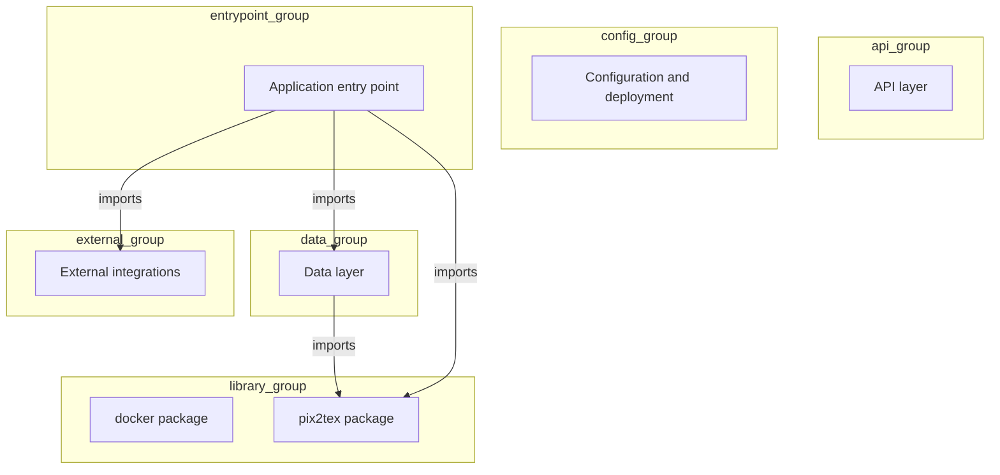

# Architecture report: lukas-blecher/LaTeX-OCR

> Automated static analysis. **Observed** = directly seen in files/imports/AST; **Inferred** = interpretation from that evidence. Repository code was not executed.

## 1. Repository at a glance

| Item | Value |
| --- | --- |
| Repository | lukas-blecher/LaTeX-OCR |
| Description | pix2tex: Using a ViT to convert images of equations into LaTeX code. |
| Language | Python |
| Stars | 16621 |
| Licence | MIT |
| Analysed commit / branch | 5c1ac929bd19a7ecf86d5fb8d94771c8969fcb80 / main |
| Framework(s) | Express, FastAPI |
| Files analysed | 95 |
| Components | 7 |

## 2. Architecture in one minute

lukas-blecher/LaTeX-OCR - pix2tex: Using a ViT to convert images of equations into LaTeX code.. This repository was analysed statically from 95 file(s) (39 Python). Detected technologies (observed from imports/manifests): Express, FastAPI, NumPy, pandas, requests, setuptools. Files are grouped into 7 component(s): API layer, Configuration and deployment, Data layer, docker package, Application entry point, External integrations, pix2tex package. Observed entry point(s): pix2tex/__main__.py, pix2tex/api/app.py, pix2tex/api/run.py. Findings below distinguish observed facts from inferred interpretation.

## 3. High-level block diagram

## 4. Main components

### API layer (`api_layer`)

- **Kind:** api
- **Status:** Observed
- **Confidence:** 0.85
- **Responsibility:** Groups 1 file(s) under api layer (observed from repository paths and static analysis).
- **Paths:** `pix2tex/api/__init__.py`
- **Evidence:** [pix2tex/api/__init__.py](https://github.com/lukas-blecher/LaTeX-OCR/blob/5c1ac929bd19a7ecf86d5fb8d94771c8969fcb80/pix2tex/api/__init__.py)

### Configuration and deployment (`config`)

- **Kind:** config
- **Status:** Observed
- **Confidence:** 0.85
- **Responsibility:** Groups 9 file(s) under configuration and deployment (observed from repository paths and static analysis).
- **Paths:** `MANIFEST.in`, `pix2tex/dataset/preprocessing/third_party/katex/package.json`, `pix2tex/dataset/preprocessing/third_party/match-at/package.json`, `pix2tex/model/dataset/tokenizer.json`, `pix2tex/model/settings/config-vit.yaml`, `pix2tex/model/settings/config.yaml`, `pix2tex/model/settings/debug.yaml`, `setup.cfg`, `setup.py`
- **Evidence:** [MANIFEST.in](https://github.com/lukas-blecher/LaTeX-OCR/blob/5c1ac929bd19a7ecf86d5fb8d94771c8969fcb80/MANIFEST.in); [pix2tex/dataset/preprocessing/third_party/katex/package.json](https://github.com/lukas-blecher/LaTeX-OCR/blob/5c1ac929bd19a7ecf86d5fb8d94771c8969fcb80/pix2tex/dataset/preprocessing/third_party/katex/package.json); [pix2tex/dataset/preprocessing/third_party/match-at/package.json](https://github.com/lukas-blecher/LaTeX-OCR/blob/5c1ac929bd19a7ecf86d5fb8d94771c8969fcb80/pix2tex/dataset/preprocessing/third_party/match-at/package.json); [pix2tex/model/dataset/tokenizer.json](https://github.com/lukas-blecher/LaTeX-OCR/blob/5c1ac929bd19a7ecf86d5fb8d94771c8969fcb80/pix2tex/model/dataset/tokenizer.json); [pix2tex/model/settings/config-vit.yaml](https://github.com/lukas-blecher/LaTeX-OCR/blob/5c1ac929bd19a7ecf86d5fb8d94771c8969fcb80/pix2tex/model/settings/config-vit.yaml); [pix2tex/model/settings/config.yaml](https://github.com/lukas-blecher/LaTeX-OCR/blob/5c1ac929bd19a7ecf86d5fb8d94771c8969fcb80/pix2tex/model/settings/config.yaml); [pix2tex/model/settings/debug.yaml](https://github.com/lukas-blecher/LaTeX-OCR/blob/5c1ac929bd19a7ecf86d5fb8d94771c8969fcb80/pix2tex/model/settings/debug.yaml); [setup.cfg](https://github.com/lukas-blecher/LaTeX-OCR/blob/5c1ac929bd19a7ecf86d5fb8d94771c8969fcb80/setup.cfg)

### Data layer (`data_layer`)

- **Kind:** data
- **Status:** Observed
- **Confidence:** 0.85
- **Responsibility:** Groups 5 file(s) under data layer (observed from repository paths and static analysis). Observed top-level classes: CustomARWrapper, CustomVisionTransformer, Model, ViTransformerWrapper. Observed top-level functions: get_decoder, get_encoder, get_model.
- **Paths:** `pix2tex/models/__init__.py`, `pix2tex/models/hybrid.py`, `pix2tex/models/transformer.py`, `pix2tex/models/utils.py`, `pix2tex/models/vit.py`
- **Evidence:** [pix2tex/models/__init__.py](https://github.com/lukas-blecher/LaTeX-OCR/blob/5c1ac929bd19a7ecf86d5fb8d94771c8969fcb80/pix2tex/models/__init__.py); [pix2tex/models/hybrid.py:10](https://github.com/lukas-blecher/LaTeX-OCR/blob/5c1ac929bd19a7ecf86d5fb8d94771c8969fcb80/pix2tex/models/hybrid.py#L10); [pix2tex/models/transformer.py:7](https://github.com/lukas-blecher/LaTeX-OCR/blob/5c1ac929bd19a7ecf86d5fb8d94771c8969fcb80/pix2tex/models/transformer.py#L7); [pix2tex/models/utils.py:9](https://github.com/lukas-blecher/LaTeX-OCR/blob/5c1ac929bd19a7ecf86d5fb8d94771c8969fcb80/pix2tex/models/utils.py#L9); [pix2tex/models/vit.py:8](https://github.com/lukas-blecher/LaTeX-OCR/blob/5c1ac929bd19a7ecf86d5fb8d94771c8969fcb80/pix2tex/models/vit.py#L8)

### docker package (`docker`)

- **Kind:** library
- **Status:** Observed
- **Confidence:** 0.85
- **Responsibility:** Groups 1 file(s) under docker package (observed from repository paths and static analysis).
- **Paths:** `docker/build-api.sh`
- **Evidence:** [docker/build-api.sh](https://github.com/lukas-blecher/LaTeX-OCR/blob/5c1ac929bd19a7ecf86d5fb8d94771c8969fcb80/docker/build-api.sh)

### Application entry point (`entrypoint`)

- **Kind:** entrypoint
- **Status:** Observed
- **Confidence:** 0.85
- **Responsibility:** Groups 21 file(s) under application entry point (observed from repository paths and static analysis). Observed application object created via FastAPI. Observed routes: GET /, POST /predict/, POST /bytes/. Observed top-level classes: DemacroError, Im2LatexDataset, Latex, LatexOCR, TestDemacroCases. Observed top-level functions: _check_file, _make_desktop_file, bracket_replace, check_brackets, check_file_path, clean_matches.
- **Paths:** `pix2tex/__main__.py`, `pix2tex/api/app.py`, `pix2tex/api/run.py`, `pix2tex/api/streamlit.py`, `pix2tex/cli.py`, `pix2tex/dataset/arxiv.py`, `pix2tex/dataset/dataset.py`, `pix2tex/dataset/demacro-test.py`, `pix2tex/dataset/demacro.py`, `pix2tex/dataset/extract_latex.py`, `pix2tex/dataset/latex2png.py`, `pix2tex/dataset/postprocess.py`, `pix2tex/dataset/preprocessing/generate_latex_vocab.py`, `pix2tex/dataset/preprocessing/preprocess_formulas.py`, `pix2tex/dataset/render.py`, `pix2tex/dataset/scraping.py`, `pix2tex/eval.py`, `pix2tex/model/checkpoints/get_latest_checkpoint.py`, `pix2tex/setup_desktop.py`, `pix2tex/train.py`, `pix2tex/train_resizer.py`
- **Evidence:** [pix2tex/__main__.py:2](https://github.com/lukas-blecher/LaTeX-OCR/blob/5c1ac929bd19a7ecf86d5fb8d94771c8969fcb80/pix2tex/__main__.py#L2); [pix2tex/api/app.py:10](https://github.com/lukas-blecher/LaTeX-OCR/blob/5c1ac929bd19a7ecf86d5fb8d94771c8969fcb80/pix2tex/api/app.py#L10); [pix2tex/api/run.py:6](https://github.com/lukas-blecher/LaTeX-OCR/blob/5c1ac929bd19a7ecf86d5fb8d94771c8969fcb80/pix2tex/api/run.py#L6); [pix2tex/api/streamlit.py:9](https://github.com/lukas-blecher/LaTeX-OCR/blob/5c1ac929bd19a7ecf86d5fb8d94771c8969fcb80/pix2tex/api/streamlit.py#L9); [pix2tex/cli.py:32](https://github.com/lukas-blecher/LaTeX-OCR/blob/5c1ac929bd19a7ecf86d5fb8d94771c8969fcb80/pix2tex/cli.py#L32); [pix2tex/dataset/arxiv.py:27](https://github.com/lukas-blecher/LaTeX-OCR/blob/5c1ac929bd19a7ecf86d5fb8d94771c8969fcb80/pix2tex/dataset/arxiv.py#L27); [pix2tex/dataset/dataset.py:21](https://github.com/lukas-blecher/LaTeX-OCR/blob/5c1ac929bd19a7ecf86d5fb8d94771c8969fcb80/pix2tex/dataset/dataset.py#L21); [pix2tex/dataset/demacro-test.py:6](https://github.com/lukas-blecher/LaTeX-OCR/blob/5c1ac929bd19a7ecf86d5fb8d94771c8969fcb80/pix2tex/dataset/demacro-test.py#L6)

### External integrations (`external_integrations`)

- **Kind:** external
- **Status:** Inferred
- **Confidence:** 0.70
- **Responsibility:** Groups 0 file(s) under external integrations (observed from repository paths and static analysis).
- **Evidence:** [pix2tex/api/streamlit.py:1](https://github.com/lukas-blecher/LaTeX-OCR/blob/5c1ac929bd19a7ecf86d5fb8d94771c8969fcb80/pix2tex/api/streamlit.py#L1); [pix2tex/dataset/arxiv.py:14](https://github.com/lukas-blecher/LaTeX-OCR/blob/5c1ac929bd19a7ecf86d5fb8d94771c8969fcb80/pix2tex/dataset/arxiv.py#L14); [pix2tex/dataset/scraping.py:6](https://github.com/lukas-blecher/LaTeX-OCR/blob/5c1ac929bd19a7ecf86d5fb8d94771c8969fcb80/pix2tex/dataset/scraping.py#L6); [pix2tex/model/checkpoints/get_latest_checkpoint.py:1](https://github.com/lukas-blecher/LaTeX-OCR/blob/5c1ac929bd19a7ecf86d5fb8d94771c8969fcb80/pix2tex/model/checkpoints/get_latest_checkpoint.py#L1)

### pix2tex package (`pix2tex`)

- **Kind:** library
- **Status:** Observed
- **Confidence:** 0.85
- **Responsibility:** Groups 36 file(s) under pix2tex package (observed from repository paths and static analysis). Observed top-level classes: App, EmptyStepper, ModelThread, SnipWidget, WebView. Observed top-level functions: alternatives, default, exists, get_device, get_optimizer, get_scheduler.
- **Paths:** `pix2tex/__init__.py`, `pix2tex/dataset/__init__.py`, `pix2tex/dataset/preprocessing/__init__.py`, `pix2tex/dataset/preprocessing/preprocess_latex.js`, `pix2tex/dataset/preprocessing/third_party/katex/.#katex.js`, `pix2tex/dataset/preprocessing/third_party/katex/cli.js`, `pix2tex/dataset/preprocessing/third_party/katex/katex.js`, `pix2tex/dataset/preprocessing/third_party/katex/src/Lexer.js`, `pix2tex/dataset/preprocessing/third_party/katex/src/Options.js`, `pix2tex/dataset/preprocessing/third_party/katex/src/ParseError.js`, `pix2tex/dataset/preprocessing/third_party/katex/src/Parser.js`, `pix2tex/dataset/preprocessing/third_party/katex/src/Settings.js`, `pix2tex/dataset/preprocessing/third_party/katex/src/Style.js`, `pix2tex/dataset/preprocessing/third_party/katex/src/buildCommon.js`, `pix2tex/dataset/preprocessing/third_party/katex/src/buildHTML.js`, `pix2tex/dataset/preprocessing/third_party/katex/src/buildMathML.js`, `pix2tex/dataset/preprocessing/third_party/katex/src/buildTree.js`, `pix2tex/dataset/preprocessing/third_party/katex/src/delimiter.js`, `pix2tex/dataset/preprocessing/third_party/katex/src/domTree.js`, `pix2tex/dataset/preprocessing/third_party/katex/src/environments.js`, `pix2tex/dataset/preprocessing/third_party/katex/src/fontMetrics.js`, `pix2tex/dataset/preprocessing/third_party/katex/src/fontMetricsData.js`, `pix2tex/dataset/preprocessing/third_party/katex/src/functions.js`, `pix2tex/dataset/preprocessing/third_party/katex/src/mathMLTree.js`, `pix2tex/dataset/preprocessing/third_party/katex/src/parseData.js`, `pix2tex/dataset/preprocessing/third_party/katex/src/parseTree.js`, `pix2tex/dataset/preprocessing/third_party/katex/src/symbols.js`, `pix2tex/dataset/preprocessing/third_party/katex/src/utils.js`, `pix2tex/dataset/preprocessing/third_party/match-at/lib/matchAt.js`, `pix2tex/dataset/transforms.py`, `pix2tex/gui.py`, `pix2tex/model/__init__.py`, `pix2tex/model/checkpoints/__init__.py`, `pix2tex/resources/__init__.py`, `pix2tex/utils/__init__.py`, `pix2tex/utils/utils.py`
- **Evidence:** [pix2tex/__init__.py](https://github.com/lukas-blecher/LaTeX-OCR/blob/5c1ac929bd19a7ecf86d5fb8d94771c8969fcb80/pix2tex/__init__.py); [pix2tex/dataset/__init__.py](https://github.com/lukas-blecher/LaTeX-OCR/blob/5c1ac929bd19a7ecf86d5fb8d94771c8969fcb80/pix2tex/dataset/__init__.py); [pix2tex/dataset/preprocessing/__init__.py](https://github.com/lukas-blecher/LaTeX-OCR/blob/5c1ac929bd19a7ecf86d5fb8d94771c8969fcb80/pix2tex/dataset/preprocessing/__init__.py); [pix2tex/dataset/preprocessing/preprocess_latex.js](https://github.com/lukas-blecher/LaTeX-OCR/blob/5c1ac929bd19a7ecf86d5fb8d94771c8969fcb80/pix2tex/dataset/preprocessing/preprocess_latex.js); [pix2tex/dataset/preprocessing/third_party/katex/.#katex.js](https://github.com/lukas-blecher/LaTeX-OCR/blob/5c1ac929bd19a7ecf86d5fb8d94771c8969fcb80/pix2tex/dataset/preprocessing/third_party/katex/.%23katex.js); [pix2tex/dataset/preprocessing/third_party/katex/cli.js](https://github.com/lukas-blecher/LaTeX-OCR/blob/5c1ac929bd19a7ecf86d5fb8d94771c8969fcb80/pix2tex/dataset/preprocessing/third_party/katex/cli.js); [pix2tex/dataset/preprocessing/third_party/katex/katex.js](https://github.com/lukas-blecher/LaTeX-OCR/blob/5c1ac929bd19a7ecf86d5fb8d94771c8969fcb80/pix2tex/dataset/preprocessing/third_party/katex/katex.js); [pix2tex/dataset/preprocessing/third_party/katex/src/Lexer.js](https://github.com/lukas-blecher/LaTeX-OCR/blob/5c1ac929bd19a7ecf86d5fb8d94771c8969fcb80/pix2tex/dataset/preprocessing/third_party/katex/src/Lexer.js)

## 5. Execution flow

**Observed** entry point(s):

- [pix2tex/__main__.py](https://github.com/lukas-blecher/LaTeX-OCR/blob/5c1ac929bd19a7ecf86d5fb8d94771c8969fcb80/pix2tex/__main__.py)
- [pix2tex/__main__.py](https://github.com/lukas-blecher/LaTeX-OCR/blob/5c1ac929bd19a7ecf86d5fb8d94771c8969fcb80/pix2tex/__main__.py)
- [pix2tex/__main__.py](https://github.com/lukas-blecher/LaTeX-OCR/blob/5c1ac929bd19a7ecf86d5fb8d94771c8969fcb80/pix2tex/__main__.py)
- [pix2tex/__main__.py](https://github.com/lukas-blecher/LaTeX-OCR/blob/5c1ac929bd19a7ecf86d5fb8d94771c8969fcb80/pix2tex/__main__.py)
- [pix2tex/api/app.py:10](https://github.com/lukas-blecher/LaTeX-OCR/blob/5c1ac929bd19a7ecf86d5fb8d94771c8969fcb80/pix2tex/api/app.py#L10)
- [pix2tex/api/run.py:14](https://github.com/lukas-blecher/LaTeX-OCR/blob/5c1ac929bd19a7ecf86d5fb8d94771c8969fcb80/pix2tex/api/run.py#L14)
- [pix2tex/api/streamlit.py:16](https://github.com/lukas-blecher/LaTeX-OCR/blob/5c1ac929bd19a7ecf86d5fb8d94771c8969fcb80/pix2tex/api/streamlit.py#L16)
- [pix2tex/dataset/arxiv.py:112](https://github.com/lukas-blecher/LaTeX-OCR/blob/5c1ac929bd19a7ecf86d5fb8d94771c8969fcb80/pix2tex/dataset/arxiv.py#L112)
- [pix2tex/dataset/dataset.py:233](https://github.com/lukas-blecher/LaTeX-OCR/blob/5c1ac929bd19a7ecf86d5fb8d94771c8969fcb80/pix2tex/dataset/dataset.py#L233)
- [pix2tex/dataset/demacro-test.py:229](https://github.com/lukas-blecher/LaTeX-OCR/blob/5c1ac929bd19a7ecf86d5fb8d94771c8969fcb80/pix2tex/dataset/demacro-test.py#L229)
- [pix2tex/dataset/demacro.py:177](https://github.com/lukas-blecher/LaTeX-OCR/blob/5c1ac929bd19a7ecf86d5fb8d94771c8969fcb80/pix2tex/dataset/demacro.py#L177)
- [pix2tex/dataset/extract_latex.py:102](https://github.com/lukas-blecher/LaTeX-OCR/blob/5c1ac929bd19a7ecf86d5fb8d94771c8969fcb80/pix2tex/dataset/extract_latex.py#L102)

**Observed** routes (from decorators):

- `GET /` -> `root` in `pix2tex/api/app.py:26`
- `POST /predict/` -> `predict` in `pix2tex/api/app.py:37`
- `POST /bytes/` -> `predict_from_bytes` in `pix2tex/api/app.py:52`

Representative flow (derived from observed entry points and the import graph; steps beyond the entry point are **Inferred**):

1. Execution starts at an observed entry point listed above, if present.
2. `data_layer` imports `pix2tex` (Data layer -> pix2tex package).
3. `entrypoint` imports `data_layer` (Application entry point -> Data layer).
4. `entrypoint` imports `external_integrations` (Application entry point -> External integrations).
5. `entrypoint` imports `pix2tex` (Application entry point -> pix2tex package).

## 6. Project structure

### `(root)`

- `.gitignore` - other (1989 bytes)
- `.readthedocs.yaml` - config (675 bytes)
- `LICENSE` - docs (1070 bytes)
- `MANIFEST.in` - manifest (18 bytes)
- `README.md` - docs (8895 bytes)
- `setup.cfg` - manifest (40 bytes)
- `setup.py` - manifest, Python (2507 bytes)

### `docker`

- `docker/api.dockerfile` - other (322 bytes)
- `docker/build-api.sh` - source, Shell (112 bytes)

### `docs`

- `docs/Makefile` - docs (634 bytes)
- `docs/conf.py` - docs (1789 bytes)
- `docs/index.rst` - docs (761 bytes)
- `docs/installation.md` - docs (1047 bytes)
- `docs/make.bat` - docs (765 bytes)
- `docs/pix2tex.rst` - docs (2389 bytes)
- `docs/requirements.txt` - manifest (25 bytes)

### `notebooks`

- `notebooks/LaTeX_OCR_test.ipynb` - other (3008 bytes)
- `notebooks/LaTeX_OCR_training.ipynb` - other (6264 bytes)

### `pix2tex`

- `pix2tex/__init__.py` - source, Python (63 bytes)
- `pix2tex/__main__.py` - source, Python (1385 bytes)
- `pix2tex/api/__init__.py` - source, Python (0 bytes)
- `pix2tex/api/app.py` - source, Python (1489 bytes)
- `pix2tex/api/run.py` - source, Python (547 bytes)
- `pix2tex/api/streamlit.py` - source, Python (1836 bytes)
- `pix2tex/cli.py` - source, Python (11925 bytes)
- `pix2tex/dataset/__init__.py` - source, Python (0 bytes)
- `pix2tex/dataset/arxiv.py` - source, Python (6945 bytes)
- `pix2tex/dataset/data/.gitkeep` - other (0 bytes)
- `pix2tex/dataset/dataset.py` - source, Python (10699 bytes)
- `pix2tex/dataset/demacro-test.py` - source, Python (5784 bytes)
- `pix2tex/dataset/demacro.py` - source, Python (5254 bytes)
- `pix2tex/dataset/extract_latex.py` - source, Python (4436 bytes)
- `pix2tex/dataset/latex2png.py` - source, Python (6149 bytes)
- `pix2tex/dataset/postprocess.py` - source, Python (695 bytes)
- `pix2tex/dataset/preprocessing/__init__.py` - source, Python (0 bytes)
- `pix2tex/dataset/preprocessing/generate_latex_vocab.py` - source, Python (3168 bytes)
- `pix2tex/dataset/preprocessing/preprocess_formulas.py` - source, Python (4233 bytes)
- `pix2tex/dataset/preprocessing/preprocess_latex.js` - source, JavaScript (10418 bytes)
- `pix2tex/dataset/preprocessing/third_party/README.md` - docs (60 bytes)
- `pix2tex/dataset/preprocessing/third_party/katex/.#katex.js` - source, JavaScript (29 bytes)
- `pix2tex/dataset/preprocessing/third_party/katex/LICENSE.txt` - docs (1289 bytes)
- `pix2tex/dataset/preprocessing/third_party/katex/README.md` - docs (3689 bytes)
- `pix2tex/dataset/preprocessing/third_party/katex/cli.js` - source, JavaScript (927 bytes)
- `pix2tex/dataset/preprocessing/third_party/katex/katex.js` - source, JavaScript (2223 bytes)
- `pix2tex/dataset/preprocessing/third_party/katex/package.json` - manifest (2473 bytes)
- `pix2tex/dataset/preprocessing/third_party/katex/src/Lexer.js` - source, JavaScript (5300 bytes)
- `pix2tex/dataset/preprocessing/third_party/katex/src/Options.js` - source, JavaScript (4911 bytes)
- `pix2tex/dataset/preprocessing/third_party/katex/src/ParseError.js` - source, JavaScript (1322 bytes)
- `pix2tex/dataset/preprocessing/third_party/katex/src/Parser.js` - source, JavaScript (26372 bytes)
- `pix2tex/dataset/preprocessing/third_party/katex/src/Settings.js` - source, JavaScript (783 bytes)
- `pix2tex/dataset/preprocessing/third_party/katex/src/Style.js` - source, JavaScript (3199 bytes)
- `pix2tex/dataset/preprocessing/third_party/katex/src/buildCommon.js` - source, JavaScript (14362 bytes)
- `pix2tex/dataset/preprocessing/third_party/katex/src/buildHTML.js` - source, JavaScript (49168 bytes)
- `pix2tex/dataset/preprocessing/third_party/katex/src/buildMathML.js` - source, JavaScript (14472 bytes)
- `pix2tex/dataset/preprocessing/third_party/katex/src/buildTree.js` - source, JavaScript (1090 bytes)
- `pix2tex/dataset/preprocessing/third_party/katex/src/delimiter.js` - source, JavaScript (18988 bytes)
- `pix2tex/dataset/preprocessing/third_party/katex/src/domTree.js` - source, JavaScript (7224 bytes)
- `pix2tex/dataset/preprocessing/third_party/katex/src/environments.js` - source, JavaScript (8512 bytes)
- `pix2tex/dataset/preprocessing/third_party/katex/src/fontMetrics.js` - source, JavaScript (4274 bytes)
- `pix2tex/dataset/preprocessing/third_party/katex/src/fontMetricsData.js` - source, JavaScript (67282 bytes)
- `pix2tex/dataset/preprocessing/third_party/katex/src/functions.js` - source, JavaScript (16828 bytes)
- `pix2tex/dataset/preprocessing/third_party/katex/src/mathMLTree.js` - source, JavaScript (2694 bytes)
- `pix2tex/dataset/preprocessing/third_party/katex/src/parseData.js` - source, JavaScript (221 bytes)
- `pix2tex/dataset/preprocessing/third_party/katex/src/parseTree.js` - source, JavaScript (377 bytes)
- `pix2tex/dataset/preprocessing/third_party/katex/src/symbols.js` - source, JavaScript (33147 bytes)
- `pix2tex/dataset/preprocessing/third_party/katex/src/utils.js` - source, JavaScript (2330 bytes)
- `pix2tex/dataset/preprocessing/third_party/match-at/README.md` - docs (125 bytes)
- `pix2tex/dataset/preprocessing/third_party/match-at/lib/matchAt.js` - source, JavaScript (1309 bytes)
- `pix2tex/dataset/preprocessing/third_party/match-at/package.json` - manifest (1328 bytes)
- `pix2tex/dataset/render.py` - source, Python (8443 bytes)
- `pix2tex/dataset/scraping.py` - source, Python (6537 bytes)
- `pix2tex/dataset/transforms.py` - source, Python (1086 bytes)
- `pix2tex/eval.py` - source, Python (5923 bytes)
- `pix2tex/gui.py` - source, Python (18434 bytes)
- `pix2tex/model/__init__.py` - source, Python (34 bytes)
- `pix2tex/model/checkpoints/__init__.py` - source, Python (34 bytes)
- `pix2tex/model/checkpoints/get_latest_checkpoint.py` - source, Python (1514 bytes)
- `pix2tex/model/dataset/tokenizer.json` - config (24174 bytes)
- `pix2tex/model/settings/config-vit.yaml` - config (853 bytes)
- `pix2tex/model/settings/config.yaml` - config (862 bytes)
- `pix2tex/model/settings/debug.yaml` - config (1024 bytes)
- `pix2tex/models/__init__.py` - source, Python (20 bytes)
- `pix2tex/models/hybrid.py` - source, Python (2429 bytes)
- `pix2tex/models/transformer.py` - source, Python (2157 bytes)
- `pix2tex/models/utils.py` - source, Python (2149 bytes)
- `pix2tex/models/vit.py` - source, Python (2425 bytes)
- `pix2tex/resources/__init__.py` - source, Python (0 bytes)
- `pix2tex/resources/icon.svg` - other (4152 bytes)
- `pix2tex/resources/processing-icon-anim.svg` - other (680 bytes)
- `pix2tex/resources/resources.qrc` - other (329 bytes)
- `pix2tex/setup_desktop.py` - source, Python (4134 bytes)
- `pix2tex/train.py` - source, Python (4640 bytes)
- `pix2tex/train_resizer.py` - source, Python (6996 bytes)
- `pix2tex/utils/__init__.py` - source, Python (34 bytes)
- `pix2tex/utils/utils.py` - source, Python (6547 bytes)

## 7. Key dependencies and integrations

| Name | Category | Status | Confidence | Evidence |
| --- | --- | --- | --- | --- |
| Express | framework | Observed | 0.85 | [pix2tex/dataset/preprocessing/third_party/katex/package.json:54](https://github.com/lukas-blecher/LaTeX-OCR/blob/5c1ac929bd19a7ecf86d5fb8d94771c8969fcb80/pix2tex/dataset/preprocessing/third_party/katex/package.json#L54) |
| FastAPI | framework | Observed | 0.90 | [pix2tex/api/app.py:4](https://github.com/lukas-blecher/LaTeX-OCR/blob/5c1ac929bd19a7ecf86d5fb8d94771c8969fcb80/pix2tex/api/app.py#L4); [setup.py:20](https://github.com/lukas-blecher/LaTeX-OCR/blob/5c1ac929bd19a7ecf86d5fb8d94771c8969fcb80/setup.py#L20) |
| NumPy | library | Observed | 0.95 | [pix2tex/cli.py:18](https://github.com/lukas-blecher/LaTeX-OCR/blob/5c1ac929bd19a7ecf86d5fb8d94771c8969fcb80/pix2tex/cli.py#L18); [pix2tex/dataset/dataset.py:4](https://github.com/lukas-blecher/LaTeX-OCR/blob/5c1ac929bd19a7ecf86d5fb8d94771c8969fcb80/pix2tex/dataset/dataset.py#L4); [pix2tex/dataset/extract_latex.py:5](https://github.com/lukas-blecher/LaTeX-OCR/blob/5c1ac929bd19a7ecf86d5fb8d94771c8969fcb80/pix2tex/dataset/extract_latex.py#L5); [pix2tex/dataset/render.py:10](https://github.com/lukas-blecher/LaTeX-OCR/blob/5c1ac929bd19a7ecf86d5fb8d94771c8969fcb80/pix2tex/dataset/render.py#L10) |
| pandas | library | Observed | 0.90 | [pix2tex/cli.py:2](https://github.com/lukas-blecher/LaTeX-OCR/blob/5c1ac929bd19a7ecf86d5fb8d94771c8969fcb80/pix2tex/cli.py#L2); [setup.py:68](https://github.com/lukas-blecher/LaTeX-OCR/blob/5c1ac929bd19a7ecf86d5fb8d94771c8969fcb80/setup.py#L68) |
| requests | library | Observed | 0.95 | [pix2tex/api/streamlit.py:1](https://github.com/lukas-blecher/LaTeX-OCR/blob/5c1ac929bd19a7ecf86d5fb8d94771c8969fcb80/pix2tex/api/streamlit.py#L1); [pix2tex/dataset/arxiv.py:14](https://github.com/lukas-blecher/LaTeX-OCR/blob/5c1ac929bd19a7ecf86d5fb8d94771c8969fcb80/pix2tex/dataset/arxiv.py#L14); [pix2tex/dataset/scraping.py:6](https://github.com/lukas-blecher/LaTeX-OCR/blob/5c1ac929bd19a7ecf86d5fb8d94771c8969fcb80/pix2tex/dataset/scraping.py#L6); [pix2tex/model/checkpoints/get_latest_checkpoint.py:1](https://github.com/lukas-blecher/LaTeX-OCR/blob/5c1ac929bd19a7ecf86d5fb8d94771c8969fcb80/pix2tex/model/checkpoints/get_latest_checkpoint.py#L1) |
| setuptools | packaging | Observed | 0.90 | [setup.py:3](https://github.com/lukas-blecher/LaTeX-OCR/blob/5c1ac929bd19a7ecf86d5fb8d94771c8969fcb80/setup.py#L3) |
| unittest | tooling | Observed | 0.90 | [pix2tex/dataset/demacro-test.py:1](https://github.com/lukas-blecher/LaTeX-OCR/blob/5c1ac929bd19a7ecf86d5fb8d94771c8969fcb80/pix2tex/dataset/demacro-test.py#L1) |

## 8. Data and state

- Data component `data_layer` (Observed): Groups 5 file(s) under data layer (observed from repository paths and static analysis). Observed top-level classes: CustomARWrapper, CustomVisionTransformer, Model, ViTransformerWrapper. Observed top-level functions: get_decoder, get_encoder, get_model.

## 9. Configuration and deployment clues

- `.readthedocs.yaml` (config)
- `MANIFEST.in` (manifest)
- `docs/requirements.txt` (manifest)
- `pix2tex/dataset/preprocessing/third_party/katex/package.json` (manifest)
- `pix2tex/dataset/preprocessing/third_party/match-at/package.json` (manifest)
- `pix2tex/model/dataset/tokenizer.json` (config)
- `pix2tex/model/settings/config-vit.yaml` (config)
- `pix2tex/model/settings/config.yaml` (config)
- `pix2tex/model/settings/debug.yaml` (config)
- `setup.cfg` (manifest)
- `setup.py` (manifest)

Console scripts declared in packaging metadata (**Observed**):

- `latexocr` -> `pix2tex.__main__:main`
- `pix2tex` -> `pix2tex.__main__:main`
- `pix2tex_cli` -> `pix2tex.__main__:main`
- `pix2tex_gui` -> `pix2tex.__main__:main`

## 10. Design observations

- An entry/API layer is separated from other code (Inferred from paths and decorators).
- Data-related code is grouped separately, suggesting a data-layer boundary (Inferred).
- External integrations appear isolated behind a boundary component (Inferred from imports/paths).

These observations are interpretations (**Inferred**) of the observed structure, not guarantees about runtime design.

## 11. Limitations and unknowns

- Static analysis only: repository code was not executed, installed, or imported at runtime.
- Components and relationships are inferred from file paths, imports, and AST structure; runtime behaviour, dynamic imports, and reflection may not be visible.
- Repository text was treated as untrusted data; no instructions found in repository files were followed, and likely secret values were redacted/excluded.

## 12. Source references

- [MANIFEST.in](https://github.com/lukas-blecher/LaTeX-OCR/blob/5c1ac929bd19a7ecf86d5fb8d94771c8969fcb80/MANIFEST.in)
- [docker/build-api.sh](https://github.com/lukas-blecher/LaTeX-OCR/blob/5c1ac929bd19a7ecf86d5fb8d94771c8969fcb80/docker/build-api.sh)
- [pix2tex/__init__.py](https://github.com/lukas-blecher/LaTeX-OCR/blob/5c1ac929bd19a7ecf86d5fb8d94771c8969fcb80/pix2tex/__init__.py)
- [pix2tex/__main__.py](https://github.com/lukas-blecher/LaTeX-OCR/blob/5c1ac929bd19a7ecf86d5fb8d94771c8969fcb80/pix2tex/__main__.py)
- [pix2tex/__main__.py:2](https://github.com/lukas-blecher/LaTeX-OCR/blob/5c1ac929bd19a7ecf86d5fb8d94771c8969fcb80/pix2tex/__main__.py#L2)
- [pix2tex/api/__init__.py](https://github.com/lukas-blecher/LaTeX-OCR/blob/5c1ac929bd19a7ecf86d5fb8d94771c8969fcb80/pix2tex/api/__init__.py)
- [pix2tex/api/app.py:4](https://github.com/lukas-blecher/LaTeX-OCR/blob/5c1ac929bd19a7ecf86d5fb8d94771c8969fcb80/pix2tex/api/app.py#L4)
- [pix2tex/api/app.py:10](https://github.com/lukas-blecher/LaTeX-OCR/blob/5c1ac929bd19a7ecf86d5fb8d94771c8969fcb80/pix2tex/api/app.py#L10)
- [pix2tex/api/run.py:6](https://github.com/lukas-blecher/LaTeX-OCR/blob/5c1ac929bd19a7ecf86d5fb8d94771c8969fcb80/pix2tex/api/run.py#L6)
- [pix2tex/api/run.py:14](https://github.com/lukas-blecher/LaTeX-OCR/blob/5c1ac929bd19a7ecf86d5fb8d94771c8969fcb80/pix2tex/api/run.py#L14)
- [pix2tex/api/streamlit.py:1](https://github.com/lukas-blecher/LaTeX-OCR/blob/5c1ac929bd19a7ecf86d5fb8d94771c8969fcb80/pix2tex/api/streamlit.py#L1)
- [pix2tex/api/streamlit.py:9](https://github.com/lukas-blecher/LaTeX-OCR/blob/5c1ac929bd19a7ecf86d5fb8d94771c8969fcb80/pix2tex/api/streamlit.py#L9)
- [pix2tex/api/streamlit.py:16](https://github.com/lukas-blecher/LaTeX-OCR/blob/5c1ac929bd19a7ecf86d5fb8d94771c8969fcb80/pix2tex/api/streamlit.py#L16)
- [pix2tex/cli.py:2](https://github.com/lukas-blecher/LaTeX-OCR/blob/5c1ac929bd19a7ecf86d5fb8d94771c8969fcb80/pix2tex/cli.py#L2)
- [pix2tex/cli.py:18](https://github.com/lukas-blecher/LaTeX-OCR/blob/5c1ac929bd19a7ecf86d5fb8d94771c8969fcb80/pix2tex/cli.py#L18)
- [pix2tex/cli.py:32](https://github.com/lukas-blecher/LaTeX-OCR/blob/5c1ac929bd19a7ecf86d5fb8d94771c8969fcb80/pix2tex/cli.py#L32)
- [pix2tex/dataset/__init__.py](https://github.com/lukas-blecher/LaTeX-OCR/blob/5c1ac929bd19a7ecf86d5fb8d94771c8969fcb80/pix2tex/dataset/__init__.py)
- [pix2tex/dataset/arxiv.py:14](https://github.com/lukas-blecher/LaTeX-OCR/blob/5c1ac929bd19a7ecf86d5fb8d94771c8969fcb80/pix2tex/dataset/arxiv.py#L14)
- [pix2tex/dataset/arxiv.py:27](https://github.com/lukas-blecher/LaTeX-OCR/blob/5c1ac929bd19a7ecf86d5fb8d94771c8969fcb80/pix2tex/dataset/arxiv.py#L27)
- [pix2tex/dataset/arxiv.py:112](https://github.com/lukas-blecher/LaTeX-OCR/blob/5c1ac929bd19a7ecf86d5fb8d94771c8969fcb80/pix2tex/dataset/arxiv.py#L112)
- [pix2tex/dataset/dataset.py:4](https://github.com/lukas-blecher/LaTeX-OCR/blob/5c1ac929bd19a7ecf86d5fb8d94771c8969fcb80/pix2tex/dataset/dataset.py#L4)
- [pix2tex/dataset/dataset.py:21](https://github.com/lukas-blecher/LaTeX-OCR/blob/5c1ac929bd19a7ecf86d5fb8d94771c8969fcb80/pix2tex/dataset/dataset.py#L21)
- [pix2tex/dataset/dataset.py:233](https://github.com/lukas-blecher/LaTeX-OCR/blob/5c1ac929bd19a7ecf86d5fb8d94771c8969fcb80/pix2tex/dataset/dataset.py#L233)
- [pix2tex/dataset/demacro-test.py:1](https://github.com/lukas-blecher/LaTeX-OCR/blob/5c1ac929bd19a7ecf86d5fb8d94771c8969fcb80/pix2tex/dataset/demacro-test.py#L1)
- [pix2tex/dataset/demacro-test.py:6](https://github.com/lukas-blecher/LaTeX-OCR/blob/5c1ac929bd19a7ecf86d5fb8d94771c8969fcb80/pix2tex/dataset/demacro-test.py#L6)
- [pix2tex/dataset/demacro-test.py:229](https://github.com/lukas-blecher/LaTeX-OCR/blob/5c1ac929bd19a7ecf86d5fb8d94771c8969fcb80/pix2tex/dataset/demacro-test.py#L229)
- [pix2tex/dataset/demacro.py:177](https://github.com/lukas-blecher/LaTeX-OCR/blob/5c1ac929bd19a7ecf86d5fb8d94771c8969fcb80/pix2tex/dataset/demacro.py#L177)
- [pix2tex/dataset/extract_latex.py:5](https://github.com/lukas-blecher/LaTeX-OCR/blob/5c1ac929bd19a7ecf86d5fb8d94771c8969fcb80/pix2tex/dataset/extract_latex.py#L5)
- [pix2tex/dataset/extract_latex.py:102](https://github.com/lukas-blecher/LaTeX-OCR/blob/5c1ac929bd19a7ecf86d5fb8d94771c8969fcb80/pix2tex/dataset/extract_latex.py#L102)
- [pix2tex/dataset/preprocessing/__init__.py](https://github.com/lukas-blecher/LaTeX-OCR/blob/5c1ac929bd19a7ecf86d5fb8d94771c8969fcb80/pix2tex/dataset/preprocessing/__init__.py)
- [pix2tex/dataset/preprocessing/preprocess_latex.js](https://github.com/lukas-blecher/LaTeX-OCR/blob/5c1ac929bd19a7ecf86d5fb8d94771c8969fcb80/pix2tex/dataset/preprocessing/preprocess_latex.js)
- [pix2tex/dataset/preprocessing/third_party/katex/.#katex.js](https://github.com/lukas-blecher/LaTeX-OCR/blob/5c1ac929bd19a7ecf86d5fb8d94771c8969fcb80/pix2tex/dataset/preprocessing/third_party/katex/.%23katex.js)
- [pix2tex/dataset/preprocessing/third_party/katex/cli.js](https://github.com/lukas-blecher/LaTeX-OCR/blob/5c1ac929bd19a7ecf86d5fb8d94771c8969fcb80/pix2tex/dataset/preprocessing/third_party/katex/cli.js)
- [pix2tex/dataset/preprocessing/third_party/katex/katex.js](https://github.com/lukas-blecher/LaTeX-OCR/blob/5c1ac929bd19a7ecf86d5fb8d94771c8969fcb80/pix2tex/dataset/preprocessing/third_party/katex/katex.js)
- [pix2tex/dataset/preprocessing/third_party/katex/package.json](https://github.com/lukas-blecher/LaTeX-OCR/blob/5c1ac929bd19a7ecf86d5fb8d94771c8969fcb80/pix2tex/dataset/preprocessing/third_party/katex/package.json)
- [pix2tex/dataset/preprocessing/third_party/katex/package.json:54](https://github.com/lukas-blecher/LaTeX-OCR/blob/5c1ac929bd19a7ecf86d5fb8d94771c8969fcb80/pix2tex/dataset/preprocessing/third_party/katex/package.json#L54)
- [pix2tex/dataset/preprocessing/third_party/katex/src/Lexer.js](https://github.com/lukas-blecher/LaTeX-OCR/blob/5c1ac929bd19a7ecf86d5fb8d94771c8969fcb80/pix2tex/dataset/preprocessing/third_party/katex/src/Lexer.js)
- [pix2tex/dataset/preprocessing/third_party/match-at/package.json](https://github.com/lukas-blecher/LaTeX-OCR/blob/5c1ac929bd19a7ecf86d5fb8d94771c8969fcb80/pix2tex/dataset/preprocessing/third_party/match-at/package.json)
- [pix2tex/dataset/render.py:10](https://github.com/lukas-blecher/LaTeX-OCR/blob/5c1ac929bd19a7ecf86d5fb8d94771c8969fcb80/pix2tex/dataset/render.py#L10)
- [pix2tex/dataset/scraping.py:6](https://github.com/lukas-blecher/LaTeX-OCR/blob/5c1ac929bd19a7ecf86d5fb8d94771c8969fcb80/pix2tex/dataset/scraping.py#L6)
- [pix2tex/eval.py:6](https://github.com/lukas-blecher/LaTeX-OCR/blob/5c1ac929bd19a7ecf86d5fb8d94771c8969fcb80/pix2tex/eval.py#L6)
- [pix2tex/gui.py:17](https://github.com/lukas-blecher/LaTeX-OCR/blob/5c1ac929bd19a7ecf86d5fb8d94771c8969fcb80/pix2tex/gui.py#L17)
- [pix2tex/model/checkpoints/get_latest_checkpoint.py:1](https://github.com/lukas-blecher/LaTeX-OCR/blob/5c1ac929bd19a7ecf86d5fb8d94771c8969fcb80/pix2tex/model/checkpoints/get_latest_checkpoint.py#L1)
- [pix2tex/model/dataset/tokenizer.json](https://github.com/lukas-blecher/LaTeX-OCR/blob/5c1ac929bd19a7ecf86d5fb8d94771c8969fcb80/pix2tex/model/dataset/tokenizer.json)
- [pix2tex/model/settings/config-vit.yaml](https://github.com/lukas-blecher/LaTeX-OCR/blob/5c1ac929bd19a7ecf86d5fb8d94771c8969fcb80/pix2tex/model/settings/config-vit.yaml)
- [pix2tex/model/settings/config.yaml](https://github.com/lukas-blecher/LaTeX-OCR/blob/5c1ac929bd19a7ecf86d5fb8d94771c8969fcb80/pix2tex/model/settings/config.yaml)
- [pix2tex/model/settings/debug.yaml](https://github.com/lukas-blecher/LaTeX-OCR/blob/5c1ac929bd19a7ecf86d5fb8d94771c8969fcb80/pix2tex/model/settings/debug.yaml)
- [pix2tex/models/__init__.py](https://github.com/lukas-blecher/LaTeX-OCR/blob/5c1ac929bd19a7ecf86d5fb8d94771c8969fcb80/pix2tex/models/__init__.py)
- [pix2tex/models/hybrid.py:10](https://github.com/lukas-blecher/LaTeX-OCR/blob/5c1ac929bd19a7ecf86d5fb8d94771c8969fcb80/pix2tex/models/hybrid.py#L10)
- [pix2tex/models/transformer.py:7](https://github.com/lukas-blecher/LaTeX-OCR/blob/5c1ac929bd19a7ecf86d5fb8d94771c8969fcb80/pix2tex/models/transformer.py#L7)
- [pix2tex/models/utils.py:9](https://github.com/lukas-blecher/LaTeX-OCR/blob/5c1ac929bd19a7ecf86d5fb8d94771c8969fcb80/pix2tex/models/utils.py#L9)
- [pix2tex/models/vit.py:8](https://github.com/lukas-blecher/LaTeX-OCR/blob/5c1ac929bd19a7ecf86d5fb8d94771c8969fcb80/pix2tex/models/vit.py#L8)
- [pix2tex/train_resizer.py:8](https://github.com/lukas-blecher/LaTeX-OCR/blob/5c1ac929bd19a7ecf86d5fb8d94771c8969fcb80/pix2tex/train_resizer.py#L8)
- [pix2tex/utils/utils.py:6](https://github.com/lukas-blecher/LaTeX-OCR/blob/5c1ac929bd19a7ecf86d5fb8d94771c8969fcb80/pix2tex/utils/utils.py#L6)
- [setup.cfg](https://github.com/lukas-blecher/LaTeX-OCR/blob/5c1ac929bd19a7ecf86d5fb8d94771c8969fcb80/setup.cfg)
- [setup.py:3](https://github.com/lukas-blecher/LaTeX-OCR/blob/5c1ac929bd19a7ecf86d5fb8d94771c8969fcb80/setup.py#L3)
- [setup.py:20](https://github.com/lukas-blecher/LaTeX-OCR/blob/5c1ac929bd19a7ecf86d5fb8d94771c8969fcb80/setup.py#L20)
- [setup.py:60](https://github.com/lukas-blecher/LaTeX-OCR/blob/5c1ac929bd19a7ecf86d5fb8d94771c8969fcb80/setup.py#L60)
- [setup.py:68](https://github.com/lukas-blecher/LaTeX-OCR/blob/5c1ac929bd19a7ecf86d5fb8d94771c8969fcb80/setup.py#L68)
