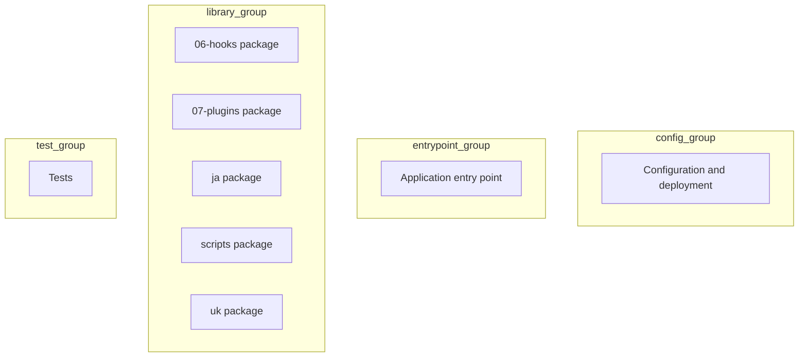

# Architecture report: luongnv89/claude-howto

> Automated static analysis. **Observed** = directly seen in files/imports/AST; **Inferred** = interpretation from that evidence. Repository code was not executed.

## 1. Repository at a glance

| Item | Value |
| --- | --- |
| Repository | luongnv89/claude-howto |
| Description | A visual, example-driven guide to Claude Code — from basic concepts to advanced agents, with copy-paste templates that bring immediate value. |
| Language | Python |
| Stars | 47197 |
| Licence | MIT |
| Analysed commit / branch | 5609e68a6ce838579e15fd31ceb6025be08841df / main |
| Framework(s) | None detected |
| Files analysed | 683 |
| Components | 8 |

## 2. Architecture in one minute

luongnv89/claude-howto - A visual, example-driven guide to Claude Code — from basic concepts to advanced agents, with copy-paste templates that bring immediate value.. This repository was analysed statically from 683 file(s) (35 Python). Detected technologies (observed from imports/manifests): GitHub Actions, Poetry, setuptools, pytest, unittest. Files are grouped into 8 component(s): 06-hooks package, 07-plugins package, Configuration and deployment, Application entry point, ja package, scripts package, Tests, uk package. Observed entry point(s): 03-skills/code-review-specialist/scripts/analyze-metrics.py, 03-skills/code-review-specialist/scripts/compare-complexity.py, 03-skills/doc-generator/generate-docs.py. Findings below distinguish observed facts from inferred interpretation.

## 3. High-level block diagram

## 4. Main components

### 06-hooks package (`c_06_hooks`)

- **Kind:** library
- **Status:** Observed
- **Confidence:** 0.85
- **Responsibility:** Groups 9 file(s) under 06-hooks package (observed from repository paths and static analysis).
- **Paths:** `06-hooks/dependency-check.sh`, `06-hooks/format-code.sh`, `06-hooks/log-bash.sh`, `06-hooks/notify-team.sh`, `06-hooks/pre-commit.sh`, `06-hooks/pre-tool-check.sh`, `06-hooks/security-scan.sh`, `06-hooks/session-end.sh`, `06-hooks/validate-prompt.sh`
- **Evidence:** [06-hooks/dependency-check.sh](https://github.com/luongnv89/claude-howto/blob/5609e68a6ce838579e15fd31ceb6025be08841df/06-hooks/dependency-check.sh); [06-hooks/format-code.sh](https://github.com/luongnv89/claude-howto/blob/5609e68a6ce838579e15fd31ceb6025be08841df/06-hooks/format-code.sh); [06-hooks/log-bash.sh](https://github.com/luongnv89/claude-howto/blob/5609e68a6ce838579e15fd31ceb6025be08841df/06-hooks/log-bash.sh); [06-hooks/notify-team.sh](https://github.com/luongnv89/claude-howto/blob/5609e68a6ce838579e15fd31ceb6025be08841df/06-hooks/notify-team.sh); [06-hooks/pre-commit.sh](https://github.com/luongnv89/claude-howto/blob/5609e68a6ce838579e15fd31ceb6025be08841df/06-hooks/pre-commit.sh); [06-hooks/pre-tool-check.sh](https://github.com/luongnv89/claude-howto/blob/5609e68a6ce838579e15fd31ceb6025be08841df/06-hooks/pre-tool-check.sh); [06-hooks/security-scan.sh](https://github.com/luongnv89/claude-howto/blob/5609e68a6ce838579e15fd31ceb6025be08841df/06-hooks/security-scan.sh); [06-hooks/session-end.sh](https://github.com/luongnv89/claude-howto/blob/5609e68a6ce838579e15fd31ceb6025be08841df/06-hooks/session-end.sh)

### 07-plugins package (`c_07_plugins`)

- **Kind:** library
- **Status:** Observed
- **Confidence:** 0.85
- **Responsibility:** Groups 6 file(s) under 07-plugins package (observed from repository paths and static analysis).
- **Paths:** `07-plugins/devops-automation/hooks/post-deploy.js`, `07-plugins/devops-automation/hooks/pre-deploy.js`, `07-plugins/devops-automation/scripts/deploy.sh`, `07-plugins/devops-automation/scripts/health-check.sh`, `07-plugins/devops-automation/scripts/rollback.sh`, `07-plugins/pr-review/hooks/pre-review.js`
- **Evidence:** [07-plugins/devops-automation/hooks/post-deploy.js](https://github.com/luongnv89/claude-howto/blob/5609e68a6ce838579e15fd31ceb6025be08841df/07-plugins/devops-automation/hooks/post-deploy.js); [07-plugins/devops-automation/hooks/pre-deploy.js](https://github.com/luongnv89/claude-howto/blob/5609e68a6ce838579e15fd31ceb6025be08841df/07-plugins/devops-automation/hooks/pre-deploy.js); [07-plugins/devops-automation/scripts/deploy.sh](https://github.com/luongnv89/claude-howto/blob/5609e68a6ce838579e15fd31ceb6025be08841df/07-plugins/devops-automation/scripts/deploy.sh); [07-plugins/devops-automation/scripts/health-check.sh](https://github.com/luongnv89/claude-howto/blob/5609e68a6ce838579e15fd31ceb6025be08841df/07-plugins/devops-automation/scripts/health-check.sh); [07-plugins/devops-automation/scripts/rollback.sh](https://github.com/luongnv89/claude-howto/blob/5609e68a6ce838579e15fd31ceb6025be08841df/07-plugins/devops-automation/scripts/rollback.sh); [07-plugins/pr-review/hooks/pre-review.js](https://github.com/luongnv89/claude-howto/blob/5609e68a6ce838579e15fd31ceb6025be08841df/07-plugins/pr-review/hooks/pre-review.js)

### Configuration and deployment (`config`)

- **Kind:** config
- **Status:** Observed
- **Confidence:** 0.85
- **Responsibility:** Groups 32 file(s) under configuration and deployment (observed from repository paths and static analysis).
- **Paths:** `05-mcp/database-mcp.json`, `05-mcp/filesystem-mcp.json`, `05-mcp/github-mcp.json`, `05-mcp/multi-mcp.json`, `07-plugins/devops-automation/.claude-plugin/plugin.json`, `07-plugins/devops-automation/hooks/hooks.json`, `07-plugins/documentation/.claude-plugin/plugin.json`, `07-plugins/documentation/.mcp.json`, `07-plugins/pr-review/.claude-plugin/plugin.json`, `07-plugins/pr-review/.mcp.json`, `07-plugins/pr-review/hooks/hooks.json`, `09-advanced-features/config-examples.json`, `ja/05-mcp/database-mcp.json`, `ja/05-mcp/filesystem-mcp.json`, `ja/05-mcp/github-mcp.json`, `ja/05-mcp/multi-mcp.json`, `scripts/pyproject.toml`, `scripts/requirements-dev.txt`, `scripts/requirements.txt`, `scripts/website_templates/roadmap.json`, `uk/05-mcp/database-mcp.json`, `uk/05-mcp/filesystem-mcp.json`, `uk/05-mcp/github-mcp.json`, `uk/05-mcp/multi-mcp.json`, `uk/07-plugins/devops-automation/.claude-plugin/plugin.json`, `uk/07-plugins/devops-automation/hooks/hooks.json`, `uk/07-plugins/documentation/.claude-plugin/plugin.json`, `uk/07-plugins/documentation/.mcp.json`, `uk/07-plugins/pr-review/.claude-plugin/plugin.json`, `uk/07-plugins/pr-review/.mcp.json`, `uk/07-plugins/pr-review/hooks/hooks.json`, `uk/09-advanced-features/config-examples.json`
- **Evidence:** [05-mcp/database-mcp.json](https://github.com/luongnv89/claude-howto/blob/5609e68a6ce838579e15fd31ceb6025be08841df/05-mcp/database-mcp.json); [05-mcp/filesystem-mcp.json](https://github.com/luongnv89/claude-howto/blob/5609e68a6ce838579e15fd31ceb6025be08841df/05-mcp/filesystem-mcp.json); [05-mcp/github-mcp.json](https://github.com/luongnv89/claude-howto/blob/5609e68a6ce838579e15fd31ceb6025be08841df/05-mcp/github-mcp.json); [05-mcp/multi-mcp.json](https://github.com/luongnv89/claude-howto/blob/5609e68a6ce838579e15fd31ceb6025be08841df/05-mcp/multi-mcp.json); [07-plugins/devops-automation/.claude-plugin/plugin.json](https://github.com/luongnv89/claude-howto/blob/5609e68a6ce838579e15fd31ceb6025be08841df/07-plugins/devops-automation/.claude-plugin/plugin.json); [07-plugins/devops-automation/hooks/hooks.json](https://github.com/luongnv89/claude-howto/blob/5609e68a6ce838579e15fd31ceb6025be08841df/07-plugins/devops-automation/hooks/hooks.json); [07-plugins/documentation/.claude-plugin/plugin.json](https://github.com/luongnv89/claude-howto/blob/5609e68a6ce838579e15fd31ceb6025be08841df/07-plugins/documentation/.claude-plugin/plugin.json); [07-plugins/documentation/.mcp.json](https://github.com/luongnv89/claude-howto/blob/5609e68a6ce838579e15fd31ceb6025be08841df/07-plugins/documentation/.mcp.json)

### Application entry point (`entrypoint`)

- **Kind:** entrypoint
- **Status:** Observed
- **Confidence:** 0.85
- **Responsibility:** Groups 24 file(s) under application entry point (observed from repository paths and static analysis). Observed top-level classes: APIDocExtractor, BuildState, ChapterCollector, ChapterInfo, CodeSmell, ComplexityAnalyzer. Observed top-level functions: _add_logo_to_cover, _consume_code_spans, _disambiguate_url, _draw_text_centered, _env_truthy, _github_source_url.
- **Paths:** `03-skills/code-review-specialist/scripts/analyze-metrics.py`, `03-skills/code-review-specialist/scripts/compare-complexity.py`, `03-skills/doc-generator/generate-docs.py`, `03-skills/refactor/scripts/analyze-complexity.py`, `03-skills/refactor/scripts/detect-smells.py`, `06-hooks/context-tracker-tiktoken.py`, `06-hooks/context-tracker.py`, `09-advanced-features/setup-auto-mode-permissions.py`, `scripts/build_epub.py`, `scripts/build_website.py`, `scripts/check_cross_references.py`, `scripts/check_epub_diagrams.py`, `scripts/check_links.py`, `scripts/check_markdown_rendering.py`, `scripts/check_mermaid.py`, `scripts/sync_translations.py`, `uk/03-skills/code-review-specialist/scripts/analyze-metrics.py`, `uk/03-skills/code-review-specialist/scripts/compare-complexity.py`, `uk/03-skills/doc-generator/generate-docs.py`, `uk/03-skills/refactor/scripts/analyze-complexity.py`, `uk/03-skills/refactor/scripts/detect-smells.py`, `uk/06-hooks/context-tracker-tiktoken.py`, `uk/06-hooks/context-tracker.py`, `uk/09-advanced-features/setup-auto-mode-permissions.py`
- **Evidence:** [03-skills/code-review-specialist/scripts/analyze-metrics.py:6](https://github.com/luongnv89/claude-howto/blob/5609e68a6ce838579e15fd31ceb6025be08841df/03-skills/code-review-specialist/scripts/analyze-metrics.py#L6); [03-skills/code-review-specialist/scripts/compare-complexity.py:11](https://github.com/luongnv89/claude-howto/blob/5609e68a6ce838579e15fd31ceb6025be08841df/03-skills/code-review-specialist/scripts/compare-complexity.py#L11); [03-skills/doc-generator/generate-docs.py:5](https://github.com/luongnv89/claude-howto/blob/5609e68a6ce838579e15fd31ceb6025be08841df/03-skills/doc-generator/generate-docs.py#L5); [03-skills/refactor/scripts/analyze-complexity.py:32](https://github.com/luongnv89/claude-howto/blob/5609e68a6ce838579e15fd31ceb6025be08841df/03-skills/refactor/scripts/analyze-complexity.py#L32); [03-skills/refactor/scripts/detect-smells.py:35](https://github.com/luongnv89/claude-howto/blob/5609e68a6ce838579e15fd31ceb6025be08841df/03-skills/refactor/scripts/detect-smells.py#L35); [06-hooks/context-tracker-tiktoken.py:38](https://github.com/luongnv89/claude-howto/blob/5609e68a6ce838579e15fd31ceb6025be08841df/06-hooks/context-tracker-tiktoken.py#L38); [06-hooks/context-tracker.py:25](https://github.com/luongnv89/claude-howto/blob/5609e68a6ce838579e15fd31ceb6025be08841df/06-hooks/context-tracker.py#L25); [09-advanced-features/setup-auto-mode-permissions.py:126](https://github.com/luongnv89/claude-howto/blob/5609e68a6ce838579e15fd31ceb6025be08841df/09-advanced-features/setup-auto-mode-permissions.py#L126)

### ja package (`ja`)

- **Kind:** library
- **Status:** Observed
- **Confidence:** 0.85
- **Responsibility:** Groups 9 file(s) under ja package (observed from repository paths and static analysis).
- **Paths:** `ja/06-hooks/dependency-check.sh`, `ja/06-hooks/format-code.sh`, `ja/06-hooks/log-bash.sh`, `ja/06-hooks/notify-team.sh`, `ja/06-hooks/pre-commit.sh`, `ja/06-hooks/pre-tool-check.sh`, `ja/06-hooks/security-scan.sh`, `ja/06-hooks/session-end.sh`, `ja/06-hooks/validate-prompt.sh`
- **Evidence:** [ja/06-hooks/dependency-check.sh](https://github.com/luongnv89/claude-howto/blob/5609e68a6ce838579e15fd31ceb6025be08841df/ja/06-hooks/dependency-check.sh); [ja/06-hooks/format-code.sh](https://github.com/luongnv89/claude-howto/blob/5609e68a6ce838579e15fd31ceb6025be08841df/ja/06-hooks/format-code.sh); [ja/06-hooks/log-bash.sh](https://github.com/luongnv89/claude-howto/blob/5609e68a6ce838579e15fd31ceb6025be08841df/ja/06-hooks/log-bash.sh); [ja/06-hooks/notify-team.sh](https://github.com/luongnv89/claude-howto/blob/5609e68a6ce838579e15fd31ceb6025be08841df/ja/06-hooks/notify-team.sh); [ja/06-hooks/pre-commit.sh](https://github.com/luongnv89/claude-howto/blob/5609e68a6ce838579e15fd31ceb6025be08841df/ja/06-hooks/pre-commit.sh); [ja/06-hooks/pre-tool-check.sh](https://github.com/luongnv89/claude-howto/blob/5609e68a6ce838579e15fd31ceb6025be08841df/ja/06-hooks/pre-tool-check.sh); [ja/06-hooks/security-scan.sh](https://github.com/luongnv89/claude-howto/blob/5609e68a6ce838579e15fd31ceb6025be08841df/ja/06-hooks/security-scan.sh); [ja/06-hooks/session-end.sh](https://github.com/luongnv89/claude-howto/blob/5609e68a6ce838579e15fd31ceb6025be08841df/ja/06-hooks/session-end.sh)

### scripts package (`scripts`)

- **Kind:** library
- **Status:** Observed
- **Confidence:** 0.85
- **Responsibility:** Groups 5 file(s) under scripts package (observed from repository paths and static analysis). Observed top-level classes: PeleDiagramError, PeleHelperError, PeleResult, PeleUnavailableError. Observed top-level functions: _detect_tailwind_asset_name, _download, _optional_int, _parse_result, _sha256_file, _vendor_cache_dir.
- **Paths:** `scripts/pele_render.mjs`, `scripts/pele_renderer.py`, `scripts/vendor_assets.py`, `scripts/website_templates/landing.js`, `scripts/website_templates/tailwind.config.js`
- **Evidence:** [scripts/pele_render.mjs](https://github.com/luongnv89/claude-howto/blob/5609e68a6ce838579e15fd31ceb6025be08841df/scripts/pele_render.mjs); [scripts/pele_renderer.py:43](https://github.com/luongnv89/claude-howto/blob/5609e68a6ce838579e15fd31ceb6025be08841df/scripts/pele_renderer.py#L43); [scripts/vendor_assets.py:67](https://github.com/luongnv89/claude-howto/blob/5609e68a6ce838579e15fd31ceb6025be08841df/scripts/vendor_assets.py#L67); [scripts/website_templates/landing.js](https://github.com/luongnv89/claude-howto/blob/5609e68a6ce838579e15fd31ceb6025be08841df/scripts/website_templates/landing.js); [scripts/website_templates/tailwind.config.js](https://github.com/luongnv89/claude-howto/blob/5609e68a6ce838579e15fd31ceb6025be08841df/scripts/website_templates/tailwind.config.js)

### Tests (`tests`)

- **Kind:** test
- **Status:** Observed
- **Confidence:** 0.85
- **Responsibility:** Groups 9 file(s) under tests (observed from repository paths and static analysis). Observed top-level classes: FakeRenderer, TestBrokenBlocks, TestBuildState, TestBuildWebsite, TestChapterCollector, TestChapterOrder. Observed top-level functions: _attribute_values, _chapter, _completed, _contrast, _css_color, _css_rule.
- **Paths:** `scripts/tests/__init__.py`, `scripts/tests/conftest.py`, `scripts/tests/test_build_epub.py`, `scripts/tests/test_build_website.py`, `scripts/tests/test_check_cross_references.py`, `scripts/tests/test_check_epub_diagrams.py`, `scripts/tests/test_check_markdown_rendering.py`, `scripts/tests/test_check_mermaid.py`, `scripts/tests/test_pele_renderer.py`
- **Evidence:** [scripts/tests/__init__.py](https://github.com/luongnv89/claude-howto/blob/5609e68a6ce838579e15fd31ceb6025be08841df/scripts/tests/__init__.py); [scripts/tests/conftest.py:18](https://github.com/luongnv89/claude-howto/blob/5609e68a6ce838579e15fd31ceb6025be08841df/scripts/tests/conftest.py#L18); [scripts/tests/test_build_epub.py:143](https://github.com/luongnv89/claude-howto/blob/5609e68a6ce838579e15fd31ceb6025be08841df/scripts/tests/test_build_epub.py#L143); [scripts/tests/test_build_website.py:51](https://github.com/luongnv89/claude-howto/blob/5609e68a6ce838579e15fd31ceb6025be08841df/scripts/tests/test_build_website.py#L51); [scripts/tests/test_check_cross_references.py:17](https://github.com/luongnv89/claude-howto/blob/5609e68a6ce838579e15fd31ceb6025be08841df/scripts/tests/test_check_cross_references.py#L17); [scripts/tests/test_check_epub_diagrams.py:25](https://github.com/luongnv89/claude-howto/blob/5609e68a6ce838579e15fd31ceb6025be08841df/scripts/tests/test_check_epub_diagrams.py#L25); [scripts/tests/test_check_markdown_rendering.py:16](https://github.com/luongnv89/claude-howto/blob/5609e68a6ce838579e15fd31ceb6025be08841df/scripts/tests/test_check_markdown_rendering.py#L16); [scripts/tests/test_check_mermaid.py:28](https://github.com/luongnv89/claude-howto/blob/5609e68a6ce838579e15fd31ceb6025be08841df/scripts/tests/test_check_mermaid.py#L28)

### uk package (`uk`)

- **Kind:** library
- **Status:** Observed
- **Confidence:** 0.85
- **Responsibility:** Groups 14 file(s) under uk package (observed from repository paths and static analysis).
- **Paths:** `uk/06-hooks/dependency-check.sh`, `uk/06-hooks/format-code.sh`, `uk/06-hooks/log-bash.sh`, `uk/06-hooks/notify-team.sh`, `uk/06-hooks/pre-commit.sh`, `uk/06-hooks/pre-tool-check.sh`, `uk/06-hooks/security-scan.sh`, `uk/06-hooks/validate-prompt.sh`, `uk/07-plugins/devops-automation/hooks/post-deploy.js`, `uk/07-plugins/devops-automation/hooks/pre-deploy.js`, `uk/07-plugins/devops-automation/scripts/deploy.sh`, `uk/07-plugins/devops-automation/scripts/health-check.sh`, `uk/07-plugins/devops-automation/scripts/rollback.sh`, `uk/07-plugins/pr-review/hooks/pre-review.js`
- **Evidence:** [uk/06-hooks/dependency-check.sh](https://github.com/luongnv89/claude-howto/blob/5609e68a6ce838579e15fd31ceb6025be08841df/uk/06-hooks/dependency-check.sh); [uk/06-hooks/format-code.sh](https://github.com/luongnv89/claude-howto/blob/5609e68a6ce838579e15fd31ceb6025be08841df/uk/06-hooks/format-code.sh); [uk/06-hooks/log-bash.sh](https://github.com/luongnv89/claude-howto/blob/5609e68a6ce838579e15fd31ceb6025be08841df/uk/06-hooks/log-bash.sh); [uk/06-hooks/notify-team.sh](https://github.com/luongnv89/claude-howto/blob/5609e68a6ce838579e15fd31ceb6025be08841df/uk/06-hooks/notify-team.sh); [uk/06-hooks/pre-commit.sh](https://github.com/luongnv89/claude-howto/blob/5609e68a6ce838579e15fd31ceb6025be08841df/uk/06-hooks/pre-commit.sh); [uk/06-hooks/pre-tool-check.sh](https://github.com/luongnv89/claude-howto/blob/5609e68a6ce838579e15fd31ceb6025be08841df/uk/06-hooks/pre-tool-check.sh); [uk/06-hooks/security-scan.sh](https://github.com/luongnv89/claude-howto/blob/5609e68a6ce838579e15fd31ceb6025be08841df/uk/06-hooks/security-scan.sh); [uk/06-hooks/validate-prompt.sh](https://github.com/luongnv89/claude-howto/blob/5609e68a6ce838579e15fd31ceb6025be08841df/uk/06-hooks/validate-prompt.sh)

## 5. Execution flow

**Observed** entry point(s):

- [03-skills/code-review-specialist/scripts/analyze-metrics.py:30](https://github.com/luongnv89/claude-howto/blob/5609e68a6ce838579e15fd31ceb6025be08841df/03-skills/code-review-specialist/scripts/analyze-metrics.py#L30)
- [03-skills/code-review-specialist/scripts/compare-complexity.py:169](https://github.com/luongnv89/claude-howto/blob/5609e68a6ce838579e15fd31ceb6025be08841df/03-skills/code-review-specialist/scripts/compare-complexity.py#L169)
- [03-skills/doc-generator/generate-docs.py:45](https://github.com/luongnv89/claude-howto/blob/5609e68a6ce838579e15fd31ceb6025be08841df/03-skills/doc-generator/generate-docs.py#L45)
- [03-skills/refactor/scripts/analyze-complexity.py:544](https://github.com/luongnv89/claude-howto/blob/5609e68a6ce838579e15fd31ceb6025be08841df/03-skills/refactor/scripts/analyze-complexity.py#L544)
- [03-skills/refactor/scripts/detect-smells.py:710](https://github.com/luongnv89/claude-howto/blob/5609e68a6ce838579e15fd31ceb6025be08841df/03-skills/refactor/scripts/detect-smells.py#L710)
- [06-hooks/context-tracker-tiktoken.py:148](https://github.com/luongnv89/claude-howto/blob/5609e68a6ce838579e15fd31ceb6025be08841df/06-hooks/context-tracker-tiktoken.py#L148)
- [06-hooks/context-tracker.py:125](https://github.com/luongnv89/claude-howto/blob/5609e68a6ce838579e15fd31ceb6025be08841df/06-hooks/context-tracker.py#L125)
- [09-advanced-features/setup-auto-mode-permissions.py:266](https://github.com/luongnv89/claude-howto/blob/5609e68a6ce838579e15fd31ceb6025be08841df/09-advanced-features/setup-auto-mode-permissions.py#L266)
- [scripts/build_epub.py:1231](https://github.com/luongnv89/claude-howto/blob/5609e68a6ce838579e15fd31ceb6025be08841df/scripts/build_epub.py#L1231)
- [scripts/build_website.py:1215](https://github.com/luongnv89/claude-howto/blob/5609e68a6ce838579e15fd31ceb6025be08841df/scripts/build_website.py#L1215)
- [scripts/check_cross_references.py:133](https://github.com/luongnv89/claude-howto/blob/5609e68a6ce838579e15fd31ceb6025be08841df/scripts/check_cross_references.py#L133)
- [scripts/check_epub_diagrams.py:160](https://github.com/luongnv89/claude-howto/blob/5609e68a6ce838579e15fd31ceb6025be08841df/scripts/check_epub_diagrams.py#L160)

Representative flow (derived from observed entry points and the import graph; steps beyond the entry point are **Inferred**):

1. Execution starts at an observed entry point listed above, if present.
2. No internal import relationships between components were observed.

## 6. Project structure

### `(root)`

- `.cspell.json` - config (4268 bytes)
- `.gitignore` - other (1530 bytes)
- `.idd.yml` - config (11543 bytes)
- `.markdownlint.json` - config (193 bytes)
- `.pre-commit-config.yaml` - config (8218 bytes)
- `CATALOG.md` - docs (49778 bytes)
- `CHANGELOG.md` - docs (69020 bytes)
- `CLAUDE.md` - docs (4435 bytes)
- `CODE_OF_CONDUCT.md` - docs (8698 bytes)
- `CONTRIBUTING.md` - docs (11124 bytes)
- `INDEX.md` - docs (34758 bytes)
- `LEARNING-ROADMAP.md` - docs (29726 bytes)
- `LICENSE` - docs (1066 bytes)
- `QUICK_REFERENCE.md` - docs (21074 bytes)
- `README.md` - docs (31825 bytes)
- `SECURITY.md` - docs (10206 bytes)
- `STYLE_GUIDE.md` - docs (17816 bytes)
- `claude-howto-logo.svg` - other (7301 bytes)
- `claude_concepts_guide.md` - docs (54606 bytes)
- `clean-code-rules.md` - docs (4723 bytes)
- `coverage.xml` - other (23924 bytes)
- `resources.md` - docs (16183 bytes)

### `.claude`

- `.claude/skills/lesson-quiz/README.md` - docs (2501 bytes)
- `.claude/skills/lesson-quiz/SKILL.md` - docs (9336 bytes)
- `.claude/skills/lesson-quiz/references/question-bank.md` - docs (62443 bytes)
- `.claude/skills/lesson-quiz/references/results-template.md` - docs (2148 bytes)
- `.claude/skills/self-assessment/README.md` - docs (2762 bytes)
- `.claude/skills/self-assessment/SKILL.md` - docs (24474 bytes)
- `.claude/skills/self-assessment/references/deep-assessment-rounds.md` - docs (5517 bytes)
- `.claude/skills/self-assessment/references/output-templates.md` - docs (3512 bytes)
- `.claude/skills/self-assessment/references/topic-recommendations.md` - docs (11656 bytes)

### `.github`

- `.github/FUNDING.yml` - config (220 bytes)
- `.github/ISSUE_TEMPLATE/bug_report.md` - docs (893 bytes)
- `.github/ISSUE_TEMPLATE/config.yml` - config (462 bytes)
- `.github/ISSUE_TEMPLATE/documentation.md` - docs (909 bytes)
- `.github/ISSUE_TEMPLATE/feature_request.md` - docs (1017 bytes)
- `.github/ISSUE_TEMPLATE/question.md` - docs (778 bytes)
- `.github/SECURITY_REPORTING.md` - docs (9115 bytes)
- `.github/TESTING.md` - docs (8119 bytes)
- `.github/markdown-link-check-config.json` - config (2579 bytes)
- `.github/pull_request_template.md` - docs (1291 bytes)
- `.github/workflows/docs-check.yml` - ci, YAML (3647 bytes)
- `.github/workflows/pages.yml` - ci, YAML (1298 bytes)
- `.github/workflows/release.yml` - ci, YAML (5801 bytes)
- `.github/workflows/test.yml` - ci, YAML (7574 bytes)

### `01-slash-commands`

- `01-slash-commands/README.md` - docs (39872 bytes)
- `01-slash-commands/commit.md` - docs (1110 bytes)
- `01-slash-commands/doc-refactor.md` - docs (1560 bytes)
- `01-slash-commands/generate-api-docs.md` - docs (823 bytes)
- `01-slash-commands/optimize.md` - docs (1018 bytes)
- `01-slash-commands/pr.md` - docs (1104 bytes)
- `01-slash-commands/push-all.md` - docs (4405 bytes)
- `01-slash-commands/setup-ci-cd.md` - docs (1324 bytes)
- `01-slash-commands/unit-test-expand.md` - docs (1298 bytes)

### `02-memory`

- `02-memory/README.md` - docs (52166 bytes)
- `02-memory/directory-api-CLAUDE.md` - docs (1937 bytes)
- `02-memory/personal-CLAUDE.md` - docs (2046 bytes)
- `02-memory/project-CLAUDE.md` - docs (2713 bytes)

### `03-skills`

- `03-skills/.gitignore` - other (64 bytes)
- `03-skills/README.md` - docs (43515 bytes)
- `03-skills/blog-draft/SKILL.md` - docs (8542 bytes)
- `03-skills/blog-draft/templates/draft-template.md` - docs (1322 bytes)
- `03-skills/blog-draft/templates/outline-template.md` - docs (2193 bytes)
- `03-skills/brand-voice/SKILL.md` - docs (2539 bytes)
- `03-skills/brand-voice/templates/email-template.txt` - docs (220 bytes)
- `03-skills/brand-voice/templates/social-post-template.txt` - docs (161 bytes)
- `03-skills/brand-voice/tone-examples.md` - docs (824 bytes)
- `03-skills/claude-md/SKILL.md` - docs (7963 bytes)
- `03-skills/code-review-specialist/SKILL.md` - docs (3152 bytes)
- `03-skills/code-review-specialist/scripts/analyze-metrics.py` - source, Python (896 bytes)
- `03-skills/code-review-specialist/scripts/compare-complexity.py` - source, Python (5723 bytes)
- `03-skills/code-review-specialist/templates/finding-template.md` - docs (2756 bytes)
- `03-skills/code-review-specialist/templates/review-checklist.md` - docs (1749 bytes)
- `03-skills/doc-generator/SKILL.md` - docs (1803 bytes)
- `03-skills/doc-generator/generate-docs.py` - source, Python (1599 bytes)
- `03-skills/refactor/SKILL.md` - docs (12034 bytes)
- `03-skills/refactor/references/code-smells.md` - docs (13938 bytes)
- `03-skills/refactor/references/refactoring-catalog.md` - docs (24403 bytes)
- `03-skills/refactor/scripts/analyze-complexity.py` - source, Python (20183 bytes)
- `03-skills/refactor/scripts/detect-smells.py` - source, Python (28738 bytes)
- `03-skills/refactor/templates/refactoring-plan.md` - docs (6728 bytes)

### `04-subagents`

- `04-subagents/README.md` - docs (59936 bytes)
- `04-subagents/clean-code-reviewer.md` - docs (2724 bytes)
- `04-subagents/code-reviewer.md` - docs (2181 bytes)
- `04-subagents/data-scientist.md` - docs (2560 bytes)
- `04-subagents/debugger.md` - docs (2268 bytes)
- `04-subagents/documentation-writer.md` - docs (2385 bytes)
- `04-subagents/implementation-agent.md` - docs (2182 bytes)
- `04-subagents/performance-optimizer.md` - docs (4419 bytes)
- `04-subagents/secure-reviewer.md` - docs (2163 bytes)
- `04-subagents/test-engineer.md` - docs (2217 bytes)

### `05-mcp`

- `05-mcp/README.md` - docs (56939 bytes)
- `05-mcp/database-mcp.json` - config (205 bytes)
- `05-mcp/filesystem-mcp.json` - config (204 bytes)
- `05-mcp/github-mcp.json` - config (214 bytes)
- `05-mcp/multi-mcp.json` - config (828 bytes)

### `06-hooks`

- `06-hooks/README.md` - docs (65747 bytes)
- `06-hooks/context-tracker-tiktoken.py` - source, Python (4872 bytes)
- `06-hooks/context-tracker.py` - source, Python (4164 bytes)
- `06-hooks/dependency-check.sh` - source, Shell (6183 bytes)
- `06-hooks/format-code.sh` - source, Shell (1229 bytes)
- `06-hooks/log-bash.sh` - source, Shell (1168 bytes)
- `06-hooks/notify-team.sh` - source, Shell (4992 bytes)
- `06-hooks/pre-commit.sh` - source, Shell (1844 bytes)
- `06-hooks/pre-tool-check.sh` - source, Shell (5328 bytes)
- `06-hooks/security-scan.sh` - source, Shell (3324 bytes)
- `06-hooks/session-end.sh` - source, Shell (3067 bytes)
- `06-hooks/validate-prompt.sh` - source, Shell (1639 bytes)

### `07-plugins`

- `07-plugins/README.md` - docs (71882 bytes)
- `07-plugins/devops-automation/.claude-plugin/plugin.json` - config (216 bytes)
- `07-plugins/devops-automation/README.md` - docs (5305 bytes)
- `07-plugins/devops-automation/agents/alert-analyzer.md` - docs (623 bytes)
- `07-plugins/devops-automation/agents/deployment-specialist.md` - docs (617 bytes)
- `07-plugins/devops-automation/agents/incident-commander.md` - docs (606 bytes)
- `07-plugins/devops-automation/commands/deploy.md` - docs (664 bytes)
- `07-plugins/devops-automation/commands/incident.md` - docs (732 bytes)
- `07-plugins/devops-automation/commands/rollback.md` - docs (656 bytes)
- `07-plugins/devops-automation/commands/status.md` - docs (700 bytes)
- `07-plugins/devops-automation/hooks/hooks.json` - config (579 bytes)
- `07-plugins/devops-automation/hooks/post-deploy.js` - source, JavaScript (5688 bytes)
- `07-plugins/devops-automation/hooks/pre-deploy.js` - source, JavaScript (4629 bytes)
- `07-plugins/devops-automation/scripts/deploy.sh` - source, Shell (488 bytes)
- `07-plugins/devops-automation/scripts/health-check.sh` - source, Shell (637 bytes)
- `07-plugins/devops-automation/scripts/rollback.sh` - source, Shell (594 bytes)
- `07-plugins/documentation/.claude-plugin/plugin.json` - config (190 bytes)
- `07-plugins/documentation/.mcp.json` - config (373 bytes)
- `07-plugins/documentation/README.md` - docs (4057 bytes)
- `07-plugins/documentation/agents/api-documenter.md` - docs (615 bytes)
- `07-plugins/documentation/agents/code-commentator.md` - docs (628 bytes)
- `07-plugins/documentation/agents/example-generator.md` - docs (609 bytes)
- `07-plugins/documentation/commands/generate-api-docs.md` - docs (745 bytes)
- `07-plugins/documentation/commands/generate-readme.md` - docs (672 bytes)
- `07-plugins/documentation/commands/sync-docs.md` - docs (667 bytes)
- `07-plugins/documentation/commands/validate-docs.md` - docs (667 bytes)
- `07-plugins/documentation/templates/adr-template.md` - docs (1082 bytes)
- `07-plugins/documentation/templates/api-endpoint.md` - docs (2071 bytes)
- `07-plugins/documentation/templates/function-docs.md` - docs (1266 bytes)
- `07-plugins/pr-review/.claude-plugin/plugin.json` - config (192 bytes)
- `07-plugins/pr-review/.mcp.json` - config (373 bytes)
- `07-plugins/pr-review/README.md` - docs (4347 bytes)
- `07-plugins/pr-review/agents/performance-analyzer.md` - docs (597 bytes)
- `07-plugins/pr-review/agents/security-reviewer.md` - docs (607 bytes)
- `07-plugins/pr-review/agents/test-checker.md` - docs (589 bytes)
- `07-plugins/pr-review/commands/check-security.md` - docs (676 bytes)
- `07-plugins/pr-review/commands/check-tests.md` - docs (672 bytes)
- `07-plugins/pr-review/commands/review-pr.md` - docs (702 bytes)
- `07-plugins/pr-review/hooks/hooks.json` - config (356 bytes)
- `07-plugins/pr-review/hooks/pre-review.js` - source, JavaScript (3146 bytes)

### `08-checkpoints`

- `08-checkpoints/README.md` - docs (15996 bytes)
- `08-checkpoints/checkpoint-examples.md` - docs (9554 bytes)

### `09-advanced-features`

- `09-advanced-features/README.md` - docs (144292 bytes)
- `09-advanced-features/config-examples.json` - config (5907 bytes)
- `09-advanced-features/planning-mode-examples.md` - docs (15751 bytes)
- `09-advanced-features/setup-auto-mode-permissions.py` - source, Python (7623 bytes)

### `10-cli`

- `10-cli/README.md` - docs (94394 bytes)

### `assets`

- `assets/logo/favicon.svg` - other (724 bytes)
- `assets/logo/logo-black.svg` - other (2977 bytes)
- `assets/logo/logo-full.svg` - other (2919 bytes)
- `assets/logo/logo-icon.svg` - other (2004 bytes)
- `assets/logo/logo-mark.svg` - other (1938 bytes)
- `assets/logo/logo-white.svg` - other (3039 bytes)
- `assets/logo/logo-wordmark.svg` - other (798 bytes)

### `docs`

- `docs/ROADMAP-20260401.md` - docs (6214 bytes)
- `docs/TASKS-20260401.md` - docs (11757 bytes)

### `fa`

- `fa/.github/ISSUE_TEMPLATE/bug_report.md` - docs (1284 bytes)
- `fa/.github/ISSUE_TEMPLATE/documentation.md` - docs (1349 bytes)
- `fa/.github/ISSUE_TEMPLATE/feature_request.md` - docs (1567 bytes)
- `fa/.github/ISSUE_TEMPLATE/question.md` - docs (1147 bytes)
- `fa/01-slash-commands/README.md` - docs (56052 bytes)
- `fa/01-slash-commands/commit.md` - docs (1413 bytes)
- `fa/01-slash-commands/doc-refactor.md` - docs (2250 bytes)
- `fa/01-slash-commands/generate-api-docs.md` - docs (1037 bytes)
- `fa/01-slash-commands/optimize.md` - docs (1384 bytes)
- `fa/01-slash-commands/pr.md` - docs (1400 bytes)
- `fa/01-slash-commands/push-all.md` - docs (6859 bytes)
- `fa/01-slash-commands/setup-ci-cd.md` - docs (1830 bytes)
- `fa/01-slash-commands/unit-test-expand.md` - docs (1791 bytes)
- `fa/02-memory/README.md` - docs (73568 bytes)
- `fa/02-memory/directory-api-CLAUDE.md` - docs (3066 bytes)
- `fa/02-memory/personal-CLAUDE.md` - docs (2932 bytes)
- `fa/02-memory/project-CLAUDE.md` - docs (3870 bytes)
- `fa/03-skills/README.md` - docs (61162 bytes)
- `fa/03-skills/blog-draft/SKILL.md` - docs (13506 bytes)
- `fa/03-skills/blog-draft/templates/draft-template.md` - docs (1895 bytes)
- `fa/03-skills/blog-draft/templates/outline-template.md` - docs (3267 bytes)
- `fa/03-skills/brand-voice/SKILL.md` - docs (4312 bytes)
- `fa/03-skills/brand-voice/tone-examples.md` - docs (1254 bytes)
- `fa/03-skills/claude-md/SKILL.md` - docs (12656 bytes)
- `fa/03-skills/code-review-specialist/SKILL.md` - docs (4683 bytes)
- `fa/03-skills/code-review-specialist/templates/finding-template.md` - docs (3734 bytes)
- `fa/03-skills/code-review-specialist/templates/review-checklist.md` - docs (2717 bytes)
- `fa/03-skills/doc-generator/SKILL.md` - docs (2159 bytes)
- `fa/03-skills/refactor/SKILL.md` - docs (18964 bytes)
- `fa/03-skills/refactor/references/code-smells.md` - docs (22216 bytes)
- `fa/03-skills/refactor/references/refactoring-catalog.md` - docs (33661 bytes)
- `fa/03-skills/refactor/templates/refactoring-plan.md` - docs (9419 bytes)
- `fa/04-subagents/README.md` - docs (93449 bytes)
- `fa/04-subagents/clean-code-reviewer.md` - docs (4278 bytes)
- `fa/04-subagents/code-reviewer.md` - docs (3311 bytes)
- `fa/04-subagents/data-scientist.md` - docs (3629 bytes)
- `fa/04-subagents/debugger.md` - docs (3477 bytes)
- `fa/04-subagents/documentation-writer.md` - docs (3248 bytes)
- `fa/04-subagents/implementation-agent.md` - docs (3617 bytes)
- `fa/04-subagents/performance-optimizer.md` - docs (7173 bytes)
- `fa/04-subagents/secure-reviewer.md` - docs (3016 bytes)
- `fa/04-subagents/test-engineer.md` - docs (3193 bytes)
- `fa/05-mcp/README.md` - docs (84353 bytes)
- `fa/06-hooks/README.md` - docs (89254 bytes)
- `fa/07-plugins/README.md` - docs (104639 bytes)
- `fa/07-plugins/devops-automation/README.md` - docs (7718 bytes)
- `fa/07-plugins/devops-automation/agents/alert-analyzer.md` - docs (830 bytes)
- `fa/07-plugins/devops-automation/agents/deployment-specialist.md` - docs (801 bytes)
- `fa/07-plugins/devops-automation/agents/incident-commander.md` - docs (742 bytes)
- `fa/07-plugins/devops-automation/commands/deploy.md` - docs (861 bytes)
- `fa/07-plugins/devops-automation/commands/incident.md` - docs (964 bytes)
- `fa/07-plugins/devops-automation/commands/rollback.md` - docs (832 bytes)
- `fa/07-plugins/devops-automation/commands/status.md` - docs (875 bytes)
- `fa/07-plugins/documentation/README.md` - docs (5286 bytes)
- `fa/07-plugins/documentation/agents/api-documenter.md` - docs (723 bytes)
- `fa/07-plugins/documentation/agents/code-commentator.md` - docs (804 bytes)
- `fa/07-plugins/documentation/agents/example-generator.md` - docs (793 bytes)
- `fa/07-plugins/documentation/commands/generate-api-docs.md` - docs (916 bytes)
- `fa/07-plugins/documentation/commands/generate-readme.md` - docs (841 bytes)
- `fa/07-plugins/documentation/commands/sync-docs.md` - docs (913 bytes)
- `fa/07-plugins/documentation/commands/validate-docs.md` - docs (868 bytes)
- `fa/07-plugins/documentation/templates/adr-template.md` - docs (1382 bytes)
- `fa/07-plugins/documentation/templates/api-endpoint.md` - docs (2423 bytes)
- `fa/07-plugins/documentation/templates/function-docs.md` - docs (1591 bytes)
- `fa/07-plugins/pr-review/README.md` - docs (5711 bytes)
- `fa/07-plugins/pr-review/agents/performance-analyzer.md` - docs (753 bytes)
- `fa/07-plugins/pr-review/agents/security-reviewer.md` - docs (720 bytes)
- `fa/07-plugins/pr-review/agents/test-checker.md` - docs (719 bytes)
- `fa/07-plugins/pr-review/commands/check-security.md` - docs (847 bytes)
- `fa/07-plugins/pr-review/commands/check-tests.md` - docs (839 bytes)
- `fa/07-plugins/pr-review/commands/review-pr.md` - docs (964 bytes)
- `fa/08-checkpoints/README.md` - docs (26126 bytes)
- `fa/08-checkpoints/checkpoint-examples.md` - docs (17152 bytes)
- `fa/09-advanced-features/planning-mode-examples.md` - docs (16780 bytes)
- `fa/10-cli/README.md` - docs (132102 bytes)
- `fa/CATALOG.md` - docs (72941 bytes)
- `fa/CHANGELOG.md` - docs (102490 bytes)
- `fa/CLAUDE.md` - docs (7407 bytes)
- `fa/CODE_OF_CONDUCT.md` - docs (14060 bytes)
- `fa/CONTRIBUTING.md` - docs (17254 bytes)
- `fa/INDEX.md` - docs (45271 bytes)
- `fa/LEARNING-ROADMAP.md` - docs (45684 bytes)
- `fa/QUICK_REFERENCE.md` - docs (29082 bytes)
- `fa/README.md` - docs (44745 bytes)
- `fa/RELEASE_NOTES.md` - docs (355 bytes)
- `fa/SECURITY.md` - docs (16291 bytes)
- `fa/STYLE_GUIDE.md` - docs (26871 bytes)
- `fa/TRANSLATION_NOTES.md` - docs (5859 bytes)
- `fa/claude_concepts_guide.md` - docs (79125 bytes)
- `fa/clean-code-rules.md` - docs (8099 bytes)
- `fa/docs/ROADMAP-20260401.md` - docs (9697 bytes)
- `fa/docs/TASKS-20260401.md` - docs (17381 bytes)
- `fa/prompts/remotion-video.md` - docs (19697 bytes)
- `fa/resources.md` - docs (22779 bytes)
- `fa/resources/DESIGN-SYSTEM.md` - docs (8474 bytes)
- `fa/resources/QUICK-START.md` - docs (3268 bytes)
- `fa/resources/README.md` - docs (11276 bytes)
- `fa/scripts/README.md` - docs (10493 bytes)

### `ja`

- `ja/.github/ISSUE_TEMPLATE/bug_report.md` - docs (1161 bytes)
- `ja/.github/ISSUE_TEMPLATE/documentation.md` - docs (1188 bytes)
- `ja/.github/ISSUE_TEMPLATE/feature_request.md` - docs (1254 bytes)
- `ja/.github/ISSUE_TEMPLATE/question.md` - docs (1056 bytes)
- `ja/.github/SECURITY_REPORTING.md` - docs (10939 bytes)
- `ja/.github/TESTING.md` - docs (9797 bytes)
- `ja/.github/pull_request_template.md` - docs (1782 bytes)
- `ja/01-slash-commands/README.md` - docs (29476 bytes)
- `ja/01-slash-commands/commit.md` - docs (1083 bytes)
- `ja/01-slash-commands/doc-refactor.md` - docs (1987 bytes)
- `ja/01-slash-commands/generate-api-docs.md` - docs (894 bytes)
- `ja/01-slash-commands/optimize.md` - docs (1049 bytes)
- `ja/01-slash-commands/pr.md` - docs (1077 bytes)
- `ja/01-slash-commands/push-all.md` - docs (5216 bytes)
- `ja/01-slash-commands/setup-ci-cd.md` - docs (1546 bytes)
- `ja/01-slash-commands/unit-test-expand.md` - docs (1422 bytes)
- `ja/02-memory/README.md` - docs (48753 bytes)
- `ja/02-memory/directory-api-CLAUDE.md` - docs (2431 bytes)
- `ja/02-memory/personal-CLAUDE.md` - docs (2340 bytes)
- `ja/02-memory/project-CLAUDE.md` - docs (3220 bytes)
- `ja/03-skills/README.md` - docs (38180 bytes)
- `ja/03-skills/blog-draft/SKILL.md` - docs (10270 bytes)
- `ja/03-skills/blog-draft/templates/draft-template.md` - docs (1281 bytes)
- `ja/03-skills/blog-draft/templates/outline-template.md` - docs (2199 bytes)
- `ja/03-skills/brand-voice/SKILL.md` - docs (3094 bytes)
- `ja/03-skills/brand-voice/tone-examples.md` - docs (826 bytes)
- `ja/03-skills/claude-md/SKILL.md` - docs (9758 bytes)
- `ja/03-skills/code-review-specialist/SKILL.md` - docs (2439 bytes)
- `ja/03-skills/code-review-specialist/templates/finding-template.md` - docs (2897 bytes)
- `ja/03-skills/code-review-specialist/templates/review-checklist.md` - docs (2051 bytes)
- `ja/03-skills/doc-generator/SKILL.md` - docs (1722 bytes)
- `ja/03-skills/refactor/SKILL.md` - docs (15546 bytes)
- `ja/03-skills/refactor/references/code-smells.md` - docs (17480 bytes)
- `ja/03-skills/refactor/references/refactoring-catalog.md` - docs (29707 bytes)
- `ja/03-skills/refactor/templates/refactoring-plan.md` - docs (8086 bytes)
- `ja/04-subagents/README.md` - docs (58027 bytes)
- `ja/04-subagents/clean-code-reviewer.md` - docs (3219 bytes)
- `ja/04-subagents/code-reviewer.md` - docs (2495 bytes)
- `ja/04-subagents/data-scientist.md` - docs (2762 bytes)
- `ja/04-subagents/debugger.md` - docs (2615 bytes)
- `ja/04-subagents/documentation-writer.md` - docs (2597 bytes)
- `ja/04-subagents/implementation-agent.md` - docs (2625 bytes)
- `ja/04-subagents/performance-optimizer.md` - docs (5807 bytes)
- `ja/04-subagents/secure-reviewer.md` - docs (2429 bytes)
- `ja/04-subagents/test-engineer.md` - docs (2490 bytes)
- `ja/05-mcp/README.md` - docs (51578 bytes)
- `ja/05-mcp/database-mcp.json` - config (165 bytes)
- `ja/05-mcp/filesystem-mcp.json` - config (180 bytes)
- `ja/05-mcp/github-mcp.json` - config (214 bytes)
- `ja/05-mcp/multi-mcp.json` - config (748 bytes)
- `ja/06-hooks/README.md` - docs (55667 bytes)
- `ja/06-hooks/dependency-check.sh` - source, Shell (6579 bytes)
- `ja/06-hooks/format-code.sh` - source, Shell (1386 bytes)
- `ja/06-hooks/log-bash.sh` - source, Shell (1496 bytes)
- `ja/06-hooks/notify-team.sh` - source, Shell (5879 bytes)
- `ja/06-hooks/pre-commit.sh` - source, Shell (2338 bytes)
- `ja/06-hooks/pre-tool-check.sh` - source, Shell (6079 bytes)
- `ja/06-hooks/security-scan.sh` - source, Shell (3979 bytes)
- `ja/06-hooks/session-end.sh` - source, Shell (3338 bytes)
- `ja/06-hooks/validate-prompt.sh` - source, Shell (1919 bytes)
- `ja/07-plugins/README.md` - docs (51595 bytes)
- `ja/07-plugins/devops-automation/README.md` - docs (6771 bytes)
- `ja/07-plugins/devops-automation/agents/alert-analyzer.md` - docs (478 bytes)
- `ja/07-plugins/devops-automation/agents/deployment-specialist.md` - docs (503 bytes)
- `ja/07-plugins/devops-automation/agents/incident-commander.md` - docs (476 bytes)
- `ja/07-plugins/devops-automation/commands/deploy.md` - docs (730 bytes)
- `ja/07-plugins/devops-automation/commands/incident.md` - docs (771 bytes)
- `ja/07-plugins/devops-automation/commands/rollback.md` - docs (684 bytes)
- `ja/07-plugins/devops-automation/commands/status.md` - docs (747 bytes)
- `ja/07-plugins/documentation/README.md` - docs (4862 bytes)
- `ja/07-plugins/documentation/agents/api-documenter.md` - docs (502 bytes)
- `ja/07-plugins/documentation/agents/code-commentator.md` - docs (502 bytes)
- `ja/07-plugins/documentation/agents/example-generator.md` - docs (487 bytes)
- `ja/07-plugins/documentation/commands/generate-api-docs.md` - docs (816 bytes)
- `ja/07-plugins/documentation/commands/generate-readme.md` - docs (681 bytes)
- `ja/07-plugins/documentation/commands/sync-docs.md` - docs (698 bytes)
- `ja/07-plugins/documentation/commands/validate-docs.md` - docs (663 bytes)
- `ja/07-plugins/documentation/templates/adr-template.md` - docs (969 bytes)
- `ja/07-plugins/documentation/templates/api-endpoint.md` - docs (1965 bytes)
- `ja/07-plugins/documentation/templates/function-docs.md` - docs (1107 bytes)
- `ja/07-plugins/pr-review/README.md` - docs (5261 bytes)
- `ja/07-plugins/pr-review/agents/performance-analyzer.md` - docs (461 bytes)
- `ja/07-plugins/pr-review/agents/security-reviewer.md` - docs (437 bytes)
- `ja/07-plugins/pr-review/agents/test-checker.md` - docs (428 bytes)
- `ja/07-plugins/pr-review/commands/check-security.md` - docs (692 bytes)
- `ja/07-plugins/pr-review/commands/check-tests.md` - docs (733 bytes)
- `ja/07-plugins/pr-review/commands/review-pr.md` - docs (731 bytes)
- `ja/08-checkpoints/README.md` - docs (17381 bytes)
- `ja/08-checkpoints/checkpoint-examples.md` - docs (9734 bytes)
- `ja/09-advanced-features/README.md` - docs (97182 bytes)
- `ja/09-advanced-features/planning-mode-examples.md` - docs (15886 bytes)
- `ja/10-cli/README.md` - docs (48258 bytes)
- `ja/CATALOG.md` - docs (39623 bytes)
- `ja/CHANGELOG.md` - docs (12156 bytes)
- `ja/CLAUDE.md` - docs (8512 bytes)
- `ja/CODE_OF_CONDUCT.md` - docs (10421 bytes)
- `ja/CONTRIBUTING.md` - docs (13931 bytes)
- `ja/INDEX.md` - docs (36888 bytes)
- `ja/LEARNING-ROADMAP.md` - docs (35026 bytes)
- `ja/QUICK_REFERENCE.md` - docs (19047 bytes)
- `ja/README.md` - docs (37268 bytes)
- `ja/RELEASE_NOTES.md` - docs (442 bytes)
- `ja/SECURITY.md` - docs (12705 bytes)
- `ja/STYLE_GUIDE.md` - docs (21979 bytes)
- `ja/TRANSLATION_NOTES.md` - docs (13692 bytes)
- `ja/claude_concepts_guide.md` - docs (94951 bytes)
- `ja/clean-code-rules.md` - docs (6008 bytes)
- `ja/docs/ROADMAP-20260401.md` - docs (8175 bytes)
- `ja/docs/TASKS-20260401.md` - docs (15606 bytes)
- `ja/prompts/remotion-video.md` - docs (16152 bytes)
- `ja/resources.md` - docs (18131 bytes)
- `ja/resources/DESIGN-SYSTEM.md` - docs (7679 bytes)
- `ja/resources/QUICK-START.md` - docs (3189 bytes)
- `ja/resources/README.md` - docs (9801 bytes)
- `ja/scripts/README.md` - docs (4617 bytes)

### `ko`

- `ko/.github/ISSUE_TEMPLATE/bug_report.md` - docs (893 bytes)
- `ko/.github/ISSUE_TEMPLATE/documentation.md` - docs (909 bytes)
- `ko/.github/ISSUE_TEMPLATE/feature_request.md` - docs (1017 bytes)
- `ko/.github/ISSUE_TEMPLATE/question.md` - docs (778 bytes)
- `ko/.github/SECURITY_REPORTING.md` - docs (9115 bytes)
- `ko/.github/TESTING.md` - docs (8119 bytes)
- `ko/.github/pull_request_template.md` - docs (1291 bytes)
- `ko/01-slash-commands/README.md` - docs (44739 bytes)
- `ko/01-slash-commands/commit.md` - docs (1338 bytes)
- `ko/01-slash-commands/doc-refactor.md` - docs (1922 bytes)
- `ko/01-slash-commands/generate-api-docs.md` - docs (1076 bytes)
- `ko/01-slash-commands/optimize.md` - docs (1196 bytes)
- `ko/01-slash-commands/pr.md` - docs (1330 bytes)
- `ko/01-slash-commands/push-all.md` - docs (5443 bytes)
- `ko/01-slash-commands/setup-ci-cd.md` - docs (1646 bytes)
- `ko/01-slash-commands/unit-test-expand.md` - docs (1664 bytes)
- `ko/02-memory/README.md` - docs (59078 bytes)
- `ko/02-memory/directory-api-CLAUDE.md` - docs (2282 bytes)
- `ko/02-memory/personal-CLAUDE.md` - docs (2569 bytes)
- `ko/02-memory/project-CLAUDE.md` - docs (3143 bytes)
- `ko/03-skills/README.md` - docs (48650 bytes)
- `ko/03-skills/blog-draft/SKILL.md` - docs (10467 bytes)
- `ko/03-skills/blog-draft/templates/draft-template.md` - docs (1683 bytes)
- `ko/03-skills/blog-draft/templates/outline-template.md` - docs (2509 bytes)
- `ko/03-skills/brand-voice/SKILL.md` - docs (3469 bytes)
- `ko/03-skills/brand-voice/tone-examples.md` - docs (1138 bytes)
- `ko/03-skills/claude-md/SKILL.md` - docs (10432 bytes)
- `ko/03-skills/code-review-specialist/SKILL.md` - docs (3619 bytes)
- `ko/03-skills/code-review-specialist/templates/finding-template.md` - docs (3223 bytes)
- `ko/03-skills/code-review-specialist/templates/review-checklist.md` - docs (2698 bytes)
- `ko/03-skills/doc-generator/SKILL.md` - docs (1972 bytes)
- `ko/03-skills/refactor/SKILL.md` - docs (14622 bytes)
- `ko/03-skills/refactor/references/code-smells.md` - docs (18311 bytes)
- `ko/03-skills/refactor/references/refactoring-catalog.md` - docs (29533 bytes)
- `ko/03-skills/refactor/templates/refactoring-plan.md` - docs (7981 bytes)
- `ko/04-subagents/README.md` - docs (67874 bytes)
- `ko/04-subagents/clean-code-reviewer.md` - docs (3790 bytes)
- `ko/04-subagents/code-reviewer.md` - docs (2783 bytes)
- `ko/04-subagents/data-scientist.md` - docs (3216 bytes)
- `ko/04-subagents/debugger.md` - docs (3164 bytes)
- `ko/04-subagents/documentation-writer.md` - docs (2863 bytes)
- `ko/04-subagents/implementation-agent.md` - docs (3003 bytes)
- `ko/04-subagents/performance-optimizer.md` - docs (5521 bytes)
- `ko/04-subagents/secure-reviewer.md` - docs (2675 bytes)
- `ko/04-subagents/test-engineer.md` - docs (2920 bytes)
- `ko/05-mcp/README.md` - docs (63065 bytes)
- `ko/06-hooks/README.md` - docs (69471 bytes)
- `ko/07-plugins/README.md` - docs (80838 bytes)
- `ko/07-plugins/devops-automation/README.md` - docs (6271 bytes)
- `ko/07-plugins/devops-automation/agents/alert-analyzer.md` - docs (808 bytes)
- `ko/07-plugins/devops-automation/agents/deployment-specialist.md` - docs (774 bytes)
- `ko/07-plugins/devops-automation/agents/incident-commander.md` - docs (756 bytes)
- `ko/07-plugins/devops-automation/commands/deploy.md` - docs (877 bytes)
- `ko/07-plugins/devops-automation/commands/incident.md` - docs (910 bytes)
- `ko/07-plugins/devops-automation/commands/rollback.md` - docs (821 bytes)
- `ko/07-plugins/devops-automation/commands/status.md` - docs (914 bytes)
- `ko/07-plugins/documentation/README.md` - docs (4491 bytes)
- `ko/07-plugins/documentation/agents/api-documenter.md` - docs (766 bytes)
- `ko/07-plugins/documentation/agents/code-commentator.md` - docs (777 bytes)
- `ko/07-plugins/documentation/agents/example-generator.md` - docs (778 bytes)
- `ko/07-plugins/documentation/commands/generate-api-docs.md` - docs (930 bytes)
- `ko/07-plugins/documentation/commands/generate-readme.md` - docs (826 bytes)
- `ko/07-plugins/documentation/commands/sync-docs.md` - docs (856 bytes)
- `ko/07-plugins/documentation/commands/validate-docs.md` - docs (806 bytes)
- `ko/07-plugins/documentation/templates/adr-template.md` - docs (1245 bytes)
- `ko/07-plugins/documentation/templates/api-endpoint.md` - docs (2354 bytes)
- `ko/07-plugins/documentation/templates/function-docs.md` - docs (1512 bytes)
- `ko/07-plugins/pr-review/README.md` - docs (4844 bytes)
- `ko/07-plugins/pr-review/agents/performance-analyzer.md` - docs (771 bytes)
- `ko/07-plugins/pr-review/agents/security-reviewer.md` - docs (773 bytes)
- `ko/07-plugins/pr-review/agents/test-checker.md` - docs (765 bytes)
- `ko/07-plugins/pr-review/commands/check-security.md` - docs (907 bytes)
- `ko/07-plugins/pr-review/commands/check-tests.md` - docs (899 bytes)
- `ko/07-plugins/pr-review/commands/review-pr.md` - docs (863 bytes)
- `ko/08-checkpoints/README.md` - docs (16418 bytes)
- `ko/08-checkpoints/checkpoint-examples.md` - docs (9267 bytes)
- `ko/09-advanced-features/README.md` - docs (158864 bytes)
- `ko/09-advanced-features/planning-mode-examples.md` - docs (15125 bytes)
- `ko/10-cli/README.md` - docs (100032 bytes)
- `ko/CATALOG.md` - docs (53502 bytes)
- `ko/CHANGELOG.md` - docs (82840 bytes)
- `ko/CLAUDE.md` - docs (5846 bytes)
- `ko/CODE_OF_CONDUCT.md` - docs (10522 bytes)
- `ko/CONTRIBUTING.md` - docs (13561 bytes)
- `ko/INDEX.md` - docs (36706 bytes)
- `ko/LEARNING-ROADMAP.md` - docs (33347 bytes)
- `ko/QUICK_REFERENCE.md` - docs (23292 bytes)
- `ko/README.md` - docs (35617 bytes)
- `ko/SECURITY.md` - docs (12251 bytes)
- `ko/STYLE_GUIDE.md` - docs (21800 bytes)
- `ko/TRANSLATION_NOTES.md` - docs (5550 bytes)
- `ko/claude_concepts_guide.md` - docs (58828 bytes)
- `ko/clean-code-rules.md` - docs (6379 bytes)
- `ko/resources.md` - docs (18387 bytes)
- `ko/resources/DESIGN-SYSTEM.md` - docs (7210 bytes)
- `ko/resources/QUICK-START.md` - docs (2897 bytes)
- `ko/resources/README.md` - docs (9025 bytes)
- `ko/scripts/README.md` - docs (8367 bytes)

### `local-progress`

- `local-progress/index.html` - other (20005 bytes)

### `prompts`

- `prompts/remotion-video.md` - docs (12685 bytes)

### `resources`

- `resources/DESIGN-SYSTEM.md` - docs (6102 bytes)
- `resources/INDEX.txt` - docs (11667 bytes)
- `resources/MANIFEST.txt` - docs (11545 bytes)
- `resources/QUICK-START.md` - docs (2546 bytes)
- `resources/README.md` - docs (7973 bytes)
- `resources/favicons/favicon-128.svg` - other (1582 bytes)
- `resources/favicons/favicon-16.svg` - other (567 bytes)
- `resources/favicons/favicon-256.svg` - other (1620 bytes)
- `resources/favicons/favicon-32.svg` - other (1120 bytes)
- `resources/favicons/favicon-64.svg` - other (1547 bytes)
- `resources/icons/claude-howto-icon-dark.svg` - other (1951 bytes)
- `resources/icons/claude-howto-icon.svg` - other (1854 bytes)
- `resources/logos/claude-howto-logo-dark.svg` - other (3139 bytes)
- `resources/logos/claude-howto-logo.svg` - other (3023 bytes)

### `scripts`

- `scripts/README.md` - docs (7120 bytes)
- `scripts/build_epub.py` - source, Python (43141 bytes)
- `scripts/build_website.py` - source, Python (42005 bytes)
- `scripts/check_cross_references.py` - source, Python (4767 bytes)
- `scripts/check_epub_diagrams.py` - source, Python (5929 bytes)
- `scripts/check_links.py` - source, Python (4847 bytes)
- `scripts/check_markdown_rendering.py` - source, Python (8535 bytes)
- `scripts/check_mermaid.py` - source, Python (6359 bytes)
- `scripts/pele_render.mjs` - source, JavaScript (2595 bytes)
- `scripts/pele_renderer.py` - source, Python (7226 bytes)
- `scripts/pyproject.toml` - manifest (3518 bytes)
- `scripts/requirements-dev.txt` - manifest (218 bytes)
- `scripts/requirements.txt` - manifest (140 bytes)
- `scripts/sync_translations.py` - source, Python (8085 bytes)
- `scripts/tests/__init__.py` - test, Python (30 bytes)
- `scripts/tests/conftest.py` - test, Python (1530 bytes)
- `scripts/tests/test_build_epub.py` - test, Python (35435 bytes)
- `scripts/tests/test_build_website.py` - test, Python (52614 bytes)
- `scripts/tests/test_check_cross_references.py` - test, Python (5992 bytes)
- `scripts/tests/test_check_epub_diagrams.py` - test, Python (7327 bytes)
- `scripts/tests/test_check_markdown_rendering.py` - test, Python (6295 bytes)
- `scripts/tests/test_check_mermaid.py` - test, Python (13266 bytes)
- `scripts/tests/test_pele_renderer.py` - test, Python (11693 bytes)
- `scripts/vendor_assets.py` - source, Python (10496 bytes)
- `scripts/website_templates/landing.css` - other (36400 bytes)
- `scripts/website_templates/landing.html.j2` - other (22655 bytes)
- `scripts/website_templates/landing.js` - source, JavaScript (19090 bytes)
- `scripts/website_templates/page.html.j2` - other (14381 bytes)
- `scripts/website_templates/roadmap.json` - config (9309 bytes)
- `scripts/website_templates/site.css` - other (4736 bytes)
- `scripts/website_templates/tailwind.config.js` - source, JavaScript (989 bytes)
- `scripts/website_templates/tailwind.input.css` - other (59 bytes)

### `uk`

- `uk/01-slash-commands/README.md` - docs (28775 bytes)
- `uk/01-slash-commands/commit.md` - docs (1264 bytes)
- `uk/01-slash-commands/doc-refactor.md` - docs (2494 bytes)
- `uk/01-slash-commands/generate-api-docs.md` - docs (869 bytes)
- `uk/01-slash-commands/optimize.md` - docs (1330 bytes)
- `uk/01-slash-commands/pr.md` - docs (1283 bytes)
- `uk/01-slash-commands/push-all.md` - docs (6683 bytes)
- `uk/01-slash-commands/setup-ci-cd.md` - docs (1811 bytes)
- `uk/01-slash-commands/unit-test-expand.md` - docs (1865 bytes)
- `uk/02-memory/README.md` - docs (56305 bytes)
- `uk/02-memory/directory-api-CLAUDE.md` - docs (2954 bytes)
- `uk/02-memory/personal-CLAUDE.md` - docs (3048 bytes)
- `uk/02-memory/project-CLAUDE.md` - docs (4100 bytes)
- `uk/03-skills/.gitignore` - other (64 bytes)
- `uk/03-skills/README.md` - docs (44835 bytes)
- `uk/03-skills/blog-draft/SKILL.md` - docs (14428 bytes)
- `uk/03-skills/blog-draft/templates/draft-template.md` - docs (1727 bytes)
- `uk/03-skills/blog-draft/templates/outline-template.md` - docs (3110 bytes)
- `uk/03-skills/brand-voice/SKILL.md` - docs (4322 bytes)
- `uk/03-skills/brand-voice/templates/email-template.txt` - docs (402 bytes)
- `uk/03-skills/brand-voice/templates/social-post-template.txt` - docs (310 bytes)
- `uk/03-skills/brand-voice/tone-examples.md` - docs (846 bytes)
- `uk/03-skills/claude-md/SKILL.md` - docs (13443 bytes)
- `uk/03-skills/code-review-specialist/SKILL.md` - docs (3315 bytes)
- `uk/03-skills/code-review-specialist/scripts/analyze-metrics.py` - source, Python (896 bytes)
- `uk/03-skills/code-review-specialist/scripts/compare-complexity.py` - source, Python (5723 bytes)
- `uk/03-skills/code-review-specialist/templates/finding-template.md` - docs (3956 bytes)
- `uk/03-skills/code-review-specialist/templates/review-checklist.md` - docs (2565 bytes)
- `uk/03-skills/doc-generator/SKILL.md` - docs (2011 bytes)
- `uk/03-skills/doc-generator/generate-docs.py` - source, Python (1599 bytes)
- `uk/03-skills/refactor/SKILL.md` - docs (20085 bytes)
- `uk/03-skills/refactor/references/code-smells.md` - docs (21537 bytes)
- `uk/03-skills/refactor/references/refactoring-catalog.md` - docs (34287 bytes)
- `uk/03-skills/refactor/scripts/analyze-complexity.py` - source, Python (20183 bytes)
- `uk/03-skills/refactor/scripts/detect-smells.py` - source, Python (28738 bytes)
- `uk/03-skills/refactor/templates/refactoring-plan.md` - docs (10338 bytes)
- `uk/04-subagents/README.md` - docs (65751 bytes)
- `uk/04-subagents/clean-code-reviewer.md` - docs (4678 bytes)
- `uk/04-subagents/code-reviewer.md` - docs (3542 bytes)
- `uk/04-subagents/data-scientist.md` - docs (3778 bytes)
- `uk/04-subagents/debugger.md` - docs (3816 bytes)
- `uk/04-subagents/documentation-writer.md` - docs (3475 bytes)
- `uk/04-subagents/implementation-agent.md` - docs (3571 bytes)
- `uk/04-subagents/performance-optimizer.md` - docs (7526 bytes)
- `uk/04-subagents/secure-reviewer.md` - docs (3134 bytes)
- `uk/04-subagents/test-engineer.md` - docs (3394 bytes)
- `uk/05-mcp/README.md` - docs (61572 bytes)
- `uk/05-mcp/database-mcp.json` - config (205 bytes)
- `uk/05-mcp/filesystem-mcp.json` - config (204 bytes)
- `uk/05-mcp/github-mcp.json` - config (214 bytes)
- `uk/05-mcp/multi-mcp.json` - config (828 bytes)
- `uk/06-hooks/README.md` - docs (59417 bytes)
- `uk/06-hooks/context-tracker-tiktoken.py` - source, Python (4872 bytes)
- `uk/06-hooks/context-tracker.py` - source, Python (4164 bytes)
- `uk/06-hooks/dependency-check.sh` - source, Shell (6183 bytes)
- `uk/06-hooks/format-code.sh` - source, Shell (1229 bytes)
- `uk/06-hooks/log-bash.sh` - source, Shell (1168 bytes)
- `uk/06-hooks/notify-team.sh` - source, Shell (4992 bytes)
- `uk/06-hooks/pre-commit.sh` - source, Shell (1844 bytes)
- `uk/06-hooks/pre-tool-check.sh` - source, Shell (5328 bytes)
- `uk/06-hooks/security-scan.sh` - source, Shell (3324 bytes)
- `uk/06-hooks/validate-prompt.sh` - source, Shell (1639 bytes)
- `uk/07-plugins/README.md` - docs (54593 bytes)
- `uk/07-plugins/devops-automation/.claude-plugin/plugin.json` - config (216 bytes)
- `uk/07-plugins/devops-automation/README.md` - docs (7535 bytes)
- `uk/07-plugins/devops-automation/agents/alert-analyzer.md` - docs (465 bytes)
- `uk/07-plugins/devops-automation/agents/deployment-specialist.md` - docs (431 bytes)
- `uk/07-plugins/devops-automation/agents/incident-commander.md` - docs (440 bytes)
- `uk/07-plugins/devops-automation/commands/deploy.md` - docs (771 bytes)
- `uk/07-plugins/devops-automation/commands/incident.md` - docs (891 bytes)
- `uk/07-plugins/devops-automation/commands/rollback.md` - docs (725 bytes)
- `uk/07-plugins/devops-automation/commands/status.md` - docs (808 bytes)
- `uk/07-plugins/devops-automation/hooks/hooks.json` - config (579 bytes)
- `uk/07-plugins/devops-automation/hooks/post-deploy.js` - source, JavaScript (5688 bytes)
- `uk/07-plugins/devops-automation/hooks/pre-deploy.js` - source, JavaScript (4629 bytes)
- `uk/07-plugins/devops-automation/scripts/deploy.sh` - source, Shell (488 bytes)
- `uk/07-plugins/devops-automation/scripts/health-check.sh` - source, Shell (637 bytes)
- `uk/07-plugins/devops-automation/scripts/rollback.sh` - source, Shell (594 bytes)
- `uk/07-plugins/documentation/.claude-plugin/plugin.json` - config (190 bytes)
- `uk/07-plugins/documentation/.mcp.json` - config (373 bytes)
- `uk/07-plugins/documentation/README.md` - docs (5469 bytes)
- `uk/07-plugins/documentation/agents/api-documenter.md` - docs (408 bytes)
- `uk/07-plugins/documentation/agents/code-commentator.md` - docs (460 bytes)
- `uk/07-plugins/documentation/agents/example-generator.md` - docs (474 bytes)
- `uk/07-plugins/documentation/commands/generate-api-docs.md` - docs (840 bytes)
- `uk/07-plugins/documentation/commands/generate-readme.md` - docs (701 bytes)
- `uk/07-plugins/documentation/commands/sync-docs.md` - docs (760 bytes)
- `uk/07-plugins/documentation/commands/validate-docs.md` - docs (725 bytes)
- `uk/07-plugins/documentation/templates/adr-template.md` - docs (1111 bytes)
- `uk/07-plugins/documentation/templates/api-endpoint.md` - docs (2124 bytes)
- `uk/07-plugins/documentation/templates/function-docs.md` - docs (1251 bytes)
- `uk/07-plugins/pr-review/.claude-plugin/plugin.json` - config (192 bytes)
- `uk/07-plugins/pr-review/.mcp.json` - config (373 bytes)
- `uk/07-plugins/pr-review/README.md` - docs (5497 bytes)
- `uk/07-plugins/pr-review/agents/performance-analyzer.md` - docs (448 bytes)
- `uk/07-plugins/pr-review/agents/security-reviewer.md` - docs (428 bytes)
- `uk/07-plugins/pr-review/agents/test-checker.md` - docs (418 bytes)
- `uk/07-plugins/pr-review/commands/check-security.md` - docs (685 bytes)
- `uk/07-plugins/pr-review/commands/check-tests.md` - docs (783 bytes)
- `uk/07-plugins/pr-review/commands/review-pr.md` - docs (728 bytes)
- `uk/07-plugins/pr-review/hooks/hooks.json` - config (356 bytes)
- `uk/07-plugins/pr-review/hooks/pre-review.js` - source, JavaScript (3146 bytes)
- `uk/08-checkpoints/README.md` - docs (20885 bytes)
- `uk/08-checkpoints/checkpoint-examples.md` - docs (16525 bytes)
- `uk/09-advanced-features/README.md` - docs (107601 bytes)
- `uk/09-advanced-features/config-examples.json` - config (6654 bytes)
- `uk/09-advanced-features/planning-mode-examples.md` - docs (25159 bytes)
- `uk/09-advanced-features/setup-auto-mode-permissions.py` - source, Python (7623 bytes)
- `uk/10-cli/README.md` - docs (45508 bytes)
- `uk/CATALOG.md` - docs (44894 bytes)
- `uk/CHANGELOG.md` - docs (7508 bytes)
- `uk/CLAUDE.md` - docs (9753 bytes)
- `uk/CODE_OF_CONDUCT.md` - docs (15168 bytes)
- `uk/CONTRIBUTING.md` - docs (18297 bytes)
- `uk/INDEX.md` - docs (44512 bytes)
- `uk/LEARNING-ROADMAP.md` - docs (44520 bytes)
- `uk/LICENSE` - docs (1066 bytes)
- `uk/QUICK_REFERENCE.md` - docs (22364 bytes)
- `uk/README.md` - docs (33934 bytes)
- `uk/RELEASE_NOTES.md` - docs (292 bytes)
- `uk/SECURITY.md` - docs (17283 bytes)
- `uk/STYLE_GUIDE.md` - docs (27449 bytes)
- `uk/TRANSLATION_NOTES.md` - docs (10677 bytes)
- `uk/TRANSLATION_QUEUE.md` - docs (2449 bytes)
- `uk/claude_concepts_guide.md` - docs (105965 bytes)
- `uk/clean-code-rules.md` - docs (8810 bytes)
- `uk/docs/ROADMAP-20260401.md` - docs (6214 bytes)
- `uk/docs/TASKS-20260401.md` - docs (11757 bytes)
- `uk/prompts/remotion-video.md` - docs (12685 bytes)
- `uk/resources.md` - docs (21027 bytes)
- `uk/resources/DESIGN-SYSTEM.md` - docs (5108 bytes)
- `uk/resources/QUICK-START.md` - docs (3357 bytes)
- `uk/resources/README.md` - docs (7569 bytes)
- `uk/scripts/README.md` - docs (4984 bytes)

### `vi`

- `vi/01-slash-commands/README.md` - docs (24132 bytes)
- `vi/01-slash-commands/commit.md` - docs (933 bytes)
- `vi/01-slash-commands/doc-refactor.md` - docs (1483 bytes)
- `vi/01-slash-commands/generate-api-docs.md` - docs (540 bytes)
- `vi/01-slash-commands/optimize.md` - docs (948 bytes)
- `vi/01-slash-commands/pr.md` - docs (856 bytes)
- `vi/01-slash-commands/push-all.md` - docs (4840 bytes)
- `vi/01-slash-commands/setup-ci-cd.md` - docs (1240 bytes)
- `vi/01-slash-commands/unit-test-expand.md` - docs (1337 bytes)
- `vi/02-memory/README.md` - docs (45088 bytes)
- `vi/02-memory/directory-api-CLAUDE.md` - docs (2354 bytes)
- `vi/02-memory/personal-CLAUDE.md` - docs (2449 bytes)
- `vi/02-memory/project-CLAUDE.md` - docs (3180 bytes)
- `vi/03-skills/README.md` - docs (35784 bytes)
- `vi/03-skills/blog-draft/SKILL.md` - docs (11082 bytes)
- `vi/03-skills/brand-voice/SKILL.md` - docs (3039 bytes)
- `vi/03-skills/claude-md/SKILL.md` - docs (9437 bytes)
- `vi/03-skills/code-review-specialist/SKILL.md` - docs (2424 bytes)
- `vi/03-skills/refactor/SKILL.md` - docs (14753 bytes)
- `vi/04-subagents/README.md` - docs (73952 bytes)
- `vi/04-subagents/code-reviewer.md` - docs (2500 bytes)
- `vi/04-subagents/debugger.md` - docs (2565 bytes)
- `vi/04-subagents/documentation-writer.md` - docs (2515 bytes)
- `vi/04-subagents/implementation-agent.md` - docs (2342 bytes)
- `vi/04-subagents/secure-reviewer.md` - docs (2310 bytes)
- `vi/04-subagents/test-engineer.md` - docs (2427 bytes)

## 7. Key dependencies and integrations

| Name | Category | Status | Confidence | Evidence |
| --- | --- | --- | --- | --- |
| GitHub Actions | ci | Observed | 0.90 | [.github/workflows/docs-check.yml](https://github.com/luongnv89/claude-howto/blob/5609e68a6ce838579e15fd31ceb6025be08841df/.github/workflows/docs-check.yml); [.github/workflows/pages.yml](https://github.com/luongnv89/claude-howto/blob/5609e68a6ce838579e15fd31ceb6025be08841df/.github/workflows/pages.yml); [.github/workflows/release.yml](https://github.com/luongnv89/claude-howto/blob/5609e68a6ce838579e15fd31ceb6025be08841df/.github/workflows/release.yml); [.github/workflows/test.yml](https://github.com/luongnv89/claude-howto/blob/5609e68a6ce838579e15fd31ceb6025be08841df/.github/workflows/test.yml) |
| Poetry | packaging | Observed | 0.85 | [scripts/pyproject.toml](https://github.com/luongnv89/claude-howto/blob/5609e68a6ce838579e15fd31ceb6025be08841df/scripts/pyproject.toml) |
| setuptools | packaging | Observed | 0.85 | [scripts/pyproject.toml:31](https://github.com/luongnv89/claude-howto/blob/5609e68a6ce838579e15fd31ceb6025be08841df/scripts/pyproject.toml#L31) |
| pytest | tooling | Observed | 0.95 | [.github/workflows/test.yml:25](https://github.com/luongnv89/claude-howto/blob/5609e68a6ce838579e15fd31ceb6025be08841df/.github/workflows/test.yml#L25); [scripts/pyproject.toml:18](https://github.com/luongnv89/claude-howto/blob/5609e68a6ce838579e15fd31ceb6025be08841df/scripts/pyproject.toml#L18); [scripts/requirements-dev.txt:5](https://github.com/luongnv89/claude-howto/blob/5609e68a6ce838579e15fd31ceb6025be08841df/scripts/requirements-dev.txt#L5); [scripts/tests/conftest.py:9](https://github.com/luongnv89/claude-howto/blob/5609e68a6ce838579e15fd31ceb6025be08841df/scripts/tests/conftest.py#L9) |
| unittest | tooling | Observed | 0.90 | [scripts/tests/test_build_epub.py:10](https://github.com/luongnv89/claude-howto/blob/5609e68a6ce838579e15fd31ceb6025be08841df/scripts/tests/test_build_epub.py#L10) |

## 8. Data and state

No database, cache, queue, or persistent-state usage was observed in the analysed files. State handling, if any, may be in-memory or in files that were not analysed.

## 9. Configuration and deployment clues

- `.cspell.json` (config)
- `.github/FUNDING.yml` (config)
- `.github/ISSUE_TEMPLATE/config.yml` (config)
- `.github/markdown-link-check-config.json` (config)
- `.github/workflows/docs-check.yml` (ci)
- `.github/workflows/pages.yml` (ci)
- `.github/workflows/release.yml` (ci)
- `.github/workflows/test.yml` (ci)
- `.idd.yml` (config)
- `.markdownlint.json` (config)
- `.pre-commit-config.yaml` (config)
- `05-mcp/database-mcp.json` (config)
- `05-mcp/filesystem-mcp.json` (config)
- `05-mcp/github-mcp.json` (config)
- `05-mcp/multi-mcp.json` (config)
- `07-plugins/devops-automation/.claude-plugin/plugin.json` (config)
- `07-plugins/devops-automation/hooks/hooks.json` (config)
- `07-plugins/documentation/.claude-plugin/plugin.json` (config)
- `07-plugins/documentation/.mcp.json` (config)
- `07-plugins/pr-review/.claude-plugin/plugin.json` (config)
- `07-plugins/pr-review/.mcp.json` (config)
- `07-plugins/pr-review/hooks/hooks.json` (config)
- `09-advanced-features/config-examples.json` (config)
- `ja/05-mcp/database-mcp.json` (config)
- `ja/05-mcp/filesystem-mcp.json` (config)
- `ja/05-mcp/github-mcp.json` (config)
- `ja/05-mcp/multi-mcp.json` (config)
- `scripts/pyproject.toml` (manifest)
- `scripts/requirements-dev.txt` (manifest)
- `scripts/requirements.txt` (manifest)
- `scripts/website_templates/roadmap.json` (config)
- `uk/05-mcp/database-mcp.json` (config)
- `uk/05-mcp/filesystem-mcp.json` (config)
- `uk/05-mcp/github-mcp.json` (config)
- `uk/05-mcp/multi-mcp.json` (config)
- `uk/07-plugins/devops-automation/.claude-plugin/plugin.json` (config)
- `uk/07-plugins/devops-automation/hooks/hooks.json` (config)
- `uk/07-plugins/documentation/.claude-plugin/plugin.json` (config)
- `uk/07-plugins/documentation/.mcp.json` (config)
- `uk/07-plugins/pr-review/.claude-plugin/plugin.json` (config)
- `uk/07-plugins/pr-review/.mcp.json` (config)
- `uk/07-plugins/pr-review/hooks/hooks.json` (config)
- `uk/09-advanced-features/config-examples.json` (config)

## 10. Design observations

- An entry/API layer is separated from other code (Inferred from paths and decorators).
- Tests are present alongside source code (Observed from test file paths).

These observations are interpretations (**Inferred**) of the observed structure, not guarantees about runtime design.

## 11. Limitations and unknowns

- Static analysis only: repository code was not executed, installed, or imported at runtime.
- Components and relationships are inferred from file paths, imports, and AST structure; runtime behaviour, dynamic imports, and reflection may not be visible.
- Repository text was treated as untrusted data; no instructions found in repository files were followed, and likely secret values were redacted/excluded.

## 12. Source references

- [.github/workflows/docs-check.yml](https://github.com/luongnv89/claude-howto/blob/5609e68a6ce838579e15fd31ceb6025be08841df/.github/workflows/docs-check.yml)
- [.github/workflows/pages.yml](https://github.com/luongnv89/claude-howto/blob/5609e68a6ce838579e15fd31ceb6025be08841df/.github/workflows/pages.yml)
- [.github/workflows/release.yml](https://github.com/luongnv89/claude-howto/blob/5609e68a6ce838579e15fd31ceb6025be08841df/.github/workflows/release.yml)
- [.github/workflows/test.yml](https://github.com/luongnv89/claude-howto/blob/5609e68a6ce838579e15fd31ceb6025be08841df/.github/workflows/test.yml)
- [.github/workflows/test.yml:25](https://github.com/luongnv89/claude-howto/blob/5609e68a6ce838579e15fd31ceb6025be08841df/.github/workflows/test.yml#L25)
- [03-skills/code-review-specialist/scripts/analyze-metrics.py:6](https://github.com/luongnv89/claude-howto/blob/5609e68a6ce838579e15fd31ceb6025be08841df/03-skills/code-review-specialist/scripts/analyze-metrics.py#L6)
- [03-skills/code-review-specialist/scripts/analyze-metrics.py:30](https://github.com/luongnv89/claude-howto/blob/5609e68a6ce838579e15fd31ceb6025be08841df/03-skills/code-review-specialist/scripts/analyze-metrics.py#L30)
- [03-skills/code-review-specialist/scripts/compare-complexity.py:11](https://github.com/luongnv89/claude-howto/blob/5609e68a6ce838579e15fd31ceb6025be08841df/03-skills/code-review-specialist/scripts/compare-complexity.py#L11)
- [03-skills/code-review-specialist/scripts/compare-complexity.py:169](https://github.com/luongnv89/claude-howto/blob/5609e68a6ce838579e15fd31ceb6025be08841df/03-skills/code-review-specialist/scripts/compare-complexity.py#L169)
- [03-skills/doc-generator/generate-docs.py:5](https://github.com/luongnv89/claude-howto/blob/5609e68a6ce838579e15fd31ceb6025be08841df/03-skills/doc-generator/generate-docs.py#L5)
- [03-skills/doc-generator/generate-docs.py:45](https://github.com/luongnv89/claude-howto/blob/5609e68a6ce838579e15fd31ceb6025be08841df/03-skills/doc-generator/generate-docs.py#L45)
- [03-skills/refactor/scripts/analyze-complexity.py:32](https://github.com/luongnv89/claude-howto/blob/5609e68a6ce838579e15fd31ceb6025be08841df/03-skills/refactor/scripts/analyze-complexity.py#L32)
- [03-skills/refactor/scripts/analyze-complexity.py:544](https://github.com/luongnv89/claude-howto/blob/5609e68a6ce838579e15fd31ceb6025be08841df/03-skills/refactor/scripts/analyze-complexity.py#L544)
- [03-skills/refactor/scripts/detect-smells.py:35](https://github.com/luongnv89/claude-howto/blob/5609e68a6ce838579e15fd31ceb6025be08841df/03-skills/refactor/scripts/detect-smells.py#L35)
- [03-skills/refactor/scripts/detect-smells.py:710](https://github.com/luongnv89/claude-howto/blob/5609e68a6ce838579e15fd31ceb6025be08841df/03-skills/refactor/scripts/detect-smells.py#L710)
- [05-mcp/database-mcp.json](https://github.com/luongnv89/claude-howto/blob/5609e68a6ce838579e15fd31ceb6025be08841df/05-mcp/database-mcp.json)
- [05-mcp/filesystem-mcp.json](https://github.com/luongnv89/claude-howto/blob/5609e68a6ce838579e15fd31ceb6025be08841df/05-mcp/filesystem-mcp.json)
- [05-mcp/github-mcp.json](https://github.com/luongnv89/claude-howto/blob/5609e68a6ce838579e15fd31ceb6025be08841df/05-mcp/github-mcp.json)
- [05-mcp/multi-mcp.json](https://github.com/luongnv89/claude-howto/blob/5609e68a6ce838579e15fd31ceb6025be08841df/05-mcp/multi-mcp.json)
- [06-hooks/context-tracker-tiktoken.py:38](https://github.com/luongnv89/claude-howto/blob/5609e68a6ce838579e15fd31ceb6025be08841df/06-hooks/context-tracker-tiktoken.py#L38)
- [06-hooks/context-tracker-tiktoken.py:148](https://github.com/luongnv89/claude-howto/blob/5609e68a6ce838579e15fd31ceb6025be08841df/06-hooks/context-tracker-tiktoken.py#L148)
- [06-hooks/context-tracker.py:25](https://github.com/luongnv89/claude-howto/blob/5609e68a6ce838579e15fd31ceb6025be08841df/06-hooks/context-tracker.py#L25)
- [06-hooks/context-tracker.py:125](https://github.com/luongnv89/claude-howto/blob/5609e68a6ce838579e15fd31ceb6025be08841df/06-hooks/context-tracker.py#L125)
- [06-hooks/dependency-check.sh](https://github.com/luongnv89/claude-howto/blob/5609e68a6ce838579e15fd31ceb6025be08841df/06-hooks/dependency-check.sh)
- [06-hooks/format-code.sh](https://github.com/luongnv89/claude-howto/blob/5609e68a6ce838579e15fd31ceb6025be08841df/06-hooks/format-code.sh)
- [06-hooks/log-bash.sh](https://github.com/luongnv89/claude-howto/blob/5609e68a6ce838579e15fd31ceb6025be08841df/06-hooks/log-bash.sh)
- [06-hooks/notify-team.sh](https://github.com/luongnv89/claude-howto/blob/5609e68a6ce838579e15fd31ceb6025be08841df/06-hooks/notify-team.sh)
- [06-hooks/pre-commit.sh](https://github.com/luongnv89/claude-howto/blob/5609e68a6ce838579e15fd31ceb6025be08841df/06-hooks/pre-commit.sh)
- [06-hooks/pre-tool-check.sh](https://github.com/luongnv89/claude-howto/blob/5609e68a6ce838579e15fd31ceb6025be08841df/06-hooks/pre-tool-check.sh)
- [06-hooks/security-scan.sh](https://github.com/luongnv89/claude-howto/blob/5609e68a6ce838579e15fd31ceb6025be08841df/06-hooks/security-scan.sh)
- [06-hooks/session-end.sh](https://github.com/luongnv89/claude-howto/blob/5609e68a6ce838579e15fd31ceb6025be08841df/06-hooks/session-end.sh)
- [07-plugins/devops-automation/.claude-plugin/plugin.json](https://github.com/luongnv89/claude-howto/blob/5609e68a6ce838579e15fd31ceb6025be08841df/07-plugins/devops-automation/.claude-plugin/plugin.json)
- [07-plugins/devops-automation/hooks/hooks.json](https://github.com/luongnv89/claude-howto/blob/5609e68a6ce838579e15fd31ceb6025be08841df/07-plugins/devops-automation/hooks/hooks.json)
- [07-plugins/devops-automation/hooks/post-deploy.js](https://github.com/luongnv89/claude-howto/blob/5609e68a6ce838579e15fd31ceb6025be08841df/07-plugins/devops-automation/hooks/post-deploy.js)
- [07-plugins/devops-automation/hooks/pre-deploy.js](https://github.com/luongnv89/claude-howto/blob/5609e68a6ce838579e15fd31ceb6025be08841df/07-plugins/devops-automation/hooks/pre-deploy.js)
- [07-plugins/devops-automation/scripts/deploy.sh](https://github.com/luongnv89/claude-howto/blob/5609e68a6ce838579e15fd31ceb6025be08841df/07-plugins/devops-automation/scripts/deploy.sh)
- [07-plugins/devops-automation/scripts/health-check.sh](https://github.com/luongnv89/claude-howto/blob/5609e68a6ce838579e15fd31ceb6025be08841df/07-plugins/devops-automation/scripts/health-check.sh)
- [07-plugins/devops-automation/scripts/rollback.sh](https://github.com/luongnv89/claude-howto/blob/5609e68a6ce838579e15fd31ceb6025be08841df/07-plugins/devops-automation/scripts/rollback.sh)
- [07-plugins/documentation/.claude-plugin/plugin.json](https://github.com/luongnv89/claude-howto/blob/5609e68a6ce838579e15fd31ceb6025be08841df/07-plugins/documentation/.claude-plugin/plugin.json)
- [07-plugins/documentation/.mcp.json](https://github.com/luongnv89/claude-howto/blob/5609e68a6ce838579e15fd31ceb6025be08841df/07-plugins/documentation/.mcp.json)
- [07-plugins/pr-review/hooks/pre-review.js](https://github.com/luongnv89/claude-howto/blob/5609e68a6ce838579e15fd31ceb6025be08841df/07-plugins/pr-review/hooks/pre-review.js)
- [09-advanced-features/setup-auto-mode-permissions.py:126](https://github.com/luongnv89/claude-howto/blob/5609e68a6ce838579e15fd31ceb6025be08841df/09-advanced-features/setup-auto-mode-permissions.py#L126)
- [09-advanced-features/setup-auto-mode-permissions.py:266](https://github.com/luongnv89/claude-howto/blob/5609e68a6ce838579e15fd31ceb6025be08841df/09-advanced-features/setup-auto-mode-permissions.py#L266)
- [ja/06-hooks/dependency-check.sh](https://github.com/luongnv89/claude-howto/blob/5609e68a6ce838579e15fd31ceb6025be08841df/ja/06-hooks/dependency-check.sh)
- [ja/06-hooks/format-code.sh](https://github.com/luongnv89/claude-howto/blob/5609e68a6ce838579e15fd31ceb6025be08841df/ja/06-hooks/format-code.sh)
- [ja/06-hooks/log-bash.sh](https://github.com/luongnv89/claude-howto/blob/5609e68a6ce838579e15fd31ceb6025be08841df/ja/06-hooks/log-bash.sh)
- [ja/06-hooks/notify-team.sh](https://github.com/luongnv89/claude-howto/blob/5609e68a6ce838579e15fd31ceb6025be08841df/ja/06-hooks/notify-team.sh)
- [ja/06-hooks/pre-commit.sh](https://github.com/luongnv89/claude-howto/blob/5609e68a6ce838579e15fd31ceb6025be08841df/ja/06-hooks/pre-commit.sh)
- [ja/06-hooks/pre-tool-check.sh](https://github.com/luongnv89/claude-howto/blob/5609e68a6ce838579e15fd31ceb6025be08841df/ja/06-hooks/pre-tool-check.sh)
- [ja/06-hooks/security-scan.sh](https://github.com/luongnv89/claude-howto/blob/5609e68a6ce838579e15fd31ceb6025be08841df/ja/06-hooks/security-scan.sh)
- [ja/06-hooks/session-end.sh](https://github.com/luongnv89/claude-howto/blob/5609e68a6ce838579e15fd31ceb6025be08841df/ja/06-hooks/session-end.sh)
- [scripts/build_epub.py:1231](https://github.com/luongnv89/claude-howto/blob/5609e68a6ce838579e15fd31ceb6025be08841df/scripts/build_epub.py#L1231)
- [scripts/build_website.py:1215](https://github.com/luongnv89/claude-howto/blob/5609e68a6ce838579e15fd31ceb6025be08841df/scripts/build_website.py#L1215)
- [scripts/check_cross_references.py:133](https://github.com/luongnv89/claude-howto/blob/5609e68a6ce838579e15fd31ceb6025be08841df/scripts/check_cross_references.py#L133)
- [scripts/check_epub_diagrams.py:160](https://github.com/luongnv89/claude-howto/blob/5609e68a6ce838579e15fd31ceb6025be08841df/scripts/check_epub_diagrams.py#L160)
- [scripts/pele_render.mjs](https://github.com/luongnv89/claude-howto/blob/5609e68a6ce838579e15fd31ceb6025be08841df/scripts/pele_render.mjs)
- [scripts/pele_renderer.py:43](https://github.com/luongnv89/claude-howto/blob/5609e68a6ce838579e15fd31ceb6025be08841df/scripts/pele_renderer.py#L43)
- [scripts/pyproject.toml](https://github.com/luongnv89/claude-howto/blob/5609e68a6ce838579e15fd31ceb6025be08841df/scripts/pyproject.toml)
- [scripts/pyproject.toml:18](https://github.com/luongnv89/claude-howto/blob/5609e68a6ce838579e15fd31ceb6025be08841df/scripts/pyproject.toml#L18)
- [scripts/pyproject.toml:31](https://github.com/luongnv89/claude-howto/blob/5609e68a6ce838579e15fd31ceb6025be08841df/scripts/pyproject.toml#L31)
- [scripts/requirements-dev.txt:5](https://github.com/luongnv89/claude-howto/blob/5609e68a6ce838579e15fd31ceb6025be08841df/scripts/requirements-dev.txt#L5)
- [scripts/tests/__init__.py](https://github.com/luongnv89/claude-howto/blob/5609e68a6ce838579e15fd31ceb6025be08841df/scripts/tests/__init__.py)
- [scripts/tests/conftest.py:9](https://github.com/luongnv89/claude-howto/blob/5609e68a6ce838579e15fd31ceb6025be08841df/scripts/tests/conftest.py#L9)
- [scripts/tests/conftest.py:18](https://github.com/luongnv89/claude-howto/blob/5609e68a6ce838579e15fd31ceb6025be08841df/scripts/tests/conftest.py#L18)
- [scripts/tests/test_build_epub.py:10](https://github.com/luongnv89/claude-howto/blob/5609e68a6ce838579e15fd31ceb6025be08841df/scripts/tests/test_build_epub.py#L10)
- [scripts/tests/test_build_epub.py:12](https://github.com/luongnv89/claude-howto/blob/5609e68a6ce838579e15fd31ceb6025be08841df/scripts/tests/test_build_epub.py#L12)
- [scripts/tests/test_build_epub.py:143](https://github.com/luongnv89/claude-howto/blob/5609e68a6ce838579e15fd31ceb6025be08841df/scripts/tests/test_build_epub.py#L143)
- [scripts/tests/test_build_website.py:14](https://github.com/luongnv89/claude-howto/blob/5609e68a6ce838579e15fd31ceb6025be08841df/scripts/tests/test_build_website.py#L14)
- [scripts/tests/test_build_website.py:51](https://github.com/luongnv89/claude-howto/blob/5609e68a6ce838579e15fd31ceb6025be08841df/scripts/tests/test_build_website.py#L51)
- [scripts/tests/test_check_cross_references.py:9](https://github.com/luongnv89/claude-howto/blob/5609e68a6ce838579e15fd31ceb6025be08841df/scripts/tests/test_check_cross_references.py#L9)
- [scripts/tests/test_check_cross_references.py:17](https://github.com/luongnv89/claude-howto/blob/5609e68a6ce838579e15fd31ceb6025be08841df/scripts/tests/test_check_cross_references.py#L17)
- [scripts/tests/test_check_epub_diagrams.py:9](https://github.com/luongnv89/claude-howto/blob/5609e68a6ce838579e15fd31ceb6025be08841df/scripts/tests/test_check_epub_diagrams.py#L9)
- [scripts/tests/test_check_epub_diagrams.py:25](https://github.com/luongnv89/claude-howto/blob/5609e68a6ce838579e15fd31ceb6025be08841df/scripts/tests/test_check_epub_diagrams.py#L25)
- [scripts/tests/test_check_markdown_rendering.py:16](https://github.com/luongnv89/claude-howto/blob/5609e68a6ce838579e15fd31ceb6025be08841df/scripts/tests/test_check_markdown_rendering.py#L16)
- [scripts/tests/test_check_mermaid.py:28](https://github.com/luongnv89/claude-howto/blob/5609e68a6ce838579e15fd31ceb6025be08841df/scripts/tests/test_check_mermaid.py#L28)
- [scripts/vendor_assets.py:67](https://github.com/luongnv89/claude-howto/blob/5609e68a6ce838579e15fd31ceb6025be08841df/scripts/vendor_assets.py#L67)
- [scripts/website_templates/landing.js](https://github.com/luongnv89/claude-howto/blob/5609e68a6ce838579e15fd31ceb6025be08841df/scripts/website_templates/landing.js)
- [scripts/website_templates/tailwind.config.js](https://github.com/luongnv89/claude-howto/blob/5609e68a6ce838579e15fd31ceb6025be08841df/scripts/website_templates/tailwind.config.js)
- [uk/06-hooks/dependency-check.sh](https://github.com/luongnv89/claude-howto/blob/5609e68a6ce838579e15fd31ceb6025be08841df/uk/06-hooks/dependency-check.sh)
- [uk/06-hooks/format-code.sh](https://github.com/luongnv89/claude-howto/blob/5609e68a6ce838579e15fd31ceb6025be08841df/uk/06-hooks/format-code.sh)
- [uk/06-hooks/log-bash.sh](https://github.com/luongnv89/claude-howto/blob/5609e68a6ce838579e15fd31ceb6025be08841df/uk/06-hooks/log-bash.sh)
- [uk/06-hooks/notify-team.sh](https://github.com/luongnv89/claude-howto/blob/5609e68a6ce838579e15fd31ceb6025be08841df/uk/06-hooks/notify-team.sh)
- [uk/06-hooks/pre-commit.sh](https://github.com/luongnv89/claude-howto/blob/5609e68a6ce838579e15fd31ceb6025be08841df/uk/06-hooks/pre-commit.sh)
- [uk/06-hooks/pre-tool-check.sh](https://github.com/luongnv89/claude-howto/blob/5609e68a6ce838579e15fd31ceb6025be08841df/uk/06-hooks/pre-tool-check.sh)
- [uk/06-hooks/security-scan.sh](https://github.com/luongnv89/claude-howto/blob/5609e68a6ce838579e15fd31ceb6025be08841df/uk/06-hooks/security-scan.sh)
- [uk/06-hooks/validate-prompt.sh](https://github.com/luongnv89/claude-howto/blob/5609e68a6ce838579e15fd31ceb6025be08841df/uk/06-hooks/validate-prompt.sh)
