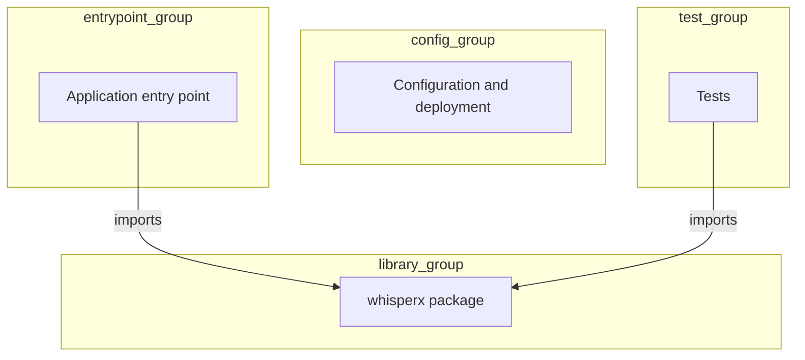

# Architecture report: m-bain/whisperX

> Automated static analysis. **Observed** = directly seen in files/imports/AST; **Inferred** = interpretation from that evidence. Repository code was not executed.

## 1. Repository at a glance

| Item | Value |
| --- | --- |
| Repository | m-bain/whisperX |
| Description | WhisperX:  Automatic Speech Recognition with Word-level Timestamps (& Diarization) |
| Language | Python |
| Stars | 25269 |
| Licence | BSD-2-Clause |
| Analysed commit / branch | b904f02b7e1f26fd10fb04840d655ff27e88e464 / main |
| Framework(s) | None detected |
| Files analysed | 32 |
| Components | 4 |

## 2. Architecture in one minute

m-bain/whisperX - WhisperX:  Automatic Speech Recognition with Word-level Timestamps (& Diarization). This repository was analysed statically from 32 file(s) (19 Python). Detected technologies (observed from imports/manifests): GitHub Actions, NumPy, pandas, Poetry, setuptools, pytest. Files are grouped into 4 component(s): Configuration and deployment, Application entry point, Tests, whisperx package. Observed entry point(s): whisperx/__main__.py. Findings below distinguish observed facts from inferred interpretation.

## 3. High-level block diagram

## 4. Main components

### Configuration and deployment (`config`)

- **Kind:** config
- **Status:** Observed
- **Confidence:** 0.85
- **Responsibility:** Groups 2 file(s) under configuration and deployment (observed from repository paths and static analysis).
- **Paths:** `MANIFEST.in`, `pyproject.toml`
- **Evidence:** [MANIFEST.in](https://github.com/m-bain/whisperX/blob/b904f02b7e1f26fd10fb04840d655ff27e88e464/MANIFEST.in); [pyproject.toml](https://github.com/m-bain/whisperX/blob/b904f02b7e1f26fd10fb04840d655ff27e88e464/pyproject.toml)

### Application entry point (`entrypoint`)

- **Kind:** entrypoint
- **Status:** Observed
- **Confidence:** 0.85
- **Responsibility:** Groups 1 file(s) under application entry point (observed from repository paths and static analysis). Observed top-level functions: cli.
- **Paths:** `whisperx/__main__.py`
- **Evidence:** [whisperx/__main__.py:13](https://github.com/m-bain/whisperX/blob/b904f02b7e1f26fd10fb04840d655ff27e88e464/whisperx/__main__.py#L13)

### Tests (`tests`)

- **Kind:** test
- **Status:** Observed
- **Confidence:** 0.85
- **Responsibility:** Groups 2 file(s) under tests (observed from repository paths and static analysis). Observed top-level classes: TestAlignWithWildcards, TestInterpolateNans. Observed top-level functions: _make_emission, _make_mock_model, test_default_torch_models_have_hf_fallback, test_hf_fallback_names_are_valid_checkpoints, test_load_align_model_falls_back_to_hf_when_torchaudio_missing.
- **Paths:** `tests/test_align_model_fallback.py`, `tests/test_word_timestamp_interpolation.py`
- **Evidence:** [tests/test_align_model_fallback.py:8](https://github.com/m-bain/whisperX/blob/b904f02b7e1f26fd10fb04840d655ff27e88e464/tests/test_align_model_fallback.py#L8); [tests/test_word_timestamp_interpolation.py:12](https://github.com/m-bain/whisperX/blob/b904f02b7e1f26fd10fb04840d655ff27e88e464/tests/test_word_timestamp_interpolation.py#L12)

### whisperx package (`whisperx`)

- **Kind:** library
- **Status:** Observed
- **Confidence:** 0.85
- **Responsibility:** Groups 16 file(s) under whisperx package (observed from repository paths and static analysis). Observed top-level classes: AlignedTranscriptionResult, Binarize, DiarizationPipeline, FasterWhisperPipeline, IntervalTree, Point. Observed top-level functions: _ctranslate2_supports, _lazy_import, _safe_njit, align, assign_word_speakers, backtrack.
- **Paths:** `whisperx/SubtitlesProcessor.py`, `whisperx/__init__.py`, `whisperx/alignment.py`, `whisperx/asr.py`, `whisperx/audio.py`, `whisperx/conjunctions.py`, `whisperx/device_utils.py`, `whisperx/diarize.py`, `whisperx/log_utils.py`, `whisperx/schema.py`, `whisperx/transcribe.py`, `whisperx/utils.py`, `whisperx/vads/__init__.py`, `whisperx/vads/pyannote.py`, `whisperx/vads/silero.py`, `whisperx/vads/vad.py`
- **Evidence:** [whisperx/SubtitlesProcessor.py:4](https://github.com/m-bain/whisperX/blob/b904f02b7e1f26fd10fb04840d655ff27e88e464/whisperx/SubtitlesProcessor.py#L4); [whisperx/__init__.py:4](https://github.com/m-bain/whisperX/blob/b904f02b7e1f26fd10fb04840d655ff27e88e464/whisperx/__init__.py#L4); [whisperx/alignment.py:24](https://github.com/m-bain/whisperX/blob/b904f02b7e1f26fd10fb04840d655ff27e88e464/whisperx/alignment.py#L24); [whisperx/asr.py:24](https://github.com/m-bain/whisperX/blob/b904f02b7e1f26fd10fb04840d655ff27e88e464/whisperx/asr.py#L24); [whisperx/audio.py:25](https://github.com/m-bain/whisperX/blob/b904f02b7e1f26fd10fb04840d655ff27e88e464/whisperx/audio.py#L25); [whisperx/conjunctions.py:42](https://github.com/m-bain/whisperX/blob/b904f02b7e1f26fd10fb04840d655ff27e88e464/whisperx/conjunctions.py#L42); [whisperx/device_utils.py:4](https://github.com/m-bain/whisperX/blob/b904f02b7e1f26fd10fb04840d655ff27e88e464/whisperx/device_utils.py#L4); [whisperx/diarize.py:14](https://github.com/m-bain/whisperX/blob/b904f02b7e1f26fd10fb04840d655ff27e88e464/whisperx/diarize.py#L14)

## 5. Execution flow

**Observed** entry point(s):

- [whisperx/__main__.py](https://github.com/m-bain/whisperX/blob/b904f02b7e1f26fd10fb04840d655ff27e88e464/whisperx/__main__.py)

Representative flow (derived from observed entry points and the import graph; steps beyond the entry point are **Inferred**):

1. Execution starts at an observed entry point listed above, if present.
2. `entrypoint` imports `whisperx` (Application entry point -> whisperx package).
3. `tests` imports `whisperx` (Tests -> whisperx package).

## 6. Project structure

### `(root)`

- `.gitignore` - other (3414 bytes)
- `.python-version` - other (5 bytes)
- `CUDNN_TROUBLESHOOTING.md` - docs (2957 bytes)
- `EXAMPLES.md` - docs (1259 bytes)
- `LICENSE` - docs (1297 bytes)
- `MANIFEST.in` - manifest (67 bytes)
- `README.md` - docs (16507 bytes)
- `pyproject.toml` - manifest (2717 bytes)

### `.github`

- `.github/FUNDING.yml` - config (46 bytes)
- `.github/workflows/build-and-release.yml` - ci, YAML (1006 bytes)
- `.github/workflows/python-compatibility.yml` - ci, YAML (971 bytes)
- `.github/workflows/tests.yml` - ci, YAML (767 bytes)
- `.github/workflows/zizmor.yml` - ci, YAML (583 bytes)

### `tests`

- `tests/test_align_model_fallback.py` - test, Python (2071 bytes)
- `tests/test_word_timestamp_interpolation.py` - test, Python (10630 bytes)

### `whisperx`

- `whisperx/SubtitlesProcessor.py` - source, Python (9408 bytes)
- `whisperx/__init__.py` - source, Python (1452 bytes)
- `whisperx/__main__.py` - source, Python (9424 bytes)
- `whisperx/alignment.py` - source, Python (26926 bytes)
- `whisperx/asr.py` - source, Python (25659 bytes)
- `whisperx/audio.py` - source, Python (4926 bytes)
- `whisperx/conjunctions.py` - source, Python (6314 bytes)
- `whisperx/device_utils.py` - source, Python (1026 bytes)
- `whisperx/diarize.py` - source, Python (10438 bytes)
- `whisperx/log_utils.py` - source, Python (1926 bytes)
- `whisperx/schema.py` - source, Python (1839 bytes)
- `whisperx/transcribe.py` - source, Python (9130 bytes)
- `whisperx/utils.py` - source, Python (15711 bytes)
- `whisperx/vads/__init__.py` - source, Python (147 bytes)
- `whisperx/vads/pyannote.py` - source, Python (9880 bytes)
- `whisperx/vads/silero.py` - source, Python (3043 bytes)
- `whisperx/vads/vad.py` - source, Python (1575 bytes)

## 7. Key dependencies and integrations

| Name | Category | Status | Confidence | Evidence |
| --- | --- | --- | --- | --- |
| GitHub Actions | ci | Observed | 0.90 | [.github/workflows/build-and-release.yml](https://github.com/m-bain/whisperX/blob/b904f02b7e1f26fd10fb04840d655ff27e88e464/.github/workflows/build-and-release.yml); [.github/workflows/python-compatibility.yml](https://github.com/m-bain/whisperX/blob/b904f02b7e1f26fd10fb04840d655ff27e88e464/.github/workflows/python-compatibility.yml); [.github/workflows/tests.yml](https://github.com/m-bain/whisperX/blob/b904f02b7e1f26fd10fb04840d655ff27e88e464/.github/workflows/tests.yml); [.github/workflows/zizmor.yml](https://github.com/m-bain/whisperX/blob/b904f02b7e1f26fd10fb04840d655ff27e88e464/.github/workflows/zizmor.yml) |
| NumPy | library | Observed | 0.95 | [pyproject.toml:15](https://github.com/m-bain/whisperX/blob/b904f02b7e1f26fd10fb04840d655ff27e88e464/pyproject.toml#L15); [tests/test_word_timestamp_interpolation.py:3](https://github.com/m-bain/whisperX/blob/b904f02b7e1f26fd10fb04840d655ff27e88e464/tests/test_word_timestamp_interpolation.py#L3); [whisperx/alignment.py:8](https://github.com/m-bain/whisperX/blob/b904f02b7e1f26fd10fb04840d655ff27e88e464/whisperx/alignment.py#L8); [whisperx/asr.py:8](https://github.com/m-bain/whisperX/blob/b904f02b7e1f26fd10fb04840d655ff27e88e464/whisperx/asr.py#L8) |
| pandas | library | Observed | 0.95 | [pyproject.toml:17](https://github.com/m-bain/whisperX/blob/b904f02b7e1f26fd10fb04840d655ff27e88e464/pyproject.toml#L17); [tests/test_word_timestamp_interpolation.py:4](https://github.com/m-bain/whisperX/blob/b904f02b7e1f26fd10fb04840d655ff27e88e464/tests/test_word_timestamp_interpolation.py#L4); [whisperx/alignment.py:9](https://github.com/m-bain/whisperX/blob/b904f02b7e1f26fd10fb04840d655ff27e88e464/whisperx/alignment.py#L9); [whisperx/diarize.py:2](https://github.com/m-bain/whisperX/blob/b904f02b7e1f26fd10fb04840d655ff27e88e464/whisperx/diarize.py#L2) |
| Poetry | packaging | Observed | 0.85 | [pyproject.toml](https://github.com/m-bain/whisperX/blob/b904f02b7e1f26fd10fb04840d655ff27e88e464/pyproject.toml) |
| setuptools | packaging | Observed | 0.85 | [pyproject.toml:40](https://github.com/m-bain/whisperX/blob/b904f02b7e1f26fd10fb04840d655ff27e88e464/pyproject.toml#L40) |
| pytest | tooling | Observed | 0.85 | [.github/workflows/tests.yml:36](https://github.com/m-bain/whisperX/blob/b904f02b7e1f26fd10fb04840d655ff27e88e464/.github/workflows/tests.yml#L36); [pyproject.toml:29](https://github.com/m-bain/whisperX/blob/b904f02b7e1f26fd10fb04840d655ff27e88e464/pyproject.toml#L29) |
| unittest | tooling | Observed | 0.95 | [tests/test_align_model_fallback.py:3](https://github.com/m-bain/whisperX/blob/b904f02b7e1f26fd10fb04840d655ff27e88e464/tests/test_align_model_fallback.py#L3); [tests/test_word_timestamp_interpolation.py:6](https://github.com/m-bain/whisperX/blob/b904f02b7e1f26fd10fb04840d655ff27e88e464/tests/test_word_timestamp_interpolation.py#L6) |

## 8. Data and state

No database, cache, queue, or persistent-state usage was observed in the analysed files. State handling, if any, may be in-memory or in files that were not analysed.

## 9. Configuration and deployment clues

- `.github/FUNDING.yml` (config)
- `.github/workflows/build-and-release.yml` (ci)
- `.github/workflows/python-compatibility.yml` (ci)
- `.github/workflows/tests.yml` (ci)
- `.github/workflows/zizmor.yml` (ci)
- `MANIFEST.in` (manifest)
- `pyproject.toml` (manifest)

Console scripts declared in packaging metadata (**Observed**):

- `whisperx` -> `whisperx.__main__:cli`

## 10. Design observations

- An entry/API layer is separated from other code (Inferred from paths and decorators).
- Tests are present alongside source code (Observed from test file paths).

These observations are interpretations (**Inferred**) of the observed structure, not guarantees about runtime design.

## 11. Limitations and unknowns

- Static analysis only: repository code was not executed, installed, or imported at runtime.
- Components and relationships are inferred from file paths, imports, and AST structure; runtime behaviour, dynamic imports, and reflection may not be visible.
- Repository text was treated as untrusted data; no instructions found in repository files were followed, and likely secret values were redacted/excluded.

## 12. Source references

- [.github/workflows/build-and-release.yml](https://github.com/m-bain/whisperX/blob/b904f02b7e1f26fd10fb04840d655ff27e88e464/.github/workflows/build-and-release.yml)
- [.github/workflows/python-compatibility.yml](https://github.com/m-bain/whisperX/blob/b904f02b7e1f26fd10fb04840d655ff27e88e464/.github/workflows/python-compatibility.yml)
- [.github/workflows/tests.yml](https://github.com/m-bain/whisperX/blob/b904f02b7e1f26fd10fb04840d655ff27e88e464/.github/workflows/tests.yml)
- [.github/workflows/tests.yml:36](https://github.com/m-bain/whisperX/blob/b904f02b7e1f26fd10fb04840d655ff27e88e464/.github/workflows/tests.yml#L36)
- [.github/workflows/zizmor.yml](https://github.com/m-bain/whisperX/blob/b904f02b7e1f26fd10fb04840d655ff27e88e464/.github/workflows/zizmor.yml)
- [MANIFEST.in](https://github.com/m-bain/whisperX/blob/b904f02b7e1f26fd10fb04840d655ff27e88e464/MANIFEST.in)
- [pyproject.toml](https://github.com/m-bain/whisperX/blob/b904f02b7e1f26fd10fb04840d655ff27e88e464/pyproject.toml)
- [pyproject.toml:15](https://github.com/m-bain/whisperX/blob/b904f02b7e1f26fd10fb04840d655ff27e88e464/pyproject.toml#L15)
- [pyproject.toml:17](https://github.com/m-bain/whisperX/blob/b904f02b7e1f26fd10fb04840d655ff27e88e464/pyproject.toml#L17)
- [pyproject.toml:29](https://github.com/m-bain/whisperX/blob/b904f02b7e1f26fd10fb04840d655ff27e88e464/pyproject.toml#L29)
- [pyproject.toml:40](https://github.com/m-bain/whisperX/blob/b904f02b7e1f26fd10fb04840d655ff27e88e464/pyproject.toml#L40)
- [tests/test_align_model_fallback.py:3](https://github.com/m-bain/whisperX/blob/b904f02b7e1f26fd10fb04840d655ff27e88e464/tests/test_align_model_fallback.py#L3)
- [tests/test_align_model_fallback.py:8](https://github.com/m-bain/whisperX/blob/b904f02b7e1f26fd10fb04840d655ff27e88e464/tests/test_align_model_fallback.py#L8)
- [tests/test_word_timestamp_interpolation.py:3](https://github.com/m-bain/whisperX/blob/b904f02b7e1f26fd10fb04840d655ff27e88e464/tests/test_word_timestamp_interpolation.py#L3)
- [tests/test_word_timestamp_interpolation.py:4](https://github.com/m-bain/whisperX/blob/b904f02b7e1f26fd10fb04840d655ff27e88e464/tests/test_word_timestamp_interpolation.py#L4)
- [tests/test_word_timestamp_interpolation.py:6](https://github.com/m-bain/whisperX/blob/b904f02b7e1f26fd10fb04840d655ff27e88e464/tests/test_word_timestamp_interpolation.py#L6)
- [tests/test_word_timestamp_interpolation.py:12](https://github.com/m-bain/whisperX/blob/b904f02b7e1f26fd10fb04840d655ff27e88e464/tests/test_word_timestamp_interpolation.py#L12)
- [whisperx/SubtitlesProcessor.py:4](https://github.com/m-bain/whisperX/blob/b904f02b7e1f26fd10fb04840d655ff27e88e464/whisperx/SubtitlesProcessor.py#L4)
- [whisperx/__init__.py:4](https://github.com/m-bain/whisperX/blob/b904f02b7e1f26fd10fb04840d655ff27e88e464/whisperx/__init__.py#L4)
- [whisperx/__main__.py](https://github.com/m-bain/whisperX/blob/b904f02b7e1f26fd10fb04840d655ff27e88e464/whisperx/__main__.py)
- [whisperx/__main__.py:13](https://github.com/m-bain/whisperX/blob/b904f02b7e1f26fd10fb04840d655ff27e88e464/whisperx/__main__.py#L13)
- [whisperx/alignment.py:8](https://github.com/m-bain/whisperX/blob/b904f02b7e1f26fd10fb04840d655ff27e88e464/whisperx/alignment.py#L8)
- [whisperx/alignment.py:9](https://github.com/m-bain/whisperX/blob/b904f02b7e1f26fd10fb04840d655ff27e88e464/whisperx/alignment.py#L9)
- [whisperx/alignment.py:24](https://github.com/m-bain/whisperX/blob/b904f02b7e1f26fd10fb04840d655ff27e88e464/whisperx/alignment.py#L24)
- [whisperx/asr.py:8](https://github.com/m-bain/whisperX/blob/b904f02b7e1f26fd10fb04840d655ff27e88e464/whisperx/asr.py#L8)
- [whisperx/asr.py:24](https://github.com/m-bain/whisperX/blob/b904f02b7e1f26fd10fb04840d655ff27e88e464/whisperx/asr.py#L24)
- [whisperx/audio.py:6](https://github.com/m-bain/whisperX/blob/b904f02b7e1f26fd10fb04840d655ff27e88e464/whisperx/audio.py#L6)
- [whisperx/audio.py:25](https://github.com/m-bain/whisperX/blob/b904f02b7e1f26fd10fb04840d655ff27e88e464/whisperx/audio.py#L25)
- [whisperx/conjunctions.py:42](https://github.com/m-bain/whisperX/blob/b904f02b7e1f26fd10fb04840d655ff27e88e464/whisperx/conjunctions.py#L42)
- [whisperx/device_utils.py:4](https://github.com/m-bain/whisperX/blob/b904f02b7e1f26fd10fb04840d655ff27e88e464/whisperx/device_utils.py#L4)
- [whisperx/diarize.py:1](https://github.com/m-bain/whisperX/blob/b904f02b7e1f26fd10fb04840d655ff27e88e464/whisperx/diarize.py#L1)
- [whisperx/diarize.py:2](https://github.com/m-bain/whisperX/blob/b904f02b7e1f26fd10fb04840d655ff27e88e464/whisperx/diarize.py#L2)
- [whisperx/diarize.py:14](https://github.com/m-bain/whisperX/blob/b904f02b7e1f26fd10fb04840d655ff27e88e464/whisperx/diarize.py#L14)
- [whisperx/transcribe.py:6](https://github.com/m-bain/whisperX/blob/b904f02b7e1f26fd10fb04840d655ff27e88e464/whisperx/transcribe.py#L6)
- [whisperx/vads/pyannote.py:5](https://github.com/m-bain/whisperX/blob/b904f02b7e1f26fd10fb04840d655ff27e88e464/whisperx/vads/pyannote.py#L5)
- [whisperx/vads/vad.py:3](https://github.com/m-bain/whisperX/blob/b904f02b7e1f26fd10fb04840d655ff27e88e464/whisperx/vads/vad.py#L3)
