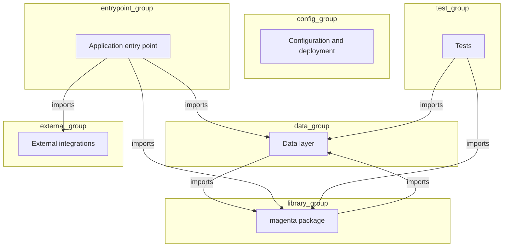

# Architecture report: magenta/magenta

> Automated static analysis. **Observed** = directly seen in files/imports/AST; **Inferred** = interpretation from that evidence. Repository code was not executed.

## 1. Repository at a glance

| Item | Value |
| --- | --- |
| Repository | magenta/magenta |
| Description | Magenta: Music and Art Generation with Machine Intelligence |
| Language | Python |
| Stars | 19785 |
| Licence | Apache-2.0 |
| Analysed commit / branch | c15687ebd1c1cc12658cd468c737d3c24c02b918 / main |
| Framework(s) | None detected |
| Files analysed | 388 |
| Components | 6 |

## 2. Architecture in one minute

magenta/magenta - Magenta: Music and Art Generation with Machine Intelligence. This repository was analysed statically from 388 file(s) (332 Python). Detected technologies (observed from imports/manifests): GitHub Actions, NumPy, requests, setuptools, pytest, unittest. Files are grouped into 6 component(s): Configuration and deployment, Data layer, Application entry point, External integrations, magenta package, Tests. Observed entry point(s): magenta/common/beam_search_test.py, magenta/common/concurrency_test.py, magenta/common/nade_test.py. Findings below distinguish observed facts from inferred interpretation.

## 3. High-level block diagram

## 4. Main components

### Configuration and deployment (`config`)

- **Kind:** config
- **Status:** Observed
- **Confidence:** 0.85
- **Responsibility:** Groups 2 file(s) under configuration and deployment (observed from repository paths and static analysis).
- **Paths:** `setup.cfg`, `setup.py`
- **Evidence:** [setup.cfg](https://github.com/magenta/magenta/blob/c15687ebd1c1cc12658cd468c737d3c24c02b918/setup.cfg); [setup.py](https://github.com/magenta/magenta/blob/c15687ebd1c1cc12658cd468c737d3c24c02b918/setup.py)

### Data layer (`data_layer`)

- **Kind:** data
- **Status:** Observed
- **Confidence:** 0.85
- **Responsibility:** Groups 171 file(s) under data layer (observed from repository paths and static analysis). Observed top-level classes: AbsoluteMelody2PerfProblem, AggregateMean, AncestralSampler, Architecture, AudioRecorder, AudioTimeoutError. Observed top-level functions: HertzToMel, SpectrogramToMelMatrix, _aspect_preserving_resize, _calculate_metrics_py, _central_crop, _checkpoint_file_exists.
- **Paths:** `magenta/models/__init__.py`, `magenta/models/arbitrary_image_stylization/__init__.py`, `magenta/models/arbitrary_image_stylization/arbitrary_image_stylization_build_mobilenet_model.py`, `magenta/models/arbitrary_image_stylization/arbitrary_image_stylization_build_model.py`, `magenta/models/arbitrary_image_stylization/arbitrary_image_stylization_losses.py`, `magenta/models/arbitrary_image_stylization/nza_model.py`, `magenta/models/coconet/__init__.py`, `magenta/models/coconet/evalmodel_bazel.sh`, `magenta/models/coconet/evalsample_bazel.sh`, `magenta/models/coconet/lib_data.py`, `magenta/models/coconet/lib_evaluation.py`, `magenta/models/coconet/lib_graph.py`, `magenta/models/coconet/lib_hparams.py`, `magenta/models/coconet/lib_logging.py`, `magenta/models/coconet/lib_mask.py`, `magenta/models/coconet/lib_pianoroll.py`, `magenta/models/coconet/lib_sampling.py`, `magenta/models/coconet/lib_saved_model.py`, `magenta/models/coconet/lib_tfutil.py`, `magenta/models/coconet/lib_util.py`, `magenta/models/coconet/sample_bazel.sh`, `magenta/models/coconet/train_bazel.sh`, `magenta/models/drums_rnn/__init__.py`, `magenta/models/drums_rnn/drums_rnn_config_flags.py`, `magenta/models/drums_rnn/drums_rnn_model.py`, `magenta/models/drums_rnn/drums_rnn_pipeline.py`, `magenta/models/drums_rnn/drums_rnn_sequence_generator.py`, `magenta/models/gansynth/__init__.py`, `magenta/models/gansynth/configs/__init__.py`, `magenta/models/gansynth/configs/mel_prog_hires.py`, `magenta/models/gansynth/lib/__init__.py`, `magenta/models/gansynth/lib/data_helpers.py`, `magenta/models/gansynth/lib/data_normalizer.py`, `magenta/models/gansynth/lib/datasets.py`, `magenta/models/gansynth/lib/flags.py`, `magenta/models/gansynth/lib/generate_util.py`, `magenta/models/gansynth/lib/layers.py`, `magenta/models/gansynth/lib/model.py`, `magenta/models/gansynth/lib/network_functions.py`, `magenta/models/gansynth/lib/networks.py`, `magenta/models/gansynth/lib/specgrams_helper.py`, `magenta/models/gansynth/lib/spectral_ops.py`, `magenta/models/gansynth/lib/train_util.py`, `magenta/models/gansynth/lib/util.py`, `magenta/models/image_stylization/__init__.py`, `magenta/models/image_stylization/image_utils.py`, `magenta/models/image_stylization/imagenet_data.py`, `magenta/models/image_stylization/learning.py`, `magenta/models/image_stylization/model.py`, `magenta/models/image_stylization/ops.py`, `magenta/models/image_stylization/vgg.py`, `magenta/models/improv_rnn/__init__.py`, `magenta/models/improv_rnn/improv_rnn_config_flags.py`, `magenta/models/improv_rnn/improv_rnn_model.py`, `magenta/models/improv_rnn/improv_rnn_pipeline.py`, `magenta/models/improv_rnn/improv_rnn_sequence_generator.py`, `magenta/models/latent_transfer/__init__.py`, `magenta/models/latent_transfer/common.py`, `magenta/models/latent_transfer/common_joint.py`, `magenta/models/latent_transfer/configs/__init__.py`, `magenta/models/latent_transfer/configs/fashion_mnist_0_nlatent100.py`, `magenta/models/latent_transfer/configs/fashion_mnist_0_nlatent64.py`, `magenta/models/latent_transfer/configs/fashion_mnist_classifier_0.py`, `magenta/models/latent_transfer/configs/joint_exp_2fashion_parameterized.py`, `magenta/models/latent_transfer/configs/joint_exp_2mnist_parameterized.py`, `magenta/models/latent_transfer/configs/joint_exp_mnist100_2wavegan_parameterized.py`, `magenta/models/latent_transfer/configs/joint_exp_mnist2fashion_parameterized.py`, `magenta/models/latent_transfer/configs/joint_exp_mnist2wavegan_parameterized.py`, `magenta/models/latent_transfer/configs/mnist_0_nlatent100.py`, `magenta/models/latent_transfer/configs/mnist_0_nlatent64.py`, `magenta/models/latent_transfer/configs/mnist_classifier_0.py`, `magenta/models/latent_transfer/configs/wavegan.py`, `magenta/models/latent_transfer/local_mnist.py`, `magenta/models/latent_transfer/model_dataspace.py`, `magenta/models/latent_transfer/model_joint.py`, `magenta/models/latent_transfer/nn.py`, `magenta/models/melody_rnn/__init__.py`, `magenta/models/melody_rnn/melody_rnn_config_flags.py`, `magenta/models/melody_rnn/melody_rnn_model.py`, `magenta/models/melody_rnn/melody_rnn_pipeline.py`, `magenta/models/melody_rnn/melody_rnn_sequence_generator.py`, `magenta/models/music_vae/__init__.py`, `magenta/models/music_vae/base_model.py`, `magenta/models/music_vae/configs.py`, `magenta/models/music_vae/data.py`, `magenta/models/music_vae/data_hierarchical.py`, `magenta/models/music_vae/lstm_models.py`, `magenta/models/music_vae/lstm_utils.py`, `magenta/models/music_vae/trained_model.py`, `magenta/models/nsynth/__init__.py`, `magenta/models/nsynth/baseline/__init__.py`, `magenta/models/nsynth/baseline/models/__init__.py`, `magenta/models/nsynth/baseline/models/ae.py`, `magenta/models/nsynth/baseline/models/ae_configs/__init__.py`, `magenta/models/nsynth/baseline/models/ae_configs/nfft_1024.py`, `magenta/models/nsynth/reader.py`, `magenta/models/nsynth/utils.py`, `magenta/models/nsynth/wavenet/__init__.py`, `magenta/models/nsynth/wavenet/fastgen.py`, `magenta/models/nsynth/wavenet/h512_bo16.py`, `magenta/models/nsynth/wavenet/masked.py`, `magenta/models/onsets_frames_transcription/__init__.py`, `magenta/models/onsets_frames_transcription/audio_label_data_utils.py`, `magenta/models/onsets_frames_transcription/audio_transform.py`, `magenta/models/onsets_frames_transcription/configs.py`, `magenta/models/onsets_frames_transcription/constants.py`, `magenta/models/onsets_frames_transcription/create_dataset.py`, `magenta/models/onsets_frames_transcription/create_dataset_lib.py`, `magenta/models/onsets_frames_transcription/data.py`, `magenta/models/onsets_frames_transcription/drum_mappings.py`, `magenta/models/onsets_frames_transcription/estimator_spec_util.py`, `magenta/models/onsets_frames_transcription/infer.py`, `magenta/models/onsets_frames_transcription/infer_util.py`, `magenta/models/onsets_frames_transcription/melspec_input.py`, `magenta/models/onsets_frames_transcription/metrics.py`, `magenta/models/onsets_frames_transcription/mfcc_mel.py`, `magenta/models/onsets_frames_transcription/model.py`, `magenta/models/onsets_frames_transcription/model_tpu.py`, `magenta/models/onsets_frames_transcription/realtime/__init__.py`, `magenta/models/onsets_frames_transcription/realtime/audio_recorder.py`, `magenta/models/onsets_frames_transcription/realtime/tflite_model.py`, `magenta/models/onsets_frames_transcription/train_util.py`, `magenta/models/performance_rnn/__init__.py`, `magenta/models/performance_rnn/performance_model.py`, `magenta/models/performance_rnn/performance_sequence_generator.py`, `magenta/models/piano_genie/__init__.py`, `magenta/models/piano_genie/configs.py`, `magenta/models/piano_genie/gold.py`, `magenta/models/piano_genie/loader.py`, `magenta/models/piano_genie/model.py`, `magenta/models/piano_genie/util.py`, `magenta/models/pianoroll_rnn_nade/__init__.py`, `magenta/models/pianoroll_rnn_nade/pianoroll_rnn_nade_graph.py`, `magenta/models/pianoroll_rnn_nade/pianoroll_rnn_nade_model.py`, `magenta/models/pianoroll_rnn_nade/pianoroll_rnn_nade_sequence_generator.py`, `magenta/models/polyphony_rnn/__init__.py`, `magenta/models/polyphony_rnn/polyphony_encoder_decoder.py`, `magenta/models/polyphony_rnn/polyphony_lib.py`, `magenta/models/polyphony_rnn/polyphony_model.py`, `magenta/models/polyphony_rnn/polyphony_rnn_pipeline.py`, `magenta/models/polyphony_rnn/polyphony_sequence_generator.py`, `magenta/models/rl_tuner/__init__.py`, `magenta/models/rl_tuner/note_rnn_loader.py`, `magenta/models/rl_tuner/rl_tuner.py`, `magenta/models/rl_tuner/rl_tuner_eval_metrics.py`, `magenta/models/rl_tuner/rl_tuner_ops.py`, `magenta/models/score2perf/__init__.py`, `magenta/models/score2perf/datagen_beam.py`, `magenta/models/score2perf/modalities.py`, `magenta/models/score2perf/music_encoders.py`, `magenta/models/score2perf/score2perf.py`, `magenta/models/score2perf/score2perf_hparams.py`, `magenta/models/score2perf/transformer_autoencoder.py`, `magenta/models/shared/__init__.py`, `magenta/models/shared/events_rnn_graph.py`, `magenta/models/shared/events_rnn_model.py`, `magenta/models/shared/events_rnn_train.py`, `magenta/models/shared/model.py`, `magenta/models/shared/sequence_generator.py`, `magenta/models/shared/sequence_generator_bundle.py`, `magenta/models/sketch_rnn/__init__.py`, `magenta/models/sketch_rnn/model.py`, `magenta/models/sketch_rnn/rnn.py`, `magenta/models/sketch_rnn/utils.py`, `magenta/models/svg_vae/__init__.py`, `magenta/models/svg_vae/glyphazzn.py`, `magenta/models/svg_vae/image_vae.py`, `magenta/models/svg_vae/svg_decoder.py`, `magenta/models/svg_vae/svg_decoder_loss.py`, `magenta/models/svg_vae/svg_utils.py`, `magenta/tensor2tensor/models.py`
- **Evidence:** [magenta/models/__init__.py](https://github.com/magenta/magenta/blob/c15687ebd1c1cc12658cd468c737d3c24c02b918/magenta/models/__init__.py); [magenta/models/arbitrary_image_stylization/__init__.py](https://github.com/magenta/magenta/blob/c15687ebd1c1cc12658cd468c737d3c24c02b918/magenta/models/arbitrary_image_stylization/__init__.py); [magenta/models/arbitrary_image_stylization/arbitrary_image_stylization_build_mobilenet_model.py:31](https://github.com/magenta/magenta/blob/c15687ebd1c1cc12658cd468c737d3c24c02b918/magenta/models/arbitrary_image_stylization/arbitrary_image_stylization_build_mobilenet_model.py#L31); [magenta/models/arbitrary_image_stylization/arbitrary_image_stylization_build_model.py:25](https://github.com/magenta/magenta/blob/c15687ebd1c1cc12658cd468c737d3c24c02b918/magenta/models/arbitrary_image_stylization/arbitrary_image_stylization_build_model.py#L25); [magenta/models/arbitrary_image_stylization/arbitrary_image_stylization_losses.py:22](https://github.com/magenta/magenta/blob/c15687ebd1c1cc12658cd468c737d3c24c02b918/magenta/models/arbitrary_image_stylization/arbitrary_image_stylization_losses.py#L22); [magenta/models/arbitrary_image_stylization/nza_model.py:25](https://github.com/magenta/magenta/blob/c15687ebd1c1cc12658cd468c737d3c24c02b918/magenta/models/arbitrary_image_stylization/nza_model.py#L25); [magenta/models/coconet/__init__.py](https://github.com/magenta/magenta/blob/c15687ebd1c1cc12658cd468c737d3c24c02b918/magenta/models/coconet/__init__.py); [magenta/models/coconet/evalmodel_bazel.sh](https://github.com/magenta/magenta/blob/c15687ebd1c1cc12658cd468c737d3c24c02b918/magenta/models/coconet/evalmodel_bazel.sh)

### Application entry point (`entrypoint`)

- **Kind:** entrypoint
- **Status:** Observed
- **Confidence:** 0.85
- **Responsibility:** Groups 78 file(s) under application entry point (observed from repository paths and static analysis). Observed top-level classes: AgibbsStrategy, AudioChunk, AudioQueue, BachUpsamplingStrategy, BaseStrategy, CCMapper. Observed top-level functions: _bytes_feature, _convert_to_path, _convert_to_tflite, _create_example, _decode_tfexample, _describe_style.
- **Paths:** `magenta/interfaces/midi/magenta_midi.py`, `magenta/interfaces/midi/midi_clock.py`, `magenta/models/arbitrary_image_stylization/arbitrary_image_stylization_convert_tflite.py`, `magenta/models/arbitrary_image_stylization/arbitrary_image_stylization_distill_mobilenet.py`, `magenta/models/arbitrary_image_stylization/arbitrary_image_stylization_evaluate.py`, `magenta/models/arbitrary_image_stylization/arbitrary_image_stylization_train.py`, `magenta/models/arbitrary_image_stylization/arbitrary_image_stylization_train_mobile.py`, `magenta/models/arbitrary_image_stylization/arbitrary_image_stylization_with_weights.py`, `magenta/models/arbitrary_image_stylization/export_hub.py`, `magenta/models/coconet/coconet_evaluate.py`, `magenta/models/coconet/coconet_sample.py`, `magenta/models/coconet/coconet_train.py`, `magenta/models/coconet/export_saved_model.py`, `magenta/models/coconet/lib_tfsampling.py`, `magenta/models/drums_rnn/drums_rnn_create_dataset.py`, `magenta/models/drums_rnn/drums_rnn_generate.py`, `magenta/models/drums_rnn/drums_rnn_train.py`, `magenta/models/gansynth/gansynth_generate.py`, `magenta/models/gansynth/gansynth_train.py`, `magenta/models/image_stylization/image_stylization_convert_tflite.py`, `magenta/models/image_stylization/image_stylization_create_dataset.py`, `magenta/models/image_stylization/image_stylization_evaluate.py`, `magenta/models/image_stylization/image_stylization_finetune.py`, `magenta/models/image_stylization/image_stylization_train.py`, `magenta/models/image_stylization/image_stylization_transform.py`, `magenta/models/improv_rnn/improv_rnn_create_dataset.py`, `magenta/models/improv_rnn/improv_rnn_generate.py`, `magenta/models/improv_rnn/improv_rnn_train.py`, `magenta/models/latent_transfer/encode_dataspace.py`, `magenta/models/latent_transfer/interpolate_joint.py`, `magenta/models/latent_transfer/sample_dataspace.py`, `magenta/models/latent_transfer/sample_wavegan.py`, `magenta/models/latent_transfer/train_dataspace.py`, `magenta/models/latent_transfer/train_dataspace_classifier.py`, `magenta/models/latent_transfer/train_joint.py`, `magenta/models/melody_rnn/melody_rnn_create_dataset.py`, `magenta/models/melody_rnn/melody_rnn_generate.py`, `magenta/models/melody_rnn/melody_rnn_train.py`, `magenta/models/music_vae/music_vae_generate.py`, `magenta/models/music_vae/music_vae_train.py`, `magenta/models/music_vae/preprocess_tfrecord.py`, `magenta/models/nsynth/baseline/save_embeddings.py`, `magenta/models/nsynth/baseline/train.py`, `magenta/models/nsynth/wavenet/nsynth_generate.py`, `magenta/models/nsynth/wavenet/nsynth_save_embeddings.py`, `magenta/models/nsynth/wavenet/train.py`, `magenta/models/onsets_frames_transcription/onsets_frames_transcription_create_dataset.py`, `magenta/models/onsets_frames_transcription/onsets_frames_transcription_create_dataset_maps.py`, `magenta/models/onsets_frames_transcription/onsets_frames_transcription_create_tfrecords.py`, `magenta/models/onsets_frames_transcription/onsets_frames_transcription_infer.py`, `magenta/models/onsets_frames_transcription/onsets_frames_transcription_spectrogram_json.py`, `magenta/models/onsets_frames_transcription/onsets_frames_transcription_train.py`, `magenta/models/onsets_frames_transcription/onsets_frames_transcription_transcribe.py`, `magenta/models/onsets_frames_transcription/realtime/onsets_frames_transcription_realtime.py`, `magenta/models/performance_rnn/performance_rnn_create_dataset.py`, `magenta/models/performance_rnn/performance_rnn_generate.py`, `magenta/models/performance_rnn/performance_rnn_train.py`, `magenta/models/piano_genie/eval.py`, `magenta/models/piano_genie/train.py`, `magenta/models/pianoroll_rnn_nade/pianoroll_rnn_nade_create_dataset.py`, `magenta/models/pianoroll_rnn_nade/pianoroll_rnn_nade_generate.py`, `magenta/models/pianoroll_rnn_nade/pianoroll_rnn_nade_train.py`, `magenta/models/polyphony_rnn/polyphony_rnn_create_dataset.py`, `magenta/models/polyphony_rnn/polyphony_rnn_generate.py`, `magenta/models/polyphony_rnn/polyphony_rnn_train.py`, `magenta/models/rl_tuner/rl_tuner_train.py`, `magenta/models/sketch_rnn/sketch_rnn_train.py`, `magenta/models/svg_vae/datagen_beam.py`, `magenta/scripts/abc_compare.py`, `magenta/scripts/convert_dir_to_note_sequences.py`, `magenta/scripts/unpack_bundle.py`, `magenta/tensor2tensor/t2t_datagen.py`, `magenta/tensor2tensor/t2t_decoder.py`, `magenta/tensor2tensor/t2t_trainer.py`, `magenta/video/next_frame_prediction_pix2pix/join_pairs.py`, `magenta/video/tools/convert2jpg.py`, `magenta/video/tools/extract_frames.py`, `magenta/video/tools/random_pick.py`
- **Evidence:** [magenta/interfaces/midi/magenta_midi.py:185](https://github.com/magenta/magenta/blob/c15687ebd1c1cc12658cd468c737d3c24c02b918/magenta/interfaces/midi/magenta_midi.py#L185); [magenta/interfaces/midi/midi_clock.py:48](https://github.com/magenta/magenta/blob/c15687ebd1c1cc12658cd468c737d3c24c02b918/magenta/interfaces/midi/midi_clock.py#L48); [magenta/models/arbitrary_image_stylization/arbitrary_image_stylization_convert_tflite.py:47](https://github.com/magenta/magenta/blob/c15687ebd1c1cc12658cd468c737d3c24c02b918/magenta/models/arbitrary_image_stylization/arbitrary_image_stylization_convert_tflite.py#L47); [magenta/models/arbitrary_image_stylization/arbitrary_image_stylization_distill_mobilenet.py:74](https://github.com/magenta/magenta/blob/c15687ebd1c1cc12658cd468c737d3c24c02b918/magenta/models/arbitrary_image_stylization/arbitrary_image_stylization_distill_mobilenet.py#L74); [magenta/models/arbitrary_image_stylization/arbitrary_image_stylization_evaluate.py:52](https://github.com/magenta/magenta/blob/c15687ebd1c1cc12658cd468c737d3c24c02b918/magenta/models/arbitrary_image_stylization/arbitrary_image_stylization_evaluate.py#L52); [magenta/models/arbitrary_image_stylization/arbitrary_image_stylization_train.py:68](https://github.com/magenta/magenta/blob/c15687ebd1c1cc12658cd468c737d3c24c02b918/magenta/models/arbitrary_image_stylization/arbitrary_image_stylization_train.py#L68); [magenta/models/arbitrary_image_stylization/arbitrary_image_stylization_train_mobile.py:69](https://github.com/magenta/magenta/blob/c15687ebd1c1cc12658cd468c737d3c24c02b918/magenta/models/arbitrary_image_stylization/arbitrary_image_stylization_train_mobile.py#L69); [magenta/models/arbitrary_image_stylization/arbitrary_image_stylization_with_weights.py:56](https://github.com/magenta/magenta/blob/c15687ebd1c1cc12658cd468c737d3c24c02b918/magenta/models/arbitrary_image_stylization/arbitrary_image_stylization_with_weights.py#L56)

### External integrations (`external_integrations`)

- **Kind:** external
- **Status:** Inferred
- **Confidence:** 0.70
- **Responsibility:** Groups 0 file(s) under external integrations (observed from repository paths and static analysis).
- **Evidence:** [magenta/models/sketch_rnn/sketch_rnn_train.py:25](https://github.com/magenta/magenta/blob/c15687ebd1c1cc12658cd468c737d3c24c02b918/magenta/models/sketch_rnn/sketch_rnn_train.py#L25)

### magenta package (`magenta`)

- **Kind:** library
- **Status:** Observed
- **Confidence:** 0.85
- **Responsibility:** Groups 45 file(s) under magenta package (observed from repository paths and static analysis). Observed top-level classes: AttentionCellWrapper, BadInputOrOutputError, BadTopologyError, BaseDecoder, BasicDecoder, BasicDecoderOutput. Observed top-level functions: _LSTMBlockCellGrad, _all_are_type, _assert_valid_type_signature, _call_sampler, _cast_to_type_if_compatible, _create_zero_outputs.
- **Paths:** `magenta/__init__.py`, `magenta/common/__init__.py`, `magenta/common/beam_search.py`, `magenta/common/concurrency.py`, `magenta/common/nade.py`, `magenta/common/sequence_example_lib.py`, `magenta/common/state_util.py`, `magenta/common/testing_lib.py`, `magenta/common/tf_utils.py`, `magenta/contrib/__init__.py`, `magenta/contrib/cudnn_rnn.py`, `magenta/contrib/rnn.py`, `magenta/contrib/seq2seq.py`, `magenta/contrib/training.py`, `magenta/interfaces/__init__.py`, `magenta/interfaces/midi/__init__.py`, `magenta/interfaces/midi/midi_hub.py`, `magenta/interfaces/midi/midi_interaction.py`, `magenta/music/__init__.py`, `magenta/pipelines/__init__.py`, `magenta/pipelines/chord_pipelines.py`, `magenta/pipelines/dag_pipeline.py`, `magenta/pipelines/drum_pipelines.py`, `magenta/pipelines/event_sequence_pipeline.py`, `magenta/pipelines/lead_sheet_pipelines.py`, `magenta/pipelines/melody_pipelines.py`, `magenta/pipelines/note_sequence_pipelines.py`, `magenta/pipelines/performance_pipeline.py`, `magenta/pipelines/pianoroll_pipeline.py`, `magenta/pipelines/pipeline.py`, `magenta/pipelines/pipelines_common.py`, `magenta/pipelines/statistics.py`, `magenta/scripts/__init__.py`, `magenta/tensor2tensor/__init__.py`, `magenta/tensor2tensor/problems.py`, `magenta/tensor2tensor/problems_datagen.py`, `magenta/tools/magenta-install.sh`, `magenta/version.py`, `magenta/video/__init__.py`, `magenta/video/next_frame_prediction_pix2pix/create_video.sh`, `magenta/video/next_frame_prediction_pix2pix/recursion_640.sh`, `magenta/video/tools/__init__.py`, `magenta/video/tools/concat_mp4.sh`, `magenta/video/tools/create_mp4.sh`, `magenta/video/tools/extract_multiple_video.sh`
- **Evidence:** [magenta/__init__.py](https://github.com/magenta/magenta/blob/c15687ebd1c1cc12658cd468c737d3c24c02b918/magenta/__init__.py); [magenta/common/__init__.py](https://github.com/magenta/magenta/blob/c15687ebd1c1cc12658cd468c737d3c24c02b918/magenta/common/__init__.py); [magenta/common/beam_search.py:27](https://github.com/magenta/magenta/blob/c15687ebd1c1cc12658cd468c737d3c24c02b918/magenta/common/beam_search.py#L27); [magenta/common/concurrency.py:22](https://github.com/magenta/magenta/blob/c15687ebd1c1cc12658cd468c737d3c24c02b918/magenta/common/concurrency.py#L22); [magenta/common/nade.py:27](https://github.com/magenta/magenta/blob/c15687ebd1c1cc12658cd468c737d3c24c02b918/magenta/common/nade.py#L27); [magenta/common/sequence_example_lib.py:25](https://github.com/magenta/magenta/blob/c15687ebd1c1cc12658cd468c737d3c24c02b918/magenta/common/sequence_example_lib.py#L25); [magenta/common/state_util.py:21](https://github.com/magenta/magenta/blob/c15687ebd1c1cc12658cd468c737d3c24c02b918/magenta/common/state_util.py#L21); [magenta/common/testing_lib.py:22](https://github.com/magenta/magenta/blob/c15687ebd1c1cc12658cd468c737d3c24c02b918/magenta/common/testing_lib.py#L22)

### Tests (`tests`)

- **Kind:** test
- **Status:** Observed
- **Confidence:** 0.85
- **Responsibility:** Groups 47 file(s) under tests (observed from repository paths and static analysis). Observed top-level classes: BaseConditionedOneHotDataTest, BaseDataTest, BaseOneHotDataTest, BasicDecoderTest, BeamSearchTest, ChordPipelinesTest. Observed top-level functions: _TmpFilePath, filter_instrument, parse_flags.
- **Paths:** `conftest.py`, `magenta/common/beam_search_test.py`, `magenta/common/concurrency_test.py`, `magenta/common/nade_test.py`, `magenta/common/state_util_test.py`, `magenta/contrib/rnn_test.py`, `magenta/contrib/seq2seq_test.py`, `magenta/interfaces/midi/midi_hub_test.py`, `magenta/models/coconet/export_saved_model_test.py`, `magenta/models/drums_rnn/drums_rnn_create_dataset_test.py`, `magenta/models/gansynth/lib/specgrams_helper_test.py`, `magenta/models/gansynth/lib/spectral_ops_test.py`, `magenta/models/improv_rnn/improv_rnn_create_dataset_test.py`, `magenta/models/melody_rnn/melody_rnn_create_dataset_test.py`, `magenta/models/music_vae/data_hierarchical_test.py`, `magenta/models/music_vae/data_test.py`, `magenta/models/music_vae/lstm_utils_test.py`, `magenta/models/nsynth/wavenet/fastgen_test.py`, `magenta/models/onsets_frames_transcription/audio_label_data_utils_test.py`, `magenta/models/onsets_frames_transcription/create_dataset_lib_test.py`, `magenta/models/onsets_frames_transcription/data_test.py`, `magenta/models/onsets_frames_transcription/infer_util_test.py`, `magenta/models/onsets_frames_transcription/melspec_input_test.py`, `magenta/models/onsets_frames_transcription/mfcc_mel_test.py`, `magenta/models/performance_rnn/performance_rnn_create_dataset_test.py`, `magenta/models/pianoroll_rnn_nade/pianoroll_rnn_nade_create_dataset_test.py`, `magenta/models/polyphony_rnn/polyphony_encoder_decoder_test.py`, `magenta/models/polyphony_rnn/polyphony_lib_test.py`, `magenta/models/polyphony_rnn/polyphony_rnn_create_dataset_test.py`, `magenta/models/rl_tuner/rl_tuner_test.py`, `magenta/models/score2perf/datagen_beam_test.py`, `magenta/models/score2perf/modalities_test.py`, `magenta/models/score2perf/music_encoders_test.py`, `magenta/models/shared/events_rnn_graph_test.py`, `magenta/models/shared/sequence_generator_test.py`, `magenta/pipelines/chord_pipelines_test.py`, `magenta/pipelines/dag_pipeline_test.py`, `magenta/pipelines/drum_pipelines_test.py`, `magenta/pipelines/lead_sheet_pipelines_test.py`, `magenta/pipelines/melody_pipelines_test.py`, `magenta/pipelines/note_sequence_pipelines_test.py`, `magenta/pipelines/performance_pipeline_test.py`, `magenta/pipelines/pianoroll_pipeline_test.py`, `magenta/pipelines/pipeline_test.py`, `magenta/pipelines/pipelines_common_test.py`, `magenta/pipelines/statistics_test.py`, `magenta/scripts/convert_dir_to_note_sequences_test.py`
- **Evidence:** [conftest.py:24](https://github.com/magenta/magenta/blob/c15687ebd1c1cc12658cd468c737d3c24c02b918/conftest.py#L24); [magenta/common/beam_search_test.py:23](https://github.com/magenta/magenta/blob/c15687ebd1c1cc12658cd468c737d3c24c02b918/magenta/common/beam_search_test.py#L23); [magenta/common/concurrency_test.py:24](https://github.com/magenta/magenta/blob/c15687ebd1c1cc12658cd468c737d3c24c02b918/magenta/common/concurrency_test.py#L24); [magenta/common/nade_test.py:23](https://github.com/magenta/magenta/blob/c15687ebd1c1cc12658cd468c737d3c24c02b918/magenta/common/nade_test.py#L23); [magenta/common/state_util_test.py:22](https://github.com/magenta/magenta/blob/c15687ebd1c1cc12658cd468c737d3c24c02b918/magenta/common/state_util_test.py#L22); [magenta/contrib/rnn_test.py:30](https://github.com/magenta/magenta/blob/c15687ebd1c1cc12658cd468c737d3c24c02b918/magenta/contrib/rnn_test.py#L30); [magenta/contrib/seq2seq_test.py:24](https://github.com/magenta/magenta/blob/c15687ebd1c1cc12658cd468c737d3c24c02b918/magenta/contrib/seq2seq_test.py#L24); [magenta/interfaces/midi/midi_hub_test.py:32](https://github.com/magenta/magenta/blob/c15687ebd1c1cc12658cd468c737d3c24c02b918/magenta/interfaces/midi/midi_hub_test.py#L32)

## 5. Execution flow

**Observed** entry point(s):

- [magenta/common/beam_search_test.py:89](https://github.com/magenta/magenta/blob/c15687ebd1c1cc12658cd468c737d3c24c02b918/magenta/common/beam_search_test.py#L89)
- [magenta/common/concurrency_test.py:53](https://github.com/magenta/magenta/blob/c15687ebd1c1cc12658cd468c737d3c24c02b918/magenta/common/concurrency_test.py#L53)
- [magenta/common/nade_test.py:59](https://github.com/magenta/magenta/blob/c15687ebd1c1cc12658cd468c737d3c24c02b918/magenta/common/nade_test.py#L59)
- [magenta/common/state_util_test.py:78](https://github.com/magenta/magenta/blob/c15687ebd1c1cc12658cd468c737d3c24c02b918/magenta/common/state_util_test.py#L78)
- [magenta/contrib/rnn_test.py:954](https://github.com/magenta/magenta/blob/c15687ebd1c1cc12658cd468c737d3c24c02b918/magenta/contrib/rnn_test.py#L954)
- [magenta/contrib/seq2seq_test.py:558](https://github.com/magenta/magenta/blob/c15687ebd1c1cc12658cd468c737d3c24c02b918/magenta/contrib/seq2seq_test.py#L558)
- [magenta/interfaces/midi/magenta_midi.py:393](https://github.com/magenta/magenta/blob/c15687ebd1c1cc12658cd468c737d3c24c02b918/magenta/interfaces/midi/magenta_midi.py#L393)
- [magenta/interfaces/midi/midi_clock.py:78](https://github.com/magenta/magenta/blob/c15687ebd1c1cc12658cd468c737d3c24c02b918/magenta/interfaces/midi/midi_clock.py#L78)
- [magenta/interfaces/midi/midi_hub_test.py:710](https://github.com/magenta/magenta/blob/c15687ebd1c1cc12658cd468c737d3c24c02b918/magenta/interfaces/midi/midi_hub_test.py#L710)
- [magenta/models/arbitrary_image_stylization/arbitrary_image_stylization_convert_tflite.py:473](https://github.com/magenta/magenta/blob/c15687ebd1c1cc12658cd468c737d3c24c02b918/magenta/models/arbitrary_image_stylization/arbitrary_image_stylization_convert_tflite.py#L473)
- [magenta/models/arbitrary_image_stylization/arbitrary_image_stylization_distill_mobilenet.py:188](https://github.com/magenta/magenta/blob/c15687ebd1c1cc12658cd468c737d3c24c02b918/magenta/models/arbitrary_image_stylization/arbitrary_image_stylization_distill_mobilenet.py#L188)
- [magenta/models/arbitrary_image_stylization/arbitrary_image_stylization_evaluate.py:134](https://github.com/magenta/magenta/blob/c15687ebd1c1cc12658cd468c737d3c24c02b918/magenta/models/arbitrary_image_stylization/arbitrary_image_stylization_evaluate.py#L134)

Representative flow (derived from observed entry points and the import graph; steps beyond the entry point are **Inferred**):

1. Execution starts at an observed entry point listed above, if present.
2. `data_layer` imports `magenta` (Data layer -> magenta package).
3. `entrypoint` imports `data_layer` (Application entry point -> Data layer).
4. `entrypoint` imports `external_integrations` (Application entry point -> External integrations).
5. `entrypoint` imports `magenta` (Application entry point -> magenta package).
6. `magenta` imports `data_layer` (magenta package -> Data layer).
7. `tests` imports `data_layer` (Tests -> Data layer).
8. `tests` imports `magenta` (Tests -> magenta package).

## 6. Project structure

### `(root)`

- `.gitignore` - other (98 bytes)
- `.isort.cfg` - config (183 bytes)
- `.pylintrc` - other (14549 bytes)
- `AUTHORS` - other (332 bytes)
- `LICENSE` - docs (11410 bytes)
- `README.md` - docs (5657 bytes)
- `conftest.py` - test, Python (898 bytes)
- `setup.cfg` - manifest (21 bytes)
- `setup.py` - manifest, Python (6443 bytes)

### `.github`

- `.github/workflows/build.yml` - ci, YAML (1407 bytes)

### `demos`

- `demos/README.md` - docs (134 bytes)

### `magenta`

- `magenta/__init__.py` - source, Python (1279 bytes)
- `magenta/common/__init__.py` - source, Python (945 bytes)
- `magenta/common/beam_search.py` - source, Python (6275 bytes)
- `magenta/common/beam_search_test.py` - test, Python (3261 bytes)
- `magenta/common/concurrency.py` - source, Python (3609 bytes)
- `magenta/common/concurrency_test.py` - test, Python (1562 bytes)
- `magenta/common/nade.py` - source, Python (8994 bytes)
- `magenta/common/nade_test.py` - test, Python (2284 bytes)
- `magenta/common/sequence_example_lib.py` - source, Python (5993 bytes)
- `magenta/common/state_util.py` - source, Python (2687 bytes)
- `magenta/common/state_util_test.py` - test, Python (2728 bytes)
- `magenta/common/testing_lib.py` - source, Python (2876 bytes)
- `magenta/common/tf_utils.py` - source, Python (2660 bytes)
- `magenta/contrib/__init__.py` - source, Python (621 bytes)
- `magenta/contrib/cudnn_rnn.py` - source, Python (1284 bytes)
- `magenta/contrib/rnn.py` - source, Python (34017 bytes)
- `magenta/contrib/rnn_test.py` - test, Python (39395 bytes)
- `magenta/contrib/seq2seq.py` - source, Python (40773 bytes)
- `magenta/contrib/seq2seq_test.py` - test, Python (23041 bytes)
- `magenta/contrib/training.py` - source, Python (23454 bytes)
- `magenta/interfaces/__init__.py` - source, Python (585 bytes)
- `magenta/interfaces/midi/README.md` - docs (7041 bytes)
- `magenta/interfaces/midi/__init__.py` - source, Python (585 bytes)
- `magenta/interfaces/midi/magenta_midi.py` - source, Python (14246 bytes)
- `magenta/interfaces/midi/midi_clock.py` - source, Python (2208 bytes)
- `magenta/interfaces/midi/midi_hub.py` - source, Python (44483 bytes)
- `magenta/interfaces/midi/midi_hub_test.py` - test, Python (25761 bytes)
- `magenta/interfaces/midi/midi_interaction.py` - source, Python (21433 bytes)
- `magenta/js/README.md` - docs (86 bytes)
- `magenta/models/README.md` - docs (4553 bytes)
- `magenta/models/__init__.py` - source, Python (585 bytes)
- `magenta/models/arbitrary_image_stylization/README.md` - docs (17501 bytes)
- `magenta/models/arbitrary_image_stylization/__init__.py` - source, Python (585 bytes)
- `magenta/models/arbitrary_image_stylization/arbitrary_image_stylization_build_mobilenet_model.py` - source, Python (8853 bytes)
- `magenta/models/arbitrary_image_stylization/arbitrary_image_stylization_build_model.py` - source, Python (9632 bytes)
- `magenta/models/arbitrary_image_stylization/arbitrary_image_stylization_convert_tflite.py` - source, Python (17487 bytes)
- `magenta/models/arbitrary_image_stylization/arbitrary_image_stylization_distill_mobilenet.py` - source, Python (7705 bytes)
- `magenta/models/arbitrary_image_stylization/arbitrary_image_stylization_evaluate.py` - source, Python (5235 bytes)
- `magenta/models/arbitrary_image_stylization/arbitrary_image_stylization_losses.py` - source, Python (5412 bytes)
- `magenta/models/arbitrary_image_stylization/arbitrary_image_stylization_train.py` - source, Python (6769 bytes)
- `magenta/models/arbitrary_image_stylization/arbitrary_image_stylization_train_mobile.py` - source, Python (6952 bytes)
- `magenta/models/arbitrary_image_stylization/arbitrary_image_stylization_with_weights.py` - source, Python (7851 bytes)
- `magenta/models/arbitrary_image_stylization/export_hub.py` - source, Python (3645 bytes)
- `magenta/models/arbitrary_image_stylization/images/content_images/README.md` - docs (371 bytes)
- `magenta/models/arbitrary_image_stylization/images/style_images/README.md` - docs (1057 bytes)
- `magenta/models/arbitrary_image_stylization/nza_model.py` - source, Python (5023 bytes)
- `magenta/models/coconet/README.md` - docs (4320 bytes)
- `magenta/models/coconet/__init__.py` - source, Python (585 bytes)
- `magenta/models/coconet/coconet_evaluate.py` - source, Python (7032 bytes)
- `magenta/models/coconet/coconet_sample.py` - source, Python (24788 bytes)
- `magenta/models/coconet/coconet_train.py` - source, Python (15208 bytes)
- `magenta/models/coconet/evalmodel_bazel.sh` - source, Shell (1539 bytes)
- `magenta/models/coconet/evalsample_bazel.sh` - source, Shell (1538 bytes)
- `magenta/models/coconet/export_saved_model.py` - source, Python (2184 bytes)
- `magenta/models/coconet/export_saved_model_test.py` - test, Python (1927 bytes)
- `magenta/models/coconet/lib_data.py` - source, Python (6685 bytes)
- `magenta/models/coconet/lib_evaluation.py` - source, Python (10287 bytes)
- `magenta/models/coconet/lib_graph.py` - source, Python (15099 bytes)
- `magenta/models/coconet/lib_hparams.py` - source, Python (12939 bytes)
- `magenta/models/coconet/lib_logging.py` - source, Python (3542 bytes)
- `magenta/models/coconet/lib_mask.py` - source, Python (3830 bytes)
- `magenta/models/coconet/lib_pianoroll.py` - source, Python (9455 bytes)
- `magenta/models/coconet/lib_sampling.py` - source, Python (16951 bytes)
- `magenta/models/coconet/lib_saved_model.py` - source, Python (2202 bytes)
- `magenta/models/coconet/lib_tfsampling.py` - source, Python (12945 bytes)
- `magenta/models/coconet/lib_tfutil.py` - source, Python (2423 bytes)
- `magenta/models/coconet/lib_util.py` - source, Python (10987 bytes)
- `magenta/models/coconet/sample_bazel.sh` - source, Shell (1435 bytes)
- `magenta/models/coconet/train_bazel.sh` - source, Shell (2004 bytes)
- `magenta/models/drums_rnn/README.md` - docs (8641 bytes)
- `magenta/models/drums_rnn/__init__.py` - source, Python (770 bytes)
- `magenta/models/drums_rnn/drums_rnn_config_flags.py` - source, Python (2202 bytes)
- `magenta/models/drums_rnn/drums_rnn_create_dataset.py` - source, Python (2181 bytes)
- `magenta/models/drums_rnn/drums_rnn_create_dataset_test.py` - test, Python (2839 bytes)
- `magenta/models/drums_rnn/drums_rnn_generate.py` - source, Python (10311 bytes)
- `magenta/models/drums_rnn/drums_rnn_model.py` - source, Python (3863 bytes)
- `magenta/models/drums_rnn/drums_rnn_pipeline.py` - source, Python (2260 bytes)
- `magenta/models/drums_rnn/drums_rnn_sequence_generator.py` - source, Python (6824 bytes)
- `magenta/models/drums_rnn/drums_rnn_train.py` - source, Python (4896 bytes)
- `magenta/models/gansynth/README.md` - docs (3645 bytes)
- `magenta/models/gansynth/__init__.py` - source, Python (585 bytes)
- `magenta/models/gansynth/configs/__init__.py` - source, Python (585 bytes)
- `magenta/models/gansynth/configs/mel_prog_hires.py` - source, Python (2115 bytes)
- `magenta/models/gansynth/gansynth_generate.py` - source, Python (4311 bytes)
- `magenta/models/gansynth/gansynth_train.py` - source, Python (4525 bytes)
- `magenta/models/gansynth/lib/__init__.py` - source, Python (585 bytes)
- `magenta/models/gansynth/lib/data_helpers.py` - source, Python (5705 bytes)
- `magenta/models/gansynth/lib/data_normalizer.py` - source, Python (6373 bytes)
- `magenta/models/gansynth/lib/datasets.py` - source, Python (5495 bytes)
- `magenta/models/gansynth/lib/flags.py` - source, Python (1862 bytes)
- `magenta/models/gansynth/lib/generate_util.py` - source, Python (4543 bytes)
- `magenta/models/gansynth/lib/layers.py` - source, Python (10352 bytes)
- `magenta/models/gansynth/lib/model.py` - source, Python (22270 bytes)
- `magenta/models/gansynth/lib/network_functions.py` - source, Python (3122 bytes)
- `magenta/models/gansynth/lib/networks.py` - source, Python (19811 bytes)
- `magenta/models/gansynth/lib/specgrams_helper.py` - source, Python (9046 bytes)
- `magenta/models/gansynth/lib/specgrams_helper_test.py` - test, Python (3383 bytes)
- `magenta/models/gansynth/lib/spectral_ops.py` - source, Python (9854 bytes)
- `magenta/models/gansynth/lib/spectral_ops_test.py` - test, Python (4127 bytes)
- `magenta/models/gansynth/lib/train_util.py` - source, Python (18859 bytes)
- `magenta/models/gansynth/lib/util.py` - source, Python (3576 bytes)
- `magenta/models/image_stylization/README.md` - docs (5374 bytes)
- `magenta/models/image_stylization/__init__.py` - source, Python (585 bytes)
- `magenta/models/image_stylization/image_stylization_convert_tflite.py` - source, Python (4909 bytes)
- `magenta/models/image_stylization/image_stylization_create_dataset.py` - source, Python (3656 bytes)
- `magenta/models/image_stylization/image_stylization_evaluate.py` - source, Python (7618 bytes)
- `magenta/models/image_stylization/image_stylization_finetune.py` - source, Python (6823 bytes)
- `magenta/models/image_stylization/image_stylization_train.py` - source, Python (6330 bytes)
- `magenta/models/image_stylization/image_stylization_transform.py` - source, Python (5495 bytes)
- `magenta/models/image_stylization/image_utils.py` - source, Python (29703 bytes)
- `magenta/models/image_stylization/imagenet_data.py` - source, Python (4326 bytes)
- `magenta/models/image_stylization/learning.py` - source, Python (7272 bytes)
- `magenta/models/image_stylization/model.py` - source, Python (5853 bytes)
- `magenta/models/image_stylization/ops.py` - source, Python (12687 bytes)
- `magenta/models/image_stylization/vgg.py` - source, Python (4570 bytes)
- `magenta/models/improv_rnn/README.md` - docs (10251 bytes)
- `magenta/models/improv_rnn/__init__.py` - source, Python (773 bytes)
- `magenta/models/improv_rnn/improv_rnn_config_flags.py` - source, Python (2251 bytes)
- `magenta/models/improv_rnn/improv_rnn_create_dataset.py` - source, Python (2205 bytes)
- `magenta/models/improv_rnn/improv_rnn_create_dataset_test.py` - test, Python (3888 bytes)
- `magenta/models/improv_rnn/improv_rnn_generate.py` - source, Python (11433 bytes)
- `magenta/models/improv_rnn/improv_rnn_model.py` - source, Python (8640 bytes)
- `magenta/models/improv_rnn/improv_rnn_pipeline.py` - source, Python (3951 bytes)
- `magenta/models/improv_rnn/improv_rnn_sequence_generator.py` - source, Python (8248 bytes)
- `magenta/models/improv_rnn/improv_rnn_train.py` - source, Python (4713 bytes)
- `magenta/models/latent_transfer/__init__.py` - source, Python (585 bytes)
- `magenta/models/latent_transfer/common.py` - source, Python (8287 bytes)
- `magenta/models/latent_transfer/common_joint.py` - source, Python (26934 bytes)
- `magenta/models/latent_transfer/configs/__init__.py` - source, Python (585 bytes)
- `magenta/models/latent_transfer/configs/fashion_mnist_0_nlatent100.py` - source, Python (1113 bytes)
- `magenta/models/latent_transfer/configs/fashion_mnist_0_nlatent64.py` - source, Python (1112 bytes)
- `magenta/models/latent_transfer/configs/fashion_mnist_classifier_0.py` - source, Python (911 bytes)
- `magenta/models/latent_transfer/configs/joint_exp_2fashion_parameterized.py` - source, Python (2449 bytes)
- `magenta/models/latent_transfer/configs/joint_exp_2mnist_parameterized.py` - source, Python (2401 bytes)
- `magenta/models/latent_transfer/configs/joint_exp_mnist100_2wavegan_parameterized.py` - source, Python (2816 bytes)
- `magenta/models/latent_transfer/configs/joint_exp_mnist2fashion_parameterized.py` - source, Python (2425 bytes)
- `magenta/models/latent_transfer/configs/joint_exp_mnist2wavegan_parameterized.py` - source, Python (2826 bytes)
- `magenta/models/latent_transfer/configs/mnist_0_nlatent100.py` - source, Python (1097 bytes)
- `magenta/models/latent_transfer/configs/mnist_0_nlatent64.py` - source, Python (1096 bytes)
- `magenta/models/latent_transfer/configs/mnist_classifier_0.py` - source, Python (888 bytes)
- `magenta/models/latent_transfer/configs/wavegan.py` - source, Python (710 bytes)
- `magenta/models/latent_transfer/encode_dataspace.py` - source, Python (4198 bytes)
- `magenta/models/latent_transfer/interpolate_joint.py` - source, Python (8073 bytes)
- `magenta/models/latent_transfer/local_mnist.py` - source, Python (8329 bytes)
- `magenta/models/latent_transfer/model_dataspace.py` - source, Python (6575 bytes)
- `magenta/models/latent_transfer/model_joint.py` - source, Python (15476 bytes)
- `magenta/models/latent_transfer/nn.py` - source, Python (6040 bytes)
- `magenta/models/latent_transfer/sample_dataspace.py` - source, Python (4030 bytes)
- `magenta/models/latent_transfer/sample_wavegan.py` - source, Python (6071 bytes)
- `magenta/models/latent_transfer/train_dataspace.py` - source, Python (6441 bytes)
- `magenta/models/latent_transfer/train_dataspace_classifier.py` - source, Python (5150 bytes)
- `magenta/models/latent_transfer/train_joint.py` - source, Python (12827 bytes)
- `magenta/models/melody_rnn/README.md` - docs (10613 bytes)
- `magenta/models/melody_rnn/__init__.py` - source, Python (773 bytes)
- `magenta/models/melody_rnn/melody_rnn_config_flags.py` - source, Python (5432 bytes)
- `magenta/models/melody_rnn/melody_rnn_create_dataset.py` - source, Python (2206 bytes)
- `magenta/models/melody_rnn/melody_rnn_create_dataset_test.py` - test, Python (3178 bytes)
- `magenta/models/melody_rnn/melody_rnn_generate.py` - source, Python (9984 bytes)
- `magenta/models/melody_rnn/melody_rnn_model.py` - source, Python (7600 bytes)
- `magenta/models/melody_rnn/melody_rnn_pipeline.py` - source, Python (3564 bytes)
- `magenta/models/melody_rnn/melody_rnn_sequence_generator.py` - source, Python (6829 bytes)
- `magenta/models/melody_rnn/melody_rnn_train.py` - source, Python (4901 bytes)
- `magenta/models/music_vae/README.md` - docs (11078 bytes)
- `magenta/models/music_vae/__init__.py` - source, Python (1169 bytes)
- `magenta/models/music_vae/base_model.py` - source, Python (13080 bytes)
- `magenta/models/music_vae/configs.py` - source, Python (21534 bytes)
- `magenta/models/music_vae/data.py` - source, Python (74256 bytes)
- `magenta/models/music_vae/data_hierarchical.py` - source, Python (28246 bytes)
- `magenta/models/music_vae/data_hierarchical_test.py` - test, Python (6535 bytes)
- `magenta/models/music_vae/data_test.py` - test, Python (69582 bytes)
- `magenta/models/music_vae/js/README.md` - docs (140 bytes)
- `magenta/models/music_vae/lstm_models.py` - source, Python (51184 bytes)
- `magenta/models/music_vae/lstm_utils.py` - source, Python (10105 bytes)
- `magenta/models/music_vae/lstm_utils_test.py` - test, Python (3902 bytes)
- `magenta/models/music_vae/music_vae_generate.py` - source, Python (6998 bytes)
- `magenta/models/music_vae/music_vae_train.py` - source, Python (11256 bytes)
- `magenta/models/music_vae/preprocess_tfrecord.py` - source, Python (10465 bytes)
- `magenta/models/music_vae/trained_model.py` - source, Python (15543 bytes)
- `magenta/models/nsynth/README.md` - docs (4894 bytes)
- `magenta/models/nsynth/__init__.py` - source, Python (585 bytes)
- `magenta/models/nsynth/baseline/__init__.py` - source, Python (585 bytes)
- `magenta/models/nsynth/baseline/models/__init__.py` - source, Python (585 bytes)
- `magenta/models/nsynth/baseline/models/ae.py` - source, Python (7373 bytes)
- `magenta/models/nsynth/baseline/models/ae_configs/__init__.py` - source, Python (585 bytes)
- `magenta/models/nsynth/baseline/models/ae_configs/nfft_1024.py` - source, Python (6080 bytes)
- `magenta/models/nsynth/baseline/save_embeddings.py` - source, Python (5169 bytes)
- `magenta/models/nsynth/baseline/train.py` - source, Python (3763 bytes)
- `magenta/models/nsynth/reader.py` - source, Python (6937 bytes)
- `magenta/models/nsynth/utils.py` - source, Python (29035 bytes)
- `magenta/models/nsynth/wavenet/__init__.py` - source, Python (585 bytes)
- `magenta/models/nsynth/wavenet/fastgen.py` - source, Python (8165 bytes)
- `magenta/models/nsynth/wavenet/fastgen_test.py` - test, Python (4392 bytes)
- `magenta/models/nsynth/wavenet/h512_bo16.py` - source, Python (10960 bytes)
- `magenta/models/nsynth/wavenet/masked.py` - source, Python (6319 bytes)
- `magenta/models/nsynth/wavenet/nsynth_generate.py` - source, Python (4393 bytes)
- `magenta/models/nsynth/wavenet/nsynth_save_embeddings.py` - source, Python (4809 bytes)
- `magenta/models/nsynth/wavenet/train.py` - source, Python (5032 bytes)
- `magenta/models/onsets_frames_transcription/README.md` - docs (9218 bytes)
- `magenta/models/onsets_frames_transcription/__init__.py` - source, Python (734 bytes)
- `magenta/models/onsets_frames_transcription/audio_label_data_utils.py` - source, Python (14908 bytes)
- `magenta/models/onsets_frames_transcription/audio_label_data_utils_test.py` - test, Python (11938 bytes)
- `magenta/models/onsets_frames_transcription/audio_transform.py` - source, Python (9154 bytes)
- `magenta/models/onsets_frames_transcription/configs.py` - source, Python (4254 bytes)
- `magenta/models/onsets_frames_transcription/constants.py` - source, Python (912 bytes)
- `magenta/models/onsets_frames_transcription/create_dataset.py` - source, Python (13677 bytes)
- `magenta/models/onsets_frames_transcription/create_dataset_lib.py` - source, Python (4100 bytes)
- `magenta/models/onsets_frames_transcription/create_dataset_lib_test.py` - test, Python (3322 bytes)
- `magenta/models/onsets_frames_transcription/data.py` - source, Python (28400 bytes)
- `magenta/models/onsets_frames_transcription/data_test.py` - test, Python (11853 bytes)
- `magenta/models/onsets_frames_transcription/drum_mappings.py` - source, Python (4904 bytes)
- `magenta/models/onsets_frames_transcription/estimator_spec_util.py` - source, Python (10589 bytes)
- `magenta/models/onsets_frames_transcription/infer.py` - source, Python (8937 bytes)
- `magenta/models/onsets_frames_transcription/infer_util.py` - source, Python (7117 bytes)
- `magenta/models/onsets_frames_transcription/infer_util_test.py` - test, Python (1356 bytes)
- `magenta/models/onsets_frames_transcription/melspec_input.py` - source, Python (12820 bytes)
- `magenta/models/onsets_frames_transcription/melspec_input_test.py` - test, Python (6899 bytes)
- `magenta/models/onsets_frames_transcription/metrics.py` - source, Python (16836 bytes)
- `magenta/models/onsets_frames_transcription/mfcc_mel.py` - source, Python (5518 bytes)
- `magenta/models/onsets_frames_transcription/mfcc_mel_test.py` - test, Python (2999 bytes)
- `magenta/models/onsets_frames_transcription/model.py` - source, Python (16217 bytes)
- `magenta/models/onsets_frames_transcription/model_tpu.py` - source, Python (12911 bytes)
- `magenta/models/onsets_frames_transcription/onsets_frames_transcription_create_dataset.py` - source, Python (1277 bytes)
- `magenta/models/onsets_frames_transcription/onsets_frames_transcription_create_dataset_maps.py` - source, Python (4587 bytes)
- `magenta/models/onsets_frames_transcription/onsets_frames_transcription_create_tfrecords.py` - source, Python (4809 bytes)
- `magenta/models/onsets_frames_transcription/onsets_frames_transcription_infer.py` - source, Python (1262 bytes)
- `magenta/models/onsets_frames_transcription/onsets_frames_transcription_spectrogram_json.py` - source, Python (2223 bytes)
- `magenta/models/onsets_frames_transcription/onsets_frames_transcription_train.py` - source, Python (4698 bytes)
- `magenta/models/onsets_frames_transcription/onsets_frames_transcription_transcribe.py` - source, Python (5623 bytes)
- `magenta/models/onsets_frames_transcription/realtime/README.md` - docs (3174 bytes)
- `magenta/models/onsets_frames_transcription/realtime/__init__.py` - source, Python (632 bytes)
- `magenta/models/onsets_frames_transcription/realtime/audio_recorder.py` - source, Python (9982 bytes)
- `magenta/models/onsets_frames_transcription/realtime/onsets_frames_transcription_realtime.py` - source, Python (7772 bytes)
- `magenta/models/onsets_frames_transcription/realtime/tflite_model.py` - source, Python (3402 bytes)
- `magenta/models/onsets_frames_transcription/train_util.py` - source, Python (9113 bytes)
- `magenta/models/performance_rnn/README.md` - docs (11454 bytes)
- `magenta/models/performance_rnn/__init__.py` - source, Python (784 bytes)
- `magenta/models/performance_rnn/performance_model.py` - source, Python (14668 bytes)
- `magenta/models/performance_rnn/performance_rnn_create_dataset.py` - source, Python (2406 bytes)
- `magenta/models/performance_rnn/performance_rnn_create_dataset_test.py` - test, Python (2441 bytes)
- `magenta/models/performance_rnn/performance_rnn_generate.py` - source, Python (11699 bytes)
- `magenta/models/performance_rnn/performance_rnn_train.py` - source, Python (5276 bytes)
- `magenta/models/performance_rnn/performance_sequence_generator.py` - source, Python (12522 bytes)
- `magenta/models/piano_genie/README.md` - docs (1230 bytes)
- `magenta/models/piano_genie/__init__.py` - source, Python (585 bytes)
- `magenta/models/piano_genie/configs.py` - source, Python (11694 bytes)
- `magenta/models/piano_genie/eval.py` - source, Python (8939 bytes)
- `magenta/models/piano_genie/gold.py` - source, Python (2974 bytes)
- `magenta/models/piano_genie/loader.py` - source, Python (6821 bytes)
- `magenta/models/piano_genie/model.py` - source, Python (18013 bytes)
- `magenta/models/piano_genie/train.py` - source, Python (6261 bytes)
- `magenta/models/piano_genie/util.py` - source, Python (2643 bytes)
- `magenta/models/pianoroll_rnn_nade/README.md` - docs (9545 bytes)
- `magenta/models/pianoroll_rnn_nade/__init__.py` - source, Python (796 bytes)
- `magenta/models/pianoroll_rnn_nade/pianoroll_rnn_nade_create_dataset.py` - source, Python (2322 bytes)
- `magenta/models/pianoroll_rnn_nade/pianoroll_rnn_nade_create_dataset_test.py` - test, Python (2674 bytes)
- `magenta/models/pianoroll_rnn_nade/pianoroll_rnn_nade_generate.py` - source, Python (9768 bytes)
- `magenta/models/pianoroll_rnn_nade/pianoroll_rnn_nade_graph.py` - source, Python (12287 bytes)
- `magenta/models/pianoroll_rnn_nade/pianoroll_rnn_nade_model.py` - source, Python (5064 bytes)
- `magenta/models/pianoroll_rnn_nade/pianoroll_rnn_nade_sequence_generator.py` - source, Python (6396 bytes)
- `magenta/models/pianoroll_rnn_nade/pianoroll_rnn_nade_train.py` - source, Python (5112 bytes)
- `magenta/models/polyphony_rnn/README.md` - docs (10226 bytes)
- `magenta/models/polyphony_rnn/__init__.py` - source, Python (778 bytes)
- `magenta/models/polyphony_rnn/polyphony_encoder_decoder.py` - source, Python (2658 bytes)
- `magenta/models/polyphony_rnn/polyphony_encoder_decoder_test.py` - test, Python (2965 bytes)
- `magenta/models/polyphony_rnn/polyphony_lib.py` - source, Python (16649 bytes)
- `magenta/models/polyphony_rnn/polyphony_lib_test.py` - test, Python (17474 bytes)
- `magenta/models/polyphony_rnn/polyphony_model.py` - source, Python (3524 bytes)
- `magenta/models/polyphony_rnn/polyphony_rnn_create_dataset.py` - source, Python (2257 bytes)
- `magenta/models/polyphony_rnn/polyphony_rnn_create_dataset_test.py` - test, Python (2815 bytes)
- `magenta/models/polyphony_rnn/polyphony_rnn_generate.py` - source, Python (10669 bytes)
- `magenta/models/polyphony_rnn/polyphony_rnn_pipeline.py` - source, Python (3711 bytes)
- `magenta/models/polyphony_rnn/polyphony_rnn_train.py` - source, Python (5071 bytes)
- `magenta/models/polyphony_rnn/polyphony_sequence_generator.py` - source, Python (11109 bytes)
- `magenta/models/rl_tuner/README.md` - docs (5810 bytes)
- `magenta/models/rl_tuner/__init__.py` - source, Python (585 bytes)
- `magenta/models/rl_tuner/note_rnn_loader.py` - source, Python (15936 bytes)
- `magenta/models/rl_tuner/rl_tuner.py` - source, Python (81040 bytes)
- `magenta/models/rl_tuner/rl_tuner_eval_metrics.py` - source, Python (16144 bytes)
- `magenta/models/rl_tuner/rl_tuner_ops.py` - source, Python (9366 bytes)
- `magenta/models/rl_tuner/rl_tuner_test.py` - test, Python (4227 bytes)
- `magenta/models/rl_tuner/rl_tuner_train.py` - source, Python (6480 bytes)
- `magenta/models/score2perf/README.md` - docs (3886 bytes)
- `magenta/models/score2perf/__init__.py` - source, Python (797 bytes)
- `magenta/models/score2perf/datagen_beam.py` - source, Python (30300 bytes)
- `magenta/models/score2perf/datagen_beam_test.py` - test, Python (2114 bytes)
- `magenta/models/score2perf/modalities.py` - source, Python (2983 bytes)
- `magenta/models/score2perf/modalities_test.py` - test, Python (2137 bytes)
- `magenta/models/score2perf/music_encoders.py` - source, Python (14536 bytes)
- `magenta/models/score2perf/music_encoders_test.py` - test, Python (11313 bytes)
- `magenta/models/score2perf/score2perf.py` - source, Python (26178 bytes)
- `magenta/models/score2perf/score2perf_hparams.py` - source, Python (8154 bytes)
- `magenta/models/score2perf/transformer_autoencoder.py` - source, Python (32764 bytes)
- `magenta/models/shared/__init__.py` - source, Python (585 bytes)
- `magenta/models/shared/events_rnn_graph.py` - source, Python (10767 bytes)
- `magenta/models/shared/events_rnn_graph_test.py` - test, Python (2316 bytes)
- `magenta/models/shared/events_rnn_model.py` - source, Python (23172 bytes)
- `magenta/models/shared/events_rnn_train.py` - source, Python (7134 bytes)
- `magenta/models/shared/model.py` - source, Python (2830 bytes)
- `magenta/models/shared/sequence_generator.py` - source, Python (9009 bytes)
- `magenta/models/shared/sequence_generator_bundle.py` - source, Python (1159 bytes)
- `magenta/models/shared/sequence_generator_test.py` - test, Python (3155 bytes)
- `magenta/models/sketch_rnn/README.md` - docs (14344 bytes)
- `magenta/models/sketch_rnn/__init__.py` - source, Python (585 bytes)
- `magenta/models/sketch_rnn/assets/catbus.svg` - other (31050 bytes)
- `magenta/models/sketch_rnn/assets/data_format.svg` - other (55208 bytes)
- `magenta/models/sketch_rnn/model.py` - source, Python (17468 bytes)
- `magenta/models/sketch_rnn/rnn.py` - source, Python (16408 bytes)
- `magenta/models/sketch_rnn/sketch_rnn_train.py` - source, Python (16879 bytes)
- `magenta/models/sketch_rnn/utils.py` - source, Python (11242 bytes)
- `magenta/models/svg_vae/README.md` - docs (4487 bytes)
- `magenta/models/svg_vae/__init__.py` - source, Python (746 bytes)
- `magenta/models/svg_vae/datagen_beam.py` - source, Python (9115 bytes)
- `magenta/models/svg_vae/glyphazzn.py` - source, Python (10824 bytes)
- `magenta/models/svg_vae/image_vae.py` - source, Python (10441 bytes)
- `magenta/models/svg_vae/svg_decoder.py` - source, Python (15852 bytes)
- `magenta/models/svg_vae/svg_decoder_loss.py` - source, Python (7941 bytes)
- `magenta/models/svg_vae/svg_utils.py` - source, Python (23896 bytes)
- `magenta/music/__init__.py` - source, Python (1060 bytes)
- `magenta/pipelines/README.md` - docs (22352 bytes)
- `magenta/pipelines/__init__.py` - source, Python (585 bytes)
- `magenta/pipelines/chord_pipelines.py` - source, Python (5406 bytes)
- `magenta/pipelines/chord_pipelines_test.py` - test, Python (6442 bytes)
- `magenta/pipelines/dag_pipeline.py` - source, Python (25419 bytes)
- `magenta/pipelines/dag_pipeline_test.py` - test, Python (29773 bytes)
- `magenta/pipelines/drum_pipelines.py` - source, Python (6745 bytes)
- `magenta/pipelines/drum_pipelines_test.py` - test, Python (8665 bytes)
- `magenta/pipelines/event_sequence_pipeline.py` - source, Python (1490 bytes)
- `magenta/pipelines/lead_sheet_pipelines.py` - source, Python (7193 bytes)
- `magenta/pipelines/lead_sheet_pipelines_test.py` - test, Python (7929 bytes)
- `magenta/pipelines/melody_pipelines.py` - source, Python (8764 bytes)
- `magenta/pipelines/melody_pipelines_test.py` - test, Python (12125 bytes)
- `magenta/pipelines/note_sequence_pipelines.py` - source, Python (7646 bytes)
- `magenta/pipelines/note_sequence_pipelines_test.py` - test, Python (6855 bytes)
- `magenta/pipelines/performance_pipeline.py` - source, Python (11265 bytes)
- `magenta/pipelines/performance_pipeline_test.py` - test, Python (5208 bytes)
- `magenta/pipelines/pianoroll_pipeline.py` - source, Python (6815 bytes)
- `magenta/pipelines/pianoroll_pipeline_test.py` - test, Python (3473 bytes)
- `magenta/pipelines/pipeline.py` - source, Python (15696 bytes)
- `magenta/pipelines/pipeline_test.py` - test, Python (8605 bytes)
- `magenta/pipelines/pipelines_common.py` - source, Python (3252 bytes)
- `magenta/pipelines/pipelines_common_test.py` - test, Python (2199 bytes)
- `magenta/pipelines/statistics.py` - source, Python (8973 bytes)
- `magenta/pipelines/statistics_test.py` - test, Python (3298 bytes)
- `magenta/reviews/GAN.md` - docs (8528 bytes)
- `magenta/reviews/README.md` - docs (1353 bytes)
- `magenta/reviews/draw.md` - docs (5894 bytes)
- `magenta/reviews/pixelrnn.md` - docs (15984 bytes)
- `magenta/reviews/rnnrbm.md` - docs (7228 bytes)
- `magenta/reviews/styletransfer.md` - docs (7981 bytes)
- `magenta/reviews/summary_generation_sequences.md` - docs (10232 bytes)
- `magenta/scripts/README.md` - docs (1178 bytes)
- `magenta/scripts/__init__.py` - source, Python (585 bytes)
- `magenta/scripts/abc_compare.py` - source, Python (3509 bytes)
- `magenta/scripts/convert_dir_to_note_sequences.py` - source, Python (9619 bytes)
- `magenta/scripts/convert_dir_to_note_sequences_test.py` - test, Python (4121 bytes)
- `magenta/scripts/unpack_bundle.py` - source, Python (1656 bytes)
- `magenta/tensor2tensor/__init__.py` - source, Python (585 bytes)
- `magenta/tensor2tensor/models.py` - source, Python (778 bytes)
- `magenta/tensor2tensor/problems.py` - source, Python (807 bytes)
- `magenta/tensor2tensor/problems_datagen.py` - source, Python (816 bytes)
- `magenta/tensor2tensor/t2t_datagen.py` - source, Python (1146 bytes)
- `magenta/tensor2tensor/t2t_decoder.py` - source, Python (1131 bytes)
- `magenta/tensor2tensor/t2t_trainer.py` - source, Python (1131 bytes)
- `magenta/tools/magenta-install.sh` - source, Shell (4325 bytes)
- `magenta/version.py` - source, Python (800 bytes)
- `magenta/video/__init__.py` - source, Python (585 bytes)
- `magenta/video/next_frame_prediction_pix2pix/README.md` - docs (3315 bytes)
- `magenta/video/next_frame_prediction_pix2pix/create_video.sh` - source, Shell (7325 bytes)
- `magenta/video/next_frame_prediction_pix2pix/join_pairs.py` - source, Python (3638 bytes)
- `magenta/video/next_frame_prediction_pix2pix/recursion_640.sh` - source, Shell (692 bytes)
- `magenta/video/tools/__init__.py` - source, Python (585 bytes)
- `magenta/video/tools/concat_mp4.sh` - source, Shell (1200 bytes)
- `magenta/video/tools/convert2jpg.py` - source, Python (3853 bytes)
- `magenta/video/tools/create_mp4.sh` - source, Shell (1191 bytes)
- `magenta/video/tools/extract_frames.py` - source, Python (5116 bytes)
- `magenta/video/tools/extract_multiple_video.sh` - source, Shell (1583 bytes)
- `magenta/video/tools/random_pick.py` - source, Python (2854 bytes)

## 7. Key dependencies and integrations

| Name | Category | Status | Confidence | Evidence |
| --- | --- | --- | --- | --- |
| GitHub Actions | ci | Observed | 0.85 | [.github/workflows/build.yml](https://github.com/magenta/magenta/blob/c15687ebd1c1cc12658cd468c737d3c24c02b918/.github/workflows/build.yml) |
| NumPy | library | Observed | 0.95 | [magenta/common/state_util.py:17](https://github.com/magenta/magenta/blob/c15687ebd1c1cc12658cd468c737d3c24c02b918/magenta/common/state_util.py#L17); [magenta/common/state_util_test.py:18](https://github.com/magenta/magenta/blob/c15687ebd1c1cc12658cd468c737d3c24c02b918/magenta/common/state_util_test.py#L18); [magenta/common/testing_lib.py:17](https://github.com/magenta/magenta/blob/c15687ebd1c1cc12658cd468c737d3c24c02b918/magenta/common/testing_lib.py#L17); [magenta/contrib/rnn_test.py:20](https://github.com/magenta/magenta/blob/c15687ebd1c1cc12658cd468c737d3c24c02b918/magenta/contrib/rnn_test.py#L20) |
| requests | library | Observed | 0.90 | [magenta/models/sketch_rnn/sketch_rnn_train.py:25](https://github.com/magenta/magenta/blob/c15687ebd1c1cc12658cd468c737d3c24c02b918/magenta/models/sketch_rnn/sketch_rnn_train.py#L25) |
| setuptools | packaging | Observed | 0.95 | [setup.py:17](https://github.com/magenta/magenta/blob/c15687ebd1c1cc12658cd468c737d3c24c02b918/setup.py#L17); [setup.py:18](https://github.com/magenta/magenta/blob/c15687ebd1c1cc12658cd468c737d3c24c02b918/setup.py#L18) |
| pytest | tooling | Observed | 0.95 | [.github/workflows/build.yml:19](https://github.com/magenta/magenta/blob/c15687ebd1c1cc12658cd468c737d3c24c02b918/.github/workflows/build.yml#L19); [conftest.py:20](https://github.com/magenta/magenta/blob/c15687ebd1c1cc12658cd468c737d3c24c02b918/conftest.py#L20); [magenta/models/score2perf/datagen_beam_test.py:21](https://github.com/magenta/magenta/blob/c15687ebd1c1cc12658cd468c737d3c24c02b918/magenta/models/score2perf/datagen_beam_test.py#L21); [setup.py:65](https://github.com/magenta/magenta/blob/c15687ebd1c1cc12658cd468c737d3c24c02b918/setup.py#L65) |
| unittest | tooling | Observed | 0.90 | [magenta/models/music_vae/data_test.py:22](https://github.com/magenta/magenta/blob/c15687ebd1c1cc12658cd468c737d3c24c02b918/magenta/models/music_vae/data_test.py#L22) |

## 8. Data and state

- Data component `data_layer` (Observed): Groups 171 file(s) under data layer (observed from repository paths and static analysis). Observed top-level classes: AbsoluteMelody2PerfProblem, AggregateMean, AncestralSampler, Architecture, AudioRecorder, AudioTimeoutError. Observed top-level functions: HertzToMel, SpectrogramToMelMatrix, _aspec…

## 9. Configuration and deployment clues

- `.github/workflows/build.yml` (ci)
- `.isort.cfg` (config)
- `setup.cfg` (manifest)
- `setup.py` (manifest)

## 10. Design observations

- An entry/API layer is separated from other code (Inferred from paths and decorators).
- Data-related code is grouped separately, suggesting a data-layer boundary (Inferred).
- Tests are present alongside source code (Observed from test file paths).
- External integrations appear isolated behind a boundary component (Inferred from imports/paths).

These observations are interpretations (**Inferred**) of the observed structure, not guarantees about runtime design.

## 11. Limitations and unknowns

- Static analysis only: repository code was not executed, installed, or imported at runtime.
- Components and relationships are inferred from file paths, imports, and AST structure; runtime behaviour, dynamic imports, and reflection may not be visible.
- Repository text was treated as untrusted data; no instructions found in repository files were followed, and likely secret values were redacted/excluded.
- The GitHub repository was marked archived at selection time.

## 12. Source references

- [.github/workflows/build.yml](https://github.com/magenta/magenta/blob/c15687ebd1c1cc12658cd468c737d3c24c02b918/.github/workflows/build.yml)
- [.github/workflows/build.yml:19](https://github.com/magenta/magenta/blob/c15687ebd1c1cc12658cd468c737d3c24c02b918/.github/workflows/build.yml#L19)
- [conftest.py:20](https://github.com/magenta/magenta/blob/c15687ebd1c1cc12658cd468c737d3c24c02b918/conftest.py#L20)
- [conftest.py:24](https://github.com/magenta/magenta/blob/c15687ebd1c1cc12658cd468c737d3c24c02b918/conftest.py#L24)
- [magenta/__init__.py](https://github.com/magenta/magenta/blob/c15687ebd1c1cc12658cd468c737d3c24c02b918/magenta/__init__.py)
- [magenta/common/__init__.py](https://github.com/magenta/magenta/blob/c15687ebd1c1cc12658cd468c737d3c24c02b918/magenta/common/__init__.py)
- [magenta/common/beam_search.py:27](https://github.com/magenta/magenta/blob/c15687ebd1c1cc12658cd468c737d3c24c02b918/magenta/common/beam_search.py#L27)
- [magenta/common/beam_search_test.py:23](https://github.com/magenta/magenta/blob/c15687ebd1c1cc12658cd468c737d3c24c02b918/magenta/common/beam_search_test.py#L23)
- [magenta/common/beam_search_test.py:89](https://github.com/magenta/magenta/blob/c15687ebd1c1cc12658cd468c737d3c24c02b918/magenta/common/beam_search_test.py#L89)
- [magenta/common/concurrency.py:22](https://github.com/magenta/magenta/blob/c15687ebd1c1cc12658cd468c737d3c24c02b918/magenta/common/concurrency.py#L22)
- [magenta/common/concurrency_test.py:24](https://github.com/magenta/magenta/blob/c15687ebd1c1cc12658cd468c737d3c24c02b918/magenta/common/concurrency_test.py#L24)
- [magenta/common/concurrency_test.py:53](https://github.com/magenta/magenta/blob/c15687ebd1c1cc12658cd468c737d3c24c02b918/magenta/common/concurrency_test.py#L53)
- [magenta/common/nade.py:27](https://github.com/magenta/magenta/blob/c15687ebd1c1cc12658cd468c737d3c24c02b918/magenta/common/nade.py#L27)
- [magenta/common/nade_test.py:23](https://github.com/magenta/magenta/blob/c15687ebd1c1cc12658cd468c737d3c24c02b918/magenta/common/nade_test.py#L23)
- [magenta/common/nade_test.py:59](https://github.com/magenta/magenta/blob/c15687ebd1c1cc12658cd468c737d3c24c02b918/magenta/common/nade_test.py#L59)
- [magenta/common/sequence_example_lib.py:25](https://github.com/magenta/magenta/blob/c15687ebd1c1cc12658cd468c737d3c24c02b918/magenta/common/sequence_example_lib.py#L25)
- [magenta/common/state_util.py:17](https://github.com/magenta/magenta/blob/c15687ebd1c1cc12658cd468c737d3c24c02b918/magenta/common/state_util.py#L17)
- [magenta/common/state_util.py:21](https://github.com/magenta/magenta/blob/c15687ebd1c1cc12658cd468c737d3c24c02b918/magenta/common/state_util.py#L21)
- [magenta/common/state_util_test.py:18](https://github.com/magenta/magenta/blob/c15687ebd1c1cc12658cd468c737d3c24c02b918/magenta/common/state_util_test.py#L18)
- [magenta/common/state_util_test.py:22](https://github.com/magenta/magenta/blob/c15687ebd1c1cc12658cd468c737d3c24c02b918/magenta/common/state_util_test.py#L22)
- [magenta/common/state_util_test.py:78](https://github.com/magenta/magenta/blob/c15687ebd1c1cc12658cd468c737d3c24c02b918/magenta/common/state_util_test.py#L78)
- [magenta/common/testing_lib.py:17](https://github.com/magenta/magenta/blob/c15687ebd1c1cc12658cd468c737d3c24c02b918/magenta/common/testing_lib.py#L17)
- [magenta/common/testing_lib.py:22](https://github.com/magenta/magenta/blob/c15687ebd1c1cc12658cd468c737d3c24c02b918/magenta/common/testing_lib.py#L22)
- [magenta/contrib/rnn_test.py:20](https://github.com/magenta/magenta/blob/c15687ebd1c1cc12658cd468c737d3c24c02b918/magenta/contrib/rnn_test.py#L20)
- [magenta/contrib/rnn_test.py:30](https://github.com/magenta/magenta/blob/c15687ebd1c1cc12658cd468c737d3c24c02b918/magenta/contrib/rnn_test.py#L30)
- [magenta/contrib/rnn_test.py:954](https://github.com/magenta/magenta/blob/c15687ebd1c1cc12658cd468c737d3c24c02b918/magenta/contrib/rnn_test.py#L954)
- [magenta/contrib/seq2seq_test.py:18](https://github.com/magenta/magenta/blob/c15687ebd1c1cc12658cd468c737d3c24c02b918/magenta/contrib/seq2seq_test.py#L18)
- [magenta/contrib/seq2seq_test.py:24](https://github.com/magenta/magenta/blob/c15687ebd1c1cc12658cd468c737d3c24c02b918/magenta/contrib/seq2seq_test.py#L24)
- [magenta/contrib/seq2seq_test.py:558](https://github.com/magenta/magenta/blob/c15687ebd1c1cc12658cd468c737d3c24c02b918/magenta/contrib/seq2seq_test.py#L558)
- [magenta/interfaces/midi/magenta_midi.py:185](https://github.com/magenta/magenta/blob/c15687ebd1c1cc12658cd468c737d3c24c02b918/magenta/interfaces/midi/magenta_midi.py#L185)
- [magenta/interfaces/midi/magenta_midi.py:393](https://github.com/magenta/magenta/blob/c15687ebd1c1cc12658cd468c737d3c24c02b918/magenta/interfaces/midi/magenta_midi.py#L393)
- [magenta/interfaces/midi/midi_clock.py:48](https://github.com/magenta/magenta/blob/c15687ebd1c1cc12658cd468c737d3c24c02b918/magenta/interfaces/midi/midi_clock.py#L48)
- [magenta/interfaces/midi/midi_clock.py:78](https://github.com/magenta/magenta/blob/c15687ebd1c1cc12658cd468c737d3c24c02b918/magenta/interfaces/midi/midi_clock.py#L78)
- [magenta/interfaces/midi/midi_hub_test.py:32](https://github.com/magenta/magenta/blob/c15687ebd1c1cc12658cd468c737d3c24c02b918/magenta/interfaces/midi/midi_hub_test.py#L32)
- [magenta/interfaces/midi/midi_hub_test.py:710](https://github.com/magenta/magenta/blob/c15687ebd1c1cc12658cd468c737d3c24c02b918/magenta/interfaces/midi/midi_hub_test.py#L710)
- [magenta/models/__init__.py](https://github.com/magenta/magenta/blob/c15687ebd1c1cc12658cd468c737d3c24c02b918/magenta/models/__init__.py)
- [magenta/models/arbitrary_image_stylization/__init__.py](https://github.com/magenta/magenta/blob/c15687ebd1c1cc12658cd468c737d3c24c02b918/magenta/models/arbitrary_image_stylization/__init__.py)
- [magenta/models/arbitrary_image_stylization/arbitrary_image_stylization_build_mobilenet_model.py:31](https://github.com/magenta/magenta/blob/c15687ebd1c1cc12658cd468c737d3c24c02b918/magenta/models/arbitrary_image_stylization/arbitrary_image_stylization_build_mobilenet_model.py#L31)
- [magenta/models/arbitrary_image_stylization/arbitrary_image_stylization_build_model.py:25](https://github.com/magenta/magenta/blob/c15687ebd1c1cc12658cd468c737d3c24c02b918/magenta/models/arbitrary_image_stylization/arbitrary_image_stylization_build_model.py#L25)
- [magenta/models/arbitrary_image_stylization/arbitrary_image_stylization_convert_tflite.py:27](https://github.com/magenta/magenta/blob/c15687ebd1c1cc12658cd468c737d3c24c02b918/magenta/models/arbitrary_image_stylization/arbitrary_image_stylization_convert_tflite.py#L27)
- [magenta/models/arbitrary_image_stylization/arbitrary_image_stylization_convert_tflite.py:47](https://github.com/magenta/magenta/blob/c15687ebd1c1cc12658cd468c737d3c24c02b918/magenta/models/arbitrary_image_stylization/arbitrary_image_stylization_convert_tflite.py#L47)
- [magenta/models/arbitrary_image_stylization/arbitrary_image_stylization_convert_tflite.py:473](https://github.com/magenta/magenta/blob/c15687ebd1c1cc12658cd468c737d3c24c02b918/magenta/models/arbitrary_image_stylization/arbitrary_image_stylization_convert_tflite.py#L473)
- [magenta/models/arbitrary_image_stylization/arbitrary_image_stylization_distill_mobilenet.py:74](https://github.com/magenta/magenta/blob/c15687ebd1c1cc12658cd468c737d3c24c02b918/magenta/models/arbitrary_image_stylization/arbitrary_image_stylization_distill_mobilenet.py#L74)
- [magenta/models/arbitrary_image_stylization/arbitrary_image_stylization_distill_mobilenet.py:188](https://github.com/magenta/magenta/blob/c15687ebd1c1cc12658cd468c737d3c24c02b918/magenta/models/arbitrary_image_stylization/arbitrary_image_stylization_distill_mobilenet.py#L188)
- [magenta/models/arbitrary_image_stylization/arbitrary_image_stylization_evaluate.py:52](https://github.com/magenta/magenta/blob/c15687ebd1c1cc12658cd468c737d3c24c02b918/magenta/models/arbitrary_image_stylization/arbitrary_image_stylization_evaluate.py#L52)
- [magenta/models/arbitrary_image_stylization/arbitrary_image_stylization_evaluate.py:134](https://github.com/magenta/magenta/blob/c15687ebd1c1cc12658cd468c737d3c24c02b918/magenta/models/arbitrary_image_stylization/arbitrary_image_stylization_evaluate.py#L134)
- [magenta/models/arbitrary_image_stylization/arbitrary_image_stylization_losses.py:18](https://github.com/magenta/magenta/blob/c15687ebd1c1cc12658cd468c737d3c24c02b918/magenta/models/arbitrary_image_stylization/arbitrary_image_stylization_losses.py#L18)
- [magenta/models/arbitrary_image_stylization/arbitrary_image_stylization_losses.py:22](https://github.com/magenta/magenta/blob/c15687ebd1c1cc12658cd468c737d3c24c02b918/magenta/models/arbitrary_image_stylization/arbitrary_image_stylization_losses.py#L22)
- [magenta/models/arbitrary_image_stylization/arbitrary_image_stylization_train.py:68](https://github.com/magenta/magenta/blob/c15687ebd1c1cc12658cd468c737d3c24c02b918/magenta/models/arbitrary_image_stylization/arbitrary_image_stylization_train.py#L68)
- [magenta/models/arbitrary_image_stylization/arbitrary_image_stylization_train_mobile.py:69](https://github.com/magenta/magenta/blob/c15687ebd1c1cc12658cd468c737d3c24c02b918/magenta/models/arbitrary_image_stylization/arbitrary_image_stylization_train_mobile.py#L69)
- [magenta/models/arbitrary_image_stylization/arbitrary_image_stylization_with_weights.py:28](https://github.com/magenta/magenta/blob/c15687ebd1c1cc12658cd468c737d3c24c02b918/magenta/models/arbitrary_image_stylization/arbitrary_image_stylization_with_weights.py#L28)
- [magenta/models/arbitrary_image_stylization/arbitrary_image_stylization_with_weights.py:56](https://github.com/magenta/magenta/blob/c15687ebd1c1cc12658cd468c737d3c24c02b918/magenta/models/arbitrary_image_stylization/arbitrary_image_stylization_with_weights.py#L56)
- [magenta/models/arbitrary_image_stylization/nza_model.py:25](https://github.com/magenta/magenta/blob/c15687ebd1c1cc12658cd468c737d3c24c02b918/magenta/models/arbitrary_image_stylization/nza_model.py#L25)
- [magenta/models/coconet/__init__.py](https://github.com/magenta/magenta/blob/c15687ebd1c1cc12658cd468c737d3c24c02b918/magenta/models/coconet/__init__.py)
- [magenta/models/coconet/evalmodel_bazel.sh](https://github.com/magenta/magenta/blob/c15687ebd1c1cc12658cd468c737d3c24c02b918/magenta/models/coconet/evalmodel_bazel.sh)
- [magenta/models/music_vae/data_test.py:22](https://github.com/magenta/magenta/blob/c15687ebd1c1cc12658cd468c737d3c24c02b918/magenta/models/music_vae/data_test.py#L22)
- [magenta/models/score2perf/datagen_beam_test.py:21](https://github.com/magenta/magenta/blob/c15687ebd1c1cc12658cd468c737d3c24c02b918/magenta/models/score2perf/datagen_beam_test.py#L21)
- [magenta/models/sketch_rnn/sketch_rnn_train.py:25](https://github.com/magenta/magenta/blob/c15687ebd1c1cc12658cd468c737d3c24c02b918/magenta/models/sketch_rnn/sketch_rnn_train.py#L25)
- [setup.cfg](https://github.com/magenta/magenta/blob/c15687ebd1c1cc12658cd468c737d3c24c02b918/setup.cfg)
- [setup.py](https://github.com/magenta/magenta/blob/c15687ebd1c1cc12658cd468c737d3c24c02b918/setup.py)
- [setup.py:17](https://github.com/magenta/magenta/blob/c15687ebd1c1cc12658cd468c737d3c24c02b918/setup.py#L17)
- [setup.py:18](https://github.com/magenta/magenta/blob/c15687ebd1c1cc12658cd468c737d3c24c02b918/setup.py#L18)
- [setup.py:65](https://github.com/magenta/magenta/blob/c15687ebd1c1cc12658cd468c737d3c24c02b918/setup.py#L65)
