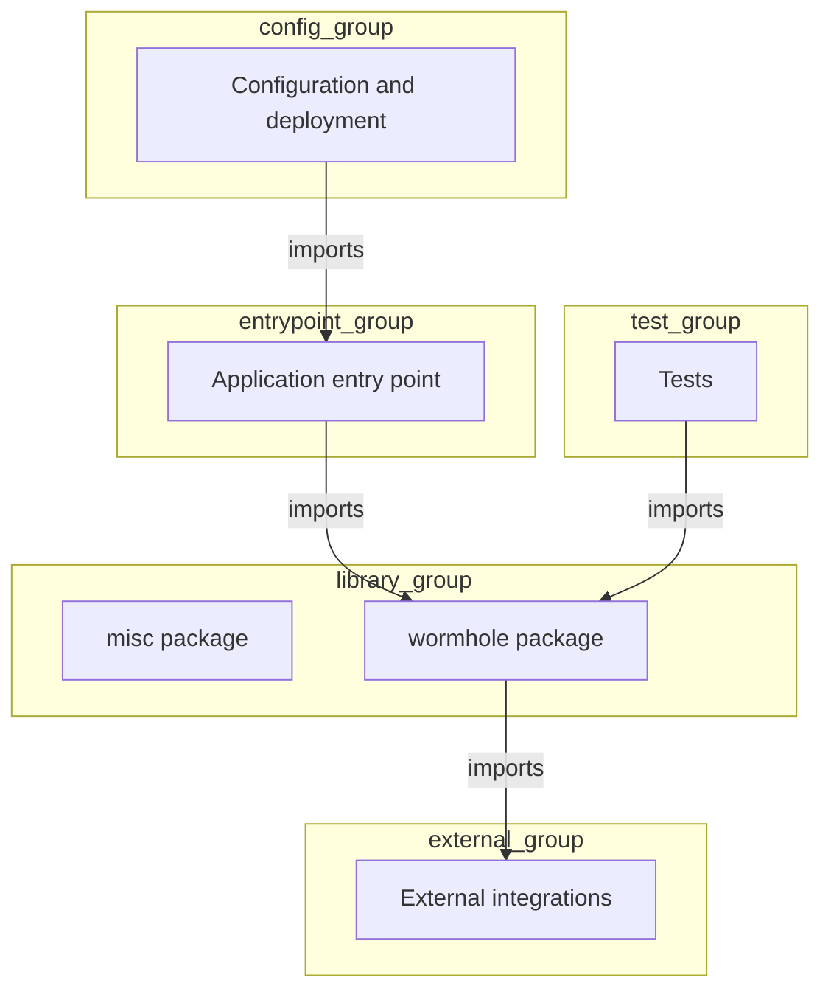

# Architecture report: magic-wormhole/magic-wormhole

> Automated static analysis. **Observed** = directly seen in files/imports/AST; **Inferred** = interpretation from that evidence. Repository code was not executed.

## 1. Repository at a glance

| Item | Value |
| --- | --- |
| Repository | magic-wormhole/magic-wormhole |
| Description | get things from one computer to another, safely |
| Language | Python |
| Stars | 23098 |
| Licence | MIT |
| Analysed commit / branch | 657bd5d51c67db2109219ff57b7d997afa57261f / master |
| Framework(s) | None detected |
| Files analysed | 231 |
| Components | 6 |

## 2. Architecture in one minute

magic-wormhole/magic-wormhole - get things from one computer to another, safely. This repository was analysed statically from 231 file(s) (99 Python). Detected technologies (observed from imports/manifests): GitHub Actions, SQLite, Click, Poetry, setuptools, pytest. Files are grouped into 6 component(s): Configuration and deployment, Application entry point, External integrations, misc package, Tests, wormhole package. Observed entry point(s): misc/demo-journal.py, newest-version.py, src/wormhole/__main__.py. Findings below distinguish observed facts from inferred interpretation.

## 3. High-level block diagram

## 4. Main components

### Configuration and deployment (`config`)

- **Kind:** config
- **Status:** Observed
- **Confidence:** 0.85
- **Responsibility:** Groups 6 file(s) under configuration and deployment (observed from repository paths and static analysis).
- **Paths:** `MANIFEST.in`, `pyproject.toml`, `setup.cfg`, `setup.py`, `snapcraft.yaml`, `tox.ini`
- **Evidence:** [MANIFEST.in](https://github.com/magic-wormhole/magic-wormhole/blob/657bd5d51c67db2109219ff57b7d997afa57261f/MANIFEST.in); [pyproject.toml](https://github.com/magic-wormhole/magic-wormhole/blob/657bd5d51c67db2109219ff57b7d997afa57261f/pyproject.toml); [setup.cfg](https://github.com/magic-wormhole/magic-wormhole/blob/657bd5d51c67db2109219ff57b7d997afa57261f/setup.cfg); [setup.py](https://github.com/magic-wormhole/magic-wormhole/blob/657bd5d51c67db2109219ff57b7d997afa57261f/setup.py); [snapcraft.yaml](https://github.com/magic-wormhole/magic-wormhole/blob/657bd5d51c67db2109219ff57b7d997afa57261f/snapcraft.yaml); [tox.ini](https://github.com/magic-wormhole/magic-wormhole/blob/657bd5d51c67db2109219ff57b7d997afa57261f/tox.ini)

### Application entry point (`entrypoint`)

- **Kind:** entrypoint
- **Status:** Observed
- **Confidence:** 0.85
- **Responsibility:** Groups 6 file(s) under application entry point (observed from repository paths and static analysis). Observed top-level classes: Action, Agent, AliasedGroup, Config, NotThisMethod, Root. Observed top-level functions: _compose, _dispatch_command, _validate_transit_helper, create, create_new_version, do_setup.
- **Paths:** `misc/demo-journal.py`, `newest-version.py`, `src/wormhole/__main__.py`, `src/wormhole/cli/cli.py`, `update-version.py`, `versioneer.py`
- **Evidence:** [misc/demo-journal.py:16](https://github.com/magic-wormhole/magic-wormhole/blob/657bd5d51c67db2109219ff57b7d997afa57261f/misc/demo-journal.py#L16); [newest-version.py:12](https://github.com/magic-wormhole/magic-wormhole/blob/657bd5d51c67db2109219ff57b7d997afa57261f/newest-version.py#L12); [src/wormhole/__main__.py](https://github.com/magic-wormhole/magic-wormhole/blob/657bd5d51c67db2109219ff57b7d997afa57261f/src/wormhole/__main__.py); [src/wormhole/cli/cli.py:26](https://github.com/magic-wormhole/magic-wormhole/blob/657bd5d51c67db2109219ff57b7d997afa57261f/src/wormhole/cli/cli.py#L26); [update-version.py:32](https://github.com/magic-wormhole/magic-wormhole/blob/657bd5d51c67db2109219ff57b7d997afa57261f/update-version.py#L32); [versioneer.py:332](https://github.com/magic-wormhole/magic-wormhole/blob/657bd5d51c67db2109219ff57b7d997afa57261f/versioneer.py#L332)

### External integrations (`external_integrations`)

- **Kind:** external
- **Status:** Inferred
- **Confidence:** 0.70
- **Responsibility:** Groups 0 file(s) under external integrations (observed from repository paths and static analysis).
- **Evidence:** [src/wormhole/test/common.py:15](https://github.com/magic-wormhole/magic-wormhole/blob/657bd5d51c67db2109219ff57b7d997afa57261f/src/wormhole/test/common.py#L15); [src/wormhole/transit.py:2](https://github.com/magic-wormhole/magic-wormhole/blob/657bd5d51c67db2109219ff57b7d997afa57261f/src/wormhole/transit.py#L2)

### misc package (`misc`)

- **Kind:** library
- **Status:** Observed
- **Confidence:** 0.85
- **Responsibility:** Groups 3 file(s) under misc package (observed from repository paths and static analysis). Observed top-level functions: web.
- **Paths:** `misc/dump-stats.py`, `misc/dump-timing.py`, `misc/web/timeline.js`
- **Evidence:** [misc/dump-stats.py](https://github.com/magic-wormhole/magic-wormhole/blob/657bd5d51c67db2109219ff57b7d997afa57261f/misc/dump-stats.py); [misc/dump-timing.py:33](https://github.com/magic-wormhole/magic-wormhole/blob/657bd5d51c67db2109219ff57b7d997afa57261f/misc/dump-timing.py#L33); [misc/web/timeline.js](https://github.com/magic-wormhole/magic-wormhole/blob/657bd5d51c67db2109219ff57b7d997afa57261f/misc/web/timeline.js)

### Tests (`tests`)

- **Kind:** test
- **Status:** Observed
- **Confidence:** 0.85
- **Responsibility:** Groups 41 file(s) under tests (observed from repository paths and static analysis). Observed routes: PATCH wormhole._rlcompleter.CodeInputter, PATCH wormhole._rlcompleter.readline, PATCH wormhole._rlcompleter.input, PATCH wormhole._rlcompleter.CodeInputter, PATCH wormhole._rlcompleter.readline. Observed top-level classes: BonjourProtocol, CannotDilateError, Delegate, DelegateWithOldMethod, Dummy, DummyProtocol. Observed top-level functions: OFF_test_push_pull, OFFassert_makeConnection, _check_top_level_help, _create_broken_symlink, _do_test, _do_test_directory.
- **Paths:** `src/wormhole/test/__init__.py`, `src/wormhole/test/common.py`, `src/wormhole/test/conftest.py`, `src/wormhole/test/dilate/__init__.py`, `src/wormhole/test/dilate/common.py`, `src/wormhole/test/dilate/test_api.py`, `src/wormhole/test/dilate/test_connect.py`, `src/wormhole/test/dilate/test_connection.py`, `src/wormhole/test/dilate/test_connector.py`, `src/wormhole/test/dilate/test_encoding.py`, `src/wormhole/test/dilate/test_endpoints.py`, `src/wormhole/test/dilate/test_framer.py`, `src/wormhole/test/dilate/test_full.py`, `src/wormhole/test/dilate/test_inbound.py`, `src/wormhole/test/dilate/test_manager.py`, `src/wormhole/test/dilate/test_outbound.py`, `src/wormhole/test/dilate/test_parse.py`, `src/wormhole/test/dilate/test_record.py`, `src/wormhole/test/dilate/test_subchannel.py`, `src/wormhole/test/dilate/test_traffic_timing.py`, `src/wormhole/test/dilate/test_version.py`, `src/wormhole/test/test_args.py`, `src/wormhole/test/test_cli.py`, `src/wormhole/test/test_eventual.py`, `src/wormhole/test/test_hints.py`, `src/wormhole/test/test_hkdf.py`, `src/wormhole/test/test_ipaddrs.py`, `src/wormhole/test/test_journal.py`, `src/wormhole/test/test_keys.py`, `src/wormhole/test/test_machines.py`, `src/wormhole/test/test_observer.py`, `src/wormhole/test/test_rlcompleter.py`, `src/wormhole/test/test_ssh.py`, `src/wormhole/test/test_status_exports.py`, `src/wormhole/test/test_tor_manager.py`, `src/wormhole/test/test_transit.py`, `src/wormhole/test/test_util.py`, `src/wormhole/test/test_util_attrs_zope.py`, `src/wormhole/test/test_wordlist.py`, `src/wormhole/test/test_wormhole.py`, `src/wormhole/test/test_xfer_util.py`
- **Evidence:** [src/wormhole/test/__init__.py](https://github.com/magic-wormhole/magic-wormhole/blob/657bd5d51c67db2109219ff57b7d997afa57261f/src/wormhole/test/__init__.py); [src/wormhole/test/common.py:21](https://github.com/magic-wormhole/magic-wormhole/blob/657bd5d51c67db2109219ff57b7d997afa57261f/src/wormhole/test/common.py#L21); [src/wormhole/test/conftest.py:15](https://github.com/magic-wormhole/magic-wormhole/blob/657bd5d51c67db2109219ff57b7d997afa57261f/src/wormhole/test/conftest.py#L15); [src/wormhole/test/dilate/__init__.py](https://github.com/magic-wormhole/magic-wormhole/blob/657bd5d51c67db2109219ff57b7d997afa57261f/src/wormhole/test/dilate/__init__.py); [src/wormhole/test/dilate/common.py:6](https://github.com/magic-wormhole/magic-wormhole/blob/657bd5d51c67db2109219ff57b7d997afa57261f/src/wormhole/test/dilate/common.py#L6); [src/wormhole/test/dilate/test_api.py:20](https://github.com/magic-wormhole/magic-wormhole/blob/657bd5d51c67db2109219ff57b7d997afa57261f/src/wormhole/test/dilate/test_api.py#L20); [src/wormhole/test/dilate/test_connect.py:19](https://github.com/magic-wormhole/magic-wormhole/blob/657bd5d51c67db2109219ff57b7d997afa57261f/src/wormhole/test/dilate/test_connect.py#L19); [src/wormhole/test/dilate/test_connection.py:15](https://github.com/magic-wormhole/magic-wormhole/blob/657bd5d51c67db2109219ff57b7d997afa57261f/src/wormhole/test/dilate/test_connection.py#L15)

### wormhole package (`wormhole`)

- **Kind:** library
- **Status:** Observed
- **Confidence:** 0.85
- **Responsibility:** Groups 47 file(s) under wormhole package (observed from repository paths and static analysis). Observed top-level classes: AllegedSharedKey, AllocatedCode, Allocator, AlreadyChoseNameplateError, AlreadyChoseWordsError, AlreadyClosedError. Observed top-level functions: HKDF, _find_shared_versions, _input_code_with_completion, _is_role, _query, accept.
- **Paths:** `src/wormhole/__init__.py`, `src/wormhole/_allocator.py`, `src/wormhole/_boss.py`, `src/wormhole/_code.py`, `src/wormhole/_dilation/__init__.py`, `src/wormhole/_dilation/_noise.py`, `src/wormhole/_dilation/connection.py`, `src/wormhole/_dilation/connector.py`, `src/wormhole/_dilation/encode.py`, `src/wormhole/_dilation/inbound.py`, `src/wormhole/_dilation/manager.py`, `src/wormhole/_dilation/outbound.py`, `src/wormhole/_dilation/roles.py`, `src/wormhole/_dilation/subchannel.py`, `src/wormhole/_hints.py`, `src/wormhole/_input.py`, `src/wormhole/_interfaces.py`, `src/wormhole/_key.py`, `src/wormhole/_lister.py`, `src/wormhole/_mailbox.py`, `src/wormhole/_nameplate.py`, `src/wormhole/_order.py`, `src/wormhole/_receive.py`, `src/wormhole/_rendezvous.py`, `src/wormhole/_rlcompleter.py`, `src/wormhole/_send.py`, `src/wormhole/_status.py`, `src/wormhole/_terminator.py`, `src/wormhole/_version.py`, `src/wormhole/_wordlist.py`, `src/wormhole/cli/__init__.py`, `src/wormhole/cli/cmd_receive.py`, `src/wormhole/cli/cmd_send.py`, `src/wormhole/cli/cmd_ssh.py`, `src/wormhole/cli/public_relay.py`, `src/wormhole/cli/welcome.py`, `src/wormhole/errors.py`, `src/wormhole/eventual.py`, `src/wormhole/ipaddrs.py`, `src/wormhole/journal.py`, `src/wormhole/observer.py`, `src/wormhole/timing.py`, `src/wormhole/tor_manager.py`, `src/wormhole/transit.py`, `src/wormhole/util.py`, `src/wormhole/wormhole.py`, `src/wormhole/xfer_util.py`
- **Evidence:** [src/wormhole/__init__.py](https://github.com/magic-wormhole/magic-wormhole/blob/657bd5d51c67db2109219ff57b7d997afa57261f/src/wormhole/__init__.py); [src/wormhole/_allocator.py:11](https://github.com/magic-wormhole/magic-wormhole/blob/657bd5d51c67db2109219ff57b7d997afa57261f/src/wormhole/_allocator.py#L11); [src/wormhole/_boss.py:32](https://github.com/magic-wormhole/magic-wormhole/blob/657bd5d51c67db2109219ff57b7d997afa57261f/src/wormhole/_boss.py#L32); [src/wormhole/_code.py:10](https://github.com/magic-wormhole/magic-wormhole/blob/657bd5d51c67db2109219ff57b7d997afa57261f/src/wormhole/_code.py#L10); [src/wormhole/_dilation/__init__.py](https://github.com/magic-wormhole/magic-wormhole/blob/657bd5d51c67db2109219ff57b7d997afa57261f/src/wormhole/_dilation/__init__.py); [src/wormhole/_dilation/_noise.py](https://github.com/magic-wormhole/magic-wormhole/blob/657bd5d51c67db2109219ff57b7d997afa57261f/src/wormhole/_dilation/_noise.py); [src/wormhole/_dilation/connection.py:43](https://github.com/magic-wormhole/magic-wormhole/blob/657bd5d51c67db2109219ff57b7d997afa57261f/src/wormhole/_dilation/connection.py#L43); [src/wormhole/_dilation/connector.py:29](https://github.com/magic-wormhole/magic-wormhole/blob/657bd5d51c67db2109219ff57b7d997afa57261f/src/wormhole/_dilation/connector.py#L29)

## 5. Execution flow

**Observed** entry point(s):

- [misc/demo-journal.py:275](https://github.com/magic-wormhole/magic-wormhole/blob/657bd5d51c67db2109219ff57b7d997afa57261f/misc/demo-journal.py#L275)
- [newest-version.py:25](https://github.com/magic-wormhole/magic-wormhole/blob/657bd5d51c67db2109219ff57b7d997afa57261f/newest-version.py#L25)
- [src/wormhole/__main__.py:1](https://github.com/magic-wormhole/magic-wormhole/blob/657bd5d51c67db2109219ff57b7d997afa57261f/src/wormhole/__main__.py#L1)
- [src/wormhole/cli/cli.py](https://github.com/magic-wormhole/magic-wormhole/blob/657bd5d51c67db2109219ff57b7d997afa57261f/src/wormhole/cli/cli.py)
- [src/wormhole/cli/cli.py](https://github.com/magic-wormhole/magic-wormhole/blob/657bd5d51c67db2109219ff57b7d997afa57261f/src/wormhole/cli/cli.py)
- [update-version.py:109](https://github.com/magic-wormhole/magic-wormhole/blob/657bd5d51c67db2109219ff57b7d997afa57261f/update-version.py#L109)
- [versioneer.py:2273](https://github.com/magic-wormhole/magic-wormhole/blob/657bd5d51c67db2109219ff57b7d997afa57261f/versioneer.py#L2273)

**Observed** routes (from decorators):

- `PATCH wormhole._rlcompleter.CodeInputter` -> `test_readline` in `src/wormhole/test/test_rlcompleter.py:40`
- `PATCH wormhole._rlcompleter.readline` -> `test_readline` in `src/wormhole/test/test_rlcompleter.py:40`
- `PATCH wormhole._rlcompleter.input` -> `test_readline` in `src/wormhole/test/test_rlcompleter.py:40`
- `PATCH wormhole._rlcompleter.CodeInputter` -> `test_readline_no_docstring` in `src/wormhole/test/test_rlcompleter.py:63`
- `PATCH wormhole._rlcompleter.readline` -> `test_readline_no_docstring` in `src/wormhole/test/test_rlcompleter.py:63`
- `PATCH wormhole._rlcompleter.input` -> `test_readline_no_docstring` in `src/wormhole/test/test_rlcompleter.py:63`
- `PATCH wormhole._rlcompleter.CodeInputter` -> `test_libedit` in `src/wormhole/test/test_rlcompleter.py:87`
- `PATCH wormhole._rlcompleter.readline` -> `test_libedit` in `src/wormhole/test/test_rlcompleter.py:87`
- `PATCH wormhole._rlcompleter.input` -> `test_libedit` in `src/wormhole/test/test_rlcompleter.py:87`
- `PATCH wormhole._rlcompleter.CodeInputter` -> `test_no_readline` in `src/wormhole/test/test_rlcompleter.py:110`
- `PATCH wormhole._rlcompleter.readline` -> `test_no_readline` in `src/wormhole/test/test_rlcompleter.py:110`
- `PATCH wormhole._rlcompleter.input` -> `test_no_readline` in `src/wormhole/test/test_rlcompleter.py:110`
- `PATCH wormhole._rlcompleter.CodeInputter` -> `test_bytes` in `src/wormhole/test/test_rlcompleter.py:128`
- `PATCH wormhole._rlcompleter.readline` -> `test_bytes` in `src/wormhole/test/test_rlcompleter.py:128`
- `PATCH wormhole._rlcompleter.input` -> `test_bytes` in `src/wormhole/test/test_rlcompleter.py:128`
- `PATCH wormhole._rlcompleter.readline` -> `test_call` in `src/wormhole/test/test_rlcompleter.py:172`
- `PATCH wormhole._rlcompleter.stderr` -> `test_warn_readline` in `src/wormhole/test/test_rlcompleter.py:368`

Representative flow (derived from observed entry points and the import graph; steps beyond the entry point are **Inferred**):

1. Execution starts at an observed entry point listed above, if present.
2. `config` imports `entrypoint` (Configuration and deployment -> Application entry point).
3. `entrypoint` imports `wormhole` (Application entry point -> wormhole package).
4. `tests` imports `wormhole` (Tests -> wormhole package).
5. `wormhole` imports `external_integrations` (wormhole package -> External integrations).

## 6. Project structure

### `(root)`

- `.appveyor.yml` - config (1800 bytes)
- `.coveragerc` - other (697 bytes)
- `.gitattributes` - other (38 bytes)
- `.gitignore` - other (712 bytes)
- `.readthedocs.yaml` - config (829 bytes)
- `LICENSE` - docs (1080 bytes)
- `MANIFEST.in` - manifest (368 bytes)
- `Makefile` - other (3645 bytes)
- `NEWS.md` - docs (34597 bytes)
- `README.md` - docs (2519 bytes)
- `bash-completions-version-4.patch` - other (499 bytes)
- `newest-version.py` - source, Python (537 bytes)
- `pyproject.toml` - manifest (419 bytes)
- `setup.cfg` - manifest (431 bytes)
- `setup.py` - manifest, Python (2974 bytes)
- `snapcraft.yaml` - config (1365 bytes)
- `tox.ini` - config (1577 bytes)
- `update-version.py` - source, Python (2803 bytes)
- `versioneer.py` - source, Python (86667 bytes)
- `wormhole_complete.bash` - other (801 bytes)
- `wormhole_complete.fish` - other (613 bytes)
- `wormhole_complete.zsh` - other (1182 bytes)

### `.github`

- `.github/workflows/codespell.yml` - ci, YAML (569 bytes)
- `.github/workflows/documentation-links.yml` - ci, YAML (537 bytes)
- `.github/workflows/test.yml` - ci, YAML (2322 bytes)

### `docs`

- `docs/CONTRIBUTING.rst` - docs (5790 bytes)
- `docs/Makefile` - docs (612 bytes)
- `docs/api-example.py` - docs (2373 bytes)
- `docs/api.rst` - docs (36980 bytes)
- `docs/attacks.rst` - docs (4844 bytes)
- `docs/client-protocol.rst` - docs (3674 bytes)
- `docs/conf.py` - docs (6014 bytes)
- `docs/dilation-protocol.rst` - docs (43384 bytes)
- `docs/ecosystem.rst` - docs (9348 bytes)
- `docs/file-transfer-protocol.rst` - docs (10394 bytes)
- `docs/how-to-release.rst` - docs (988 bytes)
- `docs/index.rst` - docs (708 bytes)
- `docs/introduction.rst` - docs (3010 bytes)
- `docs/journal.rst` - docs (7108 bytes)
- `docs/new-protocol.svg` - docs (93301 bytes)
- `docs/releases/release-announce-0.14.0.asc` - docs (1449 bytes)
- `docs/releases/release-announce-0.15.0.asc` - docs (1542 bytes)
- `docs/releases/release-announce-0.19.0.asc` - docs (2076 bytes)
- `docs/releases/release-announce-0.19.1.asc` - docs (1378 bytes)
- `docs/releases/release-announce-0.19.2.asc` - docs (1551 bytes)
- `docs/releases/release-announce-0.24.0.asc` - docs (1391 bytes)
- `docs/requirements.txt` - manifest (236 bytes)
- `docs/server-protocol.rst` - docs (15796 bytes)
- `docs/server.seqdiag` - docs (1248 bytes)
- `docs/state-machines/Makefile` - docs (241 bytes)
- `docs/state-machines/_connection.dot` - docs (3920 bytes)
- `docs/state-machines/allocator.dot` - docs (1193 bytes)
- `docs/state-machines/boss.dot` - docs (3135 bytes)
- `docs/state-machines/code.dot` - docs (1508 bytes)
- `docs/state-machines/dilation.dot` - docs (1807 bytes)
- `docs/state-machines/input.dot` - docs (1859 bytes)
- `docs/state-machines/key.dot` - docs (2704 bytes)
- `docs/state-machines/lister.dot` - docs (1190 bytes)
- `docs/state-machines/machines.dot` - docs (6233 bytes)
- `docs/state-machines/mailbox.dot` - docs (3855 bytes)
- `docs/state-machines/nameplate.dot` - docs (3546 bytes)
- `docs/state-machines/order.dot` - docs (1478 bytes)
- `docs/state-machines/receive.dot` - docs (1673 bytes)
- `docs/state-machines/send.dot` - docs (641 bytes)
- `docs/state-machines/terminator.dot` - docs (1766 bytes)
- `docs/tor.rst` - docs (3533 bytes)
- `docs/transit.rst` - docs (11291 bytes)
- `docs/using-the-cli.rst` - docs (4221 bytes)
- `docs/w.dot` - docs (4061 bytes)
- `docs/welcome.rst` - docs (19188 bytes)
- `docs/wormhole.1` - docs (1089 bytes)

### `misc`

- `misc/demo-journal.py` - source, Python (10158 bytes)
- `misc/dump-stats.py` - source, Python (383 bytes)
- `misc/dump-timing.py` - source, Python (1973 bytes)
- `misc/web/timeline.css` - other (1229 bytes)
- `misc/web/timeline.html` - other (478 bytes)
- `misc/web/timeline.js` - source, JavaScript (38857 bytes)
- `misc/windows-build.cmd` - other (838 bytes)

### `pyi`

- `pyi/build-exe` - other (712 bytes)
- `pyi/wormhole.exe.spec` - other (1212 bytes)

### `signatures`

- `signatures/README` - other (304 bytes)
- `signatures/magic-wormhole-0.10.0.tar.gz.asc` - other (833 bytes)
- `signatures/magic-wormhole-0.10.1.tar.gz.asc` - other (833 bytes)
- `signatures/magic-wormhole-0.10.2.tar.gz.asc` - other (833 bytes)
- `signatures/magic-wormhole-0.10.3.tar.gz.asc` - other (833 bytes)
- `signatures/magic-wormhole-0.10.4.tar.gz.asc` - other (833 bytes)
- `signatures/magic-wormhole-0.10.5.tar.gz.asc` - other (833 bytes)
- `signatures/magic-wormhole-0.11.0.tar.gz.asc` - other (833 bytes)
- `signatures/magic-wormhole-0.11.1.tar.gz.asc` - other (833 bytes)
- `signatures/magic-wormhole-0.11.2.tar.gz.asc` - other (833 bytes)
- `signatures/magic-wormhole-0.12.0.tar.gz.asc` - other (833 bytes)
- `signatures/magic-wormhole-0.13.0.tar.gz.asc` - other (512 bytes)
- `signatures/magic-wormhole-0.15.0.tar.gz.asc` - other (512 bytes)
- `signatures/magic-wormhole-0.16.0.tar.gz.asc` - other (512 bytes)
- `signatures/magic-wormhole-0.7.0.tar.gz.asc` - other (819 bytes)
- `signatures/magic-wormhole-0.7.5.tar.gz.asc` - other (819 bytes)
- `signatures/magic-wormhole-0.8.0.tar.gz.asc` - other (819 bytes)
- `signatures/magic-wormhole-0.8.1.tar.gz.asc` - other (819 bytes)
- `signatures/magic-wormhole-0.8.2.tar.gz.asc` - other (819 bytes)
- `signatures/magic-wormhole-0.9.0.tar.gz.asc` - other (819 bytes)
- `signatures/magic-wormhole-0.9.1.tar.gz.asc` - other (819 bytes)
- `signatures/magic-wormhole-0.9.2.tar.gz.asc` - other (819 bytes)
- `signatures/magic_wormhole-0.10.0-py2.py3-none-any.whl.asc` - other (833 bytes)
- `signatures/magic_wormhole-0.10.1-py2.py3-none-any.whl.asc` - other (833 bytes)
- `signatures/magic_wormhole-0.10.2-py2.py3-none-any.whl.asc` - other (833 bytes)
- `signatures/magic_wormhole-0.10.3-py2.py3-none-any.whl.asc` - other (833 bytes)
- `signatures/magic_wormhole-0.10.4-py2.py3-none-any.whl.asc` - other (833 bytes)
- `signatures/magic_wormhole-0.10.5-py2.py3-none-any.whl.asc` - other (833 bytes)
- `signatures/magic_wormhole-0.11.0-py2.py3-none-any.whl.asc` - other (833 bytes)
- `signatures/magic_wormhole-0.11.1-py2.py3-none-any.whl.asc` - other (833 bytes)
- `signatures/magic_wormhole-0.11.2-py2.py3-none-any.whl.asc` - other (833 bytes)
- `signatures/magic_wormhole-0.12.0-py2.py3-none-any.whl.asc` - other (833 bytes)
- `signatures/magic_wormhole-0.13.0-py3-none-any.whl.asc` - other (512 bytes)
- `signatures/magic_wormhole-0.15.0-py3-none-any.whl.asc` - other (512 bytes)
- `signatures/magic_wormhole-0.16.0-py3-none-any.whl.asc` - other (512 bytes)
- `signatures/magic_wormhole-0.17.0-py3-none-any.whl.asc` - other (512 bytes)
- `signatures/magic_wormhole-0.17.0.tar.gz.asc` - other (512 bytes)
- `signatures/magic_wormhole-0.19.0-py3-none-any.whl.asc` - other (512 bytes)
- `signatures/magic_wormhole-0.19.0.tar.gz.asc` - other (512 bytes)
- `signatures/magic_wormhole-0.19.1-py3-none-any.whl.asc` - other (512 bytes)
- `signatures/magic_wormhole-0.19.1.tar.gz.asc` - other (512 bytes)
- `signatures/magic_wormhole-0.19.2-py3-none-any.whl.asc` - other (512 bytes)
- `signatures/magic_wormhole-0.19.2.tar.gz.asc` - other (512 bytes)
- `signatures/magic_wormhole-0.19.3-py3-none-any.whl.asc` - other (228 bytes)
- `signatures/magic_wormhole-0.19.3.tar.gz.asc` - other (228 bytes)
- `signatures/magic_wormhole-0.21.1-py3-none-any.whl.asc` - other (512 bytes)
- `signatures/magic_wormhole-0.21.1.tar.gz.asc` - other (512 bytes)
- `signatures/magic_wormhole-0.22.0-py3-none-any.whl.asc` - other (512 bytes)
- `signatures/magic_wormhole-0.22.0.tar.gz.asc` - other (512 bytes)
- `signatures/magic_wormhole-0.23.0-py3-none-any.whl.asc` - other (512 bytes)
- `signatures/magic_wormhole-0.23.0.tar.gz.asc` - other (512 bytes)
- `signatures/magic_wormhole-0.24.0-py3-none-any.whl.asc` - other (512 bytes)
- `signatures/magic_wormhole-0.24.0.tar.gz.asc` - other (512 bytes)
- `signatures/magic_wormhole-0.7.0-py2.py3-none-any.whl.asc` - other (819 bytes)
- `signatures/magic_wormhole-0.7.5-py2.py3-none-any.whl.asc` - other (819 bytes)
- `signatures/magic_wormhole-0.8.0-py2.py3-none-any.whl.asc` - other (819 bytes)
- `signatures/magic_wormhole-0.8.1-py2.py3-none-any.whl.asc` - other (819 bytes)
- `signatures/magic_wormhole-0.8.2-py2.py3-none-any.whl.asc` - other (819 bytes)
- `signatures/magic_wormhole-0.9.0-py2.py3-none-any.whl.asc` - other (819 bytes)
- `signatures/magic_wormhole-0.9.1-py2.py3-none-any.whl.asc` - other (819 bytes)
- `signatures/magic_wormhole-0.9.2-py2.py3-none-any.whl.asc` - other (819 bytes)

### `src`

- `src/wormhole/__init__.py` - source, Python (1061 bytes)
- `src/wormhole/__main__.py` - source, Python (148 bytes)
- `src/wormhole/_allocator.py` - source, Python (2618 bytes)
- `src/wormhole/_boss.py` - source, Python (18879 bytes)
- `src/wormhole/_code.py` - source, Python (3427 bytes)
- `src/wormhole/_dilation/__init__.py` - source, Python (0 bytes)
- `src/wormhole/_dilation/_noise.py` - source, Python (558 bytes)
- `src/wormhole/_dilation/connection.py` - source, Python (23131 bytes)
- `src/wormhole/_dilation/connector.py` - source, Python (18459 bytes)
- `src/wormhole/_dilation/encode.py` - source, Python (371 bytes)
- `src/wormhole/_dilation/inbound.py` - source, Python (5780 bytes)
- `src/wormhole/_dilation/manager.py` - source, Python (37347 bytes)
- `src/wormhole/_dilation/outbound.py` - source, Python (17363 bytes)
- `src/wormhole/_dilation/roles.py` - source, Python (191 bytes)
- `src/wormhole/_dilation/subchannel.py` - source, Python (15193 bytes)
- `src/wormhole/_hints.py` - source, Python (6307 bytes)
- `src/wormhole/_input.py` - source, Python (10663 bytes)
- `src/wormhole/_interfaces.py` - source, Python (16636 bytes)
- `src/wormhole/_key.py` - source, Python (6388 bytes)
- `src/wormhole/_lister.py` - source, Python (3080 bytes)
- `src/wormhole/_mailbox.py` - source, Python (6911 bytes)
- `src/wormhole/_nameplate.py` - source, Python (6127 bytes)
- `src/wormhole/_order.py` - source, Python (2410 bytes)
- `src/wormhole/_receive.py` - source, Python (3170 bytes)
- `src/wormhole/_rendezvous.py` - source, Python (13176 bytes)
- `src/wormhole/_rlcompleter.py` - source, Python (9428 bytes)
- `src/wormhole/_send.py` - source, Python (2200 bytes)
- `src/wormhole/_status.py` - source, Python (3800 bytes)
- `src/wormhole/_terminator.py` - source, Python (3650 bytes)
- `src/wormhole/_version.py` - source, Python (24465 bytes)
- `src/wormhole/_wordlist.py` - source, Python (11157 bytes)
- `src/wormhole/cli/__init__.py` - source, Python (0 bytes)
- `src/wormhole/cli/cli.py` - source, Python (13700 bytes)
- `src/wormhole/cli/cmd_receive.py` - source, Python (20848 bytes)
- `src/wormhole/cli/cmd_send.py` - source, Python (20531 bytes)
- `src/wormhole/cli/cmd_ssh.py` - source, Python (3793 bytes)
- `src/wormhole/cli/public_relay.py` - source, Python (223 bytes)
- `src/wormhole/cli/welcome.py` - source, Python (843 bytes)
- `src/wormhole/errors.py` - source, Python (3565 bytes)
- `src/wormhole/eventual.py` - source, Python (2153 bytes)
- `src/wormhole/ipaddrs.py` - source, Python (2927 bytes)
- `src/wormhole/journal.py` - source, Python (1089 bytes)
- `src/wormhole/observer.py` - source, Python (2696 bytes)
- `src/wormhole/test/__init__.py` - test, Python (0 bytes)
- `src/wormhole/test/common.py` - test, Python (5605 bytes)
- `src/wormhole/test/conftest.py` - test, Python (1975 bytes)
- `src/wormhole/test/dilate/__init__.py` - test, Python (0 bytes)
- `src/wormhole/test/dilate/common.py` - test, Python (380 bytes)
- `src/wormhole/test/dilate/test_api.py` - test, Python (6269 bytes)
- `src/wormhole/test/dilate/test_connect.py` - test, Python (2493 bytes)
- `src/wormhole/test/dilate/test_connection.py` - test, Python (11135 bytes)
- `src/wormhole/test/dilate/test_connector.py` - test, Python (19664 bytes)
- `src/wormhole/test/dilate/test_encoding.py` - test, Python (697 bytes)
- `src/wormhole/test/dilate/test_endpoints.py` - test, Python (10799 bytes)
- `src/wormhole/test/dilate/test_framer.py` - test, Python (3556 bytes)
- `src/wormhole/test/dilate/test_full.py` - test, Python (12587 bytes)
- `src/wormhole/test/dilate/test_inbound.py` - test, Python (4747 bytes)
- `src/wormhole/test/dilate/test_manager.py` - test, Python (23242 bytes)
- `src/wormhole/test/dilate/test_outbound.py` - test, Python (23325 bytes)
- `src/wormhole/test/dilate/test_parse.py` - test, Python (2078 bytes)
- `src/wormhole/test/dilate/test_record.py` - test, Python (15031 bytes)
- `src/wormhole/test/dilate/test_subchannel.py` - test, Python (11245 bytes)
- `src/wormhole/test/dilate/test_traffic_timing.py` - test, Python (1763 bytes)
- `src/wormhole/test/dilate/test_version.py` - test, Python (445 bytes)
- `src/wormhole/test/test_args.py` - test, Python (7404 bytes)
- `src/wormhole/test/test_cli.py` - test, Python (56953 bytes)
- `src/wormhole/test/test_eventual.py` - test, Python (1523 bytes)
- `src/wormhole/test/test_hints.py` - test, Python (7525 bytes)
- `src/wormhole/test/test_hkdf.py` - test, Python (2230 bytes)
- `src/wormhole/test/test_ipaddrs.py` - test, Python (6421 bytes)
- `src/wormhole/test/test_journal.py` - test, Python (817 bytes)
- `src/wormhole/test/test_keys.py` - test, Python (3155 bytes)
- `src/wormhole/test/test_machines.py` - test, Python (50606 bytes)
- `src/wormhole/test/test_observer.py` - test, Python (3614 bytes)
- `src/wormhole/test/test_rlcompleter.py` - test, Python (13864 bytes)
- `src/wormhole/test/test_ssh.py` - test, Python (3077 bytes)
- `src/wormhole/test/test_status_exports.py` - test, Python (567 bytes)
- `src/wormhole/test/test_tor_manager.py` - test, Python (5566 bytes)
- `src/wormhole/test/test_transit.py` - test, Python (49702 bytes)
- `src/wormhole/test/test_util.py` - test, Python (1691 bytes)
- `src/wormhole/test/test_util_attrs_zope.py` - test, Python (1218 bytes)
- `src/wormhole/test/test_wordlist.py` - test, Python (1036 bytes)
- `src/wormhole/test/test_wormhole.py` - test, Python (26393 bytes)
- `src/wormhole/test/test_xfer_util.py` - test, Python (1500 bytes)
- `src/wormhole/timing.py` - source, Python (1370 bytes)
- `src/wormhole/tor_manager.py` - source, Python (4537 bytes)
- `src/wormhole/transit.py` - source, Python (34576 bytes)
- `src/wormhole/util.py` - source, Python (3391 bytes)
- `src/wormhole/wormhole.py` - source, Python (10785 bytes)
- `src/wormhole/xfer_util.py` - source, Python (4411 bytes)

## 7. Key dependencies and integrations

| Name | Category | Status | Confidence | Evidence |
| --- | --- | --- | --- | --- |
| GitHub Actions | ci | Observed | 0.90 | [.github/workflows/codespell.yml](https://github.com/magic-wormhole/magic-wormhole/blob/657bd5d51c67db2109219ff57b7d997afa57261f/.github/workflows/codespell.yml); [.github/workflows/documentation-links.yml](https://github.com/magic-wormhole/magic-wormhole/blob/657bd5d51c67db2109219ff57b7d997afa57261f/.github/workflows/documentation-links.yml); [.github/workflows/test.yml](https://github.com/magic-wormhole/magic-wormhole/blob/657bd5d51c67db2109219ff57b7d997afa57261f/.github/workflows/test.yml) |
| SQLite | database | Observed | 0.90 | [src/wormhole/test/common.py:15](https://github.com/magic-wormhole/magic-wormhole/blob/657bd5d51c67db2109219ff57b7d997afa57261f/src/wormhole/test/common.py#L15) |
| Click | library | Observed | 0.95 | [setup.py:60](https://github.com/magic-wormhole/magic-wormhole/blob/657bd5d51c67db2109219ff57b7d997afa57261f/setup.py#L60); [src/wormhole/cli/cli.py:9](https://github.com/magic-wormhole/magic-wormhole/blob/657bd5d51c67db2109219ff57b7d997afa57261f/src/wormhole/cli/cli.py#L9); [src/wormhole/cli/cmd_ssh.py:4](https://github.com/magic-wormhole/magic-wormhole/blob/657bd5d51c67db2109219ff57b7d997afa57261f/src/wormhole/cli/cmd_ssh.py#L4); [src/wormhole/test/common.py:3](https://github.com/magic-wormhole/magic-wormhole/blob/657bd5d51c67db2109219ff57b7d997afa57261f/src/wormhole/test/common.py#L3) |
| Poetry | packaging | Observed | 0.85 | [pyproject.toml](https://github.com/magic-wormhole/magic-wormhole/blob/657bd5d51c67db2109219ff57b7d997afa57261f/pyproject.toml) |
| setuptools | packaging | Observed | 0.95 | [docs/requirements.txt:3](https://github.com/magic-wormhole/magic-wormhole/blob/657bd5d51c67db2109219ff57b7d997afa57261f/docs/requirements.txt#L3); [pyproject.toml:2](https://github.com/magic-wormhole/magic-wormhole/blob/657bd5d51c67db2109219ff57b7d997afa57261f/pyproject.toml#L2); [setup.py:1](https://github.com/magic-wormhole/magic-wormhole/blob/657bd5d51c67db2109219ff57b7d997afa57261f/setup.py#L1); [versioneer.py:1897](https://github.com/magic-wormhole/magic-wormhole/blob/657bd5d51c67db2109219ff57b7d997afa57261f/versioneer.py#L1897) |
| pytest | tooling | Observed | 0.95 | [setup.py:74](https://github.com/magic-wormhole/magic-wormhole/blob/657bd5d51c67db2109219ff57b7d997afa57261f/setup.py#L74); [src/wormhole/test/conftest.py:4](https://github.com/magic-wormhole/magic-wormhole/blob/657bd5d51c67db2109219ff57b7d997afa57261f/src/wormhole/test/conftest.py#L4); [src/wormhole/test/dilate/test_api.py:3](https://github.com/magic-wormhole/magic-wormhole/blob/657bd5d51c67db2109219ff57b7d997afa57261f/src/wormhole/test/dilate/test_api.py#L3); [src/wormhole/test/dilate/test_connect.py:8](https://github.com/magic-wormhole/magic-wormhole/blob/657bd5d51c67db2109219ff57b7d997afa57261f/src/wormhole/test/dilate/test_connect.py#L8) |
| unittest | tooling | Observed | 0.95 | [src/wormhole/test/common.py:8](https://github.com/magic-wormhole/magic-wormhole/blob/657bd5d51c67db2109219ff57b7d997afa57261f/src/wormhole/test/common.py#L8); [src/wormhole/test/dilate/common.py:1](https://github.com/magic-wormhole/magic-wormhole/blob/657bd5d51c67db2109219ff57b7d997afa57261f/src/wormhole/test/dilate/common.py#L1); [src/wormhole/test/dilate/test_connect.py:2](https://github.com/magic-wormhole/magic-wormhole/blob/657bd5d51c67db2109219ff57b7d997afa57261f/src/wormhole/test/dilate/test_connect.py#L2); [src/wormhole/test/dilate/test_connection.py:1](https://github.com/magic-wormhole/magic-wormhole/blob/657bd5d51c67db2109219ff57b7d997afa57261f/src/wormhole/test/dilate/test_connection.py#L1) |

## 8. Data and state

- **SQLite** (Observed, confidence 0.90) - evidence: [src/wormhole/test/common.py:15](https://github.com/magic-wormhole/magic-wormhole/blob/657bd5d51c67db2109219ff57b7d997afa57261f/src/wormhole/test/common.py#L15)

## 9. Configuration and deployment clues

- `.appveyor.yml` (config)
- `.github/workflows/codespell.yml` (ci)
- `.github/workflows/documentation-links.yml` (ci)
- `.github/workflows/test.yml` (ci)
- `.readthedocs.yaml` (config)
- `MANIFEST.in` (manifest)
- `docs/requirements.txt` (manifest)
- `pyproject.toml` (manifest)
- `setup.cfg` (manifest)
- `setup.py` (manifest)
- `snapcraft.yaml` (config)
- `tox.ini` (config)

Console scripts declared in packaging metadata (**Observed**):

- `magic-wormhole` -> `wormhole.cli.cli:wormhole`
- `wormhole` -> `wormhole.cli.cli:wormhole`

## 10. Design observations

- An entry/API layer is separated from other code (Inferred from paths and decorators).
- Tests are present alongside source code (Observed from test file paths).
- External integrations appear isolated behind a boundary component (Inferred from imports/paths).

These observations are interpretations (**Inferred**) of the observed structure, not guarantees about runtime design.

## 11. Limitations and unknowns

- Static analysis only: repository code was not executed, installed, or imported at runtime.
- Components and relationships are inferred from file paths, imports, and AST structure; runtime behaviour, dynamic imports, and reflection may not be visible.
- Repository text was treated as untrusted data; no instructions found in repository files were followed, and likely secret values were redacted/excluded.

## 12. Source references

- [.github/workflows/codespell.yml](https://github.com/magic-wormhole/magic-wormhole/blob/657bd5d51c67db2109219ff57b7d997afa57261f/.github/workflows/codespell.yml)
- [.github/workflows/documentation-links.yml](https://github.com/magic-wormhole/magic-wormhole/blob/657bd5d51c67db2109219ff57b7d997afa57261f/.github/workflows/documentation-links.yml)
- [.github/workflows/test.yml](https://github.com/magic-wormhole/magic-wormhole/blob/657bd5d51c67db2109219ff57b7d997afa57261f/.github/workflows/test.yml)
- [MANIFEST.in](https://github.com/magic-wormhole/magic-wormhole/blob/657bd5d51c67db2109219ff57b7d997afa57261f/MANIFEST.in)
- [docs/requirements.txt:3](https://github.com/magic-wormhole/magic-wormhole/blob/657bd5d51c67db2109219ff57b7d997afa57261f/docs/requirements.txt#L3)
- [misc/demo-journal.py:16](https://github.com/magic-wormhole/magic-wormhole/blob/657bd5d51c67db2109219ff57b7d997afa57261f/misc/demo-journal.py#L16)
- [misc/demo-journal.py:275](https://github.com/magic-wormhole/magic-wormhole/blob/657bd5d51c67db2109219ff57b7d997afa57261f/misc/demo-journal.py#L275)
- [misc/dump-stats.py](https://github.com/magic-wormhole/magic-wormhole/blob/657bd5d51c67db2109219ff57b7d997afa57261f/misc/dump-stats.py)
- [misc/dump-timing.py:33](https://github.com/magic-wormhole/magic-wormhole/blob/657bd5d51c67db2109219ff57b7d997afa57261f/misc/dump-timing.py#L33)
- [misc/web/timeline.js](https://github.com/magic-wormhole/magic-wormhole/blob/657bd5d51c67db2109219ff57b7d997afa57261f/misc/web/timeline.js)
- [newest-version.py:12](https://github.com/magic-wormhole/magic-wormhole/blob/657bd5d51c67db2109219ff57b7d997afa57261f/newest-version.py#L12)
- [newest-version.py:25](https://github.com/magic-wormhole/magic-wormhole/blob/657bd5d51c67db2109219ff57b7d997afa57261f/newest-version.py#L25)
- [pyproject.toml](https://github.com/magic-wormhole/magic-wormhole/blob/657bd5d51c67db2109219ff57b7d997afa57261f/pyproject.toml)
- [pyproject.toml:2](https://github.com/magic-wormhole/magic-wormhole/blob/657bd5d51c67db2109219ff57b7d997afa57261f/pyproject.toml#L2)
- [setup.cfg](https://github.com/magic-wormhole/magic-wormhole/blob/657bd5d51c67db2109219ff57b7d997afa57261f/setup.cfg)
- [setup.py](https://github.com/magic-wormhole/magic-wormhole/blob/657bd5d51c67db2109219ff57b7d997afa57261f/setup.py)
- [setup.py:1](https://github.com/magic-wormhole/magic-wormhole/blob/657bd5d51c67db2109219ff57b7d997afa57261f/setup.py#L1)
- [setup.py:60](https://github.com/magic-wormhole/magic-wormhole/blob/657bd5d51c67db2109219ff57b7d997afa57261f/setup.py#L60)
- [setup.py:74](https://github.com/magic-wormhole/magic-wormhole/blob/657bd5d51c67db2109219ff57b7d997afa57261f/setup.py#L74)
- [snapcraft.yaml](https://github.com/magic-wormhole/magic-wormhole/blob/657bd5d51c67db2109219ff57b7d997afa57261f/snapcraft.yaml)
- [src/wormhole/__init__.py](https://github.com/magic-wormhole/magic-wormhole/blob/657bd5d51c67db2109219ff57b7d997afa57261f/src/wormhole/__init__.py)
- [src/wormhole/__main__.py](https://github.com/magic-wormhole/magic-wormhole/blob/657bd5d51c67db2109219ff57b7d997afa57261f/src/wormhole/__main__.py)
- [src/wormhole/__main__.py:1](https://github.com/magic-wormhole/magic-wormhole/blob/657bd5d51c67db2109219ff57b7d997afa57261f/src/wormhole/__main__.py#L1)
- [src/wormhole/_allocator.py:11](https://github.com/magic-wormhole/magic-wormhole/blob/657bd5d51c67db2109219ff57b7d997afa57261f/src/wormhole/_allocator.py#L11)
- [src/wormhole/_boss.py:32](https://github.com/magic-wormhole/magic-wormhole/blob/657bd5d51c67db2109219ff57b7d997afa57261f/src/wormhole/_boss.py#L32)
- [src/wormhole/_code.py:10](https://github.com/magic-wormhole/magic-wormhole/blob/657bd5d51c67db2109219ff57b7d997afa57261f/src/wormhole/_code.py#L10)
- [src/wormhole/_dilation/__init__.py](https://github.com/magic-wormhole/magic-wormhole/blob/657bd5d51c67db2109219ff57b7d997afa57261f/src/wormhole/_dilation/__init__.py)
- [src/wormhole/_dilation/_noise.py](https://github.com/magic-wormhole/magic-wormhole/blob/657bd5d51c67db2109219ff57b7d997afa57261f/src/wormhole/_dilation/_noise.py)
- [src/wormhole/_dilation/connection.py:43](https://github.com/magic-wormhole/magic-wormhole/blob/657bd5d51c67db2109219ff57b7d997afa57261f/src/wormhole/_dilation/connection.py#L43)
- [src/wormhole/_dilation/connector.py:29](https://github.com/magic-wormhole/magic-wormhole/blob/657bd5d51c67db2109219ff57b7d997afa57261f/src/wormhole/_dilation/connector.py#L29)
- [src/wormhole/cli/cli.py](https://github.com/magic-wormhole/magic-wormhole/blob/657bd5d51c67db2109219ff57b7d997afa57261f/src/wormhole/cli/cli.py)
- [src/wormhole/cli/cli.py:9](https://github.com/magic-wormhole/magic-wormhole/blob/657bd5d51c67db2109219ff57b7d997afa57261f/src/wormhole/cli/cli.py#L9)
- [src/wormhole/cli/cli.py:26](https://github.com/magic-wormhole/magic-wormhole/blob/657bd5d51c67db2109219ff57b7d997afa57261f/src/wormhole/cli/cli.py#L26)
- [src/wormhole/cli/cmd_ssh.py:4](https://github.com/magic-wormhole/magic-wormhole/blob/657bd5d51c67db2109219ff57b7d997afa57261f/src/wormhole/cli/cmd_ssh.py#L4)
- [src/wormhole/test/__init__.py](https://github.com/magic-wormhole/magic-wormhole/blob/657bd5d51c67db2109219ff57b7d997afa57261f/src/wormhole/test/__init__.py)
- [src/wormhole/test/common.py:3](https://github.com/magic-wormhole/magic-wormhole/blob/657bd5d51c67db2109219ff57b7d997afa57261f/src/wormhole/test/common.py#L3)
- [src/wormhole/test/common.py:8](https://github.com/magic-wormhole/magic-wormhole/blob/657bd5d51c67db2109219ff57b7d997afa57261f/src/wormhole/test/common.py#L8)
- [src/wormhole/test/common.py:15](https://github.com/magic-wormhole/magic-wormhole/blob/657bd5d51c67db2109219ff57b7d997afa57261f/src/wormhole/test/common.py#L15)
- [src/wormhole/test/common.py:21](https://github.com/magic-wormhole/magic-wormhole/blob/657bd5d51c67db2109219ff57b7d997afa57261f/src/wormhole/test/common.py#L21)
- [src/wormhole/test/conftest.py:4](https://github.com/magic-wormhole/magic-wormhole/blob/657bd5d51c67db2109219ff57b7d997afa57261f/src/wormhole/test/conftest.py#L4)
- [src/wormhole/test/conftest.py:15](https://github.com/magic-wormhole/magic-wormhole/blob/657bd5d51c67db2109219ff57b7d997afa57261f/src/wormhole/test/conftest.py#L15)
- [src/wormhole/test/dilate/__init__.py](https://github.com/magic-wormhole/magic-wormhole/blob/657bd5d51c67db2109219ff57b7d997afa57261f/src/wormhole/test/dilate/__init__.py)
- [src/wormhole/test/dilate/common.py:1](https://github.com/magic-wormhole/magic-wormhole/blob/657bd5d51c67db2109219ff57b7d997afa57261f/src/wormhole/test/dilate/common.py#L1)
- [src/wormhole/test/dilate/common.py:6](https://github.com/magic-wormhole/magic-wormhole/blob/657bd5d51c67db2109219ff57b7d997afa57261f/src/wormhole/test/dilate/common.py#L6)
- [src/wormhole/test/dilate/test_api.py:3](https://github.com/magic-wormhole/magic-wormhole/blob/657bd5d51c67db2109219ff57b7d997afa57261f/src/wormhole/test/dilate/test_api.py#L3)
- [src/wormhole/test/dilate/test_api.py:20](https://github.com/magic-wormhole/magic-wormhole/blob/657bd5d51c67db2109219ff57b7d997afa57261f/src/wormhole/test/dilate/test_api.py#L20)
- [src/wormhole/test/dilate/test_connect.py:2](https://github.com/magic-wormhole/magic-wormhole/blob/657bd5d51c67db2109219ff57b7d997afa57261f/src/wormhole/test/dilate/test_connect.py#L2)
- [src/wormhole/test/dilate/test_connect.py:8](https://github.com/magic-wormhole/magic-wormhole/blob/657bd5d51c67db2109219ff57b7d997afa57261f/src/wormhole/test/dilate/test_connect.py#L8)
- [src/wormhole/test/dilate/test_connect.py:19](https://github.com/magic-wormhole/magic-wormhole/blob/657bd5d51c67db2109219ff57b7d997afa57261f/src/wormhole/test/dilate/test_connect.py#L19)
- [src/wormhole/test/dilate/test_connection.py:1](https://github.com/magic-wormhole/magic-wormhole/blob/657bd5d51c67db2109219ff57b7d997afa57261f/src/wormhole/test/dilate/test_connection.py#L1)
- [src/wormhole/test/dilate/test_connection.py:15](https://github.com/magic-wormhole/magic-wormhole/blob/657bd5d51c67db2109219ff57b7d997afa57261f/src/wormhole/test/dilate/test_connection.py#L15)
- [src/wormhole/test/dilate/test_connector.py:2](https://github.com/magic-wormhole/magic-wormhole/blob/657bd5d51c67db2109219ff57b7d997afa57261f/src/wormhole/test/dilate/test_connector.py#L2)
- [src/wormhole/test/dilate/test_connector.py:9](https://github.com/magic-wormhole/magic-wormhole/blob/657bd5d51c67db2109219ff57b7d997afa57261f/src/wormhole/test/dilate/test_connector.py#L9)
- [src/wormhole/test/dilate/test_encoding.py:2](https://github.com/magic-wormhole/magic-wormhole/blob/657bd5d51c67db2109219ff57b7d997afa57261f/src/wormhole/test/dilate/test_encoding.py#L2)
- [src/wormhole/test/dilate/test_endpoints.py:1](https://github.com/magic-wormhole/magic-wormhole/blob/657bd5d51c67db2109219ff57b7d997afa57261f/src/wormhole/test/dilate/test_endpoints.py#L1)
- [src/wormhole/test/dilate/test_endpoints.py:7](https://github.com/magic-wormhole/magic-wormhole/blob/657bd5d51c67db2109219ff57b7d997afa57261f/src/wormhole/test/dilate/test_endpoints.py#L7)
- [src/wormhole/test/dilate/test_framer.py:1](https://github.com/magic-wormhole/magic-wormhole/blob/657bd5d51c67db2109219ff57b7d997afa57261f/src/wormhole/test/dilate/test_framer.py#L1)
- [src/wormhole/test/dilate/test_framer.py:5](https://github.com/magic-wormhole/magic-wormhole/blob/657bd5d51c67db2109219ff57b7d997afa57261f/src/wormhole/test/dilate/test_framer.py#L5)
- [src/wormhole/test/dilate/test_inbound.py:1](https://github.com/magic-wormhole/magic-wormhole/blob/657bd5d51c67db2109219ff57b7d997afa57261f/src/wormhole/test/dilate/test_inbound.py#L1)
- [src/wormhole/test/test_args.py:7](https://github.com/magic-wormhole/magic-wormhole/blob/657bd5d51c67db2109219ff57b7d997afa57261f/src/wormhole/test/test_args.py#L7)
- [src/wormhole/test/test_cli.py:13](https://github.com/magic-wormhole/magic-wormhole/blob/657bd5d51c67db2109219ff57b7d997afa57261f/src/wormhole/test/test_cli.py#L13)
- [src/wormhole/test/test_cli.py:14](https://github.com/magic-wormhole/magic-wormhole/blob/657bd5d51c67db2109219ff57b7d997afa57261f/src/wormhole/test/test_cli.py#L14)
- [src/wormhole/transit.py:2](https://github.com/magic-wormhole/magic-wormhole/blob/657bd5d51c67db2109219ff57b7d997afa57261f/src/wormhole/transit.py#L2)
- [tox.ini](https://github.com/magic-wormhole/magic-wormhole/blob/657bd5d51c67db2109219ff57b7d997afa57261f/tox.ini)
- [update-version.py:32](https://github.com/magic-wormhole/magic-wormhole/blob/657bd5d51c67db2109219ff57b7d997afa57261f/update-version.py#L32)
- [update-version.py:109](https://github.com/magic-wormhole/magic-wormhole/blob/657bd5d51c67db2109219ff57b7d997afa57261f/update-version.py#L109)
- [versioneer.py:332](https://github.com/magic-wormhole/magic-wormhole/blob/657bd5d51c67db2109219ff57b7d997afa57261f/versioneer.py#L332)
- [versioneer.py:1897](https://github.com/magic-wormhole/magic-wormhole/blob/657bd5d51c67db2109219ff57b7d997afa57261f/versioneer.py#L1897)
- [versioneer.py:1942](https://github.com/magic-wormhole/magic-wormhole/blob/657bd5d51c67db2109219ff57b7d997afa57261f/versioneer.py#L1942)
- [versioneer.py:1966](https://github.com/magic-wormhole/magic-wormhole/blob/657bd5d51c67db2109219ff57b7d997afa57261f/versioneer.py#L1966)
- [versioneer.py:2059](https://github.com/magic-wormhole/magic-wormhole/blob/657bd5d51c67db2109219ff57b7d997afa57261f/versioneer.py#L2059)
- [versioneer.py:2082](https://github.com/magic-wormhole/magic-wormhole/blob/657bd5d51c67db2109219ff57b7d997afa57261f/versioneer.py#L2082)
- [versioneer.py:2273](https://github.com/magic-wormhole/magic-wormhole/blob/657bd5d51c67db2109219ff57b7d997afa57261f/versioneer.py#L2273)
