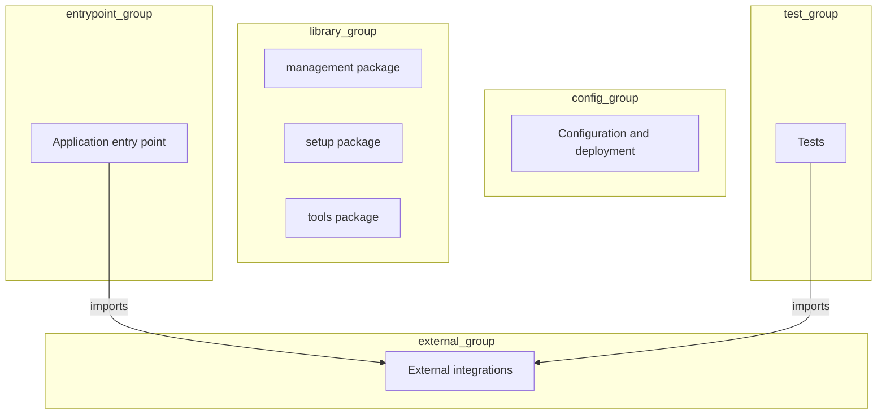

# Architecture report: mail-in-a-box/mailinabox

> Automated static analysis. **Observed** = directly seen in files/imports/AST; **Inferred** = interpretation from that evidence. Repository code was not executed.

## 1. Repository at a glance

| Item | Value |
| --- | --- |
| Repository | mail-in-a-box/mailinabox |
| Description | Mail-in-a-Box helps individuals take back control of their email by defining a one-click, easy-to-deploy SMTP+everything else server: a mail server in a box. |
| Language | Python |
| Stars | 15468 |
| Licence | CC0-1.0 |
| Analysed commit / branch | b71c2e1ca6df9c56392ba0a2adbb05e02569d4c1 / main |
| Framework(s) | Flask |
| Files analysed | 110 |
| Components | 7 |

## 2. Architecture in one minute

mail-in-a-box/mailinabox - Mail-in-a-Box helps individuals take back control of their email by defining a one-click, easy-to-deploy SMTP+everything else server: a mail server in a box.. This repository was analysed statically from 110 file(s) (24 Python). Detected technologies (observed from imports/manifests): SQLite, Flask, AWS (boto3), requests, Poetry. Files are grouped into 7 component(s): Configuration and deployment, Application entry point, External integrations, management package, setup package, Tests, tools package. Observed entry point(s): management/backup.py, management/daemon.py, management/dns_update.py. Findings below distinguish observed facts from inferred interpretation.

## 3. High-level block diagram

## 4. Main components

### Configuration and deployment (`config`)

- **Kind:** config
- **Status:** Observed
- **Confidence:** 0.85
- **Responsibility:** Groups 7 file(s) under configuration and deployment (observed from repository paths and static analysis).
- **Paths:** `api/mailinabox.yml`, `conf/zpush/autodiscover_config.php`, `conf/zpush/backend_caldav.php`, `conf/zpush/backend_carddav.php`, `conf/zpush/backend_combined.php`, `conf/zpush/backend_imap.php`, `pyproject.toml`
- **Evidence:** [api/mailinabox.yml](https://github.com/mail-in-a-box/mailinabox/blob/b71c2e1ca6df9c56392ba0a2adbb05e02569d4c1/api/mailinabox.yml); [conf/zpush/autodiscover_config.php](https://github.com/mail-in-a-box/mailinabox/blob/b71c2e1ca6df9c56392ba0a2adbb05e02569d4c1/conf/zpush/autodiscover_config.php); [conf/zpush/backend_caldav.php](https://github.com/mail-in-a-box/mailinabox/blob/b71c2e1ca6df9c56392ba0a2adbb05e02569d4c1/conf/zpush/backend_caldav.php); [conf/zpush/backend_carddav.php](https://github.com/mail-in-a-box/mailinabox/blob/b71c2e1ca6df9c56392ba0a2adbb05e02569d4c1/conf/zpush/backend_carddav.php); [conf/zpush/backend_combined.php](https://github.com/mail-in-a-box/mailinabox/blob/b71c2e1ca6df9c56392ba0a2adbb05e02569d4c1/conf/zpush/backend_combined.php); [conf/zpush/backend_imap.php](https://github.com/mail-in-a-box/mailinabox/blob/b71c2e1ca6df9c56392ba0a2adbb05e02569d4c1/conf/zpush/backend_imap.php); [pyproject.toml](https://github.com/mail-in-a-box/mailinabox/blob/b71c2e1ca6df9c56392ba0a2adbb05e02569d4c1/pyproject.toml)

### Application entry point (`entrypoint`)

- **Kind:** entrypoint
- **Status:** Observed
- **Confidence:** 0.85
- **Responsibility:** Groups 12 file(s) under application entry point (observed from repository paths and static analysis). Observed application object created via Flask. Observed routes: ROUTE /, ROUTE /login, ROUTE /logout, ROUTE /mail/users, ROUTE /mail/users/add. Observed top-level classes: AptGet, BashElement, BashScript, BufferedOutput, CaptureOutput, CatEOF. Observed top-level functions: add_auto_aliases, add_login, add_mail_alias, add_mail_user, add_remove_mail_user_privilege, authorized_personnel_only.
- **Paths:** `management/backup.py`, `management/cli.py`, `management/daemon.py`, `management/dns_update.py`, `management/mail_log.py`, `management/mailconfig.py`, `management/ssl_certificates.py`, `management/status_checks.py`, `management/utils.py`, `management/wsgi.py`, `setup/migrate.py`, `tools/readable_bash.py`
- **Evidence:** [management/backup.py:19](https://github.com/mail-in-a-box/mailinabox/blob/b71c2e1ca6df9c56392ba0a2adbb05e02569d4c1/management/backup.py#L19); [management/cli.py:12](https://github.com/mail-in-a-box/mailinabox/blob/b71c2e1ca6df9c56392ba0a2adbb05e02569d4c1/management/cli.py#L12); [management/daemon.py:45](https://github.com/mail-in-a-box/mailinabox/blob/b71c2e1ca6df9c56392ba0a2adbb05e02569d4c1/management/daemon.py#L45); [management/dns_update.py:21](https://github.com/mail-in-a-box/mailinabox/blob/b71c2e1ca6df9c56392ba0a2adbb05e02569d4c1/management/dns_update.py#L21); [management/mail_log.py:63](https://github.com/mail-in-a-box/mailinabox/blob/b71c2e1ca6df9c56392ba0a2adbb05e02569d4c1/management/mail_log.py#L63); [management/mailconfig.py:19](https://github.com/mail-in-a-box/mailinabox/blob/b71c2e1ca6df9c56392ba0a2adbb05e02569d4c1/management/mailconfig.py#L19); [management/ssl_certificates.py:12](https://github.com/mail-in-a-box/mailinabox/blob/b71c2e1ca6df9c56392ba0a2adbb05e02569d4c1/management/ssl_certificates.py#L12); [management/status_checks.py:24](https://github.com/mail-in-a-box/mailinabox/blob/b71c2e1ca6df9c56392ba0a2adbb05e02569d4c1/management/status_checks.py#L24)

### External integrations (`external_integrations`)

- **Kind:** external
- **Status:** Inferred
- **Confidence:** 0.70
- **Responsibility:** Groups 0 file(s) under external integrations (observed from repository paths and static analysis).
- **Evidence:** [management/backup.py:504](https://github.com/mail-in-a-box/mailinabox/blob/b71c2e1ca6df9c56392ba0a2adbb05e02569d4c1/management/backup.py#L504); [management/daemon.py:123](https://github.com/mail-in-a-box/mailinabox/blob/b71c2e1ca6df9c56392ba0a2adbb05e02569d4c1/management/daemon.py#L123); [management/mailconfig.py:12](https://github.com/mail-in-a-box/mailinabox/blob/b71c2e1ca6df9c56392ba0a2adbb05e02569d4c1/management/mailconfig.py#L12); [management/status_checks.py:105](https://github.com/mail-in-a-box/mailinabox/blob/b71c2e1ca6df9c56392ba0a2adbb05e02569d4c1/management/status_checks.py#L105); [management/utils.py:170](https://github.com/mail-in-a-box/mailinabox/blob/b71c2e1ca6df9c56392ba0a2adbb05e02569d4c1/management/utils.py#L170); [setup/migrate.py:72](https://github.com/mail-in-a-box/mailinabox/blob/b71c2e1ca6df9c56392ba0a2adbb05e02569d4c1/setup/migrate.py#L72)

### management package (`management`)

- **Kind:** library
- **Status:** Observed
- **Confidence:** 0.85
- **Responsibility:** Groups 6 file(s) under management package (observed from repository paths and static analysis). Observed top-level classes: AuthService. Observed top-level functions: disable_mfa, do_web_update, enable_mfa, get_domains_with_a_records, get_hash_mfa_state, get_mfa_state.
- **Paths:** `management/auth.py`, `management/daily_tasks.sh`, `management/email_administrator.py`, `management/mfa.py`, `management/munin_start.sh`, `management/web_update.py`
- **Evidence:** [management/auth.py:13](https://github.com/mail-in-a-box/mailinabox/blob/b71c2e1ca6df9c56392ba0a2adbb05e02569d4c1/management/auth.py#L13); [management/daily_tasks.sh](https://github.com/mail-in-a-box/mailinabox/blob/b71c2e1ca6df9c56392ba0a2adbb05e02569d4c1/management/daily_tasks.sh); [management/email_administrator.py](https://github.com/mail-in-a-box/mailinabox/blob/b71c2e1ca6df9c56392ba0a2adbb05e02569d4c1/management/email_administrator.py); [management/mfa.py:10](https://github.com/mail-in-a-box/mailinabox/blob/b71c2e1ca6df9c56392ba0a2adbb05e02569d4c1/management/mfa.py#L10); [management/munin_start.sh](https://github.com/mail-in-a-box/mailinabox/blob/b71c2e1ca6df9c56392ba0a2adbb05e02569d4c1/management/munin_start.sh); [management/web_update.py:12](https://github.com/mail-in-a-box/mailinabox/blob/b71c2e1ca6df9c56392ba0a2adbb05e02569d4c1/management/web_update.py#L12)

### setup package (`setup`)

- **Kind:** library
- **Status:** Observed
- **Confidence:** 0.85
- **Responsibility:** Groups 21 file(s) under setup package (observed from repository paths and static analysis).
- **Paths:** `setup/bootstrap.sh`, `setup/dkim.sh`, `setup/dns.sh`, `setup/firstuser.sh`, `setup/functions.sh`, `setup/mail-dovecot.sh`, `setup/mail-postfix.sh`, `setup/mail-users.sh`, `setup/management.sh`, `setup/munin.sh`, `setup/network-checks.sh`, `setup/nextcloud.sh`, `setup/preflight.sh`, `setup/questions.sh`, `setup/spamassassin.sh`, `setup/ssl.sh`, `setup/start.sh`, `setup/system.sh`, `setup/web.sh`, `setup/webmail.sh`, `setup/zpush.sh`
- **Evidence:** [setup/bootstrap.sh](https://github.com/mail-in-a-box/mailinabox/blob/b71c2e1ca6df9c56392ba0a2adbb05e02569d4c1/setup/bootstrap.sh); [setup/dkim.sh](https://github.com/mail-in-a-box/mailinabox/blob/b71c2e1ca6df9c56392ba0a2adbb05e02569d4c1/setup/dkim.sh); [setup/dns.sh](https://github.com/mail-in-a-box/mailinabox/blob/b71c2e1ca6df9c56392ba0a2adbb05e02569d4c1/setup/dns.sh); [setup/firstuser.sh](https://github.com/mail-in-a-box/mailinabox/blob/b71c2e1ca6df9c56392ba0a2adbb05e02569d4c1/setup/firstuser.sh); [setup/functions.sh](https://github.com/mail-in-a-box/mailinabox/blob/b71c2e1ca6df9c56392ba0a2adbb05e02569d4c1/setup/functions.sh); [setup/mail-dovecot.sh](https://github.com/mail-in-a-box/mailinabox/blob/b71c2e1ca6df9c56392ba0a2adbb05e02569d4c1/setup/mail-dovecot.sh); [setup/mail-postfix.sh](https://github.com/mail-in-a-box/mailinabox/blob/b71c2e1ca6df9c56392ba0a2adbb05e02569d4c1/setup/mail-postfix.sh); [setup/mail-users.sh](https://github.com/mail-in-a-box/mailinabox/blob/b71c2e1ca6df9c56392ba0a2adbb05e02569d4c1/setup/mail-users.sh)

### Tests (`tests`)

- **Kind:** test
- **Status:** Observed
- **Confidence:** 0.85
- **Responsibility:** Groups 7 file(s) under tests (observed from repository paths and static analysis). Observed top-level classes: IsBlocked. Observed top-level functions: http_test, imap_test, managesieve_test, pop_test, restart_fail2ban_service, run_test.
- **Paths:** `tests/fail2ban.py`, `tests/pip-requirements.txt`, `tests/test_dns.py`, `tests/test_mail.py`, `tests/test_smtp_server.py`, `tests/tls.py`, `tests/tls_results.txt`
- **Evidence:** [tests/fail2ban.py:24](https://github.com/mail-in-a-box/mailinabox/blob/b71c2e1ca6df9c56392ba0a2adbb05e02569d4c1/tests/fail2ban.py#L24); [tests/pip-requirements.txt](https://github.com/mail-in-a-box/mailinabox/blob/b71c2e1ca6df9c56392ba0a2adbb05e02569d4c1/tests/pip-requirements.txt); [tests/test_dns.py:22](https://github.com/mail-in-a-box/mailinabox/blob/b71c2e1ca6df9c56392ba0a2adbb05e02569d4c1/tests/test_dns.py#L22); [tests/test_mail.py](https://github.com/mail-in-a-box/mailinabox/blob/b71c2e1ca6df9c56392ba0a2adbb05e02569d4c1/tests/test_mail.py); [tests/test_smtp_server.py](https://github.com/mail-in-a-box/mailinabox/blob/b71c2e1ca6df9c56392ba0a2adbb05e02569d4c1/tests/test_smtp_server.py); [tests/tls.py:70](https://github.com/mail-in-a-box/mailinabox/blob/b71c2e1ca6df9c56392ba0a2adbb05e02569d4c1/tests/tls.py#L70); [tests/tls_results.txt](https://github.com/mail-in-a-box/mailinabox/blob/b71c2e1ca6df9c56392ba0a2adbb05e02569d4c1/tests/tls_results.txt)

### tools package (`tools`)

- **Kind:** library
- **Status:** Observed
- **Confidence:** 0.85
- **Responsibility:** Groups 6 file(s) under tools package (observed from repository paths and static analysis).
- **Paths:** `tools/archive_conf_files.sh`, `tools/editconf.py`, `tools/mail.py`, `tools/owncloud-restore.sh`, `tools/owncloud-unlockadmin.sh`, `tools/parse-nginx-log-bootstrap-accesses.py`
- **Evidence:** [tools/archive_conf_files.sh](https://github.com/mail-in-a-box/mailinabox/blob/b71c2e1ca6df9c56392ba0a2adbb05e02569d4c1/tools/archive_conf_files.sh); [tools/editconf.py](https://github.com/mail-in-a-box/mailinabox/blob/b71c2e1ca6df9c56392ba0a2adbb05e02569d4c1/tools/editconf.py); [tools/mail.py](https://github.com/mail-in-a-box/mailinabox/blob/b71c2e1ca6df9c56392ba0a2adbb05e02569d4c1/tools/mail.py); [tools/owncloud-restore.sh](https://github.com/mail-in-a-box/mailinabox/blob/b71c2e1ca6df9c56392ba0a2adbb05e02569d4c1/tools/owncloud-restore.sh); [tools/owncloud-unlockadmin.sh](https://github.com/mail-in-a-box/mailinabox/blob/b71c2e1ca6df9c56392ba0a2adbb05e02569d4c1/tools/owncloud-unlockadmin.sh); [tools/parse-nginx-log-bootstrap-accesses.py](https://github.com/mail-in-a-box/mailinabox/blob/b71c2e1ca6df9c56392ba0a2adbb05e02569d4c1/tools/parse-nginx-log-bootstrap-accesses.py)

## 5. Execution flow

**Observed** entry point(s):

- [management/backup.py:625](https://github.com/mail-in-a-box/mailinabox/blob/b71c2e1ca6df9c56392ba0a2adbb05e02569d4c1/management/backup.py#L625)
- [management/daemon.py:45](https://github.com/mail-in-a-box/mailinabox/blob/b71c2e1ca6df9c56392ba0a2adbb05e02569d4c1/management/daemon.py#L45)
- [management/dns_update.py:1097](https://github.com/mail-in-a-box/mailinabox/blob/b71c2e1ca6df9c56392ba0a2adbb05e02569d4c1/management/dns_update.py#L1097)
- [management/mail_log.py:787](https://github.com/mail-in-a-box/mailinabox/blob/b71c2e1ca6df9c56392ba0a2adbb05e02569d4c1/management/mail_log.py#L787)
- [management/mailconfig.py:718](https://github.com/mail-in-a-box/mailinabox/blob/b71c2e1ca6df9c56392ba0a2adbb05e02569d4c1/management/mailconfig.py#L718)
- [management/ssl_certificates.py:680](https://github.com/mail-in-a-box/mailinabox/blob/b71c2e1ca6df9c56392ba0a2adbb05e02569d4c1/management/ssl_certificates.py#L680)
- [management/status_checks.py:1168](https://github.com/mail-in-a-box/mailinabox/blob/b71c2e1ca6df9c56392ba0a2adbb05e02569d4c1/management/status_checks.py#L1168)
- [management/utils.py:212](https://github.com/mail-in-a-box/mailinabox/blob/b71c2e1ca6df9c56392ba0a2adbb05e02569d4c1/management/utils.py#L212)
- [management/wsgi.py:6](https://github.com/mail-in-a-box/mailinabox/blob/b71c2e1ca6df9c56392ba0a2adbb05e02569d4c1/management/wsgi.py#L6)
- [setup/migrate.py:271](https://github.com/mail-in-a-box/mailinabox/blob/b71c2e1ca6df9c56392ba0a2adbb05e02569d4c1/setup/migrate.py#L271)
- [tools/readable_bash.py:482](https://github.com/mail-in-a-box/mailinabox/blob/b71c2e1ca6df9c56392ba0a2adbb05e02569d4c1/tools/readable_bash.py#L482)

**Observed** routes (from decorators):

- `ROUTE /` -> `index` in `management/daemon.py:116`
- `ROUTE /login` -> `login` in `management/daemon.py:140`
- `ROUTE /logout` -> `logout` in `management/daemon.py:171`
- `ROUTE /mail/users` -> `mail_users` in `management/daemon.py:184`
- `ROUTE /mail/users/add` -> `mail_users_add` in `management/daemon.py:191`
- `ROUTE /mail/users/quota` -> `get_mail_users_quota` in `management/daemon.py:200`
- `ROUTE /mail/users/quota` -> `mail_users_quota` in `management/daemon.py:214`
- `ROUTE /mail/users/password` -> `mail_users_password` in `management/daemon.py:222`
- `ROUTE /mail/users/remove` -> `mail_users_remove` in `management/daemon.py:230`
- `ROUTE /mail/users/privileges` -> `mail_user_privs` in `management/daemon.py:236`
- `ROUTE /mail/users/privileges/add` -> `mail_user_privs_add` in `management/daemon.py:243`
- `ROUTE /mail/users/privileges/remove` -> `mail_user_privs_remove` in `management/daemon.py:248`
- `ROUTE /mail/aliases` -> `mail_aliases` in `management/daemon.py:254`
- `ROUTE /mail/aliases/add` -> `mail_aliases_add` in `management/daemon.py:261`
- `ROUTE /mail/aliases/remove` -> `mail_aliases_remove` in `management/daemon.py:272`
- `ROUTE /mail/domains` -> `mail_domains` in `management/daemon.py:277`
- `ROUTE /dns/zones` -> `dns_zones` in `management/daemon.py:284`
- `ROUTE /dns/update` -> `dns_update` in `management/daemon.py:290`
- `ROUTE /dns/secondary-nameserver` -> `dns_get_secondary_nameserver` in `management/daemon.py:299`
- `ROUTE /dns/secondary-nameserver` -> `dns_set_secondary_nameserver` in `management/daemon.py:305`
- `ROUTE /dns/custom` -> `dns_get_records` in `management/daemon.py:314`
- `ROUTE /dns/custom/<qname>` -> `dns_set_record` in `management/daemon.py:363`
- `ROUTE /dns/custom/<qname>/<rtype>` -> `dns_set_record` in `management/daemon.py:363`
- `ROUTE /dns/dump` -> `dns_get_dump` in `management/daemon.py:414`
- `ROUTE /dns/zonefile/<zone>` -> `dns_get_zonefile` in `management/daemon.py:420`
- `ROUTE /ssl/status` -> `ssl_get_status` in `management/daemon.py:428`
- `ROUTE /ssl/csr/<domain>` -> `ssl_get_csr` in `management/daemon.py:459`
- `ROUTE /ssl/install` -> `ssl_install_cert` in `management/daemon.py:466`
- `ROUTE /ssl/provision` -> `ssl_provision_certs` in `management/daemon.py:478`
- `ROUTE /mfa/status` -> `mfa_get_status` in `management/daemon.py:487`
- `ROUTE /mfa/totp/enable` -> `totp_post_enable` in `management/daemon.py:509`
- `ROUTE /mfa/disable` -> `totp_post_disable` in `management/daemon.py:524`
- `ROUTE /web/domains` -> `web_get_domains` in `management/daemon.py:542`
- `ROUTE /web/update` -> `web_update` in `management/daemon.py:548`
- `ROUTE /system/version` -> `system_version` in `management/daemon.py:556`
- `ROUTE /system/latest-upstream-version` -> `system_latest_upstream_version` in `management/daemon.py:565`
- `ROUTE /system/status` -> `system_status` in `management/daemon.py:574`
- `ROUTE /system/updates` -> `show_updates` in `management/daemon.py:599`
- `ROUTE /system/update-packages` -> `do_updates` in `management/daemon.py:607`
- `ROUTE /system/reboot` -> `needs_reboot` in `management/daemon.py:616`
- `ROUTE /system/reboot` -> `do_reboot` in `management/daemon.py:624`
- `ROUTE /system/backup/status` -> `backup_status` in `management/daemon.py:634`
- `ROUTE /system/backup/config` -> `backup_get_custom` in `management/daemon.py:643`
- `ROUTE /system/backup/config` -> `backup_set_custom` in `management/daemon.py:649`
- `ROUTE /system/privacy` -> `privacy_status_get` in `management/daemon.py:660`
- `ROUTE /system/privacy` -> `privacy_status_set` in `management/daemon.py:666`
- `ROUTE /munin/` -> `munin_start` in `management/daemon.py:676`
- `ROUTE /munin/<path:filename>` -> `munin_static_file` in `management/daemon.py:703`
- `ROUTE /munin/cgi-graph/<path:filename>` -> `munin_cgi` in `management/daemon.py:710`

Representative flow (derived from observed entry points and the import graph; steps beyond the entry point are **Inferred**):

1. Execution starts at an observed entry point listed above, if present.
2. `entrypoint` imports `external_integrations` (Application entry point -> External integrations).
3. `tests` imports `external_integrations` (Tests -> External integrations).

## 6. Project structure

### `(root)`

- `.editorconfig` - config (435 bytes)
- `.gitignore` - other (130 bytes)
- `CHANGELOG.md` - docs (66531 bytes)
- `CODE_OF_CONDUCT.md` - docs (4867 bytes)
- `CONTRIBUTING.md` - docs (2722 bytes)
- `LICENSE` - docs (7048 bytes)
- `README.md` - docs (6880 bytes)
- `Vagrantfile` - other (912 bytes)
- `pyproject.toml` - manifest (692 bytes)
- `security.md` - docs (10442 bytes)

### `api`

- `api/docs/generate-docs.sh` - docs (861 bytes)
- `api/docs/template.hbs` - docs (885 bytes)
- `api/mailinabox.yml` - config (82910 bytes)

### `conf`

- `conf/dovecot-mailboxes.conf` - other (2195 bytes)
- `conf/fail2ban/filter.d/dovecotimap.conf` - other (831 bytes)
- `conf/fail2ban/filter.d/miab-management-daemon.conf` - other (231 bytes)
- `conf/fail2ban/filter.d/miab-munin.conf` - other (124 bytes)
- `conf/fail2ban/filter.d/miab-owncloud.conf` - other (365 bytes)
- `conf/fail2ban/filter.d/miab-postfix-submission.conf` - other (153 bytes)
- `conf/fail2ban/filter.d/miab-roundcube.conf` - other (138 bytes)
- `conf/fail2ban/jails.conf` - other (2141 bytes)
- `conf/ios-profile.xml` - other (4282 bytes)
- `conf/mailinabox.service` - other (204 bytes)
- `conf/mozilla-autoconfig.xml` - other (2490 bytes)
- `conf/mta-sts.txt` - docs (67 bytes)
- `conf/munin.service` - other (192 bytes)
- `conf/nginx-alldomains.conf` - other (2785 bytes)
- `conf/nginx-primaryonly.conf` - other (3360 bytes)
- `conf/nginx-ssl.conf` - other (846 bytes)
- `conf/nginx-top.conf` - other (427 bytes)
- `conf/nginx.conf` - other (1318 bytes)
- `conf/postfix_outgoing_mail_header_filters` - other (726 bytes)
- `conf/sieve-spam.txt` - docs (126 bytes)
- `conf/www_default.html` - other (271 bytes)
- `conf/zpush/autodiscover_config.php` - source, PHP (752 bytes)
- `conf/zpush/backend_caldav.php` - source, PHP (487 bytes)
- `conf/zpush/backend_carddav.php` - source, PHP (1242 bytes)
- `conf/zpush/backend_combined.php` - source, PHP (1358 bytes)
- `conf/zpush/backend_imap.php` - source, PHP (2357 bytes)

### `management`

- `management/auth.py` - source, Python (6101 bytes)
- `management/backup.py` - source, Python (23795 bytes)
- `management/cli.py` - source, Python (5842 bytes)
- `management/csr_country_codes.tsv` - data (4449 bytes)
- `management/daemon.py` - source, Python (27240 bytes)
- `management/daily_tasks.sh` - source, Shell (1087 bytes)
- `management/dns_update.py` - source, Python (47275 bytes)
- `management/email_administrator.py` - source, Python (1417 bytes)
- `management/mail_log.py` - source, Python (29493 bytes)
- `management/mailconfig.py` - source, Python (24819 bytes)
- `management/mfa.py` - source, Python (4412 bytes)
- `management/munin_start.sh` - source, Shell (66 bytes)
- `management/ssl_certificates.py` - source, Python (26783 bytes)
- `management/status_checks.py` - source, Python (55064 bytes)
- `management/templates/aliases.html` - other (13715 bytes)
- `management/templates/custom-dns.html` - other (14123 bytes)
- `management/templates/external-dns.html` - other (4174 bytes)
- `management/templates/index.html` - other (15678 bytes)
- `management/templates/login.html` - other (6870 bytes)
- `management/templates/mail-guide.html` - other (4415 bytes)
- `management/templates/mfa.html` - other (8182 bytes)
- `management/templates/munin.html` - other (336 bytes)
- `management/templates/ssl.html` - other (9214 bytes)
- `management/templates/sync-guide.html` - other (1850 bytes)
- `management/templates/system-backup.html` - other (16994 bytes)
- `management/templates/system-status.html` - other (5507 bytes)
- `management/templates/users.html` - other (14290 bytes)
- `management/templates/web.html` - other (3993 bytes)
- `management/templates/welcome.html` - other (241 bytes)
- `management/utils.py` - source, Python (6926 bytes)
- `management/web_update.py` - source, Python (11545 bytes)
- `management/wsgi.py` - source, Python (142 bytes)

### `setup`

- `setup/bootstrap.sh` - source, Shell (3019 bytes)
- `setup/dkim.sh` - source, Shell (4751 bytes)
- `setup/dns.sh` - source, Shell (5681 bytes)
- `setup/firstuser.sh` - source, Shell (1844 bytes)
- `setup/functions.sh` - source, Shell (7594 bytes)
- `setup/mail-dovecot.sh` - source, Shell (10333 bytes)
- `setup/mail-postfix.sh` - source, Shell (17554 bytes)
- `setup/mail-users.sh` - source, Shell (7668 bytes)
- `setup/management.sh` - source, Shell (4449 bytes)
- `setup/migrate.py` - source, Python (11114 bytes)
- `setup/munin.sh` - source, Shell (3232 bytes)
- `setup/network-checks.sh` - source, Shell (2467 bytes)
- `setup/nextcloud.sh` - source, Shell (20836 bytes)
- `setup/preflight.sh` - source, Shell (2497 bytes)
- `setup/questions.sh` - source, Shell (7826 bytes)
- `setup/spamassassin.sh` - source, Shell (8113 bytes)
- `setup/ssl.sh` - source, Shell (4261 bytes)
- `setup/start.sh` - source, Shell (6531 bytes)
- `setup/system.sh` - source, Shell (16244 bytes)
- `setup/web.sh` - source, Shell (6366 bytes)
- `setup/webmail.sh` - source, Shell (9178 bytes)
- `setup/zpush.sh` - source, Shell (3955 bytes)

### `tests`

- `tests/fail2ban.py` - test, Python (6353 bytes)
- `tests/pip-requirements.txt` - test (11 bytes)
- `tests/test_dns.py` - test, Python (3823 bytes)
- `tests/test_mail.py` - test, Python (3246 bytes)
- `tests/test_smtp_server.py` - test, Python (404 bytes)
- `tests/tls.py` - test, Python (7541 bytes)
- `tests/tls_results.txt` - test (33401 bytes)

### `tools`

- `tools/archive_conf_files.sh` - source, Shell (416 bytes)
- `tools/dns_update` - other (176 bytes)
- `tools/editconf.py` - source, Python (4406 bytes)
- `tools/mail.py` - source, Python (60 bytes)
- `tools/owncloud-restore.sh` - source, Shell (1528 bytes)
- `tools/owncloud-unlockadmin.sh` - source, Shell (784 bytes)
- `tools/parse-nginx-log-bootstrap-accesses.py` - source, Python (2072 bytes)
- `tools/readable_bash.py` - source, Python (14577 bytes)
- `tools/ssl_cleanup` - other (540 bytes)
- `tools/web_update` - other (108 bytes)

## 7. Key dependencies and integrations

| Name | Category | Status | Confidence | Evidence |
| --- | --- | --- | --- | --- |
| SQLite | database | Observed | 0.95 | [management/mailconfig.py:12](https://github.com/mail-in-a-box/mailinabox/blob/b71c2e1ca6df9c56392ba0a2adbb05e02569d4c1/management/mailconfig.py#L12); [setup/migrate.py:72](https://github.com/mail-in-a-box/mailinabox/blob/b71c2e1ca6df9c56392ba0a2adbb05e02569d4c1/setup/migrate.py#L72); [setup/migrate.py:155](https://github.com/mail-in-a-box/mailinabox/blob/b71c2e1ca6df9c56392ba0a2adbb05e02569d4c1/setup/migrate.py#L155) |
| Flask | framework | Observed | 0.90 | [management/daemon.py:18](https://github.com/mail-in-a-box/mailinabox/blob/b71c2e1ca6df9c56392ba0a2adbb05e02569d4c1/management/daemon.py#L18) |
| AWS (boto3) | library | Observed | 0.95 | [management/backup.py:504](https://github.com/mail-in-a-box/mailinabox/blob/b71c2e1ca6df9c56392ba0a2adbb05e02569d4c1/management/backup.py#L504); [management/daemon.py:123](https://github.com/mail-in-a-box/mailinabox/blob/b71c2e1ca6df9c56392ba0a2adbb05e02569d4c1/management/daemon.py#L123) |
| requests | library | Observed | 0.95 | [tests/fail2ban.py:118](https://github.com/mail-in-a-box/mailinabox/blob/b71c2e1ca6df9c56392ba0a2adbb05e02569d4c1/tests/fail2ban.py#L118); [tests/fail2ban.py:119](https://github.com/mail-in-a-box/mailinabox/blob/b71c2e1ca6df9c56392ba0a2adbb05e02569d4c1/tests/fail2ban.py#L119) |
| Poetry | packaging | Observed | 0.85 | [pyproject.toml](https://github.com/mail-in-a-box/mailinabox/blob/b71c2e1ca6df9c56392ba0a2adbb05e02569d4c1/pyproject.toml) |

## 8. Data and state

- **SQLite** (Observed, confidence 0.95) - evidence: [management/mailconfig.py:12](https://github.com/mail-in-a-box/mailinabox/blob/b71c2e1ca6df9c56392ba0a2adbb05e02569d4c1/management/mailconfig.py#L12); [setup/migrate.py:72](https://github.com/mail-in-a-box/mailinabox/blob/b71c2e1ca6df9c56392ba0a2adbb05e02569d4c1/setup/migrate.py#L72); [setup/migrate.py:155](https://github.com/mail-in-a-box/mailinabox/blob/b71c2e1ca6df9c56392ba0a2adbb05e02569d4c1/setup/migrate.py#L155)

## 9. Configuration and deployment clues

- `.editorconfig` (config)
- `api/mailinabox.yml` (config)
- `pyproject.toml` (manifest)

## 10. Design observations

- An entry/API layer is separated from other code (Inferred from paths and decorators).
- Tests are present alongside source code (Observed from test file paths).
- External integrations appear isolated behind a boundary component (Inferred from imports/paths).

These observations are interpretations (**Inferred**) of the observed structure, not guarantees about runtime design.

## 11. Limitations and unknowns

- Static analysis only: repository code was not executed, installed, or imported at runtime.
- Components and relationships are inferred from file paths, imports, and AST structure; runtime behaviour, dynamic imports, and reflection may not be visible.
- File tools/mail.py could not be parsed as Python (possible SyntaxError) and was skipped for AST analysis.
- Repository text was treated as untrusted data; no instructions found in repository files were followed, and likely secret values were redacted/excluded.

## 12. Source references

- [api/mailinabox.yml](https://github.com/mail-in-a-box/mailinabox/blob/b71c2e1ca6df9c56392ba0a2adbb05e02569d4c1/api/mailinabox.yml)
- [conf/zpush/autodiscover_config.php](https://github.com/mail-in-a-box/mailinabox/blob/b71c2e1ca6df9c56392ba0a2adbb05e02569d4c1/conf/zpush/autodiscover_config.php)
- [conf/zpush/backend_caldav.php](https://github.com/mail-in-a-box/mailinabox/blob/b71c2e1ca6df9c56392ba0a2adbb05e02569d4c1/conf/zpush/backend_caldav.php)
- [conf/zpush/backend_carddav.php](https://github.com/mail-in-a-box/mailinabox/blob/b71c2e1ca6df9c56392ba0a2adbb05e02569d4c1/conf/zpush/backend_carddav.php)
- [conf/zpush/backend_combined.php](https://github.com/mail-in-a-box/mailinabox/blob/b71c2e1ca6df9c56392ba0a2adbb05e02569d4c1/conf/zpush/backend_combined.php)
- [conf/zpush/backend_imap.php](https://github.com/mail-in-a-box/mailinabox/blob/b71c2e1ca6df9c56392ba0a2adbb05e02569d4c1/conf/zpush/backend_imap.php)
- [management/auth.py:13](https://github.com/mail-in-a-box/mailinabox/blob/b71c2e1ca6df9c56392ba0a2adbb05e02569d4c1/management/auth.py#L13)
- [management/backup.py:19](https://github.com/mail-in-a-box/mailinabox/blob/b71c2e1ca6df9c56392ba0a2adbb05e02569d4c1/management/backup.py#L19)
- [management/backup.py:504](https://github.com/mail-in-a-box/mailinabox/blob/b71c2e1ca6df9c56392ba0a2adbb05e02569d4c1/management/backup.py#L504)
- [management/backup.py:625](https://github.com/mail-in-a-box/mailinabox/blob/b71c2e1ca6df9c56392ba0a2adbb05e02569d4c1/management/backup.py#L625)
- [management/cli.py:12](https://github.com/mail-in-a-box/mailinabox/blob/b71c2e1ca6df9c56392ba0a2adbb05e02569d4c1/management/cli.py#L12)
- [management/daemon.py:18](https://github.com/mail-in-a-box/mailinabox/blob/b71c2e1ca6df9c56392ba0a2adbb05e02569d4c1/management/daemon.py#L18)
- [management/daemon.py:45](https://github.com/mail-in-a-box/mailinabox/blob/b71c2e1ca6df9c56392ba0a2adbb05e02569d4c1/management/daemon.py#L45)
- [management/daemon.py:123](https://github.com/mail-in-a-box/mailinabox/blob/b71c2e1ca6df9c56392ba0a2adbb05e02569d4c1/management/daemon.py#L123)
- [management/daily_tasks.sh](https://github.com/mail-in-a-box/mailinabox/blob/b71c2e1ca6df9c56392ba0a2adbb05e02569d4c1/management/daily_tasks.sh)
- [management/dns_update.py:21](https://github.com/mail-in-a-box/mailinabox/blob/b71c2e1ca6df9c56392ba0a2adbb05e02569d4c1/management/dns_update.py#L21)
- [management/dns_update.py:1097](https://github.com/mail-in-a-box/mailinabox/blob/b71c2e1ca6df9c56392ba0a2adbb05e02569d4c1/management/dns_update.py#L1097)
- [management/email_administrator.py](https://github.com/mail-in-a-box/mailinabox/blob/b71c2e1ca6df9c56392ba0a2adbb05e02569d4c1/management/email_administrator.py)
- [management/mail_log.py:63](https://github.com/mail-in-a-box/mailinabox/blob/b71c2e1ca6df9c56392ba0a2adbb05e02569d4c1/management/mail_log.py#L63)
- [management/mail_log.py:787](https://github.com/mail-in-a-box/mailinabox/blob/b71c2e1ca6df9c56392ba0a2adbb05e02569d4c1/management/mail_log.py#L787)
- [management/mailconfig.py:12](https://github.com/mail-in-a-box/mailinabox/blob/b71c2e1ca6df9c56392ba0a2adbb05e02569d4c1/management/mailconfig.py#L12)
- [management/mailconfig.py:19](https://github.com/mail-in-a-box/mailinabox/blob/b71c2e1ca6df9c56392ba0a2adbb05e02569d4c1/management/mailconfig.py#L19)
- [management/mailconfig.py:718](https://github.com/mail-in-a-box/mailinabox/blob/b71c2e1ca6df9c56392ba0a2adbb05e02569d4c1/management/mailconfig.py#L718)
- [management/mfa.py:10](https://github.com/mail-in-a-box/mailinabox/blob/b71c2e1ca6df9c56392ba0a2adbb05e02569d4c1/management/mfa.py#L10)
- [management/munin_start.sh](https://github.com/mail-in-a-box/mailinabox/blob/b71c2e1ca6df9c56392ba0a2adbb05e02569d4c1/management/munin_start.sh)
- [management/ssl_certificates.py:12](https://github.com/mail-in-a-box/mailinabox/blob/b71c2e1ca6df9c56392ba0a2adbb05e02569d4c1/management/ssl_certificates.py#L12)
- [management/ssl_certificates.py:680](https://github.com/mail-in-a-box/mailinabox/blob/b71c2e1ca6df9c56392ba0a2adbb05e02569d4c1/management/ssl_certificates.py#L680)
- [management/status_checks.py:24](https://github.com/mail-in-a-box/mailinabox/blob/b71c2e1ca6df9c56392ba0a2adbb05e02569d4c1/management/status_checks.py#L24)
- [management/status_checks.py:105](https://github.com/mail-in-a-box/mailinabox/blob/b71c2e1ca6df9c56392ba0a2adbb05e02569d4c1/management/status_checks.py#L105)
- [management/status_checks.py:1168](https://github.com/mail-in-a-box/mailinabox/blob/b71c2e1ca6df9c56392ba0a2adbb05e02569d4c1/management/status_checks.py#L1168)
- [management/utils.py:170](https://github.com/mail-in-a-box/mailinabox/blob/b71c2e1ca6df9c56392ba0a2adbb05e02569d4c1/management/utils.py#L170)
- [management/utils.py:212](https://github.com/mail-in-a-box/mailinabox/blob/b71c2e1ca6df9c56392ba0a2adbb05e02569d4c1/management/utils.py#L212)
- [management/web_update.py:12](https://github.com/mail-in-a-box/mailinabox/blob/b71c2e1ca6df9c56392ba0a2adbb05e02569d4c1/management/web_update.py#L12)
- [management/wsgi.py:6](https://github.com/mail-in-a-box/mailinabox/blob/b71c2e1ca6df9c56392ba0a2adbb05e02569d4c1/management/wsgi.py#L6)
- [pyproject.toml](https://github.com/mail-in-a-box/mailinabox/blob/b71c2e1ca6df9c56392ba0a2adbb05e02569d4c1/pyproject.toml)
- [setup/bootstrap.sh](https://github.com/mail-in-a-box/mailinabox/blob/b71c2e1ca6df9c56392ba0a2adbb05e02569d4c1/setup/bootstrap.sh)
- [setup/dkim.sh](https://github.com/mail-in-a-box/mailinabox/blob/b71c2e1ca6df9c56392ba0a2adbb05e02569d4c1/setup/dkim.sh)
- [setup/dns.sh](https://github.com/mail-in-a-box/mailinabox/blob/b71c2e1ca6df9c56392ba0a2adbb05e02569d4c1/setup/dns.sh)
- [setup/firstuser.sh](https://github.com/mail-in-a-box/mailinabox/blob/b71c2e1ca6df9c56392ba0a2adbb05e02569d4c1/setup/firstuser.sh)
- [setup/functions.sh](https://github.com/mail-in-a-box/mailinabox/blob/b71c2e1ca6df9c56392ba0a2adbb05e02569d4c1/setup/functions.sh)
- [setup/mail-dovecot.sh](https://github.com/mail-in-a-box/mailinabox/blob/b71c2e1ca6df9c56392ba0a2adbb05e02569d4c1/setup/mail-dovecot.sh)
- [setup/mail-postfix.sh](https://github.com/mail-in-a-box/mailinabox/blob/b71c2e1ca6df9c56392ba0a2adbb05e02569d4c1/setup/mail-postfix.sh)
- [setup/mail-users.sh](https://github.com/mail-in-a-box/mailinabox/blob/b71c2e1ca6df9c56392ba0a2adbb05e02569d4c1/setup/mail-users.sh)
- [setup/migrate.py:72](https://github.com/mail-in-a-box/mailinabox/blob/b71c2e1ca6df9c56392ba0a2adbb05e02569d4c1/setup/migrate.py#L72)
- [setup/migrate.py:155](https://github.com/mail-in-a-box/mailinabox/blob/b71c2e1ca6df9c56392ba0a2adbb05e02569d4c1/setup/migrate.py#L155)
- [setup/migrate.py:271](https://github.com/mail-in-a-box/mailinabox/blob/b71c2e1ca6df9c56392ba0a2adbb05e02569d4c1/setup/migrate.py#L271)
- [tests/fail2ban.py:24](https://github.com/mail-in-a-box/mailinabox/blob/b71c2e1ca6df9c56392ba0a2adbb05e02569d4c1/tests/fail2ban.py#L24)
- [tests/fail2ban.py:118](https://github.com/mail-in-a-box/mailinabox/blob/b71c2e1ca6df9c56392ba0a2adbb05e02569d4c1/tests/fail2ban.py#L118)
- [tests/fail2ban.py:119](https://github.com/mail-in-a-box/mailinabox/blob/b71c2e1ca6df9c56392ba0a2adbb05e02569d4c1/tests/fail2ban.py#L119)
- [tests/pip-requirements.txt](https://github.com/mail-in-a-box/mailinabox/blob/b71c2e1ca6df9c56392ba0a2adbb05e02569d4c1/tests/pip-requirements.txt)
- [tests/test_dns.py:22](https://github.com/mail-in-a-box/mailinabox/blob/b71c2e1ca6df9c56392ba0a2adbb05e02569d4c1/tests/test_dns.py#L22)
- [tests/test_mail.py](https://github.com/mail-in-a-box/mailinabox/blob/b71c2e1ca6df9c56392ba0a2adbb05e02569d4c1/tests/test_mail.py)
- [tests/test_smtp_server.py](https://github.com/mail-in-a-box/mailinabox/blob/b71c2e1ca6df9c56392ba0a2adbb05e02569d4c1/tests/test_smtp_server.py)
- [tests/tls.py:70](https://github.com/mail-in-a-box/mailinabox/blob/b71c2e1ca6df9c56392ba0a2adbb05e02569d4c1/tests/tls.py#L70)
- [tests/tls_results.txt](https://github.com/mail-in-a-box/mailinabox/blob/b71c2e1ca6df9c56392ba0a2adbb05e02569d4c1/tests/tls_results.txt)
- [tools/archive_conf_files.sh](https://github.com/mail-in-a-box/mailinabox/blob/b71c2e1ca6df9c56392ba0a2adbb05e02569d4c1/tools/archive_conf_files.sh)
- [tools/editconf.py](https://github.com/mail-in-a-box/mailinabox/blob/b71c2e1ca6df9c56392ba0a2adbb05e02569d4c1/tools/editconf.py)
- [tools/mail.py](https://github.com/mail-in-a-box/mailinabox/blob/b71c2e1ca6df9c56392ba0a2adbb05e02569d4c1/tools/mail.py)
- [tools/owncloud-restore.sh](https://github.com/mail-in-a-box/mailinabox/blob/b71c2e1ca6df9c56392ba0a2adbb05e02569d4c1/tools/owncloud-restore.sh)
- [tools/owncloud-unlockadmin.sh](https://github.com/mail-in-a-box/mailinabox/blob/b71c2e1ca6df9c56392ba0a2adbb05e02569d4c1/tools/owncloud-unlockadmin.sh)
- [tools/parse-nginx-log-bootstrap-accesses.py](https://github.com/mail-in-a-box/mailinabox/blob/b71c2e1ca6df9c56392ba0a2adbb05e02569d4c1/tools/parse-nginx-log-bootstrap-accesses.py)
- [tools/readable_bash.py:482](https://github.com/mail-in-a-box/mailinabox/blob/b71c2e1ca6df9c56392ba0a2adbb05e02569d4c1/tools/readable_bash.py#L482)
