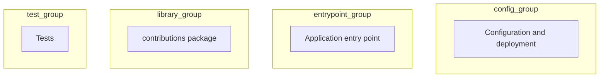

# Architecture report: makerspet/oomwoo

> Automated static analysis. **Observed** = directly seen in files/imports/AST; **Inferred** = interpretation from that evidence. Repository code was not executed.

## 1. Repository at a glance

| Item | Value |
| --- | --- |
| Repository | makerspet/oomwoo |
| Description | Open-source vacuum robot cleaner |
| Language | Python |
| Stars | 13098 |
| Licence | Apache-2.0 |
| Analysed commit / branch | 108e9d34575f84d8547298fd594a7ea513f35093 / main |
| Framework(s) | None detected |
| Files analysed | 107 |
| Components | 4 |

## 2. Architecture in one minute

makerspet/oomwoo - Open-source vacuum robot cleaner. This repository was analysed statically from 107 file(s) (20 Python). Detected technologies (observed from imports/manifests): GitHub Actions, setuptools, pytest, unittest. Files are grouped into 4 component(s): Configuration and deployment, contributions package, Application entry point, Tests. Observed entry point(s): .github/scripts/gen_star_history.py, contributions/dock-cycle/xbattlax/tools/sim_dock_ir_scenario.py, contributions/io-board-interface/smailzhu/conformance/generate_gate_vectors.py. Findings below distinguish observed facts from inferred interpretation.

## 3. High-level block diagram

## 4. Main components

### Configuration and deployment (`config`)

- **Kind:** config
- **Status:** Observed
- **Confidence:** 0.85
- **Responsibility:** Groups 5 file(s) under configuration and deployment (observed from repository paths and static analysis).
- **Paths:** `contributions/io-board-interface/smailzhu/conformance/command_gate_vectors_v1.json`, `contributions/io-board-interface/xbattlax/conformance/golden_vectors_v1.json`, `contributions/io-board-interface/xbattlax/conformance/protocol_v1.json`, `contributions/recovery-safety/xbattlax/oomwoo_recovery_safety/setup.cfg`, `contributions/recovery-safety/xbattlax/oomwoo_recovery_safety/setup.py`
- **Evidence:** [contributions/io-board-interface/smailzhu/conformance/command_gate_vectors_v1.json](https://github.com/makerspet/oomwoo/blob/108e9d34575f84d8547298fd594a7ea513f35093/contributions/io-board-interface/smailzhu/conformance/command_gate_vectors_v1.json); [contributions/io-board-interface/xbattlax/conformance/golden_vectors_v1.json](https://github.com/makerspet/oomwoo/blob/108e9d34575f84d8547298fd594a7ea513f35093/contributions/io-board-interface/xbattlax/conformance/golden_vectors_v1.json); [contributions/io-board-interface/xbattlax/conformance/protocol_v1.json](https://github.com/makerspet/oomwoo/blob/108e9d34575f84d8547298fd594a7ea513f35093/contributions/io-board-interface/xbattlax/conformance/protocol_v1.json); [contributions/recovery-safety/xbattlax/oomwoo_recovery_safety/setup.cfg](https://github.com/makerspet/oomwoo/blob/108e9d34575f84d8547298fd594a7ea513f35093/contributions/recovery-safety/xbattlax/oomwoo_recovery_safety/setup.cfg); [contributions/recovery-safety/xbattlax/oomwoo_recovery_safety/setup.py](https://github.com/makerspet/oomwoo/blob/108e9d34575f84d8547298fd594a7ea513f35093/contributions/recovery-safety/xbattlax/oomwoo_recovery_safety/setup.py)

### contributions package (`contributions`)

- **Kind:** library
- **Status:** Observed
- **Confidence:** 0.85
- **Responsibility:** Groups 9 file(s) under contributions package (observed from repository paths and static analysis). Observed top-level classes: CircleObstacle, ControllerState, Decision, DecisionKind, DockIrFrame, DockSpec. Observed top-level functions: _blocked, _check_int, _check_uint, _normalized_difference, _receiver_reading, _reject.
- **Paths:** `contributions/compute-benchmark/xbattlax/scripts/measure_ros_processes.sh`, `contributions/dock-cycle/xbattlax/tools/oomwoo_dock_ir_model.py`, `contributions/io-board-interface/smailzhu/tools/oomwoo_command_gate.py`, `contributions/io-board-interface/xbattlax/conformance/verify_vectors.c`, `contributions/io-board-interface/xbattlax/tools/oomwoo_mcu_frame.py`, `contributions/recovery-safety/xbattlax/oomwoo_recovery_safety/launch/recovery_safety.launch.py`, `contributions/recovery-safety/xbattlax/oomwoo_recovery_safety/oomwoo_recovery_safety/__init__.py`, `contributions/recovery-safety/xbattlax/oomwoo_recovery_safety/oomwoo_recovery_safety/core.py`, `contributions/recovery-safety/xbattlax/oomwoo_recovery_safety/oomwoo_recovery_safety/recovery_node.py`
- **Evidence:** [contributions/compute-benchmark/xbattlax/scripts/measure_ros_processes.sh](https://github.com/makerspet/oomwoo/blob/108e9d34575f84d8547298fd594a7ea513f35093/contributions/compute-benchmark/xbattlax/scripts/measure_ros_processes.sh); [contributions/dock-cycle/xbattlax/tools/oomwoo_dock_ir_model.py:9](https://github.com/makerspet/oomwoo/blob/108e9d34575f84d8547298fd594a7ea513f35093/contributions/dock-cycle/xbattlax/tools/oomwoo_dock_ir_model.py#L9); [contributions/io-board-interface/smailzhu/tools/oomwoo_command_gate.py:38](https://github.com/makerspet/oomwoo/blob/108e9d34575f84d8547298fd594a7ea513f35093/contributions/io-board-interface/smailzhu/tools/oomwoo_command_gate.py#L38); [contributions/io-board-interface/xbattlax/conformance/verify_vectors.c](https://github.com/makerspet/oomwoo/blob/108e9d34575f84d8547298fd594a7ea513f35093/contributions/io-board-interface/xbattlax/conformance/verify_vectors.c); [contributions/io-board-interface/xbattlax/tools/oomwoo_mcu_frame.py:25](https://github.com/makerspet/oomwoo/blob/108e9d34575f84d8547298fd594a7ea513f35093/contributions/io-board-interface/xbattlax/tools/oomwoo_mcu_frame.py#L25); [contributions/recovery-safety/xbattlax/oomwoo_recovery_safety/launch/recovery_safety.launch.py:5](https://github.com/makerspet/oomwoo/blob/108e9d34575f84d8547298fd594a7ea513f35093/contributions/recovery-safety/xbattlax/oomwoo_recovery_safety/launch/recovery_safety.launch.py#L5); [contributions/recovery-safety/xbattlax/oomwoo_recovery_safety/oomwoo_recovery_safety/__init__.py](https://github.com/makerspet/oomwoo/blob/108e9d34575f84d8547298fd594a7ea513f35093/contributions/recovery-safety/xbattlax/oomwoo_recovery_safety/oomwoo_recovery_safety/__init__.py); [contributions/recovery-safety/xbattlax/oomwoo_recovery_safety/oomwoo_recovery_safety/core.py:9](https://github.com/makerspet/oomwoo/blob/108e9d34575f84d8547298fd594a7ea513f35093/contributions/recovery-safety/xbattlax/oomwoo_recovery_safety/oomwoo_recovery_safety/core.py#L9)

### Application entry point (`entrypoint`)

- **Kind:** entrypoint
- **Status:** Observed
- **Confidence:** 0.85
- **Responsibility:** Groups 4 file(s) under application entry point (observed from repository paths and static analysis). Observed top-level functions: P, R, _bytes_initializer, _check_file, _identifier, _payload_hex.
- **Paths:** `contributions/dock-cycle/xbattlax/tools/sim_dock_ir_scenario.py`, `contributions/io-board-interface/smailzhu/conformance/generate_gate_vectors.py`, `contributions/io-board-interface/xbattlax/conformance/generate_vectors.py`, `contributions/io-board-interface/xbattlax/tools/sim_mcu.py`
- **Evidence:** [contributions/dock-cycle/xbattlax/tools/sim_dock_ir_scenario.py:42](https://github.com/makerspet/oomwoo/blob/108e9d34575f84d8547298fd594a7ea513f35093/contributions/dock-cycle/xbattlax/tools/sim_dock_ir_scenario.py#L42); [contributions/io-board-interface/smailzhu/conformance/generate_gate_vectors.py:42](https://github.com/makerspet/oomwoo/blob/108e9d34575f84d8547298fd594a7ea513f35093/contributions/io-board-interface/smailzhu/conformance/generate_gate_vectors.py#L42); [contributions/io-board-interface/xbattlax/conformance/generate_vectors.py:26](https://github.com/makerspet/oomwoo/blob/108e9d34575f84d8547298fd594a7ea513f35093/contributions/io-board-interface/xbattlax/conformance/generate_vectors.py#L26); [contributions/io-board-interface/xbattlax/tools/sim_mcu.py:20](https://github.com/makerspet/oomwoo/blob/108e9d34575f84d8547298fd594a7ea513f35093/contributions/io-board-interface/xbattlax/tools/sim_mcu.py#L20)

### Tests (`tests`)

- **Kind:** test
- **Status:** Observed
- **Confidence:** 0.85
- **Responsibility:** Groups 7 file(s) under tests (observed from repository paths and static analysis). Observed top-level classes: CommandGateVectorTest, ContractDriftTest, CorpusFreshnessTest, CorpusSchemaTest, DockIrModelTest, FrameCodecTest. Observed top-level functions: _biased_noise, _hexdump, _install_ros_stubs, _load_node_module, _random_valid_frame, load_vectors.
- **Paths:** `contributions/dock-cycle/xbattlax/tests/test_oomwoo_dock_ir_model.py`, `contributions/io-board-interface/smailzhu/tests/test_command_gate.py`, `contributions/io-board-interface/xbattlax/tests/test_oomwoo_mcu_frame.py`, `contributions/io-board-interface/xbattlax/tests/test_protocol_conformance.py`, `contributions/io-board-interface/xbattlax/tests/test_stream_decoder_fuzz.py`, `contributions/recovery-safety/xbattlax/oomwoo_recovery_safety/test/test_recovery_controller.py`, `contributions/recovery-safety/xbattlax/oomwoo_recovery_safety/test/test_recovery_node_adapter.py`
- **Evidence:** [contributions/dock-cycle/xbattlax/tests/test_oomwoo_dock_ir_model.py:19](https://github.com/makerspet/oomwoo/blob/108e9d34575f84d8547298fd594a7ea513f35093/contributions/dock-cycle/xbattlax/tests/test_oomwoo_dock_ir_model.py#L19); [contributions/io-board-interface/smailzhu/tests/test_command_gate.py:33](https://github.com/makerspet/oomwoo/blob/108e9d34575f84d8547298fd594a7ea513f35093/contributions/io-board-interface/smailzhu/tests/test_command_gate.py#L33); [contributions/io-board-interface/xbattlax/tests/test_oomwoo_mcu_frame.py:30](https://github.com/makerspet/oomwoo/blob/108e9d34575f84d8547298fd594a7ea513f35093/contributions/io-board-interface/xbattlax/tests/test_oomwoo_mcu_frame.py#L30); [contributions/io-board-interface/xbattlax/tests/test_protocol_conformance.py:21](https://github.com/makerspet/oomwoo/blob/108e9d34575f84d8547298fd594a7ea513f35093/contributions/io-board-interface/xbattlax/tests/test_protocol_conformance.py#L21); [contributions/io-board-interface/xbattlax/tests/test_stream_decoder_fuzz.py:43](https://github.com/makerspet/oomwoo/blob/108e9d34575f84d8547298fd594a7ea513f35093/contributions/io-board-interface/xbattlax/tests/test_stream_decoder_fuzz.py#L43); [contributions/recovery-safety/xbattlax/oomwoo_recovery_safety/test/test_recovery_controller.py:8](https://github.com/makerspet/oomwoo/blob/108e9d34575f84d8547298fd594a7ea513f35093/contributions/recovery-safety/xbattlax/oomwoo_recovery_safety/test/test_recovery_controller.py#L8); [contributions/recovery-safety/xbattlax/oomwoo_recovery_safety/test/test_recovery_node_adapter.py:6](https://github.com/makerspet/oomwoo/blob/108e9d34575f84d8547298fd594a7ea513f35093/contributions/recovery-safety/xbattlax/oomwoo_recovery_safety/test/test_recovery_node_adapter.py#L6)

## 5. Execution flow

**Observed** entry point(s):

- [.github/scripts/gen_star_history.py:163](https://github.com/makerspet/oomwoo/blob/108e9d34575f84d8547298fd594a7ea513f35093/.github/scripts/gen_star_history.py#L163)
- [contributions/dock-cycle/xbattlax/tools/sim_dock_ir_scenario.py:77](https://github.com/makerspet/oomwoo/blob/108e9d34575f84d8547298fd594a7ea513f35093/contributions/dock-cycle/xbattlax/tools/sim_dock_ir_scenario.py#L77)
- [contributions/io-board-interface/smailzhu/conformance/generate_gate_vectors.py:184](https://github.com/makerspet/oomwoo/blob/108e9d34575f84d8547298fd594a7ea513f35093/contributions/io-board-interface/smailzhu/conformance/generate_gate_vectors.py#L184)
- [contributions/io-board-interface/xbattlax/conformance/generate_vectors.py:189](https://github.com/makerspet/oomwoo/blob/108e9d34575f84d8547298fd594a7ea513f35093/contributions/io-board-interface/xbattlax/conformance/generate_vectors.py#L189)
- [contributions/io-board-interface/xbattlax/tools/sim_mcu.py:70](https://github.com/makerspet/oomwoo/blob/108e9d34575f84d8547298fd594a7ea513f35093/contributions/io-board-interface/xbattlax/tools/sim_mcu.py#L70)

Representative flow (derived from observed entry points and the import graph; steps beyond the entry point are **Inferred**):

1. Execution starts at an observed entry point listed above, if present.
2. No internal import relationships between components were observed.

## 6. Project structure

### `(root)`

- `.gitignore` - other (27 bytes)
- `BOM.md` - docs (28387 bytes)
- `LICENSE` - docs (11357 bytes)
- `README.md` - docs (10514 bytes)

### `.github`

- `.github/assets/star-history-dark.svg` - other (6039 bytes)
- `.github/assets/star-history-light.svg` - other (6039 bytes)
- `.github/scripts/gen_star_history.py` - source, Python (6153 bytes)
- `.github/workflows/host-contribution-tests.yml` - ci, YAML (2437 bytes)
- `.github/workflows/star-history.yml` - ci, YAML (1631 bytes)

### `contributions`

- `contributions/README.md` - docs (7535 bytes)
- `contributions/clean-and-map/Arkz-Deepak/README.md` - docs (5557 bytes)
- `contributions/clean-and-map/README.md` - docs (7861 bytes)
- `contributions/clean-and-map/yugeeklab/README.md` - docs (7449 bytes)
- `contributions/cleaning-jobs/README.md` - docs (4929 bytes)
- `contributions/cleaning-jobs/Valdi320/README.md` - docs (1334 bytes)
- `contributions/compute-benchmark/README.md` - docs (3595 bytes)
- `contributions/compute-benchmark/xbattlax/README.md` - docs (4418 bytes)
- `contributions/compute-benchmark/xbattlax/docs/adr-0001-memory-reduction-strategy.md` - docs (2886 bytes)
- `contributions/compute-benchmark/xbattlax/scripts/measure_ros_processes.sh` - source, Shell (4567 bytes)
- `contributions/compute-benchmark/xbattlax/templates/compute_bom.csv` - data (453 bytes)
- `contributions/compute-benchmark/xbattlax/templates/run_matrix.csv` - data (672 bytes)
- `contributions/control-app/README.md` - docs (5808 bytes)
- `contributions/dock-cycle/README.md` - docs (7570 bytes)
- `contributions/dock-cycle/xbattlax/README.md` - docs (2962 bytes)
- `contributions/dock-cycle/xbattlax/docs/gazebo_ir_homing_contract.md` - docs (2597 bytes)
- `contributions/dock-cycle/xbattlax/docs/opennav_docking_integration.md` - docs (2336 bytes)
- `contributions/dock-cycle/xbattlax/docs/validation_plan.md` - docs (1813 bytes)
- `contributions/dock-cycle/xbattlax/tests/test_oomwoo_dock_ir_model.py` - test, Python (2234 bytes)
- `contributions/dock-cycle/xbattlax/tools/oomwoo_dock_ir_model.py` - source, Python (6680 bytes)
- `contributions/dock-cycle/xbattlax/tools/sim_dock_ir_scenario.py` - source, Python (1869 bytes)
- `contributions/dust-bin/README.md` - docs (1792 bytes)
- `contributions/esp32-p4/README.md` - docs (7681 bytes)
- `contributions/floor-care/README.md` - docs (7780 bytes)
- `contributions/health-monitor/README.md` - docs (7427 bytes)
- `contributions/health-monitor/bilusss/README.md` - docs (819 bytes)
- `contributions/health-monitor/xbattlax/README.md` - docs (981 bytes)
- `contributions/io-board-interface/README.md` - docs (2454 bytes)
- `contributions/io-board-interface/smailzhu/README.md` - docs (3178 bytes)
- `contributions/io-board-interface/smailzhu/conformance/command_gate_vectors_v1.json` - config (10635 bytes)
- `contributions/io-board-interface/smailzhu/conformance/generate_gate_vectors.py` - source, Python (8691 bytes)
- `contributions/io-board-interface/smailzhu/tests/test_command_gate.py` - test, Python (4653 bytes)
- `contributions/io-board-interface/smailzhu/tools/oomwoo_command_gate.py` - source, Python (6736 bytes)
- `contributions/io-board-interface/xbattlax/README.md` - docs (3620 bytes)
- `contributions/io-board-interface/xbattlax/conformance/.gitignore` - other (20 bytes)
- `contributions/io-board-interface/xbattlax/conformance/README.md` - docs (1867 bytes)
- `contributions/io-board-interface/xbattlax/conformance/generate_vectors.py` - source, Python (5839 bytes)
- `contributions/io-board-interface/xbattlax/conformance/golden_vectors_v1.json` - config (6000 bytes)
- `contributions/io-board-interface/xbattlax/conformance/protocol_v1.json` - config (4951 bytes)
- `contributions/io-board-interface/xbattlax/conformance/verify_vectors.c` - source, C (2010 bytes)
- `contributions/io-board-interface/xbattlax/docs/bringup_validation_plan.md` - docs (4732 bytes)
- `contributions/io-board-interface/xbattlax/docs/cpu_mcu_serial_contract.md` - docs (7172 bytes)
- `contributions/io-board-interface/xbattlax/docs/docking_ir_requirements.md` - docs (4409 bytes)
- `contributions/io-board-interface/xbattlax/docs/hardware_contract_gaps.md` - docs (5015 bytes)
- `contributions/io-board-interface/xbattlax/docs/ros2_mapping.md` - docs (6064 bytes)
- `contributions/io-board-interface/xbattlax/tests/test_oomwoo_mcu_frame.py` - test, Python (4964 bytes)
- `contributions/io-board-interface/xbattlax/tests/test_protocol_conformance.py` - test, Python (3380 bytes)
- `contributions/io-board-interface/xbattlax/tests/test_stream_decoder_fuzz.py` - test, Python (9499 bytes)
- `contributions/io-board-interface/xbattlax/tools/oomwoo_mcu_frame.py` - source, Python (9934 bytes)
- `contributions/io-board-interface/xbattlax/tools/sim_mcu.py` - source, Python (1743 bytes)
- `contributions/io-pcb/README.md` - docs (7543 bytes)
- `contributions/live-robot-bringup/README.md` - docs (5107 bytes)
- `contributions/mac-dev-env/DingoOz/README.md` - docs (2920 bytes)
- `contributions/mac-dev-env/README.md` - docs (6463 bytes)
- `contributions/mcu-io-firmware/Creative-Dhanush/README.md` - docs (14489 bytes)
- `contributions/mcu-io-firmware/README.md` - docs (6193 bytes)
- `contributions/nav-localize/README.md` - docs (5211 bytes)
- `contributions/obstacle-avoidance/README.md` - docs (13538 bytes)
- `contributions/part-specs/IKsares/drive-wheel/README.md` - docs (39035 bytes)
- `contributions/part-specs/OsakaTX/README.md` - docs (26814 bytes)
- `contributions/part-specs/OsakaTX/gd32-sensor-packet-and-connectors.md` - docs (8333 bytes)
- `contributions/part-specs/OsakaTX/io-board-sensors-and-motors-schematic.md` - docs (15151 bytes)
- `contributions/part-specs/OsakaTX/io-board-spec-jul18-update.md` - docs (17021 bytes)
- `contributions/part-specs/OsakaTX/io-board-wheel-connector-and-caster.md` - docs (7800 bytes)
- `contributions/part-specs/OsakaTX/obstacle-avoidance-camera-ov5647.md` - docs (8885 bytes)
- `contributions/part-specs/OsakaTX/obstacle-detection-tof-vl53l7ch.md` - docs (12057 bytes)
- `contributions/part-specs/OsakaTX/roborock-s5-mainboard-ics.md` - docs (4953 bytes)
- `contributions/part-specs/OsakaTX/side-brush-charging-contacts-specs.md` - docs (12660 bytes)
- `contributions/part-specs/OsakaTX/vacuumtiger-verified-specs.md` - docs (6087 bytes)
- `contributions/part-specs/OsakaTX/wall-carpet-sensor-specs.md` - docs (11523 bytes)
- `contributions/part-specs/README.md` - docs (5141 bytes)
- `contributions/part-specs/Scowt/DriveWheel.md` - docs (1562 bytes)
- `contributions/part-specs/serengon/auto-empty-fan/README.md` - docs (13614 bytes)
- `contributions/recovery-safety/README.md` - docs (8572 bytes)
- `contributions/recovery-safety/xbattlax/README.md` - docs (4396 bytes)
- `contributions/recovery-safety/xbattlax/oomwoo_recovery_safety/launch/recovery_safety.launch.py` - source, Python (372 bytes)
- `contributions/recovery-safety/xbattlax/oomwoo_recovery_safety/oomwoo_recovery_safety/__init__.py` - source, Python (48 bytes)
- `contributions/recovery-safety/xbattlax/oomwoo_recovery_safety/oomwoo_recovery_safety/core.py` - source, Python (9863 bytes)
- `contributions/recovery-safety/xbattlax/oomwoo_recovery_safety/oomwoo_recovery_safety/recovery_node.py` - source, Python (6752 bytes)
- `contributions/recovery-safety/xbattlax/oomwoo_recovery_safety/package.xml` - other (689 bytes)
- `contributions/recovery-safety/xbattlax/oomwoo_recovery_safety/resource/oomwoo_recovery_safety` - other (23 bytes)
- `contributions/recovery-safety/xbattlax/oomwoo_recovery_safety/setup.cfg` - manifest (113 bytes)
- `contributions/recovery-safety/xbattlax/oomwoo_recovery_safety/setup.py` - manifest, Python (837 bytes)
- `contributions/recovery-safety/xbattlax/oomwoo_recovery_safety/test/test_recovery_controller.py` - test, Python (3736 bytes)
- `contributions/recovery-safety/xbattlax/oomwoo_recovery_safety/test/test_recovery_node_adapter.py` - test, Python (4268 bytes)
- `contributions/source-3d-models/README.md` - docs (4336 bytes)
- `contributions/stair-climbing/README.md` - docs (7516 bytes)
- `contributions/urdf-gazebo-sim/README.md` - docs (1587 bytes)
- `contributions/urdf-gazebo-sim/alvarosamudio/README.md` - docs (444 bytes)
- `contributions/vacuum-fan/README.md` - docs (2681 bytes)

### `docs`

- `docs/ARCHITECTURE.md` - docs (12925 bytes)
- `docs/BUILD_INSTRUCTIONS.md` - docs (1432 bytes)
- `docs/CONTRIBUTING.md` - docs (9137 bytes)
- `docs/RFC_BACKLOG.md` - docs (3872 bytes)
- `docs/SOFTWARE_INTERFACES.md` - docs (15902 bytes)
- `docs/blog/oomwoo-one-first-ros2-package.md` - docs (6036 bytes)
- `docs/blog/oomwoo-one-simulate-in-gazebo.md` - docs (4050 bytes)
- `docs/design-document.md` - docs (17962 bytes)

## 7. Key dependencies and integrations

| Name | Category | Status | Confidence | Evidence |
| --- | --- | --- | --- | --- |
| GitHub Actions | ci | Observed | 0.90 | [.github/workflows/host-contribution-tests.yml](https://github.com/makerspet/oomwoo/blob/108e9d34575f84d8547298fd594a7ea513f35093/.github/workflows/host-contribution-tests.yml); [.github/workflows/star-history.yml](https://github.com/makerspet/oomwoo/blob/108e9d34575f84d8547298fd594a7ea513f35093/.github/workflows/star-history.yml) |
| setuptools | packaging | Observed | 0.90 | [contributions/recovery-safety/xbattlax/oomwoo_recovery_safety/setup.py:1](https://github.com/makerspet/oomwoo/blob/108e9d34575f84d8547298fd594a7ea513f35093/contributions/recovery-safety/xbattlax/oomwoo_recovery_safety/setup.py#L1) |
| pytest | tooling | Observed | 0.90 | [.github/workflows/host-contribution-tests.yml:39](https://github.com/makerspet/oomwoo/blob/108e9d34575f84d8547298fd594a7ea513f35093/.github/workflows/host-contribution-tests.yml#L39); [contributions/recovery-safety/xbattlax/oomwoo_recovery_safety/setup.py:21](https://github.com/makerspet/oomwoo/blob/108e9d34575f84d8547298fd594a7ea513f35093/contributions/recovery-safety/xbattlax/oomwoo_recovery_safety/setup.py#L21); [contributions/recovery-safety/xbattlax/oomwoo_recovery_safety/test/test_recovery_controller.py:3](https://github.com/makerspet/oomwoo/blob/108e9d34575f84d8547298fd594a7ea513f35093/contributions/recovery-safety/xbattlax/oomwoo_recovery_safety/test/test_recovery_controller.py#L3) |
| unittest | tooling | Observed | 0.95 | [contributions/dock-cycle/xbattlax/tests/test_oomwoo_dock_ir_model.py:1](https://github.com/makerspet/oomwoo/blob/108e9d34575f84d8547298fd594a7ea513f35093/contributions/dock-cycle/xbattlax/tests/test_oomwoo_dock_ir_model.py#L1); [contributions/io-board-interface/smailzhu/tests/test_command_gate.py:13](https://github.com/makerspet/oomwoo/blob/108e9d34575f84d8547298fd594a7ea513f35093/contributions/io-board-interface/smailzhu/tests/test_command_gate.py#L13); [contributions/io-board-interface/xbattlax/tests/test_oomwoo_mcu_frame.py:3](https://github.com/makerspet/oomwoo/blob/108e9d34575f84d8547298fd594a7ea513f35093/contributions/io-board-interface/xbattlax/tests/test_oomwoo_mcu_frame.py#L3); [contributions/io-board-interface/xbattlax/tests/test_protocol_conformance.py:5](https://github.com/makerspet/oomwoo/blob/108e9d34575f84d8547298fd594a7ea513f35093/contributions/io-board-interface/xbattlax/tests/test_protocol_conformance.py#L5) |

## 8. Data and state

No database, cache, queue, or persistent-state usage was observed in the analysed files. State handling, if any, may be in-memory or in files that were not analysed.

## 9. Configuration and deployment clues

- `.github/workflows/host-contribution-tests.yml` (ci)
- `.github/workflows/star-history.yml` (ci)
- `contributions/io-board-interface/smailzhu/conformance/command_gate_vectors_v1.json` (config)
- `contributions/io-board-interface/xbattlax/conformance/golden_vectors_v1.json` (config)
- `contributions/io-board-interface/xbattlax/conformance/protocol_v1.json` (config)
- `contributions/recovery-safety/xbattlax/oomwoo_recovery_safety/setup.cfg` (manifest)
- `contributions/recovery-safety/xbattlax/oomwoo_recovery_safety/setup.py` (manifest)

Console scripts declared in packaging metadata (**Observed**):

- `recovery_safety_node` -> `oomwoo_recovery_safety.recovery_node:main`

## 10. Design observations

- An entry/API layer is separated from other code (Inferred from paths and decorators).
- Tests are present alongside source code (Observed from test file paths).

These observations are interpretations (**Inferred**) of the observed structure, not guarantees about runtime design.

## 11. Limitations and unknowns

- Static analysis only: repository code was not executed, installed, or imported at runtime.
- Components and relationships are inferred from file paths, imports, and AST structure; runtime behaviour, dynamic imports, and reflection may not be visible.
- Repository text was treated as untrusted data; no instructions found in repository files were followed, and likely secret values were redacted/excluded.

## 12. Source references

- [.github/scripts/gen_star_history.py:163](https://github.com/makerspet/oomwoo/blob/108e9d34575f84d8547298fd594a7ea513f35093/.github/scripts/gen_star_history.py#L163)
- [.github/workflows/host-contribution-tests.yml](https://github.com/makerspet/oomwoo/blob/108e9d34575f84d8547298fd594a7ea513f35093/.github/workflows/host-contribution-tests.yml)
- [.github/workflows/host-contribution-tests.yml:39](https://github.com/makerspet/oomwoo/blob/108e9d34575f84d8547298fd594a7ea513f35093/.github/workflows/host-contribution-tests.yml#L39)
- [.github/workflows/star-history.yml](https://github.com/makerspet/oomwoo/blob/108e9d34575f84d8547298fd594a7ea513f35093/.github/workflows/star-history.yml)
- [contributions/compute-benchmark/xbattlax/scripts/measure_ros_processes.sh](https://github.com/makerspet/oomwoo/blob/108e9d34575f84d8547298fd594a7ea513f35093/contributions/compute-benchmark/xbattlax/scripts/measure_ros_processes.sh)
- [contributions/dock-cycle/xbattlax/tests/test_oomwoo_dock_ir_model.py:1](https://github.com/makerspet/oomwoo/blob/108e9d34575f84d8547298fd594a7ea513f35093/contributions/dock-cycle/xbattlax/tests/test_oomwoo_dock_ir_model.py#L1)
- [contributions/dock-cycle/xbattlax/tests/test_oomwoo_dock_ir_model.py:19](https://github.com/makerspet/oomwoo/blob/108e9d34575f84d8547298fd594a7ea513f35093/contributions/dock-cycle/xbattlax/tests/test_oomwoo_dock_ir_model.py#L19)
- [contributions/dock-cycle/xbattlax/tools/oomwoo_dock_ir_model.py:9](https://github.com/makerspet/oomwoo/blob/108e9d34575f84d8547298fd594a7ea513f35093/contributions/dock-cycle/xbattlax/tools/oomwoo_dock_ir_model.py#L9)
- [contributions/dock-cycle/xbattlax/tools/sim_dock_ir_scenario.py:42](https://github.com/makerspet/oomwoo/blob/108e9d34575f84d8547298fd594a7ea513f35093/contributions/dock-cycle/xbattlax/tools/sim_dock_ir_scenario.py#L42)
- [contributions/dock-cycle/xbattlax/tools/sim_dock_ir_scenario.py:77](https://github.com/makerspet/oomwoo/blob/108e9d34575f84d8547298fd594a7ea513f35093/contributions/dock-cycle/xbattlax/tools/sim_dock_ir_scenario.py#L77)
- [contributions/io-board-interface/smailzhu/conformance/command_gate_vectors_v1.json](https://github.com/makerspet/oomwoo/blob/108e9d34575f84d8547298fd594a7ea513f35093/contributions/io-board-interface/smailzhu/conformance/command_gate_vectors_v1.json)
- [contributions/io-board-interface/smailzhu/conformance/generate_gate_vectors.py:42](https://github.com/makerspet/oomwoo/blob/108e9d34575f84d8547298fd594a7ea513f35093/contributions/io-board-interface/smailzhu/conformance/generate_gate_vectors.py#L42)
- [contributions/io-board-interface/smailzhu/conformance/generate_gate_vectors.py:184](https://github.com/makerspet/oomwoo/blob/108e9d34575f84d8547298fd594a7ea513f35093/contributions/io-board-interface/smailzhu/conformance/generate_gate_vectors.py#L184)
- [contributions/io-board-interface/smailzhu/tests/test_command_gate.py:13](https://github.com/makerspet/oomwoo/blob/108e9d34575f84d8547298fd594a7ea513f35093/contributions/io-board-interface/smailzhu/tests/test_command_gate.py#L13)
- [contributions/io-board-interface/smailzhu/tests/test_command_gate.py:33](https://github.com/makerspet/oomwoo/blob/108e9d34575f84d8547298fd594a7ea513f35093/contributions/io-board-interface/smailzhu/tests/test_command_gate.py#L33)
- [contributions/io-board-interface/smailzhu/tools/oomwoo_command_gate.py:38](https://github.com/makerspet/oomwoo/blob/108e9d34575f84d8547298fd594a7ea513f35093/contributions/io-board-interface/smailzhu/tools/oomwoo_command_gate.py#L38)
- [contributions/io-board-interface/xbattlax/conformance/generate_vectors.py:26](https://github.com/makerspet/oomwoo/blob/108e9d34575f84d8547298fd594a7ea513f35093/contributions/io-board-interface/xbattlax/conformance/generate_vectors.py#L26)
- [contributions/io-board-interface/xbattlax/conformance/generate_vectors.py:189](https://github.com/makerspet/oomwoo/blob/108e9d34575f84d8547298fd594a7ea513f35093/contributions/io-board-interface/xbattlax/conformance/generate_vectors.py#L189)
- [contributions/io-board-interface/xbattlax/conformance/golden_vectors_v1.json](https://github.com/makerspet/oomwoo/blob/108e9d34575f84d8547298fd594a7ea513f35093/contributions/io-board-interface/xbattlax/conformance/golden_vectors_v1.json)
- [contributions/io-board-interface/xbattlax/conformance/protocol_v1.json](https://github.com/makerspet/oomwoo/blob/108e9d34575f84d8547298fd594a7ea513f35093/contributions/io-board-interface/xbattlax/conformance/protocol_v1.json)
- [contributions/io-board-interface/xbattlax/conformance/verify_vectors.c](https://github.com/makerspet/oomwoo/blob/108e9d34575f84d8547298fd594a7ea513f35093/contributions/io-board-interface/xbattlax/conformance/verify_vectors.c)
- [contributions/io-board-interface/xbattlax/tests/test_oomwoo_mcu_frame.py:3](https://github.com/makerspet/oomwoo/blob/108e9d34575f84d8547298fd594a7ea513f35093/contributions/io-board-interface/xbattlax/tests/test_oomwoo_mcu_frame.py#L3)
- [contributions/io-board-interface/xbattlax/tests/test_oomwoo_mcu_frame.py:30](https://github.com/makerspet/oomwoo/blob/108e9d34575f84d8547298fd594a7ea513f35093/contributions/io-board-interface/xbattlax/tests/test_oomwoo_mcu_frame.py#L30)
- [contributions/io-board-interface/xbattlax/tests/test_protocol_conformance.py:5](https://github.com/makerspet/oomwoo/blob/108e9d34575f84d8547298fd594a7ea513f35093/contributions/io-board-interface/xbattlax/tests/test_protocol_conformance.py#L5)
- [contributions/io-board-interface/xbattlax/tests/test_protocol_conformance.py:21](https://github.com/makerspet/oomwoo/blob/108e9d34575f84d8547298fd594a7ea513f35093/contributions/io-board-interface/xbattlax/tests/test_protocol_conformance.py#L21)
- [contributions/io-board-interface/xbattlax/tests/test_stream_decoder_fuzz.py:18](https://github.com/makerspet/oomwoo/blob/108e9d34575f84d8547298fd594a7ea513f35093/contributions/io-board-interface/xbattlax/tests/test_stream_decoder_fuzz.py#L18)
- [contributions/io-board-interface/xbattlax/tests/test_stream_decoder_fuzz.py:43](https://github.com/makerspet/oomwoo/blob/108e9d34575f84d8547298fd594a7ea513f35093/contributions/io-board-interface/xbattlax/tests/test_stream_decoder_fuzz.py#L43)
- [contributions/io-board-interface/xbattlax/tools/oomwoo_mcu_frame.py:25](https://github.com/makerspet/oomwoo/blob/108e9d34575f84d8547298fd594a7ea513f35093/contributions/io-board-interface/xbattlax/tools/oomwoo_mcu_frame.py#L25)
- [contributions/io-board-interface/xbattlax/tools/sim_mcu.py:20](https://github.com/makerspet/oomwoo/blob/108e9d34575f84d8547298fd594a7ea513f35093/contributions/io-board-interface/xbattlax/tools/sim_mcu.py#L20)
- [contributions/io-board-interface/xbattlax/tools/sim_mcu.py:70](https://github.com/makerspet/oomwoo/blob/108e9d34575f84d8547298fd594a7ea513f35093/contributions/io-board-interface/xbattlax/tools/sim_mcu.py#L70)
- [contributions/recovery-safety/xbattlax/oomwoo_recovery_safety/launch/recovery_safety.launch.py:5](https://github.com/makerspet/oomwoo/blob/108e9d34575f84d8547298fd594a7ea513f35093/contributions/recovery-safety/xbattlax/oomwoo_recovery_safety/launch/recovery_safety.launch.py#L5)
- [contributions/recovery-safety/xbattlax/oomwoo_recovery_safety/oomwoo_recovery_safety/__init__.py](https://github.com/makerspet/oomwoo/blob/108e9d34575f84d8547298fd594a7ea513f35093/contributions/recovery-safety/xbattlax/oomwoo_recovery_safety/oomwoo_recovery_safety/__init__.py)
- [contributions/recovery-safety/xbattlax/oomwoo_recovery_safety/oomwoo_recovery_safety/core.py:9](https://github.com/makerspet/oomwoo/blob/108e9d34575f84d8547298fd594a7ea513f35093/contributions/recovery-safety/xbattlax/oomwoo_recovery_safety/oomwoo_recovery_safety/core.py#L9)
- [contributions/recovery-safety/xbattlax/oomwoo_recovery_safety/setup.cfg](https://github.com/makerspet/oomwoo/blob/108e9d34575f84d8547298fd594a7ea513f35093/contributions/recovery-safety/xbattlax/oomwoo_recovery_safety/setup.cfg)
- [contributions/recovery-safety/xbattlax/oomwoo_recovery_safety/setup.py](https://github.com/makerspet/oomwoo/blob/108e9d34575f84d8547298fd594a7ea513f35093/contributions/recovery-safety/xbattlax/oomwoo_recovery_safety/setup.py)
- [contributions/recovery-safety/xbattlax/oomwoo_recovery_safety/setup.py:1](https://github.com/makerspet/oomwoo/blob/108e9d34575f84d8547298fd594a7ea513f35093/contributions/recovery-safety/xbattlax/oomwoo_recovery_safety/setup.py#L1)
- [contributions/recovery-safety/xbattlax/oomwoo_recovery_safety/setup.py:21](https://github.com/makerspet/oomwoo/blob/108e9d34575f84d8547298fd594a7ea513f35093/contributions/recovery-safety/xbattlax/oomwoo_recovery_safety/setup.py#L21)
- [contributions/recovery-safety/xbattlax/oomwoo_recovery_safety/test/test_recovery_controller.py:3](https://github.com/makerspet/oomwoo/blob/108e9d34575f84d8547298fd594a7ea513f35093/contributions/recovery-safety/xbattlax/oomwoo_recovery_safety/test/test_recovery_controller.py#L3)
- [contributions/recovery-safety/xbattlax/oomwoo_recovery_safety/test/test_recovery_controller.py:8](https://github.com/makerspet/oomwoo/blob/108e9d34575f84d8547298fd594a7ea513f35093/contributions/recovery-safety/xbattlax/oomwoo_recovery_safety/test/test_recovery_controller.py#L8)
- [contributions/recovery-safety/xbattlax/oomwoo_recovery_safety/test/test_recovery_node_adapter.py:6](https://github.com/makerspet/oomwoo/blob/108e9d34575f84d8547298fd594a7ea513f35093/contributions/recovery-safety/xbattlax/oomwoo_recovery_safety/test/test_recovery_node_adapter.py#L6)
