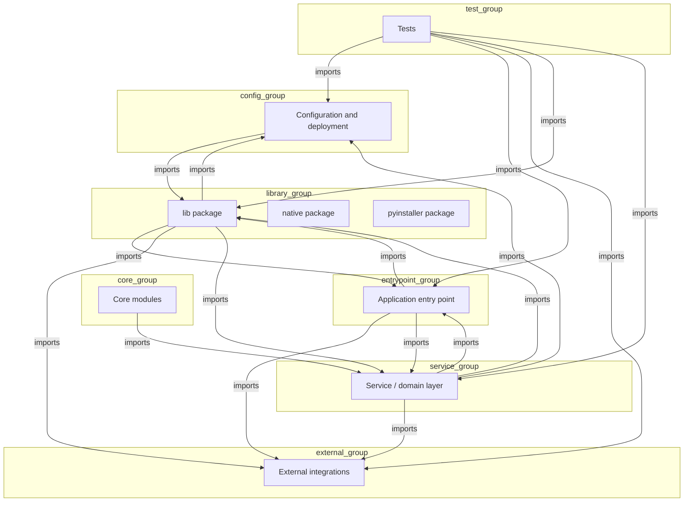

# Architecture report: maurosoria/dirsearch

> Automated static analysis. **Observed** = directly seen in files/imports/AST; **Inferred** = interpretation from that evidence. Repository code was not executed.

## 1. Repository at a glance

| Item | Value |
| --- | --- |
| Repository | maurosoria/dirsearch |
| Description | Web path scanner |
| Language | Python |
| Stars | 15078 |
| Licence | Not detected |
| Analysed commit / branch | 461705af2688ab6644b1f2bf738c46c55ee4d3da / master |
| Framework(s) | None detected |
| Files analysed | 376 |
| Components | 9 |

## 2. Architecture in one minute

maurosoria/dirsearch - Web path scanner. This repository was analysed statically from 376 file(s) (235 Python). Detected technologies (observed from imports/manifests): GitHub Actions, MySQL, PostgreSQL, SQLite, httpx, requests. Files are grouped into 9 component(s): Configuration and deployment, Core modules, Application entry point, External integrations, lib package, native package, pyinstaller package, Service / domain layer. Observed entry point(s): __main__.py, db/categories/generate_wpscan_wordlists.py, db/categories/php/generate_wpscan_wordlists.py. Findings below distinguish observed facts from inferred interpretation.

## 3. High-level block diagram

## 4. Main components

### Configuration and deployment (`config`)

- **Kind:** config
- **Status:** Observed
- **Confidence:** 0.85
- **Responsibility:** Groups 10 file(s) under configuration and deployment (observed from repository paths and static analysis). Observed top-level classes: ConfigParser. Observed top-level functions: _get_default_session_dir, package_files, package_names, read_requirements, read_version.
- **Paths:** `Dockerfile`, `config.ini`, `lib/core/settings.py`, `lib/parse/config.py`, `native/Cargo.toml`, `native/pyproject.toml`, `pyproject.toml`, `requirements.txt`, `setup.cfg`, `setup.py`
- **Evidence:** [Dockerfile](https://github.com/maurosoria/dirsearch/blob/461705af2688ab6644b1f2bf738c46c55ee4d3da/Dockerfile); [config.ini](https://github.com/maurosoria/dirsearch/blob/461705af2688ab6644b1f2bf738c46c55ee4d3da/config.ini); [lib/core/settings.py:147](https://github.com/maurosoria/dirsearch/blob/461705af2688ab6644b1f2bf738c46c55ee4d3da/lib/core/settings.py#L147); [lib/parse/config.py:25](https://github.com/maurosoria/dirsearch/blob/461705af2688ab6644b1f2bf738c46c55ee4d3da/lib/parse/config.py#L25); [native/Cargo.toml](https://github.com/maurosoria/dirsearch/blob/461705af2688ab6644b1f2bf738c46c55ee4d3da/native/Cargo.toml); [native/pyproject.toml](https://github.com/maurosoria/dirsearch/blob/461705af2688ab6644b1f2bf738c46c55ee4d3da/native/pyproject.toml); [pyproject.toml](https://github.com/maurosoria/dirsearch/blob/461705af2688ab6644b1f2bf738c46c55ee4d3da/pyproject.toml); [requirements.txt](https://github.com/maurosoria/dirsearch/blob/461705af2688ab6644b1f2bf738c46c55ee4d3da/requirements.txt)

### Core modules (`core`)

- **Kind:** core
- **Status:** Observed
- **Confidence:** 0.85
- **Responsibility:** Groups 1 file(s) under core modules (observed from repository paths and static analysis).
- **Paths:** `__init__.py`
- **Evidence:** [__init__.py](https://github.com/maurosoria/dirsearch/blob/461705af2688ab6644b1f2bf738c46c55ee4d3da/__init__.py)

### Application entry point (`entrypoint`)

- **Kind:** entrypoint
- **Status:** Observed
- **Confidence:** 0.85
- **Responsibility:** Groups 11 file(s) under application entry point (observed from repository paths and static analysis). Observed top-level functions: archive_stage, build, build_native, build_native_engine, chmod_executable, clean_wheel_dir.
- **Paths:** `__main__.py`, `db/categories/generate_wpscan_wordlists.py`, `db/categories/php/generate_wpscan_wordlists.py`, `dirsearch.py`, `lib/core/native_builder.py`, `lib/utils/cli.py`, `scripts/build_native.py`, `scripts/build_portable.py`, `scripts/configure_stack.py`, `scripts/split_wordlists.py`, `testing.py`
- **Evidence:** [__main__.py](https://github.com/maurosoria/dirsearch/blob/461705af2688ab6644b1f2bf738c46c55ee4d3da/__main__.py); [db/categories/generate_wpscan_wordlists.py:12](https://github.com/maurosoria/dirsearch/blob/461705af2688ab6644b1f2bf738c46c55ee4d3da/db/categories/generate_wpscan_wordlists.py#L12); [db/categories/php/generate_wpscan_wordlists.py:4](https://github.com/maurosoria/dirsearch/blob/461705af2688ab6644b1f2bf738c46c55ee4d3da/db/categories/php/generate_wpscan_wordlists.py#L4); [dirsearch.py:52](https://github.com/maurosoria/dirsearch/blob/461705af2688ab6644b1f2bf738c46c55ee4d3da/dirsearch.py#L52); [lib/core/native_builder.py:28](https://github.com/maurosoria/dirsearch/blob/461705af2688ab6644b1f2bf738c46c55ee4d3da/lib/core/native_builder.py#L28); [lib/utils/cli.py:26](https://github.com/maurosoria/dirsearch/blob/461705af2688ab6644b1f2bf738c46c55ee4d3da/lib/utils/cli.py#L26); [scripts/build_native.py:15](https://github.com/maurosoria/dirsearch/blob/461705af2688ab6644b1f2bf738c46c55ee4d3da/scripts/build_native.py#L15); [scripts/build_portable.py:53](https://github.com/maurosoria/dirsearch/blob/461705af2688ab6644b1f2bf738c46c55ee4d3da/scripts/build_portable.py#L53)

### External integrations (`external_integrations`)

- **Kind:** external
- **Status:** Inferred
- **Confidence:** 0.70
- **Responsibility:** Groups 0 file(s) under external integrations (observed from repository paths and static analysis).
- **Evidence:** [db/categories/generate_wpscan_wordlists.py:4](https://github.com/maurosoria/dirsearch/blob/461705af2688ab6644b1f2bf738c46c55ee4d3da/db/categories/generate_wpscan_wordlists.py#L4); [lib/connection/requester.py:24](https://github.com/maurosoria/dirsearch/blob/461705af2688ab6644b1f2bf738c46c55ee4d3da/lib/connection/requester.py#L24); [lib/connection/requester.py:33](https://github.com/maurosoria/dirsearch/blob/461705af2688ab6644b1f2bf738c46c55ee4d3da/lib/connection/requester.py#L33); [lib/connection/requester.py:34](https://github.com/maurosoria/dirsearch/blob/461705af2688ab6644b1f2bf738c46c55ee4d3da/lib/connection/requester.py#L34); [lib/connection/requester.py:35](https://github.com/maurosoria/dirsearch/blob/461705af2688ab6644b1f2bf738c46c55ee4d3da/lib/connection/requester.py#L35); [lib/connection/requester.py:36](https://github.com/maurosoria/dirsearch/blob/461705af2688ab6644b1f2bf738c46c55ee4d3da/lib/connection/requester.py#L36)

### lib package (`lib`)

- **Kind:** library
- **Status:** Observed
- **Confidence:** 0.85
- **Responsibility:** Groups 51 file(s) under lib package (observed from repository paths and static analysis). Observed top-level classes: AsyncRequester, AsyncResponse, BaseReport, BaseRequester, BaseResponse, BaseResponseStore. Observed top-level functions: _absolute_form_target, _browser_url_value, _build_common_help_parser, _create_force_quit_handler, _declared_charset, _decode_response_body.
- **Paths:** `lib/__init__.py`, `lib/connection/__init__.py`, `lib/connection/ip_overrides.py`, `lib/connection/native.py`, `lib/connection/proxy.py`, `lib/connection/rate_limiter.py`, `lib/connection/request_target.py`, `lib/connection/requester.py`, `lib/connection/response.py`, `lib/controller/__init__.py`, `lib/controller/controller.py`, `lib/controller/event_loop.py`, `lib/controller/run_resources.py`, `lib/controller/session.py`, `lib/controller/session_options.py`, `lib/controller/session_snapshot.py`, `lib/parse/__init__.py`, `lib/parse/cmdline.py`, `lib/parse/headers.py`, `lib/parse/nmap.py`, `lib/parse/rawrequest.py`, `lib/parse/url.py`, `lib/report/__init__.py`, `lib/report/csv_report.py`, `lib/report/directory_response_store.py`, `lib/report/factory.py`, `lib/report/html_report.py`, `lib/report/json_report.py`, `lib/report/jsonl_response_store.py`, `lib/report/manager.py`, `lib/report/markdown_report.py`, `lib/report/mysql_report.py`, `lib/report/plain_text_report.py`, `lib/report/postgresql_report.py`, `lib/report/response_store.py`, `lib/report/simple_report.py`, `lib/report/sqlite_report.py`, `lib/report/xml_report.py`, `lib/utils/__init__.py`, `lib/utils/command.py`, `lib/utils/common.py`, `lib/utils/crawl.py`, `lib/utils/diff.py`, `lib/utils/file.py`, `lib/utils/mimetype.py`, `lib/utils/random.py`, `lib/utils/safe_xml.py`, `lib/utils/schemedet.py`, `lib/view/__init__.py`, `lib/view/colors.py`, `lib/view/terminal.py`
- **Evidence:** [lib/__init__.py](https://github.com/maurosoria/dirsearch/blob/461705af2688ab6644b1f2bf738c46c55ee4d3da/lib/__init__.py); [lib/connection/__init__.py](https://github.com/maurosoria/dirsearch/blob/461705af2688ab6644b1f2bf738c46c55ee4d3da/lib/connection/__init__.py); [lib/connection/ip_overrides.py:22](https://github.com/maurosoria/dirsearch/blob/461705af2688ab6644b1f2bf738c46c55ee4d3da/lib/connection/ip_overrides.py#L22); [lib/connection/native.py:45](https://github.com/maurosoria/dirsearch/blob/461705af2688ab6644b1f2bf738c46c55ee4d3da/lib/connection/native.py#L45); [lib/connection/proxy.py:19](https://github.com/maurosoria/dirsearch/blob/461705af2688ab6644b1f2bf738c46c55ee4d3da/lib/connection/proxy.py#L19); [lib/connection/rate_limiter.py:14](https://github.com/maurosoria/dirsearch/blob/461705af2688ab6644b1f2bf738c46c55ee4d3da/lib/connection/rate_limiter.py#L14); [lib/connection/request_target.py:6](https://github.com/maurosoria/dirsearch/blob/461705af2688ab6644b1f2bf738c46c55ee4d3da/lib/connection/request_target.py#L6); [lib/connection/requester.py:87](https://github.com/maurosoria/dirsearch/blob/461705af2688ab6644b1f2bf738c46c55ee4d3da/lib/connection/requester.py#L87)

### native package (`native`)

- **Kind:** library
- **Status:** Observed
- **Confidence:** 0.85
- **Responsibility:** Groups 18 file(s) under native package (observed from repository paths and static analysis).
- **Paths:** `native/src/chunks.rs`, `native/src/compression.rs`, `native/src/engine.rs`, `native/src/filters.rs`, `native/src/lib.rs`, `native/src/ntlm.rs`, `native/src/pacing.rs`, `native/src/proxy.rs`, `native/src/raw_client.rs`, `native/src/raw_http.rs`, `native/src/request_target.rs`, `native/src/result.rs`, `native/src/routing.rs`, `native/src/scan.rs`, `native/src/session.rs`, `native/src/tests.rs`, `native/src/transport.rs`, `native/src/wordlist.rs`
- **Evidence:** [native/src/chunks.rs](https://github.com/maurosoria/dirsearch/blob/461705af2688ab6644b1f2bf738c46c55ee4d3da/native/src/chunks.rs); [native/src/compression.rs](https://github.com/maurosoria/dirsearch/blob/461705af2688ab6644b1f2bf738c46c55ee4d3da/native/src/compression.rs); [native/src/engine.rs](https://github.com/maurosoria/dirsearch/blob/461705af2688ab6644b1f2bf738c46c55ee4d3da/native/src/engine.rs); [native/src/filters.rs](https://github.com/maurosoria/dirsearch/blob/461705af2688ab6644b1f2bf738c46c55ee4d3da/native/src/filters.rs); [native/src/lib.rs](https://github.com/maurosoria/dirsearch/blob/461705af2688ab6644b1f2bf738c46c55ee4d3da/native/src/lib.rs); [native/src/ntlm.rs](https://github.com/maurosoria/dirsearch/blob/461705af2688ab6644b1f2bf738c46c55ee4d3da/native/src/ntlm.rs); [native/src/pacing.rs](https://github.com/maurosoria/dirsearch/blob/461705af2688ab6644b1f2bf738c46c55ee4d3da/native/src/pacing.rs); [native/src/proxy.rs](https://github.com/maurosoria/dirsearch/blob/461705af2688ab6644b1f2bf738c46c55ee4d3da/native/src/proxy.rs)

### pyinstaller package (`pyinstaller`)

- **Kind:** library
- **Status:** Observed
- **Confidence:** 0.85
- **Responsibility:** Groups 1 file(s) under pyinstaller package (observed from repository paths and static analysis).
- **Paths:** `pyinstaller/build.sh`
- **Evidence:** [pyinstaller/build.sh](https://github.com/maurosoria/dirsearch/blob/461705af2688ab6644b1f2bf738c46c55ee4d3da/pyinstaller/build.sh)

### Service / domain layer (`service_layer`)

- **Kind:** service
- **Status:** Observed
- **Confidence:** 0.85
- **Responsibility:** Groups 33 file(s) under service / domain layer (observed from repository paths and static analysis). Observed top-level classes: AsyncFuzzer, AsyncScanner, BaseFuzzer, BaseScanner, CannotConnectException, CaseInsensitiveDict. Observed top-level functions: _access_file, _has_extension, _is_cli_flag_present, _load_category, _parse_advanced_ranges, _parse_advanced_times.
- **Paths:** `lib/core/__init__.py`, `lib/core/api.py`, `lib/core/decorators.py`, `lib/core/dictionary.py`, `lib/core/discovery_config.py`, `lib/core/exceptions.py`, `lib/core/execution_config.py`, `lib/core/filter_config.py`, `lib/core/filter_state.py`, `lib/core/filters.py`, `lib/core/fuzzer.py`, `lib/core/log_config.py`, `lib/core/logger.py`, `lib/core/native_runtime.py`, `lib/core/option_defaults.py`, `lib/core/options.py`, `lib/core/report_config.py`, `lib/core/request_backend.py`, `lib/core/request_config.py`, `lib/core/result_config.py`, `lib/core/run_config.py`, `lib/core/run_metadata.py`, `lib/core/scan_run_state.py`, `lib/core/scanner.py`, `lib/core/structures.py`, `lib/core/target_config.py`, `lib/core/target_progress.py`, `lib/core/task_checkpoint.py`, `lib/core/task_spec.py`, `lib/core/terminal_config.py`, `lib/core/wordlist_backend.py`, `lib/core/wordlist_config.py`, `lib/core/wordlist_template.py`
- **Evidence:** [lib/core/__init__.py](https://github.com/maurosoria/dirsearch/blob/461705af2688ab6644b1f2bf738c46c55ee4d3da/lib/core/__init__.py); [lib/core/api.py:52](https://github.com/maurosoria/dirsearch/blob/461705af2688ab6644b1f2bf738c46c55ee4d3da/lib/core/api.py#L52); [lib/core/decorators.py:27](https://github.com/maurosoria/dirsearch/blob/461705af2688ab6644b1f2bf738c46c55ee4d3da/lib/core/decorators.py#L27); [lib/core/dictionary.py:37](https://github.com/maurosoria/dirsearch/blob/461705af2688ab6644b1f2bf738c46c55ee4d3da/lib/core/dictionary.py#L37); [lib/core/discovery_config.py:11](https://github.com/maurosoria/dirsearch/blob/461705af2688ab6644b1f2bf738c46c55ee4d3da/lib/core/discovery_config.py#L11); [lib/core/exceptions.py:20](https://github.com/maurosoria/dirsearch/blob/461705af2688ab6644b1f2bf738c46c55ee4d3da/lib/core/exceptions.py#L20); [lib/core/execution_config.py:13](https://github.com/maurosoria/dirsearch/blob/461705af2688ab6644b1f2bf738c46c55ee4d3da/lib/core/execution_config.py#L13); [lib/core/filter_config.py:14](https://github.com/maurosoria/dirsearch/blob/461705af2688ab6644b1f2bf738c46c55ee4d3da/lib/core/filter_config.py#L14)

### Tests (`tests`)

- **Kind:** test
- **Status:** Observed
- **Confidence:** 0.85
- **Responsibility:** Groups 140 file(s) under tests (observed from repository paths and static analysis). Observed top-level classes: APITestHandler, AlternatingRedirectRequester, AsyncCalibrationRequester, AsyncFixedResponseRequester, AsyncRecordingRequester, BackendContractHandler. Observed top-level functions: _create_test_certificate, _with_cause, _with_context, add_crawled_paths, block_dependencies, controller_for.
- **Paths:** `tests/__init__.py`, `tests/check_packaged_install.py`, `tests/connection/__init__.py`, `tests/connection/proxy_server.py`, `tests/connection/test_async_proxy_environment_cli.py`, `tests/connection/test_dns.py`, `tests/connection/test_logging_ownership.py`, `tests/connection/test_macos_proxy.py`, `tests/connection/test_native_backend.py`, `tests/connection/test_native_engine.py`, `tests/connection/test_native_response.py`, `tests/connection/test_proxy.py`, `tests/connection/test_proxy_integration.py`, `tests/connection/test_rate_limiter.py`, `tests/connection/test_request_config.py`, `tests/connection/test_request_target_ownership.py`, `tests/connection/test_requester.py`, `tests/connection/test_requester_rate.py`, `tests/connection/test_response.py`, `tests/controller/__init__.py`, `tests/controller/test_async_controller.py`, `tests/controller/test_backend_e2e_contract.py`, `tests/controller/test_calibration_e2e_contract.py`, `tests/controller/test_cli_interrupt_contract.py`, `tests/controller/test_controller_lifecycle.py`, `tests/controller/test_discovery_config.py`, `tests/controller/test_engine_selection.py`, `tests/controller/test_execution_config.py`, `tests/controller/test_filter_config.py`, `tests/controller/test_invocation_options.py`, `tests/controller/test_logging_ownership.py`, `tests/controller/test_native_controller.py`, `tests/controller/test_pause_state.py`, `tests/controller/test_process_isolation.py`, `tests/controller/test_progress_ownership.py`, `tests/controller/test_redirect_recursion.py`, `tests/controller/test_replay_lifecycle.py`, `tests/controller/test_report_config.py`, `tests/controller/test_request_config.py`, `tests/controller/test_result_config.py`, `tests/controller/test_root_crawl.py`, `tests/controller/test_run_config.py`, `tests/controller/test_run_resources.py`, `tests/controller/test_scan_run_state.py`, `tests/controller/test_session_cleanup.py`, `tests/controller/test_session_options.py`, `tests/controller/test_session_resume_queue.py`, `tests/controller/test_session_snapshot.py`, `tests/controller/test_session_store.py`, `tests/controller/test_target_config.py`, `tests/controller/test_target_credentials.py`, `tests/controller/test_target_dns.py`, `tests/controller/test_target_url.py`, `tests/controller/test_terminal_ownership.py`, `tests/controller/test_threaded_controller.py`, `tests/controller/test_wordlist_config.py`, `tests/core/__init__.py`, `tests/core/test_advanced_filters.py`, `tests/core/test_async_fuzzer.py`, `tests/core/test_backup_discovery.py`, `tests/core/test_calibration_words.py`, `tests/core/test_cli_output_streams.py`, `tests/core/test_cli_run_metadata.py`, `tests/core/test_constant_tables.py`, `tests/core/test_dictionary_concurrency.py`, `tests/core/test_dictionary_templates.py`, `tests/core/test_discovery_config.py`, `tests/core/test_dynamic_dictionary.py`, `tests/core/test_execution_config.py`, `tests/core/test_filter_config.py`, `tests/core/test_fuzzer_filter_stacks.py`, `tests/core/test_fuzzer_lifecycle.py`, `tests/core/test_importable_api.py`, `tests/core/test_logger.py`, `tests/core/test_native_builder.py`, `tests/core/test_native_fuzzer.py`, `tests/core/test_native_runtime.py`, `tests/core/test_numeric_option_validation.py`, `tests/core/test_options.py`, `tests/core/test_options_config_merge.py`, `tests/core/test_regex_option_validation.py`, `tests/core/test_report_config.py`, `tests/core/test_request_backend.py`, `tests/core/test_request_config.py`, `tests/core/test_result_config.py`, `tests/core/test_run_config.py`, `tests/core/test_run_logger.py`, `tests/core/test_run_metadata.py`, `tests/core/test_scan_run_state.py`, `tests/core/test_scanner.py`, `tests/core/test_target_config.py`, `tests/core/test_target_progress.py`, `tests/core/test_task_checkpoint.py`, `tests/core/test_task_spec.py`, `tests/core/test_terminal_config.py`, `tests/core/test_wordlist_backend.py`, `tests/core/test_wordlist_config.py`, `tests/parse/__init__.py`, `tests/parse/test_cmdline.py`, `tests/parse/test_config.py`, `tests/parse/test_headers.py`, `tests/parse/test_nmap.py`, `tests/parse/test_rawrequest.py`, `tests/parse/test_url.py`, `tests/report/__init__.py`, `tests/report/test_atomic_file_reports.py`, `tests/report/test_file_report_portability.py`, `tests/report/test_html_report_template.py`, `tests/report/test_mysql_report.py`, `tests/report/test_report_command_redaction.py`, `tests/report/test_report_locking.py`, `tests/report/test_report_manager.py`, `tests/report/test_response_store.py`, `tests/report/test_run_metadata.py`, `tests/report/test_sql_report.py`, `tests/report/test_streaming_file_reports.py`, `tests/report/test_structured_file_reports.py`, `tests/static/nmap.xml`, `tests/static/raw.txt`, `tests/static/targets.txt`, `tests/static/wordlist.txt`, `tests/test_docker_workflow.py`, `tests/test_native_install_packaging.py`, `tests/test_optional_db_dependencies.py`, `tests/test_release_scripts.py`, `tests/test_report_exception_handling.py`, `tests/test_test_discovery.py`, `tests/utils/__init__.py`, `tests/utils/test_cli_interrupts.py`, `tests/utils/test_command.py`, `tests/utils/test_common.py`, `tests/utils/test_crawl.py`, `tests/utils/test_diff.py`, `tests/utils/test_file.py`, `tests/utils/test_mimetype.py`, `tests/utils/test_random.py`, `tests/utils/test_safe_xml.py`, `tests/utils/test_schemedet.py`, `tests/utils/test_terminal.py`, `tests/utils/test_terminal_ownership.py`
- **Evidence:** [tests/__init__.py](https://github.com/maurosoria/dirsearch/blob/461705af2688ab6644b1f2bf738c46c55ee4d3da/tests/__init__.py); [tests/check_packaged_install.py:13](https://github.com/maurosoria/dirsearch/blob/461705af2688ab6644b1f2bf738c46c55ee4d3da/tests/check_packaged_install.py#L13); [tests/connection/__init__.py](https://github.com/maurosoria/dirsearch/blob/461705af2688ab6644b1f2bf738c46c55ee4d3da/tests/connection/__init__.py); [tests/connection/proxy_server.py:29](https://github.com/maurosoria/dirsearch/blob/461705af2688ab6644b1f2bf738c46c55ee4d3da/tests/connection/proxy_server.py#L29); [tests/connection/test_async_proxy_environment_cli.py:15](https://github.com/maurosoria/dirsearch/blob/461705af2688ab6644b1f2bf738c46c55ee4d3da/tests/connection/test_async_proxy_environment_cli.py#L15); [tests/connection/test_dns.py:54](https://github.com/maurosoria/dirsearch/blob/461705af2688ab6644b1f2bf738c46c55ee4d3da/tests/connection/test_dns.py#L54); [tests/connection/test_logging_ownership.py:16](https://github.com/maurosoria/dirsearch/blob/461705af2688ab6644b1f2bf738c46c55ee4d3da/tests/connection/test_logging_ownership.py#L16); [tests/connection/test_macos_proxy.py:19](https://github.com/maurosoria/dirsearch/blob/461705af2688ab6644b1f2bf738c46c55ee4d3da/tests/connection/test_macos_proxy.py#L19)

## 5. Execution flow

**Observed** entry point(s):

- [__main__.py:4](https://github.com/maurosoria/dirsearch/blob/461705af2688ab6644b1f2bf738c46c55ee4d3da/__main__.py#L4)
- [db/categories/generate_wpscan_wordlists.py:76](https://github.com/maurosoria/dirsearch/blob/461705af2688ab6644b1f2bf738c46c55ee4d3da/db/categories/generate_wpscan_wordlists.py#L76)
- [db/categories/php/generate_wpscan_wordlists.py:45](https://github.com/maurosoria/dirsearch/blob/461705af2688ab6644b1f2bf738c46c55ee4d3da/db/categories/php/generate_wpscan_wordlists.py#L45)
- [dirsearch.py:87](https://github.com/maurosoria/dirsearch/blob/461705af2688ab6644b1f2bf738c46c55ee4d3da/dirsearch.py#L87)
- [lib/core/native_builder.py:204](https://github.com/maurosoria/dirsearch/blob/461705af2688ab6644b1f2bf738c46c55ee4d3da/lib/core/native_builder.py#L204)
- [scripts/build_native.py:137](https://github.com/maurosoria/dirsearch/blob/461705af2688ab6644b1f2bf738c46c55ee4d3da/scripts/build_native.py#L137)
- [scripts/build_portable.py:262](https://github.com/maurosoria/dirsearch/blob/461705af2688ab6644b1f2bf738c46c55ee4d3da/scripts/build_portable.py#L262)
- [scripts/configure_stack.py:53](https://github.com/maurosoria/dirsearch/blob/461705af2688ab6644b1f2bf738c46c55ee4d3da/scripts/configure_stack.py#L53)
- [scripts/split_wordlists.py:191](https://github.com/maurosoria/dirsearch/blob/461705af2688ab6644b1f2bf738c46c55ee4d3da/scripts/split_wordlists.py#L191)
- [testing.py:40](https://github.com/maurosoria/dirsearch/blob/461705af2688ab6644b1f2bf738c46c55ee4d3da/testing.py#L40)

Representative flow (derived from observed entry points and the import graph; steps beyond the entry point are **Inferred**):

1. Execution starts at an observed entry point listed above, if present.
2. `config` imports `lib` (Configuration and deployment -> lib package).
3. `core` imports `service_layer` (Core modules -> Service / domain layer).
4. `entrypoint` imports `external_integrations` (Application entry point -> External integrations).
5. `entrypoint` imports `lib` (Application entry point -> lib package).
6. `entrypoint` imports `service_layer` (Application entry point -> Service / domain layer).
7. `lib` imports `config` (lib package -> Configuration and deployment).
8. `lib` imports `entrypoint` (lib package -> Application entry point).
9. `lib` imports `external_integrations` (lib package -> External integrations).

## 6. Project structure

### `(root)`

- `.dockerignore` - container (140 bytes)
- `.gitignore` - other (183 bytes)
- `AGENTS.md` - docs (6388 bytes)
- `CHANGELOG.md` - docs (8903 bytes)
- `CONTRIBUTORS.md` - docs (4312 bytes)
- `Dockerfile` - container (1179 bytes)
- `README.md` - docs (3730 bytes)
- `__init__.py` - source, Python (431 bytes)
- `__main__.py` - source, Python (68 bytes)
- `config.ini` - config (3690 bytes)
- `dirsearch.py` - source, Python (2702 bytes)
- `pyproject.toml` - manifest (2177 bytes)
- `requirements.txt` - manifest (328 bytes)
- `setup.cfg` - manifest (239 bytes)
- `setup.py` - manifest, Python (3900 bytes)
- `testing.py` - source, Python (1248 bytes)

### `.github`

- `.github/FUNDING.yml` - config (66 bytes)
- `.github/ISSUE_TEMPLATE/ask_question.md` - docs (141 bytes)
- `.github/ISSUE_TEMPLATE/bug_report.md` - docs (294 bytes)
- `.github/ISSUE_TEMPLATE/feature_request.md` - docs (218 bytes)
- `.github/pull_request_template.md` - docs (499 bytes)
- `.github/workflows/ci.yml` - ci, YAML (3048 bytes)
- `.github/workflows/codeql-analysis.yml` - ci, YAML (2447 bytes)
- `.github/workflows/docker-image.yml` - ci, YAML (3057 bytes)
- `.github/workflows/portable-builds.yml` - ci, YAML (3797 bytes)
- `.github/workflows/pyinstaller-linux.yml` - ci, YAML (3070 bytes)
- `.github/workflows/pyinstaller-macos-intel.yml` - ci, YAML (2561 bytes)
- `.github/workflows/pyinstaller-macos-silicon.yml` - ci, YAML (2579 bytes)
- `.github/workflows/pyinstaller-release-draft.yml` - ci, YAML (2920 bytes)
- `.github/workflows/pyinstaller-windows.yml` - ci, YAML (2599 bytes)
- `.github/workflows/rust-security.yml` - ci, YAML (745 bytes)
- `.github/workflows/semgrep-analysis.yml` - ci, YAML (1156 bytes)

### `db`

- `db/400_blacklist.txt` - docs (192 bytes)
- `db/403_blacklist.txt` - docs (201 bytes)
- `db/500_blacklist.txt` - docs (137 bytes)
- `db/categories/aggressive.txt` - docs (39 bytes)
- `db/categories/backups.txt` - docs (1635 bytes)
- `db/categories/coldfusion/coldfusion.txt` - docs (152 bytes)
- `db/categories/common.txt` - docs (88506 bytes)
- `db/categories/conf.txt` - docs (17777 bytes)
- `db/categories/db.txt` - docs (1712 bytes)
- `db/categories/dotnet/aspx.txt` - docs (215 bytes)
- `db/categories/dotnet/core.txt` - docs (180 bytes)
- `db/categories/dotnet/mvc.txt` - docs (186 bytes)
- `db/categories/extensions.txt` - docs (8964 bytes)
- `db/categories/generate_wpscan_wordlists.py` - source, Python (2700 bytes)
- `db/categories/infra/aws.txt` - docs (121 bytes)
- `db/categories/infra/docker.txt` - docs (81 bytes)
- `db/categories/infra/k8s.txt` - docs (109 bytes)
- `db/categories/java/jsf.txt` - docs (139 bytes)
- `db/categories/java/jsp.txt` - docs (149 bytes)
- `db/categories/java/spring.txt` - docs (238 bytes)
- `db/categories/keys.txt` - docs (281 bytes)
- `db/categories/logs.txt` - docs (3222 bytes)
- `db/categories/node/express.txt` - docs (139 bytes)
- `db/categories/php/cakephp.txt` - docs (165 bytes)
- `db/categories/php/codeigniter.txt` - docs (207 bytes)
- `db/categories/php/drupal.txt` - docs (170 bytes)
- `db/categories/php/generate_wpscan_wordlists.py` - source, Python (1947 bytes)
- `db/categories/php/joomla.txt` - docs (190 bytes)
- `db/categories/php/laravel.txt` - docs (403 bytes)
- `db/categories/php/magento.txt` - docs (211 bytes)
- `db/categories/php/plugins-full.txt` - docs (183 bytes)
- `db/categories/php/plugins-vulnerable.txt` - docs (288 bytes)
- `db/categories/php/symfony.txt` - docs (238 bytes)
- `db/categories/php/wordpress.txt` - docs (287 bytes)
- `db/categories/php/yii.txt` - docs (526 bytes)
- `db/categories/python/django.txt` - docs (131 bytes)
- `db/categories/python/fastapi.txt` - docs (124 bytes)
- `db/categories/python/flask.txt` - docs (89 bytes)
- `db/categories/vcs.txt` - docs (1556 bytes)
- `db/categories/web.txt` - docs (19856 bytes)
- `db/dicc.txt` - docs (143534 bytes)
- `db/templates/admin.txt` - docs (109 bytes)
- `db/templates/api.txt` - docs (129 bytes)
- `db/templates/auth.txt` - docs (80 bytes)
- `db/templates/backups.txt` - docs (118 bytes)
- `db/templates/crud.txt` - docs (128 bytes)
- `db/templates/db.txt` - docs (101 bytes)
- `db/templates/logs.txt` - docs (83 bytes)
- `db/user-agents.txt` - docs (5243 bytes)

### `docs`

- `docs/building.md` - docs (4099 bytes)
- `docs/calibration-word-ownership.md` - docs (2578 bytes)
- `docs/configuration.md` - docs (1365 bytes)
- `docs/controller-lifecycle.md` - docs (6852 bytes)
- `docs/discovery-configuration.md` - docs (4777 bytes)
- `docs/execution-configuration.md` - docs (7375 bytes)
- `docs/filter-configuration.md` - docs (6711 bytes)
- `docs/index.md` - docs (1917 bytes)
- `docs/installation.md` - docs (8793 bytes)
- `docs/invocation-options.md` - docs (3267 bytes)
- `docs/logging-ownership.md` - docs (4513 bytes)
- `docs/native-backend-benchmarks.md` - docs (4203 bytes)
- `docs/options.md` - docs (12385 bytes)
- `docs/python-api.md` - docs (14043 bytes)
- `docs/refactoring-backlog.md` - docs (13372 bytes)
- `docs/references.md` - docs (1843 bytes)
- `docs/release-notes-v0.5.0.md` - docs (3985 bytes)
- `docs/report-configuration.md` - docs (5651 bytes)
- `docs/request-configuration.md` - docs (6162 bytes)
- `docs/request-target-ownership.md` - docs (3912 bytes)
- `docs/result-configuration.md` - docs (4099 bytes)
- `docs/run-configuration.md` - docs (4779 bytes)
- `docs/run-metadata.md` - docs (3894 bytes)
- `docs/run-resources.md` - docs (5213 bytes)
- `docs/scan-run-state.md` - docs (8270 bytes)
- `docs/session-options.md` - docs (3981 bytes)
- `docs/session-snapshots.md` - docs (8917 bytes)
- `docs/sessions.md` - docs (2436 bytes)
- `docs/target-configuration.md` - docs (3642 bytes)
- `docs/terminal-configuration.md` - docs (5019 bytes)
- `docs/usage.md` - docs (9410 bytes)
- `docs/wordlist-configuration.md` - docs (5214 bytes)
- `docs/wordlists.md` - docs (5117 bytes)

### `lib`

- `lib/__init__.py` - source, Python (0 bytes)
- `lib/connection/__init__.py` - source, Python (0 bytes)
- `lib/connection/ip_overrides.py` - source, Python (2043 bytes)
- `lib/connection/native.py` - source, Python (19043 bytes)
- `lib/connection/proxy.py` - source, Python (2736 bytes)
- `lib/connection/rate_limiter.py` - source, Python (1851 bytes)
- `lib/connection/request_target.py` - source, Python (2436 bytes)
- `lib/connection/requester.py` - source, Python (38039 bytes)
- `lib/connection/response.py` - source, Python (13699 bytes)
- `lib/controller/__init__.py` - source, Python (0 bytes)
- `lib/controller/controller.py` - source, Python (48489 bytes)
- `lib/controller/event_loop.py` - source, Python (437 bytes)
- `lib/controller/run_resources.py` - source, Python (4223 bytes)
- `lib/controller/session.py` - source, Python (19528 bytes)
- `lib/controller/session_options.py` - source, Python (2320 bytes)
- `lib/controller/session_snapshot.py` - source, Python (2866 bytes)
- `lib/core/__init__.py` - source, Python (0 bytes)
- `lib/core/api.py` - source, Python (12576 bytes)
- `lib/core/decorators.py` - source, Python (1165 bytes)
- `lib/core/dictionary.py` - source, Python (13351 bytes)
- `lib/core/discovery_config.py` - source, Python (2439 bytes)
- `lib/core/exceptions.py` - source, Python (1257 bytes)
- `lib/core/execution_config.py` - source, Python (2453 bytes)
- `lib/core/filter_config.py` - source, Python (7278 bytes)
- `lib/core/filter_state.py` - source, Python (1131 bytes)
- `lib/core/filters.py` - source, Python (4224 bytes)
- `lib/core/fuzzer.py` - source, Python (34692 bytes)
- `lib/core/log_config.py` - source, Python (870 bytes)
- `lib/core/logger.py` - source, Python (4486 bytes)
- `lib/core/native_builder.py` - source, Python (5919 bytes)
- `lib/core/native_runtime.py` - source, Python (2483 bytes)
- `lib/core/option_defaults.py` - source, Python (4366 bytes)
- `lib/core/options.py` - source, Python (29193 bytes)
- `lib/core/report_config.py` - source, Python (1453 bytes)
- `lib/core/request_backend.py` - source, Python (2421 bytes)
- `lib/core/request_config.py` - source, Python (2963 bytes)
- `lib/core/result_config.py` - source, Python (1306 bytes)
- `lib/core/run_config.py` - source, Python (3538 bytes)
- `lib/core/run_metadata.py` - source, Python (1421 bytes)
- `lib/core/scan_run_state.py` - source, Python (4294 bytes)
- `lib/core/scanner.py` - source, Python (15661 bytes)
- `lib/core/settings.py` - source, Python (6651 bytes)
- `lib/core/structures.py` - source, Python (2420 bytes)
- `lib/core/target_config.py` - source, Python (1119 bytes)
- `lib/core/target_progress.py` - source, Python (1008 bytes)
- `lib/core/task_checkpoint.py` - source, Python (2314 bytes)
- `lib/core/task_spec.py` - source, Python (845 bytes)
- `lib/core/terminal_config.py` - source, Python (1591 bytes)
- `lib/core/wordlist_backend.py` - source, Python (10439 bytes)
- `lib/core/wordlist_config.py` - source, Python (2273 bytes)
- `lib/core/wordlist_template.py` - source, Python (6459 bytes)
- `lib/parse/__init__.py` - source, Python (0 bytes)
- `lib/parse/cmdline.py` - source, Python (28826 bytes)
- `lib/parse/config.py` - source, Python (3276 bytes)
- `lib/parse/headers.py` - source, Python (1915 bytes)
- `lib/parse/nmap.py` - source, Python (791 bytes)
- `lib/parse/rawrequest.py` - source, Python (3537 bytes)
- `lib/parse/url.py` - source, Python (2817 bytes)
- `lib/report/__init__.py` - source, Python (0 bytes)
- `lib/report/csv_report.py` - source, Python (2320 bytes)
- `lib/report/directory_response_store.py` - source, Python (2926 bytes)
- `lib/report/factory.py` - source, Python (19945 bytes)
- `lib/report/html_report.py` - source, Python (2568 bytes)
- `lib/report/json_report.py` - source, Python (1945 bytes)
- `lib/report/jsonl_response_store.py` - source, Python (5209 bytes)
- `lib/report/manager.py` - source, Python (6328 bytes)
- `lib/report/markdown_report.py` - source, Python (1776 bytes)
- `lib/report/mysql_report.py` - source, Python (2084 bytes)
- `lib/report/plain_text_report.py` - source, Python (1627 bytes)
- `lib/report/postgresql_report.py` - source, Python (1513 bytes)
- `lib/report/response_store.py` - source, Python (6046 bytes)
- `lib/report/simple_report.py` - source, Python (1143 bytes)
- `lib/report/sqlite_report.py` - source, Python (2537 bytes)
- `lib/report/templates/html_report_template.html` - other (10162 bytes)
- `lib/report/xml_report.py` - source, Python (2804 bytes)
- `lib/utils/__init__.py` - source, Python (0 bytes)
- `lib/utils/cli.py` - source, Python (1917 bytes)
- `lib/utils/command.py` - source, Python (3923 bytes)
- `lib/utils/common.py` - source, Python (4682 bytes)
- `lib/utils/crawl.py` - source, Python (6775 bytes)
- `lib/utils/diff.py` - source, Python (7393 bytes)
- `lib/utils/file.py` - source, Python (11302 bytes)
- `lib/utils/mimetype.py` - source, Python (1994 bytes)
- `lib/utils/random.py` - source, Python (8386 bytes)
- `lib/utils/safe_xml.py` - source, Python (2065 bytes)
- `lib/utils/schemedet.py` - source, Python (1293 bytes)
- `lib/view/__init__.py` - source, Python (0 bytes)
- `lib/view/colors.py` - source, Python (1879 bytes)
- `lib/view/terminal.py` - source, Python (9426 bytes)

### `native`

- `native/.gitignore` - other (8 bytes)
- `native/Cargo.toml` - manifest (1433 bytes)
- `native/README.md` - docs (8711 bytes)
- `native/pyproject.toml` - manifest (377 bytes)
- `native/src/chunks.rs` - source, Rust (8843 bytes)
- `native/src/compression.rs` - source, Rust (2674 bytes)
- `native/src/engine.rs` - source, Rust (14102 bytes)
- `native/src/filters.rs` - source, Rust (16364 bytes)
- `native/src/lib.rs` - source, Rust (2062 bytes)
- `native/src/ntlm.rs` - source, Rust (13803 bytes)
- `native/src/pacing.rs` - source, Rust (5035 bytes)
- `native/src/proxy.rs` - source, Rust (4154 bytes)
- `native/src/raw_client.rs` - source, Rust (7653 bytes)
- `native/src/raw_http.rs` - source, Rust (16411 bytes)
- `native/src/request_target.rs` - source, Rust (1439 bytes)
- `native/src/result.rs` - source, Rust (4132 bytes)
- `native/src/routing.rs` - source, Rust (7233 bytes)
- `native/src/scan.rs` - source, Rust (15866 bytes)
- `native/src/session.rs` - source, Rust (3747 bytes)
- `native/src/tests.rs` - source, Rust (89777 bytes)
- `native/src/transport.rs` - source, Rust (27396 bytes)
- `native/src/wordlist.rs` - source, Rust (12782 bytes)

### `pyinstaller`

- `pyinstaller/.gitignore` - other (119 bytes)
- `pyinstaller/README.md` - docs (1746 bytes)
- `pyinstaller/build.sh` - source, Shell (3995 bytes)
- `pyinstaller/dirsearch.spec` - other (3728 bytes)

### `requirements`

- `requirements/db.txt` - docs (53 bytes)
- `requirements/runtime.txt` - docs (232 bytes)

### `scripts`

- `scripts/build_native.py` - source, Python (3998 bytes)
- `scripts/build_portable.py` - source, Python (8575 bytes)
- `scripts/configure_stack.py` - source, Python (1482 bytes)
- `scripts/split_wordlists.py` - source, Python (4213 bytes)

### `sessions`

- `sessions/.gitkeep` - other (0 bytes)

### `tests`

- `tests/__init__.py` - test, Python (0 bytes)
- `tests/check_packaged_install.py` - test, Python (11467 bytes)
- `tests/connection/__init__.py` - test, Python (0 bytes)
- `tests/connection/proxy_server.py` - test, Python (23633 bytes)
- `tests/connection/test_async_proxy_environment_cli.py` - test, Python (3589 bytes)
- `tests/connection/test_dns.py` - test, Python (10168 bytes)
- `tests/connection/test_logging_ownership.py` - test, Python (3431 bytes)
- `tests/connection/test_macos_proxy.py` - test, Python (12084 bytes)
- `tests/connection/test_native_backend.py` - test, Python (43510 bytes)
- `tests/connection/test_native_engine.py` - test, Python (48612 bytes)
- `tests/connection/test_native_response.py` - test, Python (8132 bytes)
- `tests/connection/test_proxy.py` - test, Python (3799 bytes)
- `tests/connection/test_proxy_integration.py` - test, Python (36279 bytes)
- `tests/connection/test_rate_limiter.py` - test, Python (4479 bytes)
- `tests/connection/test_request_config.py` - test, Python (10481 bytes)
- `tests/connection/test_request_target_ownership.py` - test, Python (9920 bytes)
- `tests/connection/test_requester.py` - test, Python (130268 bytes)
- `tests/connection/test_requester_rate.py` - test, Python (6551 bytes)
- `tests/connection/test_response.py` - test, Python (12758 bytes)
- `tests/controller/__init__.py` - test, Python (0 bytes)
- `tests/controller/test_async_controller.py` - test, Python (9212 bytes)
- `tests/controller/test_backend_e2e_contract.py` - test, Python (7604 bytes)
- `tests/controller/test_calibration_e2e_contract.py` - test, Python (6807 bytes)
- `tests/controller/test_cli_interrupt_contract.py` - test, Python (4644 bytes)
- `tests/controller/test_controller_lifecycle.py` - test, Python (12864 bytes)
- `tests/controller/test_discovery_config.py` - test, Python (6564 bytes)
- `tests/controller/test_engine_selection.py` - test, Python (4675 bytes)
- `tests/controller/test_execution_config.py` - test, Python (14934 bytes)
- `tests/controller/test_filter_config.py` - test, Python (4835 bytes)
- `tests/controller/test_invocation_options.py` - test, Python (7203 bytes)
- `tests/controller/test_logging_ownership.py` - test, Python (8120 bytes)
- `tests/controller/test_native_controller.py` - test, Python (9508 bytes)
- `tests/controller/test_pause_state.py` - test, Python (10699 bytes)
- `tests/controller/test_process_isolation.py` - test, Python (10594 bytes)
- `tests/controller/test_progress_ownership.py` - test, Python (4316 bytes)
- `tests/controller/test_redirect_recursion.py` - test, Python (11379 bytes)
- `tests/controller/test_replay_lifecycle.py` - test, Python (6848 bytes)
- `tests/controller/test_report_config.py` - test, Python (7853 bytes)
- `tests/controller/test_request_config.py` - test, Python (3028 bytes)
- `tests/controller/test_result_config.py` - test, Python (15123 bytes)
- `tests/controller/test_root_crawl.py` - test, Python (6160 bytes)
- `tests/controller/test_run_config.py` - test, Python (11952 bytes)
- `tests/controller/test_run_resources.py` - test, Python (9059 bytes)
- `tests/controller/test_scan_run_state.py` - test, Python (13811 bytes)
- `tests/controller/test_session_cleanup.py` - test, Python (8463 bytes)
- `tests/controller/test_session_options.py` - test, Python (4255 bytes)
- `tests/controller/test_session_resume_queue.py` - test, Python (5643 bytes)
- `tests/controller/test_session_snapshot.py` - test, Python (28894 bytes)
- `tests/controller/test_session_store.py` - test, Python (21741 bytes)
- `tests/controller/test_target_config.py` - test, Python (11310 bytes)
- `tests/controller/test_target_credentials.py` - test, Python (10319 bytes)
- `tests/controller/test_target_dns.py` - test, Python (5486 bytes)
- `tests/controller/test_target_url.py` - test, Python (13123 bytes)
- `tests/controller/test_terminal_ownership.py` - test, Python (9674 bytes)
- `tests/controller/test_threaded_controller.py` - test, Python (6569 bytes)
- `tests/controller/test_wordlist_config.py` - test, Python (6145 bytes)
- `tests/core/__init__.py` - test, Python (0 bytes)
- `tests/core/test_advanced_filters.py` - test, Python (9338 bytes)
- `tests/core/test_async_fuzzer.py` - test, Python (5555 bytes)
- `tests/core/test_backup_discovery.py` - test, Python (4970 bytes)
- `tests/core/test_calibration_words.py` - test, Python (7010 bytes)
- `tests/core/test_cli_output_streams.py` - test, Python (4505 bytes)
- `tests/core/test_cli_run_metadata.py` - test, Python (2016 bytes)
- `tests/core/test_constant_tables.py` - test, Python (1965 bytes)
- `tests/core/test_dictionary_concurrency.py` - test, Python (11360 bytes)
- `tests/core/test_dictionary_templates.py` - test, Python (4848 bytes)
- `tests/core/test_discovery_config.py` - test, Python (6694 bytes)
- `tests/core/test_dynamic_dictionary.py` - test, Python (12777 bytes)
- `tests/core/test_execution_config.py` - test, Python (9467 bytes)
- `tests/core/test_filter_config.py` - test, Python (6883 bytes)
- `tests/core/test_fuzzer_filter_stacks.py` - test, Python (13685 bytes)
- `tests/core/test_fuzzer_lifecycle.py` - test, Python (7813 bytes)
- `tests/core/test_importable_api.py` - test, Python (12672 bytes)
- `tests/core/test_logger.py` - test, Python (4645 bytes)
- `tests/core/test_native_builder.py` - test, Python (2606 bytes)
- `tests/core/test_native_fuzzer.py` - test, Python (20331 bytes)
- `tests/core/test_native_runtime.py` - test, Python (1937 bytes)
- `tests/core/test_numeric_option_validation.py` - test, Python (5147 bytes)
- `tests/core/test_options.py` - test, Python (17959 bytes)
- `tests/core/test_options_config_merge.py` - test, Python (2049 bytes)
- `tests/core/test_regex_option_validation.py` - test, Python (4011 bytes)
- `tests/core/test_report_config.py` - test, Python (2378 bytes)
- `tests/core/test_request_backend.py` - test, Python (9007 bytes)
- `tests/core/test_request_config.py` - test, Python (4916 bytes)
- `tests/core/test_result_config.py` - test, Python (1668 bytes)
- `tests/core/test_run_config.py` - test, Python (7557 bytes)
- `tests/core/test_run_logger.py` - test, Python (4828 bytes)
- `tests/core/test_run_metadata.py` - test, Python (1988 bytes)
- `tests/core/test_scan_run_state.py` - test, Python (10582 bytes)
- `tests/core/test_scanner.py` - test, Python (10340 bytes)
- `tests/core/test_target_config.py` - test, Python (2463 bytes)
- `tests/core/test_target_progress.py` - test, Python (1235 bytes)
- `tests/core/test_task_checkpoint.py` - test, Python (2360 bytes)
- `tests/core/test_task_spec.py` - test, Python (1030 bytes)
- `tests/core/test_terminal_config.py` - test, Python (1271 bytes)
- `tests/core/test_wordlist_backend.py` - test, Python (8833 bytes)
- `tests/core/test_wordlist_config.py` - test, Python (8663 bytes)
- `tests/parse/__init__.py` - test, Python (0 bytes)
- `tests/parse/test_cmdline.py` - test, Python (3857 bytes)
- `tests/parse/test_config.py` - test, Python (2086 bytes)
- `tests/parse/test_headers.py` - test, Python (1448 bytes)
- `tests/parse/test_nmap.py` - test, Python (789 bytes)
- `tests/parse/test_rawrequest.py` - test, Python (2754 bytes)
- `tests/parse/test_url.py` - test, Python (4355 bytes)
- `tests/report/__init__.py` - test, Python (0 bytes)
- `tests/report/test_atomic_file_reports.py` - test, Python (4791 bytes)
- `tests/report/test_file_report_portability.py` - test, Python (4774 bytes)
- `tests/report/test_html_report_template.py` - test, Python (6586 bytes)
- `tests/report/test_mysql_report.py` - test, Python (2517 bytes)
- `tests/report/test_report_command_redaction.py` - test, Python (3677 bytes)
- `tests/report/test_report_locking.py` - test, Python (4454 bytes)
- `tests/report/test_report_manager.py` - test, Python (15054 bytes)
- `tests/report/test_response_store.py` - test, Python (34734 bytes)
- `tests/report/test_run_metadata.py` - test, Python (5849 bytes)
- `tests/report/test_sql_report.py` - test, Python (11490 bytes)
- `tests/report/test_streaming_file_reports.py` - test, Python (3515 bytes)
- `tests/report/test_structured_file_reports.py` - test, Python (32636 bytes)
- `tests/static/nmap.xml` - test (3408 bytes)
- `tests/static/raw.txt` - test (66 bytes)
- `tests/static/targets.txt` - test (20 bytes)
- `tests/static/wordlist.txt` - test (22 bytes)
- `tests/test_docker_workflow.py` - test, Python (1580 bytes)
- `tests/test_native_install_packaging.py` - test, Python (8889 bytes)
- `tests/test_optional_db_dependencies.py` - test, Python (3890 bytes)
- `tests/test_release_scripts.py` - test, Python (2106 bytes)
- `tests/test_report_exception_handling.py` - test, Python (4099 bytes)
- `tests/test_test_discovery.py` - test, Python (1416 bytes)
- `tests/utils/__init__.py` - test, Python (0 bytes)
- `tests/utils/test_cli_interrupts.py` - test, Python (3784 bytes)
- `tests/utils/test_command.py` - test, Python (5163 bytes)
- `tests/utils/test_common.py` - test, Python (2572 bytes)
- `tests/utils/test_crawl.py` - test, Python (10324 bytes)
- `tests/utils/test_diff.py` - test, Python (6197 bytes)
- `tests/utils/test_file.py` - test, Python (13312 bytes)
- `tests/utils/test_mimetype.py` - test, Python (2247 bytes)
- `tests/utils/test_random.py` - test, Python (3262 bytes)
- `tests/utils/test_safe_xml.py` - test, Python (2683 bytes)
- `tests/utils/test_schemedet.py` - test, Python (3034 bytes)
- `tests/utils/test_terminal.py` - test, Python (2436 bytes)
- `tests/utils/test_terminal_ownership.py` - test, Python (9119 bytes)

## 7. Key dependencies and integrations

| Name | Category | Status | Confidence | Evidence |
| --- | --- | --- | --- | --- |
| GitHub Actions | ci | Observed | 0.90 | [.github/workflows/ci.yml](https://github.com/maurosoria/dirsearch/blob/461705af2688ab6644b1f2bf738c46c55ee4d3da/.github/workflows/ci.yml); [.github/workflows/codeql-analysis.yml](https://github.com/maurosoria/dirsearch/blob/461705af2688ab6644b1f2bf738c46c55ee4d3da/.github/workflows/codeql-analysis.yml); [.github/workflows/docker-image.yml](https://github.com/maurosoria/dirsearch/blob/461705af2688ab6644b1f2bf738c46c55ee4d3da/.github/workflows/docker-image.yml); [.github/workflows/portable-builds.yml](https://github.com/maurosoria/dirsearch/blob/461705af2688ab6644b1f2bf738c46c55ee4d3da/.github/workflows/portable-builds.yml) |
| MySQL | database | Observed | 0.95 | [lib/report/mysql_report.py:38](https://github.com/maurosoria/dirsearch/blob/461705af2688ab6644b1f2bf738c46c55ee4d3da/lib/report/mysql_report.py#L38); [lib/report/mysql_report.py:39](https://github.com/maurosoria/dirsearch/blob/461705af2688ab6644b1f2bf738c46c55ee4d3da/lib/report/mysql_report.py#L39); [setup.py:92](https://github.com/maurosoria/dirsearch/blob/461705af2688ab6644b1f2bf738c46c55ee4d3da/setup.py#L92) |
| PostgreSQL | database | Observed | 0.90 | [lib/report/postgresql_report.py:36](https://github.com/maurosoria/dirsearch/blob/461705af2688ab6644b1f2bf738c46c55ee4d3da/lib/report/postgresql_report.py#L36); [pyproject.toml:52](https://github.com/maurosoria/dirsearch/blob/461705af2688ab6644b1f2bf738c46c55ee4d3da/pyproject.toml#L52) |
| SQLite | database | Observed | 0.95 | [lib/report/factory.py:22](https://github.com/maurosoria/dirsearch/blob/461705af2688ab6644b1f2bf738c46c55ee4d3da/lib/report/factory.py#L22); [lib/report/sqlite_report.py:19](https://github.com/maurosoria/dirsearch/blob/461705af2688ab6644b1f2bf738c46c55ee4d3da/lib/report/sqlite_report.py#L19); [tests/controller/test_report_config.py:2](https://github.com/maurosoria/dirsearch/blob/461705af2688ab6644b1f2bf738c46c55ee4d3da/tests/controller/test_report_config.py#L2); [tests/controller/test_session_cleanup.py:3](https://github.com/maurosoria/dirsearch/blob/461705af2688ab6644b1f2bf738c46c55ee4d3da/tests/controller/test_session_cleanup.py#L3) |
| httpx | library | Observed | 0.95 | [lib/connection/requester.py:33](https://github.com/maurosoria/dirsearch/blob/461705af2688ab6644b1f2bf738c46c55ee4d3da/lib/connection/requester.py#L33); [lib/connection/requester.py:35](https://github.com/maurosoria/dirsearch/blob/461705af2688ab6644b1f2bf738c46c55ee4d3da/lib/connection/requester.py#L35); [lib/connection/requester.py:36](https://github.com/maurosoria/dirsearch/blob/461705af2688ab6644b1f2bf738c46c55ee4d3da/lib/connection/requester.py#L36); [lib/connection/response.py:29](https://github.com/maurosoria/dirsearch/blob/461705af2688ab6644b1f2bf738c46c55ee4d3da/lib/connection/response.py#L29) |
| requests | library | Observed | 0.95 | [db/categories/generate_wpscan_wordlists.py:4](https://github.com/maurosoria/dirsearch/blob/461705af2688ab6644b1f2bf738c46c55ee4d3da/db/categories/generate_wpscan_wordlists.py#L4); [lib/connection/requester.py:34](https://github.com/maurosoria/dirsearch/blob/461705af2688ab6644b1f2bf738c46c55ee4d3da/lib/connection/requester.py#L34); [lib/connection/requester.py:37](https://github.com/maurosoria/dirsearch/blob/461705af2688ab6644b1f2bf738c46c55ee4d3da/lib/connection/requester.py#L37); [lib/connection/requester.py:38](https://github.com/maurosoria/dirsearch/blob/461705af2688ab6644b1f2bf738c46c55ee4d3da/lib/connection/requester.py#L38) |
| Poetry | packaging | Observed | 0.90 | [native/pyproject.toml](https://github.com/maurosoria/dirsearch/blob/461705af2688ab6644b1f2bf738c46c55ee4d3da/native/pyproject.toml); [pyproject.toml](https://github.com/maurosoria/dirsearch/blob/461705af2688ab6644b1f2bf738c46c55ee4d3da/pyproject.toml) |
| setuptools | packaging | Observed | 0.90 | [pyproject.toml:20](https://github.com/maurosoria/dirsearch/blob/461705af2688ab6644b1f2bf738c46c55ee4d3da/pyproject.toml#L20); [requirements.txt:13](https://github.com/maurosoria/dirsearch/blob/461705af2688ab6644b1f2bf738c46c55ee4d3da/requirements.txt#L13); [setup.py:23](https://github.com/maurosoria/dirsearch/blob/461705af2688ab6644b1f2bf738c46c55ee4d3da/setup.py#L23) |
| Docker | tooling | Observed | 0.90 | [.github/workflows/docker-image.yml:1](https://github.com/maurosoria/dirsearch/blob/461705af2688ab6644b1f2bf738c46c55ee4d3da/.github/workflows/docker-image.yml#L1); [.github/workflows/pyinstaller-release-draft.yml:50](https://github.com/maurosoria/dirsearch/blob/461705af2688ab6644b1f2bf738c46c55ee4d3da/.github/workflows/pyinstaller-release-draft.yml#L50); [Dockerfile](https://github.com/maurosoria/dirsearch/blob/461705af2688ab6644b1f2bf738c46c55ee4d3da/Dockerfile) |
| unittest | tooling | Observed | 0.95 | [testing.py:22](https://github.com/maurosoria/dirsearch/blob/461705af2688ab6644b1f2bf738c46c55ee4d3da/testing.py#L22); [tests/check_packaged_install.py:10](https://github.com/maurosoria/dirsearch/blob/461705af2688ab6644b1f2bf738c46c55ee4d3da/tests/check_packaged_install.py#L10); [tests/connection/test_async_proxy_environment_cli.py:8](https://github.com/maurosoria/dirsearch/blob/461705af2688ab6644b1f2bf738c46c55ee4d3da/tests/connection/test_async_proxy_environment_cli.py#L8); [tests/connection/test_dns.py:25](https://github.com/maurosoria/dirsearch/blob/461705af2688ab6644b1f2bf738c46c55ee4d3da/tests/connection/test_dns.py#L25) |

## 8. Data and state

- **MySQL** (Observed, confidence 0.95) - evidence: [lib/report/mysql_report.py:38](https://github.com/maurosoria/dirsearch/blob/461705af2688ab6644b1f2bf738c46c55ee4d3da/lib/report/mysql_report.py#L38); [lib/report/mysql_report.py:39](https://github.com/maurosoria/dirsearch/blob/461705af2688ab6644b1f2bf738c46c55ee4d3da/lib/report/mysql_report.py#L39); [setup.py:92](https://github.com/maurosoria/dirsearch/blob/461705af2688ab6644b1f2bf738c46c55ee4d3da/setup.py#L92)
- **PostgreSQL** (Observed, confidence 0.90) - evidence: [lib/report/postgresql_report.py:36](https://github.com/maurosoria/dirsearch/blob/461705af2688ab6644b1f2bf738c46c55ee4d3da/lib/report/postgresql_report.py#L36); [pyproject.toml:52](https://github.com/maurosoria/dirsearch/blob/461705af2688ab6644b1f2bf738c46c55ee4d3da/pyproject.toml#L52)
- **SQLite** (Observed, confidence 0.95) - evidence: [lib/report/factory.py:22](https://github.com/maurosoria/dirsearch/blob/461705af2688ab6644b1f2bf738c46c55ee4d3da/lib/report/factory.py#L22); [lib/report/sqlite_report.py:19](https://github.com/maurosoria/dirsearch/blob/461705af2688ab6644b1f2bf738c46c55ee4d3da/lib/report/sqlite_report.py#L19); [tests/controller/test_report_config.py:2](https://github.com/maurosoria/dirsearch/blob/461705af2688ab6644b1f2bf738c46c55ee4d3da/tests/controller/test_report_config.py#L2); [tests/controller/test_session_cleanup.py:3](https://github.com/maurosoria/dirsearch/blob/461705af2688ab6644b1f2bf738c46c55ee4d3da/tests/controller/test_session_cleanup.py#L3)

## 9. Configuration and deployment clues

- `.dockerignore` (container)
- `.github/FUNDING.yml` (config)
- `.github/workflows/ci.yml` (ci)
- `.github/workflows/codeql-analysis.yml` (ci)
- `.github/workflows/docker-image.yml` (ci)
- `.github/workflows/portable-builds.yml` (ci)
- `.github/workflows/pyinstaller-linux.yml` (ci)
- `.github/workflows/pyinstaller-macos-intel.yml` (ci)
- `.github/workflows/pyinstaller-macos-silicon.yml` (ci)
- `.github/workflows/pyinstaller-release-draft.yml` (ci)
- `.github/workflows/pyinstaller-windows.yml` (ci)
- `.github/workflows/rust-security.yml` (ci)
- `.github/workflows/semgrep-analysis.yml` (ci)
- `Dockerfile` (container)
- `config.ini` (config)
- `native/Cargo.toml` (manifest)
- `native/pyproject.toml` (manifest)
- `pyproject.toml` (manifest)
- `requirements.txt` (manifest)
- `setup.cfg` (manifest)
- `setup.py` (manifest)

Console scripts declared in packaging metadata (**Observed**):

- `dirsearch` -> `dirsearch.dirsearch:main`
- `dirsearch-build-native` -> `dirsearch.lib.core.native_builder:main`

## 10. Design observations

- An entry/API layer is separated from other code (Inferred from paths and decorators).
- Service/domain code is distinct from entry and data code, suggesting layered separation (Inferred).
- Tests are present alongside source code (Observed from test file paths).
- External integrations appear isolated behind a boundary component (Inferred from imports/paths).

These observations are interpretations (**Inferred**) of the observed structure, not guarantees about runtime design.

## 11. Limitations and unknowns

- Static analysis only: repository code was not executed, installed, or imported at runtime.
- Components and relationships are inferred from file paths, imports, and AST structure; runtime behaviour, dynamic imports, and reflection may not be visible.
- 1 file(s) were skipped during inventory (1 x lockfile excluded).
- Repository text was treated as untrusted data; no instructions found in repository files were followed, and likely secret values were redacted/excluded.

## 12. Source references

- [.github/workflows/ci.yml](https://github.com/maurosoria/dirsearch/blob/461705af2688ab6644b1f2bf738c46c55ee4d3da/.github/workflows/ci.yml)
- [.github/workflows/codeql-analysis.yml](https://github.com/maurosoria/dirsearch/blob/461705af2688ab6644b1f2bf738c46c55ee4d3da/.github/workflows/codeql-analysis.yml)
- [.github/workflows/docker-image.yml](https://github.com/maurosoria/dirsearch/blob/461705af2688ab6644b1f2bf738c46c55ee4d3da/.github/workflows/docker-image.yml)
- [.github/workflows/docker-image.yml:1](https://github.com/maurosoria/dirsearch/blob/461705af2688ab6644b1f2bf738c46c55ee4d3da/.github/workflows/docker-image.yml#L1)
- [.github/workflows/portable-builds.yml](https://github.com/maurosoria/dirsearch/blob/461705af2688ab6644b1f2bf738c46c55ee4d3da/.github/workflows/portable-builds.yml)
- [.github/workflows/pyinstaller-linux.yml](https://github.com/maurosoria/dirsearch/blob/461705af2688ab6644b1f2bf738c46c55ee4d3da/.github/workflows/pyinstaller-linux.yml)
- [.github/workflows/pyinstaller-macos-intel.yml](https://github.com/maurosoria/dirsearch/blob/461705af2688ab6644b1f2bf738c46c55ee4d3da/.github/workflows/pyinstaller-macos-intel.yml)
- [.github/workflows/pyinstaller-macos-silicon.yml](https://github.com/maurosoria/dirsearch/blob/461705af2688ab6644b1f2bf738c46c55ee4d3da/.github/workflows/pyinstaller-macos-silicon.yml)
- [.github/workflows/pyinstaller-release-draft.yml](https://github.com/maurosoria/dirsearch/blob/461705af2688ab6644b1f2bf738c46c55ee4d3da/.github/workflows/pyinstaller-release-draft.yml)
- [.github/workflows/pyinstaller-release-draft.yml:50](https://github.com/maurosoria/dirsearch/blob/461705af2688ab6644b1f2bf738c46c55ee4d3da/.github/workflows/pyinstaller-release-draft.yml#L50)
- [Dockerfile](https://github.com/maurosoria/dirsearch/blob/461705af2688ab6644b1f2bf738c46c55ee4d3da/Dockerfile)
- [__init__.py](https://github.com/maurosoria/dirsearch/blob/461705af2688ab6644b1f2bf738c46c55ee4d3da/__init__.py)
- [__main__.py](https://github.com/maurosoria/dirsearch/blob/461705af2688ab6644b1f2bf738c46c55ee4d3da/__main__.py)
- [__main__.py:4](https://github.com/maurosoria/dirsearch/blob/461705af2688ab6644b1f2bf738c46c55ee4d3da/__main__.py#L4)
- [config.ini](https://github.com/maurosoria/dirsearch/blob/461705af2688ab6644b1f2bf738c46c55ee4d3da/config.ini)
- [db/categories/generate_wpscan_wordlists.py:4](https://github.com/maurosoria/dirsearch/blob/461705af2688ab6644b1f2bf738c46c55ee4d3da/db/categories/generate_wpscan_wordlists.py#L4)
- [db/categories/generate_wpscan_wordlists.py:12](https://github.com/maurosoria/dirsearch/blob/461705af2688ab6644b1f2bf738c46c55ee4d3da/db/categories/generate_wpscan_wordlists.py#L12)
- [db/categories/generate_wpscan_wordlists.py:76](https://github.com/maurosoria/dirsearch/blob/461705af2688ab6644b1f2bf738c46c55ee4d3da/db/categories/generate_wpscan_wordlists.py#L76)
- [db/categories/php/generate_wpscan_wordlists.py:4](https://github.com/maurosoria/dirsearch/blob/461705af2688ab6644b1f2bf738c46c55ee4d3da/db/categories/php/generate_wpscan_wordlists.py#L4)
- [db/categories/php/generate_wpscan_wordlists.py:45](https://github.com/maurosoria/dirsearch/blob/461705af2688ab6644b1f2bf738c46c55ee4d3da/db/categories/php/generate_wpscan_wordlists.py#L45)
- [dirsearch.py:52](https://github.com/maurosoria/dirsearch/blob/461705af2688ab6644b1f2bf738c46c55ee4d3da/dirsearch.py#L52)
- [dirsearch.py:87](https://github.com/maurosoria/dirsearch/blob/461705af2688ab6644b1f2bf738c46c55ee4d3da/dirsearch.py#L87)
- [lib/__init__.py](https://github.com/maurosoria/dirsearch/blob/461705af2688ab6644b1f2bf738c46c55ee4d3da/lib/__init__.py)
- [lib/connection/__init__.py](https://github.com/maurosoria/dirsearch/blob/461705af2688ab6644b1f2bf738c46c55ee4d3da/lib/connection/__init__.py)
- [lib/connection/ip_overrides.py:22](https://github.com/maurosoria/dirsearch/blob/461705af2688ab6644b1f2bf738c46c55ee4d3da/lib/connection/ip_overrides.py#L22)
- [lib/connection/native.py:45](https://github.com/maurosoria/dirsearch/blob/461705af2688ab6644b1f2bf738c46c55ee4d3da/lib/connection/native.py#L45)
- [lib/connection/proxy.py:19](https://github.com/maurosoria/dirsearch/blob/461705af2688ab6644b1f2bf738c46c55ee4d3da/lib/connection/proxy.py#L19)
- [lib/connection/rate_limiter.py:14](https://github.com/maurosoria/dirsearch/blob/461705af2688ab6644b1f2bf738c46c55ee4d3da/lib/connection/rate_limiter.py#L14)
- [lib/connection/request_target.py:6](https://github.com/maurosoria/dirsearch/blob/461705af2688ab6644b1f2bf738c46c55ee4d3da/lib/connection/request_target.py#L6)
- [lib/connection/requester.py:24](https://github.com/maurosoria/dirsearch/blob/461705af2688ab6644b1f2bf738c46c55ee4d3da/lib/connection/requester.py#L24)
- [lib/connection/requester.py:33](https://github.com/maurosoria/dirsearch/blob/461705af2688ab6644b1f2bf738c46c55ee4d3da/lib/connection/requester.py#L33)
- [lib/connection/requester.py:34](https://github.com/maurosoria/dirsearch/blob/461705af2688ab6644b1f2bf738c46c55ee4d3da/lib/connection/requester.py#L34)
- [lib/connection/requester.py:35](https://github.com/maurosoria/dirsearch/blob/461705af2688ab6644b1f2bf738c46c55ee4d3da/lib/connection/requester.py#L35)
- [lib/connection/requester.py:36](https://github.com/maurosoria/dirsearch/blob/461705af2688ab6644b1f2bf738c46c55ee4d3da/lib/connection/requester.py#L36)
- [lib/connection/requester.py:37](https://github.com/maurosoria/dirsearch/blob/461705af2688ab6644b1f2bf738c46c55ee4d3da/lib/connection/requester.py#L37)
- [lib/connection/requester.py:38](https://github.com/maurosoria/dirsearch/blob/461705af2688ab6644b1f2bf738c46c55ee4d3da/lib/connection/requester.py#L38)
- [lib/connection/requester.py:87](https://github.com/maurosoria/dirsearch/blob/461705af2688ab6644b1f2bf738c46c55ee4d3da/lib/connection/requester.py#L87)
- [lib/connection/response.py:29](https://github.com/maurosoria/dirsearch/blob/461705af2688ab6644b1f2bf738c46c55ee4d3da/lib/connection/response.py#L29)
- [lib/connection/response.py:30](https://github.com/maurosoria/dirsearch/blob/461705af2688ab6644b1f2bf738c46c55ee4d3da/lib/connection/response.py#L30)
- [lib/core/__init__.py](https://github.com/maurosoria/dirsearch/blob/461705af2688ab6644b1f2bf738c46c55ee4d3da/lib/core/__init__.py)
- [lib/core/api.py:28](https://github.com/maurosoria/dirsearch/blob/461705af2688ab6644b1f2bf738c46c55ee4d3da/lib/core/api.py#L28)
- [lib/core/api.py:52](https://github.com/maurosoria/dirsearch/blob/461705af2688ab6644b1f2bf738c46c55ee4d3da/lib/core/api.py#L52)
- [lib/core/decorators.py:27](https://github.com/maurosoria/dirsearch/blob/461705af2688ab6644b1f2bf738c46c55ee4d3da/lib/core/decorators.py#L27)
- [lib/core/dictionary.py:37](https://github.com/maurosoria/dirsearch/blob/461705af2688ab6644b1f2bf738c46c55ee4d3da/lib/core/dictionary.py#L37)
- [lib/core/discovery_config.py:11](https://github.com/maurosoria/dirsearch/blob/461705af2688ab6644b1f2bf738c46c55ee4d3da/lib/core/discovery_config.py#L11)
- [lib/core/exceptions.py:20](https://github.com/maurosoria/dirsearch/blob/461705af2688ab6644b1f2bf738c46c55ee4d3da/lib/core/exceptions.py#L20)
- [lib/core/execution_config.py:13](https://github.com/maurosoria/dirsearch/blob/461705af2688ab6644b1f2bf738c46c55ee4d3da/lib/core/execution_config.py#L13)
- [lib/core/filter_config.py:14](https://github.com/maurosoria/dirsearch/blob/461705af2688ab6644b1f2bf738c46c55ee4d3da/lib/core/filter_config.py#L14)
- [lib/core/native_builder.py:28](https://github.com/maurosoria/dirsearch/blob/461705af2688ab6644b1f2bf738c46c55ee4d3da/lib/core/native_builder.py#L28)
- [lib/core/native_builder.py:204](https://github.com/maurosoria/dirsearch/blob/461705af2688ab6644b1f2bf738c46c55ee4d3da/lib/core/native_builder.py#L204)
- [lib/core/settings.py:147](https://github.com/maurosoria/dirsearch/blob/461705af2688ab6644b1f2bf738c46c55ee4d3da/lib/core/settings.py#L147)
- [lib/parse/config.py:25](https://github.com/maurosoria/dirsearch/blob/461705af2688ab6644b1f2bf738c46c55ee4d3da/lib/parse/config.py#L25)
- [lib/report/factory.py:22](https://github.com/maurosoria/dirsearch/blob/461705af2688ab6644b1f2bf738c46c55ee4d3da/lib/report/factory.py#L22)
- [lib/report/mysql_report.py:38](https://github.com/maurosoria/dirsearch/blob/461705af2688ab6644b1f2bf738c46c55ee4d3da/lib/report/mysql_report.py#L38)
- [lib/report/mysql_report.py:39](https://github.com/maurosoria/dirsearch/blob/461705af2688ab6644b1f2bf738c46c55ee4d3da/lib/report/mysql_report.py#L39)
- [lib/report/postgresql_report.py:36](https://github.com/maurosoria/dirsearch/blob/461705af2688ab6644b1f2bf738c46c55ee4d3da/lib/report/postgresql_report.py#L36)
- [lib/report/sqlite_report.py:19](https://github.com/maurosoria/dirsearch/blob/461705af2688ab6644b1f2bf738c46c55ee4d3da/lib/report/sqlite_report.py#L19)
- [lib/utils/cli.py:26](https://github.com/maurosoria/dirsearch/blob/461705af2688ab6644b1f2bf738c46c55ee4d3da/lib/utils/cli.py#L26)
- [native/Cargo.toml](https://github.com/maurosoria/dirsearch/blob/461705af2688ab6644b1f2bf738c46c55ee4d3da/native/Cargo.toml)
- [native/pyproject.toml](https://github.com/maurosoria/dirsearch/blob/461705af2688ab6644b1f2bf738c46c55ee4d3da/native/pyproject.toml)
- [native/src/chunks.rs](https://github.com/maurosoria/dirsearch/blob/461705af2688ab6644b1f2bf738c46c55ee4d3da/native/src/chunks.rs)
- [native/src/compression.rs](https://github.com/maurosoria/dirsearch/blob/461705af2688ab6644b1f2bf738c46c55ee4d3da/native/src/compression.rs)
- [native/src/engine.rs](https://github.com/maurosoria/dirsearch/blob/461705af2688ab6644b1f2bf738c46c55ee4d3da/native/src/engine.rs)
- [native/src/filters.rs](https://github.com/maurosoria/dirsearch/blob/461705af2688ab6644b1f2bf738c46c55ee4d3da/native/src/filters.rs)
- [native/src/lib.rs](https://github.com/maurosoria/dirsearch/blob/461705af2688ab6644b1f2bf738c46c55ee4d3da/native/src/lib.rs)
- [native/src/ntlm.rs](https://github.com/maurosoria/dirsearch/blob/461705af2688ab6644b1f2bf738c46c55ee4d3da/native/src/ntlm.rs)
- [native/src/pacing.rs](https://github.com/maurosoria/dirsearch/blob/461705af2688ab6644b1f2bf738c46c55ee4d3da/native/src/pacing.rs)
- [native/src/proxy.rs](https://github.com/maurosoria/dirsearch/blob/461705af2688ab6644b1f2bf738c46c55ee4d3da/native/src/proxy.rs)
- [pyinstaller/build.sh](https://github.com/maurosoria/dirsearch/blob/461705af2688ab6644b1f2bf738c46c55ee4d3da/pyinstaller/build.sh)
- [pyproject.toml](https://github.com/maurosoria/dirsearch/blob/461705af2688ab6644b1f2bf738c46c55ee4d3da/pyproject.toml)
- [pyproject.toml:20](https://github.com/maurosoria/dirsearch/blob/461705af2688ab6644b1f2bf738c46c55ee4d3da/pyproject.toml#L20)
- [pyproject.toml:52](https://github.com/maurosoria/dirsearch/blob/461705af2688ab6644b1f2bf738c46c55ee4d3da/pyproject.toml#L52)
- [requirements.txt](https://github.com/maurosoria/dirsearch/blob/461705af2688ab6644b1f2bf738c46c55ee4d3da/requirements.txt)
- [requirements.txt:6](https://github.com/maurosoria/dirsearch/blob/461705af2688ab6644b1f2bf738c46c55ee4d3da/requirements.txt#L6)
- [requirements.txt:13](https://github.com/maurosoria/dirsearch/blob/461705af2688ab6644b1f2bf738c46c55ee4d3da/requirements.txt#L13)
- [requirements.txt:14](https://github.com/maurosoria/dirsearch/blob/461705af2688ab6644b1f2bf738c46c55ee4d3da/requirements.txt#L14)
- [scripts/build_native.py:15](https://github.com/maurosoria/dirsearch/blob/461705af2688ab6644b1f2bf738c46c55ee4d3da/scripts/build_native.py#L15)
- [scripts/build_native.py:137](https://github.com/maurosoria/dirsearch/blob/461705af2688ab6644b1f2bf738c46c55ee4d3da/scripts/build_native.py#L137)
- [scripts/build_portable.py:53](https://github.com/maurosoria/dirsearch/blob/461705af2688ab6644b1f2bf738c46c55ee4d3da/scripts/build_portable.py#L53)
- [scripts/build_portable.py:262](https://github.com/maurosoria/dirsearch/blob/461705af2688ab6644b1f2bf738c46c55ee4d3da/scripts/build_portable.py#L262)
- [scripts/configure_stack.py:53](https://github.com/maurosoria/dirsearch/blob/461705af2688ab6644b1f2bf738c46c55ee4d3da/scripts/configure_stack.py#L53)
- [scripts/split_wordlists.py:191](https://github.com/maurosoria/dirsearch/blob/461705af2688ab6644b1f2bf738c46c55ee4d3da/scripts/split_wordlists.py#L191)
- [setup.py:23](https://github.com/maurosoria/dirsearch/blob/461705af2688ab6644b1f2bf738c46c55ee4d3da/setup.py#L23)
- [setup.py:92](https://github.com/maurosoria/dirsearch/blob/461705af2688ab6644b1f2bf738c46c55ee4d3da/setup.py#L92)
- [testing.py:22](https://github.com/maurosoria/dirsearch/blob/461705af2688ab6644b1f2bf738c46c55ee4d3da/testing.py#L22)
- [testing.py:40](https://github.com/maurosoria/dirsearch/blob/461705af2688ab6644b1f2bf738c46c55ee4d3da/testing.py#L40)
- [tests/__init__.py](https://github.com/maurosoria/dirsearch/blob/461705af2688ab6644b1f2bf738c46c55ee4d3da/tests/__init__.py)
- [tests/check_packaged_install.py:10](https://github.com/maurosoria/dirsearch/blob/461705af2688ab6644b1f2bf738c46c55ee4d3da/tests/check_packaged_install.py#L10)
- [tests/check_packaged_install.py:13](https://github.com/maurosoria/dirsearch/blob/461705af2688ab6644b1f2bf738c46c55ee4d3da/tests/check_packaged_install.py#L13)
- [tests/check_packaged_install.py:87](https://github.com/maurosoria/dirsearch/blob/461705af2688ab6644b1f2bf738c46c55ee4d3da/tests/check_packaged_install.py#L87)
- [tests/connection/__init__.py](https://github.com/maurosoria/dirsearch/blob/461705af2688ab6644b1f2bf738c46c55ee4d3da/tests/connection/__init__.py)
- [tests/connection/proxy_server.py:29](https://github.com/maurosoria/dirsearch/blob/461705af2688ab6644b1f2bf738c46c55ee4d3da/tests/connection/proxy_server.py#L29)
- [tests/connection/test_async_proxy_environment_cli.py:8](https://github.com/maurosoria/dirsearch/blob/461705af2688ab6644b1f2bf738c46c55ee4d3da/tests/connection/test_async_proxy_environment_cli.py#L8)
- [tests/connection/test_async_proxy_environment_cli.py:15](https://github.com/maurosoria/dirsearch/blob/461705af2688ab6644b1f2bf738c46c55ee4d3da/tests/connection/test_async_proxy_environment_cli.py#L15)
- [tests/connection/test_dns.py:25](https://github.com/maurosoria/dirsearch/blob/461705af2688ab6644b1f2bf738c46c55ee4d3da/tests/connection/test_dns.py#L25)
- [tests/connection/test_dns.py:26](https://github.com/maurosoria/dirsearch/blob/461705af2688ab6644b1f2bf738c46c55ee4d3da/tests/connection/test_dns.py#L26)
- [tests/connection/test_dns.py:54](https://github.com/maurosoria/dirsearch/blob/461705af2688ab6644b1f2bf738c46c55ee4d3da/tests/connection/test_dns.py#L54)
- [tests/connection/test_logging_ownership.py:6](https://github.com/maurosoria/dirsearch/blob/461705af2688ab6644b1f2bf738c46c55ee4d3da/tests/connection/test_logging_ownership.py#L6)
- [tests/connection/test_logging_ownership.py:7](https://github.com/maurosoria/dirsearch/blob/461705af2688ab6644b1f2bf738c46c55ee4d3da/tests/connection/test_logging_ownership.py#L7)
- [tests/connection/test_logging_ownership.py:16](https://github.com/maurosoria/dirsearch/blob/461705af2688ab6644b1f2bf738c46c55ee4d3da/tests/connection/test_logging_ownership.py#L16)
- [tests/connection/test_macos_proxy.py:6](https://github.com/maurosoria/dirsearch/blob/461705af2688ab6644b1f2bf738c46c55ee4d3da/tests/connection/test_macos_proxy.py#L6)
- [tests/connection/test_macos_proxy.py:11](https://github.com/maurosoria/dirsearch/blob/461705af2688ab6644b1f2bf738c46c55ee4d3da/tests/connection/test_macos_proxy.py#L11)
- [tests/connection/test_macos_proxy.py:19](https://github.com/maurosoria/dirsearch/blob/461705af2688ab6644b1f2bf738c46c55ee4d3da/tests/connection/test_macos_proxy.py#L19)
- [tests/connection/test_requester.py:36](https://github.com/maurosoria/dirsearch/blob/461705af2688ab6644b1f2bf738c46c55ee4d3da/tests/connection/test_requester.py#L36)
- [tests/controller/test_report_config.py:2](https://github.com/maurosoria/dirsearch/blob/461705af2688ab6644b1f2bf738c46c55ee4d3da/tests/controller/test_report_config.py#L2)
- [tests/controller/test_session_cleanup.py:3](https://github.com/maurosoria/dirsearch/blob/461705af2688ab6644b1f2bf738c46c55ee4d3da/tests/controller/test_session_cleanup.py#L3)
- [tests/report/test_report_manager.py:3](https://github.com/maurosoria/dirsearch/blob/461705af2688ab6644b1f2bf738c46c55ee4d3da/tests/report/test_report_manager.py#L3)
- [tests/report/test_sql_report.py:1](https://github.com/maurosoria/dirsearch/blob/461705af2688ab6644b1f2bf738c46c55ee4d3da/tests/report/test_sql_report.py#L1)
- [tests/test_report_exception_handling.py:1](https://github.com/maurosoria/dirsearch/blob/461705af2688ab6644b1f2bf738c46c55ee4d3da/tests/test_report_exception_handling.py#L1)
